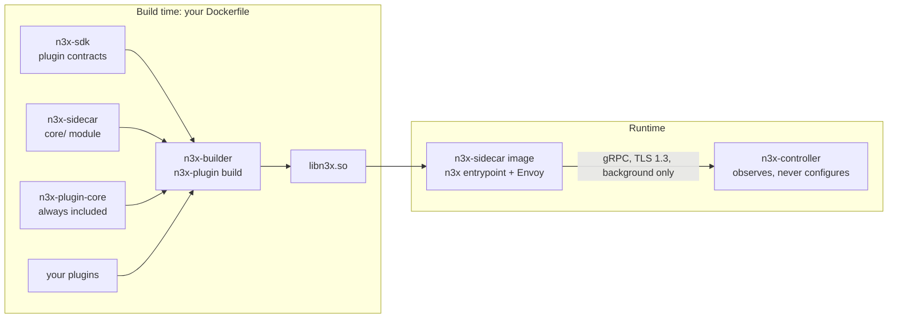
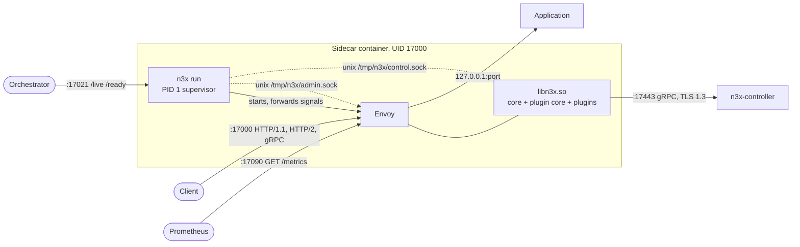
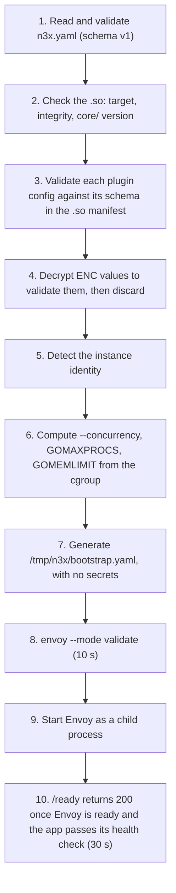
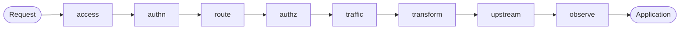
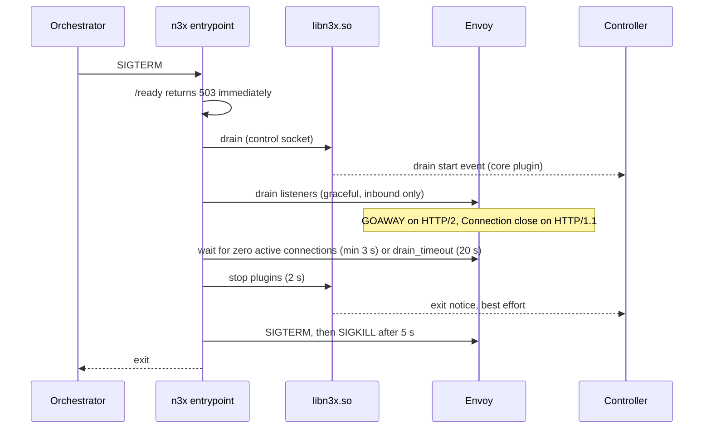

# n3x-sidecar

The sidecar of **N3X** (Network Navigation Node eXtensible, pronounced "Nex"): an Envoy-based sidecar that
becomes the only entry point of your application and runs network behaviors as Go plugins inside Envoy,
configured per service in a single `n3x.yaml` file.

> **Status: design phase.** This repository currently holds the product, architecture and feature design
> documents (`docs/`) and the spec index (`specs/`). The behavior described below is the specified v1
> behavior; it is being implemented spec by spec (see [Roadmap](#roadmap)). Commands and file paths are
> the planned ones.

## Table of contents

- [Why N3X](#why-n3x)
- [What this repository delivers](#what-this-repository-delivers)
- [How it works](#how-it-works)
- [Building your sidecar image](#building-your-sidecar-image)
- [Configuration: `n3x.yaml`](#configuration-n3xyaml)
- [Deployment](#deployment)
  - [Common requirements](#common-requirements)
  - [docker compose](#docker-compose)
  - [Kubernetes (without Istio)](#kubernetes-without-istio)
  - [Amazon ECS](#amazon-ecs)
  - [Istio (compatibility mode)](#istio-compatibility-mode)
- [Operating the sidecar](#operating-the-sidecar)
- [Performance budget and sizing](#performance-budget-and-sizing)
- [Security model](#security-model)
- [Repository layout](#repository-layout)
- [Development](#development)
- [Roadmap](#roadmap)
- [Documentation](#documentation)
- [License](#license)

## Why N3X

Network behaviors such as rate limiting, forwarding rules, redirects and observability are usually rebuilt
from scratch in every service, in every language and on every platform. That logic ends up coupled to the
application code, and the usual alternatives fall short:

- **Per-service libraries** mean rework for every language.
- **Service meshes** such as Istio are heavy and require Kubernetes.
- **API gateways** are hard to extend with custom logic, or only cover the edge.

N3X moves those behaviors into **plugins**, compiled together into a single Go dynamic module (`libn3x.so`)
loaded inside Envoy. Each application gets a sidecar next to it, which becomes its only entry point. Changing
a behavior means editing the service's `n3x.yaml` and redeploying, **without touching application code**.

N3X is language and orchestrator agnostic: the same image runs on Kubernetes, Amazon ECS and docker compose,
in front of HTTP/1.1, HTTP/2 and gRPC services written in any language. Istio is a compatibility
requirement, not a runtime dependency.

**Who uses it**

| Audience | What they do with the sidecar |
| --- | --- |
| Platform / SRE teams (primary) | Write each service's `n3x.yaml`, generate keys, encrypt secrets, operate sidecars and watch them in the controller panel |
| Product teams | Put the sidecar next to their application, with no code change |
| Plugin authors | Write plugins against the `n3x-sdk`; their code runs inside the `core/` of this repository (in v1, only the project maintainer writes plugins) |
| `n3x-builder` | Imports the `core/` module and compiles the single `libn3x.so` |

**v1 scope.** v1 delivers the platform foundation: the sidecar, the controller, the SDK, the builder and the
mandatory core plugin. No traffic plugin ships in v1 besides the SDK example plugin (`n3x.example`). Out of
scope for v1: egress traffic, transparent iptables interception, automatic sidecar injection, distributed
tracing and observability of application traffic.

## What this repository delivers

N3X is split across five repositories. This one, `n3x-sidecar`, delivers two artifacts (ADR-001):

| Artifact | What it is |
| --- | --- |
| `n3x` binary (`cmd/n3x`) | Go entrypoint and process supervisor, shipped in the runtime image `ghcr.io/giustech/n3x/sidecar:<version>-<target>` |
| `core/` Go module | Chain executor, fault containment, shared controller connection, telemetry and per-target adapters. It is a library: the `n3x-builder` imports it and compiles the single `libn3x.so` |

This repository never ships a production `.so`. The runtime image has no default `.so`; yours is always
produced by `n3x-plugin build` and copied into the final stage of your Dockerfile.



| Repository | Role |
| --- | --- |
| `n3x-sidecar` (this one) | Runtime image, entrypoint, `core/` of the `.so` |
| `n3x-sdk` | Plugin contracts (proxy and controller halves), the `chain` engine, the `secret` package, test kit, example plugin, deployment references |
| `n3x-builder` | Build images per target and architecture, the `n3x-plugin` tool, static analysis, target catalog |
| `n3x-plugin-core` | Mandatory plugin: login, session, sidecar registration, heartbeat, effective config and events |
| `n3x-controller` | Central observer: gRPC server, inventory, read-only config view and web panel |

The controller **never changes sidecar configuration** and is never on the request path: if it goes down,
traffic and plugins keep working with the local config.

## How it works

### Runtime topology (default mode)

The sidecar container runs two processes: the `n3x` entrypoint as PID 1 and Envoy as its child. The
application shares the network namespace with the sidecar and listens only on loopback.



### Startup (`n3x run`)

Target: ready to receive traffic within 5 s of the container starting. Any failure in steps 1 to 8 stops the
container with a non-zero exit code and a message that names the field, never a secret.



The `.so` reads, validates and decrypts the same `n3x.yaml` by itself with the same `core/config` package
(ADR-007): the Envoy filter config only carries `config_path`, so no decrypted secret ever reaches the
bootstrap, the `/config_dump` or a log.

**Instance identity.** On Kubernetes, the pod name (for example `orders-7d9f8b-xk2lp`). On ECS, the
container ID from the task metadata endpoint v4. On docker compose, the container ID from the cgroup or
`mountinfo`. The hostname is the last resort, with a warning.

### Request flow and the plugin chain

A single N3X filter runs every enabled plugin inside the `.so`, in **eight fixed phases**. The response
runs the phases in reverse order.



- Before the chain, Envoy enforces header limits (60 KiB, at most 100 headers, underscores rejected),
  normalizes the path (duplicate slashes, escaped slashes, `..` segments) and generates `x-request-id`.
  Malformed requests get `400` and never reach the application.
- Within a phase, plugins run in ascending `order`. Instances with the **same phase and the same `order`**
  form a parallel group (ADR-005): their async work runs concurrently, nobody sees the others' changes, and
  changes are applied at the end in alphabetical order of `instance`. If one denies, the first denial in
  alphabetical order wins. Repeated `order` in the `route` phase is rejected.
- Each instance can **continue**, **deny** or start **safe async work** (`Go()`) and resume later.
- A plugin can be limited to a slice of the service with `match` (path prefixes, HTTP methods, gRPC
  services). Outside its slice it does not run and costs nothing.
- Only phases up to `route` can change the route of the request.
- A gRPC denial is always written as a trailers-only response with the right `grpc-status` and
  `grpc-message`: a denied gRPC call **never** reaches the client as `OK`.
- At the end of the request, every instance of the slice that implements the completion hook is notified,
  including those of phases that were not reached and when the request was denied; only an instance with
  an open circuit breaker is skipped.

### Fault containment

Each plugin instance has a failure policy (`failure: open | closed`):

| Situation | fail-closed | fail-open |
| --- | --- | --- |
| Panic in a hook or goroutine | `503` / `UNAVAILABLE` | Continue |
| Error returned by the plugin | `503` / `UNAVAILABLE` | Continue |
| Async deadline exceeded | `504` / `DEADLINE_EXCEEDED` | Continue |
| `max_inflight` reached | `503` / `UNAVAILABLE`, no goroutine started | Continue |
| Circuit breaker open | `503` / `UNAVAILABLE`, plugin not called | Skip the instance |

`500` / `INTERNAL` is reserved for failures of N3X itself. A **per-instance circuit breaker** (ADR-004)
opens after 5 panics in 60 s, or more than 100 "zombie" goroutines that outlived their deadline. Once open,
it stays open until the sidecar restarts; it emits a metric, a log line and an event to the controller.
When every instance of a plugin is open, the panel shows the plugin as automatically disabled.

**Mandatory deadlines** (ADR-006): no operation runs without a deadline.

| Operation | Default | `n3x.yaml` field |
| --- | --- | --- |
| Plugin async work | 200 ms | `plugins[].async.timeout` |
| Connection to the application | 1 s | `app.timeouts.connect` |
| Request to the application | 15 s; for gRPC, the client `grpc-timeout` up to 1 h | `app.timeouts.request` |
| Plugin call to the controller | 5 s (100 ms to 60 s) | `controller.timeouts.call` |
| Login to the controller | 10 s | `controller.timeouts.login` |
| Application health check | 1 s, every 5 s | `app.health.timeout`, `app.health.interval` |
| `envoy --mode validate` | 10 s | fixed |
| Envoy ready after start | 30 s | fixed |
| Drain | 20 s | `runtime.drain_timeout` |
| Plugin shutdown, before Envoy's SIGTERM | 2 s | fixed |
| SIGKILL after Envoy's SIGTERM | 5 s | fixed |

### Connection to the controller

When the `n3x.yaml` has a `controller` section, the `.so` opens **one** gRPC connection (TLS 1.3) per
process and shares it with every plugin that has a controller half. The core plugin logs in with the
service credential and attaches the session token to every call; no other plugin sees the token.

- The connection is used only by background tasks, never during a request.
- Controller down, invalid certificate or rejected credential never affect traffic: they only produce logs,
  metrics and retries (exponential backoff from 1 s to 60 s, 20% jitter; keepalive every 30 s).
- Background sends wait in a buffer of up to 1,000 items that drops the oldest.
- After a controller restart or a short outage, sidecars are back in the panel within 30 s; after a long
  outage, within 73 s.
- Without a `controller` section, the sidecar runs in **standalone mode**, with no panel.

### Shutdown and drain

On `SIGTERM`, the entrypoint drains the sidecar. The maximum time from signal to exit is
`runtime.drain_timeout` + 9 s (29 s with the default).



Clients with persistent connections: for zero dropped requests during a rolling update, the application
can trigger the drain early by calling `POST http://127.0.0.1:17021/drain` when it receives `SIGTERM`
(accepted only from loopback). For example, in Go:

```go
<-sigterm
_, _ = http.Post("http://127.0.0.1:17021/drain", "text/plain", nil) // 202 draining
ctx, cancel := context.WithTimeout(context.Background(), 20*time.Second)
defer cancel()
_ = srv.Shutdown(ctx)
```

## Building your sidecar image

Plugins are compiled into your image with a multi-stage Dockerfile, using the build images published by the
`n3x-builder`. The core plugin is always included and does not need to be declared.

```dockerfile
# Stage 1: compile libn3x.so with your plugins (n3x-builder image, same target as the runtime)
FROM --platform=$BUILDPLATFORM ghcr.io/giustech/n3x/sidecar-builder:<builder-version>-envoy-1.40 AS build
RUN n3x-plugin add <plugin-module>@<plugin-version>
RUN n3x-plugin build

# Stage 2: runtime image from this repository, pinned by digest
FROM ghcr.io/giustech/n3x/sidecar:<version>-envoy-1.40@sha256:<digest>
COPY --from=build /out/libn3x.so /usr/lib/n3x/libn3x.so
```

Rules for the final stage: no `RUN`, `USER`, `ENTRYPOINT`, `CMD` or `ENV` changes; only copy the `.so`.

**Runtime images**

| Image | Base | Notes |
| --- | --- | --- |
| `ghcr.io/giustech/n3x/sidecar:<version>-envoy-1.40` | `envoyproxy/envoy:v1.40.x`, pinned by digest | Default mode |
| `ghcr.io/giustech/n3x/sidecar:<version>-istio-1.31` | `istio/proxyv2:1.31.x`, pinned by digest | Istio compatibility mode |

- Multi-architecture (linux/amd64 and linux/arm64), OCI format, immutable tags. Pin by digest.
- `ENTRYPOINT ["/usr/local/bin/n3x"]` with `CMD ["run"]`, so `docker run <image> encrypt ...` works.
- The image version is the version of the `core/` module (tags `vX.Y.Z` and `core/vX.Y.Z` on the same
  commit). At startup the sidecar accepts a `.so` whose `core/` has the same major version and a minor
  version lower than or equal to the image's; in the 0.x series, the minor version must be equal. Otherwise
  it exits and tells you which image version to use.

## Configuration: `n3x.yaml`

Each service has its own `n3x.yaml`, mounted at `/etc/n3x/n3x.yaml` (or passed with `--config`). It is the
**only** source of configuration: no behavior comes from operator environment variables, and the file is
read only at startup. Changes require a redeploy.

```yaml
version: 1
service: orders                      # required; service name and credential name

controller:                          # optional; absent = standalone mode
  address: n3x-controller:17443
  ca_file: /etc/n3x/ca.pem           # CA used to verify the controller certificate
  secret: ENC[v1:...]                # secret of the "orders" service credential
  timeouts: { call: 5s, login: 10s }
  heartbeat_interval: 10s
  buffer: { max_items: 1000 }        # drops the oldest items

keys:
  aes_file: /run/n3x/aes.key         # key for ENC[...] values, always a file

listener:                            # ignored in Istio mode
  port: 17000

app:                                 # ignored in Istio mode
  address: 127.0.0.1:3000
  protocol: http1                    # http1 | http2 | grpc
  timeouts: { connect: 1s, request: 15s }
  health:
    type: http                       # http | grpc | tcp
    path: /healthz                   # http only
    interval: 5s
    timeout: 1s

resources:                           # optional; defaults to the cgroup limits (the lower value wins)
  cpus: 2
  memory: 256Mi

runtime:
  drain_timeout: 20s
  log_level: info                    # debug | info | warn | error
  panic_breaker: { panics: 5, window: 60s, zombies: 100 }
  request_body: { max_bytes: 1Mi }   # body limit for plugins with body hooks
  plugin_limits: {}                  # per-plugin quotas: memory, tasks and connections

plugins:                             # the core plugin is implicit and never declared
  - id: n3x.example
    instance: add-header             # unique within the service
    phase: transform                 # access|authn|route|authz|traffic|transform|upstream|observe
    order: 10                        # same phase + same order = parallel group
    failure: closed                  # open | closed; default comes from the plugin manifest
    async: { timeout: 200ms, max_inflight: 1000 }
    match:                           # slice; absent = runs on everything
      paths: ["/api/"]               # prefixes, evaluated after path normalization
      methods: [GET, POST]
      grpc_services: ["orders.v1.Orders"]
    config:                          # validated by the plugin's own schema
      name: X-N3X
      value: "1"
```

**Validation rules** (the same in `n3x validate`, `n3x run` and the `.so`):

- `version` must be `1`; any unknown field is an error, to catch typos.
- `instance` is unique in the service; `id` must exist in the `.so` manifest; `phase` must be allowed by the
  plugin manifest.
- `ENC[...]` values must decrypt; errors name the field path, never the value.
- Durations use Go format (`200ms`, `20s`); sizes use Kubernetes format (`256Mi`).
- Without a memory limit (neither cgroup nor `resources.memory`) the sidecar refuses to start; below
  128 MiB it refuses, below 256 MiB it warns.

### Secrets: `ENC[...]`

Secrets that must be read back (such as `controller.secret` or plugin fields marked as secret) are stored
encrypted as `ENC[v1:<base64(nonce || ciphertext || tag)>]`, with AES-256-GCM and the additional data
`n3x:v1:<service>`, so a value encrypted for one service does not work when copied into another service's
file. The key is 32 random bytes in base64, always in a mounted file, never in an environment variable.

```sh
# Generate a key
docker run --rm ghcr.io/giustech/n3x/sidecar:<version>-envoy-1.40 keygen > aes.key

# Encrypt a secret read from stdin (never from the command line)
read -rs SECRET; printf '%s' "$SECRET" | docker run --rm -i -v "$PWD/aes.key:/k:ro" \
  ghcr.io/giustech/n3x/sidecar:<version>-envoy-1.40 encrypt --key /k --service orders
```

Key rotation: generate a new key, re-encrypt the values and redeploy (v1 does not accept two keys at once).

### Validating in CI

Run `validate` on your final image, so the plugin configs are checked against the schemas embedded in your
`.so`. It never starts Envoy.

```sh
docker run --rm \
  -v "$PWD/n3x.yaml:/etc/n3x/n3x.yaml:ro" \
  -v "$PWD/aes.key:/run/n3x/aes.key:ro" \
  -v "$PWD/ca.pem:/etc/n3x/ca.pem:ro" \
  registry.example.com/orders-sidecar:1.0.0 validate --config /etc/n3x/n3x.yaml
```

Use `validate --mode istio` for a file meant for the Istio image.

## Deployment

### Common requirements

Every orchestrator must provide the following:

| Requirement | Why |
| --- | --- |
| A memory limit on the sidecar container (256 MiB recommended, 128 MiB minimum) | Without it the sidecar exits with code 7 (`memory_unlimited`); `GOMEMLIMIT` and Envoy's overload manager depend on it |
| Read-only root filesystem, with `/tmp` writable (tmpfs or in-memory volume) | `/tmp/n3x` holds the bootstrap, the admin and control sockets and the facts file; without a writable `/tmp` the sidecar exits with code 6 |
| `/tmp` **never** shared with the application | The Envoy admin socket lives there |
| Non-root user (the image runs as UID/GID `17000`), no capabilities (`drop: ALL`), no privilege escalation | Running `n3x run` as UID 0 exits with code 8 (`run_as_root`) |
| `n3x.yaml` mounted as a **file**, without hiding `/etc/n3x/target` | Mounting a directory over `/etc/n3x` hides the image target file and fails the preflight (exit 5) |
| AES key and controller CA readable by UID 17000 | Key permissions wider than `0440` log a warning |
| Application listening on `127.0.0.1` only | Only the sidecar is exposed |
| Shared network namespace between sidecar and app | Pod (Kubernetes), task with `awsvpc` (ECS), `network_mode: service:` (docker compose) |

**Ports and paths**

| Port / path | Purpose | Exposure |
| --- | --- | --- |
| `17000` | Ingress: HTTP/1.1, HTTP/2 (h2c) and gRPC | External |
| `17021` | Health: `/live`, `/ready`; `POST /drain` from loopback only | Orchestrator, and `/drain` for the application |
| `17090` | Prometheus metrics: `GET /metrics` only | Internal |
| `17001` | Reserved, unused | None |
| `unix:/tmp/n3x/admin.sock` (0600) | Envoy admin, no TCP port | Sidecar container only |
| `unix:/tmp/n3x/control.sock` (0600) | Control channel between the entrypoint and the `.so` | Sidecar container only |
| `17443` (outbound) | Controller gRPC, TLS 1.3 | Sidecar to controller |
| `/etc/n3x/n3x.yaml` | Service configuration | Mounted file |
| `/run/n3x/aes.key` | AES key for `ENC[...]` | Mounted file |
| `/usr/lib/n3x/libn3x.so` | Your `.so`, copied in the final Dockerfile stage | Image |

The controller certificate must include the exact host used in `controller.address` in its SAN (for
example `n3x-controller` in docker compose, or `n3x-controller.n3x.svc.cluster.local` on Kubernetes).

### docker compose

The application joins the sidecar's network namespace, so the published ports belong to the sidecar
service. Use `n3x probe live` for the health check; never use `/ready` for `depends_on: service_healthy`,
because it waits for the application and deadlocks the startup.

```yaml
services:
  sidecar:
    image: registry.example.com/orders-sidecar:1.0.0   # your final image (runtime image + libn3x.so)
    read_only: true
    tmpfs: ["/tmp:size=64m,mode=1777"]
    cap_drop: [ALL]
    security_opt: ["no-new-privileges:true"]
    mem_limit: 256m
    cpus: 1
    ports:
      - "17000:17000"   # ingress
      - "17090:17090"   # metrics (optional)
    volumes:
      - ./n3x.yaml:/etc/n3x/n3x.yaml:ro
      - ./aes.key:/run/n3x/aes.key:ro
      - ./ca.pem:/etc/n3x/ca.pem:ro
    healthcheck:
      test: ["CMD", "/usr/local/bin/n3x", "probe", "live"]
      interval: 5s        # example values
      timeout: 3s
      retries: 3
    stop_grace_period: 30s   # >= drain_timeout + 10 s; the compose default of 10 s cuts the drain

  app:
    image: registry.example.com/orders:1.0.0   # listens on 127.0.0.1:3000
    network_mode: "service:sidecar"
    depends_on:
      sidecar:
        condition: service_healthy

  n3x-controller:
    image: ghcr.io/giustech/n3x/controller:<version>
    # configured by its own n3x.yaml; see the n3x-controller repository
```

Notes:

- Without a load balancer, clients are told to reconnect through `GOAWAY` (HTTP/2) and
  `Connection: close` (HTTP/1.1) during the drain.
- If the key file on the host is `0400`, run the sidecar with `user: "17000:<gid of the file>"`.
- Remove the `controller` section of `n3x.yaml` (and the `n3x-controller` service) to run standalone.

### Kubernetes (without Istio)

Kubernetes 1.29 or later, using a **native sidecar** (`initContainers` with `restartPolicy: Always`), so
the sidecar starts before and stops after the application.

```yaml
apiVersion: apps/v1
kind: Deployment
metadata:
  name: orders
spec:
  replicas: 2
  strategy:
    rollingUpdate: { maxUnavailable: 0, maxSurge: 1 }
  selector:
    matchLabels: { app: orders }
  template:
    metadata:
      labels: { app: orders }
    spec:
      terminationGracePeriodSeconds: 45   # >= app stop time + drain_timeout + 10 s
      securityContext:
        fsGroup: 17000
        seccompProfile: { type: RuntimeDefault }
      initContainers:
        - name: n3x
          image: registry.example.com/orders-sidecar:1.0.0
          restartPolicy: Always
          ports:
            - { containerPort: 17000, name: http }
            - { containerPort: 17021, name: health }
            - { containerPort: 17090, name: metrics }
          resources:
            limits: { cpu: "1", memory: 256Mi }   # the memory limit is mandatory
          securityContext:
            runAsNonRoot: true
            readOnlyRootFilesystem: true
            allowPrivilegeEscalation: false
            capabilities: { drop: [ALL] }
          startupProbe:   { httpGet: { path: /live,  port: health }, periodSeconds: 1,  failureThreshold: 30 }
          livenessProbe:  { httpGet: { path: /live,  port: health }, periodSeconds: 10, failureThreshold: 3 }
          readinessProbe: { httpGet: { path: /ready, port: health }, periodSeconds: 5,  failureThreshold: 1 }
          volumeMounts:
            - { name: n3x-config,  mountPath: /etc/n3x/n3x.yaml, subPath: n3x.yaml, readOnly: true }
            - { name: n3x-secrets, mountPath: /run/n3x, readOnly: true }
            - { name: n3x-tmp,     mountPath: /tmp }
      containers:
        - name: app
          image: registry.example.com/orders:1.0.0   # listens on 127.0.0.1:3000
      volumes:
        - name: n3x-config
          configMap: { name: orders-n3x }             # key: n3x.yaml
        - name: n3x-secrets
          secret: { secretName: orders-n3x, defaultMode: 288 }   # 0440; keys: aes.key, ca.pem
        - name: n3x-tmp
          emptyDir: { medium: Memory, sizeLimit: 16Mi }
---
apiVersion: v1
kind: Service
metadata:
  name: orders
spec:
  selector: { app: orders }
  ports:
    - { name: http, port: 80, targetPort: 17000 }
```

```sh
kubectl create configmap orders-n3x --from-file=n3x.yaml
kubectl create secret generic orders-n3x --from-file=aes.key --from-file=ca.pem
```

Notes:

- With the CA in the Secret, set `controller.ca_file: /run/n3x/ca.pem` in `n3x.yaml`.
- Always mount `n3x.yaml` with `subPath`. A ConfigMap mounted as a directory on `/etc/n3x` hides
  `/etc/n3x/target` and the sidecar exits with code 5 (`image_target`).
- Without a CPU limit (or `resources.cpus`), the sidecar uses at most 2 workers and logs `cpu_unlimited`.
- Do not set `spec.hostname` on workloads with more than one replica: the instance identity is the pod name.
- Scrape metrics from port `17090`, path `/metrics`.

### Amazon ECS

Works on both EC2 and Fargate. The sidecar and the application run in the same task with `awsvpc`
networking, so they share `localhost`. The instance identity comes from the task metadata endpoint v4.

```json
{
  "family": "orders",
  "networkMode": "awsvpc",
  "cpu": "2048",
  "memory": "1024",
  "containerDefinitions": [
    {
      "name": "n3x",
      "image": "registry.example.com/orders-sidecar:1.0.0",
      "essential": true,
      "cpu": 1024,
      "memory": 256,
      "command": ["run", "--config", "/run/n3x/n3x.yaml"],
      "readonlyRootFilesystem": true,
      "linuxParameters": { "capabilities": { "drop": ["ALL"] } },
      "portMappings": [
        { "containerPort": 17000, "protocol": "tcp" },
        { "containerPort": 17021, "protocol": "tcp" },
        { "containerPort": 17090, "protocol": "tcp" }
      ],
      "mountPoints": [
        { "sourceVolume": "n3x-files", "containerPath": "/run/n3x", "readOnly": true },
        { "sourceVolume": "n3x-tmp", "containerPath": "/tmp" }
      ],
      "healthCheck": {
        "command": ["CMD", "/usr/local/bin/n3x", "probe", "live"],
        "interval": 5,
        "timeout": 3,
        "retries": 3,
        "startPeriod": 10
      },
      "stopTimeout": 30
    },
    {
      "name": "app",
      "image": "registry.example.com/orders:1.0.0",
      "essential": true,
      "dependsOn": [{ "containerName": "n3x", "condition": "HEALTHY" }]
    }
  ],
  "volumes": [
    { "name": "n3x-files" },
    { "name": "n3x-tmp" }
  ]
}
```

Notes:

- Set `memory` on the sidecar container definition: without a container memory limit the sidecar exits
  with code 7. `resources` in `n3x.yaml` can lower the limits to split the task budget with the application.
- `n3x-files` is shown as a plain volume: replace it with one that delivers `n3x.yaml`, `aes.key` and
  `ca.pem`, readable by UID 17000 (for example an EFS volume), and set `keys.aes_file: /run/n3x/aes.key`
  and `controller.ca_file: /run/n3x/ca.pem`. The reference task definitions are planned in
  `n3x-sdk/deploy/`.
  The AES key must stay a file: never inject it as an ECS secret environment variable.
- The config is mounted under `/run/n3x` and passed with `--config` because ECS mounts directories, and a
  directory mounted over `/etc/n3x` would hide `/etc/n3x/target`.
- `healthCheck` uses `probe live`, never `/ready`, because `dependsOn: HEALTHY` waits on it.
- `stopTimeout` must be at least `drain_timeout` + 10 s (30 s with the default).
- Put the load balancer target group on port `17000`, with its health check on port `17021`, path
  `/ready`. ECS deregisters the target (`deregistration_delay`) before sending `SIGTERM`.
- Do not set `user` to root.

### Istio (compatibility mode)

> **Conditional.** Istio support is a compatibility requirement, not a runtime dependency, and the
> `istio-1.31` target is only declared supported after the Istio spike gate (G0) passes. If it fails, the
> target is deferred and you run the default image without Istio for that service.

In Istio mode, the `istio-1.31` image replaces the injected `proxyv2`. When the injector calls
`n3x proxy sidecar ...`, the entrypoint validates the same `n3x.yaml`, computes the Go runtime settings,
writes the facts file and `exec`s the `pilot-agent` with the same arguments. Istio owns the bootstrap,
ports, health (`15021`), metrics (`15090`, merged on `15020`), the Envoy admin (`127.0.0.1:15000`) and the
drain. N3X opens none of `17000`, `17021` or `17090`, runs as UID `1337`, and ignores the `listener`, `app`
and `runtime.drain_timeout` sections with a warning. A static `EnvoyFilter`, identical for the whole mesh,
inserts the N3X filter before the router on inbound listeners.

**Workload (pod template excerpt)**

```yaml
metadata:
  labels:
    app: orders
    n3x.io/enabled: "true"            # required; without it the sidecar exits with code 5
  annotations:
    sidecar.istio.io/proxyImage: registry.example.com/orders-sidecar:1.0.0-istio-1.31@sha256:<digest>
    sidecar.istio.io/proxyCPULimit: "2"
    sidecar.istio.io/proxyMemoryLimit: 512Mi
    sidecar.istio.io/userVolume: '[{"name":"n3x-config","configMap":{"name":"orders-n3x"}},{"name":"n3x-secrets","secret":{"secretName":"orders-n3x","defaultMode":288}},{"name":"n3x-tmp","emptyDir":{"medium":"Memory","sizeLimit":"16Mi"}}]'
    sidecar.istio.io/userVolumeMount: '[{"name":"n3x-config","mountPath":"/etc/n3x/n3x.yaml","subPath":"n3x.yaml","readOnly":true},{"name":"n3x-secrets","mountPath":"/run/n3x","readOnly":true},{"name":"n3x-tmp","mountPath":"/tmp"}]'
    proxy.istio.io/config: '{"terminationDrainDuration":"20s","proxyStatsMatcher":{"inclusionPrefixes":["n3x_"]}}'
spec:
  securityContext: { fsGroup: 1337 }
  terminationGracePeriodSeconds: 45   # >= app stop time + terminationDrainDuration + 10 s
```

**Mesh (once per cluster)**

```yaml
apiVersion: install.istio.io/v1alpha1
kind: IstioOperator
spec:
  meshConfig:
    pathNormalization: { normalization: DECODE_AND_MERGE_SLASHES }   # MERGE_SLASHES at minimum
    enablePrometheusMerge: true
```

**EnvoyFilter (once per mesh, generated from this repository)**

```yaml
apiVersion: networking.istio.io/v1alpha3
kind: EnvoyFilter
metadata: { name: n3x-istio-1-31, namespace: istio-system }
spec:
  workloadSelector: { labels: { n3x.io/enabled: "true" } }
  configPatches:
  - applyTo: HTTP_FILTER
    match:
      context: SIDECAR_INBOUND
      proxy: { proxyVersion: '^1\.31\..*' }
      listener:
        filterChain:
          filter:
            name: envoy.filters.network.http_connection_manager
            subFilter: { name: envoy.filters.http.router }
    patch:
      operation: INSERT_BEFORE
      value:
        name: n3x
        typed_config:
          "@type": type.googleapis.com/envoy.extensions.filters.http.dynamic_modules.v3.DynamicModuleFilter
          dynamic_module_config: { name: n3x, do_not_close: true }
          filter_name: n3x
          filter_config:
            "@type": type.googleapis.com/google.protobuf.StringValue
            value: '{"config_path":"/etc/n3x/n3x.yaml"}'
```

```sh
kubectl apply -k deploy/istio
istioctl install -f deploy/istio/mesh-config.yaml
```

Notes:

- The canonical `EnvoyFilter` lives in `deploy/istio/envoyfilter.yaml`; do not edit it by hand.
- `GOMAXPROCS` must be greater than or equal to the proxy `concurrency`. Set
  `sidecar.istio.io/proxyCPULimit`; otherwise the sidecar may exit with code 7 (`below_concurrency`).
- 512 MiB is the recommended memory limit in Istio mode; below it the sidecar logs `istio_memory_low`.
- With the CA in the Secret, set `controller.ca_file: /run/n3x/ca.pem`.
- The application listens on the pod IP or `0.0.0.0`, as usual with Istio.
- Keep the controller outside the mesh, or exclude its port with
  `traffic.sidecar.istio.io/excludeInboundPorts: "17443"`; with mTLS `STRICT` the connection is refused.
- The `.so` connection to the controller goes out directly, because Istio does not intercept the proxy's
  own traffic (UID 1337).
- Optional `preStop` on the `istio-proxy` container: `/usr/local/bin/n3x istio-drain --timeout 2s`.

## Operating the sidecar

### CLI

| Command | What it does |
| --- | --- |
| `n3x run [--config <file>]` | Default. Starts and supervises Envoy |
| `n3x validate [--config <file>] [--so <file>] [--mode istio\|default]` | Validates the YAML and the plugin schemas from the `.so` manifest, without starting Envoy |
| `n3x encrypt --key <file> --service <service>` | Reads a secret from stdin and prints `ENC[v1:...]` |
| `n3x keygen` | Prints a random AES-256 key in base64 |
| `n3x probe [live\|ready]` | Health check from inside the container (for ECS and docker compose); exits 0 on `200` |
| `n3x help [<command>]` | Help |
| `n3x proxy ...` | Istio image only: entered by the injector, `exec`s the `pilot-agent` |
| `n3x istio-drain` | Istio image only: optional `preStop` hook |

### Health endpoints (`17021`)

| Endpoint | Response |
| --- | --- |
| `GET /live` | `200` while the entrypoint and Envoy are alive, including during the drain |
| `GET /ready` | `200` only when Envoy is ready, the application passes its health check and the sidecar is not draining; `503` from the first moment of the drain |
| `POST /drain` | Loopback only. Starts the drain early; `202` |

### Exit codes

| Code | Meaning |
| --- | --- |
| 0 | Stopped before ready, or drain completed |
| 1 | Usage error |
| 2 | Invalid `n3x.yaml` (`N3X-S002`) |
| 3 | Secret or key error (`N3X-S003`) |
| 4 | Missing or unreadable `.so` manifest (`N3X-S004`) |
| 5 | Preflight: wrong image target, `.so` built for another target or a newer `core/`, Envoy mismatch (`N3X-S005`) |
| 6 | Bootstrap generation or `envoy --mode validate` failed (`N3X-S006`) |
| 7 | Supervisor: no memory limit, memory too low, Envoy failed to start or become ready (`N3X-S007`) |
| 8 | Unsafe environment: running as root (`N3X-S008`) |
| 9 | Health server or drain failure (`N3X-S009`) |
| Envoy's code | Envoy died while serving: same code, or 128 + signal; `0` becomes `1` so the orchestrator restarts it |

The orchestrator restarts the container; the entrypoint never restarts Envoy by itself.

### Metrics

Exposed on `17090` (`GET /metrics`) in default mode, or through Istio's metrics merge. Labels never carry
paths, headers or user values. Envoy's standard stats remain available.

| Metric | Type | Labels |
| --- | --- | --- |
| `n3x_controller_connected` | gauge 0/1 | |
| `n3x_controller_session_age_seconds` | gauge | |
| `n3x_controller_logins_total` | counter | `result` |
| `n3x_controller_buffer_items` | gauge | |
| `n3x_controller_buffer_dropped_total` | counter | |
| `n3x_plugin_panics_total` | counter | `plugin`, `instance` |
| `n3x_plugin_breaker_open` | gauge 0/1 | `plugin`, `instance` |
| `n3x_plugin_failures_total` | counter | `plugin`, `instance`, `reason` |
| `n3x_plugin_denies_total` | counter | `plugin`, `instance`, `code` |
| `n3x_plugin_async_inflight` | gauge | `plugin`, `instance` |
| `n3x_plugin_async_zombies` | gauge | `plugin`, `instance` |
| `n3x_plugin_duration_seconds` | histogram | `plugin`, `instance`, `phase`, `hook` |
| `n3x_plugin_memory_bytes` | gauge | `plugin` |
| `n3x_build_info` | gauge = 1 | `version`, `target`, `config_hash` |

**Suggested alerts**

- `n3x_plugin_breaker_open == 1` (circuit breaker open)
- `rate(n3x_plugin_panics_total[5m]) > 0`
- `n3x_plugin_async_zombies > 0`
- `n3x_controller_connected == 0` for more than 5 minutes
- `rate(n3x_controller_buffer_dropped_total[5m]) > 0`
- `rate(n3x_plugin_failures_total{reason="overflow"}[5m]) > 0` (backpressure acting)

### Logs

JSON on stderr, one line per event, with `ts`, `level`, `component` (`entrypoint`, `envoy`, `core` or
`plugin`), `service`, `instance`, `plugin_id` and `request_id` when present. The orchestrator's log
collector adds the instance identity. Logs never contain secrets, tokens, headers, bodies or query strings.
There is no distributed tracing in v1; correlate by `request_id`.

## Performance budget and sizing

Measured with open-loop load at 1,000 rps below the knee of the curve (wrk2, Nighthawk or ghz with
HdrHistogram), with the core plugin and the example plugin active, against plain Envoy on the same machine
(ADR-009). These targets apply to the default mode.

| Share | p50 | p99 |
| --- | --- | --- |
| Plain Envoy (no N3X filter) | 0.30 ms | 1.00 ms |
| `.so` core (adapter + executor) | 0.15 ms | 0.50 ms |
| Synchronous plugins (core + example) | 0.05 ms | 0.10 ms |
| Headroom | | 0.40 ms |
| **Total added latency (target)** | **≤ 0.5 ms** | **≤ 2 ms** |

- Idle sidecar: at most 100 MiB and 0.05 vCPU for the whole container (Envoy, Go runtime, plugins and
  entrypoint). Ready within 5 s of the container starting.
- 0 allocations per request on the common path, and at most 5 Envoy-to-Go entries with chain work per
  request, regardless of the number of plugins.
- Recommended size: 1 vCPU and 256 MiB for up to 1,000 rps (hypothesis, confirmed by the benchmark).

**Go runtime from the cgroup** (ADR-008), computed by the entrypoint, never set by you:

| Setting | Rule |
| --- | --- |
| `CPU` | Lower of `resources.cpus` and the cgroup quota, rounded up, minimum 1; with no limit, at most 2 (`cpu_unlimited`) |
| `MEM` | Lower of `resources.memory` and the cgroup limit; no limit means no start |
| `envoy --concurrency` | `CPU` |
| `GOMAXPROCS` | `max(CPU, 2)`, always at least the number of Envoy workers |
| `GOMEMLIMIT` | 45% of `MEM` |
| `GODEBUG` | `cgocheck=0` |
| Envoy overload manager | Shrinks the heap at 90% of the cgroup memory, stops accepting connections at 95% |

Example with 1 vCPU and 256 MiB: 1 worker, `GOMAXPROCS=2`, `GOMEMLIMIT` of about 115 MiB.

## Security model

- **Sidecar to controller:** TLS 1.3, certificate verified against the CA in `controller.ca_file`. The
  service credential (`service` + `controller.secret` in `ENC[...]`) is used only at login; the session
  token (HMAC, 1 h, renewed at 80%) lives only in the core plugin's private memory.
- **Secrets:** decrypted values never reach the bootstrap, the `/config_dump`, logs, error messages or the
  config sent to the controller; buffers are wiped after use on a best-effort basis.
- **Process and image:** non-root (UID/GID 17000; 1337 in Istio mode), read-only root filesystem, no Linux
  capabilities, the `.so` loaded only from `/usr/lib/n3x/libn3x.so` inside the image, never from a remote
  source, with its target and integrity checked against the embedded manifest.
- **Envoy admin:** only on a local Unix socket (`0600`), with no TCP port, so the application, which shares
  the network namespace, cannot reach it.
- **Request handling:** path normalization before plugin slices are evaluated (so `/api/../admin` cannot
  escape a slice), header limits, and gRPC denials that never look like success.
- **Application traffic authentication** is not the sidecar's job in v1; it is left to future plugins.

## Repository layout

High-level layout from the HLD; the feature design documents detail the final packages.

```text
n3x-sidecar/
├── cmd/n3x/                  entrypoint: run, validate, encrypt, keygen, probe, help
├── internal/supervisor/      Envoy lifecycle, signals and drain
├── internal/bootstrap/       bootstrap generation (golden files in testdata/)
├── internal/health/          17021 server and application health check
├── core/config/              n3x.yaml v1 schema and validation
├── core/identity/            pod name or container ID
├── core/chain/               compiled chain, phases, groups and slices
├── core/fault/               recover, policies, circuit breaker and zombies
├── core/grpcconn/            shared connection to the controller
├── core/telemetry/           Envoy stats and JSON logs
├── core/adapter/envoy140/    build tag n3x_envoy140
├── core/adapter/istio131/    build tag n3x_istio131
├── deploy/istio/             static EnvoyFilter
├── images/                   runtime image Dockerfiles
└── bench/                    open-loop benchmark and plain Envoy reference
```

Go modules: the root module `github.com/giustech/n3x-sidecar` (`cmd/`, `internal/`) and the nested module
`github.com/giustech/n3x-sidecar/core`, versioned with `core/vX.Y.Z` tags. The `n3x` binary is a static,
pure-Go binary with no gRPC, no Envoy SDK and no `go-control-plane` dependency; only `core/adapter/*`
(with exactly one target build tag) imports the Envoy Go SDK.

## Development

- **Stack:** Go 1.26 or later; Envoy 1.40 and istio-proxy 1.31 images pinned by digest; Envoy's Go SDK for
  dynamic modules at a pinned pseudo-version; `go.yaml.in/yaml/v3`; `log/slog`.
- **Specs:** each feature design document becomes a spec in `specs/NN_name`, developed with GitHub Spec Kit
  (`specify`, `clarify`, `plan`, `tasks`, `implement`), in dependency order.
- **TDD** for all production code in `cmd/`, `internal/` and `core/`: tests are written before the code.
- **Tests:** `go test -race`, fuzzing of every parser, `-benchmem` benchmarks with 0 allocations as a gate,
  golden files (bootstrap, logs, generated `main`), and integration tests against the real Envoy of each
  target and architecture (HTTP/1.1, HTTP/2 and gRPC, including the gRPC denial).
- **Lint:** `gofmt`, `go vet`, `staticcheck` and `gosec` on every PR; `govulncheck` reported on PRs and
  blocking releases.
- **Coverage gate per package:** 90% for most packages, 85% for `internal/supervisor`, `internal/preflight`,
  `internal/health` and `core/grpcconn`, 80% for the target adapters tested with a fake bridge.
- **CI (GitHub Actions):** on every PR, unit, race, golden, lint and an amd64 smoke test (plus the Istio
  denial scenario when the PR touches `core/adapter`). Nightly and before each release: arm64, Istio
  scenarios, the open-loop benchmark on the dedicated `n3x-perf` machine and long-running tests. No release
  ships without all of them green.
- **Git:** trunk-based development with short-lived branches from `main`, merged only through PRs with a
  green CI; commit messages follow Conventional Commits.
- **Documentation:** design documents are written in Brazilian Portuguese; identifiers, fields and commands
  are in English.

## Roadmap

Each spec covers one feature design document (FDD) and depends only on specs with a lower number.

| Spec | Scope |
| --- | --- |
| `01_config_e_cli` | `n3x.yaml` v1 schema and operator CLI (`validate`, `encrypt`, `keygen`) |
| `02_bootstrap_envoy` | Envoy bootstrap generator, filter config and admin on a Unix socket |
| `03_adaptador_envoy_telemetria` | `envoy-1.40` adapter and `.so` telemetry |
| `04_executor_cadeia` | Plugin chain executor and `.so` entry point |
| `05_contencao_falhas` | Fault containment, deadlines and per-instance circuit breaker |
| `06_conexao_controller` | Shared gRPC connection to the controller |
| `07_preflight_identidade` | Startup preflight: instance identity and `.so` checks |
| `08_supervisor_runtime_go` | Envoy supervisor and Go runtime from the cgroup |
| `09_health_drenagem` | Health `17021`, drain on SIGTERM, control channel and `n3x probe` |
| `10_imagens_runtime` | Runtime images and environment checks |
| `11_benchmark_orcamento` | Open-loop benchmark and sidecar budget |
| `12_modo_istio` | Istio mode and the `istio-1.31` target (conditional on the G0 gate) |

## Documentation

- Product requirements: [`docs/prd/PRD-N3X.md`](docs/prd/PRD-N3X.md)
- High-level design: [`docs/HLD.md`](docs/HLD.md)
- Architecture decisions: [`docs/adr/`](docs/adr/README.md)
- Feature design documents: [`docs/fdd/`](docs/fdd/)
- Spec index: [`specs/README.md`](specs/README.md)
- Project constitution: [`.specify/memory/constitution.md`](.specify/memory/constitution.md)
- Constitution input: [`DRAFT_CONSTITUITION.md`](DRAFT_CONSTITUITION.md)

When documents disagree, the PRD, the HLD and the ADRs take precedence over the FDDs.

## License

[Apache License 2.0](LICENSE)
