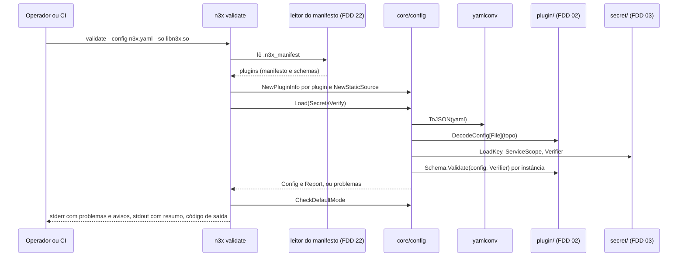
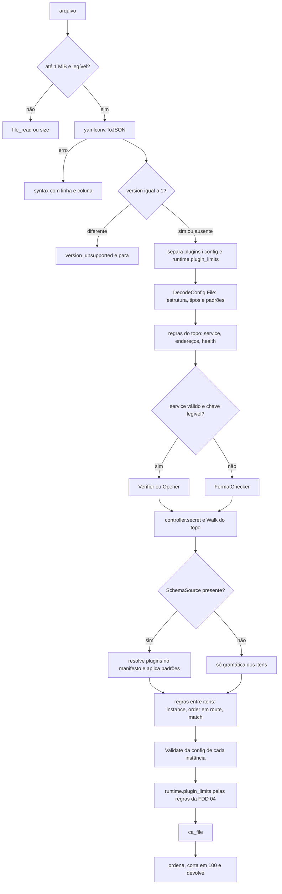

### FDD: `n3x.yaml` v1 do sidecar e CLI de operador (`validate`, `encrypt`, `keygen`) (SID-01)

Versão: 1.0
Data: 2026-10-20
Responsável: Guilherme Giusti

---

### 1. Contexto e motivação técnica

**Problema técnico.** O `n3x.yaml` é a única fonte de config do sidecar e dos plugins de proxy (FR-001); nada vem de variável de ambiente. O HLD do `n3x-sidecar` mostra um exemplo do schema v1 e sete regras de validação, mas não fixa o comportamento verificável:

- tipo, obrigatoriedade, padrão e faixa de cada campo
- como a seção `plugins` é conferida contra o manifesto e o schema de cada plugin, se o leitor do manifesto embutido só nasce na FDD 22 (D-12, lacuna L-04)
- de onde o `.so` tira os schemas: do registro compilado ou da seção ELF do arquivo carregado
- o que o `n3x validate` faz sem o `.so` ou sem a chave AES
- como o `n3x encrypt` recebe o serviço que entra na AAD (L-05)
- onde o operador ajusta o limite do body de request pedido pela FDD 05
- códigos de saída, formato das mensagens e o que vai para stderr, stdout e log JSON
- limites de tamanho para o fuzzing e para a memória do `.so`

A mesma validação roda em três lugares: `n3x validate` na CI do serviço, `n3x run` antes de subir o Envoy e o `.so` na criação da config do filtro (ADR-001 e ADR-007 do `n3x-sidecar`). Qualquer divergência entre eles vira um sidecar que passa na CI e não sobe em produção. Qualquer mensagem que ecoe um valor vira segredo no log.

**Encaixe no HLD.** Esta FDD especifica duas linhas de "Componentes e responsabilidades" do HLD do `n3x-sidecar`:

- **Config (`core/config`):** schema v1 do `n3x.yaml`, validação contra o schema de cada plugin do manifesto, regra de grupos paralelos e a mesma validação no entrypoint e no `.so`
- **Entrypoint `n3x` (`cmd/n3x`):** despacho dos subcomandos, `validate`, `encrypt` e `keygen` (ADR-003) e o passo de config do `run`, com códigos de saída e mensagens sem segredos

Consumidores:

- FDD 17 (SID-03): o `.so` chama `config.Load` no modo `SecretsOpen`, confere o registro com `config.VerifyRegistry` e instancia cada `config.Instance`
- FDD 25 (SID-05): pré-voo do `run`; liga o leitor do manifesto (FDD 22) ao `SchemaSource`
- FDD 26 (SID-06): gera o bootstrap a partir de `Config.File` (listener, app e prazos)
- FDD 27 (SID-07): usa `resources` e `runtime` para o runtime Go e a drenagem
- FDD 29 (SID-09): usa `app.health`
- FDD 37 (CORE-02): monta a config efetiva a partir dos valores tipados e das configs cruas
- FDD 38 (SID-10): usa o bloco `controller` e o `controller.secret` aberto
- FDD 49 (SID-11): acrescenta as regras do modo Istio

**Atores.** Operador (escreve o `n3x.yaml`, gera a chave, cifra os segredos e roda o `validate` na CI), entrypoint `n3x` (valida antes de subir), `.so` (valida de novo e decifra), autor de plugin (o schema da metade de proxy valida a `config`), builder (gera o manifesto que alimenta a validação) e mantenedor do sidecar.

**Limites.**
- `core/config` lê só arquivos locais (o `n3x.yaml`, a chave AES e a CA do controller). Não abre rede, não lê variável de ambiente e não tem estado global
- `core/config` não lê o `.so` nem o manifesto: recebe manifestos e schemas por uma interface (`SchemaSource`), como pede a D-12
- `core/config` não decide a subida (pré-voo, cgroup, bootstrap e health são das FDDs 25 a 29): entrega a config validada e um relatório
- `validate`, `encrypt` e `keygen` nunca sobem o Envoy

**Suposições**
- Go 1.26 ou superior (ADR-021 do `n3x-sdk`); o sidecar compila com a mesma versão do SDK usada no `.so` da mesma release
- O `n3x.yaml` chega por ConfigMap, volume ou arquivo montado; o limite de 1 MiB do ConfigMap do Kubernetes vale como teto prático do arquivo (hipótese)
- A imagem de runtime coloca o `.so` em `/usr/lib/n3x/libn3x.so` (HLD do `n3x-sidecar`, "Imagens de runtime")
- Um serviço usa poucas instâncias de plugin (o PRD cita até 5 plugins no build); 64 instâncias é folga (hipótese)

**Restrições**
- Nenhum campo vem de variável de ambiente (FR-001); `version` precisa ser `1` e campos novos só entram por adição dentro da v1 (HLD do `n3x-sidecar`)
- O `.so` lê, valida e decifra o próprio `n3x.yaml` com o mesmo `core/config`; o filtro só recebe caminhos (ADR-007 do `n3x-sidecar`)
- O pacote de segredos é o `secret/` do SDK (ADR-014 do `n3x-sdk`); o formato `ENC[...]` e a AAD são da FDD 03
- `core/config` não importa o SDK Go do Envoy nem `proxy/` do SDK, para o binário `n3x` não levar o grpc-go
- Nenhum valor do arquivo aparece em mensagem de erro, aviso ou log; só caminhos, regras, limites e listas do schema (FR-001, FDD 02)
- Documentação e mensagens em pt-BR; identificadores, campos e comandos em inglês

**Rastreabilidade**
- PRD 1.5: FR-001 (leitura, validação, `ENC[...]` e erros de subida), FR-002 (bloco `controller` e modo standalone), FR-003 (`app`, health e drenagem), FR-004 (fases, ordem, política de falha e recorte; config inválida recusa a subida), FR-012 (fases que alteram rota e body); segurança (AES-256-GCM, chave em arquivo, nenhum segredo em log); critério de aceite "`n3x.yaml` inválido impede a subida com mensagem que aponta o campo e sem segredo no log"; "Testes e validação" (fuzzing do parser do `n3x.yaml`)
- ADRs do `n3x-sidecar`: ADR-001, ADR-003, ADR-004 (`runtime.panic_breaker`), ADR-005, ADR-006 (prazos), ADR-007 e ADR-008 (`resources`)
- ADRs do `n3x-sdk`: ADR-006 (portas 17xxx), ADR-014 e ADR-020; ADR-006 do `n3x-builder` (lista todas as falhas da etapa)
- FDDs anteriores aplicadas: 01 (`ParseID`, `Phase`, `FailurePolicy`, `Manifest`, `MinOrder`, `MaxOrder`, `FieldError`, `yamlconv`), 02 (`DecodeConfig`, `Schema.Validate`, `Walk`, `PrefixErrors`, `PathKey`, `PathIndex`, `ParseSize`, `ParseDuration`), 03 (`secret/`, `plugin.Secret`, `OpenSecret`), 04 (bloco `runtime.plugin_limits`) e 05 (`proxy.DefaultMaxRequestBody`, `Phase.CanSetRoute()`)
- Lacunas e decisões do README:
  - **L-05 aplicada:** AAD `n3x:v1:<service>` para todo `ENC[...]` do arquivo, inclusive `controller.secret`; `n3x encrypt --key <arquivo> --service <serviço>`, as duas flags obrigatórias, sem ler o serviço do `n3x.yaml` (decisão da FDD 03, contrato 6 desta FDD)
  - **D-12 aplicada (e L-04 respeitada):** a seção `plugins` é validada por meio da interface `config.SchemaSource`; o leitor do manifesto embutido continua sendo da FDD 22, e o `n3x validate --so` só fecha de verdade quando ela existir (contrato 4)
  - **L-46 e P-03 da FDD 01 fechados aqui:** o sidecar converte o `n3x.yaml` inteiro com `yamlconv.ToJSON` (H-01)
  - **L-34 aplicada:** todo caminho segue a convenção `plugins[2].config.redis.password` e `runtime.plugin_limits["giustech.ratelimit"].memory.max_bytes`
  - **L-51 aplicada:** bloco `runtime.plugin_limits` com as regras e os códigos da FDD 04
  - Pontos em aberto de FDDs anteriores fechados aqui: P-03 (parte do sidecar), P-04 e P-07 da FDD 02; P-02, P-03, P-07 e P-08 (parte do sidecar) da FDD 03; P-09 da FDD 04 (parte do sidecar); P-01 e P-05 da FDD 05 (a P-05 com a FDD 17)

**Clarificações (2026-10-22)**
- `app.address` fora do loopback é aviso ou erro? → Continua aviso (`app_not_loopback`, em `CheckDefaultMode`) e não impede a subida. Motivo: o sidecar não controla o endereço em que a aplicação escuta; uma aplicação em `0.0.0.0` fica alcançável mesmo com o sidecar apontando para `127.0.0.1`, então recusar daria uma falsa garantia. A regra "a aplicação nunca fica exposta" (PRD, segurança) é garantida pela topologia de implantação e pelo guia do operador, não por esta validação.
- Refinos pedidos por FDDs posteriores (validação de consistência de 2026-10-22): o texto desta FDD continua valendo com os acréscimos e mudanças abaixo; em conflito, vale o contrato da FDD citada em cada item
  - SID-05 (FDD 25), contratos 1 e 2: categoria nova `config.CategoryPreflight` com a sentinela `config.ErrPreflight` (saída 5, `N3X-S005`); precedência dos blocos `N3X-S002`, `N3X-S005`, `N3X-S004`, `N3X-S003`, com `preflight.ExitCode` no lugar de `config.ExitCode` no `cmd/n3x`; o `validate --so` faz as conferências do artefato (alvo, integridade e versão do `core/`); resumo JSON do `validate` com `target`, `so_core_version`, `image_version` e `integrity`; saídas 5 a 9 repartidas entre as SID-05 a SID-09
  - SID-08 (FDD 28), contratos 2 e 4: `ENTRYPOINT ["/usr/local/bin/n3x"]` (caminho absoluto) com `CMD ["run"]`; textos de `key_read` e `file_read` com o UID e o GID do processo
  - SID-09 (FDD 29), contrato 8: despacho do subcomando `probe [live|ready]`
  - SID-10 (FDD 38), contrato 7: acessor `Config.ControllerCA()` com os bytes da CA já lidos pelo `Load`
  - SID-11 (FDD 49), contratos 1 e 3: despacho da palavra `proxy` (modo Istio), repasse dos subcomandos do `pilot-agent` na imagem `istio-*`, subcomando `istio-drain`, `validate --mode istio|default` e `config.CheckIstioMode` com `Config.Present` (arquivo `istio.go`)
- `n3x encrypt` com `--service` obrigatório (L-05) e `ENTRYPOINT` com `CMD` (I-03): registrados no ADR-003 e no HLD na validação de consistência de 2026-10-22

---

### 2. Objetivos técnicos

- **Um veredito só para o mesmo arquivo.** Invariante: para o mesmo `n3x.yaml`, a mesma chave e os mesmos manifestos, `config.Load` devolve a mesma lista de problemas (`Path` e `Rule`, na mesma ordem) no `n3x validate`, no `n3x run` e no `.so`. Medida: corpus compartilhado de pelo menos 150 arquivos rodado nas três configurações, com 0 divergência; e `n3x validate` e `n3x run` dão o mesmo código de saída para todo o corpus.
- **Todos os problemas numa passada.** Medida: até 100 problemas numa execução, em ordem determinística (ordem dos campos do schema v1), cada um com caminho, regra e texto; nenhum problema derivado de um campo já inválido; acima de 100, um item `truncated`.
- **Nenhum valor em mensagem.** Medida: teste de canário em que todo valor escalar do arquivo, todo texto aberto de `ENC[...]` e a chave viram marcadores `n3x-canary-`; 0 ocorrência em stderr, stdout, log JSON e `Error()`, conferido com `secrettest.Leaks` (FDD 03).
- **Erro de digitação nunca é silencioso.** Invariante: todo campo desconhecido, em qualquer nível fora de `plugins[].config` (que segue o schema do plugin, também estrito), vira `unknown_field`.
- **Validação parcial só quando pedida.** Invariante: o `validate` sem manifesto ou sem chave falha, a menos que o operador peça `--skip`; com `--skip`, a saída diz "parcial" e lista o que foi pulado.
- **Saída previsível para automação.** Invariante: o código de saída depende só da categoria dos problemas (tabela do contrato 7); os códigos `N3X-Sxxx` e as regras ficam estáveis na major do módulo `core/`.
- **Custo desprezível na subida.** Medida: `config.Load` do arquivo de referência (10 instâncias, 10 KiB, 5 segredos cifrados) em até 5 ms no p99 e de um arquivo de 1 MiB em até 200 ms no runner da CI, sem contar a leitura do manifesto (hipótese das metas).
- **Parse seguro contra entrada hostil.** Medida: fuzzing de `Load` (com `Options.Data`), do parser de endereço, do prefixo de path e do nome de serviço gRPC por 5 minutos cada na CI noturna, sem panic (hipótese de duração, igual às FDDs 01 a 03).

---

### 3. Escopo e exclusões

**Incluído**
- Schema v1 completo do `n3x.yaml`: cada campo com tipo, obrigatoriedade, padrão, faixa e comportamento no modo Istio (contrato 1)
- Campo novo `runtime.request_body.max_bytes`, pedido pela FDD 05, e o bloco `runtime.plugin_limits` da FDD 04
- Decodificação estrita do arquivo: `yamlconv.ToJSON` e decodificador da FDD 02 sobre a parte de topo, com padrões, duração e tamanho
- Regras de validação próprias (nomes, endereços, caminhos, grupos paralelos, recortes, relações entre campos) e a ordem dos problemas (contrato 2)
- Validação da `config` de cada instância pelo schema da metade de proxy do plugin, com `PrefixErrors` e `secret_unexpected`
- Conferência de todo `ENC[...]` com a chave: `Verifier` no entrypoint, `Opener` no `.so` para `controller.secret`, `FormatChecker` só com `--skip key`
- API Go do pacote `core/config`, sem dependência do Envoy (contrato 3)
- Interface `SchemaSource`, a implementação em memória `NewStaticSource`, o conversor `NewPluginInfo`, a conferência `VerifyRegistry` (registro do `.so` contra o manifesto, byte a byte) e o pacote de teste `configtest` (contrato 4)
- Regras do modo padrão separadas (`CheckDefaultMode`): `app.address` obrigatório, conflito de portas e aviso de aplicação fora do loopback
- Despacho dos subcomandos do binário `n3x` e o passo de config do `run`
- Subcomandos `n3x validate`, `n3x encrypt` e `n3x keygen`: argumentos, stdin e stdout, códigos de saída e formato das mensagens (contratos 5, 6 e 7)
- Aviso de chave AES com permissão mais aberta que `0440`, sem impedir a subida; aviso de segredo em claro
- Logs JSON da validação no entrypoint e o relatório que o `.so` loga

**Excluído**
- Leitura da seção ELF `.n3x_manifest`, formato do manifesto embutido e hash de integridade: FDD 22 (BLD-04), lacuna L-04
- Conferência de alvo, integridade e versão do `core/` na subida: FDD 25 (SID-05)
- Recusa por falta de limite de memória e cálculo do runtime Go pelo cgroup: FDD 27 (SID-07)
- Formato `ENC[...]`, AAD, `Encrypt`, `Decrypt`, `KeyGen` e `plugin.Secret`: FDD 03 (SDK-03); aqui só o uso
- Bootstrap do Envoy a partir da config validada: FDD 26 (SID-06)
- Instanciação dos plugins com `New`, compilação da cadeia, avaliação dos recortes em runtime e o log `route_conflict`: FDD 17 (SID-03)
- Seções `listener` e `app` ignoradas no modo Istio, detecção do modo e regras próprias dele: FDD 49 (SID-11)
- Health check da aplicação e drenagem: FDD 29 (SID-09); conexão com o controller e o teto de 5 s por chamada (L-08): FDD 38 (SID-10)
- Nomes e faixas dos sub-blocos `background` e `dial` de `runtime.plugin_limits`: FDD 06 (SDK-06); aqui só a validação com as regras da FDD 04
- Config efetiva, mascaramento e o objeto `sidecar` dela (L-06): FDD 37 (CORE-02)
- Imagem de runtime, `ENTRYPOINT` e `CMD`: FDD 28 (SID-08); aqui só o despacho que eles precisam respeitar
- Subcomando de health dentro do container (L-17, `n3x probe`): FDD 29 (SID-09)
- Rotação com duas chaves, recarga do `n3x.yaml` sem restart e geração de JSON Schema do `n3x.yaml` para editores: fora da v1

---

### 4. Fluxos detalhados e diagramas

**Fluxo principal: `config.Load`** (o mesmo código no `validate`, no `run` e no `.so`)
1. Lê o arquivo de `Options.Path` (ou usa `Options.Data`): arquivo regular, até 1 MiB (`file_read`, `size`).
2. Converte com `yamlconv.ToJSON` (L-46, H-01). Erro de sintaxe vira `syntax` com linha e coluna, nunca com o texto do arquivo. JSON convertido até 4 MiB; raiz precisa ser objeto; aninhamento até 64 (`size`, `syntax`).
3. Lê só o campo `version`, de forma tolerante. Ausente: `required` e segue. Diferente de `1`: `version_unsupported` e para, porque um arquivo de outra versão geraria dezenas de `unknown_field` sem sentido (mesma ideia do `ReadSDKRange` da FDD 01).
4. Separa as partes que não passam pelo decodificador da FDD 02: cada `plugins[i].config` (precisa ser objeto ou ausente; outro tipo é `type`) e o bloco `runtime.plugin_limits`. Os bytes de cada `config` são guardados como recebidos, com `ENC[...]` intacto.
5. Decodifica o restante com `plugin.DecodeConfig[config.File]` (FDD 02), sem opener: campo desconhecido, tipo, `null`, obrigatórios, `enum`, `min`, `max`, durações (`plugin.ParseDuration`) e tamanhos (`plugin.ParseSize`), com os padrões do schema aplicados.
6. Confere as regras próprias do topo: gramática de `service` (`name_format`), endereços, caminhos de arquivo, `app.health` (`field_unexpected`, `relation`) e avisos de combinação.
7. Monta o escopo `secret.ServiceScope(service)` só se `service` passou (pedido da FDD 03). Carrega a chave uma vez: de `Options.Key`, de `Options.KeyPath` (`validate --key`) ou de `keys.aes_file`. Se o arquivo tem `ENC[...]` e não há caminho de chave, `keys.aes_file` dá `required`. `KeyFileInfo.TooOpen` vira o aviso `key_too_open`.
8. Escolhe o conferidor de segredos: `key.Verifier(escopo)`; com `Skip.Key`, sem chave legível ou sem escopo, `secret.FormatChecker()` (só gramática e versão, sem erro derivado de decifra).
9. Confere `controller.secret`: precisa existir e não ser vazio; com o conferidor; no modo `SecretsOpen`, abre com `plugin.OpenSecret("controller.secret", texto, key.Opener(escopo))` e guarda o `plugin.Secret` selado para a FDD 38.
10. Percorre o topo com `Schema.Walk` (FDD 02): texto que é envelope (`secret.IsEnvelope`) em nó que não é segredo dá `secret_unexpected`; conta segredos cifrados e em claro (texto não vazio sem `ENC[...]`, aviso `secret_in_clear`).
11. Para cada `plugins[i]`, com o `SchemaSource` (pulado com `Skip.Plugins`): resolve o ID no manifesto, aplica os padrões de `phase`, `order` e `failure` do manifesto e confere fase permitida, metade de proxy, plugin core e metade só de fundo.
12. Confere as regras entre itens: `instance` única; `order` repetido na fase `route` (ADR-005, H-11); recortes bem formados; recorte impossível vira o aviso `match_unreachable` (regra da FDD 17).
13. Para cada `config` de instância válida: `info.ProxySchema.Validate(config, plugin.WithSecretOpener(conferidor))` e `Walk` para `secret_unexpected` e contagem; problemas prefixados com `plugin.PrefixErrors(err, "plugins[2].config")`. No `.so`, o conferidor das configs de plugin também é o `Verifier`: quem abre de verdade é o `Instantiate` da FDD 05, chamado pela FDD 17 com `Config.Opener()`.
14. Valida `runtime.plugin_limits` com as regras e os códigos da FDD 04 (contrato 1, parte 3).
15. Lê `controller.ca_file` (a menos que `Skip.Files`): arquivo regular até 1 MiB com pelo menos um certificado PEM que o `crypto/x509` aceita (`file_read`, `ca_format`).
16. Ordena os problemas pela ordem do schema v1, corta em 100 com `truncated` e devolve `Config` e `Report`, ou o erro com a lista.

**Fluxo do `n3x validate`**
1. O despacho reconhece `validate` e lê as flags (contrato 5); flag inválida: saída 1.
2. Monta o `SchemaSource`: com `--skip plugins`, nenhum; senão, abre o arquivo de `--so` (padrão `/usr/lib/n3x/libn3x.so`) pelo leitor da FDD 22 e converte cada plugin com `config.NewPluginInfo`. Falha de leitura ou manifesto inválido entra como problema da categoria manifesto, e a validação do arquivo segue sem as regras de plugin (para listar tudo de uma vez).
3. Chama `config.Load` com `SecretsVerify` e as opções de `--key` e `--skip`.
4. Chama `config.CheckDefaultMode` (regras do modo padrão).
5. Escreve os problemas e avisos em stderr (texto ou JSON), o resumo em stdout e sai com o código da categoria de maior precedência (contrato 7). Antes da FDD 22, o leitor é um stub e `--so` dá `manifest_unavailable` (saída 4); `--skip plugins` funciona desde já (D-12).

**Fluxo do passo de config do `n3x run`** (passos 1, 3 e 4 da subida no HLD)
1. O despacho reconhece `run` (ou nenhum subcomando) e lê `--config` (padrão `/etc/n3x/n3x.yaml`).
2. A FDD 25 monta o `SchemaSource` a partir do `.so` em `/usr/lib/n3x/libn3x.so` e faz o pré-voo de alvo, integridade e versão.
3. Chama `config.Load` com `SecretsVerify`, sem `Skip`, e `config.CheckDefaultMode`. Nenhuma opção de pular existe no `run`.
4. Em erro, loga um registro JSON por problema e um `config_rejected`, e sai com o código do contrato 7. Em sucesso, loga os avisos e um `config_loaded`, zera (melhor esforço) os buffers do arquivo e entrega o `Config` às FDDs 26 a 29.

**Fluxo do `.so`** (aplicado pela FDD 17)
1. Na criação da config do filtro, o `.so` recebe `config_path` (ADR-007) e monta o `SchemaSource` a partir da seção `.n3x_manifest` do próprio arquivo, pelo leitor da FDD 22: são os mesmos bytes que o entrypoint usou (H-04).
2. Chama `config.VerifyRegistry(src, registro)`: todo plugin com metade de proxy no manifesto precisa estar no registro compilado, e vice-versa, e `MarshalJSON` do `ConfigSchema()` de cada um precisa ser igual, byte a byte, ao schema embutido (pedido da FDD 02).
3. Chama `config.Load` com `SecretsOpen`. O resultado é o mesmo do entrypoint; a diferença é que `Config.ControllerSecret()` devolve o segredo aberto.
4. Loga os avisos do `Report` (`component=core`) e entrega cada `Instance` ao executor, que chama `Instantiate(inst.Config, env, plugin.WithSecretOpener(cfg.Opener()))` (FDD 05) e cria as contas de memória com `Config.Limits` (FDD 04).
5. Em erro, recusa a config do filtro e loga um registro por problema; o Envoy não sobe (FR-004).

**Fluxo do `n3x encrypt`**
1. Confere as flags `--key` e `--service`; falta de uma delas: saída 1.
2. Confere `--service` com a mesma gramática de `service` (`name_format`); inválido: saída 1.
3. Carrega a chave com `secret.LoadKey` antes de ler o segredo, para não consumir o segredo à toa; erro: saída 3; `TooOpen`: aviso em stderr.
4. Recusa stdin que é terminal (saída 1, com a dica de usar pipe), para o segredo não aparecer na tela.
5. Lê o stdin até 64 KiB mais 1 byte; acima disso, saída 1. Remove uma única quebra de linha final (`\n` ou `\r\n`); entrada vazia: saída 1.
6. Chama `key.Encrypt(secret.ServiceScope(service), segredo)`, escreve o envelope e uma quebra de linha em stdout, zera o buffer com `secret.Wipe` e sai com 0. Nada do segredo vai para stderr.

**Fluxo do `n3x keygen`**
- Sem argumentos; escreve `secret.KeyGen()` (44 caracteres base64 e uma quebra de linha) em stdout e sai com 0. Qualquer argumento: saída 1.

**Fluxos alternativos e exceções**
- **`service` inválido:** `name_format`; os segredos passam só pela checagem de formato, sem escopo, e nenhum erro de decifra derivado aparece
- **Chave ausente ou ilegível com `ENC[...]` no arquivo:** `required`, `key_read` ou `key_format` em `keys.aes_file`; os envelopes passam só pela checagem de formato
- **Arquivo sem nenhum `ENC[...]` e sem `keys`:** aceito, nenhuma chave é lida (H-09). Com `keys.aes_file` declarado, a chave é lida e validada mesmo sem envelopes
- **Plugin fora do manifesto:** `unknown_plugin` em `plugins[i].id`; `phase`, `order`, `failure` e `config` desse item não são conferidos contra o manifesto (sem erro derivado); a gramática deles continua conferida
- **`n3x.core` em `plugins`:** `core_implicit`; o plugin core é implícito e não se declara (decisão do HLD do `n3x-plugin-core`)
- **Plugin só de fundo de terceiros em `plugins`:** `background_only` (o manifesto não tem fase permitida, FDD 01); quem cria essas instâncias é das FDDs 09 e 36
- **`order` repetido em `access` ou `authn`:** aceito (H-11); se duas instâncias do grupo chamarem `SetRoute`, vale a última em ordem alfabética de `instance` e o executor loga `route_conflict` (FDD 05)
- **Recorte que nunca casa** (`paths` e `grpc_services` sem par compatível): aceito com o aviso `match_unreachable`; o operador separa em duas instâncias
- **`config` ausente, vazia ou `null`:** vale `{}` (FDD 02)
- **`ENC[...]` em campo que não é segredo** (do topo ou da `config`): `secret_unexpected`, porque o plugin receberia o texto cifrado como valor (FDD 03)
- **Segredo em claro** (L-64): aceito; aviso `secret_in_clear` por caminho, também no modo standalone; valor vazio não conta
- **Manifesto ilegível ou inválido no `validate`:** problemas da categoria manifesto e validação do arquivo sem as regras de plugin, para o operador ver tudo de uma vez
- **Registro do `.so` diferente do manifesto:** `registry_missing`, `registry_unexpected` ou `schema_mismatch`; o `.so` não sobe
- **Arquivo de outra versão (`version: 2`):** só `version_unsupported`; o operador usa uma imagem mais nova
- **Entrada hostil** (YAML enorme, âncoras em cadeia, aninhamento profundo, UTF-8 inválido): `size` ou `syntax`, sem panic

**Diagramas**

Sequência do `n3x validate`:



Pipeline do `config.Load`:



Precedência das categorias na saída:


---

### 5. Contratos públicos (assinaturas, endpoints, headers, exemplos)

**Contrato 1: schema v1 do `n3x.yaml`**
- Tipo: config (arquivo YAML 1.2, convertido para JSON por `yamlconv`)
- Assinatura/Rota: `/etc/n3x/n3x.yaml` ou o caminho de `--config`
- Método: n/a (lido na subida pelo entrypoint e pelo `.so`)
- Semântica:
  - Durações no formato Go (`200ms`, `1m30s`), lidas por `plugin.ParseDuration`; número sem unidade é `type`. Tamanhos com `Ki`, `Mi`, `Gi`, `Ti`, `KiB`, `MiB`, `GiB`, `TiB` ou inteiro em bytes, lidos por `plugin.ParseSize` (FDD 02)
  - Campo ausente recebe o padrão da tabela; `null` fora de `config` é `type`; campo desconhecido é `unknown_field`
  - Coluna "Istio": "lido" vale nos dois modos; "FDD 49" indica campo que o modo Istio ignora ou trata de outro jeito, comportamento definido na FDD 49
  - Faixas e padrões marcados (hipótese) estão na tabela H-21 do checkpoint

Parte 1: topo, `controller`, `keys`, `listener`, `app` e `resources`

| Campo | Tipo | Obrigatório | Padrão | Faixa ou regra | Istio |
| --- | --- | --- | --- | --- | --- |
| `version` | inteiro | sim | (nenhum) | só `1` | lido |
| `service` | texto | sim | (nenhum) | `^[a-z0-9]([a-z0-9_-]{0,61}[a-z0-9])?$` (1 a 63 caracteres) (hipótese) | lido |
| `controller` | objeto | não | ausente = modo standalone | | lido |
| `controller.address` | texto | sim, no bloco | | `host:porta`; host DNS (até 253 bytes), IPv4 ou `[IPv6]`; porta 1 a 65535 obrigatória; sem esquema (hipótese) | lido |
| `controller.ca_file` | texto | sim, no bloco | | caminho absoluto; arquivo regular até 1 MiB com certificado PEM válido | lido |
| `controller.secret` | segredo (`plugin.Secret`) | sim, no bloco | | não vazio; `ENC[v1:...]` com a AAD `n3x:v1:<service>`; em claro só com aviso | lido |
| `controller.timeouts.call` | duração | não | `5s` | 100ms a 60s (teto efetivo: FDD 38, L-08) | lido |
| `controller.timeouts.login` | duração | não | `10s` | 1s a 60s | lido |
| `controller.heartbeat_interval` | duração | não | `10s` | 1s a 5m | lido |
| `controller.buffer.max_items` | inteiro | não | `1000` | 10 a 100000 | lido |
| `keys` | objeto | não; obrigatório se houver `ENC[...]` | ausente = nenhuma chave | | lido |
| `keys.aes_file` | texto | sim, no bloco | | caminho absoluto; chave da FDD 03 (44 caracteres base64); permissão acima de `0440` só avisa | lido |
| `listener.port` | inteiro | não | `17000` | 1 a 65535; no modo padrão, diferente de 17001, 17021, 17090 e da porta da aplicação | FDD 49 |
| `app.address` | texto | sim no modo padrão | | IPv4 ou `[IPv6]` literal e porta (cluster `STATIC`); fora do loopback só avisa (`app_not_loopback`, decidido na clarificação de 2026-10-22) | FDD 49 |
| `app.protocol` | texto | não | `http1` | `http1`, `http2` ou `grpc` | FDD 49 |
| `app.timeouts.connect` | duração | não | `1s` | 10ms a 60s | FDD 49 |
| `app.timeouts.request` | duração | não | `15s` | 10ms a 1h | FDD 49 |
| `app.health.type` | texto | não | `grpc` se `app.protocol` é `grpc`; senão `http` (hipótese) | `http`, `grpc` ou `tcp` | FDD 49 |
| `app.health.path` | texto | não | `/healthz` com `type: http` | começa com `/`, até 1024 bytes; só com `type: http` | FDD 49 |
| `app.health.interval` | duração | não | `5s` | 1s a 5m | FDD 49 |
| `app.health.timeout` | duração | não | `1s` | 10ms a 60s; menor ou igual a `interval` | FDD 49 |
| `resources` | objeto | não | ausente = limites do cgroup (ADR-008) | | lido |
| `resources.cpus` | número | não | limite do cgroup | 0.01 a 1024 | lido |
| `resources.memory` | tamanho | não | limite do cgroup | 64Mi a 1Ti (sem limite nenhum: recusa da FDD 27) | lido |

Parte 2: `runtime` e `plugins`

| Campo | Tipo | Obrigatório | Padrão | Faixa ou regra | Istio |
| --- | --- | --- | --- | --- | --- |
| `runtime.drain_timeout` | duração | não | `20s` | 1s a 15m | FDD 49 |
| `runtime.log_level` | texto | não | `info` | `debug`, `info`, `warn` ou `error` | lido |
| `runtime.panic_breaker.panics` | inteiro | não | `5` | 1 a 1000 (ADR-004) | lido |
| `runtime.panic_breaker.window` | duração | não | `60s` | 1s a 1h | lido |
| `runtime.panic_breaker.zombies` | inteiro | não | `100` | 1 a 100000 | lido |
| `runtime.request_body.max_bytes` | tamanho | não | `1Mi` (igual a `proxy.DefaultMaxRequestBody`, FDD 05) | 1Ki a 16Mi; vale para a cadeia inteira (hipótese) | lido |
| `runtime.plugin_limits` | map de ID para objeto | não | `{}` | parte 3 | lido |
| `plugins` | lista | não | `[]` | até 64 itens; o plugin core é implícito e não se declara | lido |
| `plugins[].id` | texto | sim | | `plugin.ParseID`; presente no manifesto, com metade de proxy, não `n3x.core`, não só de fundo | lido |
| `plugins[].instance` | texto | sim | | mesma gramática de `service`; única no arquivo | lido |
| `plugins[].phase` | texto | não | `default_phase` do manifesto (hipótese) | uma das 8 fases; dentro de `proxy.phases` do manifesto | lido |
| `plugins[].order` | inteiro | não | `default_order` do manifesto | `plugin.MinOrder` a `plugin.MaxOrder` (0 a 1000); repetido na fase `route` é recusado | lido |
| `plugins[].failure` | texto | não | `default_failure` do manifesto | `open` ou `closed` | lido |
| `plugins[].async.timeout` | duração | não | `200ms` (ADR-006) | 1ms a 60s | lido |
| `plugins[].async.max_inflight` | inteiro | não | `1000` (ADR-006) | 1 a 100000 | lido |
| `plugins[].match.paths` | lista de texto | não | `[]` (sem restrição) | até 64; cada item é prefixo de path normalizado | lido |
| `plugins[].match.methods` | lista de texto | não | `[]` | até 9; `GET`, `HEAD`, `POST`, `PUT`, `DELETE`, `CONNECT`, `OPTIONS`, `TRACE` ou `PATCH`, sem repetição | lido |
| `plugins[].match.grpc_services` | lista de texto | não | `[]` | até 64; nome completo de serviço proto, até 255 bytes, sem repetição | lido |
| `plugins[].config` | objeto | não | `{}` | schema da metade de proxy do plugin (FDD 02) | lido |

Parte 3: `runtime.plugin_limits` (regras e códigos da FDD 04, contrato 5)

| Campo | Tipo | Padrão | Regra |
| --- | --- | --- | --- |
| chave do map | ID de plugin | | `plugin.ParseID`; presente no manifesto (`unknown_plugin`) e com metade de proxy (`half_missing`); `n3x.core` aceito sem aparecer em `plugins`; plugin sem instância: aceito, sem efeito |
| `<id>.memory.max_bytes` | tamanho | `memory.DefaultProxyMaxBytes` (16 MiB) | `memory.MinMaxBytes` a `memory.MaxMaxBytes` (1 MiB a 1 GiB); formato inválido é `size_format`, fora da faixa é `range` |
| `<id>.background.max_tasks` | inteiro | 8 (ADR-016 do `n3x-sdk`) | nome e faixa da FDD 06 (sugestão da FDD 04); fora da faixa é `range` |
| `<id>.dial.max_conns` | inteiro | 16 (ADR-016 do `n3x-sdk`) | nome e faixa da FDD 06 (sugestão da FDD 04); fora da faixa é `range` |
| qualquer outro campo | | | `unknown_field` |

Semântica dos recortes (`match`), aplicada pela FDD 17 (hipótese):
- Campos presentes combinam por E; itens de uma lista combinam por OU; lista vazia ou ausente não restringe
- `paths`: prefixo de bytes do path já normalizado pelo Envoy, sem a query; por isso cada item precisa estar em forma normalizada: começa com `/`, até 1024 bytes, ASCII visível, sem `//`, sem segmento `.` ou `..`, sem `\`, `?`, `#` ou espaço, com `%XX` válido e sem `%2F`, `%5C` ou `%2E` (mesmas regras do `CheckRoute` da FDD 05). Recomendação do guia: terminar o prefixo com `/`
- `methods`: igualdade exata, só os 9 métodos da RFC 9110 em maiúsculas (a cadeia compilada guarda uma máscara, HLD do `n3x-sidecar`); requisição gRPC é sempre `POST`
- `grpc_services`: casa só requisições gRPC cujo `:path` é `/<serviço>/<método>` com `<serviço>` igual ao item; gramática `^[A-Za-z_][A-Za-z0-9_]*(\.[A-Za-z_][A-Za-z0-9_]*)*$`
- **Recorte impossível** (mesma regra do contrato 8 da FDD 17): com `paths` e `grpc_services` presentes, se nenhum prefixo pode casar com `/<serviço>/` de algum serviço da lista (nem o prefixo começa com `/<serviço>/`, nem `/<serviço>/` começa com o prefixo), a instância nunca roda. Não é erro: `config.Load` devolve o aviso `match_unreachable` (contrato 2), logado como `config_warning` pelo `validate`, pelo `run` e pelo `.so`. Exemplo: `paths: ["/api/"]` com `grpc_services: ["pedidos.v1.Pedidos"]` nunca casa (a chamada gRPC tem path `/pedidos.v1.Pedidos/<método>`); para "HTTP em `/api/` ou gRPC de `pedidos.v1.Pedidos`", use duas instâncias

**Exemplo de requisição** (`n3x.yaml` de referência)
```yaml
version: 1
service: pedidos

controller:
  address: n3x-controller:17443
  ca_file: /etc/n3x/ca.pem
  secret: ENC[v1:oKGio6SlpqeoqaqrhWoZSSClYdYDCaq3aFezuwLaMHP9mjIJ+GdC6QyJnFO/ZQ+b5cM41CaHLENk]

keys:
  aes_file: /run/n3x/aes.key

app:
  address: 127.0.0.1:3000
  protocol: grpc

runtime:
  request_body:
    max_bytes: 256Ki
  plugin_limits:
    giustech.ratelimit:
      memory:
        max_bytes: 32Mi

plugins:
  - id: n3x.example
    instance: add-header
    config:
      header: X-N3X
      deny_path: /admin/
  - id: giustech.ratelimit
    instance: rl-api
    phase: traffic
    order: 20
    match:
      grpc_services: ["pedidos.v1.Pedidos"]
    config:
      limit: 100
      redis:
        address: redis:6379
        password: ENC[v1:oKGio6SlpqeoqaqrlSsSRXHmZtBPF+K3bgm3Tay7UBrZroDKT/dOy+2Q]
```

**Exemplo de resposta** (valores resolvidos que `Config` expõe, em JSON só para leitura; segredos nunca aparecem)
```json
{
  "service": "pedidos",
  "controller": { "address": "n3x-controller:17443", "ca_file": "/etc/n3x/ca.pem", "secret": "***", "timeouts": { "call": "5s", "login": "10s" }, "heartbeat_interval": "10s", "buffer": { "max_items": 1000 } },
  "keys": { "aes_file": "/run/n3x/aes.key" },
  "listener": { "port": 17000 },
  "app": { "address": "127.0.0.1:3000", "protocol": "grpc", "timeouts": { "connect": "1s", "request": "15s" }, "health": { "type": "grpc", "interval": "5s", "timeout": "1s" } },
  "runtime": { "drain_timeout": "20s", "log_level": "info", "panic_breaker": { "panics": 5, "window": "1m0s", "zombies": 100 }, "request_body": { "max_bytes": "256Ki" } },
  "limits": { "giustech.ratelimit": { "memory_max_bytes": 33554432 } },
  "instances": [
    { "index": 0, "id": "n3x.example", "instance": "add-header", "phase": "transform", "order": 50, "failure": "open", "async": { "timeout": "200ms", "max_inflight": 1000 }, "match": {} },
    { "index": 1, "id": "giustech.ratelimit", "instance": "rl-api", "phase": "traffic", "order": 20, "failure": "closed", "async": { "timeout": "200ms", "max_inflight": 1000 }, "match": { "grpc_services": ["pedidos.v1.Pedidos"] } }
  ],
  "report": { "secrets_sealed": 2, "secrets_in_clear": 0, "warnings": [] }
}
```
(`phase`, `order` e `failure` de `add-header` vieram do manifesto do `n3x.example`; `failure` de `rl-api` veio do manifesto do rate limit.)

---

**Contrato 2: regras de validação e ordem dos problemas**
- Tipo: regra (aplicada por `config.Load`, `config.CheckDefaultMode`, `config.NewPluginInfo` e `config.VerifyRegistry`)
- Assinatura/Rota: lista de `config.Problem` (um `plugin.FieldError` mais a categoria)
- Método: n/a
- Semântica:
  - Todos os problemas numa passada, até `MaxErrors` (100), mais um `truncated`
  - Ordem: a ordem dos campos do contrato 1 (topo, `controller`, `keys`, `listener`, `app`, `resources`, `runtime`, `plugins`); em cada objeto, primeiro as chaves desconhecidas em ordem de bytes, depois os campos declarados (regra da FDD 02); listas pelo índice; maps pela chave em ordem de bytes; no mesmo caminho, na ordem da tabela abaixo
  - Regra entre itens aparece no item de maior índice (o segundo `instance` repetido, o segundo `order` repetido na `route`)
  - Sem problema derivado: campo com erro de presença, tipo ou formato não gera erros que dependem dele
  - `Detail` nunca cita valor do arquivo. Pode citar limites, listas do schema, fases permitidas pelo manifesto, o escopo da AAD e outros caminhos do arquivo (por exemplo, "igual a `plugins[0].instance`")
  - Códigos da FDD 02 (`size`, `syntax`, `duplicate`, `unknown_field`, `type`, `required`, `min`, `max`, `enum`, `format`, `truncated`), da FDD 03 (`secret_*`, `key_*`, `scope`), da FDD 01 (`id_*`, `not_in_phases`, `background_only`) e da FDD 04 (`unknown_plugin`, `half_missing`, `size_format`, `range`) mantêm o significado de origem

| # | Caminho | Regra | Condição | Categoria |
| --- | --- | --- | --- | --- |
| 1 | (raiz) | `file_read` | Arquivo ausente, não regular ou sem permissão de leitura | config |
| 2 | (raiz) | `size` | YAML acima de 1 MiB ou JSON convertido acima de 4 MiB | config |
| 3 | (raiz) | `syntax` | YAML inválido (linha e coluna), mais de um documento, chave repetida, tag, âncora usada mais de 100 vezes, raiz que não é objeto, aninhamento acima de 64 | config |
| 4 | `version` | `required`, `version_unsupported` | Ausente; diferente de `1` (para a validação) | config |
| 5 | qualquer campo do topo | `unknown_field`, `type`, `required`, `enum`, `min`, `max`, `format` | Regras do decodificador da FDD 02 sobre `config.File` | config |
| 6 | `service`, `plugins[i].instance` | `name_format` | Fora de `^[a-z0-9]([a-z0-9_-]{0,61}[a-z0-9])?$` | config |
| 7 | `controller.address`, `app.address` | `address_format` | Sem porta, porta fora de 1 a 65535, com esquema, host inválido; em `app.address`, host que não é IP literal | config |
| 8 | `controller.ca_file`, `keys.aes_file` | `file_path` | Caminho que não é absoluto ou tem byte NUL | config |
| 9 | `controller.ca_file` | `file_read`, `ca_format` | Arquivo ilegível ou acima de 1 MiB; nenhum certificado PEM válido (pulado com `Skip.Files`) | config |
| 10 | `controller.secret` | `required` | Ausente ou vazio com o bloco `controller` presente | config |
| 11 | `controller.secret` | `secret_format`, `secret_version`, `secret_size`, `secret_decrypt` | Envelope inválido ou que não decifra com a chave e o escopo `n3x:v1:<service>` | segredo |
| 12 | `keys.aes_file` | `required` | Há `ENC[...]` no arquivo e nenhum caminho de chave | segredo |
| 13 | `keys.aes_file` | `key_read`, `key_format` | Chave ilegível ou fora do formato (FDD 03) | segredo |
| 14 | `app.health.path` | `field_unexpected`, `path_format` | Presente com `type` diferente de `http`; não começa com `/` | config |
| 15 | `app.health.timeout` | `relation` | Maior que `app.health.interval` | config |
| 16 | `runtime.plugin_limits["<id>"]` | `id_format`, `id_part_length`, `id_part_start`, `unknown_plugin`, `half_missing` | Chave que não é ID válido; plugin fora do manifesto; plugin sem metade de proxy | config |
| 17 | `runtime.plugin_limits["<id>"].<recurso>.<campo>` | `unknown_field`, `type`, `size_format`, `range` | Campo desconhecido; tipo errado; tamanho mal escrito; fora da faixa | config |
| 18 | `plugins` | `max` | Mais de 64 itens | config |
| 19 | `plugins[i].id` | `id_format`, `id_part_length`, `id_part_start` | ID inválido (`plugin.ParseID`) | config |
| 20 | `plugins[i].id` | `core_implicit` | `n3x.core` declarado em `plugins` | config |
| 21 | `plugins[i].id` | `unknown_plugin`, `half_missing`, `background_only` | Fora do manifesto; sem metade de proxy; metade de proxy só de fundo (`phases: []`) | config |
| 22 | `plugins[i].instance` | `duplicate` | Igual à de um item anterior | config |
| 23 | `plugins[i].phase` | `not_in_phases` | Fase fora de `proxy.phases` do manifesto | config |
| 24 | `plugins[i].order` | `duplicate` | Mesmo `order` de outro item na fase `route` (fase e `order` já resolvidos com os padrões) | config |
| 25 | `plugins[i].match.paths[j]` | `path_format`, `duplicate` | Prefixo fora da forma normalizada; repetido | config |
| 26 | `plugins[i].match.methods[j]` | `enum`, `duplicate` | Método fora dos 9; repetido | config |
| 27 | `plugins[i].match.grpc_services[j]` | `grpc_service_format`, `duplicate` | Nome fora da gramática ou acima de 255 bytes; repetido | config |
| 28 | `plugins[i].config` | `type` | Não é objeto nem `null` | config |
| 29 | `plugins[i].config.<campo>` | regras da FDD 02 | `Schema.Validate` do schema da metade de proxy, prefixado com `PrefixErrors` | config |
| 30 | `plugins[i].config.<campo>` | `secret_*` | Segredo da config que não confere (FDD 03) | segredo |
| 31 | qualquer campo | `secret_unexpected` | `ENC[...]` em campo que não é segredo no schema | segredo |
| 32 | (raiz) | `truncated` | Mais de 100 problemas | a do primeiro problema |
| 33 | `app.address` | `required` | Ausente no modo padrão (`CheckDefaultMode`) | config |
| 34 | `listener.port`, `app.address` | `port_conflict` | No modo padrão, porta igual a 17001, 17021 ou 17090, ou `listener.port` igual à porta da aplicação (`CheckDefaultMode`) | config |
| 35 | (manifesto) | `manifest_unavailable`, `manifest_read` | Leitor ainda não disponível (antes da FDD 22); arquivo do `.so` ou seção ilegível | manifesto |
| 36 | `plugins[k].manifest.<campo>` | regras da FDD 01 | `plugin.DecodeManifest` falhou para um plugin do manifesto | manifesto |
| 37 | `plugins[k].schemas.proxy` | `schema_missing`, `schema_unexpected` e regras de leitura da FDD 02 | Metade de proxy sem schema; schema sem metade de proxy; `plugin.ParseSchema` falhou | manifesto |
| 38 | `plugins[k].id` | `duplicate` | ID repetido no manifesto (`NewStaticSource`) | manifesto |
| 39 | `plugins["<id>"]` | `registry_missing`, `registry_unexpected`, `schema_mismatch` | No `.so`: plugin do manifesto fora do registro; registrado e fora do manifesto; schema gerado diferente do embutido (`VerifyRegistry`) | manifesto |

Os caminhos de manifesto (linhas 35 a 39) são relativos ao documento do manifesto embutido, não ao `n3x.yaml`; a saída os agrupa sob o bloco `N3X-S004`.

Avisos (não impedem a subida; saem no `Report` e no log `warn`):

| Código | Caminho | Condição |
| --- | --- | --- |
| `key_too_open` | `keys.aes_file` | Permissão com algum bit fora de `0440` (`KeyFileInfo.TooOpen`, FDD 03) |
| `secret_in_clear` | caminho do segredo | Segredo não vazio sem `ENC[...]` (L-64) |
| `health_protocol` | `app.health.type` | `app.protocol` `grpc` com health `http`, ou `http1` com health `grpc`: só funciona com servidor que atende os dois protocolos na mesma porta (hipótese) |
| `app_not_loopback` | `app.address` | IP fora do loopback no modo padrão: a aplicação fica alcançável sem passar pelo sidecar (`CheckDefaultMode`) |
| `match_unreachable` | `plugins[i].match` | Recorte impossível pela regra do contrato 8 da FDD 17 (`paths` e `grpc_services` sem nenhum par compatível): a instância nunca roda (`Load`, igual nos três lugares) |

**Exemplo de requisição** (`plugins` com erros, manifestos do `n3x.example` com `phases: [transform]` e do rate limit com `phases: [traffic, route]`)
```yaml
version: 1
service: Pedidos
app: { address: 127.0.0.1:3000, timeouts: { conect: 2s } }
runtime:
  plugin_limits:
    giustech.cors: { memory: { max_bytes: 8Mi } }
    n3x.example: { memory: { max_bytes: 512Ki, max_byte: 2Mi } }
plugins:
  - { id: n3x.core, instance: core }
  - { id: n3x.example, instance: add-header, phase: observe }
  - { id: giustech.ratelimit, instance: rl-a, phase: route, order: 10 }
  - { id: giustech.ratelimit, instance: rl-a, phase: route, order: 10, match: { methods: [get] } }
  - { id: n3x.example, instance: deny, config: { header: X, segredo: "ENC[v1:oKGio6Slpqeoqaqr2AbaEzDVX0pMl04tToZ1fQ==]" } }
```

**Exemplo de resposta** (`n3x validate --skip key`, stderr, texto)
```text
erro N3X-S002: n3x.yaml inválido (11 problemas)
  service: use de 1 a 63 letras minúsculas, dígitos, "-" ou "_", começando e terminando com letra ou dígito [name_format]
  app.timeouts.conect: campo desconhecido [unknown_field]
  runtime.plugin_limits["giustech.cors"]: plugin não está no manifesto do .so [unknown_plugin]
  runtime.plugin_limits["n3x.example"].memory.max_byte: campo desconhecido [unknown_field]
  runtime.plugin_limits["n3x.example"].memory.max_bytes: fora da faixa de 1Mi a 1Gi [range]
  plugins[0].id: o plugin core é implícito e não se declara em plugins [core_implicit]
  plugins[1].phase: fase fora das permitidas pelo manifesto: transform [not_in_phases]
  plugins[3].instance: instância repetida; igual a plugins[2].instance [duplicate]
  plugins[3].order: order repetido na fase route; igual a plugins[2].order [duplicate]
  plugins[3].match.methods[0]: fora da lista permitida: GET, HEAD, POST, PUT, DELETE, CONNECT, OPTIONS, TRACE, PATCH [enum]
  plugins[4].config.segredo: campo desconhecido [unknown_field]
  como resolver: corrija os campos indicados; referência do arquivo em docs/n3x-yaml.md
  doc: https://github.com/giustech/n3x-sidecar/blob/main/docs/erros.md#n3x-s002
aviso: validação parcial; pulado: key (segredos conferidos só no formato)
```
(`plugins[4].config.segredo` é campo desconhecido, então o `secret_unexpected` não aparece: sem problema derivado.)

---

**Contrato 3: API Go do pacote `core/config`**
- Tipo: sdk (API Go do módulo `github.com/giustech/n3x-sidecar/core`)
- Assinatura/Rota:
  ```go
  package config // github.com/giustech/n3x-sidecar/core/config

  const (
      FileVersion  = 1
      DefaultPath  = "/etc/n3x/n3x.yaml"
      DefaultSO    = "/usr/lib/n3x/libn3x.so"
      MaxFileSize  = 1 << 20 // YAML
      MaxJSONSize  = 4 << 20 // depois da conversão
      MaxDepth     = 64
      MaxInstances = 64
      MaxErrors    = 100

      DefaultRequestBodyMaxBytes = 1 << 20 // igual a proxy.DefaultMaxRequestBody (FDD 05), conferido em teste
      MinRequestBodyMaxBytes     = 1 << 10
      MaxRequestBodyMaxBytes     = 16 << 20
  )

  var ReservedPorts = [...]int{17001, 17021, 17090} // ADR-006 do n3x-sdk

  type SecretMode uint8

  const (
      SecretsVerify SecretMode = iota + 1 // entrypoint e validate: key.Verifier, nenhum valor aberto vira string
      SecretsOpen                         // .so: controller.secret aberto com key.Opener
  )

  type Skip struct {
      Plugins bool // sem SchemaSource: pula as regras que dependem do manifesto
      Key     bool // sem chave: segredos conferidos com secret.FormatChecker
      Files   bool // não lê controller.ca_file
  }

  type Options struct {
      Path        string         // "" = DefaultPath
      Data        []byte         // se não nil, usado no lugar de ler Path (testes e fuzzing)
      Source      SchemaSource   // obrigatório, salvo Skip.Plugins
      Secrets     SecretMode     // obrigatório
      Key         *secret.Key    // se não nil, usado no lugar do arquivo (testes)
      KeyPath     string         // "" = keys.aes_file; só o validate --key preenche
      Skip        Skip           // só o validate preenche
      CoreVersion plugin.Version // zero = sem conferência; versão do core/ do .so (FDD 25), para field_too_new
  }

  func Load(opts Options) (*Config, *Report, error)
  func CheckDefaultMode(c *Config) ([]Warning, error)

  type Config struct {
      File      File                       // valores do arquivo com os padrões
      Instances []Instance                 // plugins[] resolvidos, na ordem do arquivo
      Limits    map[plugin.ID]PluginLimits // runtime.plugin_limits resolvido
      // não exportados: escopo, chave e controller.secret aberto
  }

  func (c *Config) Scope() secret.Scope                       // n3x:v1:<service>
  func (c *Config) Opener() plugin.SecretOpener              // key.Opener(escopo); nil sem chave
  func (c *Config) ControllerSecret() (plugin.Secret, bool)  // só no modo SecretsOpen e com bloco controller

  type Instance struct {
      Index   int                  // posição em plugins[]
      ID      plugin.ID
      Name    string               // campo instance
      Phase   plugin.Phase         // do arquivo ou default_phase
      Order   int                  // do arquivo ou default_order
      Failure plugin.FailurePolicy // do arquivo ou default_failure
      Async   Async
      Match   Match
      Config  json.RawMessage      // como recebida, com ENC[...] intacto; "{}" se ausente
      Schema  *plugin.Schema       // schema da metade de proxy
  }

  type Async struct {
      Timeout     time.Duration
      MaxInflight int
  }

  type Match struct {
      Paths        []string
      Methods      []string
      GRPCServices []string
  }

  type PluginLimits struct {
      MemoryMaxBytes     int64 // 0 = memory.DefaultProxyMaxBytes
      BackgroundMaxTasks int   // 0 = padrão da FDD 06
      DialMaxConns       int   // 0 = padrão da FDD 06
  }

  type Report struct {
      Warnings       []Warning
      SecretsSealed  int
      SecretsInClear int
      Skipped        Skip
      KeyFile        *secret.KeyFileInfo // nil quando nenhuma chave foi lida de arquivo
      Duration       time.Duration
  }

  type Warning struct{ Path, Code, Detail string }

  type Category uint8

  const (
      CategoryConfig   Category = iota + 1 // saída 2, N3X-S002
      CategorySecret                       // saída 3, N3X-S003
      CategoryManifest                     // saída 4, N3X-S004
  )

  type Problem struct {
      plugin.FieldError
      Category Category
  }

  type Problems []Problem

  func (p Problems) Error() string // uma linha por problema, "<Path>: <Detail> [<Rule>]"

  var (
      ErrInvalidConfig = errors.New("config: n3x.yaml inválido")
      ErrSecret        = errors.New("config: segredo ou chave inválidos")
      ErrManifest      = errors.New("config: manifesto ou schema de plugin inválido")
  )

  func ExitCode(err error) int // 0, 2, 3 ou 4; precedência 2, 4, 3
  ```
- Método: n/a
- Semântica:
  - `File` é a struct do arquivo com as tags da FDD 02 (`json`, `n3x`, `desc`, `default`); campos opcionais sem padrão fixo (`controller`, `keys`, `resources`, `phase`, `order`, `failure`, `app.health.type`, `app.health.path`) são ponteiros. `plugins[].config` e `runtime.plugin_limits` não estão em `File`: o primeiro fica em `Instance.Config` e o segundo em `Config.Limits` (H-02)
  - O erro devolvido é um embrulho com `Unwrap() []error` que leva a sentinela de cada categoria presente, `Problems` e `plugin.FieldErrors` (mesmo padrão das FDDs 01 a 03): `errors.Is(err, config.ErrSecret)` e `errors.As(err, &probs)` funcionam
  - Categoria de um problema do `Load`: `CategorySecret` para regras com prefixo `secret_` ou `key_`, `scope` e o `required` de `keys.aes_file`; `CategoryConfig` para as demais. `NewPluginInfo`, `NewStaticSource` e `VerifyRegistry` só produzem `CategoryManifest`
  - `Load` é seguro para chamadas concorrentes e repetidas (o `.so` pode ser chamado mais de uma vez, L-45); não guarda estado global
  - `Config` é imutável depois do `Load`; `Instance.Config` aponta para bytes próprios do `Config`
  - `SecretsVerify` nunca cria `string` com valor aberto (FDD 03). Com `SecretsOpen`, só `controller.secret` é aberto; as configs de plugin são abertas pelo `Instantiate` (FDD 05) com `Config.Opener()`
  - A única fonte do caminho da chave é `keys.aes_file`; `Options.KeyPath` existe só para o `validate --key` (H-20)
  - `field_too_new` (reservado): campo acrescentado ao schema v1 numa minor declara a minor que o trouxe; com `CoreVersion` preenchido, campo mais novo que o `core/` do `.so` é recusado, para o entrypoint (mais novo) nunca aceitar o que o `.so` (mais antigo) recusaria (H-23). A v1.0 não tem nenhum campo assim

**Exemplo de requisição**
```go
src, _ := config.NewStaticSource(exemplo, ratelimit) // PluginInfo dos manifestos
cfg, rep, err := config.Load(config.Options{
    Path:    "/etc/n3x/n3x.yaml",
    Source:  src,
    Secrets: config.SecretsVerify,
})
if err != nil {
    var probs config.Problems
    errors.As(err, &probs)
    os.Exit(config.ExitCode(err))
}
warns, err := config.CheckDefaultMode(cfg)
fmt.Println(cfg.Instances[1].ID, cfg.Instances[1].Phase, cfg.Instances[1].Order, rep.SecretsSealed, len(warns), err)
```

**Exemplo de resposta**
```json
{ "Instances[1].ID": "giustech.ratelimit", "Phase": "traffic", "Order": 20, "SecretsSealed": 2, "warnings": 0, "err": null }
```

---

**Contrato 4: `SchemaSource`, `NewPluginInfo`, `VerifyRegistry` e `configtest` (D-12)**
- Tipo: sdk (API Go)
- Assinatura/Rota:
  ```go
  package config

  type PluginInfo struct {
      Manifest    plugin.Manifest
      ProxySchema *plugin.Schema // nil se o plugin não tem metade de proxy
      SchemaBytes []byte         // bytes embutidos do schema da metade de proxy, sem reformatar
  }

  // Fonte dos manifestos e schemas. Implementada aqui em memória; o leitor da FDD 22
  // entrega os dados que alimentam NewPluginInfo.
  type SchemaSource interface {
      IDs() []plugin.ID                       // em ordem de ID
      Lookup(id plugin.ID) (PluginInfo, bool)
  }

  // Decodifica o manifesto (plugin.DecodeManifest) e o schema de proxy (plugin.ParseSchema).
  // Caminhos relativos ao item do manifesto: "manifest.<campo>" e "schemas.proxy.<campo>".
  func NewPluginInfo(manifestJSON, proxySchemaJSON []byte) (PluginInfo, error)

  func NewStaticSource(infos ...PluginInfo) (SchemaSource, error) // ID repetido: duplicate

  type Registered struct {
      ID     plugin.ID
      Plugin plugin.ConfigSchemer // agent.Plugin() de cada plugin
  }

  // No .so: o registro compilado precisa bater com o manifesto embutido, byte a byte.
  func VerifyRegistry(src SchemaSource, reg []Registered) error

  package configtest // github.com/giustech/n3x-sidecar/core/config/configtest; só para testes

  func LoadBundle(path string) (config.SchemaSource, error) // {"plugins":[{"manifest":{..},"schemas":{"proxy":{..}}}]}
  func ExampleSource() config.SchemaSource                 // n3x.core e n3x.example de referência
  ```
- Método: n/a
- Semântica:
  - **Antes da FDD 22** (L-04, D-12): os testes usam `NewStaticSource` e `configtest.LoadBundle`, cujo formato é o subconjunto `plugins[].{manifest, schemas.proxy}` do manifesto embutido (campo `schemas` pedido pela FDD 02 à FDD 22). O `n3x validate --so` chama um leitor injetado no `cmd/n3x`; até a FDD 22, esse leitor é um stub que devolve `manifest_unavailable` (H-03)
  - **Depois da FDD 22:** o leitor dela devolve, para cada plugin, o JSON do manifesto e o do schema de proxy; o chamador (CLI ou FDD 25) chama `NewPluginInfo` e prefixa os erros com `plugins[k]`. Nenhum parser de manifesto mora em `core/config`
  - **Dentro do `.so`** (H-04): a fonte é a seção `.n3x_manifest` do próprio arquivo carregado, pelo mesmo leitor da FDD 22, para o `.so` usar os mesmos bytes que o entrypoint usou. O registro compilado não é fonte; ele é conferido contra o manifesto por `VerifyRegistry`. O harness de desenvolvimento sem ELF (L-35) monta um `NewStaticSource` a partir do registro (decisão da FDD 17)
  - `NewPluginInfo` exige schema de proxy quando o manifesto tem a metade de proxy (`schema_missing`) e recusa schema sem a metade (`schema_unexpected`). A metade só de fundo (core) também tem schema de proxy (FDD 02: um schema por metade)
  - `VerifyRegistry` compara o conjunto de IDs com metade de proxy (`registry_missing`, `registry_unexpected`) e os bytes de `ConfigSchema()` com `PluginInfo.SchemaBytes` (`schema_mismatch`). Caminho: `plugins["<id>"]`

**Exemplo de requisição**
```go
reg := []config.Registered{
    {ID: plugin.MustParseID("n3x.core"), Plugin: coreagent.Plugin()},
    {ID: plugin.MustParseID("n3x.example"), Plugin: exampleagent.Plugin()},
}
err := config.VerifyRegistry(src, reg) // src do manifesto com n3x.core, n3x.example e giustech.ratelimit
fmt.Println(err)
```

**Exemplo de resposta**
```text
plugins["giustech.ratelimit"]: plugin com metade de proxy no manifesto e fora do registro do .so [registry_missing]
```

---

**Contrato 5: despacho do binário `n3x` e `n3x validate`**
- Tipo: CLI (processo, stdin, stdout e stderr)
- Assinatura/Rota:
  ```text
  n3x [run] [--config <arquivo>]
  n3x validate [--config <arquivo>] [--so <arquivo>] [--key <arquivo>]
               [--skip plugins,key,files] [--log-format text|json]
  n3x encrypt --key <arquivo> --service <serviço>
  n3x keygen
  n3x help [<subcomando>]        # e --help em todo subcomando
  ```
- Método: processo
- Semântica:
  - **Despacho** (hipótese): o primeiro argumento escolhe o subcomando (`run`, `validate`, `encrypt`, `keygen`, `help`). Sem argumentos, ou com o primeiro argumento começando com `-`, vale `run`. A palavra `proxy` fica reservada ao modo Istio (FDD 49, L-19). Qualquer outra palavra: saída 1. Flags pelo pacote `flag` da biblioteca padrão; `--flag valor` e `--flag=valor` valem
  - **Imagem:** o despacho exige `ENTRYPOINT ["n3x"]` com `CMD ["run"]`, para `docker run <imagem> encrypt ...` (ADR-003) e os argumentos do injetor do Istio chegarem ao binário (pedido à FDD 28; inconsistência I-03)
  - `--config`: padrão `/etc/n3x/n3x.yaml`. `--so`: padrão `/usr/lib/n3x/libn3x.so`. `--key`: sobrescreve `keys.aes_file` (útil quando a CI monta a chave em outro caminho)
  - `--skip`: lista separada por vírgula, sem repetição. `plugins` valida sem manifesto (só a gramática dos itens de `plugins` e das chaves de `runtime.plugin_limits`); `key` confere segredos só no formato; `files` não lê `controller.ca_file`. Sem `--skip`, a falta do `.so` ou da chave é erro (saída 4 ou 3) (H-05)
  - Sempre aplica `CheckDefaultMode` (o `validate` simula o modo padrão; o modo Istio é da FDD 49)
  - **Saída em texto** (padrão): problemas e avisos em stderr, agrupados por categoria na ordem de precedência (contrato 7); em sucesso, uma linha de resumo em stdout
  - **Saída em JSON** (`--log-format json`): um objeto JSON por linha em stderr para cada problema e aviso, com os mesmos campos do log do `run` (seção 7); e sempre um objeto de resumo em stdout
  - Códigos de saída: 0 (válido, completo ou parcial), 1 (uso), 2, 3 ou 4 (contrato 7)
  - Limites: arquivo até 1 MiB; tempo total de até 1 s para o arquivo de referência e um `.so` de 64 MiB (hipótese; a leitura do ELF é da FDD 22)

**Exemplo de requisição**
```text
$ docker run --rm -v $PWD/n3x.yaml:/etc/n3x/n3x.yaml:ro -v $PWD/aes.key:/run/n3x/aes.key:ro \
    ghcr.io/acme/pedidos-sidecar:1.4.0 validate
```

**Exemplo de resposta** (stdout e código de saída)
```text
ok: n3x.yaml válido (serviço pedidos; 2 instâncias de plugin; 2 segredos cifrados; 0 em claro)
$ echo $?
0
```

**Exemplo de requisição** (mesmo arquivo, chave de outro ambiente, saída JSON)
```text
$ n3x validate --key /tmp/aes-hml.key --log-format json
```

**Exemplo de resposta** (stderr e stdout; código de saída 3)
```json
{"ts":"2026-10-20T14:00:00Z","level":"error","component":"entrypoint","service":"pedidos","msg":"config_problem","code":"N3X-S003","path":"controller.secret","rule":"secret_decrypt","detail":"ENC[...] não decifrou com a chave e o escopo n3x:v1:pedidos (chave errada, valor cifrado para outro serviço ou plugin, ou alterado)"}
{"ts":"2026-10-20T14:00:00Z","level":"error","component":"entrypoint","service":"pedidos","msg":"config_problem","code":"N3X-S003","path":"plugins[1].config.redis.password","rule":"secret_decrypt","detail":"ENC[...] não decifrou com a chave e o escopo n3x:v1:pedidos (chave errada, valor cifrado para outro serviço ou plugin, ou alterado)","plugin_id":"giustech.ratelimit","instance":"rl-api"}
{"valid":false,"partial":false,"exit_code":3,"codes":["N3X-S003"],"problems":2,"warnings":0,"service":"pedidos","instances":2}
```

---

**Contrato 6: `n3x encrypt` e `n3x keygen` (L-05 aplicada)**
- Tipo: CLI (processo, stdin e stdout)
- Assinatura/Rota:
  ```text
  n3x encrypt --key <arquivo> --service <serviço>   # segredo só pelo stdin
  n3x keygen                                        # sem argumentos
  ```
- Método: processo
- Semântica:
  - `--key` e `--service` obrigatórios, sem padrão (FDD 03). O serviço segue a gramática de `service` e vira a AAD `n3x:v1:<serviço>`. O serviço nunca é lido do `n3x.yaml`: uma forma só, que funciona na CI sem o arquivo
  - Ordem: flags, serviço, chave, stdin (contrato e fluxo da seção 4). A chave é carregada antes de ler o segredo; `TooOpen` gera o aviso em stderr e segue
  - stdin que é terminal (conferido com `golang.org/x/term.IsTerminal`) é recusado com saída 1, para o segredo não aparecer na tela nem ficar no histórico por digitação (hipótese). Uso recomendado: `read -rs S; printf '%s' "$S" | docker run --rm -i ...`
  - Entrada: até 64 KiB (`secret.MaxPlaintextSize`); remove uma única quebra de linha final (`\n` ou `\r\n`); vazia depois disso é recusada; o buffer é zerado com `secret.Wipe` antes de sair
  - Saída: só o envelope e `\n` em stdout; nada do segredo em stderr, nem em erro
  - `keygen`: escreve `secret.KeyGen()` em stdout (45 bytes: 44 caracteres e `\n`); serve para a chave AES. Não lê nem escreve arquivo
  - Códigos de saída: `encrypt` 0, 1 (uso: flag ausente, serviço inválido, stdin terminal, vazio ou acima de 64 KiB) ou 3 (chave); `keygen` 0 ou 1

**Exemplo de requisição**
```text
$ read -rs S; printf '%s' "$S" | docker run --rm -i -v $PWD/aes.key:/k:ro \
    ghcr.io/giustech/n3x/sidecar:1.0.0-envoy-1.40 encrypt --key /k --service pedidos
$ docker run --rm ghcr.io/giustech/n3x/sidecar:1.0.0-envoy-1.40 encrypt --key /k
$ docker run --rm ghcr.io/giustech/n3x/sidecar:1.0.0-envoy-1.40 keygen
```

**Exemplo de resposta** (stdout do primeiro, stderr do segundo com saída 1, stdout do terceiro)
```text
ENC[v1:<56 caracteres base64: nonce, 14 bytes cifrados e tag; AAD n3x:v1:pedidos>]
erro N3X-S001: flag obrigatória ausente: --service (o serviço entra na AAD n3x:v1:<serviço>)
  uso: n3x encrypt --key <arquivo> --service <serviço>
nCBwy+F1b01zQ6QjtNtcbftpsbAsFwKuGftmjmx42lc=
```

---

**Contrato 7: códigos de saída, códigos `N3X-Sxxx` e formato das mensagens**
- Tipo: CLI e log (contrato com o operador e com a automação)
- Assinatura/Rota: código de saída do processo, bloco de texto em stderr e registros JSON
- Método: n/a
- Semântica:
  - Segue o padrão do builder (HLD do `n3x-builder`, ADR-006 dele): código estável, categoria com código de saída, "como resolver" e link; saída 1 reservada a uso
  - Um bloco por categoria presente, na ordem de precedência `N3X-S002`, `N3X-S004`, `N3X-S003`, que é a ordem dos passos da subida no HLD (schema, manifesto, chave). O código de saída é o do primeiro bloco (H-16)
  - Cada linha de problema: `<caminho>: <detalhe> [<regra>]`; cada aviso: `aviso: <caminho>: <detalhe> [<código>]`
  - Os códigos 5 a 9 ficam reservados às FDDs 25 a 29 (pré-voo, ambiente, Envoy); `N3X-S005` em diante também (hipótese). O repasse do código de saída do Envoy, que costuma ser 1, é decisão da FDD 27
  - Os textos de "como resolver" e a página `docs/erros.md` ficam no repositório `n3x-sidecar`

| Código | Saída | Categoria | Como resolver |
| --- | --- | --- | --- |
| (nenhum) | 0 | válido (completo ou parcial) | |
| `N3X-S001` | 1 | uso: subcomando ou flag inválidos, serviço inválido no `encrypt`, stdin terminal, vazio ou grande demais | confira o comando com `n3x help <subcomando>` |
| `N3X-S002` | 2 | `n3x.yaml` inválido: leitura, sintaxe, schema v1, plugins, recortes, limites, config de plugin | corrija os campos indicados; referência em `docs/n3x-yaml.md` |
| `N3X-S003` | 3 | segredo ou chave: `keys.aes_file`, `ENC[...]` que não confere, `secret_unexpected` | confira `keys.aes_file` e cifre de novo com `n3x encrypt --service <service>` e a chave certa |
| `N3X-S004` | 4 | manifesto do `.so`: leitura, manifesto ou schema embutido inválido, registro diferente do manifesto | gere o `.so` de novo com o `n3x-plugin build` da mesma versão da imagem |

**Exemplo de requisição**
```text
$ n3x validate --config n3x.yaml --so /tmp/libn3x-antigo.so --skip key
```

**Exemplo de resposta** (stderr; código de saída 2, porque `N3X-S002` tem precedência)
```text
erro N3X-S002: n3x.yaml inválido (1 problema)
  plugins[0].instance: use de 1 a 63 letras minúsculas, dígitos, "-" ou "_", começando e terminando com letra ou dígito [name_format]
  como resolver: corrija os campos indicados; referência em docs/n3x-yaml.md
  doc: https://github.com/giustech/n3x-sidecar/blob/main/docs/erros.md#n3x-s002
erro N3X-S004: manifesto do .so inválido (1 problema)
  plugins[1].schemas.proxy: x-n3x-schema: versão 2 do subconjunto é maior que a suportada (1); use uma imagem com SDK mais novo [schema_version]
  como resolver: gere o .so de novo com o n3x-plugin build da mesma versão da imagem
  doc: https://github.com/giustech/n3x-sidecar/blob/main/docs/erros.md#n3x-s004
aviso: validação parcial; pulado: key (segredos conferidos só no formato)
```

---

### 6. Erros, exceções e fallback

**Matriz de erros previstos e tratamentos**

| Condição | Tratamento | Observações |
| --- | --- | --- |
| Arquivo ausente, ilegível ou acima de 1 MiB | `file_read` ou `size`; saída 2 | O `.so` recusa a config do filtro |
| YAML inválido | `syntax` com linha e coluna, sem trecho do arquivo | Depende de erro tipado do `yamlconv` (pedido à FDD 01) |
| `version` diferente de 1 | Só `version_unsupported`; para | Evita dezenas de `unknown_field` de outra versão |
| Campo desconhecido, tipo errado, ausente, fora da faixa | Regras da FDD 02 com caminho; todos de uma vez | Saída 2 |
| `service` inválido | `name_format`; segredos só no formato | Sem `secret_decrypt` derivado |
| `ENC[...]` sem chave declarada | `required` em `keys.aes_file` | Saída 3 |
| Chave ilegível ou fora do formato | `key_read` ou `key_format`; segredos só no formato | Saída 3 |
| `ENC[...]` que não decifra, versão nova ou malformado | `secret_*` com o caminho e o escopo esperado | Saída 3; nunca vira "texto em claro" |
| `ENC[...]` em campo que não é segredo | `secret_unexpected` | Saída 3 |
| Segredo em claro | Aviso `secret_in_clear` | Nunca impede a subida (L-64) |
| Chave com permissão acima de `0440` | Aviso `key_too_open` | Nunca impede a subida (HLD do `n3x-sidecar`) |
| Plugin fora do manifesto, sem metade de proxy, core, só de fundo | `unknown_plugin`, `half_missing`, `core_implicit`, `background_only` | Itens dependentes não conferidos |
| Fase fora do manifesto | `not_in_phases` | Fase padrão do manifesto quando ausente |
| `order` repetido em `route` | `duplicate` | Em `access` e `authn`, aceito (H-11) |
| Recorte mal formado | `path_format`, `enum`, `grpc_service_format`, `duplicate` | Prefixo não normalizado nunca casaria |
| Recorte bem formado que nunca casa | Aviso `match_unreachable` | Regra do contrato 8 da FDD 17; não impede a subida |
| Config de plugin inválida | Regras da FDD 02 prefixadas com `plugins[i].config` | Saída 2 |
| `runtime.plugin_limits` inválido | Códigos da FDD 04 | Saída 2 |
| CA ilegível ou sem certificado | `file_read` ou `ca_format` | Pulado só com `--skip files` |
| Manifesto ilegível, leitor ausente, schema embutido inválido | `manifest_*`, regras das FDDs 01 e 02; saída 4 | A validação do arquivo segue sem as regras de plugin |
| Registro do `.so` diferente do manifesto | `registry_missing`, `registry_unexpected`, `schema_mismatch` | Só no `.so` (FDD 17) |
| Mais de 100 problemas | 100 itens e `truncated` | Evita inundar o log |
| Flag inválida, subcomando desconhecido | Saída 1 com o uso | `N3X-S001` |
| `encrypt` com stdin terminal, vazio ou acima de 64 KiB | Saída 1 | Nada do segredo é ecoado |

**Estratégias de resiliência:** timeouts, retries, backoff e circuit breaker não se aplicam. O pacote roda uma vez na subida e nos CLIs, com I/O só em três arquivos locais pequenos. A resiliência aqui é:
- limites conferidos antes de processar (1 MiB de YAML, 4 MiB de JSON, profundidade 64, 64 instâncias, 1 MiB de CA, 64 KiB de segredo)
- nenhum panic por dado de entrada (provado por fuzzing) e nenhum estado global
- a mesma função nos três lugares, sem retry: um arquivo inválido é inválido de forma determinística
- no `.so`, `Load` roda sob o `recover` do executor (FDD 17)

**Política de fallback:** não há fallback silencioso.
- Valor inválido nunca é trocado pelo padrão; só o campo ausente recebe o padrão da tabela ou do manifesto
- Sem manifesto ou sem chave, o `validate` falha; validação parcial só com `--skip`, sempre anunciada como "parcial"
- O `run` e o `.so` não aceitam `--skip`
- Envelope que não abre nunca vira texto em claro; texto parecido com envelope é erro (FDD 03)
- Leitor do manifesto ausente (antes da FDD 22) é erro `manifest_unavailable`, não validação parcial implícita

**Invariantes**
- Para a mesma entrada, `Load` devolve os mesmos problemas, na mesma ordem, nos três lugares
- Nenhum `Detail`, aviso, log ou saída do CLI contém valor do arquivo, texto aberto, envelope, carga base64 ou chave
- `Instance.Config` guarda os bytes recebidos; `ENC[...]` nunca é substituído pelo texto aberto fora do `plugin.Secret`
- `SecretsVerify` nunca cria `string` com valor aberto
- Toda `Instance` devolvida tem `Phase` dentro de `proxy.phases` do manifesto, `Order` entre `MinOrder` e `MaxOrder` e `Failure` válida
- Não existem duas instâncias com o mesmo `Name`, nem duas instâncias de `route` com o mesmo `Order`
- `ExitCode` depende só das categorias presentes
- `core/config` não lê variável de ambiente, não abre rede e não importa o SDK do Envoy nem `proxy/`

---

### 7. Observabilidade

**Métricas**
- O entrypoint não tem endpoint de métricas (o `17021` é só health, ADR-002 do `n3x-sidecar`), e uma config inválida encerra o processo antes de existir qualquer métrica. O sinal de falha é o container que não sobe e o log `config_rejected`
- Métrica nova publicada pelo `.so` (hipótese; publicação pela FDD 16): `n3x_config_secrets_in_clear` (gauge, sem rótulos), igual a `Report.SecretsInClear`. Existe porque o sidecar standalone não tem controller para mostrar o evento `secret_in_clear` (FDD 42)
- Na CI do sidecar: cobertura de `core/config`, benchmarks `BenchmarkLoadReference` e `BenchmarkLoad1MiB` com `-benchmem` e o resultado do fuzzing noturno

**Logs**
- JSON em stderr, uma linha por evento, com `ts`, `level`, `component` e `service` quando o serviço é válido (HLD do `n3x-sidecar`). `component` é `entrypoint` no `run` e no `validate --log-format json`, e `core` no `.so`. O campo `msg` é um nome estável em snake_case
- `config_problem` (`error`): um por problema, com `code` (`N3X-S00x`), `path`, `rule`, `detail` e, quando o caminho está em `plugins[i]` com ID e instância válidos, `plugin_id` e `instance`
- `config_rejected` (`error`): um por execução que falhou, com `exit_code`, `problems`, `codes` e `config_file`
- `config_loaded` (`info`): com `config_file`, `instances`, `plugins` (IDs separados por vírgula), `secrets_sealed`, `secrets_in_clear`, `skipped` (só no `validate`) e `duration_ms`
- `config_warning` (`warn`): um por aviso do contrato 2 (`key_too_open`, `secret_in_clear`, `health_protocol`, `app_not_loopback`, `match_unreachable`), com `code`, `path`, `detail`, `plugin_id` e `instance` quando houver. A chave com permissão aberta loga `code` `key_too_open` com `key_file`, `mode` e `max_mode` (FDD 03), uma vez por processo: o entrypoint e o `.so` logam cada um o seu (P-08 da FDD 03)
- Exemplo: `{"ts":"2026-10-20T14:00:00Z","level":"warn","component":"entrypoint","service":"pedidos","msg":"config_warning","code":"secret_in_clear","path":"plugins[1].config.redis.password","plugin_id":"giustech.ratelimit","instance":"rl-api","detail":"segredo sem ENC[...]; cifre com n3x encrypt"}`
- **stderr do CLI em texto:** os blocos do contrato 7, legíveis por pessoas; **stdout:** só o resumo do `validate`, o envelope do `encrypt` e a chave do `keygen`
- **Proteção de dados:** nunca entram em log, erro ou saída: valor de campo, texto aberto, envelope, carga base64, chave, conteúdo da CA. Podem entrar: caminhos (inclusive chaves de map, como IDs), escopo da AAD, caminhos de arquivo, limites e listas do schema. Garantido pelo teste de canário (seção 9)

**Tracing**
- Sem tracing (ADR-009 do `n3x-sdk`). Não há spans nesta feature

**Dashboards e alertas**
- Alertas sugeridos no guia do operador (FDD 47), sobre o coletor de logs e o Prometheus:
  - container em reinício com `msg="config_rejected"` no log (config quebrada no deploy)
  - `n3x_config_secrets_in_clear > 0` em produção
  - qualquer `code="key_too_open"` em produção
- Na CI do serviço: o job `n3x validate` falha com o código `N3X-S00x` e a saída já diz o que corrigir
- Sem painel próprio: a config efetiva e o alerta de segredo em claro aparecem no painel do controller pelas FDDs 37, 42 e 45

---

### 8. Dependências e compatibilidade

| Componente | Versão mínima | Observações |
| --- | --- | --- |
| Go | 1.26 | ADR-021 do `n3x-sdk` |
| `n3x-sdk` `plugin/` (FDDs 01, 02 e 03) | a versão do SDK da release | `ParseID`, `Phase`, `FailurePolicy`, `Manifest`, `DecodeManifest`, `MinOrder`, `MaxOrder`, `Schema`, `ParseSchema`, `DecodeConfig`, `Walk`, `PrefixErrors`, `PathKey`, `PathIndex`, `ParseSize`, `ParseDuration`, `Size`, `Secret`, `OpenSecret`, `FieldError` |
| `n3x-sdk` `secret/` (FDD 03) | idem | `LoadKey`, `ServiceScope`, `Verifier`, `Opener`, `FormatChecker`, `IsEnvelope`, `KeyGen`, `Encrypt`, `Wipe`, `MaxPlaintextSize`; `secret/secrettest` só em testes |
| `n3x-sdk` `yamlconv` (FDD 01) | idem | `ToJSON`; traz `go.yaml.in/yaml/v3` |
| `n3x-sdk` `memory/` (FDD 04) | idem | `MinMaxBytes`, `MaxMaxBytes`, `DefaultProxyMaxBytes` (só constantes) |
| `n3x-sdk` `proxy/` (FDD 05) | idem | Não importado por `core/config`; um teste em `core/` confere `DefaultRequestBodyMaxBytes == proxy.DefaultMaxRequestBody` |
| `golang.org/x/term` | versão estável mais recente na data do build (hipótese) | Só no `cmd/n3x`, para `IsTerminal` no `encrypt` |
| Leitor do manifesto (FDD 22) | consumidor da interface | Fornece manifesto e schema por plugin; até lá, stub com `manifest_unavailable` |
| FDD 06 | decisão pendente | Nomes e faixas de `background` e `dial` em `runtime.plugin_limits` |
| FDDs 17, 25, 26, 27, 29, 37, 38 e 49 | consumidores | Usam `Config`, `Instance`, `Report`, `SchemaSource` e `VerifyRegistry` |

**Garantias de compatibilidade**
- O `n3x.yaml` v1 só cresce por adição de campos opcionais (HLD do `n3x-sidecar`). Um arquivo que usa campo novo falha numa imagem antiga com `unknown_field` (saída 2); a documentação de cada campo diz a versão mínima
- Campo novo vem marcado com a minor do `core/` que o trouxe; o entrypoint confere contra a versão do `core/` do `.so` e recusa com `field_too_new`, para nunca aceitar o que o `.so` recusaria (H-23)
- Padrões e faixas só mudam em major do `core/`, porque um padrão novo muda o comportamento e o hash da config efetiva (FDD 37)
- Códigos de regra, códigos `N3X-Sxxx` e códigos de saída estáveis na major do módulo `core/`; regra nova só para campo novo
- Flags do CLI só por adição; o formato das linhas de erro e dos registros JSON só ganha campos
- A API de `core/config` segue o semver do módulo `github.com/giustech/n3x-sidecar/core` (ADR-001 do `n3x-sidecar`, trade-off "versionamento cuidadoso")
- `go list -deps ./cmd/n3x ./core/config` não lista `google.golang.org/grpc` nem o SDK Go do Envoy

---

### 9. Critérios de aceite técnicos

- **Tabela de regras:** cada uma das 39 linhas do contrato 2 e cada aviso têm pelo menos um caso de teste que produz exatamente aquele `Path`, aquela `Rule` e aquela categoria
- **Padrões:** um arquivo mínimo (`version`, `service` e `app.address`) resolve todos os padrões da tabela do contrato 1 (golden em `core/config/testdata/minimal.golden.json`); o arquivo de referência do contrato 1 produz o JSON mostrado na resposta
- **Exemplo de erros:** a entrada do contrato 2 produz exatamente as 11 linhas mostradas, na ordem, e a linha de aviso
- **Um veredito só:** corpus de pelo menos 150 arquivos em `core/config/testdata/corpus/` (válidos, um por regra e combinações) rodado como `validate` (processo, com `configtest.LoadBundle`), como passo de config do `run` e como `.so` (`SecretsOpen`): mesma lista de `Path` e `Rule`, na mesma ordem; 0 divergência. `validate` e `run` dão o mesmo código de saída
- **Recorte impossível:** `paths: ["/api/"]` com `grpc_services: ["pedidos.v1.Pedidos"]` gera exatamente um `match_unreachable` em `plugins[i].match` (saída 0, log `config_warning`); `paths: ["/pedidos.v1.Pedidos/"]` ou `paths: ["/"]` com o mesmo serviço não geram; o arquivo de referência do contrato 1 não gera nenhum aviso
- **Grupos:** `order` repetido em `route` é recusado; em `access`, `authn` e nas demais fases é aceito; a fase e o `order` padrão do manifesto entram na conta
- **Segredos:** `encrypt --service pedidos` seguido de `validate` no serviço `pedidos` passa; o mesmo envelope com `service: estoque` dá saída 3 e `secret_decrypt` no caminho do campo; `ENC[v2:AAAA]` dá `secret_version`; `ENC[...]` em `app.health.path` e num campo comum de `config` dá `secret_unexpected`; segredo em claro dá o aviso e saída 0
- **Canário:** cada valor escalar do corpus, cada texto aberto e o texto da chave de teste viram marcadores `n3x-canary-`; stderr, stdout (fora o envelope do `encrypt` e a chave do `keygen`), logs JSON e `Error()` têm 0 marcador, conferido com `secrettest.Leaks`
- **Chave:** sem `keys` e sem `ENC[...]`, passa sem ler chave; com `ENC[...]` e sem `keys`, `required` em `keys.aes_file`; chave `0644` gera `key_too_open` e saída 0; chave ausente dá `key_read` e saída 3
- **Validação parcial:** sem o `.so` e sem `--skip`, saída 4; com `--skip plugins`, saída 0 e "parcial" no resumo; sem a chave e sem `--skip`, saída 3; com `--skip key`, só erros de formato de envelope
- **Precedência:** arquivo com um erro de cada categoria sai com 2 e mostra os blocos na ordem `S002`, `S004`, `S003`; só segredo e manifesto sai com 4
- **`encrypt`:** remove uma única quebra final (`a\n` vira `a`; `a\r\n` vira `a`; `a\n\n` vira `a\n`); entrada vazia, só `\n`, stdin terminal, 65.537 bytes, flag ausente e serviço com `:` dão saída 1; chave ausente dá saída 3; nenhum caso escreve o segredo em stderr
- **`keygen`:** 45 bytes, decodificação de 32 bytes e 1.000 execuções com chaves diferentes
- **Despacho:** `n3x`, `n3x --config x` e `n3x run` sobem pelo `run`; `n3x encrypt ...` e `n3x validate ...` funcionam com `ENTRYPOINT ["n3x"]` e `CMD ["run"]`; palavra desconhecida dá saída 1
- **Registro:** `VerifyRegistry` dá `schema_mismatch` com 1 byte diferente, `registry_missing` e `registry_unexpected` nos casos da seção 5
- **Limites:** YAML de 1 MiB mais 1 byte dá `size`; 65 instâncias dão `max`; aninhamento 65 dá `syntax`; 150 problemas dão 100 itens e `truncated`
- **Body:** `runtime.request_body.max_bytes` ausente resolve 1 MiB, igual a `proxy.DefaultMaxRequestBody`; `512` e `32Mi` dão `min` e `max`
- **`plugin_limits`:** o exemplo da FDD 04 produz as três linhas com os códigos dela (`unknown_plugin`, `range`, `unknown_field`), na ordem da FDD 02 (chave desconhecida antes do campo declarado)
- **Fuzzing:** `FuzzLoad`, `FuzzAddress`, `FuzzMatchPath`, `FuzzGRPCService` e `FuzzName` rodam 5 minutos por alvo na CI noturna sem panic; o corpus inicial inclui os exemplos desta FDD (hipótese de duração)
- **Desempenho:** `BenchmarkLoadReference` em até 5 ms no p99 e `BenchmarkLoad1MiB` em até 200 ms, no runner da CI (hipótese)
- **Dependências:** `go list -deps ./core/config ./cmd/n3x` sem `google.golang.org/grpc` e sem o SDK Go do Envoy; `go vet` e `go test -race ./core/config/... ./cmd/n3x/...` passam
- **Cobertura:** no mínimo 90% de linhas em `core/config` (hipótese, igual às FDDs 01 a 03)

---

### 10. Riscos e mitigação

### Divergência de veredito entre o `validate`, o `run` e o `.so`

- **Probabilidade:** média
- **Impacto:** o sidecar passa na CI e não sobe em produção, ou o contrário
- **Mitigação:**
    - Uma função só (`config.Load`) nos três lugares (ADR-001 e ADR-007 do `n3x-sidecar`)
    - O `.so` usa os mesmos bytes de manifesto que o entrypoint (H-04) e confere o registro byte a byte (`VerifyRegistry`)
    - Corpus compartilhado com 0 divergência como portão da CI
    - `field_too_new` contra imagem mais nova que o `.so` (H-23)
- **Plano de contingência:** patch do `core/` corrigindo a regra divergente; o operador reconstrói o `.so` e atualiza a imagem

### Segredo vazando em mensagem de erro do YAML ou do decodificador

- **Probabilidade:** média
- **Impacto:** valor sensível (inclusive segredo em claro ainda não tipado) no log do container ou da CI
- **Mitigação:**
    - Mensagens próprias com só linha e coluna para `syntax`; o texto do erro do `yamlconv` nunca é repassado (pedido à FDD 01 por erro tipado)
    - `Detail` da FDD 02 sem valor; regras próprias citando só caminhos e limites
    - Teste de canário sobre todo o corpus e todas as saídas
- **Plano de contingência:** patch do `core/` e rotação do segredo exposto pelo operador

### Ordem de dependência com a FDD 22 (leitor do manifesto)

- **Probabilidade:** alta
- **Impacto:** entre a FDD 15 e a FDD 22, o `n3x validate --so` não funciona
- **Mitigação:**
    - Interface `SchemaSource` e `NewPluginInfo` (D-12): a FDD 22 só entrega bytes
    - `--skip plugins` disponível desde já; testes com `configtest.LoadBundle`
    - Stub explícito com `manifest_unavailable`, nunca validação parcial escondida
- **Plano de contingência:** o M2 já depende da FDD 22 pela FDD 25; se ela atrasar, a CI do serviço usa `--skip plugins` e os testes de `core/config` seguem com `configtest`, sem bloquear as FDDs 16 a 18

### Validação parcial na CI dá falsa confiança

- **Probabilidade:** média
- **Impacto:** a CI passa com `--skip` e a subida falha por config de plugin ou segredo
- **Mitigação:**
    - `--skip` explícito, resumo com "parcial" e aviso listando o que foi pulado
    - Saída JSON com `"partial": true` para a CI do operador poder recusar
    - Guia (FDD 47) recomenda a validação completa na imagem final
- **Plano de contingência:** o `run` sempre valida tudo; o rolling update para no primeiro pod e as réplicas antigas seguem servindo

### Rigidez do schema incomoda o operador

- **Probabilidade:** média
- **Impacto:** `timeout: 5`, porta ausente no `controller.address`, `order` repetido na `route` ou campo com erro de digitação viram erros que parecem implicância
- **Mitigação:**
    - Mensagens com o formato esperado e exemplo; `docs/n3x-yaml.md` com a tabela do contrato 1
    - Padrões para quase tudo: o arquivo mínimo tem três campos
    - `MiB` e `Mi` aceitos (FDD 02)
- **Plano de contingência:** aceitar formatos novos por adição em minor, sem mudar padrões

### Despacho de subcomandos incompatível com a imagem

- **Probabilidade:** média
- **Impacto:** com `ENTRYPOINT ["n3x", "run"]` (HLD), `docker run <imagem> encrypt` vira `n3x run encrypt` e falha; o Istio passa argumentos que o binário não reconhece
- **Mitigação:**
    - `ENTRYPOINT ["n3x"]` e `CMD ["run"]` pedidos à FDD 28 (I-03)
    - Sem argumentos ou com flag no início, o binário assume `run`
    - Teste de despacho no critério de aceite
- **Plano de contingência:** o operador usa `--entrypoint n3x` no `docker run` até a imagem corrigida

### Faixas e padrões hipotéticos inadequados

- **Probabilidade:** média
- **Impacto:** `app.timeouts.request` de 15 s corta streams gRPC longos; limite de 64 instâncias ou de 16 MiB de body aperta um caso real
- **Mitigação:**
    - Faixas largas e ajustáveis no arquivo; padrões do HLD e dos ADRs
    - Pedido à FDD 26 para tratar streams longos no bootstrap
    - Revisão dos limites com o benchmark (FDD 50) e o protótipo de rate limit
- **Plano de contingência:** alargar faixas por adição em minor (alargar não quebra arquivos existentes)

### Segredo do `encrypt` exposto no terminal ou no histórico

- **Probabilidade:** baixa
- **Impacto:** o segredo em claro fica na tela ou no histórico do shell do operador
- **Mitigação:**
    - stdin terminal recusado; uso com `read -rs` e pipe documentado
    - Nada do segredo em stderr; buffer zerado com `secret.Wipe`
- **Plano de contingência:** trocar o segredo exposto e cifrar de novo
