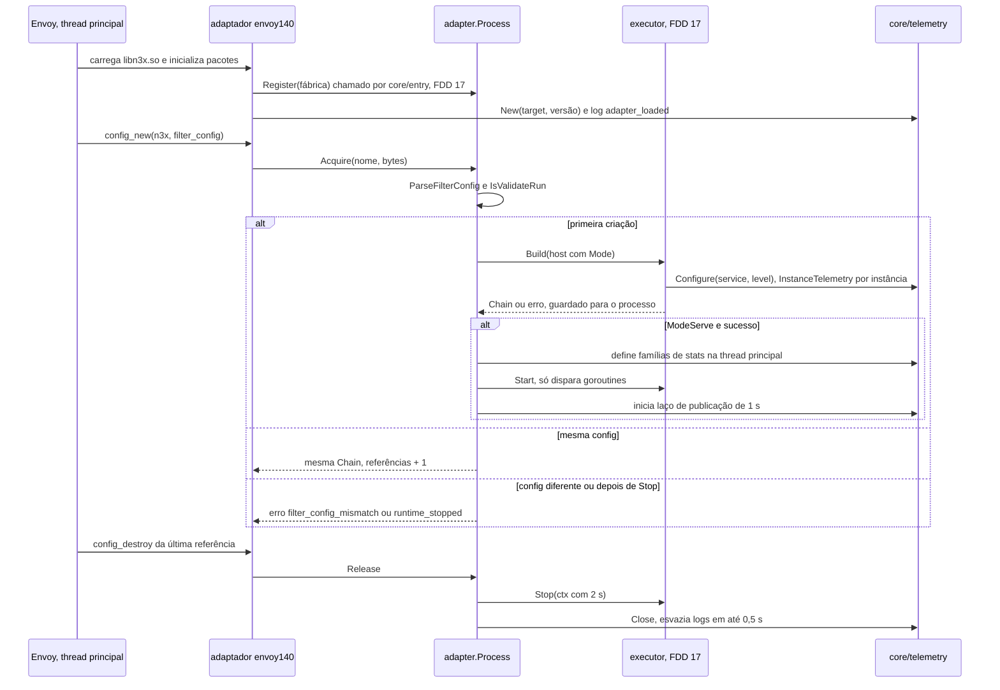
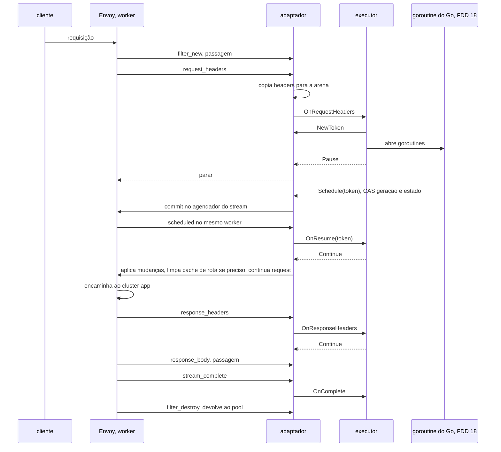
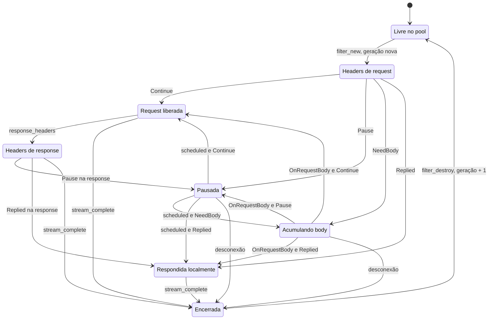
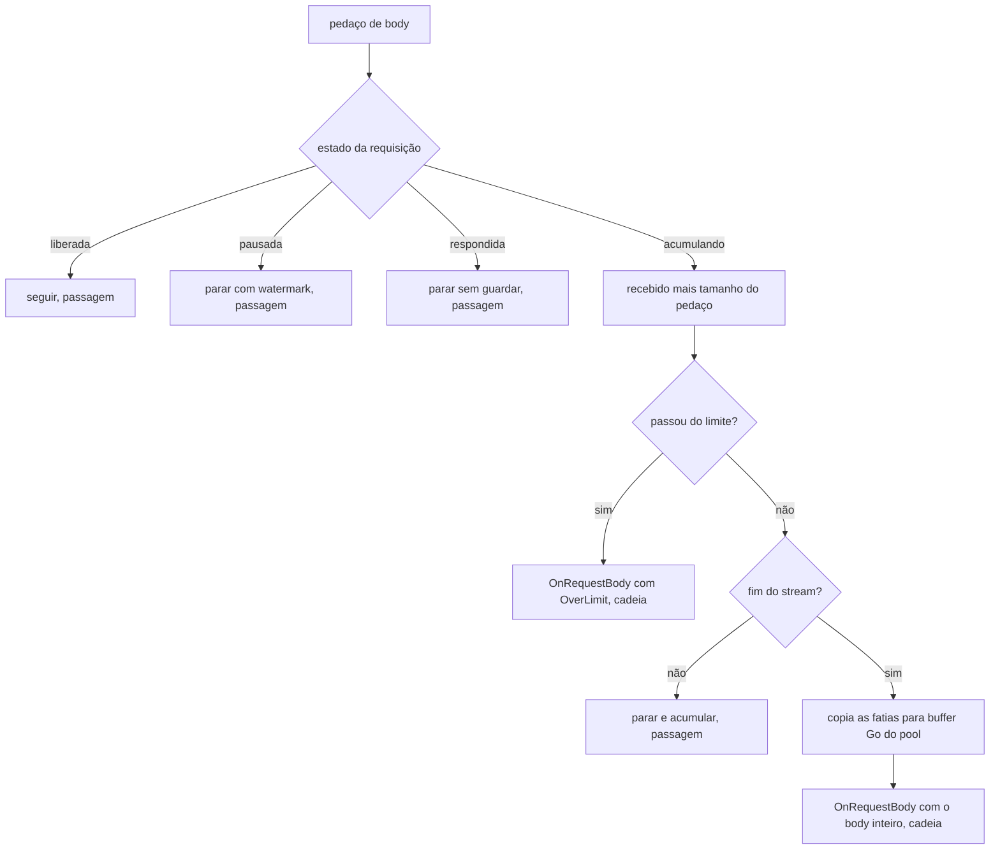

### FDD: Adaptador do alvo `envoy-1.40` e telemetria do `.so` (SID-02)

Versão: 1.0
Data: 2026-10-20
Responsável: Guilherme Giusti

---

### 1. Contexto e motivação técnica

**Problema técnico.** O `libn3x.so` roda dentro do Envoy pelo filtro HTTP de dynamic modules e fala com ele pelo SDK Go oficial, que não tem versão com tag e muda entre commits (PRD, "Dependências"). O executor (FDD 17), a contenção de falhas (FDD 18) e os plugins não podem importar esse SDK (HLD do `n3x-sidecar`, padrão "core e adaptador por alvo"). Falta especificar, de forma verificável, a única camada que traduz o Envoy para o contrato do N3X:

- quantas vezes o Envoy entra no Go por requisição e o que cada entrada faz, já que a meta de "até 5" do PRD não fecha com o ABI (P-02 e I-04 da FDD 05)
- como ler e alterar headers sem alocar e sem ler memória já liberada pelo Envoy
- como entregar o body inteiro numa chamada e aplicar o limite antes do 413 automático do Envoy
- como retomar a requisição depois de um `Go()` sem tocar uma requisição já destruída
- como escrever a negação ciente de gRPC, já que a resposta local do Envoy converte o status HTTP em código gRPC por uma tabela própria, diferente de `proxy.CodeForStatus` (FDD 05)
- como mandar o Envoy recalcular a rota depois de `SetRoute`
- o que acontece quando o Envoy cria a config do filtro mais de uma vez (L-45) e quando roda `--mode validate` (FDD 26)
- como as métricas do `telemetry.Registry` (FDD 06), que aceitam ponto flutuante, viram stats do Envoy, que só guardam inteiros (P-03 da FDD 06), e como os logs saem sem bloquear o worker

**Encaixe no HLD.** Esta FDD especifica as linhas "Adaptador por alvo (`core/adapter/*`)" e "Telemetria (`core/telemetry`)" de "Componentes e responsabilidades" do HLD do `n3x-sidecar`, o "Fluxo de requisição" do lado do Envoy, a tabela de métricas de "Observabilidade" e a parcela "Core do `.so`" do orçamento (ADR-009). Ela cria quatro pacotes no módulo `core/`:

- `core/adapter`: contrato neutro entre adaptador e executor, sem build tag e sem o SDK do Envoy; inclui o controle de processo único (L-45) e o mapa de headers da requisição
- `core/adapter/envoy140`: implementação do alvo `envoy-1.40`, build tag `n3x_envoy140`, único pacote que importa o SDK Go de dynamic modules
- `core/adapter/active`: seletor por build tag usado pelo `main` gerado, para o código gerado não depender do alvo
- `core/telemetry`: runtime de telemetria do `.so` (registro de plugins da FDD 06, métricas da plataforma, exportação para stats do Envoy, escritor de logs sem bloqueio e amostragem de stack)

Consumidores:

- FDD 17 (SID-03): implementa `adapter.Factory` e `adapter.Chain`, usa `adapter.Request` e `adapter.HeaderMap`, monta o `proxy.Env` com as partes desta FDD (D-09: `Metrics`, `Log` e `Target`) e define o `main` gerado (L-03)
- FDD 18 (SID-04): usa `Request.NewToken` e `Request.Schedule` na retomada, alimenta as métricas da plataforma e usa a amostragem de stack
- FDD 38 (SID-10): cria a conexão compartilhada sobre a garantia de processo único (L-45, parte da conexão)
- FDDs 09, 37, 39 e 42: entregam o `config_hash` e os valores de sessão `n3x_controller_*` pela capacidade privilegiada do lado do sidecar
- FDD 23 (BLD-05): usa o log `adapter_loaded` como sinal de carga do `.so`
- FDD 29 (SID-09): chama a parada do runtime pelo canal de controle
- FDD 49 (SID-11): implementa o mesmo contrato `core/adapter` no alvo `istio-1.31`
- FDDs 46, 48 e 50: matriz, conformidade cruzada e benchmark

**Atores.** Envoy (thread principal, workers e agendador), SDK Go de dynamic modules, executor da cadeia (FDD 17), contenção de falhas (FDD 18), plugins (por `proxy.Stream` e `proxy.Env`, sem ver o adaptador), plugin core (capacidades da FDD 09), entrypoint (bootstrap e marcador de validação, FDD 26), Prometheus (raspa `17090`), operador (lê métricas e logs) e mantenedor do sidecar (atualiza o alvo quando o Envoy muda).

**Limites.**
- O adaptador não decide fases, grupos, recortes nem ações (FDD 17), não aplica política de falha, prazo nem disjuntor (FDD 18) e não lê o `n3x.yaml` (quem lê é o executor, com `core/config` da FDD 15)
- O adaptador só traduz eventos, guarda o estado da requisição do lado do Envoy, escreve no fio o que o executor decide e mantém o ciclo de vida do processo
- A telemetria hospeda e publica; quem incrementa cada métrica é a FDD dona do comportamento (HLD do `n3x-sidecar`, "esta FDD entrega o mecanismo")

**Suposições**
- O spike da fase 0 ainda não rodou. O que depende do ABI real do Envoy 1.40 está marcado com "(hipótese; S-xx)" e listado na tabela "Itens a confirmar no spike" da seção 8. O contrato `core/adapter` não muda com o resultado do spike; muda só a implementação dentro de `envoy140`
- O filtro HTTP de dynamic modules chama o módulo em todos os eventos do stream (criação, headers, body por pedaço, trailers, fim, destruição e eventos agendados), mesmo quando o módulo não tem trabalho (hipótese; S-03)
- O bootstrap tem exatamente uma ocorrência do filtro `n3x`, com `do_not_close: true`, e `per_connection_buffer_limit_bytes` do listener de entrada igual a `max(1 MiB, runtime.request_body.max_bytes)` (FDD 26, contrato 1)
- O `envoy --mode validate` roda num processo separado com `N3X_ENVOY_VALIDATE=1`, e só ele (FDD 26, contrato 3)
- O Envoy normaliza o path, limita headers a 60 KiB e 100 itens, recusa `_` em nome de header e gera `x-request-id` antes do filtro (FDD 26; FDD 05)
- Go 1.26 com cgo e `-buildmode=c-shared`; `GODEBUG=cgocheck=0` no processo do Envoy (ADR-008 do `n3x-sidecar`; FDD 26)

**Restrições**
- Só `core/adapter/*` com build tag importa o SDK Go do Envoy; `core/adapter`, `core/telemetry` e o executor não (HLD do `n3x-sidecar`)
- Um runtime Go por processo; o `.so` vem sempre de `/usr/lib/n3x` e nunca é descarregado (PRD, confiabilidade; `do_not_close` da FDD 26)
- 0 alocações por requisição no caminho comum do código do N3X (ADR-009 do `n3x-sidecar`)
- Nenhum rótulo com path, header ou valor vindo do usuário; logs nunca registram headers, corpos ou query strings (HLD do `n3x-sidecar`)
- Sem tracing distribuído na v1 (ADR-009 do `n3x-sdk`)
- Nada vem de variável de ambiente do operador (FR-001); o marcador de validação é sinal interno entre processos do container (FDD 26)
- Documentação e mensagens em pt-BR; identificadores, campos e comandos em inglês

**Rastreabilidade**
- PRD 1.5: FR-003 (HTTP/1.1, HTTP/2 e gRPC; erros do sidecar com o `grpc-status` correto), FR-004 (filtro único no `.so`, seguir, negar, assíncrono e retomar, notificação no fim, negação gRPC com `grpc-status` e `grpc-message`, config recusada na criação); desempenho (p50 até 0,5 ms e p99 até 2 ms; 0 alocações; até 5 entradas do Envoy no Go); observabilidade (logs JSON com serviço, instância e ID do plugin; métricas do sidecar); confiabilidade (um runtime Go por processo, `.so` do disco local); "Dependências" (imagem oficial do Envoy 1.40 e SDK Go de dynamic modules em pseudo-versão; política de ABI do Envoy); critérios de aceite (latência, `panics_total`, carga do `.so` em cada imagem); "Testes e validação" (conformidade seguir, parar, retomar, negar e panic por alvo; teste negativo de `.so` feito para Envoy mais novo)
- ADRs do `n3x-sidecar`: ADR-001 (core como biblioteca, adaptadores por build tag), ADR-002 (métricas `17090` servidas pelo Envoy), ADR-006 (prazos), ADR-007 (o `.so` lê o próprio `n3x.yaml`), ADR-008 (runtime Go no cgroup), ADR-009 (orçamento e cruzamentos)
- ADRs do `n3x-sdk`: ADR-009 (sem tracing), ADR-015 (hooks opcionais detectados na subida), ADR-016 (tarefas e conexões), ADR-022 (métricas por plugin, stats do Envoy no sidecar)
- Lacunas do README:
  - **L-20 preenchida aqui para o `envoy-1.40`:** o alvo declara `request_body` e `route_change`, as duas capacidades opcionais da v1 (FDD 05), igual ao catálogo de alvos (FDD 19). Cada uma tem mecanismo e teste de conformidade próprios (contrato 6)
  - **L-45 fechada aqui na parte do adaptador:** o `.so` cria a cadeia e o runtime uma única vez por processo, na primeira criação da config do filtro; criações seguintes com a mesma config reaproveitam tudo por contagem de referências; config diferente é recusada; `Start` e `Stop` acontecem uma vez por processo (contrato 1). A parte da conexão (um `grpc.ClientConn` por processo) é da FDD 38, sobre esta garantia
  - **L-21 aplicada:** o adaptador compila contra a pseudo-versão registrada em `envoy_go_sdk` do `targets/envoy-1.40.yaml` (FDD 19); o valor é pendente do spike da fase 0
  - **L-12 aplicada (FDD 06):** a telemetria do `.so` publica a família de plataforma `n3x_controller_*` do sidecar, com os nomes mantidos; os valores vêm das FDDs 38 e 39 (contrato 9)
  - **L-13 aplicada (FDD 06):** o campo de log é `request_id`; `x-request-id` só no fio
  - **L-16 aplicada (FDD 26):** o admin está no socket Unix `/tmp/n3x/admin.sock` e a `17090` chega a ele pelo cluster `admin` em `pipe`; a exportação desta FDD não depende do endereço do admin
- Pedidos de FDDs anteriores atendidos:
  - FDD 04: as três métricas de memória publicadas a cada 1 s a partir de `Account.Stats()` (contrato 9)
  - FDD 05: `Target` do `envoy-1.40` (contrato 6); negação renderizada no fio em HTTP e gRPC (contrato 5); cruzamentos extras de body evitados (contrato 3); rota recalculada depois de `SetRoute` (contrato 4); P-02 da FDD 05 fechado
  - FDD 06: `telemetry.Registry` hospedado e publicado a cada 1 s; histogram em segundos nas stats do Envoy (P-03 da FDD 06, contrato 8); log sem bloqueio com `n3x_plugin_log_dropped_total`; `n3x_controller_*` publicadas como exceção de plataforma; `n3x_plugin_metric_series` alimentada
  - FDD 15: `n3x_config_secrets_in_clear` publicada (contrato 9)
  - FDD 19: capacidades do `envoy-1.40` confirmadas; log `adapter_loaded` com as capacidades para o teste da matriz (P-06 da FDD 19)
  - FDD 26: config do filtro lida com `envoycfg.ParseFilterConfig`; marcador `N3X_ENVOY_VALIDATE` respeitado; body acumulado até o limite com o buffer do listener em `max(1 MiB, max_bytes)`; nome das stats `n3x_` no `/stats/prometheus` (P-01 da FDD 26); logs do Envoy não configurados aqui

---

### 2. Objetivos técnicos

- **Cruzamentos com trabalho da cadeia independentes do número de plugins.** Invariante: cada evento do Envoy chama o executor no máximo uma vez, para a cadeia inteira. Medida: com qualquer número de instâncias, no máximo 5 entradas com trabalho de cadeia por requisição no cenário de referência da FDD 05 (body num pedaço e um grupo com `Go()`); 3 na config de referência (core e exemplo, sem body de hook e sem `Go()`), contadas por `n3x_sidecar_entries_total{kind="chain"}`.
- **Passagens baratas.** Medida: toda entrada do Envoy que não chama o executor (criação, destruição, body e trailers sem hook) roda em até 200 ns no p50 no micro-benchmark com ponte falsa, com 0 alocações (hipótese de tempo).
- **0 alocações no código do N3X por requisição.** Medida: em 100.000 requisições no Envoy real com a cadeia roteirizada de "seguir", o perfil de alocação do Go não tem nenhuma amostra em `core/adapter`, `core/adapter/envoy140` nem `core/telemetry`; `testing.AllocsPerRun(1000, ...)` dá 0 nas funções da seção 9.
- **Orçamento do adaptador.** Medida: adaptador mais cadeia vazia somam até 0,05 ms no p50 e 0,20 ms no p99 de latência adicionada a 1.000 rps contra o Envoy puro, deixando o resto da parcela "core do `.so`" (0,15 e 0,50 ms, ADR-009) ao executor (hipótese; medição na máquina do benchmark da FDD 50).
- **Retomada nunca toca requisição encerrada.** Invariante: depois do fim de uma requisição, nenhuma chamada de retomada chega ao Envoy nem ao executor para ela. Medida: fuzzing de 10 minutos com desconexão aleatória do cliente durante `Pause`, 0 crash, 0 retomada aplicada depois do fim e 0 estado de requisição preso no pool.
- **Negação no fio exata.** Invariante: toda negação gRPC sai como trailers-only com HTTP 200, exatamente um `grpc-status` igual ao `Code()` da resposta efetiva e no máximo um `grpc-message`; nunca `grpc-status 0`. Medida: conformidade com 9 respostas prontas mais `NewDeny` com códigos que o Envoy mapearia diferente (404, 429, 400, 503 com `DEADLINE_EXCEEDED`), nas fases de request e de response, em HTTP/1.1, HTTP/2 e gRPC.
- **Processo único.** Invariante: no mesmo processo, `Factory.Build`, `Chain.Start` e `Chain.Stop` rodam no máximo uma vez cada, não importa quantas configs do filtro o Envoy criar. Medida: bootstrap de teste com duas ocorrências do filtro dá 1 `Build`, 1 `Start` e o log `filter_config_reused`.
- **Validação inerte.** Invariante: com `N3X_ENVOY_VALIDATE=1`, o `.so` não chama `Start`, não define stats e não abre goroutine de publicação. Medida: com controller de teste ligado, 0 chamadas de `Login` e `Register` durante o `--mode validate` (com as FDDs 17 e 26).
- **Métricas publicadas a cada 1 s.** Medida: um valor alterado em qualquer goroutine aparece em `GET /metrics` em até 2 s; o passo de publicação com 1.000 séries leva até 5 ms na thread do Envoy (hipótese).
- **Log nunca bloqueia o worker.** Medida: com stderr parado (pipe cheio), um hook que loga 10.000 linhas termina em até 10 ms, as linhas excedentes contam em `n3x_plugin_log_dropped_total` e nenhuma thread do Envoy espera I/O.

---

### 3. Escopo e exclusões

**Incluído**
- Pacote `core/adapter` (neutro): `Factory`, `Host`, `Mode`, `Chain`, `Request`, `Verdict`, `Body`, `Token`, `HeaderMap`, `IsGRPCContentType` e `Process` (processo único, contagem de referências, marcador de validação, `Start` e `Stop`)
- Pacote `core/adapter/envoy140`: fábrica de config do filtro e do filtro sobre o SDK Go de dynamic modules, tradução de cada evento do ABI, acúmulo do body, agendador por stream, resposta local, recálculo de rota, stats nativas (`telemetry.Sink`) e rede de proteção contra panic em toda entrada do ABI
- Pacote `core/adapter/active`: `Register` e `Target` escolhidos pela build tag, com erro de compilação sem tag ou com duas tags
- Leitura da config do filtro com `envoycfg.ParseFilterConfig` (FDD 26) e as regras próprias do adaptador
- Mapa das entradas do Envoy no Go, definição de "cruzamento com trabalho" e "passagem", e a métrica que mede os dois
- Capacidades do `envoy-1.40` (`Target()`), coerentes com o catálogo de alvos (FDD 19)
- Pacote `core/telemetry`: runtime com o `telemetry.Registry` da FDD 06, logger do core, partes do `proxy.Env` (`Metrics`, `Log`, `Target`, D-09), métricas da plataforma com handles sem alocação, coletores, exportação para stats do Envoy a cada 1 s, representação inteira (P-03 da FDD 06), escritor de logs sem bloqueio e amostragem de stack em 1 por segundo
- Catálogo das métricas `n3x_plugin_*`, `n3x_controller_*` (exceção L-12), `n3x_config_secrets_in_clear`, `n3x_build_info` e das novas `n3x_sidecar_*`: nome, tipo, rótulos e quem alimenta
- Formato do log do core e dos plugins e os eventos de log do adaptador e da telemetria
- Pacote `core/adapter/adaptertest`: cadeia roteirizada e `Request` falso para testes do adaptador e do executor
- Suíte de conformidade do adaptador em Envoy real (seguir, parar, retomar, negar, panic, body, rota, desconexão, processo único, validação), amd64 e arm64

**Excluído**
- Ordem das fases, grupos, recortes, ações, aplicação das mudanças de header, detecção de hooks e `proxy.Stream`: FDD 17 (SID-03)
- `recover` em volta de hooks e goroutines de plugin, políticas de falha, prazo do `Go()`, `max_inflight`, zumbis e disjuntor: FDD 18 (SID-04)
- Contrato do `main` gerado e a função de entrada do `core/` (L-03): FDD 17; geração do código: FDD 21 (BLD-03)
- Implementação de `env.Memory()` e `env.Instance()`: FDD 17, que monta o `Env` (proposta da FDD 04, P-06, e I-08 da FDD 06); `Background`, `Dial`, `HTTPClient`: FDD 18; `Controller()`: FDD 38 (D-09)
- Bootstrap que declara o filtro, o buffer do listener e o listener de métricas `17090`, e os logs do Envoy em JSON (`application_log_config`): FDD 26 (SID-06)
- Valores das métricas `n3x_controller_*`: FDD 38 (SID-10) e FDDs 39 e 42 pela capacidade da FDD 09; aqui só a publicação
- Adaptador `istio-1.31` e modo Istio: FDD 49 (SID-11)
- Verificação de símbolos e teste de carga no build: FDD 23 (BLD-05)
- Canal de controle entre entrypoint e `.so`: FDD 29 (SID-09); aqui só o ponto de entrada `Process.Stop`
- Benchmark open-loop como portão de release: FDD 50 (SID-12)
- Fora da v1, por adição quando houver caso real: body de response para plugins (`OnResponseBody`), trailers expostos a plugins, exportação exata de ponto flutuante por um caminho fora das stats do Envoy, tracing

---

### 4. Fluxos detalhados e diagramas

**Fluxo de carga e criação da config do filtro** (thread principal do Envoy)
1. O Envoy carrega `/usr/lib/n3x/libn3x.so` pelo search path (FDD 28) e o runtime Go inicializa os pacotes. O inicializador de variável de pacote do `main` gerado chama `entry.Register(...)` (FDD 17, L-03), que monta a fábrica do executor e chama `active.Register(fábrica)`, porque em `c-shared` a função `main` não roda.
2. O SDK do Envoy confere a versão do ABI. O adaptador cria o `telemetry.Runtime` do processo, com `Target` e versão do `core/`, e loga `adapter_loaded` com alvo, capacidades, `envoy_go_sdk` e versões, sem `service` ainda.
3. O Envoy cria a config do filtro e entrega `filter_name` e `filter_config`. O adaptador chama `Process.Acquire`:
   - confere `filter_name == envoycfg.FilterName`; senão, `filter_name`
   - lê a config com `envoycfg.ParseFilterConfig` (estrita, só `config_path`; `key_path` dá `unknown_field`)
   - lê o marcador com `envoycfg.IsValidateRun(os.Getenv)` e decide `ModeValidate` ou `ModeServe`
   - primeira criação do processo: chama `Factory.Build(host)` sob `recover`. O executor (FDD 17) lê o `n3x.yaml`, chama `telemetry.Runtime.Configure(service, level)`, cria as instâncias com as partes do `Env` desta FDD e compila a cadeia. O resultado (cadeia ou erro) fica guardado para o processo inteiro
   - criação seguinte com os mesmos bytes de `filter_config`: devolve a mesma cadeia e soma uma referência (`filter_config_reused`); com bytes diferentes: `filter_config_mismatch`; depois de `Stop`: `runtime_stopped`
4. Em `ModeServe` e na primeira criação com sucesso, o adaptador define na thread principal as famílias de stats (plataforma e plugins, já seladas) e chama `Chain.Start()`, que só dispara goroutines (tarefas de fundo da FDD 18, conexão da FDD 38) e volta em até 10 ms. Depois inicia o laço de publicação de 1 s e loga `runtime_started`.
5. Em `ModeValidate`, `Build` recebe o modo e devolve uma cadeia inerte (FDD 17: sem `New`, sem tarefas, sem controller); o adaptador não define stats, não chama `Start` e não publica. A criação inteira cabe em 50 ms (hipótese), dentro do prazo de 10 s da validação (FDD 26).
6. Erro em qualquer passo: o adaptador loga `filter_config_rejected` com `path`, `rule` e `detail` (os erros de `n3x.yaml` já saem com os eventos da FDD 15) e devolve falha ao Envoy, que não sobe (FR-004).

**Fluxo principal: requisição sem body de hook e sem `Go()`** (worker do Envoy; config de referência)
1. `filter_new`: o adaptador pega um estado de requisição do pool, com geração nova (passagem).
2. `request_headers`: copia todos os headers de request do Envoy para a arena da requisição numa passada (contrato 4), decide `IsGRPC` pelo `content-type` e chama `Chain.OnRequestHeaders(r, endOfStream)` (cruzamento 1). O executor roda as fases e devolve `Continue`. O adaptador aplica no Envoy o registro de mudanças do `HeaderMap`, em ordem; se `RouteChanged` foi marcado, pede o recálculo da rota; devolve "seguir".
3. `request_body` por pedaço (se houver body): devolve "seguir" sem chamar o executor (passagem).
4. `response_headers`: copia os headers de response e o `:status` e chama `Chain.OnResponseHeaders` (cruzamento 4); aplica as mudanças e devolve "seguir".
5. `response_body` e `response_trailers`: passagem.
6. `stream_complete`: marca a requisição como encerrada e chama `Chain.OnComplete(r)` uma vez (cruzamento 5).
7. `filter_destroy`: devolve buffers e arena ao pool, avança a geração, soma as contagens de entrada da requisição em `n3x_sidecar_entries_total` e devolve o estado ao pool (passagem).

**Mapa das entradas do Envoy no Go** (hipótese de forma do ABI; S-03)

| Entrada do ABI | Quando acontece | Trabalho no Go | Tipo |
| --- | --- | --- | --- |
| `filter_new` | Toda requisição | Estado do pool | passagem |
| `request_headers` | Toda requisição | Cadeia de request (cruzamento 1) | cadeia |
| `request_body` | Por pedaço, se houver body | Soma o tamanho e acumula; no último pedaço com `NeedBody`, cadeia (cruzamento 2); sem `NeedBody`, nada | passagem ou cadeia |
| `request_trailers` | Se a requisição tiver trailers | Fecha o body acumulado: cadeia (cruzamento 2); senão nada | passagem ou cadeia |
| `scheduled` | Uma por retomada pedida pelo executor | Retomada (cruzamento 3) | cadeia |
| `response_headers` | Resposta da aplicação, do Envoy ou local | Cadeia de response (cruzamento 4); na resposta local do N3X, só a correção do contrato 5 | cadeia ou passagem |
| `response_body` | Por pedaço, se houver body | Nada (sem hook de body de response na v1) | passagem |
| `response_trailers` | gRPC e HTTP/2 com trailers | Nada | passagem |
| `stream_complete` | Toda requisição | `OnComplete` (cruzamento 5) | cadeia |
| `filter_destroy` | Toda requisição | Devolve ao pool | passagem |

Contagem por cenário (com qualquer número de instâncias, porque o executor percorre a cadeia dentro de cada cruzamento):

| Cenário | Entradas com cadeia | Entradas totais |
| --- | --- | --- |
| Config de referência, `GET` com resposta num pedaço | 3 | 6 |
| Config de referência, gRPC unário (mensagem num pedaço, trailers na resposta) | 3 | 8 |
| Hook de body com body num pedaço e um grupo com `Go()` (máximo da FDD 05) | 5 | 8 a 10 |
| Negação na fase de request, sem body | 2 | 4 ou 5 |

A meta do PRD e do ADR-009 ("até 5 entradas do Envoy no Go") só é atingível como "até 5 entradas com trabalho de cadeia": criação, destruição e pedaços de body ou trailers sempre entram no Go no ABI de dynamic modules (inconsistência I-01). As passagens são O(1), sem alocação e sem chamar o executor.

**Fluxo do `Go()`: parar e retomar**
1. No cruzamento 1, um grupo devolve `Go()`. O executor (FDDs 17 e 18) chama `r.NewToken()` no worker, que cria o agendador do stream no Envoy na primeira vez, abre as goroutines e devolve `Pause`. O adaptador devolve "parar" ao Envoy.
2. Pedaços de body que chegam durante a pausa recebem "parar com watermark": o Envoy guarda e aplica controle de fluxo, sem 413 (hipótese; S-05).
3. Quando o grupo termina (ou estoura o prazo), a goroutine da FDD 18 chama `r.Schedule(token)`. O adaptador confere, por CAS na palavra de estado, que a geração é a do token e que a requisição não terminou; marca "enviando", faz o commit no agendador do Envoy e volta para "ativa". Se a requisição terminou ou a geração mudou, devolve `false` sem tocar o Envoy.
4. O Envoy entrega `scheduled` no worker da requisição. O adaptador confere geração e encerramento de novo e chama `Chain.OnResume(r, token)` (cruzamento 3). Com `Continue`, aplica as mudanças, recalcula a rota se preciso e manda o Envoy continuar a direção pausada (request ou response).
5. Evento agendado de geração antiga ou de requisição encerrada é descartado e conta como passagem.

**Fluxo do body inteiro (`NeedBody`)**
1. O executor devolve `NeedBody` em `OnRequestHeaders` (ou em `OnResume`) quando a próxima fase tem instância com hook de body no recorte e a requisição tem body. O adaptador devolve "parar" nos headers.
2. A cada pedaço, o adaptador soma `recebido` (inclui o que chegou durante uma pausa anterior):
   - `recebido <= limite` e sem fim do stream: devolve "parar e acumular" (passagem); o Envoy guarda, e como o buffer do listener é `max(1 MiB, max_bytes)` (FDD 26), o Envoy não responde 413 sozinho
   - `recebido <= limite` e fim do stream (no último pedaço ou nos trailers): copia o body acumulado no Envoy (uma ou mais fatias) para um buffer Go do pool e chama `Chain.OnRequestBody(r, Body{Data, Size})` (cruzamento 2)
   - `recebido > limite`: para de acumular e chama `Chain.OnRequestBody(r, Body{Size, OverLimit: true})` na hora (cruzamento 2). O executor decide pela política (FDD 05 e 18): `Replied` com `PayloadTooLarge` (413 ou `RESOURCE_EXHAUSTED`) ou `Continue` sem os hooks de body (`reason="body_limit"`); com `Continue`, o Envoy segue com o que guardou e o resto passa sem acumular
3. O limite vem de `Chain.RequestBodyLimit()`, que o executor lê de `runtime.request_body.max_bytes` (FDD 15).
4. Se o fim do stream já tinha chegado durante uma pausa, o body está completo no Envoy e `OnRequestBody` roda dentro do próprio `scheduled`, sem entrada extra.

**Fluxos alternativos e exceções**
- **Negação na fase de request:** o executor chama `r.Reply(resp)` e devolve `Replied`. O adaptador escreve a resposta local do contrato 5 e devolve "parar". Se a resposta local passar pelo `response_headers` do próprio filtro, o adaptador reconhece a marca da requisição, aplica a correção do contrato 5 quando ela for o mecanismo escolhido e não chama o executor (FDD 05: negações não passam pelos hooks de response).
- **Negação na fase de response:** o mesmo `Reply`, chamado com os headers de response parados; o Envoy troca a resposta da aplicação e descarta o body dela (hipótese; S-07).
- **`SetRoute`:** o executor grava `:path` e `:authority` no `HeaderMap` e chama `r.RouteChanged()`. Antes de liberar a direção de request, o adaptador aplica as mudanças e manda o Envoy limpar o cache de rota, uma vez por liberação; a rota é escolhida de novo entre as rotas `grpc` e `http` do mesmo cluster `app` (FDD 26, I-06 dela). Sem `RouteChanged`, não há recálculo.
- **Cliente desconecta com `Pause` pendente:** o Envoy chama `stream_complete` e `filter_destroy`. O adaptador marca encerrada (CAS), chama `OnComplete` uma vez (o executor cancela o `ctx` do `Go()`), espera um commit em andamento terminar (laço curto com `runtime.Gosched`) e só então apaga o agendador. `Schedule` posterior devolve `false`.
- **`stream_complete` não chega** (reset em que o Envoy só chama a destruição; S-03): o adaptador chama `OnComplete` dentro do `filter_destroy`. `OnComplete` roda exatamente uma vez por requisição.
- **Panic ou veredito inválido vindo do executor** (bug do core, fora do `recover` da FDD 18): a rede de proteção do adaptador recupera, soma em `n3x_sidecar_core_errors_total{event, kind}`, loga `adapter_panic` (stack em no máximo 1 por segundo no processo) ou `adapter_contract_violation` e, se a resposta ainda não saiu, responde `proxy.Internal("")` (500 ou `INTERNAL`). Em `stream_complete` e `filter_destroy`, só recupera e termina a limpeza.
- **Requisição com trailers e sem `NeedBody`:** passagem.
- **Segunda criação da config do filtro** (bootstrap com duas ocorrências ou Istio com várias cadeias de entrada): mesma cadeia por contagem de referências; nenhum `New`, nenhuma conexão e nenhuma tarefa a mais.
- **Destruição da última config:** `Process.Stop` com prazo de `ShutdownGrace` (2 s) mais 0,5 s para esvaziar os logs. Se o canal de controle (FDD 29) chamar `Stop` antes, a destruição só solta a referência. Uma criação depois de `Stop` é recusada (`runtime_stopped`).
- **`--mode validate`:** criação inerte (passo 5 do fluxo de carga); o processo termina sem `Start` nem `Stop`.

**Diagramas**

Carga, processo único (L-45) e marcador de validação:



Requisição com um grupo `Go()` e retomada:



Estados do estado de requisição no adaptador:



Decisão a cada pedaço de body de request:



---

### 5. Contratos públicos (assinaturas, endpoints, headers, exemplos)

**Contrato 1: config do filtro, criação e processo único (`adapter.Process`, L-45)**
- Tipo: method (API Go do módulo `github.com/giustech/n3x-sidecar/core`, chamada pelos adaptadores e pela FDD 29)
- Assinatura/Rota:
  ```go
  package adapter // github.com/giustech/n3x-sidecar/core/adapter (sem build tag, sem o SDK do Envoy)

  type Mode uint8

  const (
      ModeServe    Mode = iota + 1 // processo real do Envoy
      ModeValidate                 // envoy --mode validate com N3X_ENVOY_VALIDATE=1 (FDD 26)
  )

  const (
      ShutdownGrace = 2 * time.Second        // FDD 06 e ADR-006
      LogFlushGrace = 500 * time.Millisecond // hipótese
      StartBudget   = 10 * time.Millisecond  // Chain.Start precisa voltar neste tempo (hipótese)
  )

  // Process existe uma vez por processo do Envoy; os adaptadores guardam um em variável de pacote.
  type Process struct{ /* fábrica, cadeia, resultado da primeira criação, referências, estado */ }

  func NewProcess(target proxy.Target, tel *telemetry.Runtime, getenv func(string) string) *Process
  func (p *Process) SetFactory(f Factory) error // uma vez; segunda chamada: ErrFactoryAlreadySet

  // Acquire roda na thread principal em toda criação da config do filtro.
  func (p *Process) Acquire(filterName string, filterConfig []byte) (Chain, error)
  // Release roda na destruição da config; a última referência chama Stop.
  func (p *Process) Release()
  // Stop é idempotente; chamado pela última Release ou pelo canal de controle (FDD 29).
  func (p *Process) Stop(ctx context.Context)
  func (p *Process) Mode() Mode
  func (p *Process) Refs() int

  var (
      ErrFactoryAlreadySet   = errors.New("adapter: fábrica já registrada")
      ErrNoFactory           = errors.New("adapter: nenhuma fábrica registrada no carregamento do .so")
      ErrFilterName          = errors.New("adapter: filter_name diferente de n3x")
      ErrFilterConfigChanged = errors.New("adapter: config do filtro diferente da primeira deste processo")
      ErrRuntimeStopped      = errors.New("adapter: runtime parado; reinicie o processo")
      ErrBuildFailed         = errors.New("adapter: a cadeia não foi criada")
  )
  ```
- Método: n/a (chamada local, na thread principal do Envoy)
- Semântica de status/headers:
  - **Formato no fio:** o `filter_config` é um `google.protobuf.StringValue` com o JSON `{"config_path": "<caminho absoluto>"}`; o adaptador lê com `envoycfg.ParseFilterConfig` (FDD 26, contrato 3), estrito, com as regras `size`, `syntax`, `unknown_field` (inclusive `key_path`), `required` e `file_path`. O adaptador não reimplementa nenhuma regra do formato
  - **Regras próprias do adaptador** (códigos estáveis, caminho pela convenção L-34): `filter_name` (nome diferente de `n3x`), `filter_config_mismatch` (bytes diferentes da primeira criação do processo), `runtime_stopped` (criação depois de `Stop`), `build_failed` (erro devolvido por `Factory.Build`, com o erro original embrulhado), `panic` (panic durante `Build`, recuperado), `no_factory` (o `main` não registrou fábrica)
  - **Processo único (L-45, parte do adaptador):** a primeira criação do processo decide tudo: com sucesso, a cadeia e o runtime valem até o fim do processo; com erro, o mesmo erro volta para toda criação seguinte, sem ler o `n3x.yaml` de novo. A config só muda com redeploy (HLD), então ler duas vezes não traria nada e poderia aplicar uma config pela metade
  - **Comparação:** criações seguintes comparam os bytes crus de `filter_config` com os da primeira; iguais somam uma referência e devolvem a mesma `Chain`; diferentes falham com `filter_config_mismatch`, porque o processo só tem um `n3x.yaml`
  - **Marcador:** `ModeValidate` quando `envoycfg.IsValidateRun(getenv)` é verdadeiro (FDD 26). Nesse modo, `Build` recebe o modo e devolve uma cadeia inerte; o adaptador nunca chama `Start`, `Stop` nem os hooks de requisição dela, não define stats e não publica
  - **`Start`:** no fim da primeira criação com sucesso em `ModeServe`, na thread principal, depois de definir as famílias de stats. É o "início depois da subida completa" das FDDs 06 e 17: todas as instâncias já foram criadas, porque o bootstrap tem uma ocorrência do filtro (FDD 26). `Start` precisa voltar em `StartBudget`; trabalho longo vai para goroutine
  - **`Stop`:** uma vez por processo, com `ctx` de `ShutdownGrace`. Depois que `Chain.Stop` volta (ou o prazo vence), o runtime de telemetria esvazia a fila de logs em até `LogFlushGrace`. O destino do `Stop` chamado pela destruição é a thread principal, que pode ficar parada até 2,5 s no desligamento (dentro dos 5 s até o SIGKILL, ADR-006)
  - **Referências a zero fora do desligamento** (Istio removendo o filtro): `Stop` também roda; uma criação depois disso é recusada com `runtime_stopped` e o pod precisa reiniciar (hipótese; FDD 49 confere)
  - **Garantia para a FDD 38:** como `Build`, `Start` e `Stop` rodam no máximo uma vez por processo e nunca em `ModeValidate`, a conexão compartilhada criada nesses pontos é única por processo e nunca existe no processo de validação

**Exemplo de requisição** (três criações no mesmo processo e uma no processo de validação)
```json
[
  { "processo": "serve", "filter_name": "n3x", "filter_config": "{\"config_path\":\"/etc/n3x/n3x.yaml\"}" },
  { "processo": "serve", "filter_name": "n3x", "filter_config": "{\"config_path\":\"/etc/n3x/n3x.yaml\"}" },
  { "processo": "serve", "filter_name": "n3x", "filter_config": "{\"config_path\":\"/etc/n3x/outro.yaml\"}" },
  { "processo": "validate", "N3X_ENVOY_VALIDATE": "1", "filter_name": "n3x", "filter_config": "{\"config_path\":\"/etc/n3x/n3x.yaml\",\"key_path\":\"/run/n3x/aes.key\"}" }
]
```

**Exemplo de resposta** (logs JSON, um por criação)
```text
{"ts":"2026-10-20T14:00:01.210Z","level":"info","component":"core","service":"pedidos","msg":"filter_config_created","config_path":"/etc/n3x/n3x.yaml","mode":"serve","refs":1,"duration_ms":38}
{"ts":"2026-10-20T14:00:01.211Z","level":"info","component":"core","service":"pedidos","msg":"filter_config_reused","refs":2}
{"ts":"2026-10-20T14:00:01.212Z","level":"error","component":"core","service":"pedidos","msg":"filter_config_rejected","path":"filter_config","rule":"filter_config_mismatch","detail":"config do filtro diferente da primeira deste processo; o processo só tem um n3x.yaml"}
{"ts":"2026-10-20T14:00:00.402Z","level":"error","component":"core","msg":"filter_config_rejected","path":"filter_config.key_path","rule":"unknown_field","detail":"campo desconhecido; removido, o caminho da chave vem de keys.aes_file no n3x.yaml"}
```

---

**Contrato 2: registro, `Factory`, `Host` e ciclo de vida da `Chain`**
- Tipo: sdk (interfaces Go entre adaptador e executor, estáveis entre `envoy140` e `istio131`)
- Assinatura/Rota:
  ```go
  package adapter

  // Factory é implementada pelo executor (FDD 17).
  type Factory interface {
      // Build roda uma vez por processo, na thread principal, dentro da primeira criação da config do filtro.
      Build(h Host) (Chain, error)
  }

  type FactoryFunc func(h Host) (Chain, error)
  func (f FactoryFunc) Build(h Host) (Chain, error)

  // Host é o que o adaptador oferece ao executor no Build.
  type Host interface {
      Target() proxy.Target                // alvo e capacidades (contrato 6)
      Mode() Mode                          // ModeServe ou ModeValidate
      FilterConfig() envoycfg.FilterConfig // config_path
      Telemetry() *telemetry.Runtime       // contrato 7
  }

  // Chain é a cadeia compilada (FDD 17). Os hooks de requisição estão no contrato 3.
  type Chain interface {
      Start()                       // uma vez, thread principal, ModeServe; só dispara goroutines
      Stop(ctx context.Context)     // uma vez; volta até o prazo do ctx
      RequestBodyLimit() int64      // runtime.request_body.max_bytes, fixo depois do Build
      RequestHooks                  // contrato 3
  }
  ```
  ```go
  package active // github.com/giustech/n3x-sidecar/core/adapter/active (um arquivo por build tag)

  func Register(f adapter.Factory) // chamado por core/entry (FDD 17) na inicialização do .so
  func Target() proxy.Target       // o alvo compilado
  ```
  ```go
  package envoy140 // github.com/giustech/n3x-sidecar/core/adapter/envoy140, //go:build n3x_envoy140

  const TargetName = "envoy-1.40"

  func Register(f adapter.Factory) // registra a fábrica do filtro no SDK Go do Envoy
  func Target() proxy.Target       // contrato 6
  ```
- Método: n/a
- Semântica:
  - **Seletor por build tag:** `active` tem um arquivo com `//go:build n3x_envoy140 && !n3x_istio131` que repassa para `envoy140`, outro com `n3x_istio131 && !n3x_envoy140` (FDD 49) e um terceiro com `!n3x_envoy140 && !n3x_istio131 || n3x_envoy140 && n3x_istio131` que referencia o identificador inexistente `faltaExatamenteUmaTagDeAlvo_n3x_envoy140_ou_n3x_istio131`, para a compilação falhar com mensagem legível (hipótese de forma). Quem importa `active` é o pacote `core/entry` (FDD 17); o `main` gerado (FDD 21) importa só `core/entry`, o plugin core e os `agent/`, e compila com a tag de `catalog.BuildTag()` (FDD 19)
  - **Registro no carregamento (L-03, fechada na FDD 17):** em `-buildmode=c-shared`, `main()` não roda; o `main` gerado faz uma única chamada `entry.Register(entry.Core("<módulo>", core.Plugin()), entry.Plugin("<id>", "<módulo>", agent.Plugin())...)` num inicializador de variável de pacote (`var _ = ...`), com `func main() {}` vazio, sem `init()` e sem `//export`; `core/entry` monta a fábrica e chama `active.Register`. Os símbolos do ABI vêm do SDK Go do Envoy, importado por `envoy140` (I-07). Sem registro, a criação falha com `no_factory`
  - **`Build`:** roda sob o `recover` do adaptador; panic vira `panic` na criação. Pode demorar o que a subida exigir (leitura do `n3x.yaml`, decifra, `New` dos plugins); só não pode fazer I/O de rede (FDD 06)
  - **Threads:** `Build`, `Start` e `Stop` rodam na thread principal; os hooks de requisição, nos workers, em paralelo entre requisições e em série dentro de uma requisição
  - **Estabilidade:** `Factory`, `Host`, `Chain`, `Request`, `HeaderMap`, `Verdict`, `Body` e `Token` são o contrato que `istio131` (FDD 49) implementa igual; método novo só por adição com a mudança nos dois adaptadores na mesma versão do `core/`

**Exemplo de requisição**
```go
// Code generated by n3x-plugin build. DO NOT EDIT. (contrato 1 da FDD 17, L-03)
package main

import (
    "github.com/giustech/n3x-sidecar/core/entry"

    n3x_core "github.com/giustech/n3x-plugin-core/agent"
    n3x_example "github.com/giustech/n3x-example/agent"
)

// entry.Register monta a fábrica do executor e chama active.Register (este contrato).
var _ = entry.Register(
    entry.Core("github.com/giustech/n3x-plugin-core", n3x_core.Plugin()),
    entry.Plugin("n3x.example", "github.com/giustech/n3x-example", n3x_example.Plugin()),
)

func main() {}
```

**Exemplo de resposta** (`go build -buildmode=c-shared` com e sem tag, e log no carregamento)
```text
$ go build -buildmode=c-shared -tags n3x_envoy140 -o libn3x.so .
(ok)
$ go build -buildmode=c-shared -o libn3x.so .
core/adapter/active/notag.go:9:9: undefined: faltaExatamenteUmaTagDeAlvo_n3x_envoy140_ou_n3x_istio131

{"ts":"2026-10-20T14:00:00.950Z","level":"info","component":"core","msg":"adapter_loaded","target":"envoy-1.40","capabilities":"request_body,route_change","envoy_go_sdk":"github.com/envoyproxy/envoy/source/extensions/dynamic_modules/sdk/go v0.0.0-<fase 0>","core_version":"1.0.0","go_version":"go1.26.0"}
```

---

**Contrato 3: hooks de requisição, `Request`, `Verdict`, `Body` e `Token`**
- Tipo: sdk (interfaces Go; o executor implementa `RequestHooks`, o adaptador implementa `Request`)
- Assinatura/Rota:
  ```go
  package adapter

  type RequestHooks interface {
      OnRequestHeaders(r Request, endOfStream bool) Verdict  // cruzamento 1
      OnRequestBody(r Request, b Body) Verdict               // cruzamento 2
      OnResume(r Request, t Token) Verdict                   // cruzamento 3
      OnResponseHeaders(r Request, endOfStream bool) Verdict // cruzamento 4
      OnComplete(r Request)                                  // cruzamento 5, exatamente uma vez
  }

  type Verdict uint8

  const (
      Continue Verdict = iota // libera a direção atual
      Pause                   // espera OnResume; o executor já pediu ou vai pedir Schedule
      NeedBody                // só na direção de request: acumule o body e chame OnRequestBody
      Replied                 // r.Reply foi chamado; nada mais nesta requisição
  )

  type Body struct {
      Data      []byte // body inteiro, em buffer Go do pool; nil se OverLimit
      Size      int64  // bytes recebidos até a decisão
      OverLimit bool   // Size passou de Chain.RequestBodyLimit()
  }

  type Token struct{ /* geração da requisição e direção; comparável; 16 bytes */ }

  type Request interface {
      Headers() *HeaderMap         // headers de request (contrato 4)
      ResponseHeaders() *HeaderMap // headers de response; vazio antes do cruzamento 4
      Status() int                 // :status da resposta; 0 antes dela ou sem ela
      IsGRPC() bool                // IsGRPCContentType do content-type original da request
      RouteChanged()               // :path ou :authority mudaram; recálculo antes de liberar
      Reply(resp proxy.DenyResponse) // resposta local (contrato 5); só dentro de um cruzamento
      NewToken() Token             // só dentro de um cruzamento; prepara a retomada
      Schedule(t Token) bool       // de qualquer goroutine; false se a requisição terminou ou o token é velho
      SetValue(v any)              // estado do executor; guarde um ponteiro (sem alocação)
      Value() any
      Ended() bool                 // fim da requisição já registrado
  }

  func IsGRPCContentType(v string) bool // prefixo "application/grpc" sem diferenciar maiúsculas (FDD 05)
  ```
- Método: n/a (chamadas locais no worker; `Schedule` de qualquer goroutine)
- Semântica:
  - **Vereditos aceitos por hook** (outro valor é violação de contrato, tratada como panic do core):

| Hook | `Continue` | `Pause` | `NeedBody` | `Replied` |
| --- | --- | --- | --- | --- |
| `OnRequestHeaders` | sim | sim | sim, se `endOfStream` é falso | sim |
| `OnRequestBody` | sim | sim | não | sim |
| `OnResume` na direção de request | sim | sim | sim, se a request tem body | sim |
| `OnResume` na direção de response | sim | sim | não | sim |
| `OnResponseHeaders` | sim | sim | não | sim |

  - **Sem cruzamento extra de body** (pedido da FDD 05): o adaptador só acumula body quando o executor devolve `NeedBody`; sem isso, cada pedaço é passagem. Body de response nunca chama o executor na v1
  - **Body inteiro numa chamada:** `Body.Data` é contíguo, copiado das fatias do Envoy para um buffer Go do pool (classes de 16 KiB, 64 KiB, 256 KiB e 1 MiB; acima de 1 MiB, buffer novo descartado no fim) (hipótese). O buffer vale até o `filter_destroy`, o que cobre a regra da FDD 05 ("até o hook retornar") com folga; plugin que guardar o slice depois disso lê memória Go reaproveitada, nunca memória do Envoy
  - **Estouro:** quando `Size` passa do limite, o adaptador chama `OnRequestBody` com `OverLimit` antes de o Envoy guardar o pedaço; com o buffer do listener em `max(1 MiB, max_bytes)` (FDD 26), o 413 automático do Envoy não acontece (P-02 da FDD 05)
  - **`Token` e `Schedule`:** o estado da requisição tem uma palavra atômica de 64 bits com a geração (48 bits) e os bits `ended` e `committing`. `NewToken` grava a geração atual e a direção. `Schedule` faz CAS de "ativa na geração do token" para "enviando", chama o commit do agendador do Envoy, e volta para "ativa"; o `filter_destroy` faz CAS para `ended`, esperando um "enviando" em curso terminar, e só depois apaga o agendador e avança a geração. Assim nenhum commit toca agendador apagado e nenhum token velho retoma uma requisição reaproveitada. Um token só retoma uma vez
  - **`IsGRPC`:** a regra mora aqui, uma vez, porque o adaptador precisa dela para a resposta local e para a rede de proteção; o executor usa `r.IsGRPC()` em `StreamInfo.IsGRPC()` (pedido à FDD 17)
  - **`Reply` fora de um cruzamento** (de uma goroutine): ignorado, com `adapter_contract_violation`; a requisição segue o veredito do cruzamento em curso
  - **`OnComplete`:** exatamente uma vez, no `stream_complete` ou, se ele não vier, no `filter_destroy`; depois dele, `Ended()` é verdadeiro e nenhum outro hook roda
  - **Custo:** `Headers`, `ResponseHeaders`, `Status`, `IsGRPC`, `RouteChanged`, `SetValue`, `Value`, `Ended`, `NewToken` (depois do primeiro do stream) e `Schedule`: 0 alocações. O primeiro `NewToken` de um stream cria o agendador no Envoy (memória do Envoy, fora do Go)

**Exemplo de requisição** (cadeia roteirizada do `adaptertest`, usada na conformidade)
```go
script := adaptertest.Script{
    OnRequestHeaders: func(r adapter.Request, eos bool) adapter.Verdict {
        r.Headers().Set("x-n3x-seen", "1")
        if eos {
            return adapter.Continue
        }
        return adapter.NeedBody
    },
    OnRequestBody: func(r adapter.Request, b adapter.Body) adapter.Verdict {
        if b.OverLimit {
            r.Reply(proxy.PayloadTooLarge("body acima do limite"))
            return adapter.Replied
        }
        return adapter.Continue
    },
    BodyLimit: 4 << 20,
}
// POST de 3 MiB e POST de 5 MiB em gRPC
```

**Exemplo de resposta**
```json
[
  { "requisição": "POST 3 MiB", "OnRequestBody": { "Size": 3145728, "OverLimit": false, "sha256 igual ao enviado": true }, "aplicação recebe x-n3x-seen": "1", "entradas": { "chain": 3, "total": "6 mais um request_body por pedaço" } },
  { "requisição": "gRPC 5 MiB", "OnRequestBody": { "Size": 4210688, "OverLimit": true }, "resposta": { ":status": 200, "grpc-status": "8", "grpc-message": "body acima do limite" }, "Envoy respondeu 413 sozinho": false }
]
```

---

**Contrato 4: `HeaderMap` (cópia única, leitura sem cópia e registro de mudanças)**
- Tipo: sdk (tipo concreto Go em `core/adapter`)
- Assinatura/Rota:
  ```go
  type HeaderMap struct{ /* arena []byte, índices, registro de mudanças; reaproveitado pelo pool */ }

  func (h *HeaderMap) Len() int
  func (h *HeaderMap) At(i int) (name, value string)        // ordem de chegada; nome em minúsculas
  func (h *HeaderMap) Get(name string) string               // primeiro valor; "" se ausente
  func (h *HeaderMap) Lookup(name string) (string, bool)
  func (h *HeaderMap) Set(name, value string)               // troca todos os valores
  func (h *HeaderMap) Add(name, value string)
  func (h *HeaderMap) Del(name string)
  func (h *HeaderMap) Changes() int                         // mudanças ainda não aplicadas no Envoy

  const (
      MaxRetainedArena = 64 << 10 // arena maior não volta ao pool (hipótese)
  )
  ```
- Método: n/a
- Semântica (resposta à pergunta das 0 alocações):
  - **Cópia única para o pool** (hipótese, em vez de referência à memória do Envoy): no cruzamento de headers, o adaptador lê todos os pares numa chamada ao ABI (S-04) e copia nomes e valores para a arena da requisição; daí em diante, toda leitura devolve strings que apontam para a arena, sem cópia e sem alocação. Custo de uma cópia de cerca de 1 KiB por requisição (até 500 ns para 20 headers, hipótese), em troca de três garantias:
    - nenhuma string entregue ao executor ou ao plugin aponta para memória do Envoy, que pode ser liberada por uma mudança de header ou no fim do callback
    - valores passados ao `Set` e ao `Add` que são fatias de strings do próprio mapa continuam válidos mesmo depois de um `Del` do header de origem, porque toda mudança copia nome e valor para a arena (requisito da FDD 05 para as FDDs 16 e 17)
    - plugin que guarda string além do hook (uso indevido) lê dado reaproveitado, nunca memória liberada: falha de dado, não crash
  - **Registro de mudanças:** `Set`, `Add` e `Del` alteram a visão e acrescentam a operação ao registro. Ao liberar a direção (ou antes de pausar, nunca no meio de um grupo), o adaptador aplica o registro no Envoy em ordem e o zera. `Changes()` mostra o tamanho pendente. O mapa não valida nome nem valor: a validação é do SDK (`proxy.CheckHeader`) no executor
  - **Pseudo-headers:** `:path`, `:authority`, `:method` e `:status` podem ser lidos; só o executor escreve `:path` e `:authority` (pelo `SetRoute` da FDD 05), seguido de `RouteChanged()`
  - **Recálculo de rota (pedido da FDD 05):** com `RouteChanged()` marcado, o adaptador aplica as mudanças e chama a limpeza do cache de rota do Envoy (S-04) uma vez, antes de liberar a request. O Envoy escolhe a rota de novo entre `grpc` e `http` do cluster `app` (FDD 26). Fases seguintes e recortes já usam o path novo pela visão do executor
  - **Comparação de nomes:** ASCII sem diferenciar maiúsculas, sem alocar
  - **Retenção:** a arena cresce até o tamanho da maior requisição; arena acima de 64 KiB não volta ao pool (o limite do Envoy é 60 KiB de headers mais as mudanças)

**Exemplo de requisição**
```go
h := r.Headers()                 // GET /v2/pedidos?status=aberto, x-b: abc
v := h.Get("x-b")                // aponta para a arena
h.Del("x-b")
h.Set("x-a", v)                  // seguro: o valor é copiado para a arena antes do Del valer no Envoy
h.Set(":path", "/pedidos?status=aberto")
r.RouteChanged()
return adapter.Continue
```

**Exemplo de resposta** (operações aplicadas no Envoy ao liberar)
```json
{
  "registro aplicado em ordem": [
    { "op": "remove", "name": "x-b" },
    { "op": "set", "name": "x-a", "value": "abc" },
    { "op": "set", "name": ":path", "value": "/pedidos?status=aberto" }
  ],
  "limpeza do cache de rota": 1,
  "path recebido pela aplicação": "/pedidos?status=aberto",
  "alocações no Go": 0
}
```

---

**Contrato 5: resposta local (negação ciente de gRPC no fio)**
- Tipo: method (`Request.Reply`) e formato no fio
- Assinatura/Rota: `Request.Reply(resp proxy.DenyResponse)`, dentro de um cruzamento, seguido de `return adapter.Replied`
- Método: n/a
- Semântica de status/headers:
  - **Entrada:** o adaptador aplica `resp.Effective()` de novo (idempotente, FDD 05), então status fora de 400 a 599 ou código 0 nunca chegam ao fio
  - **HTTP** (formato da FDD 05, contrato 5): `:status` igual a `Status()`; `content-type: text/plain; charset=utf-8`; os headers extras da resposta; body igual a `Message()` (vazio se a mensagem é vazia; sem body em `HEAD`); `content-length` do Envoy
  - **gRPC** (quando `r.IsGRPC()`): `:status: 200`; `content-type: application/grpc`; exatamente um `grpc-status` com `Code()` em decimal; `grpc-message` com `proxy.AppendGRPCMessage(Message())`, omitido se vazio, no máximo um; os headers extras; fim do stream no quadro de headers (trailers-only), sem body
  - **Por que não basta a resposta local crua do Envoy:** numa requisição gRPC, o Envoy converte o status HTTP da resposta local com a tabela dele (`400` vira `INTERNAL`, `404` vira `UNIMPLEMENTED`, `429` e `504` viram `UNAVAILABLE`, o resto vira `UNKNOWN`) e pode acrescentar o header do módulo sem trocar o dele, gerando dois `grpc-status` (hipótese; S-07). Isso diverge de `proxy.CodeForStatus` e de qualquer `NewDeny` com código explícito (I-08)
  - **Mecanismo** (escolhido no spike, S-07, na ordem; o primeiro que passa na conformidade vale e fica registrado no catálogo do alvo):
    1. resposta local do ABI com código gRPC explícito, se o commit fixado oferecer
    2. resposta local com o status HTTP e a correção no `response_headers` do próprio filtro, que troca (`set`, nunca `add`) `grpc-status` e `grpc-message` quando a requisição tem a marca de resposta local do N3X
    3. envio direto dos headers com fim do stream, se o ABI oferecer
  - Se nenhum passar, o `envoy-1.40` não pode virar `supported` (a negação é obrigatória, FDD 05 contrato 7); a contingência está na seção 10
  - **Detalhe da resposta:** `n3x` no campo de detalhes da resposta local do Envoy, para access log e tap (hipótese)
  - **Fase de response:** o mesmo `Reply` com os headers de response parados; o Envoy troca a resposta da aplicação e descarta body e trailers dela (S-07)
  - **Respostas do Envoy depois do encaminhamento** (503 sem aplicação, 504 de prazo): não passam por aqui; o formato gRPC delas é da FDD 26

**Exemplo de requisição**
```text
r.Reply(proxy.Forbidden("bloqueado"))                                   GET /admin HTTP/1.1
r.Reply(proxy.NotFound("sem pedido"))                                    gRPC /pedidos.v1.Pedidos/Obter
r.Reply(proxy.NewDeny(503, codes.DeadlineExceeded, "réplica lenta"))     gRPC
```

**Exemplo de resposta**
```text
HTTP/1.1 403 Forbidden
content-type: text/plain; charset=utf-8
content-length: 9

bloqueado

:status: 200
content-type: application/grpc
grpc-status: 5
grpc-message: sem pedido
(fim do stream nos headers; o Envoy sozinho daria grpc-status 12)

:status: 200
content-type: application/grpc
grpc-status: 4
grpc-message: r%C3%A9plica lenta
(fim do stream nos headers; um único grpc-status)
```

---

**Contrato 6: alvo `envoy-1.40` e capacidades (L-20)**
- Tipo: sdk (função Go do adaptador, exposta aos plugins por `env.Target()`)
- Assinatura/Rota:
  ```go
  package envoy140

  // Target devolve o mesmo valor em toda chamada; criado uma vez no carregamento.
  func Target() proxy.Target // proxy.NewTarget("envoy-1.40", proxy.CapRequestBody, proxy.CapRouteChange)
  ```
- Método: n/a
- Semântica:
  - **Lista do `envoy-1.40`:** `request_body` e `route_change`, as duas capacidades opcionais da v1 (FDD 05), igual ao campo `capabilities` de `targets/envoy-1.40.yaml` (FDD 19)
  - **Mecanismo de cada uma:**

| Capacidade | Mecanismo no adaptador | Prova na conformidade |
| --- | --- | --- |
| `request_body` | Acúmulo com "parar e acumular" até o limite e leitura das fatias guardadas pelo Envoy (contrato 3; S-05) | Body de 3 MiB com limite de 4 MiB chega inteiro e igual; estouro sem 413 do Envoy |
| `route_change` | Escrita de `:path` e `:authority` e limpeza do cache de rota (contrato 4; S-04) | A aplicação recebe o path novo; troca de rota `http` para `grpc` funciona |

  - **`Has`:** `env.Target().Has(c)` custa 0 alocações (FDD 05); o executor usa `Has(proxy.CapRequestBody)` para avisar `hook_unsupported`, e a FDD 05 define o `ErrUnsupported` de `SetRoute`. No `envoy-1.40`, os dois são verdadeiros
  - **Se o spike negar uma delas** (por exemplo, sem limpeza do cache de rota no ABI): `Target()` passa a omiti-la, o catálogo muda pelo fluxo `candidate` da FDD 19 e plugins que exigem a capacidade falham na subida de forma explícita (FDD 05)
  - **Prova cruzada:** o log `adapter_loaded` traz `target` e `capabilities`; a matriz (FDDs 46 ou 48) compara esse campo com o catálogo, sem plugin de sonda (P-06 da FDD 19)

**Exemplo de requisição**
```go
t := envoy140.Target()
fmt.Println(t.Name(), t.Has(proxy.CapRequestBody), t.Has(proxy.CapRouteChange), t.Capabilities())
```

**Exemplo de resposta**
```json
{ "Name": "envoy-1.40", "Has(request_body)": true, "Has(route_change)": true, "Capabilities": ["request_body", "route_change"], "catálogo targets/envoy-1.40.yaml": ["request_body", "route_change"] }
```

---

**Contrato 7: runtime de telemetria do `.so` e partes do `proxy.Env` (D-09)**
- Tipo: sdk (API Go de `core/telemetry` para o adaptador e para as FDDs 17, 18, 38 e 39)
- Assinatura/Rota:
  ```go
  package telemetry // github.com/giustech/n3x-sidecar/core/telemetry (sem o SDK do Envoy)

  import sdktel "github.com/giustech/n3x-sdk/telemetry"

  const (
      PublishInterval = time.Second // FDD 06
      StackSampleRate = time.Second // um stack por segundo por instância (HLD)
      LogQueueLines   = 4096        // hipótese
      LogQueueBytes   = 4 << 20     // hipótese
      LogWriteChunk   = 4096        // PIPE_BUF: um write por bloco (hipótese)
  )

  type Options struct {
      Target  proxy.Target
      Version string           // versão do módulo core/ no .so, sem "v"
      Stderr  io.Writer        // os.Stderr no .so; buffer nos testes
      Now     func() time.Time // nil = relógio real
  }

  type Runtime struct{ /* um por processo */ }

  func New(opts Options) *Runtime
  func (rt *Runtime) Configure(service string, level slog.Level) // uma vez, depois de ler o n3x.yaml (FDD 17)
  func (rt *Runtime) CoreLogger() *slog.Logger                   // component=core
  func (rt *Runtime) Registry() *sdktel.Registry                 // registro dos plugins (FDD 06)
  func (rt *Runtime) InstanceTelemetry(id plugin.ID, instance string) (InstanceTelemetry, error)
  func (rt *Runtime) Platform() *Platform                        // contrato 9
  func (rt *Runtime) AddCollector(name string, fn func())        // chamado a cada publicação, antes de ler
  func (rt *Runtime) Publish(s Sink) PublishReport               // contrato 8; numa thread do Envoy
  func (rt *Runtime) Close(ctx context.Context) error            // esvazia a fila de logs

  type InstanceTelemetry struct {
      Metrics *sdktel.Metrics // vira proxy.Env.Metrics(); o executor chama Metrics.Seal() depois do New
      Log     *slog.Logger    // vira proxy.Env.Log(); component=plugin, plugin_id e instance prontos
  }

  type Sampler struct{ /* uma janela de 1 s, CAS num timestamp */ }
  func (s *Sampler) Allow() bool // verdadeiro no máximo uma vez por StackSampleRate; 0 alocações
  ```
- Método: n/a
- Semântica:
  - **Partes do `proxy.Env` (D-09):** o executor (FDD 17) monta o `Env` de cada instância com `Target()` igual a `Host.Target()` (contrato 6), `Metrics()` igual a `InstanceTelemetry.Metrics` e `Log()` igual a `InstanceTelemetry.Log`. `Memory()` e `Instance()` são da FDD 17; `Background`, `Dial` e `HTTPClient`, da FDD 18; `Controller()`, da FDD 38
  - **`InstanceTelemetry`:** cria a conta do plugin no `telemetry.Registry` na primeira instância dele (`NewAccount`, que recusa namespace reservado com `ErrReservedMetric`) e o escopo da instância (`NewScope`, que recusa instância repetida); o logger usa `sdktel.PluginLogger` sobre o handler do runtime (FDD 06)
  - **Logs antes e depois do `n3x.yaml`** (resposta à pergunta do `service`): até `Configure`, o handler escreve sem `service` (campo vazio é omitido, FDD 06) e com nível `info`; não existe outra fonte do serviço antes do arquivo, porque nada vem de variável de ambiente (FR-001) e o `EnvoyFilter` do Istio é o mesmo para a malha. `Configure` monta o handler final com `service` e o nível de `runtime.log_level`; o nível usa um `slog.LevelVar`, então loggers anteriores também passam a respeitá-lo
  - **`instance` no log:** é o nome da instância do plugin (`plugins[].instance`), como fixado pela FDD 06; a identidade do sidecar (pod ou container, `core/identity`) não é campo fixo de log, e os coletores do orquestrador já a anexam (I-03)
  - **Escritor sem bloqueio** (pedido da FDD 06): o handler do SDK chama `Write` uma vez por linha; o escritor copia a linha para um bloco do pool e põe numa fila limitada (`LogQueueLines` linhas ou `LogQueueBytes` bytes). Fila cheia: a linha nova é descartada e conta em `n3x_plugin_log_dropped_total{plugin}` (linha de plugin) ou `n3x_sidecar_log_dropped_total` (linha do core). Uma goroutine do runtime esvazia a fila em blocos de até 4.096 bytes, para um `write` não intercalar com as linhas do Envoy no mesmo stderr; linha maior sai sozinha. Nenhuma thread do Envoy espera I/O
  - **Coletores:** funções que leem estado atômico e gravam nas métricas da plataforma; rodam a cada publicação, sob `recover`, e não podem bloquear. A FDD 17 registra um coletor por conta de memória (`memory.Account.Stats()`); a FDD 16 registra o de `Account.Series()` e o de entradas
  - **Amostragem de stack:** `Platform.Instance(...).Sampler()` para panics de plugin (FDD 18) e um `Sampler` do processo para `adapter_panic`; `runtime.Stack` só roda quando `Allow()` é verdadeiro

**Exemplo de requisição**
```go
rt := h.Telemetry()
rt.Configure("pedidos", slog.LevelInfo)
it, err := rt.InstanceTelemetry(plugin.MustParseID("giustech.ratelimit"), "rl-api")
env := newEnv(h.Target(), it, mem, limits) // FDD 17
inst, err := p.Instantiate(cfgJSON, env, plugin.WithSecretOpener(open))
it.Metrics.Seal()
_, errRes := rt.InstanceTelemetry(plugin.MustParseID("plugin.memory"), "x")
```

**Exemplo de resposta**
```json
{
  "env.Target().Name()": "envoy-1.40",
  "env.Log() escreve": {"ts":"2026-10-20T14:03:07.412Z","level":"warn","component":"plugin","service":"pedidos","msg":"limite atingido","plugin_id":"giustech.ratelimit","instance":"rl-api","request_id":"3f1c9a52-6b0e-4c6f-9d1a-0b7e2f4c8a11"},
  "errRes": "telemetry: namespace reservado a métricas da plataforma: plugin \"plugin.memory\" geraria nomes em n3x_plugin_*",
  "errors.Is(errRes, sdktel.ErrReservedMetric)": true
}
```

---

**Contrato 8: exportação para as stats do Envoy (`Sink`, representação inteira, P-03 da FDD 06)**
- Tipo: sdk (interface Go implementada por cada adaptador; regras de mapeamento)
- Assinatura/Rota:
  ```go
  package telemetry

  type StatKind uint8

  const (
      StatCounter StatKind = iota + 1
      StatGauge
  )

  type StatID uint32

  // Sink grava nas stats nativas do alvo; só é chamado numa thread do Envoy.
  type Sink interface {
      Define(kind StatKind, name string, labelNames []string) (StatID, error)
      Add(id StatID, labelValues []string, delta uint64)
      Set(id StatID, labelValues []string, value uint64)
  }

  type PublishReport struct {
      Families, Series, EnvoyStats int
      Unrepresentable              int
      Duration                     time.Duration
  }

  func FormatBucket(b float64) string // strconv.FormatFloat(b, 'f', -1, 64); "+Inf" para o infinito
  ```
- Método: n/a
- Semântica:
  - **Onde roda:** a cada `PublishInterval`, uma goroutine do runtime pede ao adaptador um evento na thread principal do Envoy pelo agendador da config do filtro, e o adaptador chama `rt.Publish(sink)` lá (hipótese; S-08). Se o ABI não tiver agendador na config, a alternativa é publicar de carona no próximo evento de um worker, no máximo uma vez por segundo no processo, com a limitação de não publicar sem tráfego (S-08). As famílias são definidas na thread principal no fim da primeira criação (contrato 1), já seladas (FDD 06)
  - **Leitura:** `Publish` roda os coletores, percorre `Registry.EachFamily` (plugins) e as famílias da plataforma, compara com o último valor publicado de cada série e grava só a diferença. Série nova é criada na stat com rótulos na primeira vez em que aparece. 0 alocações por série existente; a primeira publicação de uma série nova aloca a entrada da tabela de publicação
  - **Mapeamento** (as stats do Envoy só guardam inteiros sem sinal):

| Tipo no Go | Stat no Envoy | Valor publicado | Perda |
| --- | --- | --- | --- |
| counter | counter com o mesmo nome | parte inteira do valor acumulado; soma a diferença desde a última publicação | fração de `Add(0.5)` some na publicação, continua exata no Go |
| gauge | gauge com o mesmo nome | valor arredondado para o inteiro mais próximo; negativo vira 0; acima de 2^53 vira 2^53 | fração e sinal; log `metric_unrepresentable` uma vez por família e regra |
| histogram `F` | counters `F_bucket` (um por bucket, rótulo `le`, mais `le="+Inf"`) e counter `F_count` | contagens cumulativas, exatas | `F_sum` não é publicado no sidecar na v1 |

  - **Por que sem `_sum`** (hipótese): o `_sum` é ponto flutuante (segundos de durações de microssegundos, valores negativos em histogram de autor) e não cabe num inteiro sem escolher uma escala por família; `histogram_quantile` sobre `_bucket` e `rate(_count)` cobrem os painéis e alertas das FDDs 05 e 06. O controller (FDD 32) publica `_sum` normalmente. A média, quando necessária, sai aproximada dos buckets (guia, FDD 47)
  - **Histogram em segundos (pedido da FDD 06):** os buckets ficam em segundos no rótulo `le`, formatados por `FormatBucket` sem expoente (`0.00005`, `0.0001`, `+Inf`), igual ao exemplo da FDD 06; nenhum histogram nativo do Envoy é usado, porque ele grava inteiros na unidade do registro e não teria `le` em segundos
  - **Nomes e rótulos:** a stat tem o nome completo da família (`n3x_...`) e os rótulos como tags (`plugin`, `instance` e os do autor) pela definição com rótulos do ABI (S-08). Alternativa, se o ABI não aceitar rótulos: nome plano com os valores e regras `stats_tags` no bootstrap (pedido por adição à FDD 26)
  - **Prefixo no `/stats/prometheus`** (pedido da FDD 26): as stats do módulo saem sem o prefixo `envoy_` porque o Envoy registra um namespace de stats próprio para dynamic modules (hipótese; S-08). Se o Envoy acrescentar o prefixo, a contingência é renomear no scrape do Prometheus (`metric_relabel_configs`, guia da FDD 47) e, no Istio, usar o nome interno no `proxyStatsMatcher` (FDD 49)
  - **Atraso:** valor alterado em qualquer goroutine aparece no `/metrics` em até 2 s
  - **Custo:** uma publicação com 1.000 séries em até 5 ms na thread do Envoy (hipótese); acima de 100 ms, log `telemetry_publish_slow`. Cada série de histogram ocupa 20 stats do Envoy (18 buckets, `+Inf` e `_count`); o total aparece em `n3x_sidecar_envoy_stats`

**Exemplo de requisição**
```go
lookup := env.Metrics().Histogram("lookup_seconds", "Tempo da consulta à réplica", nil)
lag := env.Metrics().Gauge("lag", "Atraso em relação ao master")
hits := env.Metrics().Counter("hits_total", "Requisições avaliadas", "result")
lookup.ObserveDuration(73 * time.Microsecond)
lag.Set(-2.5)
hits.With("limited").Add(1.5)
// publicação seguinte (até 1 s)
```

**Exemplo de resposta** (`GET http://127.0.0.1:17090/metrics`, trecho, e log)
```text
n3x_giustech_ratelimit_lookup_seconds_bucket{plugin="giustech.ratelimit",instance="rl-api",le="0.00005"} 0
n3x_giustech_ratelimit_lookup_seconds_bucket{plugin="giustech.ratelimit",instance="rl-api",le="0.0001"} 1
n3x_giustech_ratelimit_lookup_seconds_bucket{plugin="giustech.ratelimit",instance="rl-api",le="+Inf"} 1
n3x_giustech_ratelimit_lookup_seconds_count{plugin="giustech.ratelimit",instance="rl-api"} 1
n3x_giustech_ratelimit_lag{plugin="giustech.ratelimit",instance="rl-api"} 0
n3x_giustech_ratelimit_hits_total{plugin="giustech.ratelimit",instance="rl-api",result="limited"} 1

{"ts":"2026-10-20T14:03:08.001Z","level":"warn","component":"core","service":"pedidos","msg":"metric_unrepresentable","plugin_id":"giustech.ratelimit","metric":"n3x_giustech_ratelimit_lag","rule":"negative"}
```

---

**Contrato 9: catálogo das métricas da plataforma publicadas pelo `.so`**
- Tipo: métrica (stats do Envoy em `17090`, pelo cluster `admin` em `pipe`, FDD 26; no Istio, pelo merge de métricas, FDD 49)
- Assinatura/Rota: `GET http://<sidecar>:17090/metrics`; handles Go em `core/telemetry`:
  ```go
  type Platform struct{ /* famílias fixas; séries criadas na subida */ }

  func (p *Platform) Instance(id plugin.ID, instance string, phase plugin.Phase, hooks proxy.HookSet) *InstanceMetrics
  func (p *Platform) Plugin(id plugin.ID) *PluginMetrics
  func (p *Platform) Controller() *ControllerMetrics
  func (p *Platform) SetSecretsInClear(n int)  // FDD 17, com Report.SecretsInClear da FDD 15
  func (p *Platform) SetConfigHash(hash string) // capacidade da FDD 09, com o hash da FDD 37
  func (p *Platform) AddChainInflight(delta int64) // FDD 17: estados por requisição em uso

  type Reason uint8
  const (
      ReasonTimeout Reason = iota + 1 // "timeout"
      ReasonError                     // "error"
      ReasonPanic                     // "panic"
      ReasonOverflow                  // "overflow"
      ReasonBodyLimit                 // "body_limit" (FDD 05)
  )

  type InstanceMetrics struct{ /* ... */ }
  func (m *InstanceMetrics) ObserveHook(h proxy.Hook, d time.Duration) // n3x_plugin_duration_seconds
  func (m *InstanceMetrics) ObserveAsync(d time.Duration)              // hook="async"
  func (m *InstanceMetrics) Deny(status int)                           // code = status HTTP nominal
  func (m *InstanceMetrics) Failure(r Reason)
  func (m *InstanceMetrics) Panic()
  func (m *InstanceMetrics) SetBreakerOpen(open bool)
  func (m *InstanceMetrics) AddAsyncInflight(delta int64)
  func (m *InstanceMetrics) AddAsyncZombies(delta int64)
  func (m *InstanceMetrics) Sampler() *Sampler

  type PluginMetrics struct{ /* ... */ }
  func (m *PluginMetrics) SetMemory(s memory.Stats)                   // coletor da FDD 17
  func (m *PluginMetrics) AddBackgroundTasks(delta int64)
  func (m *PluginMetrics) BackgroundRestart(instance, task string)
  func (m *PluginMetrics) AddDialConns(delta int64)
  func (m *PluginMetrics) SetDialMaxConns(n int)
  func (m *PluginMetrics) DialFailure(reason string)                 // slot_timeout, timeout, denied, error
  func (m *PluginMetrics) ControllerCall(code string)                // codes.Code.String(), RequestPath, ForeignService

  type ControllerMetrics struct{ /* ... */ }
  func (c *ControllerMetrics) SetConnected(connected bool)
  func (c *ControllerMetrics) SetSessionAge(d time.Duration)
  func (c *ControllerMetrics) Login(result string)
  func (c *ControllerMetrics) SetBufferItems(n int)
  func (c *ControllerMetrics) AddBufferDropped(n uint64)
  ```
- Método: GET (Prometheus)
- Semântica:

| Métrica | Tipo | Rótulos | Quem alimenta |
| --- | --- | --- | --- |
| `n3x_build_info` | gauge = 1 | `version`, `target`, `config_hash` | FDD 16; `config_hash` pelas FDDs 09 e 37 |
| `n3x_config_secrets_in_clear` | gauge | (nenhum) | FDD 17 com o `Report` da FDD 15 |
| `n3x_plugin_duration_seconds` | histogram (`DefaultBuckets`, `_bucket` e `_count`) | `plugin`, `instance`, `phase`, `hook` | FDD 17 (hooks síncronos) e FDD 18 (`async`) |
| `n3x_plugin_denies_total` | counter | `plugin`, `instance`, `code` | FDD 17 |
| `n3x_plugin_failures_total` | counter | `plugin`, `instance`, `reason` | FDD 18 |
| `n3x_plugin_panics_total` | counter | `plugin`, `instance` | FDD 18 |
| `n3x_plugin_breaker_open` | gauge 0 ou 1 | `plugin`, `instance` | FDD 18 |
| `n3x_plugin_async_inflight` | gauge | `plugin`, `instance` | FDD 18 |
| `n3x_plugin_async_zombies` | gauge | `plugin`, `instance` | FDD 18 |
| `n3x_plugin_memory_bytes`, `n3x_plugin_memory_max_bytes` | gauge | `plugin` | coletor da FDD 17 (`Account.Stats`, FDD 04) |
| `n3x_plugin_memory_evictions_total` | counter | `plugin` | coletor da FDD 17 |
| `n3x_plugin_background_tasks` | gauge | `plugin` | FDD 18 |
| `n3x_plugin_background_restarts_total` | counter | `plugin`, `instance`, `task` | FDD 18 |
| `n3x_plugin_dial_conns`, `n3x_plugin_dial_max_conns` | gauge | `plugin` | FDD 18 |
| `n3x_plugin_dial_failures_total` | counter | `plugin`, `reason` | FDD 18 |
| `n3x_plugin_controller_calls_total` | counter | `plugin`, `code` | FDD 38 |
| `n3x_plugin_log_dropped_total` | counter | `plugin` | FDD 16 |
| `n3x_plugin_metric_series` | gauge | `plugin` | FDD 16 (`Account.Series()`) |
| `n3x_controller_connected` | gauge 0 ou 1 | (nenhum) | FDD 38 (L-12) |
| `n3x_controller_session_age_seconds` | gauge | (nenhum) | FDD 39 pela capacidade da FDD 09 |
| `n3x_controller_logins_total` | counter | `result` | FDD 39 pela capacidade da FDD 09 |
| `n3x_controller_buffer_items` | gauge | (nenhum) | FDD 38 |
| `n3x_controller_buffer_dropped_total` | counter | (nenhum) | FDD 38 |
| `n3x_sidecar_entries_total` (nova) | counter | `event`, `kind` (`chain` ou `pass`) | FDD 16 |
| `n3x_sidecar_core_errors_total` (nova) | counter | `event`, `kind` (`panic` ou `contract`) | FDD 16 |
| `n3x_sidecar_log_dropped_total` (nova) | counter | (nenhum) | FDD 16 |
| `n3x_sidecar_envoy_stats` (nova) | gauge | (nenhum) | FDD 16 |
| `n3x_sidecar_chain_inflight` (nova) | gauge | (nenhum) | FDD 17 (estados por requisição fora da lista livre) |
| `n3x_<namespace>_<nome>_*` do autor | counter, gauge, histogram | `plugin`, `instance` e os do autor | plugins por `env.Metrics()` (FDD 06) |

  - **Séries sem alocação:** `Instance(...)` cria na subida as séries de duração de cada hook implementado (`HookSet`) mais `async`, as de falha por `Reason`, a de panic e os gauges; `Deny(status)` cria a série do código na primeira negação com ele (no máximo 200 valores, de 400 a 599) e depois não aloca; `BackgroundRestart` cria a série no primeiro reinício (raro)
  - **`n3x_build_info`:** `version` é a versão do módulo `github.com/giustech/n3x-sidecar` lida de `debug.ReadBuildInfo()` no `.so`, sem o `v` (`devel` se não houver); `target` é `Target().Name()`; `config_hash` começa vazio e recebe o hash canônico da config efetiva quando o core o entrega (FDDs 09 e 37). Na troca, a série com `config_hash=""` vai para 0 e a nova fica em 1 (uma troca por processo); consultas usam `n3x_build_info == 1`. O core deve calcular e entregar o hash também no modo standalone (pedido às FDDs 37 e 42)
  - **`n3x_sidecar_entries_total`:** `event` é um de `filter_new`, `request_headers`, `request_body`, `request_trailers`, `scheduled`, `response_headers`, `response_body`, `response_trailers`, `stream_complete` e `filter_destroy`; a contagem é feita por requisição no estado dela (inteiros comuns) e somada uma vez no `filter_destroy`, em contadores com 16 faixas para não disputar a mesma linha de cache entre workers
  - **Cardinalidade das métricas da plataforma:** constante por instância; nenhum rótulo com path, header, mensagem ou valor da requisição. A das métricas do autor não tem limite (ADR-022); `n3x_plugin_metric_series` mede

**Exemplo de requisição**
```text
GET http://127.0.0.1:17090/metrics
```

**Exemplo de resposta**
```text
n3x_build_info{version="1.0.0",target="envoy-1.40",config_hash="9f2c41d0a7b3"} 1
n3x_config_secrets_in_clear 0
n3x_plugin_duration_seconds_bucket{plugin="n3x.example",instance="add-header",phase="transform",hook="request_headers",le="0.00001"} 812
n3x_plugin_duration_seconds_count{plugin="n3x.example",instance="add-header",phase="transform",hook="request_headers"} 1000
n3x_plugin_denies_total{plugin="n3x.example",instance="add-header",code="403"} 3
n3x_plugin_memory_bytes{plugin="n3x.core"} 0
n3x_plugin_memory_max_bytes{plugin="n3x.core"} 16777216
n3x_controller_connected 1
n3x_sidecar_entries_total{event="request_headers",kind="chain"} 1000
n3x_sidecar_entries_total{event="response_body",kind="pass"} 1000
n3x_sidecar_core_errors_total{event="request_headers",kind="panic"} 0
n3x_sidecar_envoy_stats 412
```

---

**Contrato 10: formato do log do core e dos plugins e eventos desta FDD**
- Tipo: stream (JSON em stderr, uma linha por evento)
- Assinatura/Rota: stderr do processo do Envoy, pelo escritor do contrato 7
- Método: n/a
- Semântica:
  - **Formato:** o do handler da FDD 06 (contrato 7 dela): campos fixos na ordem `ts` (RFC 3339 em UTC com milissegundos), `level`, `component`, `service`, `msg`, `plugin_id`, `instance`, `request_id`; campo fixo vazio é omitido, menos `ts`, `level`, `component` e `msg`; o nome do evento vai em `msg` em snake_case. `component` é `core` para o adaptador, a telemetria e o executor, e `plugin` para `env.Log()`
  - **Correlação (L-13 aplicada):** o campo é `request_id`; o valor vem de `x-request-id` gerado pelo Envoy (FDD 26)
  - **Logs do próprio Envoy:** JSON pelo `application_log_config` do bootstrap, com `component=envoy` (FDD 26); esta FDD não configura nada no Envoy
  - **Nunca registra:** headers, corpos, query strings, mensagens de negação, segredos e tokens
  - **Eventos desta FDD:**

| Evento (`msg`) | Nível | Campos | Amostragem |
| --- | --- | --- | --- |
| `adapter_loaded` | info | `target`, `capabilities`, `envoy_go_sdk`, `core_version`, `go_version` | uma por processo, antes do `n3x.yaml` (sem `service`) |
| `filter_config_created` | info | `config_path`, `mode`, `refs`, `duration_ms` | uma por processo |
| `filter_config_reused` | info | `refs` | por criação extra |
| `filter_config_rejected` | error | `path`, `rule`, `detail` | por criação recusada |
| `runtime_started` | info | `duration_ms` (do carregamento ao `Start`) | uma por processo |
| `runtime_stopping` | info | `reason` (`last_config` ou `control`) | uma por processo |
| `runtime_stopped` | info | `duration_ms`, `timed_out` | uma por processo |
| `adapter_panic` | error | `event`, `stack` | stack no máximo 1 por segundo no processo |
| `adapter_contract_violation` | error | `event`, `verdict` | no máximo 1 por minuto por evento |
| `telemetry_publish_slow` | warn | `duration_ms`, `series` | no máximo 1 por minuto |
| `metric_unrepresentable` | warn | `plugin_id`, `metric`, `rule` (`negative`, `fraction`, `overflow`) | uma por família e regra no processo |
| `log_dropped` | warn | `plugin_id` (vazio para o core), `count` | no máximo 1 por minuto por plugin (FDD 06) |
| `stats_define_failed` | error | `metric`, `detail` | por família; a criação da config falha |

**Exemplo de requisição**
```text
Panic injetado no OnRequestHeaders da cadeia roteirizada, duas requisições no mesmo segundo
```

**Exemplo de resposta**
```text
{"ts":"2026-10-20T14:05:00.101Z","level":"error","component":"core","service":"pedidos","msg":"adapter_panic","request_id":"3f1c9a52-6b0e-4c6f-9d1a-0b7e2f4c8a11","event":"request_headers","stack":"goroutine 41 [running]:\n..."}
{"ts":"2026-10-20T14:05:00.430Z","level":"error","component":"core","service":"pedidos","msg":"adapter_panic","request_id":"b0d7e1c2-9a44-4f8e-8c11-2e5d6f7a8b90","event":"request_headers"}
```

---

### 6. Erros, exceções e fallback

**Matriz de erros previstos e tratamentos**

| Condição | Tratamento | Observações |
| --- | --- | --- |
| `filter_config` inválido (tamanho, JSON, campo desconhecido, `key_path`, `config_path` ausente ou relativo) | Criação recusada com a regra de `envoycfg.ParseFilterConfig`; log `filter_config_rejected`; o Envoy não sobe | FDD 26, contrato 3 |
| `filter_name` diferente de `n3x` | Recusa com `filter_name` | Erro de bootstrap |
| `main` sem `Register` | Recusa com `no_factory` | Erro de geração (FDDs 17 e 21) |
| `Factory.Build` devolve erro (`n3x.yaml`, registro, `New`) | Recusa com `build_failed`; o erro fica guardado para o processo | Os eventos da FDD 15 e da FDD 17 já descrevem a causa |
| Panic dentro de `Build` | `recover`, log `adapter_panic`, recusa com `panic` | Nunca derruba o processo na criação |
| Segunda criação com `filter_config` diferente | Recusa com `filter_config_mismatch` | Um `n3x.yaml` por processo |
| Criação depois de `Stop` | Recusa com `runtime_stopped` | Reiniciar o processo |
| Definição de stats falha | Log `stats_define_failed`; criação recusada | Sem métricas, o sidecar não sobe |
| Panic do executor num hook de requisição | Rede de proteção: `n3x_sidecar_core_errors_total{kind="panic"}`, `adapter_panic`, resposta `proxy.Internal("")` se ainda não respondeu | Bug do core; plugins já passam pelo `recover` da FDD 18 |
| Veredito inválido para o hook | Igual ao panic, com `kind="contract"` e `adapter_contract_violation` | Pego nos testes do executor |
| Panic em `OnComplete` ou na limpeza | Recupera, conta, termina a limpeza | O estado sempre volta ao pool |
| `Schedule` depois do fim ou com token velho | Devolve `false`, sem tocar o Envoy | Zumbis da FDD 18 |
| Evento `scheduled` velho | Descartado como passagem | Geração não confere |
| Body acima do limite | `OnRequestBody` com `OverLimit`; o executor responde ou segue | Sem 413 do Envoy (buffer da FDD 26) |
| Body chega durante pausa | "Parar com watermark", sem 413 | S-05 |
| `Reply` fora de cruzamento | Ignorado, `adapter_contract_violation` | |
| Negação gRPC sem mecanismo exato no alvo | Conformidade falha; alvo não vira `supported` | Release bloqueada (FDD 05) |
| Publicação lenta | `telemetry_publish_slow`; nada é descartado | Próxima publicação recupera as diferenças |
| Valor de métrica não representável | Publica o mais próximo; `metric_unrepresentable` | Valor exato continua no Go |
| Fila de log cheia | Linha descartada e contada | O hook nunca espera |
| `Stop` passa do prazo | `runtime_stopped` com `timed_out: true`; o processo segue o desligamento | SIGKILL em 5 s (ADR-006) |

**Estratégias de resiliência**
- **Timeouts:** `Chain.Start` em até 10 ms; `Chain.Stop` com `ShutdownGrace` de 2 s; esvaziamento dos logs em até 0,5 s; criação inerte em `ModeValidate` em até 50 ms, dentro dos 10 s da validação (FDD 26). Prazos da requisição são do Envoy (FDD 26) e do `Go()` (FDD 18); o acúmulo de body fica limitado pelo `stream_idle_timeout` do Envoy (FDD 26)
- **Retries e backoff:** o adaptador não repete nada; publicação perdida é recuperada pela diferença na próxima
- **Circuit breaker:** disjuntor por instância da FDD 18; o adaptador não tem disjuntor próprio
- **Estruturais:** rede de proteção com `recover` em toda entrada do ABI; estado de requisição com geração e CAS; cópia única dos headers; body em memória Go; processo único com resultado guardado

**Política de fallback**
- Bug do core numa requisição vira `500` ou `INTERNAL` para aquela requisição; o processo continua servindo
- Sem o mecanismo exato de negação gRPC, não há fallback silencioso: o alvo não passa na conformidade
- Métrica e log nunca falham a requisição: perda de precisão ou descarte são contados e logados

**Invariantes**
- `Build`, `Start` e `Stop` rodam no máximo uma vez por processo; em `ModeValidate`, `Start` e `Stop` nunca rodam
- `OnComplete` roda exatamente uma vez por requisição; nenhum hook roda depois dele
- Nenhuma chamada ao agendador do Envoy acontece depois de `ended` ou com geração diferente
- Nenhuma string entregue pelo `HeaderMap` aponta para memória do Envoy
- Toda negação gRPC tem exatamente um `grpc-status`, diferente de 0
- Cada evento do Envoy chama o executor no máximo uma vez
- Nenhuma thread do Envoy espera I/O de log
- Nenhum rótulo de métrica da plataforma carrega dado da requisição

---

### 7. Observabilidade

**Métricas**
- Catálogo do contrato 9: esta FDD publica todas e alimenta `n3x_build_info`, `n3x_plugin_log_dropped_total`, `n3x_plugin_metric_series` e as novas `n3x_sidecar_entries_total{event,kind}`, `n3x_sidecar_core_errors_total{event,kind}`, `n3x_sidecar_log_dropped_total` e `n3x_sidecar_envoy_stats` (hipótese de nomes; namespace `sidecar` reservado à plataforma pela FDD 06); publica também a `n3x_sidecar_chain_inflight`, alimentada pela FDD 17 por `Platform.AddChainInflight`
- Publicação a cada 1 s numa thread do Envoy; histogram em `_bucket` e `_count`, sem `_sum` no sidecar (contrato 8)
- Validação da meta de cruzamentos em produção: `sum(rate(n3x_sidecar_entries_total{kind="chain"}[5m])) / sum(rate(n3x_sidecar_entries_total{event="filter_new"}[5m]))` (cruzamentos com cadeia por requisição) e o mesmo sem filtro de `kind` (entradas totais)
- Buckets de `n3x_plugin_duration_seconds`: os 18 `DefaultBuckets` da FDD 06 (10 µs a 5 s, com limites em 50 µs e 100 µs, o orçamento dos hooks síncronos). Custo de medir por hook: o executor lê o relógio monotônico uma vez por hook, reaproveitando o fim de um como início do próximo, e chama `ObserveHook` em série guardada (até 40 ns e 0 alocações, FDD 06); com dois hooks síncronos por requisição, cerca de 0,2 µs (hipótese)

**Logs**
- JSON do contrato 10, com `ts`, `level`, `component`, `service`, `msg`, `plugin_id`, `instance` e `request_id`
- `service` só depois de `Configure`; linhas anteriores (por exemplo `adapter_loaded` e erros de `filter_config`) saem sem ele
- Stack de panic amostrado em 1 por segundo por instância (plugins) e por processo (`adapter_panic`)
- Nunca registra headers, corpos, query strings, mensagens de negação ou segredos

**Tracing**
- Sem tracing distribuído na v1 (ADR-009 do `n3x-sdk`); correlação por `request_id` nos logs e por `x-request-id` no metadado gRPC (FDD 06)
- Goroutines do runtime de telemetria (publicação e escritor de logs) com rótulos de pprof `kind=telemetry`, para aparecerem separadas no perfil

**Dashboards e alertas**
- Painel de referência (FDD 47): cruzamentos com cadeia e entradas totais por requisição; erros do core por evento; stats do Envoy criadas pelo N3X; descartes de log
- Alertas sugeridos:
  - bug no core: `rate(n3x_sidecar_core_errors_total[5m]) > 0` (crítico)
  - cruzamentos acima da meta: razão de cruzamentos com cadeia por requisição acima de 5 por 15 minutos (informativo)
  - logs perdidos: `rate(n3x_sidecar_log_dropped_total[5m]) > 0` ou `rate(n3x_plugin_log_dropped_total[5m]) > 0`
  - stats em excesso: `n3x_sidecar_envoy_stats > 20000` por 15 minutos (aviso; limiar hipótese)
  - hash da config não entregue: `n3x_build_info{config_hash=""} == 1` por mais de 5 minutos (o core não chamou `SetConfigHash`)

---

### 8. Dependências e compatibilidade

| Componente | Versão mínima | Observações |
| --- | --- | --- |
| Envoy | `envoyproxy/envoy:v1.40.x`, por digest (fase 0) | Filtro HTTP de dynamic modules, `do_not_close`, política de ABI só por adição a partir da 1.40 (PRD) |
| SDK Go de dynamic modules do Envoy | `github.com/envoyproxy/envoy/source/extensions/dynamic_modules/sdk/go v0.0.0-<fase 0>` | Pseudo-versão do commit da tag `v1.40.0`, igual a `envoy_go_sdk` do catálogo (FDD 19, L-21); só `core/adapter/envoy140` importa |
| Go | 1.26 | cgo, `-buildmode=c-shared`; `GODEBUG=cgocheck=0` (ADR-008) |
| glibc do estágio de compilação | igual ou anterior à da imagem do Envoy (`envoy.glibc` do catálogo) | O `.so` de conformidade é compilado num estágio com a própria imagem do alvo, Go 1.26 e gcc (hipótese) |
| `n3x-sdk` `proxy/` (FDD 05) | mesma versão do `.so` | `Target`, `NewTarget`, `Capability`, `DenyResponse`, `Effective`, `AppendGRPCMessage`, `Hook`, `HookSet`, respostas prontas |
| `n3x-sdk` `telemetry/` (FDD 06) | mesma versão do `.so` | `Registry`, `Account`, `Metrics`, `NewLogHandler`, `PluginLogger`, `DefaultBuckets`, `RequestID` |
| `n3x-sdk` `plugin/` e `memory/` (FDDs 01 e 04) | mesma versão do `.so` | `ID`, `Phase`, `memory.Stats` |
| `n3x-sidecar` `core/envoycfg` (FDD 26) | mesma versão do `core/` | `ParseFilterConfig`, `IsValidateRun`, `FilterName` |
| Bootstrap (FDD 26) | `core/` da mesma versão | Uma ocorrência do filtro com `do_not_close: true`; buffer do listener em `max(1 MiB, max_bytes)`; marcador só na validação; `17090` pelo socket do admin |
| Imagem de runtime (FDD 28) | | `ENV ENVOY_DYNAMIC_MODULES_SEARCH_PATH=/usr/lib/n3x` |
| Executor (FDD 17) e contenção (FDD 18) | mesma versão do `core/` | Implementam `Factory`, `Chain` e usam `Request`, `Platform` e `Sampler` |

**Itens a confirmar no spike da fase 0** (o README já exige o spike antes desta FDD; os itens abaixo ampliam o roteiro dele)

| # | Item | Usado em |
| --- | --- | --- |
| S-01 | Pseudo-versão com `go list -m`, commit e glibc da imagem (L-21) | Seção 8; catálogo da FDD 19 |
| S-02 | `do_not_close` evita o `dlclose` e o runtime Go sobrevive à destruição da config | Contrato 1 |
| S-03 | Ordem e presença das entradas por requisição (criação, headers, body por pedaço, trailers, fim, destruição, agendado), inclusive `stream_complete` em reset | Mapa de entradas; `OnComplete` uma vez |
| S-04 | Leitura de todos os headers numa chamada, escrita e remoção (inclusive `:path` e `:authority`) e limpeza do cache de rota | Contratos 4 e 6 |
| S-05 | "Parar e acumular" sem 413 até o buffer do listener, "parar com watermark" durante a pausa e leitura das fatias guardadas | Contrato 3; `request_body` |
| S-06 | Agendador por stream: criação no worker, commit de outra thread, evento descartado depois da destruição | Contrato 3 |
| S-07 | Resposta local: formato em HTTP e em gRPC, código gRPC explícito, passagem pelo `response_headers` do próprio filtro, uso na fase de response | Contrato 5 |
| S-08 | Stats com rótulos, de qual thread podem ser escritas, agendador na config (thread principal) e prefixo `envoy_` no `/stats/prometheus` | Contrato 8 |
| S-09 | `config_new` no `--mode validate` e `config_destroy` chamado no SIGTERM | Contrato 1 |
| S-10 | Alocações do próprio SDK Go do Envoy por requisição (perfil) | Seção 9 |
| S-11 | Custo de uma entrada C para Go num worker já associado ao runtime | Orçamento |
| S-12 | Tudo acima em arm64 nativo | Matriz |

**Garantias de compatibilidade**
- O contrato `core/adapter` é o mesmo para `envoy140` e `istio131` (FDD 49); mudança só por adição, nos dois adaptadores na mesma versão do `core/`
- O `.so` compilado contra o SDK do commit da `v1.40.0` carrega em todo patch `1.40.x`, pela política de ABI do Envoy; a CI confere a cada patch (PRD; FDD 46)
- Um `.so` compilado para um Envoy mais novo carregado no 1.40 é recusado pelo próprio Envoy na carga (versão do ABI), nunca falha depois (teste negativo no job do próximo candidato, HLD de plataforma; FDD 23)
- Troca da pseudo-versão do SDK do Envoy só pelo fluxo `candidate` do catálogo (FDD 19) e com a conformidade desta FDD verde
- O `go.mod` do `n3x-sidecar` exige a pseudo-versão de `envoy_go_sdk`; o builder confere a igualdade e força o valor do catálogo (pedido às FDDs 21 e 46)
- Nomes, tipos e rótulos das métricas do contrato 9 ficam congelados na major do `core/`; métrica nova entra por minor
- A representação inteira do contrato 8 é estável; exportar `_sum` ou valores fracionários no sidecar seria adição por um caminho novo, sem mudar os nomes atuais
- `filter_config` só cresce por campo opcional, pela regra da FDD 26

---

### 9. Critérios de aceite técnicos

- **Config do filtro:** testes de tabela de `Process.Acquire` cobrem cada regra do contrato 1 (`filter_name`, `filter_config_mismatch`, `runtime_stopped`, `build_failed`, `panic`, `no_factory`) e as regras de `ParseFilterConfig` repassadas (com `key_path` dando `unknown_field`), conferindo `Path` e `Rule`
- **Processo único (L-45):** no Envoy real, bootstrap de teste com duas ocorrências do filtro gera 1 `Build`, 1 `Start`, `refs: 2` e `filter_config_reused`; uma terceira ocorrência com outro `config_path` recusa a subida com `filter_config_mismatch`; o SIGTERM gera 1 `Stop` e `runtime_stopped` em até 2,6 s
- **Validação inerte:** `envoy --mode validate` com `N3X_ENVOY_VALIDATE=1` e o `.so` de conformidade passa, com `mode: validate`, 0 `runtime_started` e 0 chamadas a `Start`; com controller de teste ligado, 0 `Login` e 0 `Register` (com as FDDs 17 e 26); a criação inerte leva até 50 ms
- **Conformidade em Envoy real** (cadeia roteirizada do `adaptertest`, imagem exata do catálogo, amd64 e arm64, HTTP/1.1, HTTP/2 e gRPC):
  - seguir: header de request posto pela cadeia chega à aplicação; header de response chega ao cliente
  - parar e retomar: `Pause` com `Schedule` depois de 50 ms entrega a requisição; mesma coisa na fase de response; 1 entrada `scheduled` por retomada
  - negar: as 9 respostas prontas da FDD 05 nas fases de request e de response dão o status HTTP certo em HTTP e o código certo em gRPC, com exatamente um `grpc-status` e trailers-only; `NotFound` dá `NOT_FOUND` (5), `TooManyRequests` dá `RESOURCE_EXHAUSTED` (8), `BadRequest` dá `INVALID_ARGUMENT` (3) e `NewDeny(503, DeadlineExceeded)` dá 4; nenhum caso dá 0
  - panic: panic no `OnRequestHeaders` dá `500` em HTTP e `INTERNAL` em gRPC, o processo segue servindo, `n3x_sidecar_core_errors_total{event="request_headers",kind="panic"}` sobe 1; panic no `OnComplete` não muda a resposta e sobe a mesma métrica com `event="stream_complete"`
  - body: com limite de 4 MiB, body de 3 MiB chega inteiro numa chamada (SHA-256 igual); 4 MiB mais 1 byte chega como `OverLimit` sem 413 do Envoy, e a resposta gRPC é `RESOURCE_EXHAUSTED`; body terminado em trailers (HTTP/2) também chega inteiro; sem `NeedBody`, nenhum pedaço de body chama a cadeia
  - rota: `:path` e `:authority` reescritos chegam à aplicação; a troca entre as rotas `http` e `grpc` é recalculada; sem `RouteChanged`, 0 limpezas de cache de rota
  - desconexão: cliente que fecha durante `Pause` gera 1 `OnComplete` com `Status()` 0, `Schedule` devolve `false` e 0 retomadas são aplicadas
- **Contagem de entradas:** em 1.000 requisições de cada cenário da seção 4, `n3x_sidecar_entries_total` bate exatamente com a tabela (3 cruzamentos com cadeia na referência; 5 no cenário de body num pedaço com um grupo `Go()`), igual com a cadeia roteirizada simulando 1 e 50 instâncias
- **Fuzzing de desconexão:** 10 minutos na CI noturna com desconexão aleatória durante `Pause` e `NeedBody` e atrasos aleatórios de `Schedule`: 0 crash, 0 retomada aplicada depois do fim, estados do pool em uso voltam a 0 ao final
- **Estado de requisição:** teste com `-race` de `Schedule` concorrente com `filter_destroy` em 1.000.000 de iterações com ponte falsa: nenhum commit depois de `ended`, nenhum commit com geração velha
- **`HeaderMap`:** `FuzzHeaderMap` com operações aleatórias contra um modelo de referência dá a mesma visão e o mesmo registro aplicado; `Set` com valor vindo de um header removido no mesmo registro aplica o valor certo; nomes comparados sem diferenciar maiúsculas
- **0 alocações** (`testing.AllocsPerRun(1000, ...)`, ponte falsa): cada entrada do ABI em regime, cópia de 20 headers, `Get`, `Lookup`, `At`, `Set` e `Del` em regime, aplicação de 4 mudanças, `NewToken` depois do primeiro, `Schedule`, `Reply` com resposta pronta, `IsGRPCContentType`, `ObserveHook`, `Deny` com código já visto, `Failure`, `Sampler.Allow`, `Write` do escritor de log, `Publish` sem séries novas
- **Tempos com ponte falsa** (hipótese, runner da CI): passagem até 200 ns no p50; cópia de 20 headers (1 KiB) até 500 ns; aplicação de 4 mudanças até 300 ns
- **Alocações no Envoy real:** 100.000 requisições com a cadeia de "seguir": nenhuma amostra de alocação em `core/adapter`, `core/adapter/envoy140` ou `core/telemetry` no perfil; o total do processo, incluindo o SDK do Envoy, fica em até 2 objetos por requisição (hipótese; S-10)
- **Latência:** na máquina do benchmark da FDD 50, adaptador mais cadeia vazia somam até 0,05 ms no p50 e 0,20 ms no p99 a 1.000 rps contra o Envoy puro (hipótese)
- **Métricas no `/metrics`:** `GET /metrics` em `17090` traz `n3x_build_info{...,target="envoy-1.40",...} 1`, `n3x_plugin_duration_seconds_bucket` com `le="0.0001"` e `n3x_config_secrets_in_clear`, sem nenhuma linha começando com `envoy_n3x_`; valor alterado aparece em até 2 s; nenhuma linha `_sum` de histogram do N3X
- **Representação inteira:** counter com `Add(1.5)` publica 1 e depois `Add(0.5)` publica 2; gauge `-2.5` publica 0 com um único `metric_unrepresentable`; histogram com 1.000 observações publica `_count` 1.000 e `le="+Inf"` 1.000
- **Memória e plataforma:** as três métricas de memória da FDD 04 e `n3x_config_secrets_in_clear` mudam no `/metrics` em até 2 s depois de mudarem no Go; `SetConfigHash` leva a série vazia a 0 e a nova a 1
- **Logs:** golden do formato do contrato 10 para cada evento; `adapter_loaded` sem `service` e `filter_config_created` com `service`; com stderr parado, um hook que loga 10.000 linhas termina em até 10 ms e `n3x_plugin_log_dropped_total` sobe; nenhuma linha passa de um `write` intercalado em bloco de até 4.096 bytes; canário `n3x-canary-` de `plugin.Secret` nunca aparece na saída (`secrettest.Leaks`, FDD 03)
- **Stack amostrado:** 100 panics no mesmo segundo geram 100 linhas `adapter_panic` e só 1 com `stack`
- **Capacidades:** `envoy140.Target()` é igual a `proxy.NewTarget("envoy-1.40", CapRequestBody, CapRouteChange)`; o campo `capabilities` do `adapter_loaded` é igual ao `capabilities` de `targets/envoy-1.40.yaml`
- **Build tags:** `go build` de `core/adapter/active` sem tag e com as duas tags falha com o identificador do contrato 2; com `n3x_envoy140`, compila
- **Dependências:** `go list -deps ./core/adapter ./core/telemetry` não lista o SDK Go do Envoy; só `core/adapter/envoy140` lista; `go vet` e `go test -race ./core/adapter/... ./core/telemetry/...` passam
- **Cobertura:** no mínimo 90% de linhas em `core/adapter` e `core/telemetry` e 80% em `core/adapter/envoy140` com a ponte falsa (hipótese, igual às FDDs anteriores no primeiro par)

---

### 10. Riscos e mitigação

### SDK Go do Envoy muda e quebra o adaptador

- **Probabilidade:** alta (PRD)
- **Impacto:** atraso para suportar um patch ou versão nova do Envoy
- **Mitigação:**
    - Um `.so` por commit do Envoy e pseudo-versão fixada no catálogo (FDD 19)
    - Contrato `core/adapter` estável; só `envoy140` muda, e toda a lógica testável fica nos pacotes neutros com ponte falsa
    - CI contra o próximo candidato do Envoy (HLD de plataforma)
- **Plano de contingência:** manter o alvo anterior no catálogo até o adaptador ser atualizado

### Comportamento do ABI diferente do assumido (spike pendente)

- **Probabilidade:** alta
- **Impacto:** mecanismos do contrato 3, 5 ou 8 precisam mudar antes da implementação
- **Mitigação:**
    - Itens S-01 a S-12 listados e ligados a cada contrato; o spike da fase 0 roda antes da implementação
    - O contrato neutro não depende do mecanismo: só a implementação em `envoy140` muda
- **Plano de contingência:** revisar esta FDD na seção do item reprovado antes do `/speckit-plan`

### Negação gRPC sai com código errado ou com `grpc-status` duplicado

- **Probabilidade:** alta (a resposta local do Envoy converte o status HTTP com tabela própria)
- **Impacto:** cliente recebe `UNIMPLEMENTED` no lugar de `NOT_FOUND`, `UNAVAILABLE` no lugar de `RESOURCE_EXHAUSTED`, ou dois `grpc-status` com comportamento indefinido
- **Mitigação:**
    - Três mecanismos em ordem (contrato 5), escolhidos pela conformidade
    - Casos de conformidade justamente com os códigos que o Envoy mapearia diferente e conferência de header único
- **Plano de contingência:** 16 mapeadores fixos em `local_reply_config` do HCM, um por código gRPC, acionados por um header marcador do N3X e que trocam o `grpc-status` (pedido por adição à FDD 26; no Istio, pela FDD 49); se nada funcionar, release bloqueada (PRD)

### Retomada depois de a requisição ser destruída

- **Probabilidade:** média (HLD do `n3x-sidecar`)
- **Impacto:** uso de memória já liberada pelo Envoy e crash do processo
- **Mitigação:**
    - Palavra de estado com geração e CAS; o agendador só é apagado depois de nenhum commit em curso
    - Evento agendado velho descartado pela geração
    - Fuzzing de desconexão e teste com `-race` de `Schedule` contra `filter_destroy`
- **Plano de contingência:** restart pelo orquestrador; o caso vira teste de regressão

### Overhead acima do orçamento por entradas extras do ABI

- **Probabilidade:** média
- **Impacto:** a parcela "core do `.so`" passa de 0,15 ms no p50
- **Mitigação:**
    - Passagens O(1) sem chamar o executor e sem alocar; contagem em produção por `n3x_sidecar_entries_total`
    - Medição do custo de uma entrada C para Go no spike (S-11)
    - Benchmark contra o Envoy puro como portão noturno (FDD 50)
- **Plano de contingência:** rever a meta de entradas no PRD e no ADR-009 (I-01) ou otimizar o caminho da passagem

### SDK Go do Envoy aloca por requisição

- **Probabilidade:** média
- **Impacto:** GC mais frequente e p99 maior, mesmo com o código do N3X sem alocar
- **Mitigação:**
    - Perfil de alocação no spike (S-10) e critério separando o N3X do SDK do Envoy
    - Estado de requisição e buffers do N3X sempre em pool
- **Plano de contingência:** chamar o ABI em C direto (o cabeçalho do ABI vem no mesmo módulo do SDK) nos eventos quentes, ainda dentro de `envoy140`, sem mudar o contrato neutro

### Panic fora do `recover` do executor (barreira parcial no Envoy 1.40)

- **Probabilidade:** média
- **Impacto:** um bug do core derruba o Envoy
- **Mitigação:**
    - Rede de proteção com `recover` em toda entrada do ABI, além do `recover` da FDD 18 nos plugins
    - Testes com panic injetado em cada hook da cadeia roteirizada
- **Plano de contingência:** restart pelo orquestrador; erro fatal do Go (que `recover` não pega) só se evita com testes `-race` e longa duração (FDDs 48 e 50)

### Representação inteira das stats perde informação

- **Probabilidade:** média
- **Impacto:** gauge negativo ou fracionário de plugin aparece como 0 ou arredondado; sem `_sum` não há média exata no sidecar
- **Mitigação:**
    - Valor exato continua no Go; `metric_unrepresentable` avisa o autor
    - Guia do autor e kit avisando no teste (pedidos às FDDs 07 e 47)
- **Plano de contingência:** exportação exata por um caminho novo do admin ou do `.so`, por adição, se surgir caso real

### Stats sem rótulos ou com prefixo `envoy_`

- **Probabilidade:** média
- **Impacto:** nomes diferentes do catálogo no Prometheus e painéis quebrados
- **Mitigação:**
    - Item S-08 no spike; teste de aceite procura `envoy_n3x_`
    - Alternativa de nome plano com `stats_tags` no bootstrap
- **Plano de contingência:** `metric_relabel_configs` documentado no guia (FDD 47) e nome interno no `proxyStatsMatcher` (FDD 49)

### Config do filtro criada várias vezes ou destruída fora do desligamento

- **Probabilidade:** baixa no modo padrão (uma ocorrência, FDD 26); média no Istio
- **Impacto:** instâncias, tarefas ou conexões duplicadas; runtime parado com o proxy ainda vivo
- **Mitigação:**
    - Processo único com resultado guardado e contagem de referências (contrato 1)
    - Teste com duas ocorrências do filtro
- **Plano de contingência:** `runtime_stopped` recusa a recriação e o pod reinicia (FDD 49 confere o comportamento do Istio)

### Body grande pressiona a memória

- **Probabilidade:** média
- **Impacto:** com `max_bytes` de 16 MiB e muitas requisições de upload, Envoy e Go guardam cópias do body
- **Mitigação:**
    - Body só é acumulado com `NeedBody`; pool por classe até 1 MiB e descarte acima disso
    - Overload manager do Envoy e `GOMEMLIMIT` (ADR-008)
- **Plano de contingência:** reduzir `runtime.request_body.max_bytes` ou restringir o recorte do plugin com hook de body
