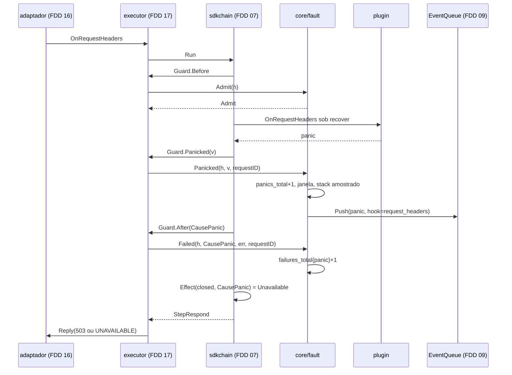
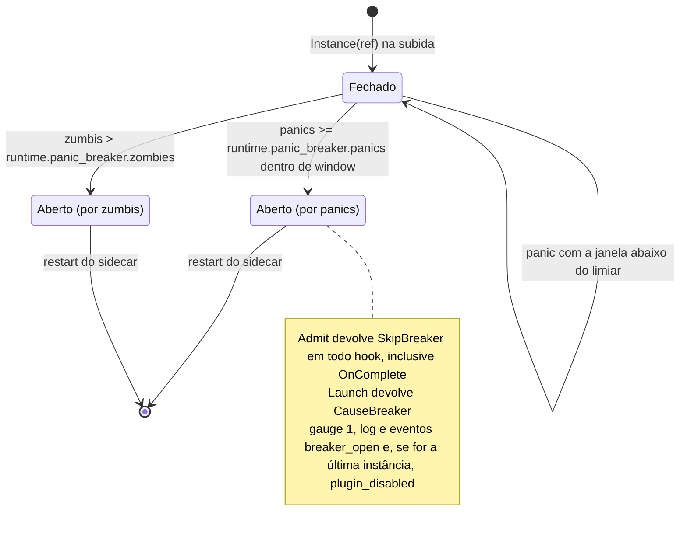
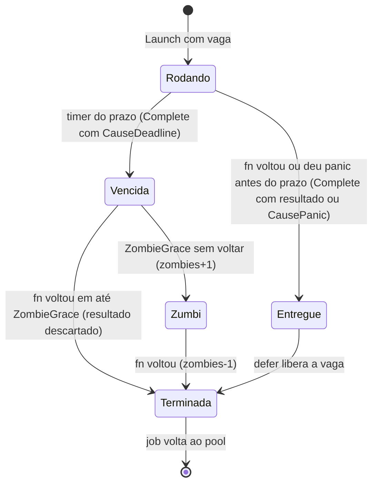
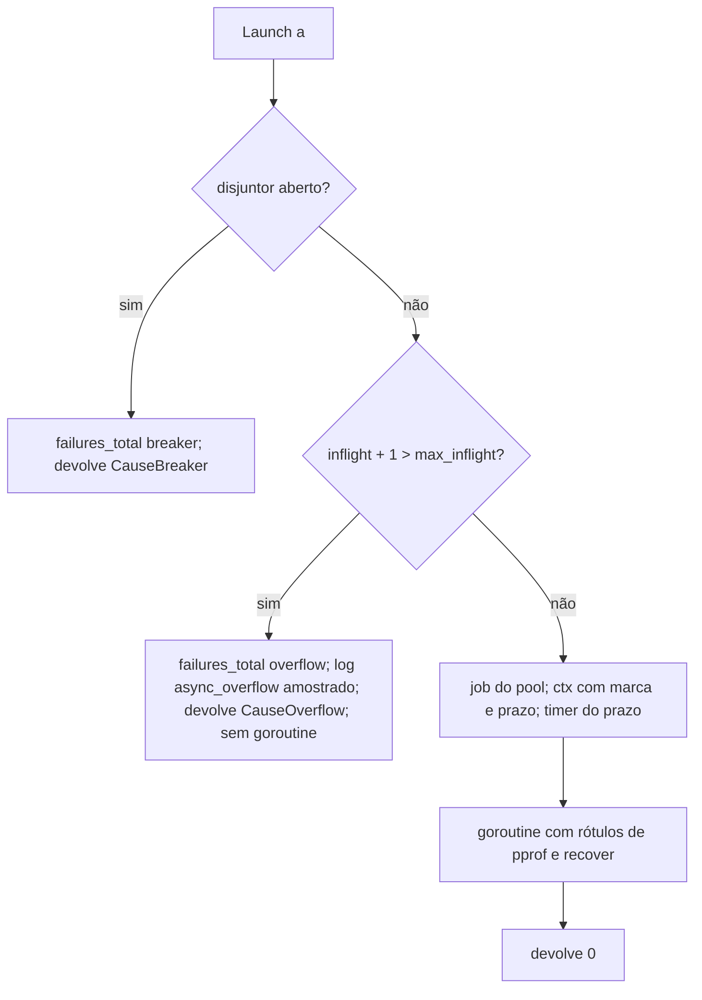

### FDD: Contenção de falhas, prazos e disjuntor (SID-04)

Versão: 1.0
Data: 2026-10-20
Responsável: Guilherme Giusti

---

### 1. Contexto e motivação técnica

**Problema técnico.** O `libn3x.so` roda plugins de terceiros dentro do processo do Envoy. A barreira de panic do Envoy 1.40 é parcial e a do istio-proxy 1.31 não existe (PRD, "Contenção de falhas própria por plugin"); um panic que escapa derruba o sidecar e, com ele, a entrada da aplicação. Go também não mata goroutine por fora: um plugin que ignora o `ctx` acumula goroutines até esgotar memória (o risco mais crítico do HLD do `n3x-sidecar`). As peças vizinhas já estão especificadas:

- o `chain` do SDK (FDD 07) faz o `recover` dos hooks síncronos, aplica o efeito da política (`chain.Effect`) e chama o `Guard` do driver antes, depois e dentro do panic de cada hook
- o executor (FDD 17) conduz a requisição, inicia as funções do `Go()` pela porta `Launch`, entrega os resultados ao `Exchange` e declara as portas `Containment` e `InstanceContainment`; sem contenção, o `Build` falha com `containment_missing`
- o `proxy.Env` (FDD 06) fixou o contrato de `Background`, `Dial`, `HTTPClient` e `Sleep`; a D-09 do README atribui a esta FDD a implementação no sidecar
- a fila `proxy.EventQueue` (FDD 09, L-01) é o caminho dos eventos de falha até a metade de proxy do plugin core

Falta especificar, de forma verificável, a peça que implementa essas portas: o que acontece com cada tipo de falha, como se conta, quando o disjuntor abre, o que é um zumbi, como as tarefas de fundo e as conexões dos plugins vivem e morrem, e quais eventos saem para o core. Esta FDD também fecha duas lacunas do README: a diferença entre `breaker_open` e `plugin_disabled` (L-70) e o status do panic em fail-closed (L-71).

**Encaixe no HLD.** Esta FDD especifica a linha "Contenção de falhas (`core/fault`)" de "Componentes e responsabilidades" do HLD do `n3x-sidecar`, as seções "Tratamento de falhas por instância", "Prazos obrigatórios" (parte do `.so`), "Técnicas aplicadas" (backpressure e disjuntor), a entidade "Estado do disjuntor por instância" e o risco "Plugin ignora o `ctx`". Ela cria dois pacotes no módulo `github.com/giustech/n3x-sidecar/core`:

- `core/fault`: implementa `chain.Containment` (FDD 17, contrato 9) com disjuntor, `max_inflight`, prazo e `recover` das funções do `Go()`, zumbis, tarefas de fundo, `Dial`, `HTTPClient`, contagem de falhas e eventos
- `core/internal/ctxmark`: marcas privadas do `ctx` (função do `Go()` e tarefa de fundo), com a API declarada pela FDD 38 (contrato 9 dela: `WithRequest`, `WithBackground`, `IsRequest`, `IsBackground`), lidas pela visão do controller para decidir `proxy.ErrRequestPath` antes do teto das unárias e usadas também no `ExitContext` (FDDs 17 e 38); por ser `internal`, nenhum módulo de plugin consegue importá-lo

Consumidores:

- FDD 17 (SID-03): monta o `Env` com as partes desta FDD, chama `Admit`, `Panicked`, `Failed` e `Launch`, e aplica os refinos de porta do contrato 4
- FDD 38 (SID-10): decide `proxy.ErrRequestPath` pelas marcas do contrato 9 (`IsRequest` ou falta de `IsBackground`) e só então aplica o teto `min(prazo do ctx, controller.timeouts.call)` nas unárias; espera o `Containment.Stop` antes do próprio `Stop`
- FDD 42 (CORE-06): consome `panic`, `breaker_open` e `plugin_disabled` pela fila e envia ao controller
- FDD 29 (SID-09): a parada da contenção roda dentro da sequência de desligamento
- FDDs 47, 48, 49 e 50: guia e alertas, injeção de panic ponta a ponta, modo Istio e teste de longa duração

**Atores.** Executor (FDD 17), instâncias de plugin (hooks, funções do `Go()`, tarefas de fundo, conexões), `chain` do SDK (recover dos hooks síncronos e efeito da política, FDD 07), telemetria do `.so` (`Platform`, `Reason`, `Sampler`, FDD 16), plugin core (consumidor dos eventos, FDD 42), conexão compartilhada (FDD 38) e operador (lê métricas, logs e eventos no painel).

**Limites.**
- O `recover` dos hooks síncronos mora no `chain` do SDK, igual no kit e no sidecar; esta FDD trata o que chega por `Guard.Panicked` e `Guard.After` (repassados pelo executor)
- O efeito da política (503, 504, 413 ou seguir) é do `sdkchain.Effect` (FDD 07); esta FDD confirma a tabela (L-71) e o rótulo de `CauseBreaker`, sem mudar valores
- Esta FDD não escreve no fio nem chama `Request.Schedule` diretamente: entrega o fim de cada função por `Completion`, e o executor pede a retomada (FDD 17, contrato 7)
- Esta FDD não envia nada ao controller: empurra eventos na `proxy.EventQueue`; quem envia é o core (FDD 42)
- `env.Controller()` é da FDD 38; `proxy.Sleep` é função pura do SDK (FDD 06, I-08 dela); o sidecar não implementa nada de `Sleep`
- Panic no `New` na subida é tratado pelo executor (FDD 17, regra `new_panic`); aqui só se confirma o comportamento

**Suposições**
- Go 1.26 com cgo e `-buildmode=c-shared` (ADR-008 do `n3x-sidecar`); `testing/synctest` disponível para os testes de tempo (estável desde o Go 1.25) (hipótese de ferramenta)
- Um panic de hook acontece na goroutine que entrou pelo callback do Envoy; o `recover` na mesma goroutine (feito pelo `chain`) funciona; panic não recuperado num callback cgo encerra o processo (rede de proteção da FDD 16 cobre bugs do executor)
- O executor chama as portas como no contrato 9 da FDD 17, com os refinos F1 a F3 do contrato 4 desta FDD (a FDD 17 declarou a forma das portas refinável pela FDD 18, H-21 dela)
- Instâncias são criadas uma vez na subida e vivem o processo; o estado do disjuntor é por instância e volátil (HLD do `n3x-sidecar`)
- Plugins só bloqueiam por primitivas do SDK (`proxy.Sleep`, `env.Dial`, clientes do SDK), como exigem a FDD 06 e a análise estática da FDD 24

**Restrições**
- 0 alocações no caminho sem falha (`Admit` e o fim do hook sem causa); a parcela do core no p50 fica dentro de 0,15 ms (ADR-009 do `n3x-sidecar`)
- Nenhuma operação sem prazo (ADR-006 do `n3x-sidecar`)
- Nada vem de variável de ambiente (FR-001); o cliente HTTP ignora `HTTP_PROXY`
- Logs nunca registram path, header, query, body ou mensagem de negação; segredo sai como `***` (FDD 03)
- `core/fault` não importa o SDK Go do Envoy, `core/adapter/active` nem `core/chain/chaintest`; importa `core/chain` só pelas portas (dependência invertida, I-07 da FDD 17)
- Documentação e mensagens em pt-BR; identificadores, campos e comandos em inglês

**Rastreabilidade**
- PRD 1.5: FR-004 (panic contido; fail-closed com status gRPC correto; fail-open segue; `panics_total`; desligamento automático e evento no painel); FR-012 (trabalho assíncrono seguro, discador com prazo e política de falha); FR-016 (eventos de panic, disjuntor e plugin desligado); confiabilidade ("toda requisição termina"); critério de aceite "panic injetado não derruba o Envoy; fail-closed responde 503 com o `grpc-status` correto; fail-open segue; `panics_total` sobe em 1"; risco "erro fatal do Go"
- HLD do `n3x-sidecar`: "Tratamento de falhas por instância", "Prazos obrigatórios", "Técnicas aplicadas", "Estado do disjuntor por instância", "Observabilidade" e riscos "Plugin ignora o `ctx`" e "Erro fatal do Go ou crash em C"
- HLD do `n3x-sdk`: "Contrato de proxy" (limites por plugin) e "Fluxo de requisição: segundo plano"
- ADRs do `n3x-sidecar`: ADR-004 (disjuntor por instância) e ADR-006 (prazos, `max_inflight`, zumbis); do `n3x-sdk`: ADR-016 (`Go()`, `Background`, `Dial`, limites); do `n3x-plugin-core`: ADR-007 (tipos de evento)
- Lacunas do README:
  - **L-70 fechada aqui:** `breaker_open` é o evento por instância, no momento em que o disjuntor dela abre, com o motivo (`reason=panics` ou `reason=zombies`). `plugin_disabled` é o evento por plugin, emitido uma vez quando o disjuntor da última instância com fase daquele plugin abre: o plugin deixou de rodar no sidecar inteiro. É este o "desligamento automático" do FR-004 e do painel. Num plugin com uma instância, os dois saem juntos, em sequência (contrato 10) (hipótese)
  - **L-71 fechada aqui:** panic em fail-closed responde 503 (`UNAVAILABLE` em gRPC), como o HLD do `n3x-sidecar`, o ADR-004 e o critério de aceite do PRD. A tabela de `chain.Effect` da FDD 07 fica como está. 500 (`INTERNAL`) fica reservado a bug do N3X (rede de proteção do adaptador, FDD 16, e negação inválida, FDD 05), o que separa "plugin falhou" de "core falhou" nas métricas do cliente
  - **L-01 aplicada (FDD 09):** os eventos `panic`, `breaker_open` e `plugin_disabled` entram na `proxy.EventQueue` do executor por `InstanceRef.Events`, com `Push` que nunca bloqueia; no standalone a fila não existe e nada é empurrado
  - **L-14 aplicada (FDDs 05 e 06):** `proxy.Fail`, `proxy.FailResult` e `proxy.Sleep`; `sdk.Fail` e `sdk.Sleep` do HLD são referências soltas
  - **L-16 aplicada (FDD 26):** a `proxy.DialDenyList` do sidecar sai de `core/envoycfg` (`ReservedLoopbackPorts` e o diretório de `AdminSocket`)
  - **L-51 aplicada (FDD 06):** `runtime.plugin_limits["<id>"].background.max_tasks` e `.dial.max_conns`, por plugin e por processo
  - **L-23 aplicada (FDD 06):** goroutines de connector ficam fora do `recover`; sem regra de build na v1, só lista recomendada e teste de longa duração (risco na seção 10)
- Pedidos de FDDs anteriores atendidos:
  - FDD 05: `FailResult` e `body_limit` na tabela de falhas e na contagem (contrato 1); P-11 dela: texto do erro de `Fail` só em log amostrado, cortado em 256 bytes (contrato 3)
  - FDD 06: implementação de `Background`, `Dial` e `HTTPClient` (contratos 7 e 8); marca do `ctx` do `Go()` com o `request_id` presente (contratos 5 e 9); P-04 dela: panic em tarefa de fundo não conta para o disjuntor (contrato 6); `DialDenyList` do sidecar montada de `core/envoycfg` (contrato 8)
  - FDD 07: disjuntor e `max_inflight` atrás do `Guard` do executor (`Admit` e `Launch`); L-71 na tabela de `chain.Effect`; rótulo `breaker` de `CauseBreaker` (contrato 1)
  - FDD 09: produção de `panic`, `breaker_open` e `plugin_disabled` pela fila; P-02 dela: quando emitir cada um e o texto de `Detail` (contrato 10)
  - FDD 16: P-03 dela: `NewToken` e `Schedule` usados pela porta `Completion` do executor; `Platform` com `Reason` (valor novo `breaker`) e `Sampler` para o stack (contratos 3 e 5; seção 7)
  - FDD 17: implementação da contenção; eventos por `InstanceRef.Events`; L-71; P-03 dela: forma final das portas (contrato 4)
  - FDD 26: P-07 dela: a porta de entrada (`listener.port`) em loopback também é negada ao `env.Dial` (contrato 8)
  - FDD 38 (P-07 e H-16 dela): implementação de `core/internal/ctxmark` na forma do contrato 9 dela e marcação do `ctx` de toda função do `Go()` (`WithRequest`) e de toda tarefa de fundo (`WithBackground`), que é como a visão do `Env` detecta `proxy.ErrRequestPath` e aplica o teto só nas unárias (contratos 5, 7 e 9); `Containment.Stop` termina antes do `Stop` da conexão, para a saída do core usar a conexão viva
  - Coordenação da FDD 07 (refinos R1 a R9): `Reset(g, req, hasBody, isGRPC)`, `SetBodyOverLimit`, `Denier()` com `Denial`, `MaxGroupLen()`, `Guard.After` também sem chamada (R5) e `Guard.Before` também no `OnComplete` (R6); instância com disjuntor aberto não roda nenhum hook da requisição, nem `OnComplete`

---

### 2. Objetivos técnicos

- **Nenhum panic de plugin derruba o processo.** Invariante: todo panic em hook, função do `Go()` ou tarefa de fundo é contido e contado. Medida: 1.000 panics injetados por hook, por `Go()` e por tarefa, em HTTP/1.1, HTTP/2 e gRPC, com o processo vivo (mesmo PID) no fim, no harness de conformidade e no harness de desenvolvimento com Envoy real (FDD 17).
- **Resposta determinística por política.** Invariante: cada falha tem um único efeito por política, dado por `sdkchain.Effect` (contrato 1). Medida: panic em fail-closed responde 503 em HTTP e HTTP 200 com `grpc-status: 14` (`UNAVAILABLE`) trailers-only em gRPC; em fail-open a aplicação recebe a requisição; nos dois casos `n3x_plugin_panics_total` sobe exatamente 1 (critério do PRD).
- **Toda função do `Go()` termina para a requisição no prazo.** Invariante: `Completion.Complete` é chamado exatamente uma vez por função iniciada, até `async.timeout` depois do início, mesmo com a goroutine presa. Medida: entrega do prazo entre `timeout` e `timeout + 10 ms` no runner da CI; 1.000.000 de corridas entre retorno e prazo com `-race`, 0 entregas duplas.
- **Backpressure sem goroutine.** Invariante: com `max_inflight` atingido, nenhuma goroutine nova é criada. Medida: `runtime.NumGoroutine()` igual antes e depois da requisição recusada; `n3x_plugin_failures_total{reason="overflow"}` sobe 1.
- **Disjuntor exato.** Invariante: com os padrões, o 5º panic numa janela deslizante de 60 s abre; o 101º zumbi abre; nada fecha antes do restart. Medida: testes com relógio do `synctest` nos limites (4 panics em 59 s não abrem; 5 em 60 s abrem; 5 espalhados em 61 s não abrem; 100 zumbis não abrem; 101 abrem); depois de aberto, 0 chamadas ao plugin em 10.000 requisições.
- **Zumbi visível.** Invariante: função que não voltou até `async.timeout + ZombieGrace` é zumbi até voltar; zumbis ocupam vaga de `max_inflight`. Medida: `n3x_plugin_async_zombies` igual ao número de goroutines presas em até 1,1 s depois do prazo; volta a 0 quando elas retornam.
- **Custo no caminho quente.** Medida com `testing.AllocsPerRun(1000, ...)` e benchmark: `Admit` com 0 alocações e até 5 ns; os critérios de 0 alocações da FDD 17 continuam valendo com `fault.New` no lugar da contenção de referência; `Panicked` sem stack amostrado com 0 alocações e até 1 µs; sobrecarga do `Launch` até 2 µs no p50 e no máximo 4 alocações por função (hipóteses de tempo e de alocação).
- **Recursos do plugin limitados e liberados.** Medida: a 9ª tarefa de fundo do plugin falha no `New`; a 17ª conexão não abre socket e falha no prazo do `ctx`; o desligamento das tarefas termina em até 2,1 s, mesmo com uma tarefa que ignora o `ctx`.
- **Eventos fiéis e baratos.** Invariante: todo panic, abertura de disjuntor e desligamento de plugin gera um `Push` na fila (com a amostragem de `panic` da própria fila); `Push` nunca bloqueia o worker. Medida: contagem de `EventQueueStats.Accepted` mais `Suppressed` igual aos panics de hook e de `Go()`, e `breaker_open` e `plugin_disabled` exatamente 1 por abertura e por plugin.
- **Paridade com o kit.** Medida: `conformance.RunChain` (no mínimo 30 casos) e `conformance.RunCore` (no mínimo 15) passam com `fault.New`; `conformance.RunEnv` (no mínimo 20) passa nos casos que não dependem do controller (os demais entram com a FDD 38).

---

### 3. Escopo e exclusões

**Incluído**
- Tabela de falhas por instância e por política, em HTTP e gRPC: panic, `proxy.Fail` e `proxy.FailResult`, violação do contrato, prazo do `Go()`, `max_inflight`, disjuntor aberto, body acima do limite e cancelamento (contrato 1), com a decisão da L-71 e o rótulo de `CauseBreaker`
- Campos `runtime.panic_breaker` e `plugins[].async` (`timeout`, `max_inflight`) com padrões, faixas e semântica de limiar (contrato 2; o parser é da FDD 15)
- Pacote `core/fault`: `New`, implementação de `chain.Containment`, `PluginContainment` e `InstanceContainment`, constantes, sentinelas e `DenyList` (contrato 3)
- Refinos das portas da FDD 17: `Configure`, `Launch` devolvendo a causa e `requestID` em `Panicked` e `Failed` (contrato 4)
- Execução das funções do `s.Go()`: goroutine com `recover` e rótulos de pprof, `ctx` com prazo, marca e `request_id`, entrega única por `Completion`, `max_inflight` e zumbis (contrato 5)
- Disjuntor por instância: janela deslizante de panics, limiar de zumbis, efeitos, métrica, log e eventos (contrato 6)
- `env.Background` no sidecar: registro, limite por plugin, selo, início no `Start`, `recover`, reinício com `proxy.BackgroundBackoff`, desligamento em 2 s (contrato 7)
- `env.Dial` e `env.HTTPClient` no sidecar: limite por plugin, espera de vaga, prazos de conexão e de I/O, liberação, vazamento e `DialDenyList` do sidecar; `proxy.Sleep` só conferido (contrato 8)
- Marcas privadas do `ctx` em `core/internal/ctxmark` (contrato 9)
- Eventos `panic`, `breaker_open` e `plugin_disabled` na `proxy.EventQueue`, com `Detail` fixado (contrato 10, L-70)
- Métricas `n3x_plugin_failures_total`, `n3x_plugin_panics_total`, `n3x_plugin_breaker_open`, `n3x_plugin_async_inflight`, `n3x_plugin_async_zombies`, `n3x_plugin_duration_seconds{hook="async"}`, `n3x_plugin_background_*` e `n3x_plugin_dial_*`; logs de falha amostrados
- Testes: unidade com `synctest`, conformidade com o harness do sidecar (`chaintest.Harness` com `WithContainment(fault.New(...))`), golden em Envoy real pelo harness de desenvolvimento e teste de longa duração de 10 minutos do pacote

**Excluído**
- Ordem das fases, grupos paralelos, recortes, escolha da negação e cancelamento dos posteriores: FDD 17 (SID-03) e `chain` da FDD 07; aqui só o efeito de uma falha dentro do grupo
- `recover` dos hooks síncronos e tabela de `Effect`: `chain` do SDK, FDD 07 (SDK-07)
- Teto de 5 s das chamadas ao controller, buffer e decisão de `ErrRequestPath` na conexão: FDD 38 (SID-10), que usa as marcas do contrato 9
- Regras de análise estática contra `go` cru, `ctx` guardado em campo, chamadas sem `ctx` e `runtime.Goexit`: FDD 24 (BLD-06)
- Envio dos eventos ao controller, `id` de idempotência e tela de eventos: FDDs 42 (CORE-06) e 45 (CORE-09)
- `AssertHonorsCancel` e agendador determinístico do kit: FDD 07 (SDK-07); teste do exemplo: FDD 13
- Panic no `New` na subida: FDD 17 (regra `new_panic`); aqui só a confirmação
- Teste de longa duração ponta a ponta com connectors reais e perfil de goroutines no Envoy: FDD 48 ou 50 (L-41)
- Endpoint de depuração com perfil de goroutines no processo do Envoy: fora da v1 (hipótese); os rótulos de pprof servem aos testes e ao teste de longa duração
- Porta `17021` na lista de destinos negados: FDD 29 (SID-09) decide; entra sozinha se for acrescentada a `envoycfg.ReservedLoopbackPorts`
- Modo Istio (`listener.port` sem efeito): FDD 49 (SID-11)

---

### 4. Fluxos detalhados e diagramas

**Fluxo de subida** (dentro do `Build` do executor, FDD 17, em `ModeServe`)
1. `core/entry` cria `fault.New(fault.Options{})` na carga do `.so`, sem I/O e sem goroutine, e entrega ao executor em `Options.Containment`.
2. Depois de `config.Load` e de `Telemetry().Configure`, o executor chama `Containment.Configure(ProcessSettings{Platform, Log, Breaker, ListenerPort})` uma vez (refino F1). A contenção monta a `DialDenyList` do processo (`fault.DenyList(listenerPort)`) e loga `containment_configured`.
3. Para cada plugin com instância (e sempre para o `n3x.core`), `Containment.Plugin(id, limites)` cria a contabilidade do plugin: vagas de tarefas (`background.max_tasks`), semáforo de conexões (`dial.max_conns`), transporte HTTP preguiçoso e as métricas `n3x_plugin_dial_max_conns` e `n3x_plugin_background_tasks` pelo `Platform().Plugin(id)`.
4. Para cada instância, antes do `New`, `PluginContainment.Instance(ref)` cria o estado da instância: disjuntor fechado, janela de panics vazia, contadores de `inflight` e zumbis, rótulos de pprof pré-montados e a origem das marcas. `ref.Events` é a fila do core (nil no standalone).
5. Durante o `New`, `env.Background` registra tarefas (sem rodar) e confere nome e limite; `env.Dial` e `env.HTTPClient` existem, mas o `New` não tem `ctx` para usá-los (FDD 06).
6. Depois do `New` (com sucesso, erro ou panic), o executor chama `ic.Seal(metricas)`: registro de tarefas fechado (depois dele, `ErrSealed`) e handles da `InstanceMetrics` da FDD 16 guardados.
7. `Chain.Start()` chama `Containment.Start()`: inicia as tarefas registradas, uma vez, na ordem de registro (as do core primeiro, porque o core é instanciado primeiro). Volta em até 1 ms (só cria goroutines).

**Fluxo principal: hook síncrono sem falha** (worker do Envoy)
1. O `chain` chama `Guard.Before(in, h)`; o executor lê o relógio e chama `ic.Admit(h)`: uma leitura atômica do estado do disjuntor; fechado devolve `sdkchain.Admit`.
2. O `chain` chama o hook do plugin sob `recover`.
3. O `chain` chama `Guard.After(in, h, o)` com `o.Cause == 0`; o executor observa a duração; a contenção não é chamada.

**Fluxo de panic em hook síncrono** (request, response ou `OnComplete`)
1. O plugin dá panic; o `recover` do `chain` pega o valor e, ainda na pilha do panic, chama `Guard.Panicked(in, h, v)`; o executor repassa `ic.Panicked(h, v, requestID)` (refino F3).
2. A contenção soma 1 em `n3x_plugin_panics_total`, registra o instante na janela do disjuntor e, se a janela passou do limiar, abre o disjuntor (contrato 6).
3. Se o `Sampler` da instância permite (1 por segundo), captura `runtime.Stack` (até 16 KiB) e loga `plugin_panic` com `suppressed`; senão só soma no contador de suprimidos.
4. Com fila, `Push(Event{Kind: EventPanic, Detail: "hook=<nome>"})`; a fila aplica a amostragem de 1 por segundo por instância e conta `Suppressed`.
5. O `chain` chama `Guard.After` com `CausePanic`; o executor chama `ic.Failed(h, CausePanic, err, requestID)`, que soma 1 em `n3x_plugin_failures_total{reason="panic"}`.
6. O `chain` aplica `Effect(política, CausePanic)`: `closed` nega com 503 ou `UNAVAILABLE` (na response, troca a resposta da aplicação); `open` segue sem as mudanças da instância; em `OnComplete`, sem efeito.

**Fluxo de uma função do `Go()`** (contrato 5)
1. O hook devolve `s.Go(fn)`; o `chain` devolve `StepAsync`; o executor pega `token := r.NewToken()` e, para cada função do grupo, monta `a := &chain.Async{Ctx, Fn, Done}` (o `Ctx` é cancelável e já leva o `request_id`) e chama `ic.Launch(a)`.
2. `Launch` confere o disjuntor (aberto: devolve `CauseBreaker`) e reserva uma vaga de `max_inflight` com um incremento atômico (sem vaga: devolve `CauseOverflow`, sem goroutine). Nos dois casos soma a falha e o executor chama `x.Abort(i, causa, nil)` na hora.
3. Com vaga, `Launch` pega um `job` do pool, deriva o `ctx` da função (marca de requisição, prazo `início + async.timeout`), arma o timer do prazo, soma `n3x_plugin_async_inflight` e abre a goroutine; devolve 0.
4. A goroutine aplica os rótulos de pprof da instância (`plugin`, `instance`, `kind=async`) e chama `fn(ctx)` sob `recover`.
5. **Retorno antes do prazo:** CAS `rodando` para `entregue`; observa `n3x_plugin_duration_seconds{hook="async"}`; `FailResult` soma `reason="error"`; chama `a.Done.Complete(r, 0, nil)`; o executor resolve no `Exchange` e, se for a última do grupo, chama `r.Schedule(token)` na mesma goroutine (FDD 16 e FDD 17, contrato 7).
6. **Prazo antes do retorno:** o timer faz o CAS `rodando` para `vencida`, soma `reason="timeout"`, observa a duração igual ao prazo, chama `Complete(ContinueResult(), CauseDeadline, context.DeadlineExceeded)` e rearma o timer para `ZombieGrace` (1 s).
7. **Zumbi:** se o timer rearmado dispara e a função ainda não voltou, a função vira zumbi: `n3x_plugin_async_zombies` sobe, o log `async_zombie` sai amostrado e, se os zumbis da instância passam de `runtime.panic_breaker.zombies`, o disjuntor abre com `reason=zombies`.
8. **Fim da goroutine** (sempre, por `defer`): devolve a vaga de `max_inflight`, desce `n3x_plugin_async_inflight` e, se era zumbi, desce `n3x_plugin_async_zombies`. Resultado que chega depois do prazo é descartado.

**Fluxos alternativos e exceções**
- **Panic na função do `Go()`:** o `recover` da goroutine soma `n3x_plugin_panics_total`, registra na janela do disjuntor, loga `plugin_panic` amostrado com `hook=async`, empurra `panic` com `Detail` `hook=async`; se a função ainda estava pendente, soma `reason="panic"` e chama `Complete(_, CausePanic, *PanicError)`; se o prazo já tinha sido entregue (panic tardio), não soma falha de requisição, só panic e janela.
- **`runtime.Goexit` na função do `Go()`:** o `defer` vê que a função não voltou nem deu panic; trata como panic do tipo `runtime.Goexit` (mesma contagem e mesmo efeito) (hipótese). O mesmo `Goexit` num hook síncrono não é recuperável pelo `chain`; a análise estática deve recusá-lo (pedido à FDD 24).
- **Cancelamento pelo grupo ou pela desconexão:** o executor cancela o `ctx` e já chama `x.Abort(i, CauseCanceled)` (FDD 17); a contenção não conta falha; a função que voltar entrega `Complete`, que o executor descarta; se não voltar até `prazo + ZombieGrace`, vira zumbi igual.
- **`proxy.Fail(err)` em hook síncrono:** o `chain` chama `After` com `CauseFail`; `Failed` soma `reason="error"` e loga `plugin_failure` amostrado com o texto do erro cortado em 256 bytes (P-11 da FDD 05).
- **Violação do contrato no hook** (header protegido, mais de 16 mudanças, `ErrUnsupported`): `CauseViolation`, `reason="error"`; o executor já loga `hook_violation` (FDD 17); a contenção só conta.
- **Body acima do limite:** `CauseBodyLimit` chega por `After` (com ou sem chamada, R5); `reason="body_limit"`; `closed` nega com 413 ou `RESOURCE_EXHAUSTED`; `open` segue sem o hook (FDD 05).
- **Disjuntor aberto:** `Admit` devolve `SkipBreaker`; o `chain` não chama o plugin e chama `After` com `CauseBreaker` (R5); `Failed` soma `reason="breaker"` por hook pulado, menos `OnComplete` (que também é pulado, R6, e não soma). `closed` nega com 503 ou `UNAVAILABLE`; `open` pula a instância.
- **Disjuntor abre com funções em andamento:** elas continuam até voltar ou vencer; o resultado delas é entregue normalmente. As funções novas recebem `CauseBreaker` no `Launch`.
- **Panic em hook de response:** mesma política; com `closed`, a resposta da aplicação é trocada por 503 ou `UNAVAILABLE`; conta para o disjuntor.
- **Panic em `OnComplete`:** a requisição já terminou; sem efeito na resposta; conta panic, `reason="panic"` e janela do disjuntor (hipótese: conta para o disjuntor porque também é disparável por entrada).
- **Panic no `New`:** contido pelo executor; `instance_failed` com `rule=new_panic`, `detail` com o valor cortado em 1 KiB e `stack` em 16 KiB; `filter_config_rejected` com `build_failed`; o Envoy não sobe (FR-004; FDD 17, contrato 3, regra 18). Sem métrica nem evento: a telemetria e o core não chegam a rodar.
- **Panic em tarefa de fundo:** contido; `n3x_plugin_panics_total` e `n3x_plugin_background_restarts_total` sobem 1; `background_panic` com stack amostrado; evento `panic` com `Detail` `task=<nome>`; reinício depois de `proxy.BackgroundBackoff(n, u)`; não conta para o disjuntor (contrato 7).
- **Standalone:** `InstanceRef.Events` é nil; métricas e logs iguais, nenhum evento.
- **Modo `ModeValidate`:** a contenção não é configurada nem chamada (FDD 17).
- **Desligamento:** `Chain.Stop(ctx)` chama `Containment.Stop(ctx)`: cancela o `ctx` raiz das tarefas, espera todas em paralelo até `min(prazo do ctx, 2 s)`, loga `background_stop_timeout` por tarefa abandonada e `containment_stopped` com o resumo. Funções do `Go()` em andamento não são esperadas: o Envoy já drenou (FDD 29) e os prazos delas terminam o trabalho (hipótese).
- **Bug dentro do próprio `core/fault` ou do executor durante `Complete`:** a entrega roda sob um segundo `recover`, separado do `recover` do plugin; o panic é atribuído ao core com log `containment_internal_panic` (stack amostrado no processo), sem somar na instância.

**Diagramas**

Panic em hook síncrono com política `closed`:



Estados do disjuntor de uma instância:



Estados de uma função do `Go()` (`job`):



Decisão do `Launch`:



---

### 5. Contratos públicos (assinaturas, endpoints, headers, exemplos)

**Contrato 1: tabela de falhas por instância e efeito por política (`sdkchain.Effect`, L-71, `CauseBreaker`)**
- Tipo: regra (aplicada pelo `chain` do SDK com `Effect`; contada por `core/fault`)
- Assinatura/Rota: `func Effect(f plugin.FailurePolicy, c chain.Cause) (proxy.DenyResponse, bool)` e `func (c chain.Cause) Reason() string` (FDD 07, contrato 9); `telemetry.Reason` da FDD 16 com o valor novo `ReasonBreaker`
- Método: n/a
- Semântica de status/headers:

| Falha | Causa | `reason` | `closed` em HTTP | `closed` em gRPC (HTTP 200, trailers-only) | `open` |
| --- | --- | --- | --- | --- | --- |
| Panic em hook de request (headers ou body) | `CausePanic` | `panic` | 503 | `grpc-status: 14` (`UNAVAILABLE`) | Segue sem as mudanças da instância |
| Panic em hook de response | `CausePanic` | `panic` | 503 no lugar da resposta da aplicação | 14 no lugar da resposta | Segue com a resposta da aplicação |
| Panic em `OnComplete` | `CausePanic` | `panic` | Sem efeito (a resposta já saiu) | Sem efeito | Sem efeito |
| Panic ou `runtime.Goexit` na função do `Go()` | `CausePanic` | `panic` | 503 | 14 | Segue sem o `Result` |
| `proxy.Fail(err)` ou `proxy.FailResult(err)` (inclusive `Result` que virou falha por mudança inválida) | `CauseFail` | `error` | 503 | 14 | Segue sem as mudanças |
| Uso indevido do contrato no hook | `CauseViolation` | `error` | 503 | 14 | Segue sem as mudanças |
| Prazo do `Go()` estourado | `CauseDeadline` | `timeout` | 504 | `grpc-status: 4` (`DEADLINE_EXCEEDED`) | Segue sem o `Result` |
| `max_inflight` atingido | `CauseOverflow` | `overflow` | 503, sem abrir goroutine | 14 | Segue, sem abrir goroutine |
| Disjuntor aberto | `CauseBreaker` | `breaker` | 503, sem chamar o plugin | 14 | Pula a instância |
| Body acima do limite | `CauseBodyLimit` | `body_limit` | 413 | `grpc-status: 8` (`RESOURCE_EXHAUSTED`) | Hook não chamado; segue |
| Cancelada pelo grupo ou pela desconexão | `CauseCanceled` | (não conta) | Sem efeito | Sem efeito | Sem efeito |

  - **L-71:** panic em `closed` é 503 ou `UNAVAILABLE`, sem mudança na tabela da FDD 07. O FR-004 ("500 ou 503") fica atendido pela escolha de um dos dois; 500 ou `INTERNAL` fica para bug do N3X (FDD 16, rede de proteção; FDD 05, negação inválida). Mensagens vazias: nenhum texto do plugin chega ao cliente
  - **`CauseBreaker`:** `Reason()` devolve `"breaker"` (valor novo, pedido às FDDs 07 e 16). Conta uma vez por hook pulado de request e de response; o `OnComplete` pulado não conta
  - **Grupo paralelo:** falha em `closed` concorre como negação (vence a da primeira instância em ordem alfabética, posteriores canceladas, FDD 07 e FDD 17); em `open` só descarta as mudanças dela
  - **Contagem:** toda falha do caminho da requisição soma 1 em `n3x_plugin_failures_total{plugin, instance, reason}`; todo panic (hook, `Go()` ou tarefa) soma 1 em `n3x_plugin_panics_total{plugin, instance}`. Panic de tarefa de fundo não soma em `failures_total` (não é falha de requisição); panic tardio de `Go()` já vencido também não. Negação causada por política não conta em `n3x_plugin_denies_total`: o executor só conta quando `x.Denier()` devolve `Denial.Cause` igual a 0 (R3 da FDD 07; H-19 da FDD 17)
  - **Nome da função de falha (L-14):** `proxy.Fail(err)` no hook síncrono e `proxy.FailResult(err)` na função do `Go()` (FDD 05)

**Exemplo de requisição**
```json
{
  "instância": { "plugin": "giustech.ratelimit", "instance": "rl-api", "failure": "closed" },
  "requisições": [
    { "proto": "HTTP/2", "path": "/pedidos/7", "falha": "panic em OnRequestHeaders" },
    { "proto": "gRPC", "path": "/pedidos.v1.Pedidos/Obter", "falha": "panic em OnRequestHeaders" },
    { "proto": "gRPC", "path": "/pedidos.v1.Pedidos/Obter", "falha": "função do Go() passou de 200 ms" }
  ]
}
```

**Exemplo de resposta**
```json
[
  { "cliente": { ":status": 503, "content-type": "text/plain; charset=utf-8", "body": "" }, "panics_total": "+1", "failures_total{reason=\"panic\"}": "+1" },
  { "cliente": { ":status": 200, "content-type": "application/grpc", "grpc-status": "14", "trailers-only": true }, "panics_total": "+1", "failures_total{reason=\"panic\"}": "+1" },
  { "cliente": { ":status": 200, "grpc-status": "4", "trailers-only": true }, "failures_total{reason=\"timeout\"}": "+1", "duration_seconds{hook=\"async\"}": "observa 0,200 s" }
]
```

---

**Contrato 2: config `runtime.panic_breaker` e `plugins[].async`**
- Tipo: config (contrato de arquivo; parser, padrões e faixas da FDD 15, contrato 1, parte 2)
- Assinatura/Rota: `runtime.panic_breaker.{panics, window, zombies}`; `plugins[].async.{timeout, max_inflight}`; struct `config.Async{Timeout, MaxInflight}` e a struct de `runtime.panic_breaker` (`config.PanicBreaker{Panics, Window, Zombies}`, nome do tipo é hipótese)
- Método: n/a (lido pelo `.so` no `Build`; nada vem de variável de ambiente)
- Semântica:

| Campo | Tipo | Padrão | Faixa (FDD 15) | Semântica nesta FDD |
| --- | --- | --- | --- | --- |
| `runtime.panic_breaker.panics` | inteiro | 5 | 1 a 1000 | Abre quando o número de panics da instância dentro da janela fica **maior ou igual** a este valor (o 5º abre) |
| `runtime.panic_breaker.window` | duração | 60s | 1s a 1h | Janela deslizante, medida no relógio monotônico; um panic sai da janela depois de `window` |
| `runtime.panic_breaker.zombies` | inteiro | 100 | 1 a 100000 | Abre quando os zumbis vivos da instância ficam **maiores** que este valor (o 101º abre), como "mais de 100 zumbis" do ADR-004 |
| `plugins[].async.timeout` | duração | 200ms | 1ms a 60s | Prazo de cada função do `Go()`, contado do `Launch`; vira `ctx.Deadline()` |
| `plugins[].async.max_inflight` | inteiro | 1000 | 1 a 100000 | Funções do `Go()` vivas da instância, inclusive vencidas e zumbis, até a goroutine voltar |

  - `runtime.panic_breaker` vale para todas as instâncias do processo; cada instância tem o próprio contador e a própria janela (ADR-004)
  - A janela guarda os instantes dos últimos `panics` panics (anel de até 1.000 instantes por instância, 8 KiB no máximo); abre se o mais antigo desse anel tem no máximo `window` de idade
  - Mudar qualquer valor exige redeploy (FR-001); não há reset do disjuntor em runtime

**Exemplo de requisição**
```yaml
runtime:
  panic_breaker: { panics: 3, window: 30s, zombies: 50 }
plugins:
  - id: giustech.ratelimit
    instance: rl-api
    phase: traffic
    failure: closed
    async: { timeout: 150ms, max_inflight: 500 }
```

**Exemplo de resposta** (log da subida e efeito)
```text
{"ts":"2026-10-20T14:00:01.105Z","level":"info","component":"core","service":"pedidos","msg":"containment_configured","panics":3,"window_ms":30000,"zombies":50,"deny_ports":"17000,17001,17090","deny_dirs":"/tmp/n3x"}

rl-api: o 3º panic em até 30 s abre o disjuntor; o 51º zumbi abre o disjuntor; a 501ª função do Go() simultânea recebe CauseOverflow; cada função vence em 150 ms
```

---

**Contrato 3: API de `core/fault`**
- Tipo: sdk (API Go do módulo `github.com/giustech/n3x-sidecar/core`, uso interno do módulo e dos testes)
- Assinatura/Rota:
  ```go
  package fault // github.com/giustech/n3x-sidecar/core/fault

  type Options struct {
      Rand func() float64 // u do backoff das tarefas, em [0, 1); nil = math/rand/v2
  }

  // New devolve a contenção do processo. Sem I/O e sem goroutine; chamada por core/entry na carga.
  func New(opts Options) *Containment

  // Containment implementa chain.Containment (FDD 17, contrato 9, com os refinos do contrato 4).
  type Containment struct{ /* ... */ }

  func (c *Containment) Configure(s chain.ProcessSettings) error
  func (c *Containment) Plugin(id plugin.ID, lim config.PluginLimits) (chain.PluginContainment, error)
  func (c *Containment) Start()
  func (c *Containment) Stop(ctx context.Context)
  func (c *Containment) Snapshot() Snapshot // testes e log de parada; cópia, sem trava longa

  type Snapshot struct {
      Instances      []InstanceState
      Tasks          int // tarefas vivas
      TasksAbandoned int // tarefas que passaram do prazo de parada
  }

  type InstanceState struct {
      Plugin         plugin.ID
      Instance       string
      BreakerOpen    bool
      BreakerReason  string // "", "panics" ou "zombies"
      PanicsInWindow int
      Inflight       int
      Zombies        int
  }

  // DenyList monta a lista de destinos negados do sidecar (contrato 8).
  func DenyList(listenerPort int) proxy.DialDenyList

  const (
      ZombieGrace         = 1 * time.Second     // tolerância depois do prazo até virar zumbi (hipótese)
      StackMax            = 16 << 10            // bytes de stack num log (igual à FDD 17)
      PanicTextMax        = 256                 // bytes do texto do valor do panic no log
      ErrorTextMax        = 256                 // bytes do texto do erro de Fail no log
      FailureLogInterval  = 1 * time.Second     // plugin_failure, por instância
      PressureLogInterval = 1 * time.Minute     // async_overflow, async_zombie, dial_denied
      StopGrace           = proxy.ShutdownGrace // 2 s
  )

  var (
      ErrPanic         = errors.New("fault: panic contido no plugin")
      ErrNotConfigured = errors.New("fault: contenção usada antes de Configure")
      ErrConfigured    = errors.New("fault: Configure chamado mais de uma vez")
  )

  // PanicError é o err entregue com CausePanic nas funções do Go(). errors.Is(err, ErrPanic) é verdadeiro.
  type PanicError struct {
      Type   string // tipo Go do valor (ex.: "runtime.boundsError", "string", "runtime.Goexit")
      Goexit bool
  }
  func (e *PanicError) Error() string // "fault: panic contido no plugin (<Type>)"; nunca o texto do valor
  func (e *PanicError) Unwrap() error // ErrPanic
  ```
- Método: n/a
- Semântica:
  - **Ciclo de vida:** `New` na carga; `Configure` uma vez no `Build` em `ModeServe`; `Plugin` e `Instance` antes de cada `New`; `Seal` depois; `Start` e `Stop` uma vez cada (FDD 16, L-45). `Plugin` antes de `Configure` devolve `ErrNotConfigured`; segundo `Configure`, `ErrConfigured`. O executor transforma esses erros na regra `containment_config` (pedido à FDD 17)
  - **Instância repetida:** `PluginContainment.Instance` com a mesma `instance` devolve erro (`duplicate`), defensivo: a FDD 15 já recusa
  - **`recover` em toda goroutine criada aqui:** funções do `Go()` e tarefas de fundo têm `recover` na base, que cobre o plugin; a entrega a `Completion` tem um `recover` separado, atribuído ao core (`containment_internal_panic`)
  - **Texto de panic e de erro nos logs (P-11 da FDD 05):** valor do panic do tipo `error` (inclusive `runtime.Error`) ou `string` sai em `panic`, cortado em `PanicTextMax` sem quebrar UTF-8, com caracteres de controle trocados por espaço; outro tipo sai só como `panic_type`, sem formatar (formatar rodaria código do plugin). O erro de `Fail` e de `FailResult` sai em `error`, cortado em `ErrorTextMax`, no log amostrado `plugin_failure`. `plugin.Secret` formatado sai `***` (FDD 03); `.Reveal()` dentro de erro é tratado pela análise estática (FDD 24). O guia do autor diz que esses textos vão ao log do core e não devem levar dado da requisição (FDD 47) (hipótese)
  - **`PanicError` sem texto:** o `err` entregue ao `chain` não carrega o valor, para nunca chegar a evento nem à resposta
  - **Estabilidade:** API interna do módulo `core/`, muda por minor junto com `core/chain` (H-25 da FDD 17); constantes de comportamento (prazos, intervalos) só mudam com nota de versão

**Exemplo de requisição**
```go
c := fault.New(fault.Options{})
_ = c.Configure(chain.ProcessSettings{Platform: tel.Platform(), Log: tel.CoreLogger(),
    Breaker: config.PanicBreaker{Panics: 5, Window: time.Minute, Zombies: 100}, ListenerPort: 17000})
pc, _ := c.Plugin(rl, config.PluginLimits{BackgroundMaxTasks: 4, DialMaxConns: 32})
ic, _ := pc.Instance(chain.InstanceRef{ID: rl, Instance: "rl-api", Phase: plugin.PhaseTraffic,
    Failure: plugin.FailClosed, Async: config.Async{Timeout: 200 * time.Millisecond, MaxInflight: 1000},
    Log: logger, Events: q})
err := c.Configure(chain.ProcessSettings{})
```

**Exemplo de resposta**
```json
{
  "fault.DenyList(17000)": { "LoopbackPorts": [17000, 17001, 17090], "UnixDirs": ["/tmp/n3x"] },
  "c.Snapshot().Instances[0]": { "Plugin": "giustech.ratelimit", "Instance": "rl-api", "BreakerOpen": false, "PanicsInWindow": 0, "Inflight": 0, "Zombies": 0 },
  "err (segundo Configure)": "fault: Configure chamado mais de uma vez",
  "errors.Is(err, fault.ErrConfigured)": true
}
```

---

**Contrato 4: refinos das portas da FDD 17 (`chain.Containment`, `InstanceContainment`)**
- Tipo: sdk (interfaces Go de `core/chain`; a FDD 17 declarou a forma refinável pela FDD 18, H-21 dela)
- Assinatura/Rota:
  ```go
  package chain // github.com/giustech/n3x-sidecar/core/chain

  type Containment interface {
      // F1 (novo): uma vez no Build em ModeServe, depois de config.Load e de
      // Telemetry().Configure, antes do primeiro Plugin.
      Configure(s ProcessSettings) error
      Plugin(id plugin.ID, lim config.PluginLimits) (PluginContainment, error)
      Start()
      Stop(ctx context.Context)
  }

  // F1: o que a contenção só conhece depois de ler o n3x.yaml.
  type ProcessSettings struct {
      Platform     *telemetry.Platform // FDD 16: Instance, Plugin, Reason e Sampler
      Log          *slog.Logger        // CoreLogger (component=core)
      Breaker      config.PanicBreaker // runtime.panic_breaker com os padrões (FDD 15)
      ListenerPort int                 // listener.port no modo padrão; 0 no modo Istio (FDD 49)
  }

  type PluginContainment interface {
      Instance(ref InstanceRef) (InstanceContainment, error) // antes do New; InstanceRef igual ao da FDD 17
  }

  type InstanceContainment interface {
      Background(name string, fn func(ctx context.Context))
      Dial(ctx context.Context, network, address string) (net.Conn, error)
      HTTPClient() *http.Client
      Seal(m *telemetry.InstanceMetrics)

      Admit(h proxy.Hook) sdkchain.Admission                              // Guard.Before (também no OnComplete, R6)
      Panicked(h proxy.Hook, v any, requestID string)                    // F3: requestID
      Failed(h proxy.Hook, c sdkchain.Cause, err error, requestID string) // F3: requestID; Guard.After com causa (também sem chamada, R5)
      Launch(a *Async) sdkchain.Cause                                     // F2: 0 = iniciada; CauseOverflow ou CauseBreaker
  }
  ```
- Método: n/a
- Semântica:
  - **F1, `Configure`:** a contenção é criada na carga do `.so` (`core/entry`), antes de existir telemetria e `n3x.yaml`; ela precisa do `Platform` (métricas por plugin e por instância), do logger do core, de `runtime.panic_breaker` e da porta de entrada (lista de destinos negados). Erro vira a regra `containment_config` no `Build` (pedido à FDD 17)
  - **F2, `Launch` devolve a causa:** `CauseOverflow` (sem vaga) ou `CauseBreaker` (disjuntor aberto entre o hook e o início da função); o executor chama `x.Abort(i, c, nil)` na hora, como já fazia com o `false`. A falha já foi contada pela contenção
  - **F3, `requestID`:** o executor passa o `x-request-id` da requisição (string da arena, válida durante a chamada; a contenção só a usa para formatar o log na hora, sem guardar). Custo zero quando o log é descartado
  - **Guard do executor com os refinos:** `Before` chama `Admit`; `After` com causa diferente de 0 e de `CauseCanceled` chama `Failed`; `Panicked` repassa; `Event` continua do executor. `Admit` vale para todo hook síncrono, inclusive `OnComplete` (R6): com `SkipBreaker`, a instância com disjuntor aberto não roda nenhum hook da requisição
  - **`Seal`:** recebe a `InstanceMetrics` da FDD 16 (`Platform().Instance(id, instance, fase, hooks)`), inclusive para o core (fase zero), cujos panics de tarefa precisam de série
  - **Contenção de referência:** `chaintest.Containment()` continua só para testes rápidos do executor; a conformidade com a contenção real usa `chaintest.WithContainment(fault.New(...))`

**Exemplo de requisição**
```go
// Executor (FDD 17), contrato 7, com o refino F2
for i := range st.Start.Indexes() {
    in, fn := x.Async(i)
    if c := st.ic(in).Launch(&chain.Async{Ctx: slotCtx(i), Fn: fn, Done: st.slot(i)}); c != 0 {
        cancel := x.Abort(i, c, nil)
        st.cancelSlots(cancel)
    }
}
```

**Exemplo de resposta**
```json
{
  "Launch com 1000 funções vivas e max_inflight 1000": "CauseOverflow; 0 goroutines novas; Abort(i, overflow)",
  "Launch com disjuntor aberto": "CauseBreaker; Abort(i, breaker)",
  "Launch com vaga": "0; goroutine iniciada; Complete chamado exatamente uma vez depois"
}
```

---

**Contrato 5: funções do `s.Go()` no sidecar (`Launch`, `ctx`, prazo, zumbis, `max_inflight`)**
- Tipo: method (implementação de `InstanceContainment.Launch`; protocolo com `Completion` da FDD 17, contrato 7)
- Assinatura/Rota: `Launch(a *chain.Async) sdkchain.Cause`; `a.Done.Complete(r proxy.Result, c sdkchain.Cause, err error)`
- Método: n/a (chamado no worker; a goroutine chama `Complete` de outra thread)
- Semântica:
  - **`ctx` entregue à função:** deriva de `a.Ctx` (cancelável pelo executor no grupo e na desconexão, já com `request_id` por `telemetry.ContextWithRequestID`, FDD 17); acrescenta a marca de requisição (`ctxmark.WithRequest`, contrato 9, API da FDD 38) e o prazo `início + async.timeout` (`context.WithDeadline`), para `ctx.Deadline()` chegar às bibliotecas de connector, que usam o prazo no socket. `telemetry.RequestIDFrom(ctx)` devolve o `x-request-id` (pedido da FDD 06)
  - **Goroutine:** uma por função, com `pprof.SetGoroutineLabels` de um `ctx` de rótulos pré-montado por instância (`plugin`, `instance`, `kind=async`; 0 alocações), `recover` na base e `defer` que sempre libera a vaga
  - **Entrega exatamente uma vez:** palavra atômica do `job` com os estados `rodando`, `entregue`, `vencida` e o bit `zumbi`. O retorno e o timer do prazo disputam o CAS de `rodando`; quem ganha chama `Complete`; o outro não chama. Resultado e prazo no mesmo instante: vale o primeiro CAS (determinismo garantido pela regra "uma entrega")
  - **Prazo:** timer do próprio `job` (reaproveitado do pool com `Reset`) no instante do prazo; ao disparar com a função rodando, entrega `CauseDeadline` com `context.DeadlineExceeded`, soma `reason="timeout"`, observa a duração igual ao prazo e rearma para `ZombieGrace`
  - **Zumbi (definição):** função cuja goroutine não voltou até `prazo + ZombieGrace` (1 s), tenha ela vencido ou sido cancelada antes pelo grupo ou pela desconexão. A conferência é feita pelo próprio timer rearmado do `job`, sem varredura; a goroutine não é morta (Go não permite); ela sai da contagem quando volta. O mesmo intervalo de 1 s é o `CancelGrace` do kit (FDD 07), então um plugin que passa no `AssertHonorsCancel` não vira zumbi no sidecar
  - **`max_inflight`:** contador atômico por instância, incrementado no `Launch` e decrementado no fim da goroutine; inclui vencidas e zumbis (ADR-006). Sem vaga, nenhuma goroutine nem `ctx` é criado
  - **Duração:** `n3x_plugin_duration_seconds{hook="async"}` observa do `Launch` até a entrega (retorno, panic ou prazo), o tempo que a requisição esperou por aquela função; retorno tardio não é observado
  - **Contagem na entrega:** `FailResult` soma `reason="error"` e passa pelo log `plugin_failure` amostrado; `DenyResult` não soma (a negação é contada pelo executor); panic soma `reason="panic"`
  - **Custo (hipótese):** sobrecarga do `Launch` mais a entrega até 2 µs no p50, sem o tempo do plugin; no máximo 4 alocações por função (valor do `ctx` com a marca, `ctx` com prazo e o timer dele, e o fechamento da goroutine); `job` e timer do prazo vêm de pool
  - **`NewToken` e `Schedule` (P-03 da FDD 16):** o executor chama `r.NewToken()` no worker antes do primeiro `Launch` do grupo; a goroutine desta FDD chama `Complete`, e é dentro dele que o executor chama `r.Schedule(token)` quando não resta pendente. `false` (requisição encerrada) é ignorado

**Exemplo de requisição** (instância `rl-api`, `async.timeout` 200 ms, três requisições)
```go
// A: backend responde em 3 ms; B: backend não responde e a função respeita o ctx;
// C: função em laço que ignora o ctx (bug do plugin)
func (r *RL) OnRequestHeaders(s proxy.Stream) proxy.Action {
    key := strings.Clone(s.Headers().Get("x-api-key"))
    return s.Go(func(ctx context.Context) proxy.Result {
        n, err := r.replica.Incr(ctx, key)
        if err != nil {
            return proxy.FailResult(err)
        }
        return proxy.ContinueResult().SetHeader("x-ratelimit-remaining", strconv.FormatInt(r.cfg.Limit-n, 10))
    })
}
```

**Exemplo de resposta**
```json
{
  "A": { "t=3ms": "Complete(ContinueResult, 0)", "async_inflight": "1 e depois 0", "duration{hook=async}": "0,003 s" },
  "B": { "t=200ms": "timer: Complete(_, deadline); failures_total{timeout}+1; 504 ou DEADLINE_EXCEEDED em closed", "t=200,4ms": "função volta com FailResult(context deadline exceeded): descartado, sem segunda entrega", "zumbi": false },
  "C": { "t=200ms": "Complete(_, deadline)", "t=1200ms": "zumbi: async_zombies+1, log async_zombie amostrado", "async_inflight": "continua ocupando 1 vaga", "quando voltar": "async_zombies-1, async_inflight-1" },
  "ctx dentro da função": { "Deadline": "início + 200 ms", "RequestIDFrom": "3f1c9a52-6b0e-4c6f-9d1a-0b7e2f4c8a11", "ctxmark.IsRequest": true, "rótulos de pprof": "plugin=giustech.ratelimit instance=rl-api kind=async" }
}
```

---

**Contrato 6: disjuntor por instância**
- Tipo: method (estado em `core/fault`, lido por `Admit` e `Launch`, alterado por `Panicked`, pela goroutine do `Go()` e pelo timer de zumbi)
- Assinatura/Rota: `Admit(h proxy.Hook) sdkchain.Admission`; efeitos em `n3x_plugin_breaker_open`, logs `breaker_open` e `plugin_disabled`, eventos `breaker_open` e `plugin_disabled`
- Método: n/a
- Semântica:
  - **Granularidade:** por instância (`instance`), não por plugin (ADR-004)
  - **Abre por panics:** a cada panic de hook (request, response ou `OnComplete`) ou de função do `Go()` (inclusive panic tardio e `Goexit`), o instante entra no anel; abre quando há `panics` panics em no máximo `window` (padrão: o 5º em 60 s). A conferência roda sob uma trava curta da instância, só no caminho do panic
  - **Abre por zumbis:** quando o contador de zumbis vivos passa de `zombies` (padrão: o 101º)
  - **O que não conta:** panic de tarefa de fundo (P-04 da FDD 06, confirmada aqui): a tarefa não é disparada por entrada de requisição, já tem custo limitado pelo backoff de 1 s a 60 s, e o core (que só tem tarefas) nunca teria o disjuntor aberto por elas; falhas sem panic (`Fail`, prazo, overflow, body) também não contam (hipótese)
  - **Aberto:** estado atômico lido em `Admit` (uma leitura, 0 alocações): devolve `SkipBreaker` em todo hook, inclusive `OnComplete` (R6); `Launch` devolve `CauseBreaker`. Funções já em andamento terminam normalmente. A política da instância vale: `closed` nega com 503 ou `UNAVAILABLE`; `open` pula
  - **Fecha:** só no restart do sidecar; não há API, sinal nem config para fechar (ADR-004)
  - **Na abertura** (uma vez, por CAS): `n3x_plugin_breaker_open{plugin, instance}` vai a 1; log `breaker_open` (error) com o motivo e os números; evento `breaker_open` com `Detail` `reason=panics` ou `reason=zombies`; se todas as instâncias com fase daquele plugin estão abertas, log `plugin_disabled` e evento `plugin_disabled` (contrato 10, L-70)
  - **Instância do core:** sem fase e sem hooks; nunca recebe `Admit` nem `Launch`; não entra na conta de `plugin_disabled`

**Exemplo de requisição** (padrões; instância `waf` de `giustech.waf`, a única do plugin, `closed`)
```text
t=0s    panic em OnRequestHeaders (requisição 1)
t=10s   panic (requisição 2)
t=20s   panic (requisição 3)
t=30s   panic (requisição 4)
t=59s   panic (requisição 5)
t=60s   requisição 6
t=3600s requisição 7
```

**Exemplo de resposta**
```text
requisições 1 a 5: 503; panics_total=5; failures_total{reason="panic"}=5
t=59s: janela com 5 panics em 59 s: disjuntor abre
{"ts":"2026-10-20T14:01:00.000Z","level":"error","component":"core","service":"pedidos","msg":"breaker_open","plugin_id":"giustech.waf","instance":"waf","reason":"panics","panics":5,"window_ms":60000,"zombies":0,"threshold":5}
{"ts":"2026-10-20T14:01:00.000Z","level":"error","component":"core","service":"pedidos","msg":"plugin_disabled","plugin_id":"giustech.waf","instance":"waf","instances":1}
eventos: {Seq: 41, Kind: breaker_open, Plugin: giustech.waf, Instance: waf, Detail: "reason=panics"} e {Seq: 42, Kind: plugin_disabled, Plugin: giustech.waf, Instance: waf, Detail: "reason=breaker instances=1"}
requisições 6 e 7: 503 sem chamar o plugin; failures_total{reason="breaker"}+1 cada; OnComplete do waf não roda
n3x_plugin_breaker_open{plugin="giustech.waf",instance="waf"} 1 (até o restart)
```

---

**Contrato 7: `env.Background` no sidecar (tarefas de fundo)**
- Tipo: method (implementação de `InstanceContainment.Background`, `Containment.Start` e `Containment.Stop`; contrato da FDD 06, contrato 2)
- Assinatura/Rota: `Background(name string, fn func(ctx context.Context))`; `proxy.CheckTaskName`, `proxy.BackgroundBackoff`, `proxy.DefaultMaxTasks`, `proxy.ShutdownGrace`, `proxy.BackgroundBackoffReset`; sentinelas `proxy.ErrSealed`, `proxy.ErrInvalidTask`, `proxy.ErrTooManyTasks`
- Método: n/a
- Semântica (regras da FDD 06; aqui só a implementação):
  - **Registro:** só antes do `Seal`; nome por `proxy.CheckTaskName` e único na instância; `fn` não nula; panic com valor `error` que embrulha `ErrInvalidTask`, `ErrSealed` ou `ErrTooManyTasks` (mensagem cita `runtime.plugin_limits["<id>"].background.max_tasks`). O limite conta as tarefas de todas as instâncias do plugin (contador do `PluginContainment`)
  - **Início:** `Containment.Start()` cria uma goroutine por tarefa, na ordem de registro (core primeiro); `n3x_plugin_background_tasks{plugin}` sobe 1 por tarefa viva (inclusive esperando backoff); log `background_start` (debug)
  - **`ctx` da tarefa:** filho do `ctx` raiz da contenção (cancelado no `Stop`), sem prazo, com a marca de segundo plano (`ctxmark.WithBackground`, contrato 9) e rótulos de pprof `plugin`, `instance`, `task`, `kind=background`
  - **Retorno de `fn`:** a tarefa acaba (log `background_done`), sem reinício
  - **Panic:** `recover`; `n3x_plugin_panics_total{plugin, instance}` e `n3x_plugin_background_restarts_total{plugin, instance, task}` sobem 1; log `background_panic` com `task`, `restarts`, `delay_ms`, `panic_type`, `panic` (regra do contrato 3) e `stack` quando o `Sampler` da instância permite; evento `panic` com `Detail` `task=<nome>`; espera `proxy.BackgroundBackoff(n, u)` sobre o `ctx` da tarefa e chama `fn` de novo; `n` volta a 0 quando a execução anterior durou pelo menos `proxy.BackgroundBackoffReset` (60 s). Não soma em `failures_total` nem conta para o disjuntor
  - **Parada (`Stop`):** cancela o `ctx` raiz; espera todas em paralelo até `min(prazo do ctx, StopGrace)`; cada uma que passar loga `background_stop_timeout` e fica abandonada (o processo termina em seguida); a chamada final do core (`Exit`) roda nessa janela com o `ExitContext` (FDDs 09, 29 e 38); depois, `containment_stopped`
  - **Espera do backoff:** usa um timer real preso ao `ctx` (equivalente a `proxy.Sleep`); nos testes, o relógio do `synctest` (hipótese)

**Exemplo de requisição**
```go
func New(cfg Config, env proxy.Env) (proxy.Instance, error) {
    env.Background("refresh", func(ctx context.Context) {
        for {
            if err := reload(ctx); err != nil {
                panic(err) // bug: panic a cada execução
            }
            if proxy.Sleep(ctx, 30*time.Second) != nil {
                return
            }
        }
    })
    return &P{}, nil
}
```

**Exemplo de resposta**
```text
{"ts":"2026-10-20T14:02:00.010Z","level":"error","component":"core","service":"pedidos","msg":"background_panic","plugin_id":"giustech.sync","instance":"sync-a","task":"refresh","restarts":1,"delay_ms":1000,"panic_type":"*errors.errorString","panic":"réplica indisponível","stack":"goroutine 88 [running]:\n..."}
atrasos seguintes (u = 0,5): 2 s, 4 s, 8 s, 16 s, 32 s, 60 s, 60 s
n3x_plugin_panics_total{plugin="giustech.sync",instance="sync-a"} 8
n3x_plugin_background_restarts_total{plugin="giustech.sync",instance="sync-a",task="refresh"} 8
n3x_plugin_breaker_open{plugin="giustech.sync",instance="sync-a"} 0
eventos: panic com Detail "task=refresh" (no máximo 1 por segundo pela fila)
```

---

**Contrato 8: `env.Dial`, `env.HTTPClient` e `DialDenyList` do sidecar; `proxy.Sleep`**
- Tipo: method (implementação de `InstanceContainment.Dial` e `HTTPClient`; contrato da FDD 06, contrato 4)
- Assinatura/Rota: `Dial(ctx, network, address) (net.Conn, error)`; `HTTPClient() *http.Client`; `fault.DenyList(listenerPort int) proxy.DialDenyList`; `proxy.CheckDialTarget`, `proxy.DialDenyList.Check`, `proxy.DefaultMaxConns`, `proxy.DefaultDialTimeout`, `proxy.DefaultIOTimeout`, `proxy.DefaultHTTPTimeout`; sentinelas `proxy.ErrTooManyConns`, `proxy.ErrDialDenied`
- Método: TCP (`tcp`, `tcp4`, `tcp6`) e `unix`; HTTP pelo `*http.Client`
- Semântica:
  - **Lista do sidecar (L-16, pedido da FDD 06, P-07 da FDD 26):** `DenyList(p)` devolve `LoopbackPorts` = `envoycfg.ReservedLoopbackPorts` (17001 e 17090) mais `listener.port` quando `p > 0` (17000 por padrão), ordenadas e sem repetição, e `UnixDirs` = `[filepath.Dir(envoycfg.AdminSocket)]` (`/tmp/n3x`). A porta de entrada entra porque um plugin que chama o próprio sidecar faria cada requisição gerar outra pela cadeia; a aplicação continua alcançável pelo endereço dela (hipótese). Uma porta nova em `envoycfg.ReservedLoopbackPorts` (por exemplo a 17021, se a FDD 29 decidir) entra sem mudar esta FDD. Um teste confere `envoycfg.IsReservedUnixPath` contra `Check` num corpus de caminhos
  - **Ordem no `Dial`:** `CheckDialTarget` e `DialDenyList.Check` (recusa `ErrDialDenied`, sem socket, `dial_failures_total{reason="denied"}`, log `dial_denied` amostrado); vaga no semáforo do plugin (canal com capacidade `dial.max_conns`), esperando até o prazo do `ctx` ou `DefaultDialTimeout` (5 s) sem prazo; sem vaga: `ErrTooManyConns` junto com `context.DeadlineExceeded`, `reason="slot_timeout"`, log `dial_slot_timeout`; conexão com `net.Dialer{Timeout: min(prazo do ctx, 5 s), Control: Check no endereço resolvido}`; erro devolve a vaga (`reason="timeout"` ou `"error"`)
  - **Conexão devolvida:** embrulho que aplica `agora + DefaultIOTimeout` (30 s) a cada `Read` e `Write` quando o chamador não definiu prazo; `Close` idempotente devolve a vaga uma vez; `runtime.AddCleanup` devolve a vaga de conexão coletada sem `Close` e loga `dial_leak` (no máximo 1 por minuto por plugin); `n3x_plugin_dial_conns{plugin}` acompanha
  - **`HTTPClient()`:** `*http.Client` novo por chamada, com o `Transport` do plugin criado na primeira chamada: `DialContext` igual ao `Dial` (conta vagas e aplica a lista), `Proxy` nulo, `TLSHandshakeTimeout` de 5 s, `IdleConnTimeout` de 30 s, `MaxIdleConnsPerHost` de 4, `ForceAttemptHTTP2`; `Client.Timeout` igual a `DefaultHTTPTimeout` (10 s). Conexão ociosa do transporte ocupa vaga até o `IdleConnTimeout` (FDD 06)
  - **Na requisição:** só dentro da função do `Go()`, com o prazo dela; a 17ª conexão espera até o prazo do `Go()` (ADR-016) e o erro vira `FailResult` pelo plugin, com a política da instância
  - **`proxy.Sleep`:** função pura do SDK (FDD 06, contrato 5); no sidecar usa o relógio real e nada precisa ser implementado (a D-09 do README a atribuía aqui, I-08 da FDD 06). Esta FDD só confere na conformidade que `Sleep` com o `ctx` do `Go()` acorda no prazo e com o `ctx` da tarefa acorda no `Stop`

**Exemplo de requisição**
```go
// Na função do Go() (prazo de 200 ms), plugin com dial.max_conns padrão e 16 conexões abertas
c17, err := env.Dial(ctx, "tcp", "replica.interno:6379")
_, e1 := env.Dial(ctx, "tcp", "127.0.0.1:17000")            // porta de entrada do próprio sidecar
_, e2 := env.Dial(ctx, "unix", "/tmp/x/../n3x/control.sock")  // canal de controle (FDD 29)
app, e3 := env.Dial(ctx, "tcp", "127.0.0.1:3000")           // aplicação
```

**Exemplo de resposta**
```json
{
  "err": "proxy: limite de conexões do plugin atingido: context deadline exceeded (em 200 ms, sem socket)",
  "e1": "proxy: rede ou endereço não permitido: destino reservado do sidecar",
  "e2": "proxy: rede ou endereço não permitido: destino reservado do sidecar",
  "e3": null,
  "n3x_plugin_dial_failures_total": { "slot_timeout": 1, "denied": 2 },
  "n3x_plugin_dial_conns{plugin=\"giustech.ratelimit\"}": 17
}
```

---

**Contrato 9: marcas privadas do `ctx` (`core/internal/ctxmark`, API da FDD 38)**
- Tipo: sdk (API Go interna do módulo `core/`; plugins, em outros módulos, não conseguem importar). A forma é a do contrato 9 da FDD 38, que a declarou e a consome; esta FDD implementa o pacote e põe as marcas (P-07 e H-16 da FDD 38)
- Assinatura/Rota:
  ```go
  package ctxmark // github.com/giustech/n3x-sidecar/core/internal/ctxmark (FDD 38, contrato 9)

  func WithRequest(ctx context.Context) context.Context    // ctx da função do Go() (core/fault, contrato 5)
  func WithBackground(ctx context.Context) context.Context // ctx das tarefas de fundo (core/fault, contrato 7); ExitContext e envios do buffer (FDD 38)
  func IsRequest(ctx context.Context) bool
  func IsBackground(ctx context.Context) bool
  ```
- Método: n/a
- Semântica:
  - **Quem marca:** `core/fault` marca o `ctx` de toda função do `Go()` com `WithRequest` (em `Launch`, antes do prazo) e o de toda tarefa de fundo com `WithBackground` (no `Start`). O `ExitContext` do core e os envios do buffer são marcados pela FDD 38 (`grpcconn`); o `ExitContext` padrão do executor, sem a FDD 38, também usa `WithBackground` (FDD 17, contrato 5)
  - **Quem lê:** a visão do `env.Controller()` (FDD 38, contrato 3 dela, regra 2) devolve `proxy.ErrRequestPath` se `IsRequest(ctx)` é verdadeiro ou se `IsBackground(ctx)` é falso; só depois aplica o teto `min(prazo do ctx, controller.timeouts.call)`, e só em chamada unária. A marca de requisição vence quando as duas estão presentes (`ctx` de tarefa guardado num campo e reaproveitado num `Go()`, o que a análise estática também recusa, FDD 24)
  - **Inforjável:** chaves de tipo não exportado num pacote `internal`; o SDK não exporta as marcas (FDD 06, contrato 3). Um `ctx` derivado (`context.WithTimeout` sobre o marcado) herda a marca. O kit (FDD 07) tem marcas próprias com a mesma regra
  - **Custo:** `WithRequest` e `WithBackground` com uma alocação (o valor do `ctx`); `IsRequest` e `IsBackground` com 0 alocações (FDD 38). A origem (plugin, instância, tarefa) não vai na marca: ela já está nos rótulos de pprof e no logger da instância

**Exemplo de requisição**
```go
root := ctxmark.WithBackground(contencaoCtx)       // tarefa de fundo (contrato 7)
goCtx := ctxmark.WithRequest(execCtx)              // função do Go() (contrato 5)
mixed := ctxmark.WithRequest(root)                 // ctx de tarefa guardado e usado num Go()
sub, cancel := context.WithTimeout(root, time.Second)
defer cancel()
fmt.Println(ctxmark.IsRequest(goCtx), ctxmark.IsBackground(goCtx), ctxmark.IsBackground(sub), ctxmark.IsRequest(mixed))
```

**Exemplo de resposta**
```json
{
  "saída": "true false true true",
  "decisão da FDD 38 para goCtx e mixed": "proxy.ErrRequestPath na hora, sem rede",
  "decisão da FDD 38 para sub": "segue; unária com teto min(1 s, controller.timeouts.call)"
}
```

---

**Contrato 10: eventos de falha para o plugin core (L-01, L-70)**
- Tipo: queue (`proxy.EventQueue` da FDD 09, contrato 7, criada pelo executor e entregue em `InstanceRef.Events`)
- Assinatura/Rota: `q.Push(proxy.Event{Kind, Plugin, Instance, Detail, At}) bool`; consumidos pelo core com `Sidecar().NextEvent(ctx)` (FDD 42)
- Método: fila em memória; produtor nunca bloqueia
- Semântica:

| `Kind` | Quando | `Plugin` e `Instance` | `Detail` |
| --- | --- | --- | --- |
| `panic` | Todo panic contido de hook, função do `Go()` (inclusive tardio e `Goexit`) ou tarefa de fundo; a fila aceita no máximo 1 por instância por segundo e soma os demais em `Suppressed` | o plugin e a instância | `hook=request_headers`, `hook=request_body`, `hook=response_headers`, `hook=complete`, `hook=async` ou `task=<nome>` |
| `breaker_open` | Uma vez por instância, no momento em que o disjuntor dela abre | o plugin e a instância | `reason=panics` ou `reason=zombies` |
| `plugin_disabled` | Uma vez por plugin, quando o disjuntor da última instância com fase daquele plugin abre (logo depois do `breaker_open` dela) | o plugin e a instância que completou o desligamento | `reason=breaker instances=<n>`, com `n` instâncias do plugin no `n3x.yaml` |

  - **L-70:** `breaker_open` é o fato técnico por instância (com o motivo); `plugin_disabled` é o estado "o plugin não roda mais neste sidecar", o "desligamento automático" do FR-004 e do painel (PRD, "Visão geral" e "detalhe de um sidecar"). Com uma instância, os dois saem em sequência (`Seq` consecutivos se não houver outro produtor no meio); com várias, `plugin_disabled` só sai quando todas estão abertas (hipótese)
  - **`Detail`:** só os textos acima, fixos; nunca o valor do panic, o texto do erro, header, path ou config (fecha a P-02 da FDD 09). Os prefixos `hook=`, `task=` e `reason=` ficam estáveis na major do `core/`
  - **`At`:** instante do panic ou da abertura, em UTC
  - **Standalone:** `Events` nil; nada é empurrado, nada falha
  - **Custo:** `Push` com `Detail` constante não aloca (FDD 09); no hook, a chamada acontece só no caminho do panic
  - **Contagem exata:** fica nas métricas (`n3x_plugin_panics_total`, `n3x_plugin_breaker_open`); o evento é sinal para o painel

**Exemplo de requisição**
```go
// Dentro da contenção, instância rl-api; 10 panics em 300 ms e depois o disjuntor por zumbis
q.Push(proxy.Event{Kind: proxy.EventPanic, Plugin: rl, Instance: "rl-api", Detail: "hook=async", At: now})
q.Push(proxy.Event{Kind: proxy.EventBreakerOpen, Plugin: rl, Instance: "rl-api", Detail: "reason=zombies", At: now})
```

**Exemplo de resposta** (o que o core lê com `NextEvent`, `rl-api` é a única instância do plugin)
```json
[
  { "Seq": 12, "Kind": "panic", "Plugin": "giustech.ratelimit", "Instance": "rl-api", "Detail": "hook=async", "Suppressed": 0 },
  { "Seq": 13, "Kind": "panic", "Plugin": "giustech.ratelimit", "Instance": "rl-api", "Detail": "hook=async", "Suppressed": 9 },
  { "Seq": 14, "Kind": "breaker_open", "Plugin": "giustech.ratelimit", "Instance": "rl-api", "Detail": "reason=zombies" },
  { "Seq": 15, "Kind": "plugin_disabled", "Plugin": "giustech.ratelimit", "Instance": "rl-api", "Detail": "reason=breaker instances=1" }
]
```

---

### 6. Erros, exceções e fallback

**Matriz de erros previstos e tratamentos**

| Condição | Tratamento | Observações |
| --- | --- | --- |
| Panic em hook síncrono de request ou response | Contido pelo `chain`; `Panicked` conta, registra na janela, loga amostrado e empurra `panic`; `Failed` soma `reason="panic"`; política da instância (contrato 1) | `closed`: 503 ou `UNAVAILABLE` (L-71) |
| Panic em `OnComplete` | Conta panic, falha e janela; sem efeito na resposta | Hipótese H-07 |
| Panic ou `runtime.Goexit` na função do `Go()` | `recover` da goroutine; `Complete(_, CausePanic, *PanicError)` se pendente; senão só panic e janela | Valor do panic nunca no `err` |
| Panic no `New` | Executor: `new_panic`, `instance_failed` com stack, Envoy não sobe | FDD 17, regra 18 |
| `proxy.Fail` ou `FailResult` | `reason="error"`; log `plugin_failure` amostrado com o texto cortado; política | P-11 da FDD 05 |
| Uso indevido do contrato | `reason="error"`; executor loga `hook_violation` | FDD 05, contrato 8 |
| Prazo do `Go()` | Timer entrega `CauseDeadline`; `reason="timeout"`; 504 ou `DEADLINE_EXCEEDED` em `closed` | Resultado tardio descartado |
| Função não volta até `prazo + 1 s` | Zumbi; `async_zombies` sobe; continua ocupando vaga; log amostrado; pode abrir o disjuntor | Go não mata goroutine |
| `max_inflight` atingido | `CauseOverflow` no `Launch`, sem goroutine; `reason="overflow"`; log `async_overflow` amostrado | Zumbis contam |
| Disjuntor aberto | `SkipBreaker` em todo hook (inclusive `OnComplete`) e `CauseBreaker` no `Launch`; `reason="breaker"` por hook pulado de request e response | Fecha só no restart |
| Body acima do limite | `reason="body_limit"`; `closed` 413 ou `RESOURCE_EXHAUSTED`; `open` segue sem o hook | FDD 05 |
| Cancelamento pelo grupo ou desconexão | Nada contado; entrega posterior descartada pelo executor | FDD 17, contrato 7 |
| Panic em tarefa de fundo | Contido; panic e reinícios contados; reinício com `BackgroundBackoff`; evento `panic` com `task=` | Não conta para o disjuntor (H-04) |
| Tarefa que ignora o `ctx` no desligamento | Abandonada depois de 2 s com `background_stop_timeout` | O processo termina; SIGKILL em 5 s |
| `Background` fora do `New`, nome inválido, repetido ou acima do limite | Panic com `ErrSealed`, `ErrInvalidTask` ou `ErrTooManyTasks`; no `New`, o Envoy não sobe; num hook, política | FDD 06 |
| `Dial` com destino reservado ou inválido | `ErrDialDenied` na hora, sem socket; `dial_denied` amostrado | Inclui `listener.port` (H-12) |
| 17ª conexão | Espera até o prazo; `ErrTooManyConns` com `DeadlineExceeded`, sem socket | Na requisição, vira `FailResult` |
| Conexão não fechada | Vaga devolvida na coleta; `dial_leak` | Gauge mostra o vazamento |
| Fila de eventos cheia | Sai o mais antigo (`Dropped`); `Push` nunca bloqueia | FDD 09 |
| `Configure` duplicado ou ausente | `ErrConfigured` ou `ErrNotConfigured`; `Build` falha com `containment_config` | Bug de composição (pedido à FDD 17) |
| Panic dentro de `core/fault` ou do executor durante `Complete` | `recover` separado; log `containment_internal_panic`; não soma na instância | A entrega perdida é coberta pelo timer do prazo |
| Erro fatal do Go (escrita concorrente em map, estouro de pilha, falta de memória) ou crash em C | Não recuperável; o processo morre; o orquestrador reinicia | Risco na seção 10 |
| Panic em goroutine criada por biblioteca de connector | Não recuperável (fora do `recover`); o processo morre | L-23; risco na seção 10 |

**Estratégias de resiliência**
- **Timeouts:** prazo de cada função do `Go()` (`async.timeout`, 200 ms); `ZombieGrace` de 1 s para classificar zumbis; espera de vaga e conexão do `Dial` em até `min(prazo do ctx, 5 s)`; I/O com rede de segurança de 30 s; cliente HTTP com teto de 10 s; parada das tarefas em 2 s
- **Retries e backoff:** nada de requisição é repetido; tarefas de fundo reiniciam com `proxy.BackgroundBackoff` (1 s a 60 s, jitter de 20%, reinício da contagem depois de 60 s sem panic)
- **Circuit breaker:** disjuntor por instância (contrato 6), aberto por panics ou zumbis, fechado só no restart
- **Backpressure:** `max_inflight` por instância, com zumbis ocupando vaga; limites de tarefas e conexões por plugin
- **Estruturais:** entrega única por CAS; timer do prazo que garante o fim da requisição mesmo com a goroutine presa ou perdida; `recover` separado para o plugin e para o core; marcas de `ctx` inforjáveis; nenhuma alocação no caminho sem falha

**Política de fallback**
- Toda falha de plugin vira a política da instância: `closed` nega (503, 504 ou 413), `open` segue sem a contribuição da instância
- Falha nunca vira silêncio: toda falha é contada; panic e abertura de disjuntor geram log e evento
- Nada é reaberto automaticamente: instância com disjuntor aberto fica fora até o restart (ADR-004)

**Invariantes**
- Nenhum panic de plugin em hook, função do `Go()` ou tarefa de fundo sai do `recover`
- `Completion.Complete` é chamado exatamente uma vez por função iniciada, no máximo `async.timeout` depois do `Launch` (mais a latência do timer)
- `Launch` que devolve causa diferente de 0 não cria goroutine nem `ctx`
- `async_inflight` de uma instância nunca passa de `max_inflight`; volta a 0 quando todas as goroutines voltam
- Disjuntor aberto nunca fecha no mesmo processo; instância aberta não recebe nenhum hook nem função nova
- `breaker_open` sai uma vez por instância; `plugin_disabled`, uma vez por plugin
- `Detail` de evento e `err` de panic nunca carregam o valor do panic nem dado da requisição
- Panic de tarefa de fundo nunca abre o disjuntor
- Toda tarefa de fundo termina ou é declarada abandonada até 2 s depois do `Stop`
- Nenhuma conexão do plugin passa de `dial.max_conns`; nenhuma conexão chega a destino da `DialDenyList`

---

### 7. Observabilidade

**Métricas** (publicadas pela telemetria do `.so`, FDD 16, a cada 1 s; alimentadas por esta FDD pelo `Platform`; rótulos sem dado da requisição)
- `n3x_plugin_failures_total{plugin, instance, reason}` (counter): `reason` em `timeout`, `error`, `panic`, `overflow`, `body_limit` e o novo `breaker` (pedido à FDD 16: `telemetry.ReasonBreaker`); séries criadas na subida por `Platform().Instance`
- `n3x_plugin_panics_total{plugin, instance}` (counter): hooks, funções do `Go()` e tarefas de fundo
- `n3x_plugin_breaker_open{plugin, instance}` (gauge 0 ou 1)
- `n3x_plugin_async_inflight{plugin, instance}` e `n3x_plugin_async_zombies{plugin, instance}` (gauges)
- `n3x_plugin_duration_seconds{plugin, instance, phase, hook="async"}` (histogram, `DefaultBuckets`): do `Launch` até a entrega
- `n3x_plugin_background_tasks{plugin}` (gauge) e `n3x_plugin_background_restarts_total{plugin, instance, task}` (counter)
- `n3x_plugin_dial_conns{plugin}`, `n3x_plugin_dial_max_conns{plugin}` (gauges) e `n3x_plugin_dial_failures_total{plugin, reason}` (counter, `slot_timeout`, `timeout`, `denied`, `error`)
- "Plugins desligados automaticamente" (PRD, observabilidade): consulta `min by (plugin) (n3x_plugin_breaker_open) == 1`, sem métrica nova (hipótese)
- Cardinalidade: constante por instância (6 valores de `reason`); `task` limitado a `background.max_tasks`

**Logs** (JSON pelo escritor sem bloqueio da FDD 16; campos fixos `ts`, `level`, `component`, `service`, `msg`, `plugin_id`, `instance`, `request_id`; `component=core`)

| Evento (`msg`) | Nível | Campos | Amostragem |
| --- | --- | --- | --- |
| `containment_configured` | info | `panics`, `window_ms`, `zombies`, `deny_ports`, `deny_dirs` | uma por processo |
| `plugin_panic` | error | `hook` (`async` no `Go()`), `panic_type`, `panic` (só `error` ou `string`, até 256 bytes), `stack` (até 16 KiB), `suppressed`, `request_id` | no máximo 1 por segundo por instância (`Sampler` da FDD 16); `suppressed` conta os panics não logados desde a linha anterior |
| `plugin_failure` | warn | `hook`, `reason` (`error`), `error_type`, `error` (até 256 bytes), `suppressed`, `request_id` | no máximo 1 por segundo por instância |
| `async_overflow` | warn | `max_inflight`, `inflight`, `zombies`, `count` | no máximo 1 por minuto por instância |
| `async_zombie` | warn | `timeout_ms`, `zombies`, `count` | no máximo 1 por minuto por instância |
| `breaker_open` | error | `reason`, `panics`, `window_ms`, `zombies`, `threshold` | uma por instância por processo |
| `plugin_disabled` | error | `instances` | uma por plugin por processo |
| `background_start`, `background_done` | debug, info | `task` | por tarefa (FDD 06) |
| `background_panic` | error | `task`, `restarts`, `delay_ms`, `panic_type`, `panic`, `stack` | stack no máximo 1 por segundo por instância (a linha é limitada pelo backoff) |
| `background_stop_timeout` | warn | `task`, `grace_ms` | por tarefa abandonada |
| `dial_denied` | warn | `network`, `address`, `count` | no máximo 1 por minuto por plugin (novo) |
| `dial_slot_timeout`, `dial_leak` | warn | `network`, `address`, `max_conns`, `count` | no máximo 1 por minuto por plugin (FDD 06) |
| `containment_stopped` | info | `tasks`, `abandoned`, `async_inflight`, `async_zombies`, `duration_ms` | uma por processo |
| `containment_internal_panic` | error | `where`, `stack` | stack no máximo 1 por segundo no processo |

- `address` é `host:porta` ou caminho Unix; nunca usuário, senha ou DSN
- Nunca registra path, header, query, body, mensagem de negação ou segredo; o valor de panic que não é `error` nem `string` sai só como tipo
- A amostragem usa carimbo atômico por instância e evento: 0 alocações quando descarta

**Tracing**
- Sem tracing distribuído na v1 (ADR-009 do `n3x-sdk`); correlação por `request_id` nos logs de panic e falha
- Rótulos de pprof: funções do `Go()` com `plugin`, `instance` e `kind=async`; tarefas com `plugin`, `instance`, `task` e `kind=background`. Usados pelos testes (perfil de goroutines em processo) e pelo teste de longa duração (FDDs 48 ou 50); sem endpoint de depuração no `.so` na v1 (hipótese)

**Dashboards e alertas**
- Painel de referência (FDD 47): falhas por `reason` e por instância; panics; disjuntores abertos; zumbis e `inflight`; p99 de `hook="async"`; reinícios de tarefas; conexões em relação ao limite
- Alertas sugeridos (HLD do `n3x-sidecar` e FDD 06):
  - crítico: disjuntor aberto, `max(n3x_plugin_breaker_open) == 1`
  - crítico: plugin desligado, `min by (plugin) (n3x_plugin_breaker_open) == 1`
  - aviso: taxa de panics, `increase(n3x_plugin_panics_total[5m]) > 0`
  - aviso: zumbis, `n3x_plugin_async_zombies > 0` por 5 minutos
  - aviso: overflow, `rate(n3x_plugin_failures_total{reason="overflow"}[5m]) > 0`
  - aviso: prazos, `rate(n3x_plugin_failures_total{reason="timeout"}[5m]) / rate(n3x_plugin_duration_seconds_count{hook="async"}[5m]) > 0.01` (limiar hipótese)
  - informativo: tarefa instável, `increase(n3x_plugin_background_restarts_total[15m]) > 0`; conexões apertadas (FDD 06)
- No painel do controller (FDDs 42 e 45): eventos `panic`, `breaker_open` e `plugin_disabled`; o alerta "plugin desligado automaticamente" da visão geral vem de `plugin_disabled`

---

### 8. Dependências e compatibilidade

| Componente | Versão mínima | Observações |
| --- | --- | --- |
| Go | 1.26 | cgo, `-buildmode=c-shared`; `runtime.AddCleanup`; `testing/synctest` nos testes |
| `n3x-sdk` `proxy` (FDDs 05, 06 e 09) | mesma versão do `.so` | `Hook`, `Result`, `FailResult`, `Env`, `CheckTaskName`, `BackgroundBackoff`, `ShutdownGrace`, `CheckDialTarget`, `DialDenyList`, limites, sentinelas, `EventQueue`, `Event`, `EventKind` |
| `n3x-sdk` `chain` (FDD 07, com R1 a R9) | mesma versão do `.so` | `Cause`, `Admission`, `Effect`, `Reason()` com `breaker` (pedido) |
| `n3x-sdk` `telemetry` (FDD 06) | mesma versão do `.so` | `RequestIDFrom`, `ContextWithRequestID` |
| `core/chain` (FDD 17) | mesmo `core/` | Portas com os refinos F1 a F3 (contrato 4); `Async`, `Completion`, `InstanceRef` |
| `core/config` (FDD 15) | mesmo `core/` | `PluginLimits`, `Async`, struct de `runtime.panic_breaker` |
| `core/telemetry` (FDD 16) | mesmo `core/` | `Platform`, `InstanceMetrics`, `PluginMetrics`, `Reason` com `ReasonBreaker` (pedido), `Sampler` |
| `core/envoycfg` (FDD 26) | mesmo `core/` | `ReservedLoopbackPorts`, `AdminSocket`, `IsReservedUnixPath` |
| `core/grpcconn` (FDD 38) | mesmo `core/` | Declara a API de `core/internal/ctxmark` (contrato 9 dela) e lê as marcas; marca o `ExitContext` e os envios do buffer; `Stop` depois do `Containment.Stop` |
| Plugin core (FDDs 09, 36 e 42) | consumidor | Lê os eventos pela fila |
| Envoy `v1.40.x` | por digest (fase 0) | Só pelo harness de desenvolvimento nos testes golden; `core/fault` não usa o ABI |

**Garantias de compatibilidade**
- Nomes, tipos e rótulos das métricas desta FDD congelados na major do `core/`; valor novo de `reason` só por minor (consultas com `reason=~"..."` continuam valendo)
- Textos de `Detail` dos eventos (`hook=`, `task=`, `reason=`, `instances=`) estáveis na major do `core/`; o core trata texto desconhecido sem falhar (FDD 09)
- Semântica dos limiares (`>=` para panics, `>` para zumbis) e de `ZombieGrace` só muda com nota de versão
- API de `core/fault` e das portas é interna ao módulo `core/` e muda por minor junto com `core/chain` (H-25 da FDD 17); `core/internal/ctxmark` é inacessível de fora do módulo por regra do Go
- A tabela de efeitos é a do `chain` do SDK, compartilhada com o kit: mudar exige mudar o SDK, e o kit muda junto
- O mesmo código roda no alvo `istio-1.31` (FDD 49), onde é a única barreira de panic; muda só `ListenerPort` (0)

---

### 9. Critérios de aceite técnicos

- **TDD:** `core/fault` e `core/internal/ctxmark` nascem com os testes antes do código; cobertura de linhas de no mínimo 90% (hipótese, igual às FDDs anteriores)
- **Critério do PRD (harness do sidecar):** com `chaintest.Harness(chaintest.WithContainment(fault.New(...)))` e um `conformance.ScriptPlugin` que dá panic no `OnRequestHeaders`: `closed` em HTTP responde 503; `closed` em gRPC responde HTTP 200, `grpc-status: 14`, trailers-only, nunca `grpc-status: 0`; `open` em HTTP e gRPC entrega a requisição à aplicação; em cada um dos 4 casos, `n3x_plugin_panics_total` e `n3x_plugin_failures_total{reason="panic"}` sobem exatamente 1
- **Critério do PRD (Envoy real):** pelo harness de desenvolvimento (`dev/compose.yaml`, FDD 17), os mesmos 4 casos dão o mesmo resultado no `envoy-1.40` em amd64, e 1.000 panics seguidos deixam o processo do Envoy com o mesmo PID e o health respondendo
- **Panic no `Go()`, na response e no `OnComplete`:** os 4 casos com panic na função do `Go()` (`hook=async`); panic no `OnResponseHeaders` com `closed` troca o 200 da aplicação por 503; panic no `OnComplete` não muda a resposta, soma 1 em panics, 1 em `reason="panic"` e entra na janela do disjuntor
- **Tabela do contrato 1:** um teste de tabela por linha (causa, política, HTTP e gRPC), conferindo status, `grpc-status`, `reason` e que a mensagem da negação é vazia
- **Disjuntor por panics (synctest):** com os padrões, 4 panics em 59 s não abrem; o 5º em 60 s abre; 5 panics espalhados em 61 s não abrem; com `panics: 1`, o primeiro abre; depois de aberto, 10.000 requisições chamam o plugin 0 vezes (contador no plugin), inclusive `OnComplete`; `closed` responde 503 e `open` entrega à aplicação; `reason="breaker"` soma 1 por hook pulado de request e response e 0 pelo `OnComplete`; avançar 1 hora não fecha
- **Disjuntor por zumbis:** com `async.timeout` de 10 ms e funções presas que ignoram o `ctx`, 100 zumbis mantêm o disjuntor fechado e o 101º abre com `reason=zombies` em até 1,1 s depois do prazo dele; `n3x_plugin_async_zombies` vale 101 e volta a 0 quando as funções são liberadas, e o disjuntor continua aberto
- **Eventos e L-70:** plugin com uma instância: `breaker_open` (`reason=panics`) e `plugin_disabled` (`reason=breaker instances=1`), nessa ordem, 1 de cada; plugin com 2 instâncias: abrir a primeira gera 1 `breaker_open` e 0 `plugin_disabled`; abrir a segunda gera o segundo `breaker_open` e 1 `plugin_disabled` com `instances=2`; 10 panics em 300 ms geram 1 evento `panic` aceito e o seguinte leva `Suppressed` igual a 9 (regra da fila); no standalone, 0 eventos e nenhum erro
- **`Detail` e texto:** `Detail` só com os valores do contrato 10; um panic com o valor `"n3x-canary-abc"` e um `FailResult(fmt.Errorf("%v", segredo))` com `plugin.Secret` do canário: o canário não aparece em nenhum evento nem no `err` do `chain`; no log, o `Secret` sai `***`; um panic com valor do tipo struct sai só com `panic_type`
- **Prazo e entrega única:** função que dorme 1 s com prazo de 200 ms recebe `CauseDeadline` entre 200 e 210 ms (relógio real) e o resultado tardio não muda nenhum header; com `-race`, 1.000.000 de corridas entre retorno e prazo dão exatamente 1 `Complete` por função (contador na `Completion` de teste)
- **`ctx` da função:** `Deadline()` igual ao início mais o prazo (tolerância de 1 ms); `telemetry.RequestIDFrom(ctx)` igual ao `x-request-id` da requisição; `ctxmark.IsRequest` verdadeiro e `ctxmark.IsBackground` falso; o `ctx` das tarefas de fundo tem `ctxmark.IsBackground` verdadeiro e `ctxmark.IsRequest` falso; o perfil de goroutines mostra os rótulos `plugin`, `instance` e `kind=async`
- **`Goexit`:** função do `Go()` que chama `runtime.Goexit` conta como panic do tipo `runtime.Goexit` e devolve a vaga (`async_inflight` volta a 0)
- **Overflow:** com `max_inflight: 3` e 3 funções presas, a 4ª requisição recebe `CauseOverflow` sem nova goroutine (`runtime.NumGoroutine` igual), 503 em `closed` e segue em `open`, `reason="overflow"` soma 1; com as 3 vencidas e ainda presas (zumbis), a 4ª continua recebendo overflow até uma voltar
- **Tarefas de fundo (synctest):** tarefas começam só no `Start`, as do core primeiro, uma vez cada; tarefa com panic a cada execução reinicia com 1, 2, 4, 8, 16, 32, 60 e 60 s (u = 0,5); `panics_total` e `background_restarts_total` sobem 1 por reinício; depois de 100 panics de tarefa o disjuntor da instância continua fechado; evento `panic` com `task=<nome>`; a 9ª tarefa do plugin (somando instâncias) faz o `New` falhar com `ErrTooManyTasks`; `Background` depois do `Seal` dá `ErrSealed`
- **Parada:** 8 tarefas que respeitam o `ctx` param antes de 2 s; com uma tarefa que ignora o `ctx`, `Stop` volta em até 2,1 s com 1 `background_stop_timeout` e `containment_stopped` com `abandoned: 1`; com o core de teste, a chamada de saída roda dentro da janela
- **`Dial`:** com `dial.max_conns` padrão e 16 conexões abertas, a 17ª no `ctx` de 200 ms falha entre 200 e 250 ms com `ErrTooManyConns` e `DeadlineExceeded`, sem `accept` no servidor de teste; `Close` libera e o próximo `Dial` passa; `127.0.0.1:17001`, `[::1]:17090`, `0.0.0.0:17000`, um nome que resolve para `127.0.0.1` na porta 17090, `unix` em `/tmp/n3x/admin.sock` e em `/tmp/x/../n3x/control.sock` dão `ErrDialDenied`; `127.0.0.1:3000` passa; com `ListenerPort` 0 (Istio), `127.0.0.1:17000` passa; leitura sem prazo numa conexão parada falha em 30 s; conexão coletada sem `Close` devolve a vaga e loga `dial_leak`
- **`HTTPClient`:** com `HTTP_PROXY` definido no ambiente do teste, a requisição não passa pelo proxy; servidor que nunca responde dá erro em 10 s; as conexões do transporte contam no limite do plugin
- **Conformidade:** `conformance.RunChain` (no mínimo 30 casos) e `conformance.RunCore` (no mínimo 15) passam com `fault.New`; `conformance.RunEnv` (no mínimo 20) passa nos casos sem controller, com a lista `fault.DenyList(17000)`; os casos de controller entram com a FDD 38
- **Custo:** `BenchmarkAdmit` com 0 alocações e até 5 ns por operação; os critérios de 0 alocações da FDD 17 (requisição de referência, negação, recorte, body, `OnComplete`) passam com `fault.New` no lugar de `chaintest.Containment()`; `Panicked` com o `Sampler` negando tem 0 alocações e até 1 µs; `Launch` mais entrega até 2 µs no p50 e no máximo 4 alocações por função (hipóteses)
- **Longa duração do pacote:** teste de 10 minutos na CI noturna com mistura de panics, prazos, zumbis que voltam depois, overflows e tarefas instáveis: ao final, `async_inflight` e `async_zombies` voltam a 0, o número de goroutines volta à linha de base com tolerância de 2, sem corrida apontada pelo `-race` (hipótese de duração)
- **Exemplo:** o plugin de exemplo passa `sdktest.AssertHonorsCancel` (FDD 13) e, no harness do sidecar com backend que não responde, gera 0 zumbis em 10.000 requisições
- **Logs:** golden de cada evento da seção 7; 100 panics no mesmo segundo geram 1 `plugin_panic` com stack e a linha seguinte traz `suppressed: 99`; nenhuma linha traz path, header ou mensagem de negação
- **Dependências:** `go list -deps ./core/fault` não lista o SDK Go do Envoy, `core/adapter/active` nem `core/chain/chaintest`; um módulo de teste fora do `n3x-sidecar` não compila importando `core/internal/ctxmark`; `go vet` e `go test -race ./core/fault/... ./core/internal/...` passam

---

### 10. Riscos e mitigação

### Plugin ignora o `ctx` e acumula zumbis

- **Probabilidade:** média (o risco mais crítico do sidecar)
- **Impacto:** goroutines e memória acumulam; vagas de `max_inflight` presas viram overflow para todo o tráfego da instância
- **Mitigação:**
    - Prazo em todo `Go()` com entrega garantida pelo timer, mesmo com a goroutine presa
    - Zumbis contam em `max_inflight` e mais de 100 abrem o disjuntor da instância
    - Métrica, log amostrado, alerta e rótulos de pprof
    - Análise estática (FDD 24) e `AssertHonorsCancel` no kit (FDD 07)
- **Plano de contingência:** um laço de CPU só para com o restart; a instância fica isolada pelo disjuntor e visível no painel até sair do `n3x.yaml` ou o plugin ser corrigido

### Erro fatal do Go, `Goexit` em hook ou crash em C fora do `recover`

- **Probabilidade:** média
- **Impacto:** o Envoy cai e o serviço perde a entrada até o container reiniciar
- **Mitigação:**
    - `recover` em todo hook (no `chain`) e em toda goroutine criada pelo core; `Goexit` em `Go()` tratado como panic
    - Análise estática contra cgo, `unsafe`, `go` cru e `runtime.Goexit` (pedido à FDD 24)
    - `GOMEMLIMIT` e overload manager (FDDs 26 e 27); testes com `-race` e fuzzing
- **Plano de contingência:** o orquestrador reinicia o container; mais de uma réplica por serviço; o plugin sai do `n3x.yaml`

### Goroutines de bibliotecas de connector fora do `recover` (L-23)

- **Probabilidade:** média
- **Impacto:** panic numa goroutine interna do client Redis ou Postgres derruba o Envoy
- **Mitigação:**
    - Lista mínima recomendada de connectors e receitas com `env.Dial` (FDD 06)
    - Teste de longa duração com esses connectors (FDD 48 ou 50, L-41)
- **Plano de contingência:** trocar a versão da biblioteca ou o connector; mais de uma réplica

### Custo do `recover` e da contabilidade estoura o orçamento do core

- **Probabilidade:** baixa
- **Impacto:** a parcela do core passa de 0,15 ms no p50 ou aparecem alocações
- **Mitigação:**
    - `Admit` com uma leitura atômica; contagem só no caminho de falha; amostragem sem alocação
    - Benchmarks com `-benchmem` como portão; critérios de 0 alocações da FDD 17 rodando com a contenção real
- **Plano de contingência:** mover a janela de panics para fora da trava (anel atômico) e reduzir o trabalho do `Launch` com pool de `ctx` próprio

### Disjuntor abre por surto curto e deixa a instância fora até o restart

- **Probabilidade:** média
- **Impacto:** plugin fora por horas por um problema passageiro (trade-off do ADR-004)
- **Mitigação:**
    - Limiares configuráveis em `runtime.panic_breaker`; alerta crítico; evento no painel
    - Guia do operador: reiniciar o pod com rolling restart depois de corrigir a causa (FDD 47)
- **Plano de contingência:** subir `panics` ou `window` no `n3x.yaml` e redeployar

### Disjuntor aberto em instância `open` esconde a falha

- **Probabilidade:** média
- **Impacto:** um plugin de segurança com `failure: open` deixa de rodar e o tráfego segue sem ele
- **Mitigação:**
    - Alerta crítico de disjuntor e de plugin desligado; `reason="breaker"` mostra o volume afetado
    - Guia: plugin de segurança usa `failure: closed` (FDD 47)
- **Plano de contingência:** trocar a política para `closed` e redeployar

### Texto de panic ou de erro leva dado da requisição ao log

- **Probabilidade:** baixa
- **Impacto:** header ou identificador de usuário aparece no log do core
- **Mitigação:**
    - Só `error` e `string` saem como texto, cortados em 256 bytes e amostrados; outros tipos só como tipo; `Secret` mascarado
    - Guia do autor e análise estática de `.Reveal()` (FDDs 24 e 47)
- **Plano de contingência:** patch que reduz a regra a "só o tipo", sem mudar métricas nem eventos

### Corrida entre retorno, prazo, cancelamento e reaproveitamento do `job`

- **Probabilidade:** média
- **Impacto:** entrega dupla, zumbi contado errado ou `inflight` que não volta a 0
- **Mitigação:**
    - Estado do `job` numa palavra atômica com CAS; vaga devolvida só no `defer` da goroutine; `job` volta ao pool só depois do fim da goroutine e do último disparo do timer
    - Teste com `-race` de 1.000.000 de corridas e teste de longa duração do pacote
- **Plano de contingência:** desligar o pool de `job` (alocação por função) até a correção

### Refinos das portas (F1 a F3) não entram na FDD 17

- **Probabilidade:** média
- **Impacto:** a contenção não recebe `Platform`, `runtime.panic_breaker` nem `request_id` e não consegue distinguir overflow de disjuntor no `Launch`
- **Mitigação:**
    - Refinos pequenos e por adição, permitidos pela H-21 da FDD 17; pedido registrado no checkpoint
    - Testes do executor com a contenção real como portão da sessão S13
- **Plano de contingência:** `fault.New` recebe `Platform` e `runtime.panic_breaker` por um construtor tardio em `core/entry` e `Launch` continua `bool` (overflow e disjuntor contados igual, com a causa `overflow`)
