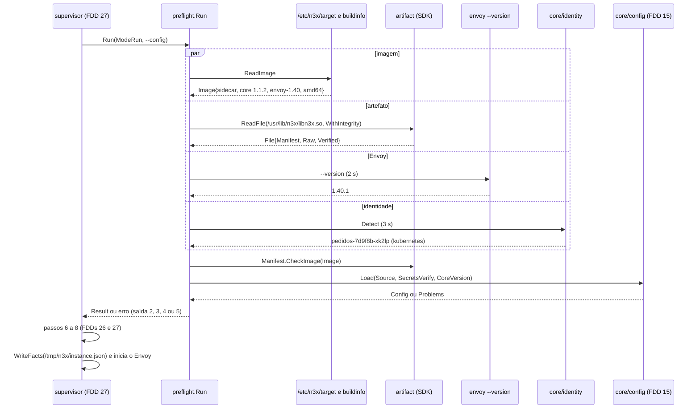
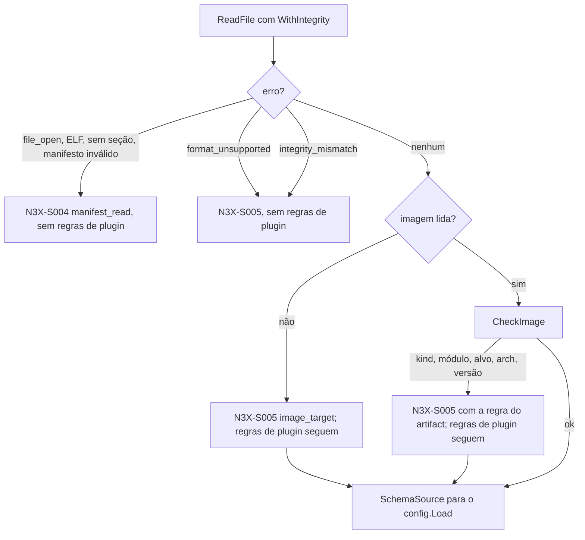
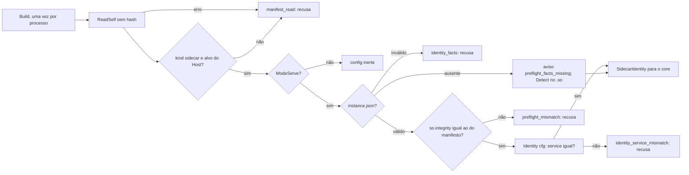

### FDD: Pré-voo da subida: identidade da instância e conferência do `.so` (SID-05)

Versão: 1.0
Data: 2026-10-21
Responsável: Guilherme Giusti

---

### 1. Contexto e motivação técnica

**Problema técnico.** Entre ler o `n3x.yaml` e subir o Envoy, o `n3x run` precisa responder a duas perguntas que nenhuma FDD anterior responde por inteiro:

- **O `libn3x.so` serve para esta imagem?** Um `.so` de outro alvo, de outra arquitetura, corrompido, com `format` de manifesto que a imagem não conhece ou feito com um `core/` mais novo que o da imagem só falharia dentro do Envoy, às vezes depois de receber tráfego (ADR-001 e ADR-002 do `n3x-builder`). A FDD 22 entregou o leitor (`artifact.ReadFile`, `WithIntegrity`, `CheckImage`), mas deixou para cá a ordem das conferências, os códigos de saída, os eventos de log, de onde vem cada campo do `Image`, se o `.so` refaz o hash (P-01 dela) e se o `n3x validate --so` também faz o pré-voo (P-02 dela).
- **Quem é esta instância?** A identidade (serviço e nome do pod ou ID do container) é a chave do inventário e fica amarrada ao token de sessão (FR-006, ADR-005 do `n3x-plugin-core`). Ela precisa ser estável num restart do container no mesmo pod e diferente entre réplicas. O HLD só lista as fontes (pod, metadata v4 do ECS, cgroup ou `mountinfo`, hostname); faltam a ordem, os prazos, os formatos, o que fazer com o `spec.hostname` do Kubernetes e com o cgroup v2, e como a variável `ECS_CONTAINER_METADATA_URI_V4` convive com a regra "nenhum comportamento por variável de ambiente" do FR-001 (L-72). E o `Register` do core tem dois campos sem origem: `address` (L-68) e `envoy_version` (L-69).

Além disso, a visão `proxy.Sidecar` do core (FDD 09) promete uma identidade "igual à que o entrypoint detectou", mas o `.so` roda em outro processo, criado pelo Envoy, e a porta `SidecarParts.Identity` da FDD 17 ainda não tem quem a preencha.

**Encaixe no HLD.** Esta FDD especifica, no repositório `n3x-sidecar`, os passos 2 e 5 da "Sequência de subida" do HLD (conferência do `.so` e identidade) e a composição dos passos 1 a 5 numa chamada única do entrypoint, o componente "Identidade (`core/identity`)" e a parte "`.so` com alvo e integridade conferidos" de "Proteção de dados". Pacotes:

- `internal/preflight` (novo, só do entrypoint): monta os passos 1 a 5, lê a imagem, confere o `.so`, chama o `config.Load` da FDD 15, roda `envoy --version` e a detecção de identidade, e devolve o código de saída 5 (`N3X-S005`)
- `core/identity` (HLD): detecção da identidade, endereço anunciado e o arquivo de fatos entregue ao `.so`, usados pelo entrypoint e pelo `.so` (ADR-001 do `n3x-sidecar`)
- `core/buildinfo` (novo, hipótese de nome): versão e módulo do `core/` compilado, usados como versão da imagem
- `core/entry` (FDD 17): a `SelfSource` do `.so` e a parte `Identity` da visão `Sidecar` são implementadas aqui (contrato 8 da FDD 22 e contrato 9 da FDD 17)
- `cmd/n3x` (FDD 15): o `run` e o `validate` passam a chamar `preflight.Run`

Quem consome:

- FDD 27 (SID-07, supervisor): chama `preflight.Run` como passos 1 a 5, usa o código de saída, a versão do `core/` do `.so` e grava o arquivo de fatos antes de iniciar o Envoy (contrato 1)
- FDD 26 (SID-06, bootstrap): recebe a versão do `core/` do `.so` para evoluir a config do filtro (contrato 1)
- FDD 42 (CORE-06, agente do core): lê `Sidecar.Identity()` para o `Login` e o `Register` (contrato 9)
- FDDs 17 e 38: a parte `Identity` de `SidecarParts`, com assinatura refinada (contrato 8)
- FDD 16: a gauge nova `n3x_sidecar_identity_info` (seção 7)
- FDD 28: o formato de `/etc/n3x/target` e a versão da imagem (contrato 10)
- FDD 49: o mesmo pré-voo no modo Istio

**Atores.** Entrypoint `n3x run` (PID 1, passos 1 a 5), `n3x validate` na CI do serviço, `.so` carregado no Envoy (criação da config do filtro), plugin core (consome a identidade), orquestrador (Kubernetes, ECS e docker compose, que fornece os sinais de identidade e reinicia o container que sai com código diferente de 0) e operador (lê as mensagens de recusa).

**Limites.** Esta FDD não define o formato do manifesto, o hash nem o leitor (FDD 22), não valida a seção `plugins` (FDD 15; aqui só se monta a fonte de schemas e se chama o `config.Load`), não calcula o runtime Go nem inicia o Envoy (FDD 27), não envia o registro (FDD 42) e não trata a identidade no modo Istio além do que é igual ao modo padrão (FDD 49).

**Suposições**
- FDDs 15, 16, 17, 22 e 26 implementadas: `config.Load`, `config.NewPluginInfo`, `config.NewStaticSource`, `config.ExitCode`, `config.DefaultSO` (FDD 15); `telemetry.Platform` (FDD 16); `chain.SidecarParts`, `entry.SelfSource` e `adapter.Host` (FDDs 16 e 17); pacote `artifact` do SDK (FDD 22); `bootstrap.PrepareDir`, `bootstrap.DefaultEnvoyPath` e `envoycfg.RuntimeDir` (FDD 26)
- A imagem de runtime e o `core/` saem da mesma tag do repositório, então a versão da imagem é a versão do `core/` compilado no entrypoint (H-02 da FDD 22)
- O container tem `/proc` montado e o processo lê `/proc/self/cgroup`, `/proc/self/mountinfo` e o hostname sem capacidades extras (spike ID-05)
- `/tmp/n3x` existe com modo `0700` e dono `17000` quando o Envoy inicia (FDD 26)
- O binário do Envoy da imagem responde a `envoy --version` sem carregar módulo nem config (spike ID-01)

**Restrições**
- `.so` carregado só de `/usr/lib/n3x/libn3x.so`, nunca de fonte remota (HLD do `n3x-sidecar`)
- Aceita a mesma major com minor do manifesto menor ou igual à da imagem; fora disso, recusa e diz qual versão usar (ADR-001 do `n3x-builder`), sempre pela função única `CheckImage` da FDD 22
- Integridade por SHA-256 das seções `SHF_ALLOC`, sem assinatura (ADR-002 do `n3x-builder`); `format` maior do que o leitor conhece é recusado e campo desconhecido é ignorado (ADR-003)
- Fontes da identidade: pod, ECS metadata v4, cgroup ou `mountinfo`, hostname com aviso (HLD do `n3x-sidecar`); identidade amarrada ao token (ADR-005 do `n3x-plugin-core`)
- Nenhum comportamento configurado pelo operador por variável de ambiente (FR-001)
- Meta de pronto em até 5 s depois que o container sobe (PRD)
- `core/identity` só com a biblioteca padrão (entra no entrypoint e no `.so`); o entrypoint não importa `proxy/` do SDK
- Documentação e mensagens em pt-BR; identificadores em inglês

**Rastreabilidade**
- PRD 1.5: FR-001 (identidade da instância; `.so` ausente ou incompatível encerra o container; nada por variável de ambiente), FR-006 (serviço, instância, endereço, alvo e versão do Envoy no inventário; reconexão com a mesma identidade num restart do container), FR-015 (imagem de runtime incompatível com a versão do `core/` não sobe e diz qual versão usar); critérios "o painel mostra serviço, instância, alvo e versão do Envoy de cada sidecar", "teste negativo com um `.so` feito para um Envoy mais novo carregado num mais antigo" e "pronto em até 5 s"
- HLD do `n3x-sidecar`: "Sequência de subida" (passos 1 a 5), "Componentes" (Entrypoint e Identidade), "Modelo de dados" (identidade da instância), "Proteção de dados"; HLD do `n3x-builder`: "Versionamento e compatibilidade" e "Modelo de dados"; HLD do `n3x-plugin-core`: conflito de identidade
- ADRs: ADR-001 e ADR-007 do `n3x-sidecar`; ADR-001, ADR-002 e ADR-003 do `n3x-builder`; ADR-005 do `n3x-plugin-core`
- Lacunas do README:
  - **L-68 fechada aqui:** `address` é `<IP>:<listener.port>`, com o IP do metadata do ECS ou da primeira interface ativa (contrato 6)
  - **L-69 fechada aqui:** `envoy_version` vem de `envoy --version` rodado pelo entrypoint no pré-voo, conferido contra o alvo (contrato 6)
  - **L-72 fechada aqui:** ler variáveis que o próprio orquestrador injeta, só para detectar o ambiente, não é configuração por variável de ambiente; a lista é fechada (`KUBERNETES_SERVICE_HOST` e `ECS_CONTAINER_METADATA_URI_V4`) e a URI do ECS só vale com o host fixo `169.254.170.2` (contrato 5)
  - **L-01 aplicada (FDD 09):** a identidade chega ao core pela visão `proxy.Sidecar`, preenchida pela parte `Identity` desta FDD (contratos 8 e 9)
  - **L-04 aplicada (FDD 22):** o entrypoint e o `.so` usam o pacote `artifact` do SDK
  - **D-12 completada:** o `n3x validate --so` deixa de ser stub e faz o mesmo pré-voo do `run` (contrato 1)
- Pedidos atendidos: FDD 15 (ligar o leitor ao `run`, preencher `CoreVersion`, decidir os códigos de saída 5 a 9), FDD 16 (código de saída 5 citado pela FDD 26; identidade e alvo em métrica, seção 7), FDD 09 (identidade e manifesto para a visão `Sidecar`), FDD 17 (`SidecarParts.Identity`), FDD 21 (conferir a `arch` do manifesto contra a do processo), FDD 22 (contrato de leitura com `ReadFile` e `WithIntegrity`, `Image` inteiro, P-01, P-02, eventos `manifest_loaded` e `manifest_rejected`, busca na CI por `config.DefaultSO` usado como reserva), FDD 26 (código de saída 5; versão do `core/` do `.so` para evoluir a config do filtro)

---

### 2. Objetivos técnicos

- **Nenhum `.so` incompatível chega ao Envoy.** Invariante: `.so` de outro alvo, de outra arquitetura, de outro tipo, com hash diferente, com `format` maior que 1, com major de `core/` diferente ou minor maior que a da imagem nunca é carregado pelo Envoy do `n3x run`. Medida: em cada um dos 9 casos, o `n3x run` sai com 5 antes de qualquer `envoy --mode validate` (contador do Envoy falso igual a 0).
- **Uma regra de compatibilidade só.** Invariante: a decisão de versão, alvo, arquitetura e tipo vem só de `artifact.Manifest.CheckImage` (FDD 22). Medida: busca na CI do `n3x-sidecar` por comparação própria de major ou minor de versão de runtime dá 0 ocorrências.
- **Mesmo veredito no `run` e no `validate`.** Invariante: para o mesmo `.so` e a mesma imagem, `n3x validate` e `n3x run` dão o mesmo código de saída e as mesmas regras (`Path` e `Rule`) nas conferências do artefato. Medida: corpus de 24 artefatos (os 9 casos de recusa, 6 de leitura e 9 válidos) com 0 divergência.
- **Identidade estável e única.** Invariante: no Kubernetes, a instância é igual antes e depois de um restart do container no mesmo pod e diferente entre réplicas; no docker compose, igual num `docker compose restart` e igual ao ID curto do `docker ps`. Medida: testes de ponta a ponta em kind e docker compose na CI; ECS em teste manual guiado.
- **Identidade igual nos dois processos.** Invariante: `Sidecar.Identity()` dentro do `.so` é exatamente a identidade que o entrypoint detectou e logou (instância, endereço e versão do Envoy). Medida: teste de ponta a ponta compara o `identity_detected` do entrypoint com o `preflight_facts_loaded` do `.so`.
- **Pré-voo curto.** Medida: num runner amd64 da CI, `.so` de 64 MiB, p95 de 20 execuções do `preflight.Run` no modo `run` em até 400 ms fora do ECS e até 450 ms com o metadata do ECS falso; pior caso limitado a 2,5 s pelos prazos (hipótese). Cabe na meta de pronto em 5 s.
- **Recusa que diz o que fazer.** Invariante: toda recusa do pré-voo tem código `N3X-S005` (ou `N3X-S004` para leitura), regra estável, caminho e texto com a versão ou a imagem a usar; nunca há fallback silencioso para outro `.so`, outra identidade ou outro alvo.
- **Sem bloqueio por detalhe informativo.** Invariante: a falta de uma fonte de identidade melhor nunca impede a subida (o hostname é o último recurso, com aviso), e uma saída de `envoy --version` que não é reconhecida vira `unknown` com aviso, sem recusa.

---

### 3. Escopo e exclusões

**Incluído**
- `preflight.Run`: composição dos passos 1 a 5 do HLD para o `run` e o `validate`, com paralelismo, prazos, ordem dos problemas e logs (contrato 1)
- Leitura da imagem: `/etc/n3x/target`, versão e módulo do `core/` do entrypoint, arquitetura do processo, preenchendo o `artifact.Image` inteiro (contratos 1 e 10)
- Conferência do `.so`: `artifact.ReadFile` com `WithIntegrity`, classificação dos erros em `N3X-S004` e `N3X-S005`, `CheckImage` com `kind`, módulo, alvo, `arch` e versão (contrato 1)
- Código de saída 5 e `N3X-S005`, com regras, textos e precedência; repartição das saídas 6 a 9 entre as FDDs 26 a 29 (contrato 2)
- Fonte de schemas para o `config.Load` (adaptador da FDD 22) e `CoreVersion` preenchido
- `core/identity`: detecção em cinco fontes, com ordem, prazos, gramática e log (contratos 3 e 4)
- L-72: regra para as variáveis injetadas pelo orquestrador (contrato 5)
- Endereço anunciado (L-68) e versão do Envoy (L-69) (contrato 6)
- Arquivo de fatos `/tmp/n3x/instance.json`, do entrypoint para o `.so` (contrato 7)
- Lado do `.so`: `entry.SelfPreflight` com a `SelfSource` sem refazer o hash (P-01 da FDD 22) e a parte `Identity` da visão `Sidecar` (contrato 8)
- Contrato da identidade entregue ao plugin core e dos dados entregues ao supervisor (contrato 9)
- `core/buildinfo` e formato de `/etc/n3x/target` (contrato 10)
- P-02 da FDD 22: o `n3x validate --so` faz as conferências do artefato

**Excluído**
- Formato do manifesto, hash, leitor e regra de compatibilidade: FDD 22 (BLD-04)
- Regras do `n3x.yaml` e da seção `plugins`, categorias 2 a 4 e renderização dos blocos: FDD 15 (SID-01); aqui só os pedidos de acréscimo da categoria 5
- Cálculo do runtime Go, início do Envoy, repasse de sinais e repasse do código de saída do Envoy: FDD 27 (SID-07)
- Bootstrap e `envoy --mode validate`: FDD 26 (SID-06)
- Conteúdo da imagem de runtime (Dockerfile, UID, digest): FDD 28 (SID-08); aqui só o formato de `/etc/n3x/target` pedido a ela
- Envio de `Login` e `Register`: FDDs 39 e 42; conflito de identidade no controller: FDD 43
- Identidade e versão do Envoy no modo Istio quando diferirem do modo padrão: FDD 49 (SID-11)
- Downward API ou outra fonte que exija configuração do operador para o nome do pod: fora da v1 (ponto P-01)

---

### 4. Fluxos detalhados e diagramas

**Fluxo principal: `preflight.Run` no `n3x run`** (passos 1 a 5 do HLD; chamado pelo supervisor da FDD 27)
1. O despacho da FDD 15 reconhece `run` e o supervisor chama `preflight.Run(ctx, Options{Mode: ModeRun, ConfigPath: <--config>})`.
2. **Em paralelo, quatro trabalhos** (o pré-voo dura o tempo do mais lento, não a soma):
   - a. `ReadImage()`: lê `/etc/n3x/target` (até 64 bytes, uma linha) e monta `artifact.Image{Kind: sidecar, Name: buildinfo.ImageName, Module: buildinfo.Module, Version: buildinfo.CoreVersion(), Target: <arquivo>, Arch: runtime.GOARCH}` (contrato 10).
   - b. `artifact.ReadFile(config.DefaultSO, artifact.WithIntegrity())` (contrato de leitura 1 da FDD 22): cabeçalhos, seção `.n3x_manifest` e hash das seções carregáveis em blocos de 64 KiB.
   - c. `EnvoyVersion(ctx, bootstrap.DefaultEnvoyPath)`: roda `envoy --version` com ambiente mínimo e prazo de 2 s (contrato 6).
   - d. `identity.Detect(ctx, ...)` com prazo de 3 s: fontes na ordem do contrato 4.
3. **Imagem e artefato.** Espera a e b. Erro de leitura do artefato é classificado pelo contrato 2: arquivo ausente, ELF inválido, sem seção ou manifesto estruturalmente inválido viram `manifest_read` (`N3X-S004`, FDD 15); `format` maior e hash diferente viram `format_unsupported` e `integrity_mismatch` (`N3X-S005`). Com a e b sem erro: `f.Manifest.CheckImage(img)`; cada problema vira uma regra `N3X-S005` com o `Path` do `artifact` (`kind`, `runtime.module`, `target`, `arch`, `runtime.version`). Imagem ilegível: `image_target` e nenhuma conferência de `CheckImage`.
4. **Fonte de schemas.** Se o artefato foi lido e o manifesto é confiável (sem `format_unsupported` nem `integrity_mismatch`), monta o `SchemaSource` pelo adaptador do contrato 8 da FDD 22 (`config.NewPluginInfo` por plugin, erros prefixados com `plugins[k]`, `config.NewStaticSource`); erro aqui é `N3X-S004`. Uma recusa só de `CheckImage` (alvo ou versão) não impede a fonte: o manifesto é íntegro, então a seção `plugins` ainda é validada, para o operador ver tudo de uma vez.
5. **Config** (FDD 15, passos 1, 3 e 4 do HLD). `config.Load(config.Options{Path, Source, Secrets: SecretsVerify, CoreVersion: f.Manifest.Runtime.Version})` e `config.CheckDefaultMode`. Sem fonte (passo 4 não montou), as regras de plugin ficam de fora, como no `validate` da FDD 15 quando o manifesto falha; o problema do artefato já foi registrado, então não há anúncio de validação parcial.
6. **Envoy e identidade.** Espera c e d (já correndo). `envoy --version` com falha de execução ou prazo estourado vira `envoy_version`; versão reconhecida com `major.minor` diferente do alvo `envoy-M.m` vira `envoy_mismatch`; saída não reconhecida vira `unknown` com o aviso `envoy_version_unknown`. Identidade: `ErrUnavailable` vira `identity_unavailable`; fonte `hostname` gera o aviso `identity_fallback`. O endereço anunciado é montado com `listener.port` do `Config` (contrato 6).
7. **Resultado.** Junta os problemas e ordena pelas categorias `N3X-S002`, `N3X-S005`, `N3X-S004`, `N3X-S003` (contrato 2), mantendo a ordem da FDD 15 dentro de cada uma. Emite os logs numa ordem fixa: `manifest_loaded` ou `manifest_rejected`, os eventos da FDD 15 (`config_problem`, `config_warning`, `config_rejected` ou `config_loaded`), `envoy_detected`, `identity_detected` ou `identity_fallback`, e por último `preflight_passed` ou `preflight_failed`. Com problema, devolve o erro; `preflight.ExitCode(err)` dá a saída.
8. **Depois, no supervisor** (FDD 27): passos 6 a 8 (runtime Go, bootstrap e `envoy --mode validate`); depois de `bootstrap.Prepare` e antes de iniciar o Envoy (passo 9), `res.WriteFacts()` grava `/tmp/n3x/instance.json` (contrato 7), modo `0600`, de forma atômica.

**Fluxo do `n3x validate`** (FDD 15, contrato 5 dela; P-02 da FDD 22 fechado)
1. O despacho chama `preflight.Run(ctx, Options{Mode: ModeValidate, ConfigPath, SOPath: <--so>, SOFromFlag, KeyPath, Skip})`.
2. Sem `--skip plugins`: os trabalhos a e b, os passos 3 a 5 e as mesmas regras do `run` para o artefato (`image_target`, `format_unsupported`, `integrity_mismatch` e as de `CheckImage`), com `path_source: flag` quando `--so` foi passado. Não roda `envoy --version` nem a detecção de identidade: são fatos do container em execução, não do artefato.
3. Com `--skip plugins`: não lê o `.so` nem a imagem; nenhuma regra `N3X-S005`; a validação é anunciada como parcial (FDD 15).
4. Saída em texto ou JSON pelo renderizador da FDD 15, com o bloco `N3X-S005` na posição de precedência (contrato 2).

**Fluxo do `.so`** (criação da config do filtro, FDD 17; contrato 8)
1. O Envoy cria a config do filtro; o `adapter.Process` chama o `Build` uma vez por processo (FDD 16).
2. O executor chama `Source(h, reg)`, implementada por `entry.SelfPreflight.Source`: `artifact.ReadSelf()` **sem** `WithIntegrity` (P-01: o `.so` não refaz o hash); confere `kind: sidecar` e `target` igual a `h.Target.Name()`; monta schemas, módulos e `Raw` (contrato 8 da FDD 22). Qualquer erro vira `manifest_read`, sem caminho de reserva.
3. Só em `ModeServe`: lê `/tmp/n3x/instance.json` com `identity.ReadFacts`. Presente e válido: `so.integrity` do arquivo precisa ser igual a `integrity` do próprio manifesto e `target` igual ao do manifesto; senão `preflight_mismatch` e a config do filtro é recusada. Ausente: aviso `preflight_facts_missing` e a identidade será detectada pelo próprio `.so`. Inválido ou com `format` maior que 1: `identity_facts`, recusa.
4. O executor roda `VerifyRegistry` e `config.Load` com `SecretsOpen` e `CoreVersion` zero (FDDs 15 e 17).
5. O executor chama `Sidecar.Identity(cfg)` (assinatura refinada, pedido à FDD 17), implementada por `SelfPreflight.Identity`: com fatos, confere `service` contra `cfg.File.Service` (`identity_service_mismatch`) e devolve a identidade do arquivo; sem fatos, roda `identity.Detect` com prazo de 3 s e `EnvoyVersion` igual a `unknown`. O valor fica guardado; as chamadas seguintes da visão devolvem o mesmo.
6. Loga `preflight_facts_loaded` (ou o aviso) e publica `n3x_sidecar_identity_info{source, facts}` pela telemetria da FDD 16.
7. Em `ModeValidate` (`N3X_ENVOY_VALIDATE=1`): só o passo 2; os fatos não são lidos e a identidade não é pedida (config inerte, FDD 26).

**Fluxo da detecção de identidade** (`identity.Detect`, contrato 4)
1. `kubernetes`: presente se `KUBERNETES_SERVICE_HOST` não está vazio ou se `/proc/self/mountinfo` tem `/etc/hosts` montado de `.../pods/<uid>/etc-hosts` (o kubelet sempre monta). Instância = hostname, que no Kubernetes é o nome do pod. O `<uid>` do pod vai só para o log.
2. `ecs`: presente se `ECS_CONTAINER_METADATA_URI_V4` existe, com esquema `http`, host `169.254.170.2` e caminho começando em `/v4/` (outro host: tentativa `untrusted`, nenhuma requisição). `GET` da URI, até 2 tentativas de 900 ms com 200 ms de espera, corpo até 64 KiB. Instância = `DockerId` (64 hex viram os 12 primeiros; outro formato, como o do Fargate, fica inteiro se casar com a gramática). IP de `Networks[0].IPv4Addresses[0]`.
3. `cgroup`: `/proc/self/cgroup` com um segmento de 64 hex (`/docker/<id>`, `docker-<id>.scope`, `libpod-<id>.scope`); instância = 12 primeiros hex. No cgroup v2 com namespace privado a linha é `0::/` e a fonte fica ausente.
4. `mountinfo`: `/proc/self/mountinfo` com ponto de montagem `/etc/hostname`, `/etc/hosts` ou `/etc/resolv.conf` e raiz que contém `containers/[<namespace>/]<64 hex>/` (Docker, Podman e containerd); instância = 12 primeiros hex. É a fonte que cobre o docker compose com cgroup v2.
5. `hostname`: `os.Hostname()`; vale se casar com a gramática, com o aviso `identity_fallback`. Vazio ou inválido: `ErrUnavailable`.
- A primeira fonte presente e válida vence; fonte presente com valor inválido ou com erro registra a tentativa e passa para a próxima. Cada tentativa entra em `Identity.Attempts` e no log.

**Fluxos alternativos e exceções**
- **`.so` ausente** (imagem de runtime sem o `COPY` do estágio final): `manifest_read` com `fs.ErrNotExist`, saída 4, texto "nenhum libn3x.so em /usr/lib/n3x/libn3x.so: a imagem de runtime não traz .so; copie o /out/libn3x.so do n3x-plugin build no estágio final" (FR-001)
- **`.so` de desenvolvimento (tag `n3x_dev`, sem seção):** `manifest_read` com `section_missing`, saída 4 (FDDs 17 e 22)
- **`.so` de outro alvo (teste negativo do PRD):** `target_mismatch`, saída 5, antes de qualquer `envoy --mode validate`; o texto manda usar a imagem com o sufixo do alvo do `.so` ou recompilar com a `sidecar-builder` do alvo da imagem
- **`.so` de outra arquitetura:** o leitor garante `arch` igual à máquina do ELF (FDD 22); `CheckImage` compara com `runtime.GOARCH` do entrypoint e dá `arch_mismatch` (pedido da FDD 21). Na prática acontece quando o operador copia o `.so` de um build cruzado para a imagem da outra arquitetura
- **`.so` alterado depois do build:** byte em seção carregável dá `integrity_mismatch`, saída 5; a seção do manifesto e as seções não carregáveis ficam fora do hash (trade-off do ADR-002)
- **`core/` do `.so` mais novo que o da imagem, ou de outra major:** `runtime_too_new` ou `runtime_major` (`runtime_unstable` na série 0), saída 5, com as duas linhas do `VersionError` da FDD 22
- **`n3x.yaml` inválido e `.so` incompatível juntos:** os dois blocos aparecem; a saída é 2 (precedência do contrato 2)
- **`/etc/n3x/target` ausente** (binário `n3x` fora da imagem de runtime): `image_target`, saída 5; o artefato ainda é lido para validar a seção `plugins`
- **Envoy ausente ou que não responde a `--version` em 2 s:** `envoy_version`, saída 5 (imagem de runtime incompleta); o motivo `envoy_missing` da FDD 26 continua como defesa e só aparece se o binário sumir entre os passos 5 e 8
- **Envoy de outra minor que o alvo da imagem** (imagem montada errado): `envoy_mismatch`, saída 5
- **Saída de `envoy --version` irreconhecível:** `EnvoyVersion` vale `unknown`, aviso `envoy_version_unknown`, sem recusa
- **Kubernetes com `spec.hostname`:** o hostname deixa de ser o nome do pod e as réplicas de um Deployment ficam com a mesma instância; o N3X não tem como saber (sem configuração do operador). O controller marca o conflito de identidade (FDD 43) e o guia proíbe `spec.hostname` em workload com mais de uma réplica (ponto P-01)
- **Kubernetes, restart do container no mesmo pod:** hostname igual, instância igual; o `emptyDir` de `/tmp` guarda o `instance.json` antigo, que o novo entrypoint sobrescreve antes de iniciar o Envoy
- **Docker compose com `hostname:` fixo:** a fonte `mountinfo` vence o hostname, então réplicas com o mesmo hostname continuam com instâncias diferentes
- **ECS com o metadata fora do ar:** as tentativas falham em até 2,2 s; a detecção segue para `cgroup`, `mountinfo` (EC2) ou `hostname` (Fargate, em que o hostname já é único por task), com aviso
- **Variável do ECS com outro host** (por exemplo, posta à mão num compose): ignorada, tentativa `untrusted` no log, nenhuma requisição (L-72)
- **Envoy iniciado sem o entrypoint** (teste de carga da FDD 23, harness de desenvolvimento, Istio antes da FDD 49): sem `instance.json`, o `.so` avisa `preflight_facts_missing`, não confere integridade e detecta a identidade sozinho, com `EnvoyVersion` `unknown`; a gauge sai com `facts="self"`
- **`.so` trocado depois do pré-voo** (ou carregado de outro caminho que o verificado): `so.integrity` do arquivo de fatos difere do `integrity` do manifesto lido por `ReadSelf`; `preflight_mismatch`, a config do filtro é recusada e o Envoy não sobe
- **`n3x.yaml` trocado entre o entrypoint e o `.so`** (ConfigMap atualizado nesse intervalo) com outro `service`: `identity_service_mismatch`; o container reinicia e os dois lados voltam a ler o mesmo arquivo
- **Sem nenhum IP global nas interfaces:** endereço vira `<hostname>:<porta>` com o aviso `address_fallback`

**Diagramas**

Sequência do `n3x run` até o pré-voo terminar:



Classificação do resultado da leitura e da conferência:



Lado do `.so`:



---

### 5. Contratos públicos (assinaturas, endpoints, headers, exemplos)

**Contrato 1: `preflight.Run` (passos 1 a 5 do entrypoint)**
- Tipo: sdk (API Go do pacote `github.com/giustech/n3x-sidecar/internal/preflight`, hipótese de nome; usada pelo `cmd/n3x` e pelo supervisor da FDD 27)
- Assinatura/Rota:
  ```go
  package preflight

  const (
      TargetFile            = "/etc/n3x/target"
      MaxTargetFileSize     = 64
      ExitCode              = 5
      Code                  = "N3X-S005"
      EnvoyVersionTimeout   = 2 * time.Second
      MaxEnvoyVersionOutput = 4 << 10
      IdentityTimeout       = 3 * time.Second
  )

  type Mode uint8

  const (
      ModeRun      Mode = iota + 1 // artefato, imagem, config, Envoy e identidade
      ModeValidate                 // artefato, imagem e config; sem Envoy nem identidade
  )

  type Options struct {
      Mode       Mode
      ConfigPath string        // "" = config.DefaultPath
      SOPath     string        // "" = config.DefaultSO; só o validate muda (--so)
      SOFromFlag bool          // path_source "flag" no log
      KeyPath    string        // só validate (--key)
      Skip       config.Skip   // só validate (--skip); Skip.Plugins pula também o artefato e a imagem
      EnvoyPath  string        // "" = bootstrap.DefaultEnvoyPath
      Identity   identity.Env  // zero = identity.SystemEnv(); testes injetam
      Image      *artifact.Image // nil = ReadImage(); testes injetam
      Logger     *slog.Logger  // component=entrypoint
  }

  type Durations struct {
      Total, Read, Hash, Config, Envoy, Identity time.Duration
  }

  type Result struct {
      Config       *config.Config    // nil se a config falhou
      Report       *config.Report
      DefaultMode  []config.Warning  // config.CheckDefaultMode
      Image        artifact.Image
      Artifact     *artifact.File    // nil com Skip.Plugins ou leitura recusada
      Identity     identity.Identity // zero no validate
      Address      string            // identity.Address(listener.port); "" no validate
      EnvoyVersion string            // "" no validate; "unknown" se a saída não foi reconhecida
      Durations    Durations
  }

  // Passos 1 a 5. Com erro de categoria, Result vem preenchido com o que foi possível
  // montar (o validate usa no resumo); o chamador só usa Config quando err == nil.
  func Run(ctx context.Context, opts Options) (*Result, error)

  func ReadImage() (artifact.Image, error)                       // contrato 10
  func EnvoyVersion(ctx context.Context, path string) (string, error) // contrato 6
  func ExitCode(err error) int                                    // 0 a 5; precedência 2, 5, 4, 3

  func (r *Result) SOCoreVersion() plugin.Version // runtime.version do manifesto; zero sem artefato
  func (r *Result) Facts(now time.Time) identity.Facts
  func (r *Result) WriteFacts() error             // identity.WriteFacts(identity.FactsFile, r.Facts(time.Now()))
  ```
- Método: n/a (chamada local)
- Semântica de status/headers:
  - **Erro:** o embrulho da FDD 15 (`Unwrap() []error`, sentinela de cada categoria presente e `config.Problems`), com a categoria nova `config.CategoryPreflight` e a sentinela `config.ErrPreflight` (pedido à FDD 15). `preflight.ExitCode` é o `config.ExitCode` com a saída 5 na precedência do contrato 2; `cmd/n3x` usa só ele
  - **Paralelismo:** os trabalhos a, b, c e d do fluxo começam juntos; o `config.Load` espera b; os resultados de c e d só são lidos no passo 6; o `ctx` de c e d é cancelado quando `Run` volta
  - **`CoreVersion`** (pedido da FDD 15): `f.Manifest.Runtime.Version`, a versão do `core/` do `.so`; zero sem artefato. O `field_too_new` da FDD 15 passa a ter o que comparar
  - **`SOCoreVersion`** (pedido da FDD 26): a mesma versão, para o gerador do bootstrap só emitir campo novo do `filter_config` que o `.so` conhece. Na v1.0 nenhum campo depende disso
  - **`WriteFacts`:** o supervisor chama depois de `bootstrap.Prepare` (que cria `/tmp/n3x` com `PrepareDir`) e antes do passo 9; erro de escrita é `bootstrap.ErrWrite` do ponto de vista do operador (saída 6, `reason` `write`), porque é o mesmo diretório (pedido à FDD 27)
  - **Sem estado global:** duas chamadas com as mesmas entradas dão o mesmo resultado (salvo `Durations` e a identidade, que lê o ambiente)
  - **`validate`:** mesma função; o resumo JSON da FDD 15 ganha os campos `target`, `so_core_version`, `image_version` e `integrity` (pedido à FDD 15)

**Exemplo de requisição** (supervisor da FDD 27)
```go
res, err := preflight.Run(ctx, preflight.Options{
    Mode:       preflight.ModeRun,
    ConfigPath: "/etc/n3x/n3x.yaml",
    Logger:     log, // component=entrypoint
})
if err != nil {
    os.Exit(preflight.ExitCode(err))
}
// passos 6 a 8 (FDDs 27 e 26) ...
if err := res.WriteFacts(); err != nil { /* saída 6, reason write */ }
fmt.Println(res.Identity.Instance, res.Address, res.EnvoyVersion, res.SOCoreVersion(), res.Durations.Total)
```

**Exemplo de resposta**
```json
{
  "Identity.Instance": "pedidos-7d9f8b-xk2lp",
  "Identity.Source": "kubernetes",
  "Address": "10.42.3.17:17000",
  "EnvoyVersion": "1.40.1",
  "SOCoreVersion()": "1.0.0",
  "Image": { "Kind": "sidecar", "Name": "ghcr.io/giustech/n3x/sidecar", "Module": "github.com/giustech/n3x-sidecar/core", "Version": "1.1.2", "Target": "envoy-1.40", "Arch": "amd64" },
  "Artifact.Verified": true,
  "Durations": { "Total": "142ms", "Read": "4ms", "Hash": "97ms", "Config": "6ms", "Envoy": "61ms", "Identity": "2ms" },
  "err": null
}
```

---

**Contrato 2: código de saída 5, `N3X-S005` e repartição das saídas 5 a 9**
- Tipo: CLI e log (contrato com o operador e com a automação; complementa o contrato 7 da FDD 15)
- Assinatura/Rota: código de saída do processo, bloco de texto em stderr no `validate` e registros JSON no `run`
- Método: n/a
- Semântica de status/headers:
  - **Repartição das saídas reservadas pela FDD 15** (hipótese H-03 da FDD 26 confirmada: cada FDD usa o seu número menos 20):

| Saída | Código | FDD dona | Categoria |
| --- | --- | --- | --- |
| 0 | | | válido; subiu ou passou |
| 1 | `N3X-S001` | 15 | uso |
| 2 | `N3X-S002` | 15 | `n3x.yaml` inválido |
| 3 | `N3X-S003` | 15 | segredo ou chave |
| 4 | `N3X-S004` | 15 | manifesto do `.so` ilegível ou inválido (inclui `.so` ausente) |
| 5 | `N3X-S005` | 25 (esta) | pré-voo: `.so` incompatível com a imagem, imagem incompleta, identidade indisponível |
| 6 | `N3X-S006` | 26 | bootstrap do Envoy (já definido) |
| 7 | `N3X-S007` | 27 | supervisor antes do pronto: runtime Go (inclusive sem limite de memória, ADR-008), início do Envoy e prazo de 30 s para o Envoy ficar pronto; o repasse do código do próprio Envoy depois do pronto é decisão da 27 |
| 8 | `N3X-S008` | 28 | reservado; hipótese de uso: ambiente do container diferente do que a imagem exige (UID, arquivos da imagem); a 28 usa ou libera |
| 9 | `N3X-S009` | 29 | health e drenagem (já pedido pela FDD 26) |

  - **Precedência** (H-16 da FDD 15 estendida, ordem dos passos do HLD: schema no passo 1, pré-voo no 2, plugins no 3, chave no 4): `N3X-S002`, `N3X-S005`, `N3X-S004`, `N3X-S003`. A saída é a do primeiro bloco presente. `N3X-S004` e `N3X-S005` só aparecem juntos quando o artefato é lido, falha em `CheckImage` e um schema embutido é inválido
  - **Quem é `S004` e quem é `S005`:** `S004` é "não consigo ler o `.so`" (a correção é gerar o `.so` de novo ou copiá-lo); `S005` é "li o `.so` e ele não serve para esta imagem, ou a imagem está incompleta" (a correção é trocar a imagem ou recompilar com a `sidecar-builder` certa). `format_unsupported` e `integrity_mismatch` ficam em `S005` porque são conferências do passo 2 do HLD, com correção de compatibilidade
  - **Regras de `N3X-S005`** (estáveis na major do `n3x-sidecar`; o `Detail` pode melhorar em patch):

| # | Caminho | Regra | Condição | Fonte | Modos |
| --- | --- | --- | --- | --- | --- |
| 1 | `(imagem).target` | `image_target` | `/etc/n3x/target` ausente, ilegível, acima de 64 bytes, com mais de uma linha ou fora de `^(envoy\|istio)-[0-9]+\.[0-9]+$` | `ReadImage` | run, validate |
| 2 | `format` | `format_unsupported` | `ErrUnsupportedFormat` | `ReadFile` | run, validate |
| 3 | `integrity` | `integrity_mismatch` | `ErrIntegrity` | `ReadFile` com `WithIntegrity` | run, validate |
| 4 | `kind` | `kind_mismatch` | arquivo é um `n3x-controller` | `CheckImage` | run, validate |
| 5 | `runtime.module` | `runtime_module` | `core/` de outro módulo (fork) | `CheckImage` | run, validate |
| 6 | `target` | `target_mismatch` | alvo do manifesto diferente de `/etc/n3x/target` | `CheckImage` | run, validate |
| 7 | `arch` | `arch_mismatch` | `arch` do manifesto diferente de `runtime.GOARCH` | `CheckImage` | run, validate |
| 8 | `runtime.version` | `runtime_major`, `runtime_too_new`, `runtime_unstable` | regra do ADR-001 (contrato 4 da FDD 22) | `CheckImage` | run, validate |
| 9 | `(envoy)` | `envoy_version` | binário ausente, sem permissão, saída diferente de 0, morto por sinal ou acima de 2 s | `EnvoyVersion` | run |
| 10 | `(envoy)` | `envoy_mismatch` | versão reconhecida com `major.minor` diferente do alvo `envoy-M.m` | `EnvoyVersion` | run |
| 11 | `(identidade)` | `identity_unavailable` | nenhuma fonte deu instância válida, nem o hostname | `identity.Detect` | run |

  - **`N3X-S004` vindo do pré-voo:** problema `manifest_read` da FDD 15 (linha 35 dela) com caminho `(manifesto)`, para `file_open`, `ErrInvalidELF`, `ErrNoManifest` e `ErrInvalidManifest`; a regra do `artifact` vai no fim do `Detail` e no campo `artifact_rule` do log. Os problemas de `NewPluginInfo` mantêm os caminhos `plugins[k]...` da FDD 15
  - **Textos** (uma linha no `Detail`; as regras de `CheckImage` usam o texto da FDD 22 e, no `validate`, a segunda linha do `VersionError.Lines()`):

| Regra | Texto |
| --- | --- |
| `image_target` | `/etc/n3x/target ausente: o binário n3x só roda dentro da imagem ghcr.io/giustech/n3x/sidecar` |
| `format_unsupported` | `manifesto no formato 2; esta imagem (sidecar 1.1.2, SDK 1.2.0) lê até o formato 1: use uma imagem de runtime mais nova` |
| `integrity_mismatch` | `hash calculado sha256:de8ceee1a7d6... difere do manifesto sha256:b9afdfefaab1...; o libn3x.so foi alterado ou corrompido depois do build: copie de novo o /out/libn3x.so ou refaça o build` |
| `envoy_version` | `envoy --version falhou: /usr/local/bin/envoy ausente; a imagem de runtime está incompleta` |
| `envoy_mismatch` | `o Envoy da imagem é 1.39.4, mas o alvo da imagem é envoy-1.40; a imagem de runtime foi montada errado` |
| `identity_unavailable` | `nenhuma fonte deu uma identidade válida (kubernetes: ausente; ecs: ausente; cgroup: ausente; mountinfo: ausente; hostname: vazio)` |

  - **Como resolver** (bloco `N3X-S005` e `docs/erros.md#n3x-s005` do `n3x-sidecar`): "use a imagem indicada na mensagem ou recompile o `.so` com a `sidecar-builder` do mesmo alvo e da mesma versão de `core/` da imagem; para `image_target`, `envoy_*` e `identity_unavailable`, confira a imagem de runtime e o ambiente do container"
  - **No `run`:** cada problema sai como um registro JSON (`manifest_rejected` para as regras 2 a 8 e para o `manifest_read`; `config_problem` para as da FDD 15; `preflight_problem` para as regras 1, 9, 10 e 11), seguido de `preflight_failed` com o código de saída (seção 7)

**Exemplo de requisição**
```text
$ docker run --rm -v $PWD/n3x.yaml:/etc/n3x/n3x.yaml:ro ghcr.io/acme/pedidos-sidecar:1.4.0 validate --skip key
```

**Exemplo de resposta** (stderr; `.so` feito para `envoy-1.41` e com `core/` 1.3.0 numa imagem `1.1.2-envoy-1.40`; código de saída 5)
```text
erro N3X-S005: libn3x.so não serve para esta imagem (2 problemas)
  target: libn3x.so feito para envoy-1.41; esta imagem é envoy-1.40; use uma imagem ghcr.io/giustech/n3x/sidecar com sufixo -envoy-1.41, ou recompile com uma sidecar-builder -envoy-1.40 [target_mismatch]
  runtime.version: libn3x.so feito com core 1.3.0; esta imagem (sidecar 1.1.2) aceita core >=1.0 <=1.1 [runtime_too_new]
    use ghcr.io/giustech/n3x/sidecar >= 1.3.0-envoy-1.41, ou recompile com uma sidecar-builder de core >=1.0 <=1.1
  como resolver: use a imagem indicada ou recompile o .so com a sidecar-builder do mesmo alvo e da mesma versão de core/ da imagem
  doc: https://github.com/giustech/n3x-sidecar/blob/main/docs/erros.md#n3x-s005
aviso: validação parcial; pulado: key (segredos conferidos só no formato)
$ echo $?
5
```

---

**Contrato 3: API de `core/identity`**
- Tipo: sdk (API Go do módulo `github.com/giustech/n3x-sidecar/core`; só biblioteca padrão)
- Assinatura/Rota:
  ```go
  package identity // github.com/giustech/n3x-sidecar/core/identity

  const (
      MaxInstanceLen      = 253 // igual ao limite de LoginRequest.instance (FDD 36)
      MaxAddressLen       = 260 // Identity.address (FDD 36)
      MaxEnvoyVersionLen  = 64  // RegisterRequest.envoy_version (FDD 36)
      UnknownEnvoyVersion = "unknown"
      ShortIDLen          = 12  // ID curto, como no docker ps
      KubernetesEnv       = "KUBERNETES_SERVICE_HOST"
      ECSMetadataEnv      = "ECS_CONTAINER_METADATA_URI_V4"
      ECSMetadataHost     = "169.254.170.2"
      ECSAttemptTimeout   = 900 * time.Millisecond
      ECSAttempts         = 2
      ECSRetryWait        = 200 * time.Millisecond
      MaxECSBody          = 64 << 10
      MaxProcFile         = 1 << 20
  )

  type Source string

  const (
      SourceKubernetes Source = "kubernetes"
      SourceECS        Source = "ecs"
      SourceCgroup     Source = "cgroup"
      SourceMountinfo  Source = "mountinfo"
      SourceHostname   Source = "hostname"
  )

  type AddressSource string

  const (
      AddressECS       AddressSource = "ecs"
      AddressInterface AddressSource = "interface"
      AddressHostname  AddressSource = "hostname"
  )

  type Attempt struct {
      Source Source
      Result string // "ok", "absent", "invalid", "error", "untrusted", "skipped"
      Detail string // sem valores do ambiente além do que a regra precisa
  }

  type Identity struct {
      Instance      string
      Source        Source
      Host          string        // IP literal ou hostname, para o endereço
      AddressSource AddressSource
      PodUID        string        // só Kubernetes; só para log
      Attempts      []Attempt
      Duration      time.Duration
  }

  func (i Identity) Fallback() bool                // Source == SourceHostname
  func (i Identity) Address(port uint16) string    // contrato 6; port 0 = sem porta

  type Interface struct {
      Index    int
      Name     string
      Up       bool
      Loopback bool
      Addrs    []netip.Prefix
  }

  type Env struct {
      Getenv     func(string) string
      ReadFile   func(path string, max int64) ([]byte, error)
      Hostname   func() (string, error)
      Interfaces func() ([]Interface, error)
      HTTP       *http.Client // Transport sem proxy de ambiente
  }

  func SystemEnv() Env

  type Options struct{ Env Env }

  func Detect(ctx context.Context, opts Options) (Identity, error)
  func ValidInstance(s string) bool
  func ValidAddress(s string) bool

  var (
      ErrUnavailable = errors.New("identity: nenhuma fonte deu uma identidade válida")
      ErrFacts       = errors.New("identity: arquivo de fatos inválido")
  )
  ```
- Método: n/a
- Semântica de status/headers:
  - **Gramática da instância:** `^[A-Za-z0-9]([A-Za-z0-9._-]{0,251}[A-Za-z0-9])?$`, no máximo 253 bytes; é um subconjunto da regra de `LoginRequest.instance` da FDD 36 (ASCII visível, sem espaço), então o controller nunca recusa uma instância detectada aqui (hipótese)
  - **`Detect`:** nunca entra em panic; cada leitura de `/proc` tem teto de 1 MiB; respeita o `ctx` (o pré-voo passa 3 s); sem estado global; `SystemEnv` lê o ambiente real, os testes injetam `Env`
  - **Erro:** só `ErrUnavailable`, embrulhado com a lista de tentativas (`Unwrap`); fonte com problema não é erro, é tentativa registrada
  - **Não importa `proxy/`:** a conversão para `proxy.SidecarIdentity` fica em `core/entry` (contrato 8), para o entrypoint não puxar gRPC
  - **Proteção de dados:** o corpo do metadata do ECS nunca vai para log nem para `Attempt.Detail`; só `DockerId` e o IP

**Exemplo de requisição**
```go
id, err := identity.Detect(ctx, identity.Options{Env: identity.SystemEnv()})
fmt.Println(id.Instance, id.Source, id.Host, id.Address(17000), id.Fallback(), err)
```

**Exemplo de resposta** (pod de kind; depois, container de docker compose com cgroup v2; depois, ambiente sem nenhuma fonte boa)
```text
pedidos-7d9f8b-xk2lp kubernetes 10.42.3.17 10.42.3.17:17000 false <nil>
4f9c2e1b7a3d mountinfo 172.18.0.5 172.18.0.5:17000 false <nil>
ip-10-0-1-23 hostname 10.0.1.23 10.0.1.23:17000 true <nil>
```

---

**Contrato 4: ordem, sinais e formatos da detecção**
- Tipo: sdk (comportamento de `identity.Detect`)
- Assinatura/Rota: fontes em ordem; a primeira presente e válida vence
- Método: n/a
- Semântica de status/headers:

| Ordem | Fonte | Sinal de presença | Instância | Prazo | Quando não serve |
| --- | --- | --- | --- | --- | --- |
| 1 | `kubernetes` | `KUBERNETES_SERVICE_HOST` não vazio, ou `/etc/hosts` montado com raiz casando `/pods/[0-9a-f-]{36}/etc-hosts$` em `/proc/self/mountinfo` | hostname inteiro (nome do pod) | leitura local | hostname fora da gramática: `invalid`, segue |
| 2 | `ecs` | `ECS_CONTAINER_METADATA_URI_V4` com `http://169.254.170.2[:porta]/v4/...` | `DockerId`: 64 hex viram os 12 primeiros; outro formato (Fargate, `<32 hex>-<dígitos>`) fica inteiro | 2 tentativas de 900 ms, espera de 200 ms (no máximo 2,2 s) | host diferente: `untrusted`, sem requisição; erro, status diferente de 200, corpo acima de 64 KiB ou `DockerId` inválido: `error` ou `invalid`, segue |
| 3 | `cgroup` | linha de `/proc/self/cgroup` com segmento final `(?:^\|/\|-)([0-9a-f]{64})(?:\.scope)?$` | 12 primeiros hex | leitura local | `0::/` (cgroup v2 com namespace privado): `absent`, segue |
| 4 | `mountinfo` | linha de `/proc/self/mountinfo` com ponto de montagem `/etc/hostname`, `/etc/hosts` ou `/etc/resolv.conf` e raiz casando `containers/(?:[a-z0-9._-]+/)?([0-9a-f]{64})/` | 12 primeiros hex | leitura local | nenhuma linha: `absent`, segue |
| 5 | `hostname` | sempre | hostname inteiro, com aviso | leitura local | vazio ou fora da gramática: `ErrUnavailable` |

  - **Kubernetes primeiro:** no Kubernetes o ID do container muda a cada restart; o nome do pod não muda (FR-006, "restart do container no mesmo pod"). Por isso as fontes de container nunca são consultadas quando há sinal de Kubernetes
  - **Pod name pelo hostname:** o kubelet põe o nome do pod no hostname (truncado em 63 caracteres; os nomes gerados por Deployment e StatefulSet já cabem). Com `spec.hostname` o hostname é outro e não há como saber sem configuração do operador (P-01); com `setHostnameAsFQDN`, o hostname tem o domínio e é usado inteiro
  - **`cgroup` antes de `mountinfo`:** a ordem do HLD ("cgroup ou `mountinfo`"); as duas dão o mesmo ID quando existem. No cgroup v2 com namespace privado (padrão do Docker 20.10 em diante) só a `mountinfo` acha o ID, o que responde à pergunta do ASSUNTO (hipótese a confirmar no spike ID-02)
  - **12 hex:** é o ID curto do `docker ps` e o hostname padrão do Docker, então o painel mostra o mesmo valor que o operador vê no host
  - **Log:** a lista de tentativas sai no `identity_detected` como texto `fonte:resultado` separado por vírgula

**Exemplo de requisição** (fixture de container Docker com cgroup v2; linhas de `/proc/self/mountinfo` encurtadas)
```text
/proc/self/cgroup:
0::/
/proc/self/mountinfo:
612 590 0:52 / / rw,relatime master:265 - overlay overlay rw,lowerdir=...
627 612 254:1 /var/lib/docker/containers/4f9c2e1b7a3d8e5f60718293a4b5c6d7e8f90a1b2c3d4e5f60718293a4b5c6d7/hostname /etc/hostname rw,relatime - ext4 /dev/vda1 rw
env: (sem KUBERNETES_SERVICE_HOST nem ECS_CONTAINER_METADATA_URI_V4)
```

**Exemplo de resposta**
```json
{
  "Instance": "4f9c2e1b7a3d",
  "Source": "mountinfo",
  "Attempts": [
    { "Source": "kubernetes", "Result": "absent" },
    { "Source": "ecs", "Result": "absent" },
    { "Source": "cgroup", "Result": "absent", "Detail": "cgroup v2 sem caminho de container" },
    { "Source": "mountinfo", "Result": "ok" }
  ]
}
```

---

**Contrato 5: variáveis injetadas pelo orquestrador (L-72)**
- Tipo: regra de comportamento (documentada em `docs/n3x-yaml.md` e no guia da FDD 47)
- Assinatura/Rota: lista fechada de variáveis lidas pelo entrypoint e pelo `.so`
- Método: n/a
- Semântica de status/headers:
  - **Leitura de detecção, não configuração:** o FR-001 proíbe que o operador configure comportamento por variável de ambiente. As duas variáveis abaixo são escritas pelo próprio orquestrador, só indicam em que ambiente o container está e nunca mudam um campo do `n3x.yaml`; ler essas duas é o mesmo tipo de sinal interno que o `N3X_ENVOY_VALIDATE` da FDD 26 e as variáveis do runtime Go do FR-001
  - **Lista fechada:**

| Variável | Quem injeta | Para que serve | Com valor estranho |
| --- | --- | --- | --- |
| `KUBERNETES_SERVICE_HOST` | kubelet, em todo container | sinal de Kubernetes (o outro sinal é a montagem do `/etc/hosts`) | só o fato de não estar vazia importa |
| `ECS_CONTAINER_METADATA_URI_V4` | agente do ECS (EC2 e Fargate) | URI do metadata do container | host diferente de `169.254.170.2`, esquema diferente de `http` ou caminho fora de `/v4/`: ignorada, tentativa `untrusted`, nenhuma requisição |

  - **Restrições da requisição ao ECS:** cliente sem proxy (`Proxy: nil`), sem seguir redirecionamento, só `GET`, só a URI recebida, corpo até 64 KiB; o host fixo impede que uma variável posta à mão leve o entrypoint a chamar outro destino (hipótese)
  - **Qualquer outra variável** (inclusive `HOSTNAME`, `POD_NAME` ou as do Downward API) não é lida
  - Reflexo pendente: o texto do FR-001 no PRD ganha "salvo a detecção do ambiente, por variáveis que o orquestrador injeta" (L-33)

**Exemplo de requisição** (compose com a variável copiada de um exemplo do ECS)
```yaml
services:
  sidecar:
    image: ghcr.io/acme/pedidos-sidecar:1.4.0
    environment:
      ECS_CONTAINER_METADATA_URI_V4: http://10.0.0.9/v4/abc
```

**Exemplo de resposta** (log do entrypoint)
```json
{"ts":"2026-10-21T14:00:00.212Z","level":"info","component":"entrypoint","service":"pedidos","msg":"identity_detected","sidecar_instance":"4f9c2e1b7a3d","identity_source":"mountinfo","address":"172.18.0.5:17000","address_source":"interface","attempts":"kubernetes:absent,ecs:untrusted,cgroup:absent,mountinfo:ok","duration_ms":1}
```

---

**Contrato 6: endereço anunciado (L-68) e versão do Envoy (L-69)**
- Tipo: sdk (`identity.Identity.Address` e `preflight.EnvoyVersion`)
- Assinatura/Rota:
  ```go
  func (i identity.Identity) Address(port uint16) string
  func preflight.EnvoyVersion(ctx context.Context, path string) (string, error)
  ```
- Método: n/a
- Semântica de status/headers:
  - **Endereço (`Identity.address` do `Register`):** onde o tráfego chega ao serviço por este sidecar, como o FR-006 lista no inventário
    1. Fonte `ecs`: o primeiro IPv4 válido de `Networks[0].IPv4Addresses` (é o IP da task no `awsvpc`); `AddressSource` `ecs`
    2. Senão: interfaces ativas e não loopback, por `Index` crescente; o primeiro IPv4 global (`IsGlobalUnicast`, o que inclui faixas privadas); sem IPv4, o primeiro IPv6 global; link-local nunca; `AddressSource` `interface`
    3. Sem nenhum: o hostname, com o aviso `address_fallback`; `AddressSource` `hostname`
    4. Porta: `listener.port` do `n3x.yaml` (padrão 17000, FDD 15); porta 0 (modo Istio, FDD 18) sai sem porta. Forma `netip.AddrPort.String()`: `10.42.3.17:17000`, `[fd00::5]:17000`, ou `host:porta` no caso 3
    5. No máximo 260 bytes (`MaxAddressLen`); só um hostname longo passaria disso, e nesse caso o endereço é o hostname cortado em 260 bytes, com o aviso `address_fallback` (hipótese; com IP literal nunca acontece)
    - Não usa o truque de "conectar UDP ao controller", porque exigiria resolver `controller.address` no pré-voo e não existe no standalone (hipótese)
  - **Versão do Envoy (`RegisterRequest.envoy_version`):** a versão do binário que vai rodar, medida no próprio binário, e não a que a imagem diz ter
    1. `EnvoyVersion` executa `<path> --version` com ambiente só com `PATH=/usr/local/bin:/usr/bin:/bin`, grupo de processo próprio, prazo de 2 s (`SIGKILL` no grupo ao estourar) e até 4 KiB de saída
    2. Reconhece a linha `version: <40 hex>/<versão>/<estado>/<tipo>/<ssl>` e extrai `<versão>` com `^[0-9]+\.[0-9]+\.[0-9]+(-[0-9A-Za-z.-]+)?$`, até 64 bytes (formato a confirmar no spike ID-01)
    3. Alvo `envoy-M.m`: a versão precisa começar com `M.m.`; senão `envoy_mismatch`. Alvo `istio-*`: sem conferência aqui (FDD 49)
    4. Saída irreconhecível: devolve `unknown` com o aviso `envoy_version_unknown` (campo informativo; não recusa)
    5. Por que não o admin `/server_info`: a identidade precisa existir antes do `Build` do `.so`, e o Envoy só responde no admin depois de pronto; por que não o catálogo: o formato 1 do manifesto não grava a versão do Envoy (ADR-003, FDD 22) e `/etc/n3x/target` só tem o ID (contrato 10)
  - O `.so` sem arquivo de fatos não executa o Envoy para saber a versão: usa `unknown` (contrato 8)

**Exemplo de requisição**
```text
$ /usr/local/bin/envoy --version
```

**Exemplo de resposta** (saída do Envoy e o resultado das duas funções)
```text
/usr/local/bin/envoy  version: 5b9b4b6e9d0f1a2b3c4d5e6f708192a3b4c5d6e7/1.40.1/Clean/RELEASE/BoringSSL

EnvoyVersion = "1.40.1", err = nil
Address(17000) = "10.42.3.17:17000" (AddressSource interface, eth0, Index 2)
```

---

**Contrato 7: arquivo de fatos `/tmp/n3x/instance.json`**
- Tipo: formato de dados (arquivo local, escrito pelo entrypoint e lido pelo `.so`)
- Assinatura/Rota:
  ```go
  package identity

  const (
      FactsFile    = "/tmp/n3x/instance.json" // dentro de envoycfg.RuntimeDir (FDD 26)
      FactsFormat  = 1
      MaxFactsSize = 16 << 10
  )

  type SOFacts struct {
      Path        string `json:"path"`         // caminho conferido pelo pré-voo
      Integrity   string `json:"integrity"`    // "sha256:<64 hex>", conferido com WithIntegrity
      CoreVersion string `json:"core_version"` // runtime.version do manifesto
  }

  type Facts struct {
      Format        int           `json:"format"`
      Service       string        `json:"service"`
      Instance      string        `json:"instance"`
      Source        Source        `json:"source"`
      Address       string        `json:"address"`
      AddressSource AddressSource `json:"address_source"`
      EnvoyVersion  string        `json:"envoy_version"`
      Target        string        `json:"target"`
      Arch          string        `json:"arch"`
      ImageVersion  string        `json:"image_version"`
      SO            SOFacts       `json:"so"`
      DetectedAt    time.Time     `json:"detected_at"` // UTC, milissegundos
  }

  func (f Facts) Validate() error                 // gramáticas e limites deste contrato
  func WriteFacts(path string, f Facts) error     // temporário no mesmo diretório, fsync, 0600, rename
  func ReadFacts(path string) (Facts, error)      // até 16 KiB; tolerante a campo desconhecido
  ```
- Método: n/a
- Semântica de status/headers:
  - **Por que um arquivo e não detectar de novo no `.so`:** a FDD 09 exige que a identidade da visão `Sidecar` seja igual à do entrypoint; duas detecções podem divergir (o metadata do ECS responde numa e não na outra), o `.so` não tem como rodar `envoy --version` de dentro do Envoy, e a ligação pelo `so.integrity` permite ao `.so` não refazer o hash (P-01, contrato 8). O mesmo pacote `core/identity` escreve e lê, com a mesma validação dos dois lados (ADR-001 do `n3x-sidecar`)
  - **Escrita:** só pelo entrypoint, depois de `bootstrap.PrepareDir` (diretório `0700`, dono `17000`, sem link) e antes de iniciar o Envoy; modo `0600`; nunca contém segredo (nem `controller.secret`, nem chave, nem config de plugin)
  - **Leitura:** só pelo `.so` em `ModeServe`, uma vez por processo. Campo desconhecido é ignorado (o entrypoint pode ser mais novo que o `.so`); `format` maior que 1 é `ErrFacts` (o `format` só sobe numa mudança que o leitor antigo leria errado, e nunca dentro da major 1 do `core/`); campo obrigatório ausente ou fora da gramática é `ErrFacts`
  - **Gramáticas:** `service` da FDD 15; `instance` do contrato 3; `address` até 260 bytes; `envoy_version` até 64 bytes ou `unknown`; `target` da regra 10 do contrato 3 da FDD 22; `integrity` `sha256:` mais 64 hex minúsculos; `core_version` e `image_version` por `plugin.ParseVersion`
  - **Não é segredo nem prova:** um plugin poderia ler o arquivo pelo sistema de arquivos (o mesmo vale para a chave, risco já registrado pela FDD 24); o conteúdo é o que o painel mostra. A ligação por `so.integrity` protege contra erro (`.so` trocado, caminho diferente), não contra alteração intencional, que é o mesmo trade-off do ADR-002

**Exemplo de requisição**
```go
err := identity.WriteFacts(identity.FactsFile, res.Facts(time.Now()))
f, err2 := identity.ReadFacts(identity.FactsFile)
```

**Exemplo de resposta** (conteúdo do arquivo, numa linha no disco; formatado aqui)
```json
{
  "format": 1,
  "service": "pedidos",
  "instance": "pedidos-7d9f8b-xk2lp",
  "source": "kubernetes",
  "address": "10.42.3.17:17000",
  "address_source": "interface",
  "envoy_version": "1.40.1",
  "target": "envoy-1.40",
  "arch": "amd64",
  "image_version": "1.1.2",
  "so": { "path": "/usr/lib/n3x/libn3x.so", "integrity": "sha256:b9afdfefaab120b846fb41ad60606747503e53b8179b9ff6b88c3c65fe9acf40", "core_version": "1.0.0" },
  "detected_at": "2026-10-21T14:00:00.214Z"
}
```

---

**Contrato 8: lado do `.so` (`entry.SelfPreflight`, `SelfSource` e a parte `Identity`)**
- Tipo: sdk (API Go de `core/entry`; implementa o contrato 4 da FDD 17, o contrato 8 da FDD 22 e a porta `SidecarParts.Identity` do contrato 9 da FDD 17)
- Assinatura/Rota:
  ```go
  package entry

  type SelfOptions struct {
      FactsFile string                                  // "" = identity.FactsFile
      Identity  identity.Options                        // detecção própria quando não há arquivo
      ReadSelf  func(...artifact.Option) (*artifact.File, error) // nil = artifact.ReadSelf; testes
  }

  // Estado de um Build: o manifesto lido e os fatos. Um por processo (o Build roda no máximo
  // uma vez, FDD 16); seguro entre goroutines depois de Source.
  type SelfPreflight struct{ /* não exportado */ }

  func NewSelfPreflight(o SelfOptions) *SelfPreflight

  // Fonte de schemas do executor (FDD 17, contrato 4; FDD 22, contrato 8).
  func (p *SelfPreflight) Source(h adapter.Host, reg *chain.Registry) (chain.Source, error)

  // Parte Identity de SidecarParts, com a assinatura refinada (pedido à FDD 17):
  // chamada no Build em ModeServe, depois do config.Load.
  func (p *SelfPreflight) Identity(cfg *config.Config) (proxy.SidecarIdentity, error)

  // Mantida para a assinatura da FDD 17: NewSelfPreflight(SelfOptions{}).Source.
  func SelfSource(h adapter.Host, reg *chain.Registry) (chain.Source, error)

  package chain // forma refinada pedida à FDD 17 (H-21 dela permite)

  type SidecarParts struct {
      Identity    func(cfg *config.Config) (proxy.SidecarIdentity, error) // FDD 25
      Drain       func(q *proxy.EventQueue) <-chan struct{}              // FDD 29
      ExitContext func() (context.Context, context.CancelFunc)           // FDDs 29 e 38
  }
  ```
- Método: n/a
- Semântica de status/headers:
  - **P-01 da FDD 22 fechado: o `.so` não refaz o hash.** `Source` chama `ReadSelf()` sem `WithIntegrity`. Motivos: o entrypoint já conferiu o hash do arquivo, que está numa camada imutável da imagem; refazer custaria cerca de 150 ms por criação da config (há duas na subida: validação e serviço) dentro da meta de 5 s; e a integridade não protege contra alteração intencional (ADR-002). No lugar do hash, o `.so` liga o que carregou ao que foi conferido: `so.integrity` do arquivo de fatos tem de ser igual ao `integrity` do próprio manifesto (`preflight_mismatch`). Sem arquivo de fatos (teste de carga, harness, Envoy iniciado à mão), não há ligação e o `.so` avisa `preflight_facts_missing` (hipótese)
  - **Conferências baratas em `Source`:** `kind` igual a `sidecar` e `target` igual a `h.Target.Name()`; falha vira `manifest_read` com a regra (`kind_mismatch` ou `target_mismatch`) no detalhe, como no exemplo do contrato 8 da FDD 22. A `arch` não é conferida de novo: o leitor já garante `arch` igual à máquina do ELF, e um ELF de outra máquina não carregaria no processo
  - **Sem caminho fixo:** `ReadSelf` sem reserva; `ErrSelfNotFound` vira `manifest_read`; `config.DefaultSO` nunca aparece em `core/entry` (critério de CI, pedido da FDD 22)
  - **Fatos:** lidos em `Source` só quando `h.Mode` é `ModeServe`; em `ModeValidate` nada é lido
  - **`Identity(cfg)`:** com fatos, `facts.Service` tem de ser igual a `cfg.File.Service` (`identity_service_mismatch`) e o resultado é `proxy.SidecarIdentity{Service, Instance, Address, EnvoyVersion}` do arquivo; sem fatos, `identity.Detect` com prazo de 3 s, `Address` com `cfg` (porta de `listener.port`) e `EnvoyVersion` `unknown`; `ErrUnavailable` vira `identity_unavailable`. A primeira chamada guarda o valor; as seguintes devolvem o mesmo, sem erro
  - **Regras de recusa da config do filtro** (problemas no log `filter_config_rejected` da FDD 17, `component=core`; o Envoy não sobe e o supervisor da FDD 27 trata a saída):

| Regra | Onde | Condição |
| --- | --- | --- |
| `manifest_read` | `Source` | erro de `ReadSelf`, `kind` ou alvo diferentes |
| `identity_facts` | `Source` | arquivo presente e ilegível, acima de 16 KiB, com `format` maior que 1 ou fora das gramáticas |
| `preflight_mismatch` | `Source` | `so.integrity` ou `target` do arquivo diferentes do manifesto carregado |
| `identity_service_mismatch` | `Identity` | `service` do arquivo diferente do `n3x.yaml` lido pelo `.so` |
| `identity_unavailable` | `Identity` | sem arquivo e sem nenhuma fonte válida |

  - **Composição de produção** (FDD 17): `p := entry.NewSelfPreflight(entry.SelfOptions{})`; `chain.Options{Source: p.Source, Sidecar: chain.SidecarParts{Identity: p.Identity, ...}}`
  - **Harness de desenvolvimento (`n3x_dev`):** usa a própria fonte estática da FDD 17 e `Identity` por `identity.Detect`, sem arquivo de fatos

**Exemplo de requisição**
```go
p := entry.NewSelfPreflight(entry.SelfOptions{})
src, err := p.Source(h, reg)              // h.Mode == adapter.ModeServe
// ... VerifyRegistry e config.Load (FDD 17) ...
id, err2 := p.Identity(cfg)
```

**Exemplo de resposta** (caso normal e caso de `.so` trocado depois do pré-voo)
```text
src.Schemas.IDs() = [giustech.ratelimit n3x.core], err = <nil>
id = {Service:pedidos Instance:pedidos-7d9f8b-xk2lp Address:10.42.3.17:17000 EnvoyVersion:1.40.1}, err2 = <nil>

err = (manifesto): o libn3x.so carregado (sha256:de8ceee1a7d6...) não é o conferido pelo pré-voo do entrypoint (sha256:b9afdfefaab1...) [preflight_mismatch]
```

---

**Contrato 9: o que o plugin core e o supervisor recebem**
- Tipo: sdk (semântica dos valores entregues; tipos das FDDs 09 e 17)
- Assinatura/Rota: `proxy.Sidecar.Identity() proxy.SidecarIdentity` (FDD 09, contrato 5) para a FDD 42; `preflight.Result` (contrato 1) para a FDD 27
- Método: n/a
- Semântica de status/headers:
  - **Garantias de `SidecarIdentity` para a FDD 42** (vale para `LoginRequest.instance`, `Identity` e `envoy_version` do `Register`, FDD 36):

| Campo | Garantia | Limite | Estabilidade |
| --- | --- | --- | --- |
| `Service` | igual a `service` do `n3x.yaml` lido pelo `.so` | gramática da FDD 15, 1 a 63 bytes | o processo inteiro |
| `Instance` | nome do pod (Kubernetes), ID do container (ECS, Docker, Podman, containerd) ou hostname (com aviso) | gramática do contrato 3, 1 a 253 bytes | igual num restart do container no mesmo pod (Kubernetes) e num `docker restart`; diferente entre réplicas, salvo `spec.hostname` (P-01) |
| `Address` | `<IP>:<listener.port>` do contrato 6, ou hostname com aviso | 1 a 260 bytes | o processo inteiro |
| `EnvoyVersion` | versão do binário em execução, ou `unknown` | 1 a 64 bytes | o processo inteiro |

  - **O alvo** vem de `env.Target().Name()` (FDD 09), igual ao `target` do manifesto e ao de `/etc/n3x/target` (conferidos aqui)
  - **O core não detecta nada:** não lê `/proc`, não chama o metadata do ECS, não lê o arquivo de fatos e não recalcula a identidade; usa o valor da visão em toda chamada (`Login` e `Register`). Valores sempre válidos para os limites da FDD 36, então o `register_too_large` e as recusas de formato da FDD 43 nunca vêm da identidade
  - **`EnvoyVersion` igual a `unknown`** é um valor válido no `Register` (o controller mostra como está); o core não trata como erro
  - **Para a FDD 27:** `preflight.Run` cobre os passos 1 a 5; o supervisor chama uma vez, sai com `preflight.ExitCode(err)`, loga `Durations` no resumo da subida, passa `res.Config` às FDDs 26 e 29 e `res.SOCoreVersion()` à FDD 26, e grava os fatos com `res.WriteFacts()` entre o passo 8 e o 9

**Exemplo de requisição** (metade de proxy do core, FDD 42)
```go
id := cenv.Sidecar().Identity()
req := &corev1.RegisterRequest{
    Identity:     &corev1.Identity{Service: id.Service, Instance: id.Instance, Address: id.Address},
    Target:       cenv.Target().Name(),
    EnvoyVersion: id.EnvoyVersion,
}
```

**Exemplo de resposta**
```json
{ "identity": { "service": "pedidos", "instance": "pedidos-7d9f8b-xk2lp", "address": "10.42.3.17:17000" }, "target": "envoy-1.40", "envoy_version": "1.40.1" }
```

---

**Contrato 10: versão do `core/` da imagem (`core/buildinfo`) e `/etc/n3x/target`**
- Tipo: sdk (constantes Go) e formato de arquivo da imagem de runtime
- Assinatura/Rota:
  ```go
  package buildinfo // github.com/giustech/n3x-sidecar/core/buildinfo; só biblioteca padrão e plugin/

  const (
      Module    = "github.com/giustech/n3x-sidecar/core"
      Version   = "1.0.0" // igual à tag core/vX.Y.Z e à versão da imagem de runtime
      ImageName = "ghcr.io/giustech/n3x/sidecar"
  )

  func CoreVersion() plugin.Version // plugin.ParseVersion(Version); um teste garante que é válida
  ```
  ```text
  /etc/n3x/target   (imagem de runtime; modo 0444)
  envoy-1.40\n
  ```
- Método: n/a
- Semântica de status/headers:
  - **Versão da imagem = versão do `core/` compilado no entrypoint** (H-02 da FDD 22). Ela vem de uma constante no código, e não de `debug.ReadBuildInfo`: o entrypoint é compilado no próprio repositório, onde o módulo `core/` entra por `replace` local e aparece como `(devel)` (hipótese). O release do `n3x-sidecar` falha se a tag `core/vX.Y.Z` ou a tag da imagem diferirem de `Version` (pedido à FDD 28)
  - **`ReadImage`:** `Kind` `sidecar`, `Name` `ImageName`, `Module` `Module`, `Version` `CoreVersion()`, `Target` do arquivo, `Arch` `runtime.GOARCH`. Todos preenchidos, como pede a FDD 22 (campo vazio não seria conferido por `CheckImage`)
  - **`/etc/n3x/target`:** só o ID do alvo e uma quebra de linha final opcional; até 64 bytes; gramática da regra 10 do contrato 3 da FDD 22. Não guarda a versão da imagem nem a faixa de `core/` aceita: as duas saem do binário `n3x`, que é a parte que decide (resposta à pergunta do ASSUNTO da FDD 28, pedido a ela)
  - **No `.so`:** `buildinfo` não é usado para a identidade nem para o pré-voo; o `.so` confia no `runtime.version` do próprio manifesto

**Exemplo de requisição**
```go
img, err := preflight.ReadImage()
```

**Exemplo de resposta**
```json
{ "Kind": "sidecar", "Name": "ghcr.io/giustech/n3x/sidecar", "Module": "github.com/giustech/n3x-sidecar/core", "Version": "1.1.2", "Target": "envoy-1.40", "Arch": "arm64", "err": null }
```

---

### 6. Erros, exceções e fallback

**Matriz de erros previstos e tratamentos**

| Condição | Onde | Código, regra e saída | Tratamento |
| --- | --- | --- | --- |
| `.so` ausente ou sem permissão | `run`, `validate` | `N3X-S004` `manifest_read` (`file_open`), saída 4 | texto manda copiar `/out/libn3x.so` no estágio final; regras de plugin puladas |
| ELF inválido, sem seção (inclusive `.so` de desenvolvimento) ou manifesto estruturalmente inválido | `run`, `validate` | `N3X-S004` `manifest_read`, saída 4 | regra do `artifact` no detalhe; regras de plugin puladas |
| Schema embutido inválido | `run`, `validate` | `N3X-S004` (`NewPluginInfo`), saída 4 | FDD 15 |
| `format` maior que 1 | `run`, `validate` | `N3X-S005` `format_unsupported`, saída 5 | "use uma imagem mais nova"; regras de plugin puladas |
| Hash diferente | `run`, `validate` | `N3X-S005` `integrity_mismatch`, saída 5 | esperado e calculado no texto; regras de plugin puladas |
| Tipo, módulo, alvo, arquitetura ou versão do `core/` incompatíveis | `run`, `validate` | `N3X-S005` com a regra do `artifact`, saída 5 | duas linhas do `VersionError`; regras de plugin seguem |
| `/etc/n3x/target` ausente ou inválido | `run`, `validate` | `N3X-S005` `image_target`, saída 5 | `CheckImage` não roda; regras de plugin seguem |
| `envoy --version` falha, morre ou passa de 2 s | `run` | `N3X-S005` `envoy_version`, saída 5 | `SIGKILL` no grupo; saída do Envoy (até 4 KiB) no log |
| Envoy de outra minor que o alvo | `run` | `N3X-S005` `envoy_mismatch`, saída 5 | imagem montada errado |
| Saída de `envoy --version` irreconhecível | `run` | aviso `envoy_version_unknown` | `EnvoyVersion` `unknown`; sobe |
| Nenhuma fonte de identidade válida | `run` | `N3X-S005` `identity_unavailable`, saída 5 | lista de tentativas no texto |
| Identidade só pelo hostname | `run` | aviso `identity_fallback` | sobe; gauge com `source="hostname"` |
| Metadata do ECS fora do ar ou lento | `run` | tentativa `error` | 2 tentativas em até 2,2 s; próxima fonte |
| Variável do ECS com host diferente | `run` | tentativa `untrusted` | nenhuma requisição; próxima fonte |
| Sem IP global | `run` | aviso `address_fallback` | endereço com o hostname |
| `n3x.yaml` inválido junto com pré-voo | `run`, `validate` | precedência `S002`, `S005`, `S004`, `S003` | todos os blocos; saída do primeiro |
| Escrita de `instance.json` falha | supervisor (FDD 27) | `N3X-S006` `reason` `write`, saída 6 | mesmo diretório do bootstrap |
| `ReadSelf` falha no `.so` | `.so` | `manifest_read` | config do filtro recusada, sem caminho de reserva |
| `instance.json` ausente no `.so` | `.so` | aviso `preflight_facts_missing` | detecção própria; `EnvoyVersion` `unknown`; sem ligação de integridade |
| `instance.json` inválido ou `format` maior | `.so` | `identity_facts` | config recusada |
| `.so` carregado diferente do conferido | `.so` | `preflight_mismatch` | config recusada |
| `service` do arquivo diferente do `n3x.yaml` | `.so` | `identity_service_mismatch` | config recusada; o restart do container realinha |
| Panic num parser de `/proc` ou do metadata | entrypoint e `.so` | `recover` vira tentativa `error` | próxima fonte (hipótese) |

**Estratégias de resiliência**
- **Timeouts:** `envoy --version` com 2 s; detecção com 3 s no total; metadata do ECS com 900 ms por tentativa; nenhum prazo próprio na leitura do `.so` (arquivo local; o leitor tem tetos de tamanho, FDD 22). Os prazos seguem o ADR-006 do `n3x-sidecar` (prazo obrigatório)
- **Retries:** só no metadata do ECS (2 tentativas, espera fixa de 200 ms); leitura de arquivo e `envoy --version` não se repetem, porque repetir dá o mesmo resultado
- **Backoff e circuit breaker:** não se aplicam a uma subida de vida curta; quem repete a subida é o orquestrador
- **Paralelismo:** a leitura com hash, `envoy --version` e a detecção correm juntas; o pior caso do pré-voo é o maior prazo (cerca de 2,2 s com o ECS fora do ar), não a soma

**Política de fallback**
- **Artefato:** nenhum fallback. O pré-voo nunca procura outro `.so`, nunca aceita `format` maior, hash diferente ou versão fora da regra, e não existe opção de pular no `run`
- **Identidade:** fallback em cadeia até o hostname, sempre registrado (`identity_fallback`, `Attempts`, gauge); o que nunca acontece é inventar um valor, usar uma variável do operador ou devolver instância vazia
- **Versão do Envoy:** `unknown` só quando a saída não é reconhecida; binário ausente ou travado recusa (a imagem está quebrada)
- **`.so` sem arquivo de fatos:** detecção própria com aviso, para não quebrar o teste de carga do builder (FDD 23), o harness e o Istio antes da FDD 49; o `.so` nunca usa um arquivo de fatos cuja integridade não bate

**Invariantes**
- Todo `.so` que o Envoy do `n3x run` carrega passou por `ReadFile` com `WithIntegrity` e por `CheckImage` com o `Image` inteiro preenchido, no mesmo container
- A única comparação de versão de runtime é a de `artifact.CheckVersion` (via `CheckImage`)
- A identidade da visão `Sidecar` é a do arquivo de fatos escrito pelo entrypoint do mesmo container, ou, só sem esse arquivo, a detecção do próprio `.so`
- `Instance`, `Address` e `EnvoyVersion` respeitam os limites da FDD 36
- Nenhum valor do `n3x.yaml` além de `service` e `listener.port`, e nenhum segredo, entra no pré-voo, no arquivo de fatos ou nos logs desta FDD
- Nenhuma variável de ambiente além das duas do contrato 5 é lida pela detecção
- `config.DefaultSO` não aparece em `core/` fora de `core/config`

---

### 7. Observabilidade

**Métricas**
- O entrypoint não tem endpoint de métricas (ADR-002 do `n3x-sidecar`: métricas pelo Envoy); a duração do pré-voo vai no log (`preflight_passed` e `preflight_failed`, campos `*_ms`)
- **Nova:** `n3x_sidecar_identity_info{source, facts}`, gauge igual a 1, uma série por processo, publicada pelo `.so` depois de `SelfPreflight.Identity`; `source` com os 5 valores do contrato 4, `facts` com `file` (arquivo do entrypoint) ou `self` (detecção própria). Cardinalidade máxima de 10 séries no catálogo e 1 por processo (pedido à FDD 16: handle `Platform.SetIdentityInfo(source, facts string)`) (hipótese)
- **Identidade e alvo em `n3x_build_info`** (pergunta do ASSUNTO): o alvo já é o rótulo `target` de `n3x_build_info` (FDD 16), igual ao `target` do manifesto (FDD 22); a identidade **não** vira rótulo: o scrape do Prometheus já identifica o pod ou o container, e o rótulo `instance` colidiria com o do Prometheus (I-03 da FDD 16). Por isso só a origem da identidade vira métrica

**Logs** (JSON, `log/slog`, campos na ordem da FDD 06; a identidade do sidecar usa o campo `sidecar_instance`, porque `instance` é o nome da instância de plugin, FDD 06)
- Entrypoint (`component=entrypoint`), em ordem fixa por subida:
  - `manifest_loaded` (`info`): `path`, `path_source` (`image` ou `flag`), `format`, `kind`, `target`, `arch`, `runtime_module`, `runtime_version`, `sdk`, `builder`, `built_at`, `plugins`, `plugins_hash`, `integrity`, `integrity_verified`, `warnings`, `vuln_called`, `image_version`, `image_target`, `read_ms`, `hash_ms` (campos propostos pela FDD 22 mais os da imagem)
  - `manifest_rejected` (`error`, um por problema): `code` (`N3X-S004` ou `N3X-S005`), `rule`, `field`, `detail`, `artifact_rule` (no `manifest_read`), `built_version`, `image_version`, `accepts`, `use`, `expected`, `actual`, `path`
  - eventos da FDD 15 (`config_problem`, `config_warning`, `config_rejected` ou `config_loaded`)
  - `envoy_detected` (`info`): `binary`, `envoy_version`, `envoy_build` (40 hex), `duration_ms`; aviso `envoy_version_unknown` (`warn`) com `output` (até 512 bytes)
  - `identity_detected` (`info`): `sidecar_instance`, `identity_source`, `address`, `address_source`, `attempts`, `pod_uid` (só Kubernetes), `duration_ms`; `identity_fallback` (`warn`) com os mesmos campos e `detail`; `address_fallback` (`warn`)
  - `preflight_problem` (`error`, regras 1, 9, 10 e 11 do contrato 2): `code`, `rule`, `field`, `detail`
  - `preflight_passed` (`info`): `sidecar_instance`, `identity_source`, `address`, `target`, `envoy_version`, `image_version`, `so_core_version`, `integrity`, `duration_ms`, `read_ms`, `hash_ms`, `config_ms`, `envoy_ms`, `identity_ms`
  - `preflight_failed` (`error`): `codes` (lista), `exit_code`, `problems`, `duration_ms`
- `.so` (`component=core`): `preflight_facts_loaded` (`info`: `facts_file`, `sidecar_instance`, `identity_source`, `envoy_version`, `integrity`), `preflight_facts_missing` (`warn`: `facts_file`, `detail`), `identity_loaded` (`info`, só com detecção própria: os campos de `identity_detected`) e os problemas do contrato 8 no `filter_config_rejected` da FDD 17
- **Proteção de dados:** sem segredo; o corpo do metadata do ECS nunca é logado; o IP do pod e o nome do pod não são dados pessoais; o canário do `n3x.yaml` (FDD 03) nunca aparece nos eventos desta FDD

Exemplo de subida aprovada (entrypoint, linhas encurtadas):
```json
{"ts":"2026-10-21T14:00:00.205Z","level":"info","component":"entrypoint","service":"pedidos","msg":"manifest_loaded","path":"/usr/lib/n3x/libn3x.so","path_source":"image","format":1,"kind":"sidecar","target":"envoy-1.40","arch":"amd64","runtime_module":"github.com/giustech/n3x-sidecar/core","runtime_version":"1.0.0","sdk":"1.2.0","builder":"1.0.0","built_at":"2026-10-20T14:00:00Z","plugins":2,"plugins_hash":"8175a20a2029","integrity":"sha256:b9afdfefaab120b846fb41ad60606747503e53b8179b9ff6b88c3c65fe9acf40","integrity_verified":true,"warnings":2,"vuln_called":1,"image_version":"1.1.2","image_target":"envoy-1.40","read_ms":4,"hash_ms":97}
{"ts":"2026-10-21T14:00:00.212Z","level":"info","component":"entrypoint","service":"pedidos","msg":"envoy_detected","binary":"/usr/local/bin/envoy","envoy_version":"1.40.1","envoy_build":"5b9b4b6e9d0f1a2b3c4d5e6f708192a3b4c5d6e7","duration_ms":61}
{"ts":"2026-10-21T14:00:00.212Z","level":"info","component":"entrypoint","service":"pedidos","msg":"identity_detected","sidecar_instance":"pedidos-7d9f8b-xk2lp","identity_source":"kubernetes","address":"10.42.3.17:17000","address_source":"interface","attempts":"kubernetes:ok","pod_uid":"3f6c1d2e-8a9b-4c7d-9e0f-1a2b3c4d5e6f","duration_ms":2}
{"ts":"2026-10-21T14:00:00.213Z","level":"info","component":"entrypoint","service":"pedidos","msg":"preflight_passed","sidecar_instance":"pedidos-7d9f8b-xk2lp","identity_source":"kubernetes","address":"10.42.3.17:17000","target":"envoy-1.40","envoy_version":"1.40.1","image_version":"1.1.2","so_core_version":"1.0.0","integrity":"sha256:b9afdfefaab120b846fb41ad60606747503e53b8179b9ff6b88c3c65fe9acf40","duration_ms":142,"read_ms":4,"hash_ms":97,"config_ms":6,"envoy_ms":61,"identity_ms":2}
```

Exemplo de recusa (teste negativo do PRD):
```json
{"ts":"2026-10-21T14:00:00.190Z","level":"error","component":"entrypoint","service":"pedidos","msg":"manifest_rejected","code":"N3X-S005","rule":"target_mismatch","field":"target","detail":"libn3x.so feito para envoy-1.41; esta imagem é envoy-1.40; use uma imagem ghcr.io/giustech/n3x/sidecar com sufixo -envoy-1.41, ou recompile com uma sidecar-builder -envoy-1.40","expected":"envoy-1.40","actual":"envoy-1.41","path":"/usr/lib/n3x/libn3x.so"}
{"ts":"2026-10-21T14:00:00.214Z","level":"error","component":"entrypoint","service":"pedidos","msg":"preflight_failed","codes":["N3X-S005"],"exit_code":5,"problems":1,"duration_ms":121}
```

**Tracing**
- Sem tracing (ADR-009 de plataforma); a subida é medida pelos campos `*_ms` dos logs

**Dashboards e alertas**
- Orquestrador: container em reinício em laço com `msg=preflight_failed` aparece no coletor de logs; alerta mínimo por consulta de log: `preflight_failed` agrupado por `codes` e `rule` em 10 minutos (guia da FDD 47)
- Prometheus: `n3x_sidecar_identity_info{source="hostname"} == 1` por mais de 5 minutos (`warn`, "identidade pelo hostname"); `n3x_sidecar_identity_info{facts="self"} == 1` em produção (`warn`, "Envoy sem pré-voo do entrypoint")
- Painel do controller: conflito de identidade (FDD 43 e 45) é o sinal de instância duplicada (`spec.hostname`)
- CI do `n3x-sidecar`: tempos do pré-voo do benchmark contra as metas da seção 2

---

### 8. Dependências e compatibilidade

| Componente | Versão mínima | Observações |
| --- | --- | --- |
| Go | 1.26 | `net/netip`, `os/exec` com `WaitDelay`, `log/slog` |
| `github.com/giustech/n3x-sdk` | pré-release com `artifact` (hipótese: `v0.2.0`) | `artifact.ReadFile`, `ReadSelf`, `WithIntegrity`, `CheckImage`, `VersionError`; `plugin.Version` |
| FDD 15 (`core/config`, `cmd/n3x`) | implementada, com os pedidos desta | `Load`, `NewPluginInfo`, `NewStaticSource`, `ExitCode`, `DefaultSO`; acréscimo de `CategoryPreflight` e `ErrPreflight` |
| FDD 16 (`core/telemetry`) | implementada, com o pedido desta | `Platform.SetIdentityInfo` |
| FDD 17 (`core/entry`, `core/chain`) | implementada, com o pedido desta | `SidecarParts.Identity` refinada; `SelfSource` |
| FDD 22 (`artifact`) | implementada | contrato 8 dela |
| FDD 26 (`internal/bootstrap`, `core/envoycfg`) | implementada (mesma sessão S18) | `PrepareDir`, `DefaultEnvoyPath`, `RuntimeDir` |
| FDD 27 (supervisor) | consumidora | chama `preflight.Run` e `WriteFacts` |
| FDD 28 (imagem de runtime) | consumidora | `/etc/n3x/target` e versão da imagem |
| FDD 42 (agente do core) | consumidora | `Sidecar.Identity()` |
| FDD 49 (Istio) | consumidora | mesmo pré-voo antes do `exec` do `pilot-agent` |
| Envoy | 1.40.x da imagem de runtime | `envoy --version` (spike ID-01) |
| Kubernetes | 1.29 | hostname do pod e `/etc/hosts` do kubelet |
| ECS | agente com metadata v4 (EC2) e Fargate 1.4.0 | `ECS_CONTAINER_METADATA_URI_V4` |
| Docker, Podman, containerd | Docker 20.10, Podman 4, containerd 1.7 (hipótese) | cgroup v1 e v2; padrões de `mountinfo` (spike ID-02) |

**Itens do spike da fase 0 para esta FDD** (hipótese até rodar):

| Item | O que confirmar | Onde é usado |
| --- | --- | --- |
| ID-01 | Formato e duração de `envoy --version` no `envoyproxy/envoy:v1.40.x`, amd64 e arm64 | contrato 6 |
| ID-02 | Raiz das montagens de `/etc/hostname`, `/etc/hosts` e `/etc/resolv.conf` e conteúdo de `/proc/self/cgroup` em Docker 27 (cgroup v2), Podman 5 e nerdctl 2; o ID achado é o do `docker ps` | contrato 4 |
| ID-03 | Em kind (containerd) com Kubernetes 1.29: raiz `.../pods/<uid>/etc-hosts` do `/etc/hosts`, hostname igual ao nome do pod e igual depois de um restart do container | contrato 4 |
| ID-04 | No ECS EC2 e Fargate: host `169.254.170.2` na URI, formato do `DockerId`, `Networks[0].IPv4Addresses` e latência do metadata | contratos 4, 5 e 6 |
| ID-05 | `/proc/self/mountinfo`, `/proc/self/cgroup` e o hostname legíveis pelo UID 17000 sem capacidades, com sistema de arquivos raiz somente leitura | contrato 4 |

**Garantias de compatibilidade**
- Regras e textos de `N3X-S005` estáveis na major do `n3x-sidecar`; regra nova só por adição; os testes conferem `errors.Is`, `Rule` e `Path`, nunca o texto
- Saídas 5 a 9 fixas na major; o significado de 8 só é decidido pela FDD 28 e nunca muda depois
- `instance.json` só cresce por campo opcional com `format: 1`; um `.so` mais antigo ignora o campo novo; o entrypoint nunca grava `format` maior dentro da major 1 do `core/`
- A gramática da instância e a ordem das fontes ficam estáveis na major (mudar a ordem mudaria a identidade de um pod em produção e geraria conflito no controller); fonte nova só entra antes do hostname e só por major ou com prova de que não altera ambientes existentes
- `SidecarIdentity` só cresce por campo novo em minor do SDK (FDD 09)
- O formato de `/etc/n3x/target` é fixo na major; informação nova da imagem vai em arquivo novo

---

### 9. Critérios de aceite técnicos

- **Recusas `N3X-S005`:** um teste por regra do contrato 2 (11 regras, com as três de versão), cada um com saída 5, `Path` e `Rule` esperados, `manifest_rejected` ou `preflight_problem` no log e nenhum `envoy --mode validate` executado (Envoy falso conta 0 execuções de `--mode`)
- **Teste negativo do PRD:** na imagem de runtime `envoy-1.40`, `.so` com `target: envoy-1.41` sai com 5 e `target_mismatch` em até 1 s, antes de o Envoy carregar o módulo
- **Integridade:** um byte alterado em `.text` ou `.rodata` dá `integrity_mismatch` (saída 5); um byte alterado em `.symtab` ou em `built_at` não dá
- **Versões:** imagem `1.1.2` com `.so` de `core/` 1.0.0 e 1.1.9 sobe; 1.2.0 dá `runtime_too_new`; 2.0.0 dá `runtime_major`; imagem `0.3.1` com 0.2.0 dá `runtime_unstable`
- **Leitura (`N3X-S004`):** `.so` ausente dá saída 4 com `manifest_read`, `artifact_rule` `file_open` e o texto do `COPY`; `.so` do harness `n3x_dev` dá saída 4 com `section_missing`
- **Precedência:** `n3x.yaml` inválido com `.so` incompatível dá 2; `.so` incompatível com chave errada dá 5; `CheckImage` recusado com schema embutido inválido dá 5 e lista os dois blocos
- **Paridade:** corpus de 24 artefatos (9 recusas `S005`, 6 casos de leitura `S004`, 9 válidos) dá o mesmo código de saída e as mesmas regras no `n3x run` e no `n3x validate`, com 0 divergência
- **`CoreVersion`:** o `config.Load` do entrypoint recebe `runtime.version` do manifesto (teste com fonte falsa que registra o valor); o do `.so` recebe zero
- **Identidade, testes de unidade:** pelo menos 20 fixtures de `/proc` e ambiente (Docker cgroup v1 e v2, Podman, containerd, kind, ECS EC2, ECS Fargate, compose com `hostname:` fixo, `spec.hostname`, nenhuma fonte) com a instância e a fonte esperadas; fuzzing dos parsers de `cgroup`, `mountinfo` e do metadata por 5 minutos cada na CI noturna, sem panic
- **Kubernetes (kind, CI):** Deployment com 2 réplicas dá 2 instâncias diferentes, iguais aos nomes dos pods; depois de matar o container do sidecar, a instância é a mesma e `/ready` responde 200 em até 5 s
- **Docker compose (CI):** a instância é igual aos 12 primeiros caracteres do ID do `docker ps`; igual depois de `docker compose restart`; dois projetos dão instâncias diferentes; com `hostname: fixo` nos dois, as instâncias continuam diferentes
- **ECS:** teste manual guiado (roteiro em `docs/testes/ecs.md`) em EC2 e Fargate com o resultado anotado; na CI, metadata falso: resposta normal dá `ecs`; servidor que dorme 5 s faz a detecção seguir para a próxima fonte em até 2,2 s mais ou menos 0,1 s; URI com outro host dá `untrusted` e o transporte falso registra 0 requisições
- **Endereço:** fixtures de interfaces dão `10.42.3.17:17000` (IPv4), `[fd00::5]:17000` (só IPv6), o IP do metadata no ECS, o hostname com `address_fallback` sem IP global, e sem porta com `ListenerPort` 0
- **Versão do Envoy:** Envoy falso com a saída do contrato 6 dá `1.40.1`; com `1.39.4` dá `envoy_mismatch`; que dorme 5 s é morto em 2 s mais ou menos 0,2 s com `envoy_version`; com saída sem a linha de versão dá `unknown`, o aviso e saída 0
- **Arquivo de fatos:** escrito com modo `0600`, de forma atômica (um leitor concorrente nunca vê arquivo parcial em 1.000 repetições); `ReadFacts(WriteFacts(f)) == f`; campo desconhecido ignorado; `format: 2` dá `ErrFacts`
- **Lado do `.so`:** com fatos de integridade igual, `Identity` devolve exatamente a identidade do `identity_detected` do entrypoint (teste de ponta a ponta compara os campos); com integridade diferente, a config do filtro é recusada com `preflight_mismatch` e o Envoy não sobe; sem arquivo, aviso `preflight_facts_missing`, gauge com `facts="self"` e `EnvoyVersion` `unknown`; `service` diferente dá `identity_service_mismatch`
- **P-01:** dentro do `.so`, `ReadSelf` é chamado sem `WithIntegrity` (leitor falso registra as opções) e o número de bytes lidos do arquivo é no máximo cabeçalhos mais a seção
- **Sem caminho fixo:** busca na CI do `n3x-sidecar` por `config.DefaultSO` em `core/` fora de `core/config` dá 0 ocorrências (pedido da FDD 22); `ReadSelf` com `/proc/self/maps` indisponível (leitor falso) dá `manifest_read` e nenhum arquivo é aberto
- **Regra única de compatibilidade:** busca na CI por comparação própria de `.Major` ou `.Minor` de versão de runtime em código que não é teste dá 0 ocorrências
- **L-72:** nenhuma variável de ambiente fora das duas do contrato 5 é lida pela detecção (teste com `Getenv` falso que registra as chaves pedidas)
- **Desempenho:** benchmark num runner amd64, `.so` de 64 MiB, 20 execuções do `preflight.Run` no modo `run`: p95 até 400 ms sem ECS e até 450 ms com metadata falso que responde em 10 ms (hipótese)
- **Pronto em 5 s:** no teste de ponta a ponta da imagem de desenvolvimento, do início do container ao `/ready` 200 em até 5 s com o pré-voo incluído (critério compartilhado com a FDD 27)
- **Logs:** campos de cada evento da seção 7 conferidos por golden; a identidade sempre em `sidecar_instance`, nunca em `instance`; o canário de segredo do `n3x.yaml` dá 0 ocorrências na saída do pré-voo
- **M2:** o `.so` com core e exemplo gerado pelo builder passa no pré-voo e carrega no Envoy 1.40 (critério compartilhado com as FDDs 21, 22, 23 e 29)
- **Qualidade:** TDD; `go vet` e `go test -race` passam; cobertura de linhas de no mínimo 90% em `core/identity` e 85% em `internal/preflight` (hipótese)

---

### 10. Riscos e mitigação

### Operador combina imagem de runtime e `.so` de versões ou alvos incompatíveis

- **Probabilidade:** média
- **Impacto:** container não sobe em produção; reinício em laço
- **Mitigação:**
    - Recusa no pré-voo com a faixa de imagens e a alternativa de recompilar (contrato 4 da FDD 22)
    - `n3x validate` faz as mesmas conferências (P-02), então a CI do serviço pega a combinação antes do deploy
    - Tabela de pares no README do builder e guia da FDD 47
- **Plano de contingência:** o operador volta à imagem anterior; a mensagem já diz qual faixa aceita o `.so`

### Identidade duplicada entre réplicas

- **Probabilidade:** média
- **Impacto:** conflito de identidade no painel, inventário confuso e tokens de sessões diferentes para a mesma instância
- **Mitigação:**
    - Kubernetes pelo nome do pod; Docker, Podman e containerd pelo ID do container antes do hostname
    - Aviso `identity_fallback` e gauge com `source="hostname"`
    - Guia proíbe `spec.hostname` em workload com mais de uma réplica (P-01)
    - O controller detecta e mostra o conflito (FDD 43)
- **Plano de contingência:** se o caso `spec.hostname` aparecer em uso real, uma fonte opcional por arquivo do Downward API num caminho fixo entra antes do hostname numa minor (P-01)

### Detecção quebra numa versão nova do runtime de containers

- **Probabilidade:** média
- **Impacto:** a fonte de container falha e a identidade cai no hostname, que no Docker sem `hostname:` é o mesmo ID curto, mas em outros casos pode repetir
- **Mitigação:**
    - Cinco fontes em ordem, com fixtures reais por runtime e fuzzing
    - Teste noturno na CI com Docker e Podman nas versões mais novas
    - A falha nunca bloqueia a subida; vira aviso e métrica
- **Plano de contingência:** patch com o padrão novo de `mountinfo` ou `cgroup`; até lá, o aviso orienta o operador a definir `hostname:` único

### Hash de integridade lento num `.so` grande

- **Probabilidade:** baixa
- **Impacto:** o pré-voo come parte da meta de 5 s
- **Mitigação:**
    - Hash em paralelo com `envoy --version` e a detecção
    - Meta medida no benchmark (p95 até 400 ms com 64 MiB, spike M-03 da FDD 22)
    - O `.so` não refaz o hash (P-01)
- **Plano de contingência:** iniciar o `envoy --mode validate` (config inerte) em paralelo com o hash e só iniciar o Envoy real depois do hash aprovado

### Metadata do ECS lento ou fora do ar

- **Probabilidade:** baixa
- **Impacto:** subida mais lenta ou identidade pelo hostname
- **Mitigação:**
    - 2 tentativas de 900 ms, em paralelo com o resto do pré-voo
    - Fontes seguintes (`cgroup`, `mountinfo`, hostname único por task no Fargate)
- **Plano de contingência:** teste manual guiado registra a latência real; ajuste dos prazos numa minor

### `envoy --version` muda de formato num patch do Envoy

- **Probabilidade:** baixa
- **Impacto:** `envoy_version` vira `unknown` no painel
- **Mitigação:**
    - Saída irreconhecível não recusa a subida
    - Teste com o binário real de cada alvo do catálogo na CI da imagem (FDD 28)
- **Plano de contingência:** patch do parser; a conferência contra o alvo continua com o `major.minor`

### Versão da imagem esquecida no release

- **Probabilidade:** média
- **Impacto:** `buildinfo.Version` diferente da tag faz o pré-voo aceitar ou recusar `.so` errado
- **Mitigação:**
    - O release falha se a tag `core/vX.Y.Z` ou a da imagem diferirem de `buildinfo.Version`
    - Teste de unidade garante que a constante é semver válido
- **Plano de contingência:** republicar a imagem com a constante corrigida e a mesma tag de patch seguinte

### `.so` trocado ou carregado de outro caminho depois do pré-voo

- **Probabilidade:** baixa
- **Impacto:** o Envoy carregaria um `.so` não conferido
- **Mitigação:**
    - Ligação por `so.integrity` no arquivo de fatos (`preflight_mismatch`)
    - Camada da imagem imutável; `/tmp/n3x` com modo `0700`
- **Plano de contingência:** se a ligação se mostrar insuficiente, o `.so` passa a refazer o hash só quando o caminho mapeado difere de `so.path`
