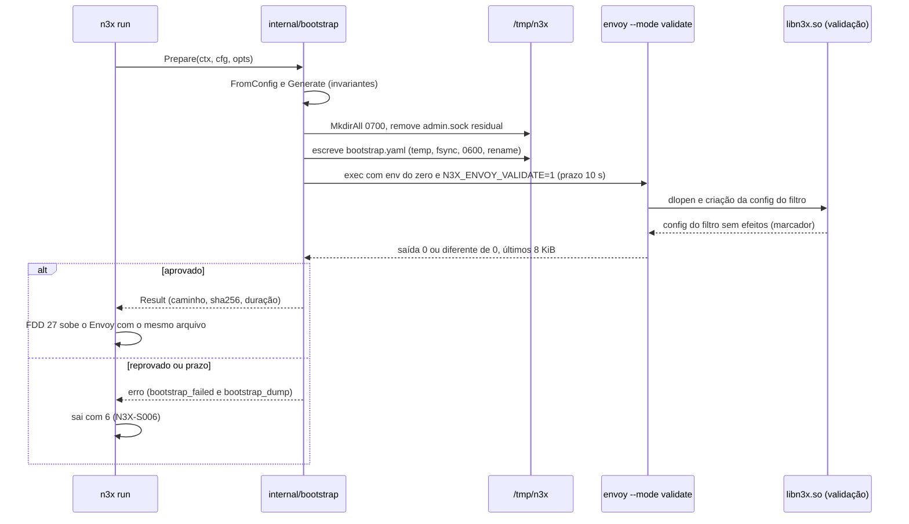
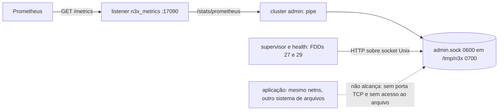
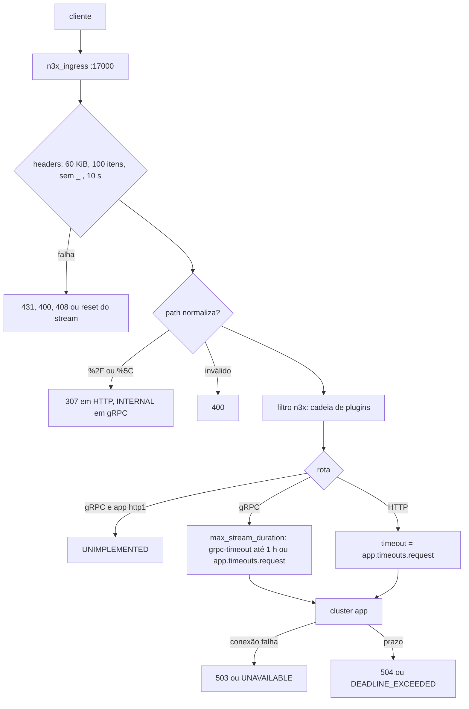

### FDD: Gerador do bootstrap do Envoy (SID-06)

Versão: 1.0
Data: 2026-10-20
Responsável: Guilherme Giusti

---

### 1. Contexto e motivação técnica

**Problema técnico.** No modo padrão (Kubernetes, ECS e docker compose), quem diz ao Envoy o que escutar, para onde encaminhar, que limites aplicar e qual `.so` carregar é o bootstrap gerado pelo entrypoint a partir do `n3x.yaml` (FR-001). O HLD do `n3x-sidecar` mostra só o "bootstrap essencial" em comentários. Ficam sem resposta verificável:

- onde fica o admin do Envoy, já que a aplicação divide o namespace de rede com o sidecar e alcançaria `127.0.0.1:17001` (`/quitquitquit`, `/drain_listeners`, `/config_dump`), lacuna L-16
- como o listener de métricas `17090` e o supervisor falam com o admin
- como os limites de headers, a normalização de path e a recusa de underscore se expressam no Envoy 1.40, e o que cada um devolve em HTTP/1.1, HTTP/2 e gRPC
- como `app.timeouts.request` (15 s) convive com streams gRPC longos, e como o prazo estourado vira `DEADLINE_EXCEEDED` em gRPC (o timeout de rota do Envoy vira `UNAVAILABLE`)
- o que fazer com cliente gRPC quando `app.protocol` é `http1`
- prazos de ociosidade que o HLD não cita
- onde escrever o arquivo com a raiz somente leitura
- o que o `envoy --mode validate` faz com o `.so` (ele carrega o módulo e cria a config do filtro) e o que vai para o log quando reprova
- o formato exato da config do filtro, que a FDD 15 pediu para ficar sem `key_path`

Um campo errado aqui expõe o admin, deixa passar path malicioso, corta streams ou deixa segredo no `/config_dump`.

**Encaixe no HLD.** Esta FDD especifica a linha "Gerador de bootstrap (`internal/bootstrap`)" de "Componentes e responsabilidades" do HLD do `n3x-sidecar`, os passos 7 e 8 da "Sequência de subida", o bloco "Bootstrap gerado (essencial)" e o bloco "Filtro do N3X no bootstrap e no `EnvoyFilter`". Acrescenta um pacote pequeno no módulo `core/`, `core/envoycfg`, com o contrato que o entrypoint escreve e o `.so` lê (config do filtro, caminhos locais e marcador de validação), porque o `.so` não pode importar `internal/`.

Consumidores:

- FDD 27 (SID-07): sobe o Envoy com o arquivo validado, fala com o admin pelo socket e repassa o ambiente
- FDD 29 (SID-09): usa o admin pelo socket (`/ready`, `/drain_listeners`) e o diretório `/tmp/n3x` para o canal de controle
- FDD 16 (SID-02): lê a config do filtro com `envoycfg.ParseFilterConfig` e respeita o marcador de validação
- FDD 17 (SID-03): no processo de validação, não instancia plugins
- FDD 49 (SID-11): usa o mesmo bloco do filtro (`bootstrap.HTTPFilter`) no `EnvoyFilter`
- FDD 06 (SDK-06): recebe os destinos reservados do `env.Dial` que são desta FDD
- FDDs 47 e 48: documentação do `/tmp` e testes golden e de validação na CI

**Atores.** Entrypoint `n3x run` (gera, escreve e valida), Envoy (carrega o bootstrap e o `.so`), `.so` (lê a config do filtro), supervisor e health (falam com o admin), operador (lê o bootstrap no log quando a validação reprova), Prometheus (raspa `17090`), aplicação (destino do cluster `app`; nunca deve alcançar o admin).

**Limites.**
- O gerador só lê o `config.Config` já validado (FDD 15) e o caminho do `n3x.yaml`; não lê arquivo, variável de ambiente, chave AES nem manifesto
- O bootstrap não contém segredo por construção: a entrada do gerador (`bootstrap.Input`) não tem nenhum campo de segredo, de plugin ou do bloco `controller`
- Não decide `--concurrency`, variáveis do runtime Go, `--log-level` nem a subida do Envoy (FDD 27), nem health e drenagem (FDD 29)
- Não roda no modo Istio, em que o bootstrap é do `pilot-agent` (FDD 49)

**Suposições**
- O Envoy 1.40.x da imagem `envoyproxy/envoy:v1.40.x` aceita todos os campos do contrato 1; os itens marcados "conferir no spike" são confirmados no spike da fase 0 e pelo `--mode validate` na CI
- O binário do Envoy fica em `/usr/local/bin/envoy` e o `.so` em `/usr/lib/n3x/libn3x.so` (imagem da FDD 28) (hipótese do caminho do Envoy)
- O processo roda com UID e GID `17000`, sem capabilities, com raiz somente leitura e `/tmp` gravável (HLD do `n3x-sidecar`, "Proteção de dados")
- Quando o gerador roda, os passos 1 a 6 da subida já passaram: `config.Load` e `CheckDefaultMode` (FDD 15), pré-voo (FDD 25) e cálculo do runtime (FDD 27)

**Restrições**
- Nenhum segredo no bootstrap, no `/config_dump` ou em log (ADR-007 do `n3x-sidecar`)
- Mesma entrada, mesmos bytes: sem horário, sem aleatório, sem iteração de map (golden do HLD)
- O binário `n3x` continua sem `google.golang.org/grpc`, sem o SDK Go do Envoy e sem `go-control-plane` (critério da FDD 15); o bootstrap é montado com structs próprias
- Nenhum comportamento vem de variável de ambiente do operador (FR-001); o ambiente do processo de validação é montado do zero pelo entrypoint
- Documentação e mensagens em pt-BR; identificadores, campos e comandos em inglês

**Rastreabilidade**
- PRD 1.5: FR-001 (bootstrap com admin local, listener de entrada, cluster da aplicação e um único filtro; `--mode validate`; bootstrap reprovado encerra e é logado sem segredos; `.so` incompatível encerra), FR-003 (normalização de path, 400 para malformado, 503 e 504 da aplicação com o status gRPC correto); segurança (admin só local, aplicação nunca exposta); confiabilidade (overload manager com monitor de memória do cgroup); "Testes e validação" (bootstrap comparado com golden e validado com `envoy --mode validate`)
- ADRs do `n3x-sidecar`: ADR-002 (`17090` só `GET /metrics`), ADR-006 (prazos: conexão 1 s, requisição 15 s, validação 10 s), ADR-007 (config do filtro só com caminhos, `.so` lê o próprio `n3x.yaml`), ADR-008 (overload manager `cgroup_memory` em 90% e 95%)
- ADRs do `n3x-sdk`: ADR-006 (portas 17xxx; o admin muda aqui, L-16), ADR-009 (sem tracing)
- FDDs anteriores aplicadas: 15 (`config.Config`, `ReservedPorts`, `runtime.request_body.max_bytes`, `keys.aes_file` como única fonte da chave, códigos de saída 5 a 9 reservados), 05 (L-49: um único cluster `app`; limite de body; negação gRPC nunca `OK`), 06 (destinos reservados do `env.Dial`, P-11 dela)
- Lacunas e pedidos:
  - **L-16 fechada aqui:** o admin do Envoy sai de `127.0.0.1:17001` e vai para o socket Unix `/tmp/n3x/admin.sock`, modo `0600`, dentro de `/tmp/n3x` (modo `0700`), sem nenhuma porta TCP. O listener `17090` fala com ele por um cluster estático com endereço `pipe`; supervisor e health usam um cliente HTTP sobre o socket. A porta `17001` continua reservada na faixa 17xxx, sem uso (contrato 4)
  - **Pedido da FDD 15 (`key_path`) atendido:** a config do filtro tem só `config_path`; o caminho da chave vem de `keys.aes_file` do `n3x.yaml` (contrato 3)
  - **Pedido da FDD 15 (streams gRPC longos) atendido:** na rota gRPC, o prazo é o `grpc-timeout` do cliente, com teto de 1 h; sem `grpc-timeout`, vale `app.timeouts.request`; o estouro sai como `DEADLINE_EXCEEDED` (contrato 1)
  - **Pedido da FDD 05 (limite de body) aplicado:** o buffer por conexão do listener de entrada acompanha `runtime.request_body.max_bytes`, para o `.so` ver o estouro antes do Envoy (contrato 1)
  - **P-11 da FDD 06 (parte desta FDD):** destinos reservados do `env.Dial` (contrato 3)
  - **L-45 (fato registrado para as FDDs 16 e 38):** o bootstrap tem exatamente uma ocorrência do filtro `n3x`, então, no modo padrão, a config do filtro é criada uma vez por processo do Envoy

**Clarificações (2026-10-22)**
- Refinos pedidos por FDDs posteriores (validação de consistência de 2026-10-22): o texto desta FDD continua valendo com os acréscimos e mudanças abaixo; em conflito, vale o contrato da FDD citada em cada item
  - SID-09 (FDD 29), contratos 1 e 9: `envoycfg.ReservedLoopbackPorts` passa a `{17001, 17021, 17090}`; o listener `n3x_ingress` ganha `traffic_direction: INBOUND` (o `n3x_metrics` fica sem valor), para o `drain_listeners?inboundonly` drenar só a entrada
  - SID-11 (FDD 49), contrato 6: arquivo novo `core/envoycfg/istio.go` com `IstioReservedLoopbackPorts` e `IstioReservedUnixDirs` (dono: SID-11)
- Admin em socket Unix (L-16), retirada do `key_path` (I-02), protocolo do upstream por `typed_extension_protocol_options` (I-04) e prazo de gRPC pelo `grpc-timeout` do cliente (I-03): aprovados e aplicados ao PRD, ao HLD e aos ADR-006 e ADR-007 na validação de consistência

---

### 2. Objetivos técnicos

- **Bootstrap determinístico.** Invariante: para o mesmo `bootstrap.Input`, `Generate` devolve os mesmos bytes. Medida: 1.000 gerações por golden, 0 diferença; golden comparado byte a byte na CI.
- **Nenhum segredo em disco nem no admin.** Medida: teste de canário com todo segredo e toda config de plugin do `n3x.yaml` trocados por marcadores `n3x-canary-`: 0 marcador no bootstrap, nos logs do passo e no `/config_dump` lido pelo socket do admin, conferido com `secrettest.Leaks` (FDD 03).
- **Admin inalcançável pela aplicação.** Invariante: o Envoy não escuta em nenhuma porta TCP de admin. Medida: conexão em `127.0.0.1:17001` recusada; o socket existe com modo `0600` e dono `17000`; processo com outro UID recebe `EACCES`.
- **Superfície exata.** Invariante: `17090` responde 200 só a `GET /metrics`; qualquer outro método em `/metrics` dá 405 e qualquer outro path dá 404; nenhum endpoint do admin além de `/stats/prometheus` é alcançável pela rede.
- **Requisição hostil barrada antes do filtro.** Invariante: o filtro `n3x` só vê path normalizado, headers dentro de 60 KiB e 100 itens e nomes sem `_`. Medida: casos da seção 9 em HTTP/1.1, HTTP/2 e gRPC no Envoy real.
- **Status gRPC correto nos erros do Envoy.** Invariante: aplicação fora dá `UNAVAILABLE`, prazo estourado dá `DEADLINE_EXCEEDED`, cliente gRPC com aplicação `http1` dá `UNIMPLEMENTED`; nenhum erro gerado pelo Envoy sai como `OK`.
- **Validação rápida e com prazo.** Medida: geração em até 1 ms no p99; escrita em até 10 ms; `envoy --mode validate` com o `.so` de exemplo em até 1,5 s no p95 no runner da CI (hipótese das metas); prazo duro de 10 s (ADR-006), com o processo morto ao estourar.
- **Validação sem efeito colateral.** Invariante: o processo do `--mode validate` recebe o marcador `N3X_ENVOY_VALIDATE=1`, e só ele; com o marcador, o `.so` não conecta no controller, não inicia tarefas de fundo e não chama `New` nem `Stop` de plugin (pedido às FDDs 16 e 17).

---

### 3. Escopo e exclusões

**Incluído**
- Pacote `internal/bootstrap`: projeção `Input` a partir do `config.Config`, geração do YAML, escrita atômica, execução do `envoy --mode validate` com prazo e o passo completo `Prepare` (passos 7 e 8 da subida), com logs e código de saída
- Pacote `core/envoycfg`: tipo e parser da config do filtro (só `config_path`), nomes do filtro e do módulo, marcador de validação, diretório de runtime, caminho do socket do admin e portas reservadas em loopback
- Admin em socket Unix (L-16) com o cluster `admin` em `pipe` e o contrato de acesso para as FDDs 27 e 29
- Overload manager com `cgroup_memory` (90% `shrink_heap`, 95% `stop_accepting_connections`), `max_memory_bytes` vindo de `resources.memory` e teto global de conexões
- Listener `n3x_ingress` com `http_connection_manager`: codec `AUTO`, normalização, limites de headers, recusa de underscore, prazo de headers, `x-request-id`, tratamento de borda e limites de HTTP/2
- Filtro `n3x` antes do `envoy.filters.http.router`, com `do_not_close: true`
- Rotas para o cluster `app`: rota gRPC (prazo por `max_stream_duration` e `grpc-timeout`) e rota HTTP (prazo por `timeout`); com `app.protocol: http1`, rota gRPC com resposta direta `UNIMPLEMENTED`
- Listener `n3x_metrics` em `17090` com `GET /metrics` reescrito para `/stats/prometheus`, 405 e 404 para o resto
- Clusters `app` e `admin`, prazos de ociosidade explícitos e logs do Envoy em JSON (`application_log_config`)
- Avisos do gerador (`grpc_on_http1`, `privileged_port`, `idle_below_request`)
- Arquivos golden em `internal/bootstrap/testdata/` e a função `HTTPFilter`, fonte única do bloco do filtro para o `EnvoyFilter` (FDD 49)

**Excluído**
- `EnvoyFilter`, normalização pela `meshConfig` e todo o modo Istio, em que o bootstrap é do `pilot-agent`: FDD 49 (SID-11)
- `--concurrency`, `--log-level`, `--disable-hot-restart`, variáveis do runtime Go e a subida do Envoy como filho: FDD 27 (SID-07)
- Servidor de health `17021`, uso do admin para `/ready` e drenagem, canal de controle: FDD 29 (SID-09)
- Validação do `n3x.yaml` e regras do modo padrão (`CheckDefaultMode`): FDD 15 (SID-01)
- Comportamento do filtro `n3x` dentro do `.so` (leitura da config do filtro, bufferização do body, stats, negação): FDDs 16, 17 e 18
- Conteúdo da imagem (`ENV` do search path, binário do Envoy, usuário): FDD 28 (SID-08)
- Guia de deploy (`/tmp` em tmpfs ou `emptyDir`): FDD 47; CI cruzada: FDD 48
- WebSocket, `CONNECT`, TLS na entrada, IPv6 no listener e retentativas para a aplicação: fora da v1 (hipótese)
- Recarga do bootstrap sem restart: fora da v1 (config estática, ADR-007)

---

### 4. Fluxos detalhados e diagramas

**Fluxo principal: passos 7 e 8 do `n3x run` (`bootstrap.Prepare`)**
1. O `run` chega ao passo 7 com o `*config.Config` validado (FDD 15), o pré-voo aprovado (FDD 25) e o runtime calculado (FDD 27).
2. `FromConfig(cfg, configPath)` monta o `Input`: `service`, caminho absoluto do `n3x.yaml` (relativo vira absoluto com `filepath.Abs`), `listener.port`, `app.address` como `netip.AddrPort`, `app.protocol`, `app.timeouts.connect`, `app.timeouts.request`, `resources.memory` (0 se ausente) e `runtime.request_body.max_bytes`. Confere de novo as faixas (defensivo) e calcula os avisos `grpc_on_http1`, `privileged_port` e `idle_below_request`.
3. `Generate(in)` monta as structs na ordem fixa do contrato 1, formata durações no formato do proto (`15s`, `0.25s`), deriva o buffer, a memória e as rotas, serializa com `go.yaml.in/yaml/v3` (indentação 2) e prefixa um comentário fixo. Confere as invariantes antes de devolver: até 64 KiB, nenhum `ENC[` no texto, exatamente um filtro `n3x` e ele antes do router.
4. Prepara o diretório: `MkdirAll("/tmp/n3x", 0700)`; confere que não é link simbólico, que o dono é o UID do processo e corrige o modo para `0700` se estiver mais aberto; remove `admin.sock` e arquivos temporários residuais (o `emptyDir` do Kubernetes sobrevive ao restart do container).
5. Escreve de forma atômica: arquivo temporário no mesmo diretório, `fsync`, modo `0600`, `rename` para `/tmp/n3x/bootstrap.yaml`. Loga `bootstrap_written`.
6. Valida: `envoy --mode validate -c /tmp/n3x/bootstrap.yaml --log-level warning`, com ambiente montado do zero (base da FDD 27 mais `ENVOY_DYNAMIC_MODULES_SEARCH_PATH=/usr/lib/n3x`, `GODEBUG=cgocheck=0` e `N3X_ENVOY_VALIDATE=1`), grupo de processo próprio e prazo de 10 s. Stdout e stderr vão para um buffer que guarda os últimos 8 KiB.
7. O Envoy de validação carrega o `libn3x.so` e cria a config do filtro (é o que confere a ABI do módulo contra o Envoy, FR-001). Com o marcador, o `.so` só lê a config do filtro e responde, sem controller, tarefas de fundo ou `New` de plugin (FDDs 16 e 17).
8. Saída 0: loga `bootstrap_validated` com a duração e devolve o `Result` ao supervisor, que sobe o Envoy com o mesmo arquivo (FDD 27), sem o marcador.
9. Saída diferente de 0: loga `bootstrap_failed` (`reason` `rejected`, com a saída do Envoy) e `bootstrap_dump` (o arquivo inteiro), e o `run` sai com 6 (`N3X-S006`). O arquivo fica no disco para inspeção.

**Fluxo de uma requisição na entrada `17000`** (o que o bootstrap garante antes e depois do filtro)
1. O listener aceita a conexão (recusada se o overload manager estiver em `stop_accepting_connections` ou o teto global de conexões for atingido).
2. O codec (`AUTO`: HTTP/1.1 ou h2c) aplica `max_request_headers_kb: 60`, `max_headers_count: 100`, recusa nome de header com `_` e o prazo de 10 s para os headers.
3. O HCM trata a borda: remove headers `x-envoy-*` do cliente, acrescenta o IP do par ao `x-forwarded-for`, mantém o `x-request-id` do cliente ou gera um.
4. O HCM normaliza o path (`normalize_path`, `merge_slashes`); `%2F` e `%5C` geram redirecionamento em HTTP e `INTERNAL` em gRPC.
5. O filtro `n3x` executa a cadeia (FDDs 16 a 18); os recortes veem o path já normalizado.
6. O router escolhe a rota: `grpc` (content-type `application/grpc*`) ou `http`. Com `app.protocol: http1`, a rota gRPC responde direto `UNIMPLEMENTED` sem tocar a aplicação.
7. O cluster `app` conecta em `app.address` com `app.timeouts.connect` e o protocolo de `app.protocol`; falha dá 503 ou `UNAVAILABLE`; prazo estourado dá 504 (HTTP) ou `DEADLINE_EXCEEDED` (gRPC).

**Fluxos alternativos e exceções**
- **`/tmp` somente leitura ou cheio:** `MkdirAll` ou a escrita falham; `bootstrap_failed` com `reason` `write` e a dica "monte `/tmp` como tmpfs (docker compose `tmpfs: /tmp`) ou `emptyDir` com `medium: Memory` (Kubernetes)"; saída 6
- **`/tmp/n3x` com outro dono ou como link simbólico:** recusado com `reason` `write`; não segue links
- **Binário do Envoy ausente:** `reason` `envoy_missing`; saída 6
- **Validação estoura 10 s:** o grupo de processo recebe SIGKILL; `reason` `timeout`, com a saída parcial e o `bootstrap_dump`; saída 6
- **`.so` incompatível com o Envoy (ABI) ou ausente:** o Envoy de validação falha ao carregar o módulo; `reason` `rejected` com a mensagem do Envoy; saída 6 (FR-001). O pré-voo da FDD 25 já deveria ter pegado o alvo errado
- **Campo do bootstrap desconhecido para o patch do Envoy:** `reason` `rejected`; a CI por patch pega antes (seção 9)
- **`Input` fora das faixas** (bug ou descompasso com a FDD 15): `reason` `input`, sem gerar arquivo; saída 6
- **SIGTERM durante a validação:** o `ctx` é cancelado, o processo de validação é morto e `Prepare` devolve `context.Canceled` sem logar falha; quem decide a saída é o supervisor (FDDs 27 e 29)
- **`app.protocol: http1` com `plugins[].match.grpc_services` preenchido:** aviso `grpc_on_http1`; a rota gRPC responde `UNIMPLEMENTED`
- **`listener.port` abaixo de 1024:** aviso `privileged_port` (sem capabilities, o bind só funciona se o runtime do container liberar portas baixas); a falha de bind, se houver, aparece na subida do Envoy (FDD 27), porque o `--mode validate` não abre sockets
- **`app.timeouts.request` acima de 5 min:** aviso `idle_below_request`: resposta HTTP sem nenhum byte por 5 min é cortada pelo `stream_idle_timeout` antes do prazo
- **Restart do container com `emptyDir`:** o `admin.sock` antigo é removido no passo 4; o Envoy também remove o arquivo antes do `bind` (conferir no spike)
- **Modo Istio:** `Prepare` não é chamado (FDD 49)

**Diagramas**

Sequência dos passos 7 e 8:



Quem fala com o admin depois da mudança (L-16):



Caminho de uma requisição na entrada:



---

### 5. Contratos públicos (assinaturas, endpoints, headers, exemplos)

**Contrato 1: mapa do `n3x.yaml` para o bootstrap**
- Tipo: config (arquivo YAML gerado em `/tmp/n3x/bootstrap.yaml`, lido pelo Envoy)
- Assinatura/Rota: `bootstrap.Generate(Input) ([]byte, error)`; arquivo `/tmp/n3x/bootstrap.yaml`, modo `0600`
- Método: n/a (gerado no passo 7, lido pelo Envoy no passo 8 e na subida)
- Semântica:
  - O bootstrap não é contrato do operador: o operador só escreve o `n3x.yaml`. O que é contrato é a superfície (contratos 4 e 5) e o mapa abaixo, conferidos por golden
  - Durações no formato do `google.protobuf.Duration` em texto: segundos com fração sem zeros à direita e sufixo `s` (`1s`, `0.25s`, `90s`, `3600s`); tamanhos em bytes inteiros
  - Ordem dos campos fixa (a da tabela e do exemplo); a primeira linha é sempre `# Gerado por n3x run (internal/bootstrap). Não editar. Não contém segredos.`
  - Nenhum campo depreciado do Envoy: protocolo do upstream por `typed_extension_protocol_options` (o `http2_protocol_options` direto no cluster, citado no HLD, é depreciado na API v3) (I-04)

Parte 1: campos derivados do `n3x.yaml`

| Origem no `n3x.yaml` | Campo do bootstrap | Regra |
| --- | --- | --- |
| `service` | `application_log_config.log_format.json_format.service` | Valor literal (gramática da FDD 15, seguro em JSON) |
| caminho de `--config` | `filter_config.value` do filtro `n3x` | `{"config_path":"<caminho absoluto>"}` (contrato 3) |
| `listener.port` | `n3x_ingress.address.socket_address.port_value` | Igual (padrão 17000) |
| `runtime.request_body.max_bytes` | `n3x_ingress.per_connection_buffer_limit_bytes` | `max(1 MiB, max_bytes)`: o buffer do Envoy nunca fica abaixo do padrão dele nem do limite do body, para o `.so` ver o estouro antes do Envoy responder 413 (hipótese; confirmação na FDD 16, P-02 da FDD 05) |
| `resources.memory` | `overload_manager.resource_monitors[cgroup_memory].typed_config.max_memory_bytes` | Presente só se `resources.memory` existe; o Envoy usa o menor entre ele e o limite do cgroup (conferir no spike) |
| `app.address` | `clusters[app].load_assignment...socket_address` | IP literal (IPv4 ou IPv6 sem zona) e porta |
| `app.protocol` | `clusters[app].typed_extension_protocol_options["envoy.extensions.upstreams.http.v3.HttpProtocolOptions"].explicit_http_config` | `http1`: `http_protocol_options: {}`; `http2` e `grpc`: `http2_protocol_options: {}` |
| `app.protocol: http1` | rota `grpc` | `direct_response` com status 404 e corpo `n3x: app.protocol http1 sem suporte a gRPC`; o Envoy converte em `grpc-status 12` (`UNIMPLEMENTED`) |
| `app.timeouts.connect` | `clusters[app].connect_timeout` | Igual (padrão 1s) |
| `app.timeouts.request` | rota `http`: `route.timeout` | Igual (padrão 15s); estouro dá 504 |
| `app.timeouts.request` | rota `grpc`: `route.max_stream_duration.max_stream_duration` | Igual; vale quando o cliente não manda `grpc-timeout`; estouro dá `DEADLINE_EXCEEDED` |

Parte 2: valores fixos

| Campo | Valor | Fonte ou motivo |
| --- | --- | --- |
| `admin.address.pipe` | `path: /tmp/n3x/admin.sock`, `mode: 384` (`0600` em decimal, porque YAML 1.2 não lê `0600` como octal) | L-16 (contrato 4) |
| `admin.ignore_global_conn_limit` | `true` | Supervisor e drenagem funcionam com o teto de conexões atingido (hipótese) |
| `overload_manager.refresh_interval` | `1s` | Padrão do Envoy, explícito |
| `resource_monitors` | `envoy.resource_monitors.cgroup_memory`; `envoy.resource_monitors.global_downstream_max_connections` com `max_active_downstream_connections: 50000` | ADR-008; teto de conexões do guia de borda do Envoy, que também evita o aviso de "sem limite de conexões" na subida (hipótese; ajuste na FDD 50) |
| `actions` | `envoy.overload_actions.shrink_heap` em `0.9`; `envoy.overload_actions.stop_accepting_connections` em `0.95` | ADR-008 |
| `n3x_ingress.address` | `0.0.0.0` | HLD; IPv6 na entrada fora da v1 (hipótese) |
| HCM de entrada: `codec_type` | `AUTO` | HTTP/1.1 e h2c na mesma porta |
| HCM: `normalize_path`, `merge_slashes`, `path_with_escaped_slashes_action` | `true`, `true`, `UNESCAPE_AND_REDIRECT` | HLD e FR-003 |
| HCM: `max_request_headers_kb` | `60` | HLD |
| HCM: `common_http_protocol_options.max_headers_count` | `100` | HLD; é aqui que o Envoy 1.40 expressa o limite de itens (vale para HTTP/1.1 e HTTP/2) |
| HCM: `common_http_protocol_options.headers_with_underscores_action` | `REJECT_REQUEST` | HLD |
| HCM: `common_http_protocol_options.idle_timeout` | `3600s` | Conexão sem streams; padrão do Envoy, explícito |
| HCM: `stream_idle_timeout` | `300s` | Stream sem nenhum byte nos dois sentidos; padrão do Envoy, explícito |
| HCM: `request_headers_timeout` | `10s` | HLD |
| HCM: `request_timeout` | ausente (desligado) | Ligado, cortaria streams de cliente gRPC; o envio do corpo é limitado pelo `stream_idle_timeout` e, na rota gRPC, pelo `max_stream_duration` |
| HCM: `generate_request_id`, `preserve_external_request_id` | `true`, `true` | HLD; o `x-request-id` do chamador é mantido para correlação (L-13, FDD 06) (hipótese) |
| HCM: `use_remote_address`, `internal_address_config` | `true`; `unix_sockets: false`, `cidr_ranges: []` | Toda requisição é externa: o Envoy remove `x-envoy-*` do cliente (ninguém muda prazo ou retentativa por header) e põe o IP do par no `x-forwarded-for` (hipótese) |
| HCM: `server_header_transformation` | `PASS_THROUGH` | Não acrescenta `server: envoy` (hipótese) |
| HCM: `http2_protocol_options` | `max_concurrent_streams: 100`, `initial_stream_window_size: 65536`, `initial_connection_window_size: 1048576` | Guia de borda do Envoy (hipótese) |
| HCM: `access_log` | ausente | Tráfego da aplicação fora da v1; logs não registram path nem headers (HLD) |
| `http_filters` | `n3x` e depois `envoy.filters.http.router` (`suppress_envoy_headers: true`) | ADR-007; sem `x-envoy-upstream-service-time` na resposta (hipótese) |
| Filtro `n3x` | `dynamic_module_config: { name: n3x, do_not_close: true }`, `filter_name: n3x`, `filter_config` `StringValue` | `do_not_close`: o runtime Go não pode ser descarregado com `dlclose` (I-05) |
| Rota `grpc` | `match: { prefix: /, grpc: {} }`, `timeout: 0s`, `max_stream_duration.grpc_timeout_header_max: 3600s` | O `timeout` de rota começa no fim do envio do cliente e vira `UNAVAILABLE` em gRPC; o `max_stream_duration` conta do início do stream, usa o `grpc-timeout` do cliente com teto de 1 h e sai como `DEADLINE_EXCEEDED` (pedido da FDD 15; I-03) |
| Rota `http` | `match: { prefix: / }` | Todo o resto |
| Retentativas | nenhuma | Uma tentativa só, comportamento determinístico (hipótese) |
| Cluster `app`: `type` | `STATIC` | IP literal (H-25 da FDD 15) |
| Cluster `app`: `common_http_protocol_options.idle_timeout` | `4s` | Fecha a conexão ociosa antes do keep-alive padrão do Node.js e do uvicorn (5 s), para o Envoy não reaproveitar uma conexão que a aplicação está fechando (hipótese) |
| Listener `n3x_metrics` | `0.0.0.0:17090`, `ignore_global_conn_limit: true`; HCM só com o router, `generate_request_id: false`, `max_request_headers_kb: 8`, `request_headers_timeout: 10s`, `stream_idle_timeout: 30s`, `idle_timeout: 300s`, `normalize_path` e `merge_slashes` | ADR-002; valores menores porque só serve o scrape (hipótese) |
| Rotas de `n3x_metrics` | `path: /metrics` com `:method` `GET` → cluster `admin`, `prefix_rewrite: /stats/prometheus`, `timeout: 5s`; `path: /metrics` com outro método → `direct_response` 405; `prefix: /` → `direct_response` 404 | ADR-002 |
| Cluster `admin` | `STATIC`, `connect_timeout: 1s`, endereço `pipe: /tmp/n3x/admin.sock` | L-16 |
| `application_log_config.log_format.json_format` | `ts: "%Y-%m-%dT%T.%eZ"`, `level: "%l"`, `component: envoy`, `service: <service>`, `logger: "%n"`, `msg: "%j"` | HLD (logs JSON com `component=envoy`); `%j` é a mensagem escapada para JSON (conferir no spike) |

Campos do `n3x.yaml` que não entram no bootstrap: `controller.*` (o `.so` lê), `keys.*` (o `.so` lê `keys.aes_file`), `plugins` e `runtime.plugin_limits` (o `.so` lê), `app.health.*` (FDD 29), `resources.cpus` (FDD 27, `--concurrency`), `runtime.log_level` (FDD 27, `--log-level`), `runtime.drain_timeout` (FDD 29).

**Exemplo de requisição** (`n3x.yaml` de referência da FDD 15, resumido ao que importa aqui)
```yaml
version: 1
service: pedidos
app:
  address: 127.0.0.1:3000
  protocol: grpc
runtime:
  request_body:
    max_bytes: 256Ki
```

**Exemplo de resposta** (`/tmp/n3x/bootstrap.yaml`, golden `testdata/grpc-reference.golden.yaml`)
```yaml
# Gerado por n3x run (internal/bootstrap). Não editar. Não contém segredos.
admin:
  address:
    pipe:
      path: /tmp/n3x/admin.sock
      mode: 384
  ignore_global_conn_limit: true
application_log_config:
  log_format:
    json_format:
      ts: '%Y-%m-%dT%T.%eZ'
      level: '%l'
      component: envoy
      service: pedidos
      logger: '%n'
      msg: '%j'
overload_manager:
  refresh_interval: 1s
  resource_monitors:
    - name: envoy.resource_monitors.cgroup_memory
      typed_config:
        '@type': type.googleapis.com/envoy.extensions.resource_monitors.cgroup_memory.v3.CgroupMemoryConfig
    - name: envoy.resource_monitors.global_downstream_max_connections
      typed_config:
        '@type': type.googleapis.com/envoy.extensions.resource_monitors.downstream_connections.v3.DownstreamConnectionsConfig
        max_active_downstream_connections: 50000
  actions:
    - name: envoy.overload_actions.shrink_heap
      triggers:
        - name: envoy.resource_monitors.cgroup_memory
          threshold:
            value: 0.9
    - name: envoy.overload_actions.stop_accepting_connections
      triggers:
        - name: envoy.resource_monitors.cgroup_memory
          threshold:
            value: 0.95
static_resources:
  listeners:
    - name: n3x_ingress
      stat_prefix: n3x_ingress
      address:
        socket_address:
          address: 0.0.0.0
          port_value: 17000
      per_connection_buffer_limit_bytes: 1048576
      filter_chains:
        - filters:
            - name: envoy.filters.network.http_connection_manager
              typed_config:
                '@type': type.googleapis.com/envoy.extensions.filters.network.http_connection_manager.v3.HttpConnectionManager
                stat_prefix: n3x_ingress
                codec_type: AUTO
                use_remote_address: true
                internal_address_config:
                  unix_sockets: false
                  cidr_ranges: []
                generate_request_id: true
                preserve_external_request_id: true
                server_header_transformation: PASS_THROUGH
                normalize_path: true
                merge_slashes: true
                path_with_escaped_slashes_action: UNESCAPE_AND_REDIRECT
                max_request_headers_kb: 60
                request_headers_timeout: 10s
                stream_idle_timeout: 300s
                common_http_protocol_options:
                  idle_timeout: 3600s
                  max_headers_count: 100
                  headers_with_underscores_action: REJECT_REQUEST
                http2_protocol_options:
                  max_concurrent_streams: 100
                  initial_stream_window_size: 65536
                  initial_connection_window_size: 1048576
                route_config:
                  name: n3x_app
                  virtual_hosts:
                    - name: app
                      domains: ['*']
                      routes:
                        - name: grpc
                          match:
                            prefix: /
                            grpc: {}
                          route:
                            cluster: app
                            timeout: 0s
                            max_stream_duration:
                              max_stream_duration: 15s
                              grpc_timeout_header_max: 3600s
                        - name: http
                          match:
                            prefix: /
                          route:
                            cluster: app
                            timeout: 15s
                http_filters:
                  - name: n3x
                    typed_config:
                      '@type': type.googleapis.com/envoy.extensions.filters.http.dynamic_modules.v3.DynamicModuleFilter
                      dynamic_module_config:
                        name: n3x
                        do_not_close: true
                      filter_name: n3x
                      filter_config:
                        '@type': type.googleapis.com/google.protobuf.StringValue
                        value: '{"config_path":"/etc/n3x/n3x.yaml"}'
                  - name: envoy.filters.http.router
                    typed_config:
                      '@type': type.googleapis.com/envoy.extensions.filters.http.router.v3.Router
                      suppress_envoy_headers: true
    - name: n3x_metrics
      stat_prefix: n3x_metrics
      address:
        socket_address:
          address: 0.0.0.0
          port_value: 17090
      ignore_global_conn_limit: true
      filter_chains:
        - filters:
            - name: envoy.filters.network.http_connection_manager
              typed_config:
                '@type': type.googleapis.com/envoy.extensions.filters.network.http_connection_manager.v3.HttpConnectionManager
                stat_prefix: n3x_metrics
                codec_type: AUTO
                generate_request_id: false
                server_header_transformation: PASS_THROUGH
                normalize_path: true
                merge_slashes: true
                max_request_headers_kb: 8
                request_headers_timeout: 10s
                stream_idle_timeout: 30s
                common_http_protocol_options:
                  idle_timeout: 300s
                  headers_with_underscores_action: REJECT_REQUEST
                route_config:
                  name: n3x_metrics
                  virtual_hosts:
                    - name: metrics
                      domains: ['*']
                      routes:
                        - name: metrics
                          match:
                            path: /metrics
                            headers:
                              - name: ':method'
                                string_match:
                                  exact: GET
                          route:
                            cluster: admin
                            prefix_rewrite: /stats/prometheus
                            timeout: 5s
                        - name: metrics_method
                          match:
                            path: /metrics
                          direct_response:
                            status: 405
                        - name: not_found
                          match:
                            prefix: /
                          direct_response:
                            status: 404
                http_filters:
                  - name: envoy.filters.http.router
                    typed_config:
                      '@type': type.googleapis.com/envoy.extensions.filters.http.router.v3.Router
                      suppress_envoy_headers: true
  clusters:
    - name: app
      type: STATIC
      connect_timeout: 1s
      load_assignment:
        cluster_name: app
        endpoints:
          - lb_endpoints:
              - endpoint:
                  address:
                    socket_address:
                      address: 127.0.0.1
                      port_value: 3000
      typed_extension_protocol_options:
        envoy.extensions.upstreams.http.v3.HttpProtocolOptions:
          '@type': type.googleapis.com/envoy.extensions.upstreams.http.v3.HttpProtocolOptions
          common_http_protocol_options:
            idle_timeout: 4s
          explicit_http_config:
            http2_protocol_options: {}
    - name: admin
      type: STATIC
      connect_timeout: 1s
      load_assignment:
        cluster_name: admin
        endpoints:
          - lb_endpoints:
              - endpoint:
                  address:
                    pipe:
                      path: /tmp/n3x/admin.sock
```
(`per_connection_buffer_limit_bytes` ficou em 1 MiB porque `max(1 MiB, 256 KiB)` é 1 MiB. Com `app.protocol: http1`, a rota `grpc` vira `direct_response: { status: 404, body: { inline_string: 'n3x: app.protocol http1 sem suporte a gRPC' } }` e o cluster usa `http_protocol_options: {}`; com `resources.memory: 512Mi`, o monitor ganha `max_memory_bytes: 536870912`.)

---

**Contrato 2: API Go do pacote `internal/bootstrap`**
- Tipo: sdk (API Go interna do módulo `github.com/giustech/n3x-sidecar`, usada pelo `cmd/n3x`)
- Assinatura/Rota:
  ```go
  package bootstrap // github.com/giustech/n3x-sidecar/internal/bootstrap

  const (
      File             = "/tmp/n3x/bootstrap.yaml"
      FileMode         = 0o600
      IngressListener  = "n3x_ingress"
      MetricsListener  = "n3x_metrics"
      MetricsPort      = 17090
      MetricsPath      = "/metrics"
      AppCluster       = "app"
      AdminCluster     = "admin"
      DefaultEnvoyPath = "/usr/local/bin/envoy"
      ModuleSearchPath = "/usr/lib/n3x"
      ValidateTimeout  = 10 * time.Second // ADR-006
      MaxGRPCTimeout   = time.Hour        // teto do grpc-timeout do cliente
      MinBufferLimit   = 1 << 20          // padrão do Envoy
      StreamIdle       = 300 * time.Second
      UpstreamIdle     = 4 * time.Second
      MaxConnections   = 50000
      MaxBootstrapSize = 64 << 10
      MaxEnvoyOutput   = 8 << 10
      ExitCode         = 6
      Code             = "N3X-S006"
      GRPCOnHTTP1Body  = "n3x: app.protocol http1 sem suporte a gRPC"
  )

  type Protocol uint8

  const (
      ProtocolHTTP1 Protocol = iota + 1
      ProtocolHTTP2
      ProtocolGRPC
  )

  // Projeção sem segredo do config.Config. Nenhum campo de controller, keys ou plugins.
  type Input struct {
      Service             string
      ConfigPath          string         // absoluto; vai para filter_config
      ListenerPort        uint16
      App                 netip.AddrPort // IP literal, sem zona
      Protocol            Protocol
      ConnectTimeout      time.Duration
      RequestTimeout      time.Duration
      MemoryLimitBytes    uint64 // 0 = só o cgroup (resources.memory ausente)
      RequestBodyMaxBytes uint64
  }

  type Warning struct{ Path, Code, Detail string }

  func FromConfig(cfg *config.Config, configPath string) (Input, []Warning, error)
  func (in Input) Validate() error
  func Generate(in Input) ([]byte, error)

  // Bloco YAML do filtro n3x (name e typed_config), o mesmo do bootstrap.
  // Fonte única para o EnvoyFilter do modo Istio (FDD 49).
  func HTTPFilter(fc envoycfg.FilterConfig) ([]byte, error)

  func PrepareDir() error                      // /tmp/n3x 0700, sem link, dono = UID; remove admin.sock residual
  func Write(data []byte) (path string, err error) // atômico, 0600

  type ValidateOptions struct {
      EnvoyPath string        // "" = DefaultEnvoyPath
      Path      string        // "" = File
      Env       []string      // base do supervisor (FDD 27); o pacote acrescenta e sobrescreve 3 variáveis
      Timeout   time.Duration // 0 = ValidateTimeout
  }

  type ValidateResult struct {
      Duration  time.Duration
      EnvoyExit int    // código de saída do envoy; -1 se morto pelo prazo
      Output    []byte // últimos MaxEnvoyOutput bytes de stdout e stderr
      Truncated bool
  }

  func Validate(ctx context.Context, opts ValidateOptions) (ValidateResult, error)

  type Options struct {
      ConfigPath string          // caminho de --config
      Envoy      ValidateOptions
      Logger     *slog.Logger    // component=entrypoint
  }

  type Result struct {
      Path     string
      SHA256   string // hex do conteúdo
      Size     int
      Warnings []Warning
      Validate ValidateResult
  }

  // Passos 7 e 8: FromConfig, Generate, PrepareDir, Write, Validate e logs.
  func Prepare(ctx context.Context, cfg *config.Config, opts Options) (Result, error)

  var (
      ErrInput           = errors.New("bootstrap: entrada inválida")
      ErrWrite           = errors.New("bootstrap: não foi possível escrever em /tmp/n3x")
      ErrEnvoyMissing    = errors.New("bootstrap: binário do Envoy ausente")
      ErrRejected        = errors.New("bootstrap: reprovado no envoy --mode validate")
      ErrValidateTimeout = errors.New("bootstrap: envoy --mode validate estourou o prazo")
  )
  ```
- Método: n/a (chamada local no `n3x run`)
- Semântica:
  - `Input.Validate` repete, de forma defensiva, as faixas da FDD 15 (`service` na gramática, `ConfigPath` absoluto sem NUL e até 4096 bytes, porta de 1 a 65535 fora de `config.ReservedPorts`, IP sem zona, conexão de 10ms a 60s, requisição de 10ms a 1h, memória 0 ou de 64 MiB a 1 TiB, body de 1 KiB a 16 MiB). Falha é `ErrInput` com `plugin.FieldErrors` (caminhos do `n3x.yaml`); indica bug ou descompasso com a FDD 15
  - Avisos de `FromConfig`: `grpc_on_http1` (`app.protocol`: `http1` e algum `plugins[].match.grpc_services` preenchido), `privileged_port` (`listener.port` abaixo de 1024), `idle_below_request` (`app.timeouts.request` acima de 300 s)
  - `Generate` é pura: sem I/O, sem relógio, sem estado global; segura para chamadas concorrentes
  - `Validate` monta o ambiente do zero: `opts.Env`, depois `ENVOY_DYNAMIC_MODULES_SEARCH_PATH=/usr/lib/n3x`, `GODEBUG=cgocheck=0` e `N3X_ENVOY_VALIDATE=1` (estes três sobrescrevem). Nunca herda o ambiente do container. Roda em grupo de processo próprio; no prazo, SIGKILL no grupo e espera de até 1 s
  - `Validate` não passa `--log-format`, porque o Envoy recusa a flag junto com `application_log_config.log_format` (conferir no spike); a mesma regra vale para a FDD 27
  - Erros de `Prepare` embrulham uma sentinela e satisfazem `errors.Is`; `context.Canceled` volta sem embrulho e sem log de falha
  - `Prepare` não sobe o Envoy; devolve o `Result` para a FDD 27
- Limites: bootstrap até 64 KiB (o de referência tem cerca de 6 KiB); saída do Envoy guardada até 8 KiB; prazo de 10 s

**Exemplo de requisição**
```go
res, err := bootstrap.Prepare(ctx, cfg, bootstrap.Options{
    ConfigPath: "/etc/n3x/n3x.yaml",
    Envoy:      bootstrap.ValidateOptions{Env: runtimeEnv}, // GOMAXPROCS e GOMEMLIMIT da FDD 27
    Logger:     log,
})
if err != nil {
    if errors.Is(err, context.Canceled) {
        return err // supervisor decide a saída
    }
    os.Exit(bootstrap.ExitCode)
}
fmt.Println(res.Path, res.SHA256[:12], res.Validate.Duration, len(res.Warnings))
```

**Exemplo de resposta**
```json
{ "Path": "/tmp/n3x/bootstrap.yaml", "SHA256[:12]": "9c41e0b27a5d", "Validate.Duration": "412ms", "Warnings": 0, "err": null }
```

---

**Contrato 3: pacote `core/envoycfg` (config do filtro, marcador de validação e caminhos locais)**
- Tipo: sdk (API Go do módulo `github.com/giustech/n3x-sidecar/core`, usada pelo entrypoint e pelo `.so`)
- Assinatura/Rota:
  ```go
  package envoycfg // github.com/giustech/n3x-sidecar/core/envoycfg

  const (
      FilterName          = "n3x"
      ModuleName          = "n3x" // libn3x.so, achado pelo search path
      SearchPathEnv       = "ENVOY_DYNAMIC_MODULES_SEARCH_PATH"
      ValidateEnv         = "N3X_ENVOY_VALIDATE"
      RuntimeDir          = "/tmp/n3x"
      RuntimeDirMode      = 0o700
      AdminSocket         = "/tmp/n3x/admin.sock"
      AdminSocketMode     = 0o600
      MaxFilterConfigSize = 4 << 10
      MaxPathLen          = 4096
  )

  // Portas TCP em loopback que um plugin nunca alcança pelo env.Dial (FDD 06).
  var ReservedLoopbackPorts = [...]int{17001, 17090}

  type FilterConfig struct {
      ConfigPath string `json:"config_path"`
  }

  func (c FilterConfig) Marshal() ([]byte, error)        // JSON compacto
  func ParseFilterConfig(data []byte) (FilterConfig, error)
  func IsValidateRun(getenv func(string) string) bool   // getenv(ValidateEnv) == "1"
  func IsReservedUnixPath(path string) bool             // path limpo dentro de RuntimeDir

  var ErrInvalidFilterConfig = errors.New("envoycfg: config do filtro inválida")
  ```
- Método: n/a
- Semântica:
  - **Formato no fio:** `filter_config` é um `google.protobuf.StringValue` cujo `value` é um objeto JSON com um único campo, `config_path`. O `key_path` do ADR-007 foi retirado: a única fonte do caminho da chave é `keys.aes_file` do `n3x.yaml`, que o `.so` lê (H-20 da FDD 15; I-02)
  - **Leitura estrita:** `ParseFilterConfig` recusa, com `plugin.FieldError` e caminho `filter_config.<campo>`: entrada acima de 4 KiB (`size`), JSON inválido ou raiz que não é objeto (`syntax`), campo desconhecido (`unknown_field`; para `key_path`, o detalhe diz "removido; o caminho da chave vem de keys.aes_file no n3x.yaml"), `config_path` ausente ou vazio (`required`), caminho que não é absoluto, tem NUL ou passa de 4096 bytes (`file_path`, mesmo código da FDD 15). O erro satisfaz `errors.Is(err, ErrInvalidFilterConfig)`. O `.so` recusa a config do filtro e o Envoy não sobe
  - **Evolução:** campo novo só por adição, opcional; o gerador só emite campo novo quando o `core/` do `.so` (versão lida no pré-voo, FDD 25) o conhece, porque o entrypoint pode ser mais novo que o `.so` (mesma regra do `field_too_new` da FDD 15)
  - **Marcador de validação:** o entrypoint põe `N3X_ENVOY_VALIDATE=1` só no processo do `envoy --mode validate`. Com ele, o `.so` (FDDs 16 e 17) cria uma config do filtro inerte: não abre conexão com o controller, não inicia tarefas de fundo, não chama `New` nem `Stop` de plugin e não envia eventos. O processo real do Envoy nunca recebe a variável (FDD 27 monta o ambiente do zero). Não é config do operador: é sinal interno entre dois processos do mesmo container, como as variáveis do runtime Go do FR-001
  - **Destinos reservados do `env.Dial` (parte desta FDD, P-11 da FDD 06):** rede `unix` com caminho dentro de `/tmp/n3x/` (admin, bootstrap e o canal de controle da FDD 29), e TCP em loopback (`127.0.0.0/8` e `::1`) nas portas `17001` (reservada, sem uso) e `17090` (métricas). Plugins rodam no processo do Envoy com o mesmo UID do socket, então o modo `0600` não os barra; quem barra é o `env.Dial` (FDD 06) e a análise estática (FDD 24). A porta de entrada em loopback é da FDD 18 e a `17021`, da FDD 29

**Exemplo de requisição**
```go
b, _ := envoycfg.FilterConfig{ConfigPath: "/etc/n3x/n3x.yaml"}.Marshal()
_, err := envoycfg.ParseFilterConfig([]byte(`{"config_path":"/etc/n3x/n3x.yaml","key_path":"/run/n3x/aes.key"}`))
fmt.Println(string(b))
fmt.Println(err)
fmt.Println(envoycfg.IsValidateRun(os.Getenv), envoycfg.IsReservedUnixPath("/tmp/n3x/../n3x/admin.sock"))
```

**Exemplo de resposta**
```text
{"config_path":"/etc/n3x/n3x.yaml"}
filter_config.key_path: campo desconhecido; removido, o caminho da chave vem de keys.aes_file no n3x.yaml [unknown_field]
false true
```

---

**Contrato 4: admin do Envoy em socket Unix (L-16)**
- Tipo: endpoint (HTTP/1.1 sobre socket Unix, interno ao container)
- Assinatura/Rota: `unix:/tmp/n3x/admin.sock`, endpoints do admin do Envoy 1.40
- Método: os do admin (`GET /ready`, `POST /drain_listeners?graceful`, `GET /stats`, `GET /stats/prometheus`, `GET /config_dump`)
- Semântica:
  - O Envoy cria o socket com modo `0600` (`pipe.mode: 384`) dentro de `/tmp/n3x`, criado pelo entrypoint com modo `0700`, os dois com dono `17000`. Não existe porta TCP de admin: `127.0.0.1:17001` recusa conexão
  - Por que resolve o risco do HLD: a aplicação divide o namespace de rede com o sidecar (Kubernetes, ECS `awsvpc`, docker compose `network_mode: service:`), mas não o sistema de arquivos do container do sidecar. Um socket em caminho de arquivo (nunca socket abstrato, que vive no namespace de rede) fica fora do alcance dela. A condição é o `/tmp` do sidecar não ser um volume compartilhado com a aplicação (guia da FDD 47)
  - **Quem usa:** o próprio Envoy, pelo cluster `admin` (listener `17090`); o supervisor e o health (FDDs 27 e 29), por cliente HTTP com `DialContext` em `unix`. Ninguém mais
  - **Cliente Go de referência para as FDDs 27 e 29:** `http.Transport{DialContext: func(ctx context.Context, _, _ string) (net.Conn, error) { return (&net.Dialer{}).DialContext(ctx, "unix", envoycfg.AdminSocket) }}`, URL com host fixo `http://admin/<endpoint>` e prazo por chamada
  - `/config_dump` mostra a config do filtro só com `config_path`; nunca há segredo nele (ADR-007)
  - A porta `17001` continua em `config.ReservedPorts` (FDD 15) e nos destinos reservados do `env.Dial`, sem uso: mantém a faixa 17xxx estável e evita que alguém use a porta (hipótese)
  - No modo Istio, o admin é o do `pilot-agent` (`127.0.0.1:15000`); fora desta FDD (FDD 49)

**Exemplo de requisição**
```text
$ curl -s --unix-socket /tmp/n3x/admin.sock http://admin/ready
$ curl -s -o /dev/null -w '%{http_code}\n' http://127.0.0.1:17001/ready
$ ls -l /tmp/n3x/admin.sock
```

**Exemplo de resposta**
```text
LIVE
000    (curl: (7) Failed to connect to 127.0.0.1 port 17001: Connection refused)
srw------- 1 17000 17000 0 Oct 20 14:00 /tmp/n3x/admin.sock
```

---

**Contrato 5: superfície exposta e códigos gerados pelo Envoy**
- Tipo: endpoint (portas `17000` e `17090` do container)
- Assinatura/Rota: `0.0.0.0:<listener.port>` (entrada) e `0.0.0.0:17090` (métricas); admin só no socket (contrato 4); `17021` é do entrypoint (FDD 29)
- Método: entrada, todos; métricas, só `GET`
- Semântica:
  - **Entrada:** HTTP/1.1 e h2c na mesma porta; gRPC sobre h2c. Toda requisição que passa pelos limites e pela normalização entra no filtro `n3x` e depois vai ao cluster `app`. Negação e falha de plugin são das FDDs 05 e 18
  - **Métricas:** só `GET /metrics` (path exato, depois da normalização), reescrito para `/stats/prometheus`; a query string é repassada (`usedonly`, `filter` e outras do próprio `/stats/prometheus`, todas de leitura) (hipótese). Saem as stats padrão do Envoy (upstream, conexões e overload) e as `n3x_` do `.so` (nomes na FDD 16)
  - **Nunca responde:** admin por TCP; endpoints do admin pela rede (`/stats`, `/config_dump`, `/quitquitquit`, `/drain_listeners`, `/ready` e outros dão 404 em `17090`)
  - Respostas locais do Envoy saem em `text/plain` (formato padrão do Envoy, igual ao da negação da FDD 05); em gRPC, o Envoy converte o status HTTP em trailers-only com `grpc-status` e `grpc-message`, nunca `0`

Códigos gerados pelo Envoy antes ou depois da cadeia:

| Situação | HTTP/1.1 | HTTP/2 (h2c) | gRPC |
| --- | --- | --- | --- |
| Headers acima de 60 KiB | 431 | reset do stream (conferir no teste) | reset do stream |
| Mais de 100 headers | 431 | reset do stream | reset do stream |
| Nome de header com `_` | 400 | reset do stream | reset do stream |
| Headers incompletos em 10 s | 408 e conexão fechada (conferir no teste) | 408 | 408 mapeado pelo Envoy |
| Path que não normaliza (escape inválido) | 400 | 400 | `INTERNAL` (13) |
| `.`, `..` e `//` no path | normaliza e segue (`/api/../admin` vira `/admin`, `//api` vira `/api`) | idem | idem |
| `%2F`, `%2f`, `%5C` ou `%5c` no path | 307 para o path sem escape | 307 | `INTERNAL` (13), sem redirecionamento (comportamento documentado do `UNESCAPE_AND_REDIRECT`) |
| Upgrade (WebSocket) | 403 (hipótese) | n/a | n/a |
| gRPC com `app.protocol: http1` | n/a | n/a | `UNIMPLEMENTED` (12), `grpc-message` `n3x: app.protocol http1 sem suporte a gRPC` |
| Aplicação recusa conexão ou estoura `app.timeouts.connect` | 503 | 503 | `UNAVAILABLE` (14) |
| Prazo da requisição HTTP (`app.timeouts.request`) | 504 | 504 | n/a |
| Prazo do stream gRPC (`grpc-timeout` até 1 h, ou `app.timeouts.request`) | n/a | n/a | `DEADLINE_EXCEEDED` (4); com resposta já iniciada, reset do stream |
| Stream sem nenhum byte por 5 min | 504 (ou 408 com envio incompleto) | idem | status mapeado pelo Envoy |
| Body acima do limite com hook de body | decisão do `.so` (FDD 05: 413 ou `RESOURCE_EXHAUSTED` em `closed`) | idem | idem |
| Memória do cgroup em 95% ou 50.000 conexões | conexão nova não é aceita | idem | `UNAVAILABLE` no cliente |

**Exemplo de requisição**
```text
curl -s -o /dev/null -w '%{http_code}\n' http://sidecar:17090/metrics
curl -s -o /dev/null -w '%{http_code}\n' -X POST http://sidecar:17090/metrics
curl -s -o /dev/null -w '%{http_code}\n' http://sidecar:17090/config_dump
curl -s -o /dev/null -w '%{http_code}\n' -H 'x_tenant: a' http://sidecar:17000/api
curl -s -o /dev/null -w '%{http_code} %{redirect_url}\n' 'http://sidecar:17000/api%2Fadmin'
grpcurl -plaintext -max-time 30 sidecar:17000 pedidos.v1.Pedidos/Listar   # app.protocol: http1
```

**Exemplo de resposta**
```text
200
405
404
400
307 http://sidecar:17000/api/admin
ERROR:
  Code: Unimplemented
  Message: n3x: app.protocol http1 sem suporte a gRPC
```

---

**Contrato 6: saída e logs dos passos 7 e 8**
- Tipo: CLI e log (contrato com o operador e com a automação)
- Assinatura/Rota: código de saída do `n3x run` e registros JSON em stderr com `component=entrypoint`
- Método: n/a
- Semântica:
  - Código de saída **6** e código **`N3X-S006`** ("bootstrap do Envoy") para toda falha dos passos 7 e 8, dentro da faixa 5 a 9 reservada pela FDD 15 às FDDs 25 a 29 (hipótese: cada FDD usa o seu número menos 20; 5 fica com a FDD 25, 7 com a 27 e 9 com a 29)
  - `reason` estável: `input`, `write`, `envoy_missing`, `rejected`, `timeout`
  - Como resolver, por `reason`: `write`: monte `/tmp` gravável (tmpfs ou `emptyDir`) e não compartilhe com a aplicação; `envoy_missing` e `rejected`: use a imagem de runtime da mesma versão do `n3x-plugin build` e do mesmo alvo; `timeout`: confira CPU e memória do container; `input`: abra uma issue com o `n3x.yaml` sem segredos (é bug)
  - Em `rejected` e `timeout`, saem dois registros: `bootstrap_failed` com a saída do Envoy e `bootstrap_dump` com o arquivo inteiro. São dois para cada linha caber em 16 KiB, limite em que o driver `json-file` do Docker parte a linha (hipótese). O bootstrap pode ir ao log inteiro porque não tem segredo por construção (FR-001: "loga o bootstrap, sem segredos")
  - O texto do Envoy entra como está: só contém o bootstrap e logs do `.so`, que já seguem a regra de nunca logar valor (FDD 15)

**Exemplo de requisição**
```text
$ docker run --read-only --tmpfs /tmp ... ghcr.io/acme/pedidos-sidecar:1.4.0     # .so de outro alvo
$ echo $?
```

**Exemplo de resposta**
```json
{"ts":"2026-10-20T14:00:01.120Z","level":"info","component":"entrypoint","service":"pedidos","msg":"bootstrap_written","bootstrap_file":"/tmp/n3x/bootstrap.yaml","bootstrap_bytes":6140,"bootstrap_sha256":"9c41e0b27a5d0f6e1c2b8a7d94e3f0a1b5c6d7e8f9a0b1c2d3e4f5a6b7c8d9e0","warnings":0}
{"ts":"2026-10-20T14:00:01.598Z","level":"error","component":"entrypoint","service":"pedidos","msg":"bootstrap_failed","code":"N3X-S006","reason":"rejected","detail":"envoy --mode validate saiu com 1","bootstrap_file":"/tmp/n3x/bootstrap.yaml","bootstrap_sha256":"9c41e0b27a5d0f6e1c2b8a7d94e3f0a1b5c6d7e8f9a0b1c2d3e4f5a6b7c8d9e0","envoy_exit_code":1,"duration_ms":478,"envoy_output":"[critical] error initializing configuration '/tmp/n3x/bootstrap.yaml': Failed to load dynamic module: ... ABI version mismatch ...","envoy_output_truncated":false,"exit_code":6}
{"ts":"2026-10-20T14:00:01.598Z","level":"error","component":"entrypoint","service":"pedidos","msg":"bootstrap_dump","bootstrap_file":"/tmp/n3x/bootstrap.yaml","bootstrap_sha256":"9c41e0b27a5d0f6e1c2b8a7d94e3f0a1b5c6d7e8f9a0b1c2d3e4f5a6b7c8d9e0","bootstrap":"# Gerado por n3x run (internal/bootstrap). Não editar. Não contém segredos.\nadmin:\n  address:\n ..."}
```
(Código de saída do container: 6. O texto de `envoy_output` é ilustrativo; a mensagem exata é a do Envoy.)

---

### 6. Erros, exceções e fallback

**Matriz de erros previstos e tratamentos**

| Condição | Tratamento | Observações |
| --- | --- | --- |
| `Input` fora das faixas | `ErrInput`; `reason` `input`; saída 6; nada é escrito | Bug ou descompasso com a FDD 15 |
| Bootstrap acima de 64 KiB, com `ENC[`, sem o filtro `n3x` ou com dois | `ErrInput` (invariante violada); saída 6 | Nunca deve acontecer; protege contra regressão |
| `/tmp` somente leitura, cheio ou `/tmp/n3x` de outro dono ou link | `ErrWrite`; `reason` `write`; saída 6 | Mensagem com a dica de tmpfs ou `emptyDir` |
| `admin.sock` residual | Removido no passo 4 | Restart com `emptyDir` |
| Envoy ausente | `ErrEnvoyMissing`; `reason` `envoy_missing`; saída 6 | Imagem errada |
| `--mode validate` reprova (campo, ABI do `.so`, módulo ausente) | `ErrRejected`; `reason` `rejected`; `bootstrap_failed` e `bootstrap_dump`; saída 6 | FR-001 |
| `--mode validate` passa de 10 s | SIGKILL no grupo; `ErrValidateTimeout`; `reason` `timeout`; dump; saída 6 | ADR-006 |
| SIGTERM durante a validação | Processo morto; `context.Canceled` sem log de falha | Saída decidida pelo supervisor |
| Config do filtro inválida no `.so` | `ErrInvalidFilterConfig` no `.so`; o Envoy não sobe | Só acontece com `EnvoyFilter` antigo (Istio) ou bootstrap editado à mão |
| Bind de porta baixa falha | Fora deste passo: o Envoy falha ao subir (FDD 27) | Aviso `privileged_port` antes |

**Estratégias de resiliência**
- **Timeouts:** 10 s para o `--mode validate` (ADR-006); os prazos de tráfego do bootstrap estão no contrato 1
- **Retries:** nenhum. Um bootstrap reprovado é reprovado de forma determinística; quem tenta de novo é o orquestrador, reiniciando o container. O cluster `app` também não tem retentativa (hipótese; contingência no risco de keep-alive)
- **Backoff e circuit breaker:** não se aplicam ao passo; os circuit breakers do Envoy no cluster `app` ficam nos padrões (1.024 conexões, requisições pendentes e requisições)
- **Atomicidade:** escrita por arquivo temporário e `rename`; o Envoy nunca lê um arquivo pela metade

**Política de fallback:** não há fallback silencioso.
- Sem `/tmp` gravável, o sidecar não sobe; não existe caminho alternativo de escrita
- Bootstrap reprovado nunca sobe "sem validação"
- Admin nunca volta para TCP por falha do socket
- Cliente gRPC com aplicação `http1` recebe `UNIMPLEMENTED`, nunca uma tradução improvisada

**Invariantes**
- O bootstrap não contém segredo, config de plugin, nem campo do bloco `controller`; contém só caminhos, números, nomes fixos e o nome do serviço
- Exatamente um filtro `n3x`, no listener `n3x_ingress`, antes do router; o listener `n3x_metrics` não tem o filtro
- Nenhuma porta TCP de admin; o cluster `admin` só tem endereço `pipe`
- `17090` só encaminha `GET /metrics` e sempre para `/stats/prometheus`
- Mesma `Input`, mesmos bytes
- O processo do `--mode validate`, e só ele, tem `N3X_ENVOY_VALIDATE=1`
- `per_connection_buffer_limit_bytes` do listener de entrada maior ou igual a `runtime.request_body.max_bytes`
- A config do filtro tem só `config_path`

---

### 7. Observabilidade

**Métricas**
- O entrypoint não tem endpoint de métricas (FDD 15, seção 7); a falha do passo aparece como container que não sobe e no log `bootstrap_failed`
- Nenhuma métrica `n3x_` nova nesta FDD. O que esta FDD garante é a exposição, em `GET /metrics`, das stats padrão do Envoy que validam o bootstrap em produção (nome do Envoy; no Prometheus ganham o prefixo `envoy_` e os rótulos extraídos, conferidos no teste de integração):
  - `http.n3x_ingress.downstream_rq_xx` (por classe), `downstream_rq_max_duration_reached`, `downstream_rq_idle_timeout`, `downstream_rq_redirected_with_normalized_path`
  - `http1.requests_rejected_with_underscores_in_headers` e `http2.requests_rejected_with_underscores_in_headers`
  - `cluster.app.upstream_cx_connect_fail`, `cluster.app.upstream_cx_connect_timeout`, `cluster.app.upstream_rq_timeout`, `cluster.app.upstream_rq_pending_overflow`
  - `overload.envoy.resource_monitors.cgroup_memory.pressure`, `overload.envoy.overload_actions.shrink_heap.active`, `overload.envoy.overload_actions.stop_accepting_connections.active`
  - `http.n3x_metrics.downstream_rq_xx` (scrapes e recusas no `17090`)
- Na CI do sidecar: benchmarks `BenchmarkGenerate` (meta de 1 ms no p99) e cobertura de `internal/bootstrap` e `core/envoycfg`

**Logs**
- JSON em stderr, uma linha por evento, campos fixos `ts`, `level`, `component` (`entrypoint`), `service` e `msg` (nome estável em snake_case, como na FDD 15)
- `bootstrap_warning` (`warn`): `code`, `path`, `detail`
- `bootstrap_written` (`info`): `bootstrap_file`, `bootstrap_bytes`, `bootstrap_sha256`, `warnings`
- `bootstrap_validated` (`info`): `bootstrap_file`, `bootstrap_sha256`, `duration_ms`, `timeout_ms`
- `bootstrap_failed` (`error`): `code` (`N3X-S006`), `reason`, `detail`, `bootstrap_file` e `bootstrap_sha256` (quando houver), `envoy_exit_code`, `duration_ms`, `envoy_output` e `envoy_output_truncated` (em `rejected` e `timeout`), `exit_code`
- `bootstrap_dump` (`error`, só em `rejected` e `timeout`): `bootstrap_file`, `bootstrap_sha256`, `bootstrap` (texto inteiro)
- **Logs do Envoy:** JSON no mesmo stderr pelo `application_log_config`, com `ts`, `level` (nomes do Envoy: `warning`, não `warn`), `component=envoy`, `service`, `logger` e `msg` (ordem das chaves definida pelo Envoy). Linhas emitidas antes de o Envoy ler o bootstrap saem no formato padrão dele (conferir no spike). Sem access log
- **Proteção de dados:** nunca entram nos logs desta etapa: valor de campo do `n3x.yaml`, config de plugin, segredo, chave. Podem entrar: caminhos de arquivo, nome do serviço, hash do bootstrap, o próprio bootstrap e a saída do Envoy. Garantido pelo teste de canário (seção 9)

**Tracing**
- Sem tracing (ADR-009 do `n3x-sdk`); nenhum span. O HCM não tem `tracing` configurado

**Dashboards e alertas**
- Alertas sugeridos no guia do operador (FDD 47):
  - container em reinício com `msg="bootstrap_failed"` no log (sidecar não sobe)
  - `rate(envoy_cluster_upstream_cx_connect_fail{envoy_cluster_name="app"}[5m]) > 0` (aplicação recusando conexão)
  - `envoy_overload_envoy_overload_actions_stop_accepting_connections_active > 0` (sidecar perto do OOM; nome final conferido no teste)
  - aumento de `downstream_rq_max_duration_reached` ou `downstream_rq_idle_timeout` (prazos curtos para o tráfego real, em especial streams gRPC)
- Painel de referência (FDD 47): respostas 5xx da entrada por causa (conexão, prazo, ociosidade, sobrecarga) e pressão de memória do cgroup

---

### 8. Dependências e compatibilidade

| Componente | Versão mínima | Observações |
| --- | --- | --- |
| Envoy | 1.40.x (`envoyproxy/envoy:v1.40.x`, por digest) | Campos usados: `DynamicModuleFilter` (com `do_not_close`), `admin.address.pipe`, monitores `cgroup_memory` e `global_downstream_max_connections`, `application_log_config.log_format.json_format`, `path_with_escaped_slashes_action`, `max_stream_duration.grpc_timeout_header_max`, `HttpProtocolOptions` em `typed_extension_protocol_options`. Os marcados "conferir no spike" entram na lista do spike da fase 0 |
| Go | 1.26 | ADR-021 do `n3x-sdk` |
| `go.yaml.in/yaml/v3` | v3.0.4 (FDD 01) | Serialização do bootstrap; já está no grafo do `n3x` pelo `yamlconv` |
| `n3x-sdk` `plugin/` | a da release | `FieldError` e `FieldErrors` em `core/envoycfg` e em `Input.Validate` |
| FDD 15 `core/config` | consumidor | `config.Config` validado, `ReservedPorts`; nenhuma mudança pedida |
| FDD 16 (adaptador) | consumidor | Lê a config do filtro com `ParseFilterConfig`, respeita `IsValidateRun`, bufferiza o body até o limite (P-02 da FDD 05) e confirma o nome das stats `n3x_` no `/stats/prometheus` |
| FDD 17 (executor) | consumidor | Config do filtro inerte no processo de validação |
| FDD 25 (pré-voo) | anterior no `run` | Código de saída 5; versão do `core/` do `.so` para a regra de evolução da config do filtro |
| FDD 27 (supervisor) | consumidor | Sobe o Envoy com `bootstrap.File`, ambiente montado do zero (com o search path, sem o marcador), `--disable-hot-restart` e `--log-level`; fala com o admin pelo socket |
| FDD 28 (imagem) | fornecedor | `/usr/local/bin/envoy`, `/usr/lib/n3x/`, `ENV ENVOY_DYNAMIC_MODULES_SEARCH_PATH=/usr/lib/n3x`; não cria `/tmp/n3x` |
| FDD 29 (health e drenagem) | consumidor | Admin pelo socket; canal de controle dentro de `/tmp/n3x` |
| FDD 49 (Istio) | consumidor | `HTTPFilter` como fonte do `EnvoyFilter`, sem `key_path`, com `do_not_close` |
| FDD 06 (SDK) | consumidor | Destinos reservados do `env.Dial` (`IsReservedUnixPath`, `ReservedLoopbackPorts`) |

**Garantias de compatibilidade**
- A superfície (portas, rotas de `17090`, códigos da tabela do contrato 5) segue o semver da imagem do sidecar; abrir um endpoint novo é minor com nota; fechar um é major
- O bootstrap é interno: pode mudar entre patches desde que a superfície não mude; toda mudança de golden vai no changelog
- Config do filtro v1: só `config_path`; campo novo só por adição e só emitido para `.so` que o conhece (contrato 3)
- Nenhum campo depreciado do Envoy: a CI falha se a saída do `--mode validate` citar `deprecated` (hipótese)
- Golden e `--mode validate` por patch do Envoy 1.40.x na CI (FDDs 46 e 48)
- `go list -deps ./cmd/n3x` continua sem `google.golang.org/grpc`, sem o SDK Go do Envoy e sem `go-control-plane`
- O modo Istio não usa o gerador; o único artefato compartilhado é o bloco do filtro (`HTTPFilter`)

---

### 9. Critérios de aceite técnicos

- **Golden:** pelo menos 9 arquivos em `internal/bootstrap/testdata/`, comparados byte a byte: `minimal` (padrões, `http1`), `http2`, `grpc-reference` (exemplo do contrato 1), `custom-port-timeouts` (porta 18000, conexão 250ms, requisição 2m), `memory-limit` (`resources.memory: 512Mi`), `body-16mi` (buffer de 16 MiB), `body-256ki` (buffer de 1 MiB), `ipv6-app` (`[::1]:3000`) e `config-path-quoting` (caminho com espaço e `:`); `go test ./internal/bootstrap -update` regenera
- **Determinismo:** 1.000 gerações de cada golden dão os mesmos bytes; `Generate` não faz I/O (teste com sistema de arquivos e relógio indisponíveis)
- **Validação no Envoy real:** todos os golden passam em `envoy --mode validate` no `envoyproxy/envoy:v1.40.x` em amd64 e arm64, com o `.so` de exemplo no search path; a saída não cita `deprecated` (FDD 48)
- **Canário:** com todo segredo e toda config de plugin do `n3x.yaml` trocados por `n3x-canary-`, 0 marcador no bootstrap, nos logs do passo e no `/config_dump` lido pelo socket, conferido com `secrettest.Leaks`; o bootstrap não contém `ENC[`
- **Admin:** `127.0.0.1:17001` recusa conexão; `admin.sock` com modo `0600` e dono `17000`; `/tmp/n3x` com `0700`; processo com outro UID recebe `EACCES`; `GET /ready` pelo socket responde `LIVE`; container reiniciado com `emptyDir` sobe com o socket antigo presente
- **Métricas:** `GET /metrics` em `17090` dá 200 com `envoy_cluster_upstream_rq` e as stats `n3x_` do exemplo; `GET //metrics` dá 200; `POST` e `HEAD /metrics` dão 405; `/stats`, `/config_dump`, `/quitquitquit`, `/ready`, `/metrics/` e `/` dão 404; com 50.000 conexões abertas na entrada, o scrape ainda responde
- **Normalização e limites** (HTTP/1.1, HTTP/2 e gRPC no Envoy real): o plugin de teste vê `/admin` para `/api/../admin` e `/api` para `//api`; `/api%2Fx` dá 307 com `Location` `/api/x` em HTTP e `INTERNAL` em gRPC; header `x_tenant` dá 400 em HTTP/1.1 e reset em HTTP/2; 101 headers e 61 KiB de headers dão 431 em HTTP/1.1; 100 headers e 60 KiB passam; headers enviados aos poucos por mais de 10 s dão 408
- **Borda:** `x-envoy-upstream-rq-timeout-ms: 1` do cliente não muda o prazo e nenhum `x-envoy-*` do cliente chega à aplicação; `x-request-id` do cliente chega igual; sem ele, a aplicação recebe um UUID; a resposta não tem `server: envoy` nem `x-envoy-upstream-service-time`
- **Prazos HTTP:** aplicação que dorme 2 s com `app.timeouts.request: 1s` dá 504 entre 1,0 e 1,1 s; aplicação fora do ar dá 503 em até 50 ms; endereço que não responde ao SYN dá 503 entre `app.timeouts.connect` e mais 100 ms
- **Prazos gRPC:** unário sem `grpc-timeout`, aplicação dorme 2 s, `app.timeouts.request: 1s`: `DEADLINE_EXCEEDED` entre 1,0 e 1,1 s; server stream de 30 s com `grpc-timeout` de 60 s e `app.timeouts.request: 1s`: termina `OK`; `grpc-timeout` de 2 h: cortado em 1 h (teste com relógio do Envoy acelerado ou valor reduzido em build de teste, hipótese); aplicação fora: `UNAVAILABLE`
- **gRPC com `http1`:** `UNIMPLEMENTED` com a mensagem do contrato; a aplicação recebe 0 requisições; aviso `grpc_on_http1` quando há `grpc_services` em algum recorte
- **Body:** com `runtime.request_body.max_bytes: 4Mi` e um plugin com hook de body e `failure: open`, um body de 3 MiB chega inteiro ao hook (o Envoy não responde 413 antes) (com a FDD 16)
- **Validação sem efeito:** fake do Envoy que despeja o ambiente: o processo de validação tem `N3X_ENVOY_VALIDATE=1`, `GODEBUG=cgocheck=0`, o search path e nada do ambiente do container; com controller de teste ligado, a validação gera 0 chamadas de `Login` e `Register` (com as FDDs 16 e 17)
- **Falhas do passo:** `/tmp` somente leitura dá saída 6 com `reason` `write`; Envoy ausente dá `envoy_missing`; bootstrap com campo inválido injetado dá `rejected` com `bootstrap_failed` e `bootstrap_dump`, cada linha com menos de 16 KiB; fake do Envoy que dorme 60 s é morto em 10 s mais ou menos 0,5 s com `reason` `timeout`; SIGTERM durante a validação devolve `context.Canceled` sem `bootstrap_failed`
- **Config do filtro:** testes de tabela de `ParseFilterConfig` com cada regra (`size`, `syntax`, `unknown_field` com `key_path`, `required`, `file_path`); fuzzing `FuzzParseFilterConfig` 5 minutos na CI noturna sem panic (hipótese de duração, igual às FDDs anteriores)
- **Bloco do Istio:** `HTTPFilter` produz exatamente o trecho do filtro do golden `minimal` (teste que extrai o bloco do bootstrap e compara)
- **Desempenho:** `BenchmarkGenerate` em até 1 ms no p99 e no máximo 200 alocações; `Prepare` completo em até 1,5 s no p95 com o `.so` de exemplo no runner da CI (hipótese)
- **Dependências:** `go list -deps ./cmd/n3x` sem `google.golang.org/grpc`, sem o SDK Go do Envoy e sem `go-control-plane`; `go vet` e `go test -race ./internal/bootstrap/... ./core/envoycfg/...` passam
- **Cobertura:** no mínimo 90% de linhas em `internal/bootstrap` e `core/envoycfg` (hipótese, igual às FDDs anteriores)

---

### 10. Riscos e mitigação

### Aplicação alcança o admin do Envoy

- **Probabilidade:** baixa (era média com o admin em `127.0.0.1:17001`)
- **Impacto:** um processo comprometido na aplicação chamaria `/quitquitquit`, `/drain_listeners` ou leria `/config_dump`
- **Mitigação:**
    - Admin só no socket Unix `0600` dentro de `/tmp/n3x` `0700`, sem porta TCP (L-16)
    - Nenhum segredo no `/config_dump` por construção (ADR-007), conferido por canário
    - Guia (FDD 47): o `/tmp` do sidecar nunca é volume compartilhado com a aplicação; a aplicação não roda como root com volume compartilhado
    - Plugins (mesmo UID) barrados pelo `env.Dial` (FDD 06) e pela análise estática (FDD 24)
- **Plano de contingência:** se um orquestrador exigir `/tmp` compartilhado, mover o socket para um diretório próprio fora de `/tmp` numa minor, sem mudar o contrato do operador

### `--mode validate` com efeito colateral ao carregar o `.so`

- **Probabilidade:** média
- **Impacto:** o processo de validação faria login e registro no controller e chamaria `New` de plugins; o painel veria uma instância fantasma a cada subida, com conflito de identidade
- **Mitigação:**
    - Marcador `N3X_ENVOY_VALIDATE=1` só no processo de validação; config do filtro inerte no `.so` (pedido às FDDs 16 e 17)
    - Critério de aceite com controller de teste: 0 chamadas na validação
- **Plano de contingência:** validar com uma cópia do bootstrap em que o filtro `n3x` aponta para um `filter_config` com campo `validate_only` (contrato 3, por adição), mantendo o resto idêntico

### Campo do bootstrap que muda de nome ou é depreciado entre patches do Envoy 1.40.x

- **Probabilidade:** média
- **Impacto:** o sidecar não sobe depois da troca de patch da imagem
- **Mitigação:**
    - Golden e `--mode validate` por patch na CI (FDDs 46 e 48), com falha em `deprecated`
    - Só campos estáveis; protocolo do upstream por `typed_extension_protocol_options`
    - Itens "conferir no spike" confirmados antes da implementação
- **Plano de contingência:** fixar o patch anterior no catálogo de alvos (FDD 19) até o patch do gerador

### Monitor `cgroup_memory` ausente ou com semântica diferente no 1.40

- **Probabilidade:** baixa
- **Impacto:** o overload manager não atua e o container morre por OOM em vez de recusar conexões
- **Mitigação:**
    - Conferência no spike da fase 0 (nome, `max_memory_bytes`, leitura do cgroup v1 e v2)
    - Teste de pressão de memória com limite de 256 MiB (FDD 50)
- **Plano de contingência:** trocar pelo monitor `fixed_heap` com `max_heap_size_bytes` derivado de `resources.memory` ou do cgroup (valor passado pela FDD 27)

### Streams gRPC longos cortados

- **Probabilidade:** média
- **Impacto:** server streams e streams bidirecionais encerrados com `DEADLINE_EXCEEDED` em 15 s, ou por ociosidade em 5 min
- **Mitigação:**
    - Rota gRPC usa o `grpc-timeout` do cliente, com teto de 1 h; sem ele, `app.timeouts.request`
    - Aviso `idle_below_request` e guia (FDD 47): cliente com stream longo define deadline e manda mensagem pelo menos a cada 5 min
    - Métricas `downstream_rq_max_duration_reached` e `downstream_rq_idle_timeout` com alerta
- **Plano de contingência:** campos novos por adição no `n3x.yaml` (por exemplo, prazo de ociosidade de stream), pedidos à FDD 15 numa minor

### Divergência entre a normalização do Envoy e os recortes do executor

- **Probabilidade:** baixa
- **Impacto:** um recorte por path seria contornado com `..`, `//` ou escape
- **Mitigação:**
    - Normalização completa no HCM antes do filtro; recortes avaliados sobre o path já normalizado (HLD do `n3x-sidecar`) e prefixos do `n3x.yaml` exigidos em forma normalizada (FDD 15)
    - Testes de integração da seção 9 com `..`, `//`, `%2F` e `%5C`
- **Plano de contingência:** recusar no `.so` requisição cujo path ainda tenha `%2F` ou segmento de ponto, como segunda barreira

### Corrida de keep-alive com a aplicação

- **Probabilidade:** média
- **Impacto:** 503 esporádico quando a aplicação fecha uma conexão ociosa no momento em que o Envoy a reaproveita
- **Mitigação:**
    - Ociosidade do upstream em 4 s, abaixo do keep-alive padrão do Node.js e do uvicorn (hipótese)
    - Métrica `upstream_cx_connect_fail` e `upstream_rq_xx` no painel; guia com a recomendação de keep-alive da aplicação acima de 4 s
- **Plano de contingência:** retentativa `reset-before-request` com uma tentativa, segura para qualquer método porque nada foi enviado (conferir disponibilidade no 1.40), numa minor

### `/tmp` não gravável no orquestrador

- **Probabilidade:** média
- **Impacto:** sidecar não sobe com raiz somente leitura sem tmpfs ou `emptyDir`
- **Mitigação:**
    - Mensagem `reason` `write` com a dica exata
    - Exemplos de deploy com `tmpfs: /tmp` (docker compose), `emptyDir` com `medium: Memory` (Kubernetes) e volume efêmero (ECS) (FDD 47)
- **Plano de contingência:** o operador desliga a raiz somente leitura até ajustar o volume
