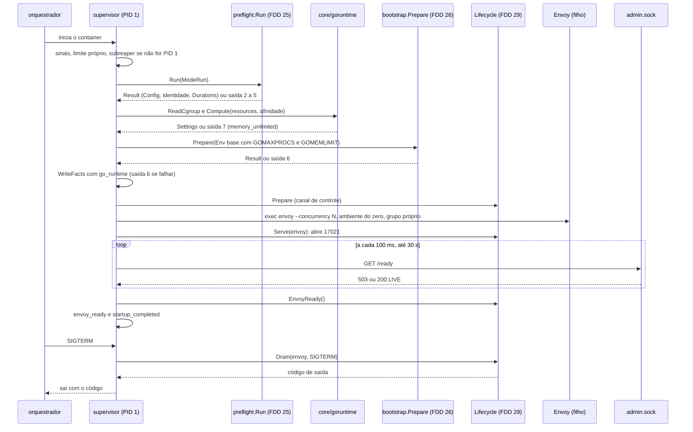
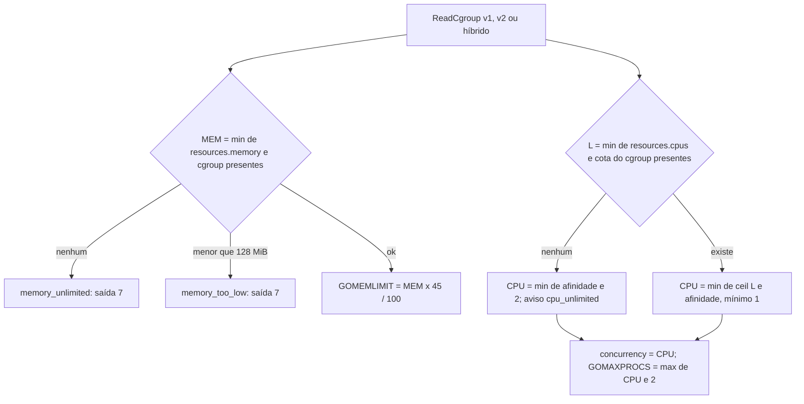

### FDD: Supervisor do Envoy e runtime Go calculado pelo cgroup (SID-07)

Versão: 1.0
Data: 2026-10-21
Responsável: Guilherme Giusti

---

### 1. Contexto e motivação técnica

**Problema técnico.** As FDDs 25 e 26 entregam os passos 1 a 5 (pré-voo) e 7 e 8 (bootstrap e `envoy --mode validate`) da "Sequência de subida" do HLD do `n3x-sidecar`, mas ninguém ainda encadeia os passos, decide o runtime Go, sobe o Envoy de verdade e responde pelo processo depois disso. Ficam sem resposta verificável:

- **Runtime Go no mesmo cgroup do Envoy.** O runtime Go do `libn3x.so` e os workers do Envoy dividem CPU e memória. `GOMAXPROCS` abaixo dos workers trava a cadeia; `GOMEMLIMIT` alto demais leva ao OOM e baixo demais leva a GC em excesso (ADR-008 do `n3x-sidecar`). O ADR fixa as fórmulas, mas não diz como ler o limite no cgroup v1 e no v2, o que fazer com `cpu.max` igual a `max` (caso comum no Kubernetes, que costuma ter só `requests` de CPU), qual a precedência entre `resources` e o cgroup, qual o mínimo de memória aceito, nem como os valores chegam ao `.so`, que roda dentro de outro processo (o Envoy) e só lê o ambiente quando é carregado.
- **Supervisor como PID 1.** O entrypoint é o PID 1 do container no modo padrão (Kubernetes, ECS e docker compose). Sem tratar sinais, o PID 1 ignora o SIGTERM; sem coletar processos órfãos, acumula zumbis; sem prazos, um Envoy que não fica pronto segura o container para sempre.
- **Saída previsível.** O HLD diz que, se o Envoy morre fora da drenagem, o entrypoint sai "com o mesmo código", mas não diz o que acontece antes do pronto, com morte por sinal ou com saída 0, e a FDD 15 deixou o repasse para cá. A FDD 25 reservou a saída 7 para o supervisor antes do pronto.
- **Integração com o que vem depois.** O health `17021` e a drenagem são da FDD 29, mas dependem de um supervisor que saiba quando o Envoy está pronto e que entregue o processo do Envoy a quem drena. O modo Istio (FDD 49) faz `exec` do `pilot-agent` e precisa do mesmo cálculo de runtime sem o supervisor.

**Encaixe no HLD.** Esta FDD especifica, no repositório `n3x-sidecar`, a linha "Supervisor (`internal/supervisor`)" de "Componentes e responsabilidades", os passos 6, 9 e 10 da "Sequência de subida" (com a orquestração de todos os passos de 1 a 10), o bloco "Runtime calculado pelo cgroup" de "Técnicas aplicadas", as linhas "`envoy --mode validate`", "Envoy pronto após subir" e "SIGKILL após SIGTERM ao Envoy" de "Prazos obrigatórios" e o registro dos valores efetivos de runtime em "Observabilidade". Pacotes:

- `internal/supervisor` (HLD): sequência de subida, início e vigilância do Envoy, espera do pronto, sinais, coleta de órfãos e código de saída; porta `Lifecycle` para a FDD 29
- `core/goruntime` (novo, hipótese de nome): leitura do cgroup v1 e v2, fórmulas do ADR-008, variáveis do runtime Go e conferência dos valores dentro do processo. Fica no módulo `core/` (só biblioteca padrão) porque é usado pelo entrypoint, pelo modo Istio (FDD 49) e pelo `.so` (conferência do que ele recebeu)
- `cmd/n3x` (FDD 15): o despacho do `run` passa a chamar `supervisor.Run` e sai com o código devolvido

Quem consome:

- FDD 29 (SID-09): implementa a porta `Lifecycle` (canal de controle antes do passo 9, servidor `17021` no passo 10, aviso de Envoy pronto, drenagem no SIGTERM) e recebe o handle `Envoy` (contrato 5)
- FDD 28 (SID-08): `ENTRYPOINT ["n3x"]` com `CMD ["run"]` sobe o supervisor; caminhos do Envoy e do `.so`; UID 17000
- FDD 49 (SID-11): usa `goruntime.Compute`, `Settings.Apply` e `CheckProxyConcurrency` antes do `exec` do `pilot-agent` (contrato 2)
- FDDs 16 e 25: o `.so` registra os valores que recebeu e os confere com o arquivo de fatos (contrato 9)
- FDD 50 (SID-12): mede o orçamento e revê os percentuais (L-31)
- FDD 47 (SDK-15): guia de limites por orquestrador e tabela de saídas

**Atores.** Orquestrador (cria o container, define os limites do cgroup, manda SIGTERM e reinicia quem sai com código diferente de 0), entrypoint `n3x run` (PID 1, supervisor), Envoy (processo filho, carrega o `.so`), `.so` (runtime Go dentro do Envoy), operador (lê os valores efetivos e as recusas no log).

**Limites.** Esta FDD não define o pré-voo (FDD 25), o bootstrap nem o `--mode validate` (FDD 26), o servidor `17021`, o health check da aplicação, o canal de controle nem a sequência de drenagem (FDD 29), o conteúdo da imagem (FDD 28), o modo Istio além do cálculo reaproveitável (FDD 49) nem o ajuste dos percentuais pelo benchmark (FDD 50). Aqui só se encadeia, calcula, sobe, vigia e sai.

**Suposições**
- FDDs 15, 25 e 26 implementadas: `config.Config` com `resources` e `runtime`, `config.ExitCode`; `preflight.Run`, `preflight.ExitCode`, `Result.Facts` e `identity.WriteFacts`; `bootstrap.Prepare`, `bootstrap.File`, `bootstrap.DefaultEnvoyPath`, `envoycfg.AdminSocket` e `envoycfg.ValidateEnv`
- O binário do Envoy fica em `/usr/local/bin/envoy` e o `.so` em `/usr/lib/n3x/libn3x.so` (FDDs 26 e 28)
- O container tem `/proc` e `/sys/fs/cgroup` montados e legíveis pelo UID 17000 (padrão de Docker, containerd e ECS; conferir no spike RT-01)
- O runtime Go de uma biblioteca `c-shared` lê `GOMAXPROCS`, `GOMEMLIMIT` e `GODEBUG` do ambiente do processo hospedeiro uma vez, quando a biblioteca é carregada; o Envoy não altera o próprio ambiente (spike RT-03)
- Com `GOMAXPROCS` definido no ambiente, o Go 1.25 ou superior desliga o ajuste automático de `GOMAXPROCS` pelo limite de CPU do cgroup (documentação do Go 1.25)

**Restrições**
- Fórmulas do ADR-008 (decisão já tomada): `CPU` arredondado para cima e mínimo 1; `--concurrency` = `CPU`; `GOMAXPROCS` = `max(CPU, 2)`; `GOMEMLIMIT` = 45% de `MEM`; `GODEBUG=cgocheck=0`; recusa sem limite de memória
- Prazos fixos do ADR-006: Envoy pronto em 30 s, SIGKILL 5 s depois do SIGTERM ao Envoy
- Nenhum comportamento configurado pelo operador por variável de ambiente (FR-001); o ambiente do Envoy é montado do zero pelo entrypoint
- Meta de pronto em até 5 s e sidecar ocioso em até 100 MB e 0,05 vCPU (PRD; ADR-009)
- `core/goruntime` só com a biblioteca padrão; o binário `n3x` continua sem `google.golang.org/grpc`, sem o SDK Go do Envoy e sem `go-control-plane` (critério da FDD 15)
- Documentação e mensagens em pt-BR; identificadores em inglês

**Rastreabilidade**
- PRD 1.5: FR-001 (variáveis `GODEBUG=cgocheck=0`, `GOMAXPROCS` e `GOMEMLIMIT` a partir do `n3x.yaml` e dos limites do container; Envoy como processo filho e entrypoint como supervisor que repassa sinais; campo opcional ausente usa o padrão documentado); desempenho (pronto em até 5 s; ocioso até 100 MB e 0,05 vCPU); confiabilidade (`GOMEMLIMIT`, overload manager, `GOMAXPROCS` maior ou igual aos workers)
- HLD do `n3x-sidecar`: "Sequência de subida (`n3x run`)", "Componentes e responsabilidades" (Entrypoint e Supervisor), "Runtime calculado pelo cgroup", "Prazos obrigatórios", "Observabilidade" (valores efetivos de runtime) e o risco "Fórmula de `GOMEMLIMIT` errada"
- ADRs do `n3x-sidecar`: ADR-002 (health no entrypoint), ADR-003 (`n3x run` como padrão), ADR-006 (prazos), ADR-008 (runtime pelo cgroup), ADR-009 (orçamento); ADR-007 do `n3x-sdk` (sidecar nativo)
- Lacunas do README:
  - **L-31 fechada aqui (hipótese até a FDD 50):** 45% de `MEM` e o dimensionamento de 1 vCPU e 256 MiB valem até o benchmark; a fórmula é constante do código e só muda em release minor com nota; o único ajuste do operador é `resources.memory` e `resources.cpus` (contrato 3)
  - **L-16 aplicada (FDD 26):** "Envoy pronto" por `GET /ready` no socket Unix do admin (contrato 5)
  - **L-72 aplicada (FDD 25):** as duas variáveis do orquestrador são repassadas ao Envoy, nenhuma outra (contrato 4)
- Pedidos atendidos:
  - FDD 04: aviso quando a soma das cotas de memória dos plugins passa de 50% do `GOMEMLIMIT` (contrato 3, aviso `memory_quota_budget`)
  - FDD 15: repasse do código de saída do Envoy (contrato 1)
  - FDD 25: `preflight.Run` uma vez, saída por `preflight.ExitCode(err)`, `Durations` no resumo da subida, `res.Config` para as FDDs 26 e 29, arquivo de fatos gravado entre os passos 8 e 9 (falha de escrita sai com 6, `reason` `write`); dona da saída 7 (contratos 1 e 6)
  - FDD 26: Envoy com ambiente montado do zero (search path, sem o marcador), `--disable-hot-restart`, `--log-level` com `warn` virando `warning`, sem `--log-format`; base de ambiente para o `--mode validate`; "Envoy pronto" por `GET /ready` no socket; código de saída 7 (contratos 4 e 5)

---

### 2. Objetivos técnicos

- **Runtime coerente com o cgroup.** Invariante: `GOMAXPROCS` maior ou igual a `--concurrency` em toda combinação de entrada; `GOMEMLIMIT` igual a `floor(MEM * 45 / 100)`. Medida: tabela de pelo menos 30 casos (cgroup v1, v2, híbrido e ausente; com e sem `resources`; afinidade de 1 a 64 CPUs) e teste de propriedade sobre 10.000 entradas aleatórias, 0 violação.
- **Nada sobe sem limite de memória.** Invariante: sem `memory.max` (ou `memory.limit_in_bytes`) e sem `resources.memory`, o `n3x run` sai com 7 (`N3X-S007`, `memory_unlimited`) antes de gerar o bootstrap. Medida: Envoy falso conta 0 execuções.
- **O `.so` recebe o que o supervisor calculou.** Invariante: dentro do Envoy, `runtime.GOMAXPROCS(0)` e `debug.SetMemoryLimit(-1)` são iguais aos valores do log `runtime_computed`, e `cgocheck` está desligado. Medida: teste de ponta a ponta compara o `runtime_computed` do entrypoint com o `adapter_loaded` do `.so`; divergência gera o aviso `go_runtime_mismatch`.
- **Ambiente do Envoy fechado.** Invariante: o processo do Envoy tem exatamente as variáveis do contrato 4 (5 fixas mais as 2 do orquestrador, quando presentes) e nunca `N3X_ENVOY_VALIDATE`. Medida: Envoy falso que despeja o ambiente.
- **Pronto em até 5 s.** Medida: na CI, imagem de desenvolvimento com o `.so` do core e do exemplo, 20 subidas: p95 do início do container ao log `envoy_ready` em até 4 s e ao `/ready` 200 da FDD 29 em até 5 s (hipótese da divisão; critério compartilhado com as FDDs 25, 26 e 29).
- **Saída previsível.** Invariante: toda saída do processo tem um código da tabela do contrato 1 e um último registro `supervisor_exit` com o código e o motivo. Envoy que morre depois do pronto e fora da drenagem leva o container a sair com o código do Envoy (128 mais o número do sinal, se morto por sinal; 0 vira 1) em até 100 ms.
- **PID 1 limpo.** Invariante: nenhum processo zumbi filho do entrypoint dura mais de 100 ms depois do passo 9; SIGTERM nunca é ignorado. Medida: teste com um filho que cria órfãos.
- **Supervisor barato.** Medida: entrypoint ocioso com RSS de até 15 MB e CPU média abaixo de 0,005 vCPU em 10 minutos depois do pronto, sem a FDD 29 (hipótese; a soma com o resto do orçamento é conferida na FDD 50).

---

### 3. Escopo e exclusões

**Incluído**
- `supervisor.Run`: orquestração dos passos 1 a 10 do HLD, chamando `preflight.Run` (FDD 25), `goruntime` (aqui), `bootstrap.Prepare` (FDD 26), arquivo de fatos (FDD 25) e a porta `Lifecycle` (FDD 29), com a duração de cada passo (contrato 5)
- Leitura dos limites do cgroup v1, v2 e híbrido (`cpu.max`, `memory.max`, `cpu.cfs_quota_us`, `cpu.cfs_period_us`, `memory.limit_in_bytes`), com subida pela hierarquia e afinidade de CPU (contrato 3)
- Precedência entre `resources` e o cgroup, regra para CPU sem limite, mínimo de memória e avisos (contrato 3)
- Fórmulas do ADR-008 e variáveis `GOMAXPROCS`, `GOMEMLIMIT` e `GODEBUG` (contratos 2 e 3)
- Aviso da soma das cotas de memória dos plugins acima de 50% do `GOMEMLIMIT` (pedido da FDD 04)
- Início do Envoy como filho: argumentos, ambiente montado do zero, grupo de processo, stdin, stdout e stderr (contrato 4)
- Espera do Envoy pronto pelo `/ready` do admin, com prazo de 30 s (contrato 5)
- Sinais, deveres de PID 1 e coleta de órfãos (contrato 7)
- Repasse do código de saída do Envoy e tabela completa de saídas do `n3x run`; saída 7 com `N3X-S007` e as recusas (contratos 1 e 6)
- Logs dos valores efetivos e da origem de cada um, e dos eventos da subida (contrato 8)
- Como os valores chegam ao `.so` e como o `.so` os confere (contrato 9)
- API reaproveitável para o modo Istio (FDD 49), sem impedir o `exec` do `pilot-agent`

**Excluído**
- Servidor `17021`, health check da aplicação, canal de controle, sequência de drenagem no SIGTERM e saída 9: FDD 29 (SID-09); aqui só a porta `Lifecycle` e o repasse do sinal
- Pré-voo, identidade e saída 5: FDD 25 (SID-05)
- Bootstrap, `--mode validate`, overload manager e saída 6: FDD 26 (SID-06)
- Conteúdo da imagem, usuário 17000, `ENTRYPOINT` e saída 8: FDD 28 (SID-08)
- Modo Istio (detecção, leitura do `concurrency` do proxy, `exec` do `pilot-agent`, códigos de saída do modo): FDD 49 (SID-11)
- Ajuste dos percentuais pelo benchmark: FDD 50 (SID-12)
- Recarga de config sem restart (config estática, ADR-007), hot restart do Envoy e reinício do Envoy pelo supervisor (quem reinicia é o orquestrador): fora da v1

---

### 4. Fluxos detalhados e diagramas

**Fluxo principal: `n3x run` no modo padrão**
1. **Início do supervisor.** O despacho da FDD 15 chama `supervisor.Run(ctx, Options{ConfigPath})`. O supervisor registra os sinais (contrato 7) antes de qualquer outro trabalho, aplica o próprio limite de memória (`debug.SetMemoryLimit(16 MiB)`, hipótese), detecta se é o PID 1 (se não for, se marca como subreaper com `PR_SET_CHILD_SUBREAPER`) e loga `supervisor_started`.
2. **Passos 1 a 5 (FDD 25).** `preflight.Run(ctx, preflight.Options{Mode: ModeRun, ConfigPath, Logger})`, uma vez. Com erro, sai com `preflight.ExitCode(err)` (2, 3, 4 ou 5). Com o `ctx` cancelado por SIGTERM, sai com 0 (`startup_aborted`).
3. **Passo 6: runtime.** `goruntime.ReadCgroup(os.DirFS("/"))` lê `/proc/self/cgroup`, `/proc/self/mountinfo` e os arquivos do cgroup; `goruntime.Compute(Input{Cgroup, CPUs: resources.cpus, MemoryBytes: resources.memory, Affinity: runtime.NumCPU()})` aplica a precedência e as fórmulas (contrato 3). Erro: sai com 7 (`memory_unlimited` ou `memory_too_low`). Soma as cotas de memória dos plugins (cada ID com instância em `cfg.Instances`, mais o `n3x.core`, com `cfg.Limits[id].MemoryMaxBytes` ou `memory.DefaultProxyMaxBytes`) e chama `goruntime.QuotaBudget`. Loga `runtime_warning` (um por aviso) e `runtime_computed`.
4. **Passos 7 e 8 (FDD 26).** `bootstrap.Prepare(ctx, res.Config, bootstrap.Options{ConfigPath, Envoy: ValidateOptions{Env: supervisor.ValidateEnv(settings, getenv)}, Logger})`. Com erro, sai com 6; com `context.Canceled`, sai com 0 (`startup_aborted`).
5. **Fatos (FDD 25).** `f := res.Facts(now)`, `f.GoRuntime = settings.Expected()` (campo novo, pedido à FDD 25) e `identity.WriteFacts(identity.FactsFile, f)`. Erro: sai com 6, `reason` `write` (contrato 1 da FDD 25).
6. **Preparação da FDD 29.** `lifecycle.Prepare(ctx, LifecycleInput{Config, Preflight, Runtime, Logger})` (por exemplo, o canal de controle em `/tmp/n3x`). Erro: sai com o código do erro (`ExitCoder`), que é da FDD 29.
7. **Passo 9: início do Envoy.** `os.StartProcess` de `/usr/local/bin/envoy` com os argumentos e o ambiente do contrato 4, grupo de processo próprio, stdin em `/dev/null` e stdout e stderr iguais ao stderr do entrypoint. A partir daqui, um único coletor (`wait4(-1)`) recolhe todo filho (contrato 7). Falha do `exec`: sai com 7 (`envoy_start`). Loga `envoy_started`.
8. **Passo 10: 17021 e pronto.** `lifecycle.Serve(ctx, envoy)` (a FDD 29 abre `17021`; `/live` responde e `/ready` fica 503). Em paralelo, o supervisor consulta `GET http://admin/ready` pelo socket a cada 100 ms, com 500 ms por consulta (hipótese). Resposta 200 com `LIVE`: chama `lifecycle.EnvoyReady()`, loga `envoy_ready` e `startup_completed` e para de consultar.
9. **Em serviço.** O supervisor espera um destes eventos: saída do Envoy (fluxo alternativo "morte em serviço"), SIGTERM ou SIGINT (entrega à FDD 29: `code := lifecycle.Drain(ctx, DrainRequest{Envoy, Signal, Again})`, e sai com `code`), ou sinal ignorado (log e segue).
10. **Saída.** Loga `supervisor_exit` com o código, o motivo e o número de órfãos coletados, e devolve o código ao `cmd/n3x`, que chama `os.Exit`.

**Fluxos alternativos e exceções**
- **Sem limite de memória** (docker compose sem `mem_limit`, ECS sem memória no container e com cgroupns privado, Kubernetes sem `limits.memory`): `memory_unlimited`, saída 7, texto com a correção por orquestrador e o campo `resources.memory`; nenhum bootstrap gerado
- **Memória abaixo de 128 MiB:** `memory_too_low`, saída 7; entre 128 MiB e 256 MiB, aviso `memory_below_recommended` e sobe
- **CPU sem limite** (`cpu.max` igual a `max`, `cfs_quota_us` igual a `-1`, sem `resources.cpus`): `CPU = min(afinidade, 2)` e aviso `cpu_unlimited`, que recomenda `resources.cpus` ou um limite de CPU (hipótese)
- **`resources` acima do cgroup:** vale o cgroup, com aviso `resources_above_cgroup`; `resources` abaixo do cgroup vale `resources` (por exemplo, para dividir o limite da task do ECS com a aplicação)
- **cgroup ilegível ou em formato inesperado** (sandbox sem `/sys/fs/cgroup`, arquivo corrompido): aviso `cgroup_unreadable` e o controlador fica "sem limite"; sem `resources.memory`, cai em `memory_unlimited`
- **Soma das cotas acima de 50% do `GOMEMLIMIT`:** aviso `memory_quota_budget` com a soma, o limite e os plugins; sobe
- **Binário do Envoy ausente ou sem permissão no passo 9:** `envoy_start`, saída 7 (normalmente o pré-voo já recusou com `envoy_version`)
- **Envoy sai antes do pronto** (bind da porta recusado, `.so` recusa a config do filtro com `preflight_mismatch`, `identity_service_mismatch` ou config de plugin inválida, crash na carga): `envoy_exited`, saída 7, com o código ou o sinal do Envoy no log; as linhas do Envoy e do `.so` já estão no stderr logo acima
- **Envoy não fica pronto em 30 s:** SIGTERM no grupo do Envoy, SIGKILL 5 s depois se preciso, `ready_timeout`, saída 7, com o último status e corpo de `/ready` (até 64 bytes) no log
- **SIGTERM ou SIGINT antes do pronto:** cancela o `ctx`; se o Envoy já iniciou, `envoy.Stop` (SIGTERM, 5 s, SIGKILL); loga `startup_aborted` e sai com 0; não há drenagem, porque o sidecar nunca ficou pronto (hipótese)
- **Morte em serviço** (Envoy sai depois do pronto, fora da drenagem: crash do `.so`, OOM, sinal externo): loga `envoy_exited` com `phase` `serving` e sai em até 100 ms com `ExitStatus.ProcessExitCode()`: o código do Envoy; 128 mais o sinal; 0 vira 1 (hipótese). A FDD 29 é avisada pelo `ctx` cancelado e não drena. Quem reinicia é o orquestrador
- **Envoy sai durante a drenagem:** decisão da FDD 29 (a drenagem recebe `Envoy.Exited()`)
- **SIGHUP, SIGUSR1, SIGUSR2 ou SIGQUIT:** log `signal_received` com `action` `ignore`; nada é repassado ao Envoy (contrato 7)
- **Segundo SIGTERM ou SIGINT:** antes do pronto, ignorado (a parada já está em curso); depois do pronto, entregue à FDD 29 pelo canal `Again`
- **Entrypoint não é o PID 1** (Kubernetes com `shareProcessNamespace: true`, `docker run --init`): o supervisor se marca como subreaper e se comporta igual; `supervisor_started` registra `pid1: false`
- **Panic no supervisor:** `recover` no topo de `Run` para o Envoy e sai com 7 (`internal`)
- **Supervisor morre por erro fatal** (não recuperável, como `fatal error` do runtime Go): o Envoy recebe SIGKILL por `Pdeathsig` (hipótese; conferir com `LockOSThread` na implementação); como PID 1, a morte do supervisor já encerra o container
- **Modo Istio** (primeiro argumento `proxy`, FDD 49): `supervisor.Run` não é chamado. O caminho da FDD 49 usa `preflight.Run`, `goruntime.ReadCgroup`, `goruntime.Compute`, `CheckProxyConcurrency`, `Settings.Apply` sobre o ambiente injetado pelo Istio e o arquivo de fatos, e faz `exec` do `pilot-agent`. Nada no pacote `supervisor` tem efeito em `init()` (sem sinais registrados, goroutines, portas ou arquivos), então o `exec` substitui o processo sem resto

**Diagramas**

Sequência da subida:



Estados do supervisor:

```mermaid
stateDiagram-v2
    [*] --> Subindo
    Subindo --> Saida: passos 1 a 8 falham (2 a 6) ou SIGTERM (0)
    Subindo --> Iniciando: exec do Envoy
    Iniciando --> Saida: Envoy sai ou 30 s (7); SIGTERM (0)
    Iniciando --> EmServico: /ready LIVE
    EmServico --> Saida: Envoy sai (código do Envoy)
    EmServico --> Drenando: SIGTERM ou SIGINT
    Drenando --> Saida: código da FDD 29
    Saida --> [*]
```



Precedência do cálculo:



---

### 5. Contratos públicos (assinaturas, endpoints, headers, exemplos)

**Contrato 1: `n3x run` e a tabela completa de saídas**
- Tipo: CLI (processo; complementa o contrato 5 da FDD 15, que define o despacho e a flag)
- Assinatura/Rota: `n3x [run] [--config <arquivo>]` (padrão `/etc/n3x/n3x.yaml`); sem outras flags e sem `--skip` (FDD 15)
- Método: processo (PID 1 do container no modo padrão)
- Semântica de status/headers:
  - **Comportamento:** encadeia os passos 1 a 10 (seção 4), sobe o Envoy, fica em primeiro plano até a saída do Envoy ou o fim da drenagem e devolve um dos códigos abaixo. Logs JSON em stderr; nada em stdout
  - **Tabela de saídas do `n3x run`** (as faixas 1 a 9 são as da FDD 25, contrato 2):

| Saída | Código | Quando | Dona |
| --- | --- | --- | --- |
| 0 | | parada pedida (SIGTERM ou SIGINT) concluída, antes do pronto; ou drenagem concluída (FDD 29) | 27 e 29 |
| 1 | `N3X-S001` | uso | 15 |
| 2, 3, 4 | `N3X-S002` a `N3X-S004` | `n3x.yaml`, segredo ou chave, manifesto do `.so` | 15 |
| 5 | `N3X-S005` | pré-voo | 25 |
| 6 | `N3X-S006` | bootstrap, `--mode validate` ou escrita do arquivo de fatos | 26 (e 25) |
| 7 | `N3X-S007` | supervisor antes do pronto: runtime (sem limite de memória, memória baixa), início do Envoy, Envoy que sai antes do pronto, prazo de 30 s | 27 (esta) |
| 8 | `N3X-S008` | reservado | 28 |
| 9 | `N3X-S009` | health e drenagem | 29 |
| código do Envoy | | depois do pronto e fora da drenagem: o Envoy saiu sozinho | 27 (repasse) |

  - **Repasse do código do Envoy** (pedido da FDD 15; HLD "sai com o mesmo código"): saída normal com código `c` diferente de 0: o entrypoint sai com `c`; morte pelo sinal `n`: sai com `128 + n` (convenção do shell: 137 para SIGKILL, 139 para SIGSEGV, 134 para SIGABRT); saída 0 fora da drenagem: sai com 1, para o orquestrador tratar como falha (o `restart: on-failure` do compose e o ECS não reiniciam saída 0) (hipótese, inconsistência I-02)
  - **Ambiguidade:** depois do pronto, uma saída de 1 a 9 pode ser do Envoy e não do N3X; o log `envoy_exited` com `phase` `serving` e `envoy_exit_code` desfaz a dúvida (ponto P-02)
  - **Precedência:** os passos rodam em sequência; só existe uma categoria por execução (as categorias 2 a 5 têm a precedência interna da FDD 25)

**Exemplo de requisição**
```text
$ docker run --rm --read-only --tmpfs /tmp --memory 256m --cpus 1 \
    -v $PWD/n3x.yaml:/etc/n3x/n3x.yaml:ro ghcr.io/acme/pedidos-sidecar:1.4.0
$ docker run --rm --read-only --tmpfs /tmp -v $PWD/n3x.yaml:/etc/n3x/n3x.yaml:ro ghcr.io/acme/pedidos-sidecar:1.4.0
$ echo $?
```

**Exemplo de resposta** (primeiro: sobe e, no `docker stop`, sai com 0 pela drenagem; segundo: sem limite de memória, saída 7; linhas encurtadas)
```json
{"ts":"2026-10-21T14:00:00.231Z","level":"info","component":"entrypoint","service":"pedidos","msg":"runtime_computed","concurrency":1,"gomaxprocs":2,"gomemlimit_bytes":120795955,"godebug":"cgocheck=0","cpu_limit":1,"cpu_source":"cgroup_v2","cpu_affinity":8,"memory_limit_bytes":268435456,"memory_source":"cgroup_v2","cgroup":"v2","memory_percent":45,"plugin_quota_bytes":33554432,"duration_ms":1}
{"ts":"2026-10-21T14:00:02.104Z","level":"info","component":"entrypoint","service":"pedidos","msg":"startup_completed","total_ms":2104,"preflight_ms":142,"runtime_ms":1,"bootstrap_ms":905,"facts_ms":2,"envoy_ready_ms":1048}
{"ts":"2026-10-21T14:00:00.230Z","level":"error","component":"entrypoint","service":"pedidos","msg":"supervisor_failed","code":"N3X-S007","reason":"memory_unlimited","detail":"nenhum limite de memória: o cgroup não tem limite (memory.max = max) e resources.memory não foi definido; defina o limite de memória do container ou resources.memory no n3x.yaml","exit_code":7}
```
```text
7
```

---

**Contrato 2: API de `core/goruntime`**
- Tipo: sdk (API Go do módulo `github.com/giustech/n3x-sidecar/core`, só biblioteca padrão; usada pelo supervisor, pelo modo Istio da FDD 49 e pelo `.so`)
- Assinatura/Rota:
  ```go
  package goruntime // github.com/giustech/n3x-sidecar/core/goruntime

  const (
      MemoryPercent          = 45        // ADR-008; revisto pela FDD 50 (L-31)
      MinMemoryBytes         = 128 << 20 // abaixo: ErrMemoryTooLow
      RecommendedMemoryBytes = 256 << 20 // abaixo: aviso memory_below_recommended (ADR-009)
      MinGOMAXPROCS          = 2
      UnlimitedCPUCap        = 2         // CPU sem limite: min(afinidade, 2)
      QuotaBudgetPercent     = 50        // aviso da FDD 04
      GODEBUG                = "cgocheck=0"
      V1UnlimitedBytes       = 1 << 62   // memory.limit_in_bytes a partir disto = sem limite
      MaxCgroupFileSize      = 64 << 10
  )

  type Version string // "v1", "v2", "hybrid", "none"
  type Source string  // "resources", "cgroup_v1", "cgroup_v2", "affinity"

  type Cgroup struct {
      Version       Version
      CPU           float64 // CPUs da cota (quota/period), menor da hierarquia; 0 = sem limite
      CPUVersion    Version
      MemoryBytes   int64   // menor da hierarquia; 0 = sem limite
      MemoryVersion Version
      Path          string   // cgroup do processo, para o log
      Problems      []string // arquivo ilegível ou fora do formato; vira aviso cgroup_unreadable
  }

  // Lê /proc/self/cgroup, /proc/self/mountinfo e os arquivos de limite a partir da raiz
  // de fsys (os.DirFS("/") em produção). Nunca falha: problema vira Problems.
  func ReadCgroup(fsys fs.FS) Cgroup

  type Input struct {
      Cgroup      Cgroup
      CPUs        float64 // resources.cpus; 0 = ausente
      MemoryBytes int64   // resources.memory; 0 = ausente
      Affinity    int     // runtime.NumCPU() (afinidade e cpuset); >= 1
  }

  type Settings struct {
      Concurrency  int
      GOMAXPROCS   int
      GOMEMLIMIT   int64
      GODEBUG      string
      CPULimit     float64 // limite efetivo antes do arredondamento; 0 = sem limite
      CPUSource    Source
      Affinity     int
      MemoryBytes  int64
      MemorySource Source
      Cgroup       Version
  }

  type Warning struct{ Code, Detail string }

  func Compute(in Input) (Settings, []Warning, error)
  func (s Settings) Env() []string                // "GOMAXPROCS=..", "GOMEMLIMIT=..", "GODEBUG=..", nessa ordem
  func (s Settings) Apply(env []string) []string  // sobrescreve ou acrescenta as 3; o resto fica (modo Istio)
  func (s Settings) Expected() Expected
  func QuotaBudget(s Settings, quotaBytes int64) (Warning, bool) // true se quotaBytes > 50% de GOMEMLIMIT
  func CheckProxyConcurrency(s Settings, concurrency int) error  // modo Istio (FDD 49)

  // Dentro do processo (o .so): valores que o runtime Go realmente aplicou.
  type Observed struct {
      GOMAXPROCS  int
      GOMEMLIMIT  int64 // debug.SetMemoryLimit(-1)
      CgoCheckOff bool  // GODEBUG do processo contém cgocheck=0
  }

  type Expected struct {
      Concurrency int    `json:"concurrency"`
      GOMAXPROCS  int    `json:"gomaxprocs"`
      GOMEMLIMIT  int64  `json:"gomemlimit"`
      GODEBUG     string `json:"godebug"`
  }

  type Mismatch struct{ Field, Expected, Observed string }

  func Observe() Observed
  func Verify(e Expected, o Observed) []Mismatch

  var (
      ErrNoMemoryLimit    = errors.New("goruntime: nenhum limite de memória")
      ErrMemoryTooLow     = errors.New("goruntime: limite de memória abaixo do mínimo")
      ErrBelowConcurrency = errors.New("goruntime: GOMAXPROCS abaixo do concurrency do proxy")
  )
  ```
- Método: n/a (chamada local)
- Semântica de status/headers:
  - **Pureza:** `Compute`, `Env`, `Apply`, `Expected`, `QuotaBudget`, `CheckProxyConcurrency` e `Verify` são puras, sem I/O nem estado global; `ReadCgroup` só lê arquivos de `fsys`, cada um com teto de 64 KiB; `Observe` só lê o estado do runtime e o ambiente do próprio processo
  - **Erros de `Compute`:** `ErrNoMemoryLimit` ou `ErrMemoryTooLow`, embrulhados com o detalhe (limite lido e origem); `Settings` vem preenchido com o que foi possível (CPU), para o log
  - **`Env`:** `GOMEMLIMIT` em bytes inteiros sem sufixo (`GOMEMLIMIT=120795955`), forma aceita pelo Go e sem arredondamento; `GOMAXPROCS` inteiro; `GODEBUG=cgocheck=0` exato
  - **`Apply`:** para o modo Istio, em que o ambiente injetado pelo Istio precisa ser mantido para o `pilot-agent`; remove qualquer `GOMAXPROCS`, `GOMEMLIMIT` e `GODEBUG` anteriores e acrescenta os 3 no fim
  - **`CheckProxyConcurrency`:** `ErrBelowConcurrency` se `GOMAXPROCS < concurrency` (ADR-008, modo Istio); a FDD 49 lê o `concurrency` e escolhe o código de saída (sugestão: 7)
  - **`Verify`:** compara `GOMAXPROCS`, `GOMEMLIMIT` e `cgocheck`; `Concurrency` não é conferido dentro do processo (o Envoy expõe a stat `server.concurrency`)

**Exemplo de requisição**
```go
cg := goruntime.ReadCgroup(os.DirFS("/"))
s, warns, err := goruntime.Compute(goruntime.Input{Cgroup: cg, Affinity: runtime.NumCPU()})
fmt.Println(s.Concurrency, s.GOMAXPROCS, s.GOMEMLIMIT, s.CPUSource, s.MemorySource, len(warns), err)
fmt.Println(s.Env())
fmt.Println(s.Apply([]string{"ISTIO_META_MESH_ID=m1", "GOMAXPROCS=8"}))
```

**Exemplo de resposta** (container com cgroup v2, `cpu.max` `100000 100000`, `memory.max` `268435456`, afinidade 8)
```text
1 2 120795955 cgroup_v2 cgroup_v2 0 <nil>
[GOMAXPROCS=2 GOMEMLIMIT=120795955 GODEBUG=cgocheck=0]
[ISTIO_META_MESH_ID=m1 GOMAXPROCS=2 GOMEMLIMIT=120795955 GODEBUG=cgocheck=0]
```

---

**Contrato 3: regras do cálculo (cgroup, precedência, fórmulas e avisos)**
- Tipo: regra de comportamento (`goruntime.ReadCgroup` e `goruntime.Compute`; documentada em `docs/runtime.md` do `n3x-sidecar` e no guia da FDD 47)
- Assinatura/Rota: entradas `cpu.max`, `memory.max` (v2), `cpu.cfs_quota_us`, `cpu.cfs_period_us`, `memory.limit_in_bytes` (v1), `resources.cpus`, `resources.memory` e afinidade de CPU
- Método: n/a
- Semântica de status/headers:
  - **Qual cgroup** (resposta ao ponto "v1 ou só v2"; hipótese H-02): os dois. Motivo: nós com Amazon Linux 2 (ECS e EKS) e hosts Docker antigos ainda usam v1; v2 é o padrão nos demais. A escolha é por controlador:
    1. lê `/proc/self/mountinfo` e acha as montagens `cgroup2` e `cgroup` (v1, com `cpu` ou `memory` nas opções)
    2. lê `/proc/self/cgroup`: linhas `N:cpu,cpuacct:/caminho` e `N:memory:/caminho` (v1) e `0::/caminho` (v2)
    3. para cada controlador (CPU e memória): se ele tem montagem v1, usa v1; senão, usa v2; senão, "sem limite". `Version` é `v2`, `v1`, `hybrid` (v2 montado e algum controlador em v1) ou `none`
    4. diretório = ponto de montagem + (caminho do processo sem o prefixo da raiz da montagem); sobe pela hierarquia até o ponto de montagem e fica com o **menor** limite encontrado (o limite de um ancestral também vale para o processo; com cgroupns privado, a raiz já é o cgroup do container)
  - **Formatos:**

| Versão | Arquivo | Com limite | Sem limite | Valor |
| --- | --- | --- | --- | --- |
| v2 | `cpu.max` | `<quota> <period>` | `max <period>` | `quota / period` CPUs |
| v2 | `memory.max` | inteiro em bytes | `max` | bytes |
| v1 | `cpu.cfs_quota_us` e `cpu.cfs_period_us` | quota maior que 0 | `-1` | `quota / period` CPUs |
| v1 | `memory.limit_in_bytes` | inteiro em bytes | a partir de `2^62` (o kernel grava `9223372036854771712`) | bytes |

  - Arquivo ausente, ilegível, acima de 64 KiB, com `period` 0 ou fora do formato: o controlador fica "sem limite" e o caminho vai para `Problems` (aviso `cgroup_unreadable`) (hipótese H-17)
  - **Precedência** (resposta ao ponto aberto; hipótese H-04): `resources` e cgroup não se excluem; vale o **menor** dos que existem. `resources` acima do cgroup é cortado ao cgroup com o aviso `resources_above_cgroup` (o processo não consegue passar do cgroup, e recusar quebraria implantações em que uma política reduz o limite); `resources` abaixo do cgroup vale `resources` (reserva para outros processos do mesmo limite, como a task do ECS com cgroupns visível)
  - **Fórmulas:**
    - `L` = menor entre `resources.cpus` e a cota do cgroup (os que existem)
    - com `L`: `CPU = max(1, min(ceil(L), Affinity))`; origem `resources` ou `cgroup_v*` (a de onde veio o menor); se a afinidade cortou, aviso `cpu_affinity_cap`
    - sem `L` (CPU sem limite; hipótese H-03): `CPU = min(Affinity, 2)`, origem `affinity`, aviso `cpu_unlimited`. Motivo: o Kubernetes costuma ter só `requests` de CPU; usar todas as CPUs do nó daria dezenas de workers e de threads do Go, que não cabem no orçamento de 100 MB; 2 cobre o dimensionamento recomendado de 1 vCPU com folga (inconsistência I-03 com o exemplo do FR-001)
    - `--concurrency = CPU`; `GOMAXPROCS = max(CPU, 2)`
    - `MEM` = menor entre `resources.memory` e o limite do cgroup (os que existem); sem nenhum: `ErrNoMemoryLimit` (ADR-008)
    - `MEM < 128 MiB`: `ErrMemoryTooLow` (hipótese H-05: abaixo disso, o Envoy ocioso, de 45 MB, e o `GOMEMLIMIT`, de 57,6 MiB, não cabem com folga para o overload manager); `MEM < 256 MiB`: aviso `memory_below_recommended`
    - `GOMEMLIMIT = floor(MEM * 45 / 100)` em bytes; `GODEBUG = cgocheck=0`
  - **L-31 (hipótese H-06):** 45% e o perfil de 1 vCPU e 256 MiB valem até a FDD 50. Num container de 256 MiB sobram 140,8 MiB para o Envoy e o próprio entrypoint, acima dos 45 MB do Envoy ocioso (ADR-009), e o overload manager age em 230,4 MiB (90%) e 243,2 MiB (95%) (FDD 26). Não há campo nem variável para mudar o percentual: o operador ajusta `resources.memory` (que muda `MEM`, o `GOMEMLIMIT` e o `max_memory_bytes` do overload manager juntos) e `resources.cpus`; a mudança da constante vem em release minor do `n3x-sidecar`, com nota, depois do benchmark (HLD, plano de contingência do risco de `GOMEMLIMIT`)
  - **Soma das cotas (pedido da FDD 04):** `quota` = soma, por ID com pelo menos uma instância em `cfg.Instances` e mais o `n3x.core`, de `cfg.Limits[id].MemoryMaxBytes` (0 vale `memory.DefaultProxyMaxBytes`, 16 MiB). Se `quota > 50% de GOMEMLIMIT`, aviso `memory_quota_budget`; nunca recusa. Só no `run` (o `validate` não conhece o cgroup do container) (hipótese H-18)
  - **Avisos** (`runtime_warning`, nível `warn`, nunca recusam):

| Código | Quando | Texto |
| --- | --- | --- |
| `cpu_unlimited` | sem cota de CPU e sem `resources.cpus` | `sem limite de CPU no cgroup e sem resources.cpus: usando 2 workers; defina resources.cpus ou o limite de CPU do container` |
| `cpu_affinity_cap` | `ceil(L)` maior que a afinidade | `limite de 4 CPUs, mas o processo só pode usar 2 (cpuset): usando 2` |
| `resources_above_cgroup` | `resources.cpus` ou `resources.memory` acima do cgroup | `resources.memory (1 GiB) acima do limite do cgroup (256 MiB): usando o cgroup` |
| `memory_below_recommended` | `MEM` de 128 MiB a 256 MiB | `limite de memória de 192 MiB abaixo dos 256 MiB recomendados` |
| `memory_quota_budget` | soma das cotas acima de 50% do `GOMEMLIMIT` | `cotas de memória dos plugins somam 80 MiB, acima de 50% do GOMEMLIMIT (115,2 MiB); reduza runtime.plugin_limits[...].memory.max_bytes ou aumente a memória` |
| `cgroup_unreadable` | arquivo do cgroup ilegível ou fora do formato | `não foi possível ler /sys/fs/cgroup/memory.max: tratado como sem limite` |

**Exemplo de requisição** (tabela de referência dos testes; `aff` é a afinidade)

| `cpu.max` | `resources.cpus` | aff | `memory.max` | `resources.memory` |
| --- | --- | --- | --- | --- |
| `100000 100000` | | 8 | `268435456` | |
| `200000 100000` | | 8 | `536870912` | |
| `400000 100000` | 1.5 | 8 | `max` | `512Mi` |
| `50000 100000` | | 8 | `1073741824` | `512Mi` |
| `max 100000` | | 8 | `268435456` | `1Gi` |
| `100000 100000` | 4 | 8 | `max` | |

**Exemplo de resposta**

| `--concurrency` | `GOMAXPROCS` | `GOMEMLIMIT` | Origens | Avisos ou erro |
| --- | --- | --- | --- | --- |
| 1 | 2 | 120795955 | cgroup_v2, cgroup_v2 | nenhum |
| 2 | 2 | 241591910 | cgroup_v2, cgroup_v2 | nenhum |
| 2 | 2 | 241591910 | resources, resources | nenhum |
| 1 | 2 | 241591910 | cgroup_v2, resources | nenhum |
| 2 | 2 | 120795955 | affinity, cgroup_v2 | `cpu_unlimited`, `resources_above_cgroup` |
| 1 | 2 | | cgroup_v2 | `resources_above_cgroup`; erro `ErrNoMemoryLimit` (saída 7) |

---

**Contrato 4: processo do Envoy (argumentos e ambiente)**
- Tipo: contrato de processo (o que o supervisor executa no passo 9; e a base do ambiente do `--mode validate` da FDD 26)
- Assinatura/Rota:
  ```go
  package supervisor

  func EnvoyArgs(s goruntime.Settings, cfg *config.Config) []string
  func ValidateEnv(s goruntime.Settings, getenv func(string) string) []string // base da FDD 26
  func EnvoyEnv(s goruntime.Settings, getenv func(string) string) []string    // processo real
  ```
  ```text
  /usr/local/bin/envoy -c /tmp/n3x/bootstrap.yaml --mode serve --concurrency <CPU>
      --disable-hot-restart --log-level <nível> --drain-time-s <segundos>
  ```
- Método: `os.StartProcess` (sem shell)
- Semântica de status/headers:
  - **Argumentos:** `-c bootstrap.File` (o arquivo validado no passo 8, sem regenerar); `--mode serve` explícito; `--concurrency` igual a `Settings.Concurrency`; `--disable-hot-restart` (sem memória compartilhada nem `base-id`, pedido da FDD 26); `--log-level` de `runtime.log_level` com `debug`, `info`, `warn` e `error` virando `debug`, `info`, `warning` e `error`; `--drain-time-s` igual a `runtime.drain_timeout` arredondado para cima em segundos, para o `POST /drain_listeners?graceful` da FDD 29 fechar as conexões dentro do prazo, e não nos 600 s padrão do Envoy (hipótese H-13, a FDD 29 confirma); **nunca** `--log-format` (o bootstrap tem `application_log_config`, FDD 26), `--base-id`, `--cpuset-threads` nem `--service-*`
  - **Ambiente do processo real, montado do zero** (as únicas variáveis; nada é herdado do container):

| Variável | Valor | Por quê |
| --- | --- | --- |
| `PATH` | `/usr/local/bin:/usr/bin:/bin` | igual ao `envoy --version` da FDD 25 |
| `ENVOY_DYNAMIC_MODULES_SEARCH_PATH` | `/usr/lib/n3x` | o Envoy acha o `libn3x.so` (FDD 26) |
| `GODEBUG` | `cgocheck=0` | ADR-008 |
| `GOMAXPROCS` | `Settings.GOMAXPROCS` | ADR-008; também desliga o ajuste automático do Go 1.25 ou superior |
| `GOMEMLIMIT` | `Settings.GOMEMLIMIT` em bytes | ADR-008 |
| `KUBERNETES_SERVICE_HOST` | o valor do entrypoint, só se presente | detecção própria do `.so` quando falta o arquivo de fatos (L-72, FDD 25) (hipótese H-14) |
| `ECS_CONTAINER_METADATA_URI_V4` | o valor do entrypoint, só se presente e com o host `169.254.170.2` | idem |

  - **Nunca no ambiente do Envoy real:** `N3X_ENVOY_VALIDATE` (só no `--mode validate`, FDD 26); `HOME`, `TMPDIR`, `HTTP_PROXY` e qualquer outra variável do container; `GOTRACEBACK` e `GOGC` ficam nos padrões do Go (hipótese)
  - **`ValidateEnv`:** `PATH`, `GOMAXPROCS`, `GOMEMLIMIT` e as duas do orquestrador; a FDD 26 acrescenta e sobrescreve `ENVOY_DYNAMIC_MODULES_SEARCH_PATH`, `GODEBUG` e `N3X_ENVOY_VALIDATE`. Assim o `.so` carregado na validação já roda com o mesmo runtime do processo real
  - **Atributos do processo:** grupo de processo próprio (`Setpgid`), para o SIGINT de um terminal não chegar direto ao Envoy; stdin em `/dev/null`; stdout e stderr do Envoy são o próprio stderr do entrypoint (descritor herdado, sem pipe), para um supervisor lento nunca bloquear a escrita do Envoy nem do `.so` e as linhas JSON (`component=envoy` e `component=core`) chegarem inteiras ao coletor (hipótese H-09); `Pdeathsig: SIGKILL`, com o início do processo numa thread travada (`runtime.LockOSThread`) que não termina (hipótese H-11)
  - **Diretório de trabalho:** `/` (o bootstrap usa caminhos absolutos)

**Exemplo de requisição**
```go
args := supervisor.EnvoyArgs(settings, cfg) // concurrency 1, log_level warn, drain_timeout 20s
env := supervisor.EnvoyEnv(settings, os.Getenv)
fmt.Println(strings.Join(args, " "))
fmt.Println(strings.Join(env, "\n"))
```

**Exemplo de resposta** (pod do Kubernetes)
```text
/usr/local/bin/envoy -c /tmp/n3x/bootstrap.yaml --mode serve --concurrency 1 --disable-hot-restart --log-level warning --drain-time-s 20
PATH=/usr/local/bin:/usr/bin:/bin
ENVOY_DYNAMIC_MODULES_SEARCH_PATH=/usr/lib/n3x
GODEBUG=cgocheck=0
GOMAXPROCS=2
GOMEMLIMIT=120795955
KUBERNETES_SERVICE_HOST=10.96.0.1
```

---

**Contrato 5: API de `internal/supervisor` e a porta `Lifecycle` da FDD 29**
- Tipo: sdk (API Go do pacote `github.com/giustech/n3x-sidecar/internal/supervisor`; usada pelo `cmd/n3x` e implementada em parte pela FDD 29)
- Assinatura/Rota:
  ```go
  package supervisor

  const (
      ExitCode          = 7
      Code              = "N3X-S007"
      ReadyTimeout      = 30 * time.Second       // ADR-006
      ReadyPollInterval = 100 * time.Millisecond // hipótese
      ReadyProbeTimeout = 500 * time.Millisecond // hipótese
      StopGrace         = 5 * time.Second        // SIGKILL 5 s depois do SIGTERM (ADR-006)
      KillWait          = 1 * time.Second
      OwnMemoryLimit    = 16 << 20               // limite do próprio supervisor (hipótese)
      EnvoyPATH         = "/usr/local/bin:/usr/bin:/bin"
  )

  type Options struct {
      ConfigPath string       // "" = config.DefaultPath
      Logger     *slog.Logger // component=entrypoint
      Lifecycle  Lifecycle    // FDD 29; nil = NopLifecycle
      // Injeções para testes (zero = produção)
      Preflight func(context.Context, preflight.Options) (*preflight.Result, error)
      Bootstrap func(context.Context, *config.Config, bootstrap.Options) (bootstrap.Result, error)
      Cgroup    fs.FS               // os.DirFS("/")
      Affinity  func() int          // runtime.NumCPU
      Getenv    func(string) string // os.Getenv
      EnvoyPath string              // bootstrap.DefaultEnvoyPath
      Signals   <-chan os.Signal    // signal.Notify do contrato 7
      Now       func() time.Time
  }

  // Passos 1 a 10 e a vida do Envoy. Devolve o código de saída do processo (contrato 1).
  func Run(ctx context.Context, opts Options) int

  type ExitStatus struct {
      Code   int            // -1 se morto por sinal
      Signal syscall.Signal // 0 se saiu normalmente
      Uptime time.Duration
  }

  func (s ExitStatus) ProcessExitCode() int // repasse do contrato 1: c; 128+n; 0 vira 1

  type Phase string // "starting", "serving", "draining", "stopping"

  // Handle do processo do Envoy entregue à FDD 29. Seguro entre goroutines.
  type Envoy interface {
      PID() int
      Started() time.Time
      Phase() Phase
      Admin() *http.Client               // socket do admin; URL http://admin/<endpoint> (FDD 26)
      Exited() <-chan struct{}           // fecha quando o processo saiu e foi coletado
      Status() (ExitStatus, bool)        // válido depois de Exited
      Terminate() error                  // SIGTERM no grupo do Envoy
      Stop(ctx context.Context) ExitStatus // SIGTERM, StopGrace, SIGKILL, KillWait
  }

  type LifecycleInput struct {
      Config    *config.Config
      Preflight *preflight.Result
      Runtime   goruntime.Settings
      Logger    *slog.Logger
  }

  type DrainRequest struct {
      Envoy  Envoy
      Signal os.Signal        // SIGTERM ou SIGINT
      Again  <-chan os.Signal // SIGTERM ou SIGINT seguintes
  }

  // Porta implementada pela FDD 29 (health 17021, canal de controle e drenagem).
  type Lifecycle interface {
      Prepare(ctx context.Context, in LifecycleInput) error // depois dos fatos, antes do passo 9
      Serve(ctx context.Context, e Envoy) error              // passo 10, logo depois do exec do Envoy
      EnvoyReady()                                           // uma vez, no primeiro /ready LIVE
      Drain(ctx context.Context, r DrainRequest) int         // SIGTERM ou SIGINT depois do pronto
  }

  // Até a FDD 29 existir (e nos testes): Prepare e Serve não fazem nada;
  // Drain chama r.Envoy.Stop e devolve 0.
  type NopLifecycle struct{}

  // Erros de Prepare e Serve podem trazer o próprio código de saída.
  type ExitCoder interface{ ExitCode() int }
  ```
- Método: n/a (chamada local)
- Semântica de status/headers:
  - **Uma chamada por processo:** `Run` registra os sinais, roda os passos e só volta com o código; não chama `os.Exit` (o `cmd/n3x` chama)
  - **Pronto do Envoy** (pedido da FDD 26): `GET http://admin/ready` pelo cliente do contrato 4 da FDD 26, a cada 100 ms, com 500 ms por consulta, a partir do `exec`; pronto é status 200 com corpo começando por `LIVE`; socket ausente, conexão recusada, 503 (`PRE_INITIALIZING`, `INITIALIZING`) e prazo da consulta só contam como "ainda não"; o prazo total de 30 s conta do `exec`. Depois do pronto, o supervisor não consulta mais o admin (quem continua consultando é o `/ready` da FDD 29)
  - **Contrato com a FDD 29:**
    - `Prepare`: chamada uma vez, depois do arquivo de fatos e antes do `exec`; recebe a config validada, o resultado do pré-voo e o runtime; erro aborta a subida com `ExitCoder.ExitCode()` (a FDD 29 define, normalmente 9) ou 9 se o erro não trouxer código
    - `Serve`: chamada uma vez, logo depois do `exec`, antes do pronto; deve voltar em até 100 ms (abre o `17021` e põe o trabalho em goroutines); o `ctx` é cancelado quando o supervisor sai
    - `EnvoyReady`: chamada uma vez, na goroutine do supervisor, quando o admin responde `LIVE`; a FDD 29 junta com o health da aplicação para o `/ready` do `17021`
    - `Drain`: chamada uma vez, no primeiro SIGTERM ou SIGINT depois do pronto, com o Envoy em `PhaseDraining`; a FDD 29 conduz a sequência do HLD (503, canal de controle, `drain_listeners`, espera, `Terminate`, `Stop`) e devolve o código de saída do processo (0 ou 9); os sinais seguintes chegam por `Again`; se o Envoy sair sozinho durante a drenagem, `Exited()` fecha e a FDD 29 decide
    - Proibido à FDD 29 depois do passo 9: criar processo filho com `os/exec` (o coletor do contrato 7 recolheria o status antes do `Wait`); o health da aplicação é por rede, não por comando (pedido à FDD 29)
  - **Durações:** `Run` mede cada passo com relógio monotônico desde o início de `Run`; `startup_completed` traz `preflight_ms` (de `Result.Durations.Total`), `runtime_ms`, `bootstrap_ms`, `facts_ms`, `envoy_ready_ms` (do `exec` ao `LIVE`) e `total_ms`
  - **Estado:** sem estado global; `Run` pode rodar em teste com Envoy falso, cgroup de fixture e sinais injetados

**Exemplo de requisição** (`cmd/n3x`, despacho do `run`)
```go
code := supervisor.Run(ctx, supervisor.Options{
    ConfigPath: configFlag,           // --config
    Logger:     log,                  // component=entrypoint
    Lifecycle:  health.NewLifecycle(), // FDD 29; nil antes dela
})
os.Exit(code)
```

**Exemplo de resposta** (uso da porta pela FDD 29 e o código que volta)
```go
func (l *lifecycle) Drain(ctx context.Context, r supervisor.DrainRequest) int {
    l.setDraining()                      // /ready 503 na hora (ADR-002)
    // canal de controle, drain_listeners, espera ...
    st := r.Envoy.Stop(ctx)              // SIGTERM, 5 s, SIGKILL
    if st.Signal == syscall.SIGKILL { return 9 }
    return 0
}
// supervisor_exit: {"exit_code":0,"reason":"drained"}
```

---

**Contrato 6: recusas da saída 7 (`N3X-S007`)**
- Tipo: CLI e log (contrato com o operador e com a automação)
- Assinatura/Rota: código de saída 7, registro `supervisor_failed` em stderr e `docs/erros.md#n3x-s007` do `n3x-sidecar`
- Método: n/a
- Semântica de status/headers:
  - **Um código, um `reason` estável** (estáveis na major do `n3x-sidecar`; o texto pode melhorar em patch):

| `reason` | Passo | Condição | Texto (campo `detail`) |
| --- | --- | --- | --- |
| `memory_unlimited` | 6 | sem limite de memória no cgroup e sem `resources.memory` | `nenhum limite de memória: o cgroup não tem limite (memory.max = max) e resources.memory não foi definido; defina o limite de memória do container (Kubernetes resources.limits.memory, ECS memory do container, docker compose mem_limit ou deploy.resources.limits.memory) ou resources.memory no n3x.yaml` |
| `memory_too_low` | 6 | `MEM` abaixo de 128 MiB | `limite de memória de 96 MiB (cgroup_v2) abaixo do mínimo de 128 MiB; recomendado 256 MiB` |
| `envoy_start` | 9 | `exec` do Envoy falhou | `não foi possível iniciar /usr/local/bin/envoy: permission denied; a imagem de runtime está incompleta` |
| `envoy_exited` | 10 | Envoy saiu antes do pronto | `o Envoy saiu com 1 depois de 0,8 s, antes de ficar pronto; veja as linhas component=envoy e component=core acima (porta em uso, config do filtro recusada)` |
| `ready_timeout` | 10 | Envoy não ficou pronto em 30 s | `o Envoy não ficou pronto em 30 s (último /ready: 503 PRE_INITIALIZING); o Envoy foi encerrado` |
| `internal` | qualquer | panic recuperado dentro do supervisor (bug) | `erro interno do supervisor (runtime.Error); o Envoy foi encerrado; abra uma issue com este log` |

  - **Campos do registro:** `code` (`N3X-S007`), `reason`, `detail`, `exit_code` (7) e, conforme o `reason`, `memory_limit_bytes`, `memory_source`, `envoy_exit_code`, `envoy_signal`, `envoy_uptime_ms`, `last_ready_status`, `last_ready_body`
  - **Como resolver** (`docs/erros.md#n3x-s007`): "defina o limite de memória do container ou `resources.memory`; para `envoy_*` e `ready_timeout`, leia as linhas do Envoy e do `.so` logo acima e confira a imagem de runtime, a porta `listener.port` e a CPU do container"
  - **Fora do 7:** falha ao gravar o arquivo de fatos é 6 (`reason` `write`, FDD 25); falha de `Lifecycle.Prepare` ou `Serve` é o código da FDD 29; avisos do contrato 3 nunca recusam

**Exemplo de requisição**
```text
$ docker run --rm --read-only --tmpfs /tmp --memory 96m ghcr.io/acme/pedidos-sidecar:1.4.0
```

**Exemplo de resposta** (stderr; saída 7)
```json
{"ts":"2026-10-21T14:00:00.231Z","level":"error","component":"entrypoint","service":"pedidos","msg":"supervisor_failed","code":"N3X-S007","reason":"memory_too_low","detail":"limite de memória de 96 MiB (cgroup_v2) abaixo do mínimo de 128 MiB; recomendado 256 MiB","memory_limit_bytes":100663296,"memory_source":"cgroup_v2","exit_code":7}
{"ts":"2026-10-21T14:00:00.231Z","level":"info","component":"entrypoint","service":"pedidos","msg":"supervisor_exit","exit_code":7,"reason":"memory_too_low","orphans_reaped":0,"uptime_ms":231}
```

---

**Contrato 7: sinais e deveres de PID 1**
- Tipo: contrato de processo (sinais Unix recebidos pelo entrypoint)
- Assinatura/Rota: `signal.Notify` para `SIGTERM`, `SIGINT`, `SIGHUP`, `SIGUSR1`, `SIGUSR2` e `SIGQUIT`, registrado no início de `Run`
- Método: sinal
- Semântica de status/headers:

| Sinal | Antes do pronto | Em serviço | Na drenagem |
| --- | --- | --- | --- |
| `SIGTERM` | cancela a subida; para o Envoy se já iniciou (SIGTERM, 5 s, SIGKILL); saída 0 (`startup_aborted`) | `lifecycle.Drain` (FDD 29) | repassado por `Again` (FDD 29 decide se acelera) |
| `SIGINT` | igual ao SIGTERM (`docker run -it` e Ctrl+C) | igual ao SIGTERM | igual ao SIGTERM |
| `SIGHUP` | ignorado (config estática, ADR-007) | ignorado | ignorado |
| `SIGUSR1`, `SIGUSR2` | ignorados (o Envoy não tem access log a reabrir) | ignorados | ignorados |
| `SIGQUIT` | ignorado (evita a saída do Go com dump sem drenagem) | ignorado | ignorado |
| `SIGCHLD` | coletor (abaixo) | coletor | coletor |
| `SIGPIPE` | padrão do Go (stderr fechado não derruba o supervisor) | idem | idem |

  - **Hipótese H-08:** nenhum sinal é repassado cru ao Envoy; o Envoy só recebe SIGTERM (fim da parada ou da drenagem) e SIGKILL (prazo), sempre no grupo de processo dele
  - **Sinal ignorado:** registro `signal_received` com `action` `ignore`, no máximo 1 por segundo por sinal
  - **Deveres de PID 1:**
    1. Handlers instalados antes de qualquer trabalho (no namespace de PID, o PID 1 ignora sinais sem handler)
    2. Coleta de filhos: até o passo 8, os filhos (`envoy --version`, `envoy --mode validate`) são de `os/exec` e recolhidos pelo próprio `Wait` das FDDs 25 e 26; a partir do passo 9, uma goroutine faz `wait4(-1, ..., 0)` em laço e recolhe todo filho: o PID do Envoy vira `ExitStatus` e fecha `Exited()`; qualquer outro é órfão, contado e logado em `debug` (`orphan_reaped`). Por isso nenhum pacote cria filho com `os/exec` depois do passo 9 (invariante)
    3. Fora do PID 1 (`shareProcessNamespace`, `--init`): `prctl(PR_SET_CHILD_SUBREAPER, 1)` no início, para os órfãos do Envoy virem para o supervisor (hipótese H-11)
    4. Envoy em grupo de processo próprio; SIGTERM e SIGKILL vão para o grupo (`kill(-pgid)`), alcançando qualquer filho do Envoy
    5. O supervisor não reinicia o Envoy; quem reinicia é o orquestrador (HLD)

**Exemplo de requisição**
```text
$ docker kill --signal HUP sidecar
$ docker kill --signal TERM sidecar     # antes do pronto
```

**Exemplo de resposta**
```json
{"ts":"2026-10-21T14:00:05.010Z","level":"info","component":"entrypoint","service":"pedidos","msg":"signal_received","signal":"hangup","phase":"serving","action":"ignore"}
{"ts":"2026-10-21T14:00:01.020Z","level":"info","component":"entrypoint","service":"pedidos","msg":"signal_received","signal":"terminated","phase":"starting","action":"stop"}
{"ts":"2026-10-21T14:00:01.090Z","level":"info","component":"entrypoint","service":"pedidos","msg":"startup_aborted","step":"envoy_ready","envoy_exit_code":0,"envoy_signal":"","duration_ms":70}
{"ts":"2026-10-21T14:00:01.090Z","level":"info","component":"entrypoint","service":"pedidos","msg":"supervisor_exit","exit_code":0,"reason":"startup_aborted","orphans_reaped":0,"uptime_ms":1090}
```

---

**Contrato 8: log dos valores efetivos e dos eventos da subida**
- Tipo: log (JSON em stderr, `component=entrypoint`, campos de base `ts`, `level`, `component`, `service`, `msg` da FDD 15)
- Assinatura/Rota: eventos `supervisor_started`, `runtime_computed`, `runtime_warning`, `envoy_started`, `envoy_ready`, `startup_completed`, `signal_received`, `startup_aborted`, `envoy_exited`, `supervisor_failed`, `orphan_reaped` e `supervisor_exit`
- Método: n/a
- Semântica de status/headers:

| Evento | Nível | Campos |
| --- | --- | --- |
| `supervisor_started` | info | `pid`, `pid1`, `subreaper`, `config_file`, `version` (`buildinfo.Version`), `go_version` (sem `service`, que só existe depois do `n3x.yaml`) |
| `runtime_computed` | info | `concurrency`, `gomaxprocs`, `gomemlimit_bytes`, `godebug`, `cpu_limit` (número, 0 sem limite), `cpu_source`, `cpu_affinity`, `memory_limit_bytes`, `memory_source`, `cgroup` (`v1`, `v2`, `hybrid`, `none`), `cgroup_path`, `memory_percent`, `plugin_quota_bytes`, `duration_ms` |
| `runtime_warning` | warn | `code` (contrato 3), `detail` e os números do caso |
| `envoy_started` | info | `pid`, `binary`, `args` (texto), `concurrency`, `log_level`, `env_keys` (só os nomes das variáveis) |
| `envoy_ready` | info | `pid`, `envoy_ready_ms` (do `exec` ao `LIVE`), `polls` |
| `startup_completed` | info | `total_ms`, `preflight_ms`, `runtime_ms`, `bootstrap_ms`, `facts_ms`, `envoy_ready_ms`, `sidecar_instance`, `target`, `image_version`, `envoy_version`, `concurrency`, `gomaxprocs`, `gomemlimit_bytes` |
| `signal_received` | info | `signal`, `phase`, `action` (`stop`, `drain`, `forward_drain`, `ignore`) |
| `startup_aborted` | info | `step`, `envoy_exit_code`, `envoy_signal`, `duration_ms` |
| `envoy_exited` | error em `starting` e `serving`; info em `draining` e `stopping` | `pid`, `phase`, `envoy_exit_code`, `envoy_signal`, `envoy_uptime_ms`, `exit_code` (o do processo) |
| `supervisor_failed` | error | contrato 6 |
| `orphan_reaped` | debug | `pid`, `status` |
| `supervisor_exit` | info (error se `exit_code` diferente de 0) | `exit_code`, `reason` (`startup_aborted`, `drained`, `envoy_exited`, `preflight`, `bootstrap`, `facts`, o `reason` do 7, `lifecycle`), `orphans_reaped`, `uptime_ms`; sempre o último registro do processo |

  - **Origem de cada valor** (pedido do ASSUNTO): `cpu_source` e `memory_source` dizem se veio de `resources`, do cgroup (com a versão) ou da afinidade; os avisos `resources_above_cgroup`, `cpu_unlimited` e `cpu_affinity_cap` dizem por que o valor mudou
  - **Proteção de dados:** nenhum valor do `n3x.yaml` além de `service`, `listener.port`, `resources.*`, `runtime.log_level` e `runtime.drain_timeout`; `envoy_started` loga só os nomes das variáveis, não os valores das do orquestrador; nenhum segredo (canário da FDD 03)
  - **Nomes estáveis** na major; campo novo só por adição

**Exemplo de requisição**
```text
$ kubectl logs pedidos-7d9f8b-xk2lp -c n3x | jq -c 'select(.component=="entrypoint")'
```

**Exemplo de resposta**
```json
{"ts":"2026-10-21T14:00:00.001Z","level":"info","component":"entrypoint","msg":"supervisor_started","pid":1,"pid1":true,"subreaper":false,"config_file":"/etc/n3x/n3x.yaml","version":"1.1.2","go_version":"go1.26.0"}
{"ts":"2026-10-21T14:00:00.231Z","level":"info","component":"entrypoint","service":"pedidos","msg":"runtime_computed","concurrency":2,"gomaxprocs":2,"gomemlimit_bytes":120795955,"godebug":"cgocheck=0","cpu_limit":0,"cpu_source":"affinity","cpu_affinity":16,"memory_limit_bytes":268435456,"memory_source":"cgroup_v2","cgroup":"v2","cgroup_path":"/","memory_percent":45,"plugin_quota_bytes":33554432,"duration_ms":1}
{"ts":"2026-10-21T14:00:00.231Z","level":"warn","component":"entrypoint","service":"pedidos","msg":"runtime_warning","code":"cpu_unlimited","detail":"sem limite de CPU no cgroup e sem resources.cpus: usando 2 workers; defina resources.cpus ou o limite de CPU do container","cpu_affinity":16}
{"ts":"2026-10-21T14:00:01.140Z","level":"info","component":"entrypoint","service":"pedidos","msg":"envoy_started","pid":27,"binary":"/usr/local/bin/envoy","args":"-c /tmp/n3x/bootstrap.yaml --mode serve --concurrency 2 --disable-hot-restart --log-level info --drain-time-s 20","concurrency":2,"log_level":"info","env_keys":"PATH,ENVOY_DYNAMIC_MODULES_SEARCH_PATH,GODEBUG,GOMAXPROCS,GOMEMLIMIT,KUBERNETES_SERVICE_HOST"}
{"ts":"2026-10-21T14:00:02.188Z","level":"info","component":"entrypoint","service":"pedidos","msg":"envoy_ready","pid":27,"envoy_ready_ms":1048,"polls":11}
{"ts":"2026-10-21T14:00:02.188Z","level":"info","component":"entrypoint","service":"pedidos","msg":"startup_completed","total_ms":2188,"preflight_ms":142,"runtime_ms":1,"bootstrap_ms":905,"facts_ms":2,"envoy_ready_ms":1048,"sidecar_instance":"pedidos-7d9f8b-xk2lp","target":"envoy-1.40","image_version":"1.1.2","envoy_version":"1.40.1","concurrency":2,"gomaxprocs":2,"gomemlimit_bytes":120795955}
```

---

**Contrato 9: como os valores chegam ao `.so` e como ele os confere**
- Tipo: contrato entre processos (ambiente do Envoy e arquivo de fatos da FDD 25) e telemetria do `.so` (FDD 16)
- Assinatura/Rota:
  ```go
  package identity // acréscimo ao contrato 7 da FDD 25 (pedido)

  type Facts struct {
      // ... campos da FDD 25 ...
      GoRuntime *goruntime.Expected `json:"go_runtime,omitempty"` // opcional; format continua 1
  }
  ```
  ```text
  stats novas do .so (pedido à FDD 16), publicadas a cada 1 s:
    n3x_sidecar_go_maxprocs            gauge  runtime.GOMAXPROCS(0)
    n3x_sidecar_go_memory_limit_bytes  gauge  debug.SetMemoryLimit(-1)
    n3x_sidecar_go_memory_bytes        gauge  /memory/classes/total:bytes menos /memory/classes/heap/released:bytes
  ```
- Método: n/a
- Semântica de status/headers:
  - **Caminho dos valores:** o supervisor calcula no passo 6, passa as variáveis no `exec` do Envoy (contrato 4) e o Envoy, sem mexer no próprio ambiente, faz `dlopen` do `libn3x.so` ao processar o bootstrap. O runtime Go da biblioteca `c-shared` inicializa nesse momento e lê `GOMAXPROCS`, `GOMEMLIMIT` e `GODEBUG` uma vez. Não há outro canal: o `.so` não recalcula nada e não lê o cgroup. Com `GOMAXPROCS` no ambiente, o ajuste automático do Go 1.25 ou superior fica desligado, então o valor não muda depois (spike RT-03)
  - **Conferência no `.so`** (HLD: "o `.so` loga os valores de runtime que realmente recebeu"):
    1. o adaptador acrescenta ao `adapter_loaded` os campos `gomaxprocs`, `gomemlimit_bytes` e `cgocheck_off` de `goruntime.Observe()` (pedido à FDD 16)
    2. em `ModeServe`, `entry.SelfPreflight.Source` lê o bloco `go_runtime` do arquivo de fatos e chama `goruntime.Verify`; cada divergência gera o aviso `go_runtime_mismatch` (`component=core`, `warn`, campos `field`, `expected`, `observed`), sem recusar a config do filtro (pedido à FDD 25; hipótese H-15: recusar derrubaria o tráfego por um problema que o overload manager e o `GOMEMLIMIT` padrão do Go ainda toleram)
    3. sem o bloco (arquivo de fatos da versão anterior, teste de carga do builder, harness), não há conferência; os campos do `adapter_loaded` continuam
  - **Métricas como fonte do painel** (resposta ao ASSUNTO: métrica ou só log): os valores efetivos viram gauges do `.so`, e não rótulos de `n3x_build_info` (rótulo mutável quebra séries e o `config_hash` já troca a série uma vez, FDD 16). `--concurrency` sai pela stat nativa `server.concurrency` do Envoy (`envoy_server_concurrency` no Prometheus). A razão `n3x_sidecar_go_memory_bytes / n3x_sidecar_go_memory_limit_bytes` é o "uso em relação ao `GOMEMLIMIT`" do painel de referência do HLD
  - **Compatibilidade com a FDD 23:** o teste de carga do builder roda o Envoy direto em `ModeServe`, com `GOMAXPROCS=2` e `GOMEMLIMIT=128MiB` fixos e sem arquivo de fatos; os campos novos do `adapter_loaded` são só acréscimo e não mudam os sinais de sucesso dela

**Exemplo de requisição**
```text
$ cat /tmp/n3x/instance.json | jq .go_runtime
$ curl -s http://127.0.0.1:17090/metrics | grep -E 'n3x_sidecar_go_|envoy_server_concurrency'
```

**Exemplo de resposta**
```json
{ "concurrency": 1, "gomaxprocs": 2, "gomemlimit": 120795955, "godebug": "cgocheck=0" }
```
```text
n3x_sidecar_go_maxprocs 2
n3x_sidecar_go_memory_limit_bytes 120795955
n3x_sidecar_go_memory_bytes 31457280
envoy_server_concurrency 1
```
```json
{"ts":"2026-10-21T14:00:01.302Z","level":"info","component":"core","msg":"adapter_loaded","target":"envoy-1.40","capabilities":"request_body,route_change","core_version":"1.0.0","go_version":"go1.26.0","gomaxprocs":2,"gomemlimit_bytes":120795955,"cgocheck_off":true}
```

---

### 6. Erros, exceções e fallback

**Matriz de erros previstos e tratamentos**

| Condição | Passo | Código e `reason` | Tratamento |
| --- | --- | --- | --- |
| Pré-voo recusa | 1 a 5 | `preflight.ExitCode(err)`: 2, 3, 4 ou 5 | FDD 25; nenhum bootstrap |
| Sem limite de memória | 6 | 7 `memory_unlimited` | texto com a correção por orquestrador |
| Memória abaixo de 128 MiB | 6 | 7 `memory_too_low` | texto com o mínimo e o recomendado |
| Memória de 128 a 256 MiB | 6 | aviso `memory_below_recommended` | sobe |
| CPU sem limite | 6 | aviso `cpu_unlimited` | `CPU = min(afinidade, 2)` |
| `resources` acima do cgroup | 6 | aviso `resources_above_cgroup` | vale o cgroup |
| cgroup ilegível | 6 | aviso `cgroup_unreadable` | controlador sem limite |
| Cotas acima de 50% do `GOMEMLIMIT` | 6 | aviso `memory_quota_budget` | sobe |
| Bootstrap ou validação reprovados | 7 e 8 | 6 (FDD 26) | FDD 26 |
| Arquivo de fatos não grava | entre 8 e 9 | 6 `write` | FDD 25 |
| `Lifecycle.Prepare` falha | antes de 9 | código da FDD 29 | FDD 29 |
| `exec` do Envoy falha | 9 | 7 `envoy_start` | nada a parar |
| Envoy sai antes do pronto | 10 | 7 `envoy_exited` | código e sinal do Envoy no log |
| Envoy não fica pronto em 30 s | 10 | 7 `ready_timeout` | SIGTERM, 5 s, SIGKILL; último `/ready` no log |
| SIGTERM ou SIGINT antes do pronto | 1 a 10 | 0 `startup_aborted` | para o Envoy se já iniciou |
| Envoy sai em serviço | depois do pronto | código do Envoy (128+n; 0 vira 1) | sem drenagem; orquestrador reinicia |
| SIGTERM ou SIGINT em serviço | depois do pronto | código da FDD 29 | `lifecycle.Drain` |
| Envoy não sai em 5 s depois do SIGTERM | parada | SIGKILL no grupo | `Stop` espera mais 1 s e devolve o status |
| Órfão aparece | depois de 9 | log `orphan_reaped` | coletado na hora |
| Panic dentro do supervisor | qualquer | `recover` no topo de `Run`: para o Envoy e sai com 7 `internal` (hipótese) | `supervisor_failed` com o tipo do panic, sem valores |
| Valores divergentes no `.so` | carga do `.so` | aviso `go_runtime_mismatch` | sobe |

**Estratégias de resiliência**
- **Timeouts:** pronto do Envoy em 30 s; 500 ms por consulta ao `/ready`; SIGKILL 5 s depois do SIGTERM; 1 s de espera depois do SIGKILL (ADR-006); os prazos dos passos 1 a 8 são das FDDs 25 e 26
- **Retries:** só a consulta ao `/ready` se repete (a cada 100 ms) até o prazo; nenhum passo da subida é tentado de novo
- **Backoff e circuit breaker:** não se aplicam; o supervisor nunca reinicia o Envoy. A repetição da subida é do orquestrador (Kubernetes com backoff de `CrashLoopBackOff`, ECS e compose com a política de reinício)
- **Isolamento:** o Envoy em grupo próprio e com stderr herdado; o supervisor nunca bloqueia nem lê a saída do Envoy

**Política de fallback**
- **Sem limite de memória não há fallback:** o sidecar não sobe (ADR-008); não existe valor padrão de memória
- **CPU sem limite tem padrão documentado** (2 workers, aviso), como manda o FR-001 para campo opcional ausente
- **Cgroup ilegível** é tratado como "sem limite" daquele controlador, nunca como um valor inventado
- **Envoy morto não é reiniciado** pelo supervisor; o container sai com o código do Envoy
- **`.so` com valores diferentes** avisa e segue; não há segundo cálculo dentro do Envoy

**Invariantes**
- `GOMAXPROCS >= --concurrency >= 1` e `GOMEMLIMIT = floor(MEM * 45 / 100)` com `MEM >= 128 MiB`
- O Envoy só inicia depois do pré-voo, do runtime, do bootstrap validado e do arquivo de fatos gravado
- O ambiente do Envoy real tem só as variáveis do contrato 4 e nunca `N3X_ENVOY_VALIDATE`
- O processo do `--mode validate` e o real recebem os mesmos `GOMAXPROCS` e `GOMEMLIMIT`
- Nenhum filho é criado com `os/exec` depois do passo 9; todo filho do entrypoint é coletado
- `supervisor_exit` é sempre o último registro e traz o código com que o processo sai
- O supervisor nunca chama `os.Exit` nem registra sinais em `init()`; o modo Istio pode fazer `exec` sem resto

---

### 7. Observabilidade

**Métricas**
- O entrypoint não tem endpoint de métricas (ADR-002 do `n3x-sidecar`: métricas pelo Envoy); o sinal da subida é o log e o container que sai
- **Novas, publicadas pelo `.so`** (pedido à FDD 16, pendente na consolidação; hipótese H-15): `n3x_sidecar_go_maxprocs` (gauge), `n3x_sidecar_go_memory_limit_bytes` (gauge) e `n3x_sidecar_go_memory_bytes` (gauge), sem rótulos, uma série cada por processo
- **Stats do Envoy usadas** (já expostas em `17090`, FDD 26): `server.concurrency`, `server.memory_allocated`, `server.memory_heap_size`, `server.uptime`, `overload.envoy.resource_monitors.cgroup_memory.pressure`
- Na CI do sidecar: `BenchmarkCompute` (meta de 0 alocações além do `Settings`, abaixo de 1 µs), cobertura de `core/goruntime` e `internal/supervisor` e o tempo de subida do teste de ponta a ponta

**Logs**
- Formato e campos no contrato 8; logs do Envoy e do `.so` no mesmo stderr, em JSON, pelo descritor herdado (contrato 4)
- Do `.so` (`component=core`): campos novos no `adapter_loaded` e aviso `go_runtime_mismatch` (contrato 9)
- **Proteção de dados:** sem segredo, sem valor de config de plugin, sem os valores das variáveis do orquestrador; canário da FDD 03 com 0 ocorrência na saída do supervisor

**Tracing**
- Sem tracing (ADR-009 do `n3x-sdk`); a subida é medida pelos campos `*_ms` dos logs

**Dashboards e alertas**
- Por consulta de log (guia da FDD 47): container que reinicia com `msg="supervisor_failed"` agrupado por `reason`; `msg="envoy_exited"` com `phase="serving"` (Envoy morrendo em serviço); `runtime_warning` com `code="memory_quota_budget"` ou `cpu_unlimited` em produção; `go_runtime_mismatch` (comum no modo Istio, se o `pilot-agent` não repassar o ambiente)
- Prometheus: `n3x_sidecar_go_memory_bytes / n3x_sidecar_go_memory_limit_bytes > 0.9` por 10 minutos (`warn`, GC sob pressão); `envoy_overload_envoy_resource_monitors_cgroup_memory_pressure > 0.85` por 5 minutos (`warn`, perto do overload manager); `n3x_sidecar_go_maxprocs < envoy_server_concurrency` (`critical`, nunca deveria acontecer)
- Painel de referência (FDD 47): memória do Go contra o `GOMEMLIMIT`, heap do Envoy e pressão do cgroup; tempo de subida (`startup_completed.total_ms`)

---

### 8. Dependências e compatibilidade

| Componente | Versão mínima | Observações |
| --- | --- | --- |
| Go | 1.26 | `os.StartProcess` com `SysProcAttr` (`Setpgid`, `Pdeathsig`), `syscall.Wait4`, `runtime/debug.SetMemoryLimit`, `runtime/metrics`, `io/fs`; com `GOMAXPROCS` no ambiente, o ajuste automático do Go 1.25 fica desligado |
| `golang.org/x/sys/unix` | a já usada pela FDD 15 (`x/term`) | `Prctl(PR_SET_CHILD_SUBREAPER)` |
| Linux | kernel 4.15 (controlador de CPU no cgroup v2) | cgroup v1, v2 e híbrido |
| Envoy | 1.40.x da imagem de runtime | `--concurrency`, `--disable-hot-restart`, `--drain-time-s`, `--mode serve`, `/ready` no admin em `pipe` (spike RT-02) |
| FDD 15 (`core/config`, `cmd/n3x`) | implementada | `Config.File.Resources`, `Runtime.LogLevel`, `Runtime.DrainTimeout`, `Instances`, `Limits`; despacho do `run` |
| FDD 25 (`internal/preflight`, `core/identity`) | implementada, com o pedido desta | `Run`, `ExitCode`, `Result.Facts`, `WriteFacts`; campo `Facts.GoRuntime` e chamada de `goruntime.Verify` no `.so` |
| FDD 26 (`internal/bootstrap`, `core/envoycfg`) | implementada | `Prepare`, `ValidateOptions.Env`, `File`, `DefaultEnvoyPath`, `AdminSocket`, cliente do admin |
| FDD 16 (`core/telemetry`, adaptador) | implementada, com o pedido desta | campos novos do `adapter_loaded` e as 3 gauges |
| SDK `memory/` | a da release | `memory.DefaultProxyMaxBytes` para a soma das cotas |
| FDD 29 | consumidora | implementa `Lifecycle` |
| FDD 49 | consumidora | `goruntime` no modo Istio |
| Kubernetes, ECS, docker compose | Kubernetes 1.29; ECS com AL2 (v1) e AL2023 ou Fargate (v2); Docker 20.10 | limites do container e cgroupns (spike RT-01) |

**Itens do spike da fase 0 para esta FDD** (hipótese até rodar):

| Item | O que confirmar | Onde é usado |
| --- | --- | --- |
| RT-01 | `/proc/self/cgroup`, `/proc/self/mountinfo`, `cpu.max` e `memory.max` legíveis pelo UID 17000 em Docker 27 (v2, cgroupns privado), kind com containerd (v2), ECS AL2 (v1), ECS AL2023 e Fargate (v2); valores iguais aos limites declarados | contrato 3 |
| RT-02 | Envoy 1.40: tempo do `exec` ao `/ready` `LIVE` com o `.so` do core e do exemplo (meta 1,5 s no p95); corpo de `/ready`; `--drain-time-s` aceito com `--disable-hot-restart` | contratos 4 e 5 |
| RT-03 | Runtime Go num `c-shared` carregado pelo Envoy aplica `GOMAXPROCS`, `GOMEMLIMIT` e `GODEBUG=cgocheck=0` do ambiente (`Observe` igual ao esperado) e não reajusta `GOMAXPROCS` depois | contrato 9 |
| RT-04 | `Pdeathsig` com `LockOSThread` mata o Envoy quando o supervisor morre fora do PID 1 | contrato 4 |
| RT-05 | Ordem de `dlopen` e criação da config do filtro no Envoy 1.40: o runtime Go inicializa antes de qualquer worker | contrato 9 |

**Garantias de compatibilidade**
- Fórmulas, mínimos, `reason` e avisos estáveis na major do `n3x-sidecar`; mudança dos percentuais (L-31) só em minor, com nota, e sempre refletida no log `runtime_computed` (`memory_percent`)
- Saída 7 e seus `reason` fixos na major; `reason` novo só por adição
- Tabela de sinais fixa na major; um sinal hoje ignorado só ganha ação em minor com nota
- `Facts.GoRuntime` é opcional dentro do `format: 1`; `.so` antigo ignora, entrypoint antigo não grava
- `core/goruntime` segue o semver do módulo `core/`; `Settings` só cresce por campo novo
- A porta `Lifecycle` é interna ao repositório; muda junto com a FDD 29

---

### 9. Critérios de aceite técnicos

- **Fórmulas:** tabela de pelo menos 30 casos em `core/goruntime` com fixtures de `/proc` e `/sys/fs/cgroup` (v2 com cgroupns privado, v2 com caminho aninhado, v1, híbrido, ausente), incluindo 1, 2 e 4 vCPU, 0,5 e 1,5 vCPU, sem limite de CPU com afinidade 1 e 16, `cpuset` menor que a cota, 256 MiB, 512 MiB, 1 GiB, 128 MiB, 96 MiB e sem limite, com e sem `resources`; resultados iguais aos do contrato 3 (por exemplo, 256 MiB dá `GOMEMLIMIT=120795955`, 512 MiB dá 241591910, 1 GiB dá 483183820, 128 MiB dá 60397977)
- **Propriedade:** 10.000 entradas aleatórias: `GOMAXPROCS >= Concurrency >= 1`, `Concurrency <= max(Affinity, 1)`, `GOMEMLIMIT == MEM*45/100` e `MEM` igual ao menor limite presente; fuzzing de `ReadCgroup` sobre os 4 arquivos por 5 minutos na CI noturna, sem panic
- **Hierarquia:** limite só no ancestral (v1 e v2) é encontrado; ancestral menor que o filho vence
- **Recusas:** sem limite de memória e sem `resources.memory` dá saída 7 `memory_unlimited`; 96 MiB dá `memory_too_low`; nos dois, o Envoy falso conta 0 execuções de `--mode validate` e de `serve`
- **Avisos:** cada código do contrato 3 tem teste; nenhum muda a saída; `memory_quota_budget` sai com core mais 4 plugins de 16 MiB em 256 MiB e não sai com core mais exemplo
- **Ambiente do Envoy:** Envoy falso que despeja ambiente e argumentos: exatamente as variáveis do contrato 4, sem `N3X_ENVOY_VALIDATE`, com as do orquestrador só quando presentes e válidas; argumentos iguais ao exemplo do contrato 4, sem `--log-format`; `warn` vira `warning`; `drain_timeout: 1500ms` vira `--drain-time-s 2`
- **Base da validação:** o processo do `--mode validate` (FDD 26) recebe os mesmos `GOMAXPROCS` e `GOMEMLIMIT` do processo real
- **Pronto:** Envoy falso que fica `LIVE` em 800 ms dá `envoy_ready` com `envoy_ready_ms` entre 800 e 950; que fica em 503 dá saída 7 `ready_timeout` em 30 s mais ou menos 0,3 s, com SIGTERM e, se ignorado, SIGKILL 5 s depois; que sai com 1 em 300 ms dá saída 7 `envoy_exited` com `envoy_exit_code: 1` em até 100 ms depois da saída
- **Repasse em serviço:** depois do pronto, Envoy falso que sai com 3 leva o `run` a sair com 3; morto com SIGKILL, 137; com SIGSEGV, 139; com 0, 1; em até 100 ms; `envoy_exited` com `phase: serving`
- **Sinais:** SIGTERM antes do pronto dá saída 0 `startup_aborted` em até 6 s com Envoy que ignora SIGTERM (SIGKILL em 5 s); SIGHUP, SIGUSR1, SIGUSR2 e SIGQUIT em serviço não mudam nada e o Envoy falso não recebe nenhum sinal; SIGTERM em serviço chama `Drain` uma vez e o segundo chega por `Again`; SIGINT de terminal (`docker run -it`, Ctrl+C) não chega ao Envoy (grupo próprio)
- **PID 1:** filho falso que cria 50 órfãos e sai: 50 `orphan_reaped`, 0 zumbis em `/proc` depois de 100 ms; fora do PID 1 (`--init`), o subreaper está ativo e o resultado é o mesmo; nenhum `os/exec` depois do passo 9 (busca na CI em `internal/health` e `internal/supervisor` por `exec.Command` fora dos passos 1 a 8 dá 0 ocorrências)
- **Porta `Lifecycle`:** com um `Lifecycle` falso, a ordem é `Prepare`, `exec`, `Serve`, `EnvoyReady`, `Drain`, cada um uma vez; erro de `Prepare` com `ExitCode() == 9` dá saída 9 sem iniciar o Envoy; com `NopLifecycle`, SIGTERM em serviço para o Envoy e sai com 0
- **Fatos:** `/tmp/n3x/instance.json` tem o bloco `go_runtime` igual ao `runtime_computed` e é gravado antes do `exec`; `/tmp` somente leitura dá saída 6 `write`
- **Valores no `.so`** (ponta a ponta com o `.so` do exemplo, com a FDD 16): `adapter_loaded` traz `gomaxprocs` e `gomemlimit_bytes` iguais ao `runtime_computed` e `cgocheck_off: true`; `/metrics` traz as 3 gauges e `envoy_server_concurrency` igual a `--concurrency`; Envoy iniciado à mão com `GOMAXPROCS=4` e o arquivo de fatos esperando 2 gera `go_runtime_mismatch` e sobe
- **Pronto em 5 s:** 20 subidas na CI (amd64, imagem de desenvolvimento, `.so` do core e do exemplo, 1 vCPU e 256 MiB): p95 do início do container ao `envoy_ready` em até 4 s e, com a FDD 29, ao `/ready` 200 em até 5 s (hipótese da divisão)
- **Supervisor ocioso:** 10 minutos depois do pronto, sem a FDD 29, RSS do entrypoint em até 15 MB e CPU média abaixo de 0,005 vCPU; nenhuma consulta ao admin depois do pronto (hipótese; o total com o Envoy é da FDD 50)
- **Modo Istio não impedido:** importar `internal/supervisor` e `core/goruntime` não registra sinal nem cria goroutine (teste com `signal.Ignored` e contagem de goroutines antes e depois); `Settings.Apply` mantém as variáveis do Istio e troca as 3 do Go
- **Logs:** golden de cada evento do contrato 8; `supervisor_exit` é a última linha em todos os testes de saída; canário de segredo com 0 ocorrência
- **Qualidade:** TDD; `go vet` e `go test -race` passam; cobertura de linhas de no mínimo 90% em `core/goruntime` e 85% em `internal/supervisor` (hipótese, igual às FDDs anteriores); `go list -deps ./cmd/n3x` sem `google.golang.org/grpc`, sem o SDK Go do Envoy e sem `go-control-plane`

---

### 10. Riscos e mitigação

### Fórmula de `GOMEMLIMIT` errada causa OOM ou GC excessivo

- **Probabilidade:** média
- **Impacto:** restart por OOM ou latência alta por GC frequente
- **Mitigação:**
    - Valores efetivos e origem no `runtime_computed`; gauges de memória do Go contra o limite
    - Mínimo de 128 MiB e aviso abaixo de 256 MiB; aviso de soma das cotas acima de 50% do `GOMEMLIMIT`
    - Overload manager em 90% e 95% como última linha (FDD 26)
    - Teste com limite apertado na FDD 50 (L-31)
- **Plano de contingência:** o operador aumenta `resources.memory` ou o limite do container; a constante muda numa minor depois do benchmark

### `GOMAXPROCS` abaixo dos workers trava a cadeia

- **Probabilidade:** baixa
- **Impacto:** retomadas da cadeia esperando thread do Go; latência alta
- **Mitigação:**
    - Regra `max(CPU, 2)` com `--concurrency = CPU`, garantida por teste de propriedade
    - `GOMAXPROCS` no ambiente desliga o ajuste automático do Go
    - Alerta `n3x_sidecar_go_maxprocs < envoy_server_concurrency`
- **Plano de contingência:** no modo Istio, `CheckProxyConcurrency` recusa a subida (FDD 49)

### Container sem limite de memória impede a adoção

- **Probabilidade:** média
- **Impacto:** o sidecar não sobe em compose ou ECS sem limite declarado
- **Mitigação:**
    - Mensagem com a correção por orquestrador e o campo `resources.memory`
    - Exemplos com limite em `n3x-sdk/deploy/` (FDD 47)
- **Plano de contingência:** `resources.memory` no `n3x.yaml` resolve sem mexer no orquestrador

### CPU sem limite no Kubernetes leva a poucos workers

- **Probabilidade:** média
- **Impacto:** com `requests` só, o sidecar usa 2 workers num nó grande e satura acima do perfil recomendado
- **Mitigação:**
    - Aviso `cpu_unlimited` com a correção
    - Guia recomenda `resources.cpus` ou `limits.cpu` (FDD 47)
- **Plano de contingência:** o teto de 2 é revisto pela FDD 50 (ponto P-03)

### Detecção do cgroup erra num runtime de container

- **Probabilidade:** média
- **Impacto:** limite errado ou ausente; recusa indevida ou runtime superdimensionado
- **Mitigação:**
    - v1, v2 e híbrido por controlador, com subida pela hierarquia
    - Fixtures reais por runtime (spike RT-01) e fuzzing
    - `cgroup_unreadable` no log e `resources` como forma explícita de corrigir
- **Plano de contingência:** patch com o formato novo; até lá, `resources.memory` e `resources.cpus` no `n3x.yaml`

### Zumbis ou corrida na coleta de filhos

- **Probabilidade:** baixa
- **Impacto:** tabela de processos cheia, ou status do Envoy perdido e saída errada
- **Mitigação:**
    - Coletor único só depois do passo 9; `os/exec` proibido depois disso (busca na CI)
    - Subreaper fora do PID 1
- **Plano de contingência:** se um uso de `os/exec` depois do passo 9 for inevitável, o coletor passa a entregar o status por PID a quem registrou o filho

### Código de saída do Envoy confunde o operador

- **Probabilidade:** média
- **Impacto:** saída 2 depois do pronto lida como `n3x.yaml` inválido
- **Mitigação:**
    - `envoy_exited` com `phase` e `envoy_exit_code` e `supervisor_exit` com o motivo
    - Tabela do contrato 1 no guia (FDD 47)
- **Plano de contingência:** mover o repasse para uma faixa própria (por exemplo, 64 mais o código) numa major (ponto P-02)

### Envoy demora a ficar pronto e estoura a meta de 5 s

- **Probabilidade:** média
- **Impacto:** meta do PRD não cumprida; rollout mais lento
- **Mitigação:**
    - Medição por passo no `startup_completed`; consulta a cada 100 ms
    - Pré-voo em paralelo (FDD 25); validação com prazo (FDD 26)
- **Plano de contingência:** iniciar o Envoy real em paralelo ao fim do `--mode validate` só se o spike RT-02 mostrar folga insuficiente, mantendo a recusa se a validação reprovar

### O ambiente não chega ao `.so` no modo Istio

- **Probabilidade:** alta (risco do HLD)
- **Impacto:** o `.so` roda com o `GOMAXPROCS` e o `GOMEMLIMIT` padrão do Go
- **Mitigação:**
    - `Settings.Apply` sobre o ambiente do `pilot-agent` e o bloco `go_runtime` no arquivo de fatos
    - `go_runtime_mismatch` e as gauges mostram o problema
- **Plano de contingência:** FDD 49 decide recusar ou documentar a limitação por patch do Istio
