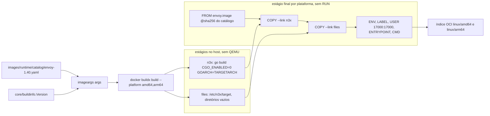
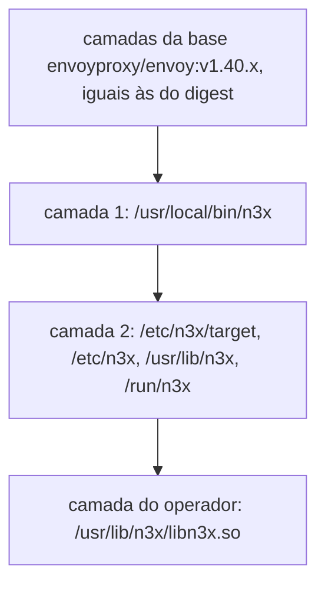
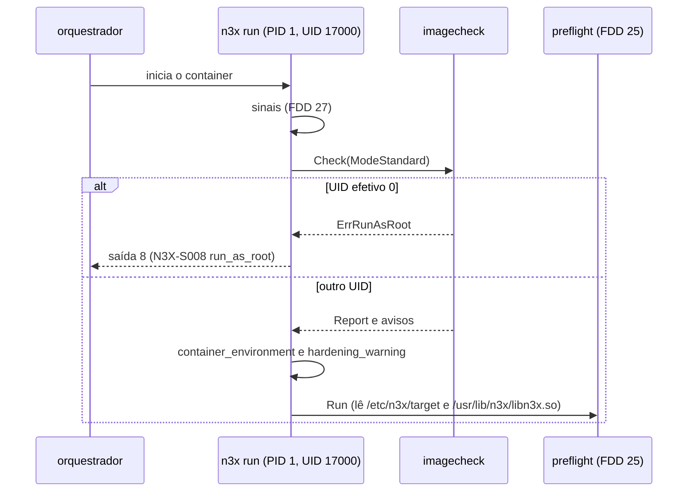

### FDD: Imagens de runtime do sidecar (SID-08)

Versão: 1.0
Data: 2026-10-21
Responsável: Guilherme Giusti

---

### 1. Contexto e motivação técnica

**Problema técnico.** As FDDs 15, 25, 26 e 27 definem o que o binário `n3x` faz dentro do container, mas todas supõem uma imagem que ainda não existe: o Envoy em `/usr/local/bin/envoy`, o `.so` em `/usr/lib/n3x/libn3x.so`, o alvo em `/etc/n3x/target`, o UID 17000, `/proc` e `/sys/fs/cgroup` legíveis e um `ENTRYPOINT` que deixe `docker run <imagem> encrypt` funcionar. A imagem de runtime é o estágio final de todo Dockerfile de operador (FR-015); sem ela não há marco M2 em docker compose. Ficam sem resposta verificável:

- **De onde vem a base.** O PRD e o HLD exigem `envoyproxy/envoy:v1.40.x` fixada por digest, e o catálogo de alvos do builder (FDD 19) já fixa esse digest. Se o sidecar declarar outro digest, a glibc e o Envoy da imagem de runtime podem divergir dos que o builder usou na verificação de símbolos e no teste de carga (FDD 23).
- **O que a imagem garante e o que fica com o orquestrador.** Usuário não root, raiz somente leitura com escrita só em `/tmp` e `drop: ALL` são requisitos do HLD, mas uma imagem só controla o usuário padrão, os arquivos e as permissões. O resto depende do Kubernetes, do ECS ou do compose, e hoje nada avisa quando o container roda fora do endurecimento.
- **Versão e alvo.** A FDD 25 decidiu que a versão da imagem é a constante `buildinfo.Version` compilada no `n3x` e que `/etc/n3x/target` guarda só o ID do alvo; falta a regra que impede publicar uma imagem cuja tag ou cuja tag `core/vX.Y.Z` diverge dessa constante, e falta dizer como a imagem acomoda o alvo `istio-1.31` sem refazer a estrutura.
- **Saída 8.** A FDD 25 reservou a saída 8 (`N3X-S008`) para esta FDD decidir o uso.

**Encaixe no HLD.** Esta FDD especifica, no repositório `n3x-sidecar`, o bloco "Imagens de runtime" de "Interfaces públicas", a parte de imagem de "Proteção de dados" (endurecimento do processo e da imagem) e a "Topologia em runtime" do modo padrão. Pacotes e pastas:

- `images/runtime/Dockerfile`: estágios comuns (`n3x` e `files`) e o estágio final por família de alvo (`runtime-envoy` aqui; `runtime-istio` na FDD 49) (contrato 6)
- `images/runtime/catalog/`: cópia byte a byte dos arquivos `targets/<alvo>.yaml` do `n3x-builder`, com `SOURCE.json` (contrato 7)
- `images/tools/imageargs` (novo, hipótese de nome): lê a cópia do catálogo, monta os argumentos do `docker buildx`, confere a sincronia com o builder e a versão no release (contrato 7)
- `internal/imagecheck` (novo, hipótese de nome): conferência do ambiente do container no início do `n3x run`, dona da saída 8 (contrato 8)
- `images/test/`: teste estrutural e teste de fumaça da imagem (contrato 9)

Quem consome:

- Operador: o estágio final do Dockerfile dele parte desta imagem e copia o `.so` (contrato 5; exemplo completo na FDD 47)
- FDDs 25, 26 e 27: caminhos, usuário e ambiente que elas supõem (contratos 2 e 4)
- FDD 46 (BLD-07): publica esta imagem no GHCR pelo processo comum e monta a tabela de pares
- FDD 47 (SDK-15): guia de montagem de volumes e `securityContext` por orquestrador
- FDD 48 (SDK-16): testes de ponta a ponta com a imagem real
- FDD 49 (SID-11): estágio `runtime-istio` no mesmo Dockerfile

**Atores.** Operador (escreve o Dockerfile multi-stage e monta `n3x.yaml`, chave e CA), builder (gera o `.so` copiado para a imagem), orquestrador (aplica usuário, raiz somente leitura, `tmpfs`, capabilities e limites), CI do `n3x-sidecar` (constrói, testa e, pela FDD 46, publica) e mantenedor (atualiza a base por patch).

**Limites.** Esta FDD não define o comportamento do `n3x run` (FDDs 15, 25, 26, 27 e 29), a publicação no GHCR, a matriz de CI das imagens de build e a tabela de pares (FDD 46), as imagens `sidecar-builder` (FDDs 21 e 46), os exemplos completos de montagem por orquestrador (FDD 47) nem a imagem `-istio-1.31` (FDD 49, D-10 do README). Aqui ficam o conteúdo, o endurecimento verificável, a base por digest, o build multi-arquitetura, as tags, a conferência do ambiente na subida e os testes da imagem.

**Suposições**
- A imagem oficial `envoyproxy/envoy:v1.40.x` traz o binário em `/usr/local/bin/envoy` (0755), `getconf`, `/tmp` com modo 1777, um `docker-entrypoint.sh` que troca para o usuário `envoy` (UID 101) quando sobe como root, e um `PATH` com `/usr/local/bin` (conferir no spike, item IMG-01)
- O digest de `envoy.image` no catálogo é o de um índice multiplataforma com `linux/amd64` e `linux/arm64` (regra `image_platform` da FDD 19)
- O BuildKit cria os pontos de montagem antes de deixar a raiz somente leitura (Docker, containerd e ECS); a imagem só garante que eles existem
- O `n3x` é um binário Go puro (sem cgo, sem gRPC e sem o SDK Go do Envoy, critério da FDD 15), igual para todos os alvos da mesma arquitetura
- O runner do GitHub Actions oferece amd64 e arm64 nativos (`ubuntu-24.04` e `ubuntu-24.04-arm`) (hipótese; conferir custo na FDD 46)

**Restrições**
- Base fixada por digest; amd64 e arm64; formato OCI (PRD e HLD, decisão já tomada)
- Usuário e grupo 17000; raiz somente leitura com escrita só em `/tmp`; `drop: ALL`; `.so` só em `/usr/lib/n3x/libn3x.so` (HLD, decisão já tomada)
- A imagem não traz `.so` padrão (ADR-001 do `n3x-sidecar`, decisão já tomada)
- Tags imutáveis em `ghcr.io/giustech/n3x/*` (ADR-009 do `n3x-builder`); semver por imagem (ADR-001 do `n3x-builder`)
- Sem QEMU: nenhum `RUN` no estágio final, que é o único na plataforma de destino (mesma regra da L-59 da FDD 21)
- Nenhum comportamento por variável de ambiente (FR-001): a imagem não declara `GOMAXPROCS`, `GOMEMLIMIT`, `GODEBUG` nem `N3X_*` (pedido da FDD 27)
- Documentação e mensagens em pt-BR; identificadores em inglês

**Rastreabilidade**
- PRD 1.5: FR-015 (estágio final parte de `ghcr.io/giustech/n3x/sidecar:<semver>-<alvo>` e copia o `.so`; sidecar recusa `core/` incompatível); FR-001 (`.so` ausente encerra o container; nada por variável de ambiente); compatibilidade (imagens OCI, amd64 e arm64); segurança (imagens base fixadas por digest; `govulncheck` e `gosec`); critério "cada imagem carrega o seu `.so` sem erro"
- HLD do `n3x-sidecar`: "Imagens de runtime", "Proteção de dados", "Topologia em runtime", estrutura `images/`
- ADRs: ADR-001 do `n3x-sidecar` (sem `.so` padrão); ADR-001 e ADR-009 do `n3x-builder` (semver por imagem, GHCR, tags imutáveis); ADR-006 do `n3x-sdk` (portas 17xxx); ADR-003 do `n3x-sidecar` (subcomandos)
- Lacunas do README: nenhuma atribuída a esta FDD. L-16 aplicada (admin em `/tmp/n3x/admin.sock`, sem porta TCP exposta); L-17 continua na FDD 29 (a imagem não traz binário extra de health); L-21 aplicada (glibc e digest vêm do catálogo); L-72 aplicada (a imagem não declara as variáveis do orquestrador)
- Pedidos atendidos:
  - FDD 15 e FDD 27: `ENTRYPOINT ["/usr/local/bin/n3x"]` com `CMD ["run"]` (contrato 2); imagem sem `ENV` de `GOMAXPROCS`, `GOMEMLIMIT` e `GODEBUG`; `/proc` e `/sys/fs/cgroup` não são escondidos nem sobrescritos (contratos 2 e 4)
  - FDD 19: digest da base sincronizado com o catálogo (contrato 7)
  - FDD 23: mesma glibc da imagem do Envoy usada pelo builder (mesmo digest, por construção) e UID 17000 (contratos 2 e 7)
  - FDD 25: `/etc/n3x/target` igual a `<id>\n` com modo 0444; release falha se a tag da imagem ou `core/vX.Y.Z` diferir de `buildinfo.Version`; saída 8 decidida (contratos 2, 7 e 8)
  - FDD 26: `/usr/local/bin/envoy`, `ENV ENVOY_DYNAMIC_MODULES_SEARCH_PATH=/usr/lib/n3x`, sem `/tmp/n3x` na imagem (contrato 2)

---

### 2. Objetivos técnicos

- **Base igual à do builder.** Invariante: para todo alvo, o `FROM` do estágio final usa exatamente `envoy.image` do arquivo `targets/<alvo>.yaml` do `n3x-builder` na referência registrada em `SOURCE.json`, com o mesmo digest. Medida: o job `catalog-sync` compara os bytes da cópia com o arquivo do builder (0 diferença) e o teste estrutural confere que as camadas da base na imagem final são as mesmas, na mesma ordem, do manifesto da base para aquela plataforma.
- **Conteúdo exato.** Invariante: a imagem tem os caminhos, donos e modos da tabela do contrato 2 e nada mais além da base; `/usr/lib/n3x/` está vazio; `/tmp/n3x` não existe. Medida: teste estrutural sobre o sistema de arquivos exportado, nas duas arquiteturas, sem executar a imagem.
- **Duas plataformas sem emulação.** Medida: `docker buildx build --platform linux/amd64,linux/arm64` gera um índice OCI com as duas plataformas num host amd64 sem QEMU registrado (`binfmt` vazio); o `n3x` de cada plataforma é ELF estático da arquitetura certa.
- **Pequena por cima da base.** Medida: no máximo 2 camadas próprias e no máximo 20 MiB descomprimidos somados; `n3x` com até 15 MiB (hipótese, H-07).
- **Endurecida por padrão.** Invariante: `docker run` sem nenhuma opção de usuário roda como 17000:17000; com `--read-only --tmpfs /tmp --cap-drop ALL --security-opt no-new-privileges`, o sidecar sobe e fica pronto sem nenhum `hardening_warning`. Medida: teste de fumaça nativo em amd64 e arm64.
- **Recusa explícita fora do contrato.** Invariante: `n3x run` como UID 0 sai com 8 (`N3X-S008`, `run_as_root`) antes de qualquer outro passo; sem `.so` sai com 4 (`N3X-S004`, `manifest_read`) sem iniciar o Envoy. Medida: teste de fumaça, as duas saídas em até 2 s.
- **Versão coerente.** Invariante: a tag publicada `<v>-<alvo>`, o rótulo `org.opencontainers.image.version`, a tag `core/v<v>` do commit e `buildinfo.Version` são o mesmo texto. Medida: o gate `imageargs release` recusa qualquer divergência antes do build (exit 4).
- **Reproduzível.** Medida: dois builds do mesmo commit em runners diferentes, com `SOURCE_DATE_EPOCH` do commit e `rewrite-timestamp=true`, geram o mesmo digest de manifesto por plataforma (hipótese H-12; contingência: comparar os `diffID` das camadas próprias).

---

### 3. Escopo e exclusões

**Incluído**
- Dockerfile `images/runtime/Dockerfile` com a base `envoyproxy/envoy:v1.40.x@sha256:...` vinda do catálogo, estágios comuns e estágio final `runtime-envoy`, pronto para receber `runtime-istio` (contrato 6)
- Conteúdo, donos, modos, usuário, `ENTRYPOINT`, `CMD`, `ENV`, portas, sinal de parada e ausência de `HEALTHCHECK` e `VOLUME` (contrato 2)
- Rótulos OCI e rótulos `io.n3x.*` (contrato 3)
- Requisitos de execução: o que a imagem garante e o que o orquestrador precisa aplicar (contrato 4)
- Forma do estágio final do Dockerfile do operador (contrato 5)
- Build do binário `n3x` (estático, `CGO_ENABLED=0`, cruzado sem QEMU) e build multi-arquitetura OCI com `docker buildx` (contrato 6)
- Cópia do catálogo, ferramenta `imageargs`, sincronia com o builder e gate de versão do release (contrato 7)
- Esquema de tags `<semver>-<alvo>`, imutabilidade e regra de semver da imagem (contrato 1)
- Conferência do ambiente do container no `n3x run` e uso da saída 8 (contrato 8)
- Teste estrutural, teste de fumaça (sobe com `.so` e `n3x.yaml` mínimo; falha sem `.so`), `govulncheck` e `gosec` do `n3x` (contrato 9)
- Uso local no marco M2, sem publicação: `n3x-dev/sidecar:dev-envoy-1.40` (contrato 6)

**Excluído**
- Imagem `-istio-1.31` (base `proxyv2`, usuário 1337, substituição da imagem injetada): FDD 49 (SID-11); aqui só a estrutura que a acomoda
- Publicação no GHCR, assinatura de tags, matriz de CI das imagens de build e tabela de pares: FDD 46 (BLD-07)
- Imagens `sidecar-builder` e `controller-builder`: FDDs 21 e 46
- Comportamento do `n3x run` além do passo novo de conferência do ambiente: FDDs 15, 25, 26, 27 e 29
- Comando de health dentro do container (L-17): FDD 29 (SID-09)
- Exemplos completos de montagem de volumes, `securityContext` e task definitions: FDD 47 (SDK-15)
- SBOM e assinatura de imagens: fora da v1 (PRD)

---

### 4. Fluxos detalhados e diagramas

**Fluxo principal: build local da imagem (CI de PR e M2)**
1. `make runtime-image TARGET=envoy-1.40` chama `go run ./images/tools/imageargs args --target envoy-1.40 --format buildx`.
2. O `imageargs` lê `images/runtime/catalog/envoy-1.40.yaml` com `yamlconv.ToJSON` e decodificação tolerante (campo desconhecido é ignorado, como a FDD 19 pede aos leitores externos), confere as regras do contrato 7 e imprime os `--build-arg` (`BASE_IMAGE`, `BASE_NAME`, `BASE_DIGEST`, `TARGET_ID`, `ENVOY_VERSION`, `GLIBC`, `VERSION` igual a `buildinfo.Version`, `REVISION`, `CREATED` com a hora do commit em RFC 3339), o `--target runtime-envoy`, as plataformas de `archs` e a tag.
3. O BuildKit roda o estágio `n3x` em `$BUILDPLATFORM` uma vez por plataforma de destino: `go build` com `CGO_ENABLED=0`, `GOOS=linux` e `GOARCH=$TARGETARCH` (compilação cruzada pura, sem QEMU).
4. O estágio `files`, também em `$BUILDPLATFORM`, cria `/etc/n3x/target` com `envoy-1.40\n` e os diretórios vazios `/etc/n3x`, `/usr/lib/n3x` e `/run/n3x`.
5. O estágio final `runtime-envoy` parte de `BASE_IMAGE` (o BuildKit escolhe a plataforma no índice do digest), faz dois `COPY --link` (binário e arquivos), declara `ENV`, rótulos, `USER 17000:17000`, `EXPOSE`, `STOPSIGNAL`, `ENTRYPOINT` e `CMD`. Nenhum `RUN`.
6. Saída: `--output type=oci,dest=out/sidecar-<v>-envoy-1.40.oci.tar,rewrite-timestamp=true` (as duas plataformas) ou `--load` de uma plataforma com a tag local `n3x-dev/sidecar:dev-envoy-1.40` (`make runtime-image-dev`, M2).
7. `make image-test` roda o teste estrutural nas duas plataformas e o teste de fumaça na plataforma nativa (contrato 9).

**Fluxo de uso pelo operador (FR-015)**
1. Estágio de build: `FROM --platform=$BUILDPLATFORM ghcr.io/giustech/n3x/sidecar-builder:<v>-envoy-1.40 AS build`, `RUN n3x-plugin add ...`, `ARG TARGETARCH`, `RUN n3x-plugin build` (FDD 21).
2. Estágio final: `FROM ghcr.io/giustech/n3x/sidecar:<v>-envoy-1.40` (recomendado com `@sha256:`) e `COPY --from=build /out/libn3x.so /usr/lib/n3x/libn3x.so` (contrato 5). O arquivo fica com dono root e o UID 17000 não consegue alterá-lo.
3. O orquestrador sobe o container com `n3x.yaml` montado como arquivo em `/etc/n3x/n3x.yaml`, a chave em `/run/n3x/aes.key`, `/tmp` em `tmpfs` e o endurecimento do contrato 4.

**Fluxo da subida dentro da imagem (encaixe com a FDD 27)**
1. O orquestrador executa `/usr/local/bin/n3x run` como 17000:17000 (PID 1).
2. Passo 0 (novo, esta FDD): `supervisor.Run` chama `imagecheck.Check(Options{Mode: ModeStandard})` logo depois de registrar os sinais. UID efetivo 0: `environment_rejected` e saída 8. Senão, loga `container_environment` e um `hardening_warning` por aviso, e segue.
3. Passos 1 a 5 (FDD 25): `ReadImage` lê `/etc/n3x/target` e `buildinfo.Version`; o `.so` é lido de `/usr/lib/n3x/libn3x.so`; `envoy --version` roda `/usr/local/bin/envoy`.
4. Passo 6 (FDD 27): lê `/proc/self/cgroup`, `/proc/self/mountinfo` e `/sys/fs/cgroup/...` como 17000.
5. Passos 7 e 8 (FDD 26): cria `/tmp/n3x` (0700, dono 17000), grava o bootstrap e roda `envoy --mode validate`.
6. Passos 9 e 10 (FDDs 27 e 29): Envoy filho carrega `libn3x.so` pelo search path `/usr/lib/n3x`; `17021`, `17000` e `17090` abertas.

**Fluxo de atualização da base (patch do Envoy 1.40.x)**
1. O `n3x-builder` muda `envoy.image` em `targets/envoy-1.40.yaml` e o alvo volta a `candidate` (regra de diff da FDD 19); a matriz da FDD 46 promove a `supported`.
2. Um PR no `n3x-sidecar` copia o arquivo novo para `images/runtime/catalog/` e atualiza `SOURCE.json` (ref e SHA-256); `catalog-sync` passa.
3. O mesmo PR sobe `buildinfo.Version` em um patch; o release cria `core/vX.Y.Z` e `vX.Y.Z` no mesmo commit e publica `<X.Y.Z>-envoy-1.40` (FDD 46). As camadas próprias, por `COPY --link`, não mudam de conteúdo.

**Fluxos alternativos e exceções**
- **Catálogo copiado diverge do builder:** `imageargs sync` sai com 3 (`catalog_drift`, com os dois SHA-256); o job falha no PR. Na execução noturna contra a branch principal do builder, a divergência abre uma issue com o rótulo `catalog`, sem bloquear a branch principal (hipótese)
- **Alvo `candidate` ou `deprecated`:** `imageargs args` emite o aviso `target_status` e constrói; a política de publicação dessas imagens é da FDD 46
- **Alvo `istio-*` antes da FDD 49:** `imageargs args` sai com 2 (`target_unsupported`: "o estágio runtime-istio ainda não existe; ver FDD 49")
- **Release com versão divergente:** `imageargs release --tag v1.1.3` com `buildinfo.Version = "1.1.2"` sai com 4 (`version_mismatch`); sem a tag `core/v1.1.3` no mesmo commit, `core_tag_missing`; árvore com alteração, `dirty_tree`. Nada é construído nem publicado
- **Operador esqueceu o `COPY` do `.so`:** `n3x run` sai com 4 (`N3X-S004`, `manifest_read`, texto da FDD 25: "nenhum libn3x.so em /usr/lib/n3x/libn3x.so: a imagem de runtime não traz .so; copie o /out/libn3x.so do n3x-plugin build no estágio final"); o Envoy não sobe
- **`.so` de outro alvo ou de `core/` mais novo:** saída 5 do pré-voo (`target_mismatch`, `runtime_too_new`), com a imagem a usar (FDD 25)
- **Container como root** (`docker run --user 0`, `runAsUser: 0`): saída 8, `run_as_root`; os subcomandos `validate`, `encrypt` e `keygen` não fazem essa conferência
- **UID diferente de 17000 e de 0** (OpenShift com UID aleatório e GID 0): aceito sem aviso; todos os arquivos da imagem são legíveis por qualquer usuário; `uid` aparece no `container_environment`
- **Raiz gravável, capabilities presentes, `/tmp` fora de `tmpfs` ou `.so` gravável pelo processo:** um `hardening_warning` por item, e sobe
- **Raiz somente leitura sem `tmpfs` em `/tmp`:** saída 6, `reason` `write` (FDD 26)
- **Diretório montado sobre `/etc/n3x`** (ConfigMap montado como diretório): esconde `/etc/n3x/target`; saída 5, `image_target`, com a dica de montar o `n3x.yaml` como arquivo (`subPath`) (pedido à FDD 25; inconsistência I-03)
- **Chave ou `n3x.yaml` sem permissão de leitura para 17000:** saída 3 (`key_read`) ou 2 (`file_read`) da FDD 15, com UID e GID do processo no texto (pedido à FDD 15)
- **`docker run <imagem> keygen` ou `encrypt`:** o `CMD` é trocado pelos argumentos e o `ENTRYPOINT` continua o `n3x` (ADR-003)
- **`docker run --entrypoint envoy <imagem> --version`:** funciona como 17000, útil para diagnóstico; não passa pelo `n3x`

**Diagramas**

Estágios do Dockerfile e plataformas:



Camadas da imagem do operador:



Subida com o passo 0:



---

### 5. Contratos públicos (assinaturas, endpoints, headers, exemplos)

**Contrato 1: nome, tags, plataformas e imutabilidade**
- Tipo: imagem OCI (índice multiplataforma)
- Assinatura/Rota: `ghcr.io/giustech/n3x/sidecar:<versão>-<alvo>`
- Método: n/a (`docker pull`, `FROM`)
- Semântica:
  - `<versão>`: exatamente `buildinfo.Version` (semver 2.0.0 sem `v`; pré-release permitido, por exemplo `1.2.0-rc.1`; sem metadado `+`, que a tag OCI não aceita). É também a versão do `core/` compilado no `n3x` (FDD 25, contrato 10)
  - `<alvo>`: o `id` do catálogo (`envoy-1.40`; `istio-1.31` pela FDD 49). O alvo é sempre o sufixo que casa com `-(envoy|istio)-[0-9]+\.[0-9]+$`, o que separa o alvo de uma pré-release sem ambiguidade
  - Plataformas: as de `archs` do catálogo (para `envoy-1.40`, `linux/amd64` e `linux/arm64`), num índice OCI (`application/vnd.oci.image.index.v1+json`)
  - Imutabilidade (ADR-009): uma tag publicada nunca é sobrescrita nem apagada. Não há tags móveis (`latest`, `1.1-envoy-1.40`) (hipótese H-03); o operador fixa por tag e, de preferência, por digest
  - Semver da imagem (hipótese H-04, coerente com ADR-001 do builder e com o acoplamento da FDD 25): patch para troca de digest da base (patch do Envoy 1.40.x), correção do `n3x` ou do `core/`; minor para recurso novo do `n3x`, campo novo no `n3x.yaml` ou arquivo novo na imagem; major para mudança de caminho, UID, `ENTRYPOINT`, `CMD`, formato de `/etc/n3x/target` ou significado de um código de saída. Como a versão é a do `core/`, um patch só de base também cria a tag `core/vX.Y.Z` (inconsistência I-05)
  - Compatibilidade com o `.so` (ADR-001 do builder, FDD 22): a imagem aceita `.so` com `core/` da mesma major e minor igual ou menor; na série 0, minor igual
  - Imagem local de desenvolvimento: `n3x-dev/sidecar:dev-<alvo>`, nunca publicada (sem o prefixo `ghcr.io/giustech`), igual ao padrão `n3x-dev/...` da FDD 21

**Exemplo de requisição**
```text
docker buildx imagetools inspect ghcr.io/giustech/n3x/sidecar:1.1.2-envoy-1.40
```

**Exemplo de resposta** (digests ilustrativos)
```text
Name:      ghcr.io/giustech/n3x/sidecar:1.1.2-envoy-1.40
MediaType: application/vnd.oci.image.index.v1+json
Digest:    sha256:7e0c5a91d2b4...

Manifests:
  Name:      ghcr.io/giustech/n3x/sidecar:1.1.2-envoy-1.40@sha256:3a91f0c4b8e2...
  MediaType: application/vnd.oci.image.manifest.v1+json
  Platform:  linux/amd64

  Name:      ghcr.io/giustech/n3x/sidecar:1.1.2-envoy-1.40@sha256:c41d7f20a9b3...
  MediaType: application/vnd.oci.image.manifest.v1+json
  Platform:  linux/arm64
```

---

**Contrato 2: layout de arquivos, permissões e configuração da imagem**
- Tipo: formato da imagem (sistema de arquivos e `config` OCI)
- Assinatura/Rota: estágio `runtime-envoy` de `images/runtime/Dockerfile`
- Método: n/a
- Semântica:

| Caminho | Dono | Modo | Origem | Observações |
| --- | --- | --- | --- | --- |
| `/usr/local/bin/n3x` | 0:0 | `0555` | estágio `n3x` | ELF estático da plataforma, sem `PT_INTERP` nem `DT_NEEDED` |
| `/usr/local/bin/envoy` | da base | da base (`0755`) | base | usado por `n3x run`, `--mode validate` e `envoy --version` (FDDs 25, 26 e 27) |
| `/etc/n3x/` | 0:0 | `0755` | estágio `files` | ponto de montagem do `n3x.yaml` e da CA, montados como arquivos |
| `/etc/n3x/target` | 0:0 | `0444` | estágio `files` | `<id>\n` (por exemplo `envoy-1.40\n`, 11 bytes); formato da FDD 25, contrato 10 |
| `/usr/lib/n3x/` | 0:0 | `0755` | estágio `files` | vazio; destino do `COPY` do operador; search path do Envoy |
| `/usr/lib/n3x/libn3x.so` | ausente | | operador | a imagem nunca traz `.so` (ADR-001) |
| `/run/n3x/` | 0:0 | `0755` | estágio `files` | vazio; ponto de montagem recomendado da chave AES (`/run/n3x/aes.key`, exemplos da FDD 15) |
| `/tmp` | da base | `1777` | base | o orquestrador monta `tmpfs`; `/tmp/n3x` é criado pelo `n3x run` (FDD 26), nunca pela imagem |

  - Nenhum outro caminho muda em relação à base (o teste estrutural compara a lista de arquivos da camada própria com a lista esperada)
  - Configuração OCI:

| Campo | Valor | Motivo |
| --- | --- | --- |
| `User` | `17000:17000` | numérico, para `runAsNonRoot` do Kubernetes funcionar sem `/etc/passwd`; não há entrada `n3x` no `/etc/passwd` (hipótese H-06) |
| `Entrypoint` | `["/usr/local/bin/n3x"]` | pedido das FDDs 15 e 27 (`n3x` sem `run`), com caminho absoluto para não depender do `PATH` que o orquestrador pode sobrescrever (inconsistência I-01) |
| `Cmd` | `["run"]` | `docker run <imagem> encrypt ...` troca só o `CMD` |
| `Env` | o da base mais `ENVOY_DYNAMIC_MODULES_SEARCH_PATH=/usr/lib/n3x` | pedido das FDDs 16 e 26; o `n3x run` monta o ambiente do Envoy do zero (FDD 27), então a variável serve a `docker run --entrypoint envoy` e ao modo Istio |
| `Env` proibido | `GOMAXPROCS`, `GOMEMLIMIT`, `GODEBUG`, `GOGC`, qualquer `N3X_*`, `KUBERNETES_SERVICE_HOST`, `ECS_CONTAINER_METADATA_URI_V4` | FR-001, FDD 27 e L-72 |
| `WorkingDir` | `/` | |
| `ExposedPorts` | `17000/tcp`, `17021/tcp`, `17090/tcp` | ADR-006 do SDK; a 17001 não é exposta (L-16) |
| `StopSignal` | `SIGTERM` | drenagem (FDD 29) |
| `Healthcheck` | ausente | o compose e o ECS declaram o comando da FDD 29 (L-17); igual à imagem do controller (FDD 30) |
| `Volumes` | ausente | `VOLUME /tmp` criaria volume anônimo em disco e esconderia a falta do `tmpfs` (hipótese H-08) |
| `OnBuild` | ausente | o operador não deve ter efeito oculto no `FROM` |
| `Labels` | contrato 3 | |

  - Tamanho: no máximo 2 camadas próprias, somando no máximo 20 MiB descomprimidos; `n3x` com até 15 MiB (hipótese H-07)

**Exemplo de requisição**
```text
docker image inspect --format '{{json .Config}}' n3x-dev/sidecar:dev-envoy-1.40
docker run --rm --entrypoint /bin/ls n3x-dev/sidecar:dev-envoy-1.40 -ln /etc/n3x /usr/lib/n3x /run/n3x /usr/local/bin
```

**Exemplo de resposta** (encurtado)
```json
{
  "User": "17000:17000",
  "Env": ["PATH=/usr/local/sbin:/usr/local/bin:/usr/sbin:/usr/bin:/sbin:/bin", "ENVOY_DYNAMIC_MODULES_SEARCH_PATH=/usr/lib/n3x"],
  "Entrypoint": ["/usr/local/bin/n3x"],
  "Cmd": ["run"],
  "WorkingDir": "/",
  "ExposedPorts": { "17000/tcp": {}, "17021/tcp": {}, "17090/tcp": {} },
  "StopSignal": "SIGTERM"
}
```
```text
/etc/n3x:
-r--r--r-- 1 0 0       11 Jan  1  1970 target
/usr/lib/n3x:
/run/n3x:
/usr/local/bin:
-rwxr-xr-x 1 0 0 67108864 ...  envoy
-r-xr-xr-x 1 0 0  9437184 Jan  1  1970 n3x
```

---

**Contrato 3: rótulos OCI e `io.n3x.*`**
- Tipo: metadado da imagem (`config.Labels`), legível com `docker inspect` e `docker buildx imagetools inspect --format '{{json .Image}}'`
- Assinatura/Rota: `LABEL` do estágio final
- Método: n/a
- Semântica:

| Rótulo | Valor | Fonte |
| --- | --- | --- |
| `org.opencontainers.image.title` | `n3x sidecar (<alvo>)` | fixo |
| `org.opencontainers.image.description` | `Envoy com o entrypoint n3x; copie o libn3x.so gerado pelo n3x-plugin build para /usr/lib/n3x/libn3x.so` | fixo |
| `org.opencontainers.image.source` | `https://github.com/giustech/n3x-sidecar` | fixo |
| `org.opencontainers.image.version` | `<versão>` (igual a `buildinfo.Version`) | `imageargs` |
| `org.opencontainers.image.revision` | commit de 40 hex | `git rev-parse HEAD` |
| `org.opencontainers.image.created` | RFC 3339 de `SOURCE_DATE_EPOCH` (hora do commit) | reprodutível |
| `org.opencontainers.image.licenses` | `Apache-2.0` | fixo |
| `org.opencontainers.image.base.name` | `docker.io/envoyproxy/envoy:v1.40.<patch>` | catálogo |
| `org.opencontainers.image.base.digest` | `sha256:<64 hex>` do índice da base | catálogo |
| `io.n3x.image.kind` | `sidecar` | fixo |
| `io.n3x.target` | `<alvo>` | catálogo; igual a `/etc/n3x/target` sem a quebra de linha |
| `io.n3x.core.module` | `github.com/giustech/n3x-sidecar/core` | `buildinfo.Module` |
| `io.n3x.core.version` | `<versão>` | `buildinfo.Version` |
| `io.n3x.envoy.version` | `1.40.<patch>` | tag de `envoy.image` |
| `io.n3x.glibc` | `envoy.glibc` do catálogo (por exemplo `2.35`) | catálogo |

  - Os rótulos são só para inspeção: o `n3x run` nunca os lê (o processo não tem acesso a eles). A versão vem de `buildinfo.Version` e o alvo de `/etc/n3x/target` (FDD 25)
  - Rótulos herdados da base com a mesma chave são sobrescritos; os demais rótulos herdados ficam e entram no golden do teste estrutural
  - Rótulo novo só por adição; nenhum muda de sentido na major

**Exemplo de requisição**
```text
docker image inspect --format '{{json .Config.Labels}}' ghcr.io/giustech/n3x/sidecar:1.1.2-envoy-1.40
```

**Exemplo de resposta**
```json
{
  "org.opencontainers.image.title": "n3x sidecar (envoy-1.40)",
  "org.opencontainers.image.description": "Envoy com o entrypoint n3x; copie o libn3x.so gerado pelo n3x-plugin build para /usr/lib/n3x/libn3x.so",
  "org.opencontainers.image.source": "https://github.com/giustech/n3x-sidecar",
  "org.opencontainers.image.version": "1.1.2",
  "org.opencontainers.image.revision": "4f2c9d0e1a7b3c5d6e8f90a1b2c3d4e5f6a7b8c9",
  "org.opencontainers.image.created": "2026-10-20T13:41:07Z",
  "org.opencontainers.image.licenses": "Apache-2.0",
  "org.opencontainers.image.base.name": "docker.io/envoyproxy/envoy:v1.40.2",
  "org.opencontainers.image.base.digest": "sha256:3b1d6f0a...",
  "io.n3x.image.kind": "sidecar",
  "io.n3x.target": "envoy-1.40",
  "io.n3x.core.module": "github.com/giustech/n3x-sidecar/core",
  "io.n3x.core.version": "1.1.2",
  "io.n3x.envoy.version": "1.40.2",
  "io.n3x.glibc": "2.35"
}
```

---

**Contrato 4: requisitos de execução (o que a imagem garante e o que o orquestrador aplica)**
- Tipo: contrato de implantação (documentado em `images/README.md`; exemplos completos na FDD 47)
- Assinatura/Rota: n/a
- Método: n/a
- Semântica:

| Requisito | Quem garante | Como é verificado | Se faltar |
| --- | --- | --- | --- |
| Usuário não root, 17000:17000 por padrão | imagem (`USER`) | teste estrutural; `container_environment.uid` | UID 0: saída 8 `run_as_root` |
| Arquivos da imagem legíveis por qualquer UID | imagem (modos do contrato 2) | teste estrutural | |
| `/usr/lib/n3x/libn3x.so` com dono root e não gravável pelo processo | `COPY` do operador (padrão do Docker: dono 0:0) | `imagecheck` (`access(W_OK)`) | aviso `so_writable` |
| Raiz somente leitura | orquestrador (`readOnlyRootFilesystem`, `read_only`, `readonlyRootFilesystem`) | `imagecheck` (`statfs("/")` com `ST_RDONLY`) | aviso `rootfs_writable` |
| `/tmp` gravável, em `tmpfs`, não compartilhado com a aplicação | orquestrador (`emptyDir` com `medium: Memory`, `tmpfs: /tmp`) | `imagecheck` (`/proc/self/mountinfo`); escrita da FDD 26 | sem escrita: saída 6 `write`; fora de `tmpfs`: aviso `tmp_not_tmpfs` |
| Nenhuma capability (`drop: ALL`) | orquestrador | `imagecheck` (`CapEff` e `CapBnd` em `/proc/self/status`) | aviso `capabilities_present` |
| Sem escalada de privilégio | orquestrador (`allowPrivilegeEscalation: false`, `no-new-privileges`) | `container_environment.no_new_privs` | só registrado |
| `/proc` e `/sys/fs/cgroup` montados e legíveis por 17000 | runtime de container (padrão); a imagem não declara `VOLUME` nem arquivo nesses caminhos | teste de fumaça (`runtime_computed.memory_source`) | `cgroup_unreadable` e, sem `resources.memory`, saída 7 (FDD 27) |
| Limite de memória do container | orquestrador | FDD 27 | saída 7 `memory_unlimited` |
| `n3x.yaml` montado como arquivo em `/etc/n3x/n3x.yaml`, sem esconder `/etc/n3x/target` | orquestrador (`subPath` no Kubernetes; bind de arquivo no compose e no ECS) | FDD 25 | saída 5 `image_target` |
| Chave AES e CA legíveis por 17000 | orquestrador (`fsGroup: 17000` com `defaultMode: 0440`; dono ou grupo 17000 no compose) | FDD 15 | saída 3 `key_read` ou 2 `file_read` |
| Seccomp padrão | orquestrador (`RuntimeDefault`) | não verificado (hipótese H-10: o Envoy e o Go não precisam de syscall fora do perfil padrão; spike IMG-03) | |

  - A imagem não traz `curl`, shell extra nem binário de health: o comando de health é o do `n3x` (FDD 29, L-17)

**Exemplo de requisição** (forma mínima no compose; o guia completo é da FDD 47)
```yaml
services:
  sidecar:
    image: registry.acme/pedidos-sidecar:1.4.0
    read_only: true
    tmpfs: ["/tmp:size=64m,mode=1777"]
    cap_drop: [ALL]
    security_opt: ["no-new-privileges:true"]
    mem_limit: 256m
    cpus: 1
    volumes:
      - ./n3x.yaml:/etc/n3x/n3x.yaml:ro
      - ./aes.key:/run/n3x/aes.key:ro
```

**Exemplo de resposta** (`container_environment` de um container endurecido)
```json
{"ts":"2026-10-21T14:00:00.002Z","level":"info","component":"entrypoint","msg":"container_environment","uid":17000,"gid":17000,"groups":[17000],"rootfs_readonly":true,"tmp_tmpfs":true,"cap_eff":"0000000000000000","cap_bnd":"0000000000000000","no_new_privs":true,"so_writable":false,"image_version":"1.1.2","duration_ms":1}
```

---

**Contrato 5: estágio final do Dockerfile do operador (só a forma)**
- Tipo: Docker BuildKit (Dockerfile multi-stage)
- Assinatura/Rota:
  ```text
  FROM ghcr.io/giustech/n3x/sidecar:<versão>-<alvo>[@sha256:<digest>]   (sem --platform; sem RUN)
  COPY --from=build /out/libn3x.so /usr/lib/n3x/libn3x.so
  ```
- Método: n/a
- Semântica:
  - É exatamente o estágio final do contrato 8 da FDD 21; esta FDD só fixa o destino e as regras
  - O `<alvo>` e a versão de `core/` precisam combinar com a `sidecar-builder` do estágio de build (mesmo alvo; minor do `core/` da imagem maior ou igual); senão, saída 5 do pré-voo com a imagem indicada (FDD 25)
  - Sem `--chown`: o `.so` fica com dono 0:0 e não é gravável por 17000 (com `--chown=17000`, aviso `so_writable`)
  - Sem `USER`, `ENTRYPOINT`, `CMD` ou `ENV` novos: mudar qualquer um sai do contrato desta imagem
  - Sem `RUN` no estágio final, para o build multi-arquitetura não precisar de QEMU
  - Outros arquivos (por exemplo um `n3x.yaml` embutido) podem ser copiados para `/etc/n3x/n3x.yaml`, mas a recomendação é montar (config por serviço, FDD 47)

**Exemplo de requisição**
```dockerfile
FROM ghcr.io/giustech/n3x/sidecar:1.1.2-envoy-1.40@sha256:7e0c5a91d2b4...
COPY --from=build /out/libn3x.so /usr/lib/n3x/libn3x.so
```

**Exemplo de resposta** (camadas da imagem do operador, `docker history`, encurtado)
```text
CREATED BY                                              SIZE
COPY /out/libn3x.so /usr/lib/n3x/libn3x.so # buildkit   41.9MB
CMD ["run"]                                             0B
ENTRYPOINT ["/usr/local/bin/n3x"]                       0B
USER 17000:17000                                        0B
COPY /stage/ / # buildkit                               4.1kB
COPY /stage/usr/local/bin/n3x /usr/local/bin/n3x        9.4MB
(camadas da base envoyproxy/envoy:v1.40.2)
```

---

**Contrato 6: `images/runtime/Dockerfile` e alvos do Makefile**
- Tipo: Dockerfile do repositório e comandos de build
- Assinatura/Rota:
  ```text
  make runtime-image     TARGET=envoy-1.40 [PLATFORMS=linux/amd64,linux/arm64]   # índice OCI em out/
  make runtime-image-dev TARGET=envoy-1.40                                         # --load amd64, n3x-dev/sidecar:dev-envoy-1.40
  make image-test        TARGET=envoy-1.40                                         # contrato 9
  ```
- Método: n/a
- Semântica:
  - **ARGs globais:** `GO_IMAGE` (`golang:1.26.x` fixada por digest), `BASE_IMAGE`, `BASE_NAME`, `BASE_DIGEST`, `TARGET_ID`, `ENVOY_VERSION`, `GLIBC`, `VERSION`, `REVISION`, `CREATED`, `SOURCE_DATE_EPOCH`. Todos, menos `GO_IMAGE` e `SOURCE_DATE_EPOCH` (passado pelo Makefile com `git log -1 --format=%ct`), vêm do `imageargs`; `GO_IMAGE` fica no próprio Dockerfile e é atualizado por PR
  - **Estágio `n3x`** (`FROM --platform=$BUILDPLATFORM`): `CGO_ENABLED=0`, `GOOS=linux`, `GOARCH=$TARGETARCH`, `GOAMD64=v1`, `GOARM64=v8.0` (mesmos níveis da FDD 21), `GOFLAGS=-mod=readonly`, `go build -trimpath -buildvcs=false -ldflags="-s -w -buildid=" -o /stage/usr/local/bin/n3x ./cmd/n3x`. O binário é igual para todos os alvos da mesma arquitetura e o BuildKit reaproveita o estágio entre alvos. `-s -w` tira a tabela de símbolos e o DWARF; o rastro de pilha do Go continua legível (hipótese H-05)
  - **Estágio `files`** (`FROM --platform=$BUILDPLATFORM`): cria `/stage/etc/n3x/target` com `printf '%s\n' "$TARGET_ID"` e modo 0444, e os diretórios `/stage/etc/n3x`, `/stage/usr/lib/n3x` e `/stage/run/n3x` com modo 0755
  - **Estágio final `runtime-envoy`** (`FROM ${BASE_IMAGE}`): `COPY --link --chown=0:0 --chmod=0555` do binário, `COPY --link --chown=0:0` de `/stage/` para `/`, `ENV`, `LABEL`, `USER`, `WORKDIR`, `EXPOSE`, `STOPSIGNAL`, `ENTRYPOINT` e `CMD`. `--link` deixa as camadas próprias independentes da base, então uma troca de patch do Envoy não muda o conteúdo delas
  - **Estrutura para outros alvos:** cada família tem um estágio final (`runtime-envoy`; `runtime-istio` pela FDD 49, com `USER 1337:1337`); os estágios `n3x` e `files` são comuns; o `imageargs` escolhe o estágio pelo prefixo do `id`. Um alvo novo da mesma família (por exemplo `envoy-1.41`) só precisa do arquivo de catálogo
  - **`.dockerignore`:** exclui `.git`, `out/`, `bench/`, `docs/` e `deploy/`, para o contexto e o cache do estágio `n3x` dependerem só do código
  - **M2 sem publicação:** `make runtime-image-dev` usa o driver `docker` do buildx e `--load`; o Dockerfile do operador do M2 usa `FROM n3x-dev/sidecar:dev-envoy-1.40` com o `.so` da `n3x-dev/sidecar-builder:dev-envoy-1.40` (FDD 21). Para a regra da série 0, a `SIDECAR_RUNTIME` da imagem de build de desenvolvimento precisa ter a mesma minor de `buildinfo.Version` (hipótese H-14; o teste de fumaça usa a pseudo-versão do próprio commit)

**Exemplo de requisição** (`images/runtime/Dockerfile`; digests entre `<>` ficam no repositório)
```dockerfile
# syntax=docker/dockerfile:1.10
# Imagem de runtime do sidecar (FDD 28). Os argumentos vêm de images/tools/imageargs.
ARG GO_IMAGE=golang:1.26.1-trixie@sha256:<digest>
ARG BASE_IMAGE
ARG TARGET_ID

FROM --platform=$BUILDPLATFORM ${GO_IMAGE} AS n3x
ARG TARGETARCH
WORKDIR /src
COPY go.mod go.sum ./
COPY core/go.mod core/go.sum ./core/
RUN --mount=type=cache,target=/go/pkg/mod go mod download
COPY . .
RUN --mount=type=cache,target=/go/pkg/mod --mount=type=cache,target=/root/.cache/go-build \
    CGO_ENABLED=0 GOOS=linux GOARCH=$TARGETARCH GOAMD64=v1 GOARM64=v8.0 GOFLAGS=-mod=readonly \
    go build -trimpath -buildvcs=false -ldflags="-s -w -buildid=" \
      -o /stage/usr/local/bin/n3x ./cmd/n3x

FROM --platform=$BUILDPLATFORM ${GO_IMAGE} AS files
ARG TARGET_ID
RUN set -eu; mkdir -p /stage/etc/n3x /stage/usr/lib/n3x /stage/run/n3x; \
    printf '%s\n' "$TARGET_ID" > /stage/etc/n3x/target; \
    chmod 0755 /stage/etc/n3x /stage/usr/lib/n3x /stage/run/n3x; chmod 0444 /stage/etc/n3x/target

FROM ${BASE_IMAGE} AS runtime-envoy
ARG VERSION REVISION TARGET_ID BASE_NAME BASE_DIGEST ENVOY_VERSION GLIBC CREATED
COPY --link --from=n3x --chown=0:0 --chmod=0555 /stage/usr/local/bin/n3x /usr/local/bin/n3x
COPY --link --from=files --chown=0:0 /stage/ /
ENV ENVOY_DYNAMIC_MODULES_SEARCH_PATH=/usr/lib/n3x
LABEL org.opencontainers.image.title="n3x sidecar (${TARGET_ID})" \
      org.opencontainers.image.description="Envoy com o entrypoint n3x; copie o libn3x.so gerado pelo n3x-plugin build para /usr/lib/n3x/libn3x.so" \
      org.opencontainers.image.source="https://github.com/giustech/n3x-sidecar" \
      org.opencontainers.image.version="${VERSION}" \
      org.opencontainers.image.revision="${REVISION}" \
      org.opencontainers.image.created="${CREATED}" \
      org.opencontainers.image.licenses="Apache-2.0" \
      org.opencontainers.image.base.name="${BASE_NAME}" \
      org.opencontainers.image.base.digest="${BASE_DIGEST}" \
      io.n3x.image.kind="sidecar" io.n3x.target="${TARGET_ID}" \
      io.n3x.core.module="github.com/giustech/n3x-sidecar/core" io.n3x.core.version="${VERSION}" \
      io.n3x.envoy.version="${ENVOY_VERSION}" io.n3x.glibc="${GLIBC}"
USER 17000:17000
WORKDIR /
EXPOSE 17000 17021 17090
STOPSIGNAL SIGTERM
ENTRYPOINT ["/usr/local/bin/n3x"]
CMD ["run"]

# FDD 49: estágio runtime-istio (FROM ${BASE_IMAGE} com istio/proxyv2, USER 1337:1337)
```
```text
docker buildx build -f images/runtime/Dockerfile \
  $(go run ./images/tools/imageargs args --target envoy-1.40 --format buildx) \
  --build-arg SOURCE_DATE_EPOCH="$(git log -1 --format=%ct)" \
  --output type=oci,dest=out/sidecar-1.1.2-envoy-1.40.oci.tar,rewrite-timestamp=true .
```

**Exemplo de resposta** (log do BuildKit num host amd64 sem QEMU, encurtado)
```text
#9  [linux/amd64->amd64 n3x 6/6] RUN ... go build ... ./cmd/n3x        DONE 18.2s
#10 [linux/amd64->arm64 n3x 6/6] RUN ... go build ... ./cmd/n3x        DONE 19.0s
#12 [linux/arm64 runtime-envoy 1/3] FROM docker.io/envoyproxy/envoy:v1.40.2@sha256:3b1d...
#14 [linux/arm64 runtime-envoy 3/3] COPY --link --from=files /stage/ /  DONE 0.0s
#16 exporting to oci image format                                       DONE 2.9s
```

---

**Contrato 7: cópia do catálogo e ferramenta `imageargs`**
- Tipo: arquivos do repositório e CLI interna (`images/tools/imageargs`, módulo raiz do `n3x-sidecar`, importa `core/buildinfo` e `yamlconv` do SDK)
- Assinatura/Rota:
  ```text
  images/runtime/catalog/<alvo>.yaml    cópia byte a byte de n3x-builder/targets/<alvo>.yaml
  images/runtime/catalog/SOURCE.json    {"format":1,"repository":"github.com/giustech/n3x-builder","ref":"<tag ou 40 hex>","files":{"<alvo>.yaml":"sha256:<64 hex>"}}

  go run ./images/tools/imageargs args    --target <alvo> [--format buildx|json] [--revision <40 hex>]
  go run ./images/tools/imageargs sync    --target <alvo> --from <arquivo do builder na ref>
  go run ./images/tools/imageargs release --tag v<X.Y.Z> --target <alvo>
  ```
- Método: processo; saída em stdout (argumentos ou JSON), problemas em stderr no formato de lista da FDD 15 (`<caminho>: <texto> [<regra>]`)
- Semântica:
  - **Fonte de verdade do digest:** o catálogo do `n3x-builder` (FDD 19). O sidecar não pode importar `internal/catalog` do builder, então guarda uma cópia exata e confere a sincronia. Leitura tolerante: só `format`, `id`, `status`, `envoy.image`, `envoy.glibc`, `runtime_image` e `archs`; campo desconhecido é ignorado; `format` diferente de 1 é erro (contrato de leitor externo da FDD 19)
  - **`args`:** confere as regras abaixo e imprime os argumentos do build. `VERSION` sai sempre de `buildinfo.Version` (nunca de flag), para a imagem não ter outra versão que não a do binário. `REVISION` vem de `--revision` ou de `git rev-parse HEAD` (com `-dirty` se a árvore tiver alteração, só fora do release). Avisos (`target_status`) vão para stderr e não mudam a saída
  - **`sync`:** compara o SHA-256 da cópia com o do arquivo indicado e com o de `SOURCE.json`; o job de CI baixa o arquivo do builder na `ref` de `SOURCE.json`
  - **`release`:** roda `sync` contra o builder na `ref`, depois as regras de release; só com saída 0 o fluxo de publicação da FDD 46 continua
  - **Regras e saídas:**

| Saída | Regra | Condição | Subcomando |
| --- | --- | --- | --- |
| 1 | (uso) | flag ausente ou desconhecida | todos |
| 2 | `catalog_read` | arquivo ausente, acima de 64 KiB ou YAML inválido | todos |
| 2 | `format` | `format` diferente de 1 | todos |
| 2 | `id_mismatch` | `id` diferente do nome do arquivo ou de `--target` | todos |
| 2 | `image_ref` | `envoy.image` sem tag ou sem `@sha256:` de 64 hex | todos |
| 2 | `image_tag` | em `envoy-X.Y`, tag diferente de `vX.Y.<patch>` | todos |
| 2 | `runtime_image` | `runtime_image` diferente de `buildinfo.ImageName` | todos |
| 2 | `archs` | `archs` vazio ou com valor fora de `amd64` e `arm64` | todos |
| 2 | `glibc_format` | `envoy.glibc` fora de `^[0-9]+\.[0-9]+$` | todos |
| 2 | `target_unsupported` | família sem estágio final (`istio-*` antes da FDD 49) | todos |
| 3 | `catalog_drift` | SHA-256 da cópia diferente do arquivo do builder ou de `SOURCE.json` | `sync`, `release` |
| 4 | `tag_format` | `--tag` fora de `v<semver>` | `release` |
| 4 | `version_mismatch` | `--tag` sem o `v` diferente de `buildinfo.Version` | `release` |
| 4 | `core_tag_missing` | o commit não tem a tag `core/v<versão>` | `release` |
| 4 | `core_tag_mismatch` | a tag `core/v<versão>` aponta para outro commit | `release` |
| 4 | `dirty_tree` | árvore de trabalho com alteração | `release` |
| aviso | `target_status` | `status` `candidate` ou `deprecated` | `args`, `release` |

**Exemplo de requisição**
```text
go run ./images/tools/imageargs args --target envoy-1.40 --format json
go run ./images/tools/imageargs release --tag v1.1.3 --target envoy-1.40
```

**Exemplo de resposta**
```json
{
  "target": "envoy-1.40",
  "stage": "runtime-envoy",
  "status": "supported",
  "base_image": "envoyproxy/envoy:v1.40.2@sha256:3b1d6f0a...",
  "base_name": "docker.io/envoyproxy/envoy:v1.40.2",
  "base_digest": "sha256:3b1d6f0a...",
  "envoy_version": "1.40.2",
  "glibc": "2.35",
  "platforms": ["linux/amd64", "linux/arm64"],
  "version": "1.1.2",
  "revision": "4f2c9d0e1a7b3c5d6e8f90a1b2c3d4e5f6a7b8c9",
  "tag": "ghcr.io/giustech/n3x/sidecar:1.1.2-envoy-1.40",
  "warnings": []
}
```
```text
(release) --tag: v1.1.3 difere de buildinfo.Version 1.1.2; suba a constante em core/buildinfo e crie core/v1.1.3 no mesmo commit [version_mismatch]
exit 4
```

---

**Contrato 8: conferência do ambiente na subida (`internal/imagecheck`) e saída 8**
- Tipo: sdk (API Go interna) e código de saída do `n3x run`
- Assinatura/Rota:
  ```go
  package imagecheck // github.com/giustech/n3x-sidecar/internal/imagecheck; só biblioteca padrão e golang.org/x/sys/unix

  type Mode uint8

  const (
      ModeStandard Mode = iota + 1 // n3x run (Kubernetes, ECS, compose)
      ModeIstio                    // FDD 49 decide o uso
  )

  const (
      ExitCode    = 8
      Code        = "N3X-S008"
      ImageUID    = 17000
      SOPath      = "/usr/lib/n3x/libn3x.so" // igual a config.DefaultSO (teste de igualdade)
  )

  var ErrRunAsRoot = errors.New("imagecheck: o n3x run não roda como root")

  type Options struct {
      Mode   Mode
      FS     fs.FS                                       // nil = os.DirFS("/"); lê proc/self/status e proc/self/mountinfo
      Statfs func(path string) (readOnly bool, err error) // nil = unix.Statfs com ST_RDONLY
      Access func(path string, mode uint32) error         // nil = unix.Access
      Geteuid, Getegid func() int                         // nil = os.Geteuid, os.Getegid
      Getgroups        func() ([]int, error)
  }

  type Report struct {
      UID, GID       int
      Groups         []int
      RootfsReadOnly *bool   // nil = não foi possível saber
      TmpTmpfs       *bool
      CapEff, CapBnd *uint64
      NoNewPrivs     *bool
      SOWritable     *bool   // nil quando o .so não existe (o pré-voo trata)
      Warnings       []Warning
      Duration       time.Duration
  }

  type Warning struct{ Code, Detail string }

  func Check(opts Options) (Report, error) // nunca dá panic; erro só ErrRunAsRoot
  ```
- Método: chamada local, uma vez, no passo 0 do `supervisor.Run` (depois dos sinais e antes do `preflight.Run`) (pedido à FDD 27)
- Semântica:
  - **Recusa (saída 8):** UID efetivo 0 no `ModeStandard` dá `ErrRunAsRoot`; o supervisor loga `environment_rejected` (`code` `N3X-S008`, `reason` `run_as_root`) e sai com 8. Não há chave para liberar (FR-001). `validate`, `encrypt`, `keygen` e `help` não chamam `Check`
  - **Avisos (sobem):** `rootfs_writable` (raiz sem `ST_RDONLY`), `tmp_not_tmpfs` (`/tmp` sem montagem própria ou com tipo diferente de `tmpfs`), `capabilities_present` (`CapEff` ou `CapBnd` diferente de 0; o texto diz qual), `so_writable` (`access(SOPath, W_OK)` com sucesso). UID diferente de 17000 não gera aviso
  - **Leitura que falha** (sandbox sem `/proc`): o campo fica `nil` (`null` no log) e nenhum aviso sai daquele item
  - **Tabela de saídas** (contrato 2 da FDD 25 e contrato 1 da FDD 27): a linha 8 deixa de ser "reservado" e passa a "ambiente do container fora do contrato da imagem de runtime (`run_as_root`)", dona FDD 28. `reason` novo só por adição na major
  - **Como resolver** (`docs/erros.md#n3x-s008`): "rode com o usuário da imagem (17000:17000) ou outro UID diferente de 0; no Kubernetes, `runAsNonRoot: true` e sem `runAsUser: 0`; no compose e no ECS, não defina `user: root`"
  - **Custo:** até 5 ms e até 4 leituras de arquivo; sem goroutine

**Exemplo de requisição**
```text
docker run --rm --user 0 --read-only --tmpfs /tmp -v $PWD/n3x.yaml:/etc/n3x/n3x.yaml:ro n3x-dev/sidecar-teste:dev; echo $?
```

**Exemplo de resposta** (stderr)
```json
{"ts":"2026-10-21T14:00:00.002Z","level":"error","component":"entrypoint","msg":"environment_rejected","code":"N3X-S008","reason":"run_as_root","detail":"o n3x run não roda como root (UID 0): use o usuário da imagem (17000:17000) ou outro UID diferente de 0","uid":0,"gid":0,"exit_code":8}
{"ts":"2026-10-21T14:00:00.002Z","level":"info","component":"entrypoint","msg":"supervisor_exit","exit_code":8,"reason":"run_as_root","orphans_reaped":0}
```
```text
8
```

---

**Contrato 9: testes da imagem (`images/test/`)**
- Tipo: suíte de testes (Go com a tag de build `imagetest`, que chama `docker` e `docker compose`) e relatório da CI
- Assinatura/Rota:
  ```text
  make image-test TARGET=envoy-1.40 [ARCH=amd64|arm64] [SMOKE=1]
  go test -tags imagetest ./images/test/... -image <ref ou oci.tar> -arch <arch> [-smoke]
  saída: out/image-report-<alvo>-<arch>.json e GITHUB_STEP_SUMMARY
  ```
- Método: n/a
- Semântica:
  - **Estrutural (sem executar a imagem, nas duas arquiteturas, sem QEMU):** `docker create --platform linux/<arch>` e `docker export` do sistema de arquivos; confere o contrato 2 inteiro (caminhos, donos, modos, conteúdo de `/etc/n3x/target`, `/usr/lib/n3x/` vazio, ausência de `/tmp/n3x`), o ELF do `n3x` (`e_machine` da arquitetura, sem `PT_INTERP`, sem `DT_NEEDED`), `go version -m` com `CGO_ENABLED=0` e `-trimpath`, a `config` OCI (golden por alvo, inclusive o `Env` herdado), os rótulos do contrato 3 contra `imageargs args` e `buildinfo`, as camadas da base iguais às do manifesto da base para a plataforma, até 2 camadas próprias e até 20 MiB
  - **Fumaça (na arquitetura nativa):** usa um `.so` gerado pela `n3x-dev/sidecar-builder` (FDD 21), construída a partir de uma ref fixada do `n3x-builder` (`images/test/builder.ref`), com `SIDECAR_RUNTIME` igual à pseudo-versão do commit em teste e `GOPRIVATE=github.com/giustech/n3x-sidecar` (hipótese H-15); só o plugin core, `n3x.yaml` mínimo sem plugins, sem controller e sem chave; a aplicação de teste é uma imagem fixada por digest no mesmo namespace de rede (`images/test/compose.yaml`). Casos no contrato 9 da seção 9
  - **Frequência (hipótese H-16):** estrutural nas duas arquiteturas em todo PR; fumaça amd64 em todo PR; fumaça arm64 em todo push na branch principal, toda noite e obrigatória antes do release. PR de fork sem acesso à pseudo-versão roda a fumaça com o último `core/` publicado e avisa no resumo
  - **Relatório:** `format: 1`, `target`, `arch`, `image_digest`, `base_digest`, `own_layers`, `own_bytes`, `n3x_bytes`, `checks` (nome e resultado), `smoke` (`ready_ms`, `no_so_exit`, `root_exit`, `warnings`), `duration_ms`

**Exemplo de requisição**
```text
make image-test TARGET=envoy-1.40 ARCH=amd64 SMOKE=1
```

**Exemplo de resposta** (`out/image-report-envoy-1.40-amd64.json`, encurtado)
```json
{
  "format": 1,
  "target": "envoy-1.40",
  "arch": "amd64",
  "image_digest": "sha256:3a91f0c4b8e2...",
  "base_digest": "sha256:3b1d6f0a...",
  "own_layers": 2,
  "own_bytes": 9441280,
  "n3x_bytes": 9437184,
  "checks": [{ "name": "layout", "ok": true }, { "name": "config", "ok": true }, { "name": "labels", "ok": true }, { "name": "base_layers", "ok": true }, { "name": "elf_static", "ok": true }],
  "smoke": { "ready_ms": 1840, "no_so_exit": 4, "root_exit": 8, "readonly_no_tmpfs_exit": 6, "hardening_warnings": 0, "stop_exit": 0 },
  "duration_ms": 41210
}
```

---

### 6. Erros, exceções e fallback

**Matriz de erros previstos e tratamentos**

| Condição | Onde | Tratamento | Observações |
| --- | --- | --- | --- |
| Cópia do catálogo diferente do builder | CI (`imageargs sync`) | saída 3 `catalog_drift`; PR falha | noturna contra a branch principal abre issue |
| Catálogo inválido ou alvo sem estágio | `imageargs args` | saída 2 com a regra | nada é construído |
| Alvo `candidate` ou `deprecated` | `imageargs` | aviso `target_status` | publicação decidida pela FDD 46 |
| Tag, versão ou `core/` divergentes no release | `imageargs release` | saída 4; nada publicado | `version_mismatch`, `core_tag_missing`, `core_tag_mismatch`, `dirty_tree` |
| Build com QEMU (estágio final com `RUN`) | revisão e CI | o teste estrutural confere que o estágio final não tem `RUN` (histórico da imagem) | regra de "sem QEMU" |
| Base sem a plataforma pedida | `docker buildx` | build falha | a regra `image_platform` da FDD 19 já recusa no catálogo |
| Tag já publicada | publicação (FDD 46) | recusa | imutabilidade (ADR-009) |
| UID efetivo 0 no `n3x run` | `imagecheck` | saída 8 `N3X-S008` `run_as_root` | antes de qualquer outro passo |
| Raiz gravável, capabilities, `/tmp` fora de `tmpfs`, `.so` gravável | `imagecheck` | `hardening_warning`; sobe | um registro por aviso |
| `/proc` ilegível | `imagecheck` | campos `null`, sem aviso | o cgroup tem tratamento próprio na FDD 27 |
| Sem `.so` | pré-voo (FDD 25) | saída 4 `manifest_read` | texto aponta o `COPY` do estágio final |
| `/etc/n3x/target` escondido por montagem | pré-voo (FDD 25) | saída 5 `image_target` | texto com a dica de `subPath` (pedido) |
| `/tmp` sem escrita | bootstrap (FDD 26) | saída 6 `write` | dica de `tmpfs` |
| Sem limite de memória | supervisor (FDD 27) | saída 7 `memory_unlimited` | |
| Chave ou `n3x.yaml` sem leitura para 17000 | `config.Load` (FDD 15) | saída 3 ou 2 | texto com UID e GID (pedido) |
| Envoy da base não é o do alvo | pré-voo (FDD 25) | saída 5 `envoy_mismatch` | o teste estrutural pega antes, pelo rótulo e pelo catálogo |

**Estratégias de resiliência**
- Sem rede e sem retry em runtime: a imagem não baixa nada; a conferência do ambiente lê só arquivos locais, sem prazo próprio (até 5 ms)
- No build: a base é fixada por digest, então uma tag do upstream que muda de conteúdo não muda a imagem; o cache do BuildKit é seguro porque o estágio `n3x` depende só do código e do `GO_IMAGE`
- Atualização da base: troca de digest só por PR que passa nos testes (sincronia, estrutural e fumaça); a tag anterior continua disponível para rollback (imutável)

**Política de fallback**
- Nenhum fallback silencioso: sem `.so` padrão, sem `/tmp` alternativo, sem descer para outro usuário. O que não cumpre o contrato da imagem ou recusa (saídas 4 a 8) ou aparece como aviso
- O operador volta para a tag anterior (imutável) se um patch da base der problema

**Invariantes**
- O digest da base da imagem é sempre o `envoy.image` do catálogo do builder na ref registrada
- A imagem nunca contém `/usr/lib/n3x/libn3x.so`, `/tmp/n3x` nem `ENV` de `GOMAXPROCS`, `GOMEMLIMIT`, `GODEBUG` ou `N3X_*`
- `buildinfo.Version`, a tag, o rótulo `org.opencontainers.image.version` e `io.n3x.core.version` são o mesmo texto em toda imagem publicada
- `/etc/n3x/target` e o rótulo `io.n3x.target` são o mesmo alvo
- O estágio final não tem `RUN`
- `n3x run` nunca segue como UID 0

---

### 7. Observabilidade

**Métricas**
- Nenhuma métrica nasce na imagem. As existentes já mostram o par em uso: `n3x_build_info{version,target,config_hash}` (versão do `core/` do `.so`, FDDs 16 e 22) e as `n3x_sidecar_go_*` (FDD 27)
- Proposta (pedido à FDD 16, hipótese H-13): gauge `n3x_sidecar_image_info{version,target}` com valor 1, lida do campo `image_version` do arquivo de fatos da FDD 25, para ver a versão da imagem de runtime no Prometheus (ela pode ser maior que a do `.so`)
- Na CI: `own_bytes`, `own_layers`, `n3x_bytes`, `ready_ms` e duração do build por alvo e arquitetura, no relatório do contrato 9 e no resumo do job

**Logs** (JSON em stderr, `component=entrypoint`, campos de base da FDD 15)

| Evento | Nível | Campos |
| --- | --- | --- |
| `container_environment` | info | `uid`, `gid`, `groups`, `rootfs_readonly`, `tmp_tmpfs`, `cap_eff` (16 hex), `cap_bnd` (16 hex), `no_new_privs`, `so_writable`, `image_version` (`buildinfo.Version`), `duration_ms` |
| `hardening_warning` | warn | `code` (`rootfs_writable`, `tmp_not_tmpfs`, `capabilities_present`, `so_writable`), `detail` |
| `environment_rejected` | error | `code` `N3X-S008`, `reason` `run_as_root`, `detail`, `uid`, `gid`, `exit_code` |

- Origem da versão e do alvo no log (resposta ao ASSUNTO): a versão vem de `buildinfo.Version` (constante do `n3x`, conferida contra a tag no release) e aparece em `supervisor_started.version` (FDD 27) e `container_environment.image_version`; o alvo vem de `/etc/n3x/target` e aparece em `manifest_loaded.image_target` e `preflight_passed.target` (FDD 25)
- Proteção de dados: nenhum caminho de montagem, valor de variável ou conteúdo de arquivo do operador entra nesses eventos

**Tracing**
- Sem tracing (ADR-009 do `n3x-sdk`)

**Dashboards e alertas**
- CI: job `runtime-image` vermelho (estrutural, fumaça ou `catalog_sync`) bloqueia o merge; a noturna arm64 vermelha abre issue com o rótulo `image`; `catalog_drift` contra a branch principal do builder abre issue com o rótulo `catalog` (hipótese)
- Produção (consulta de log, guia da FDD 47): `msg="hardening_warning"` agrupado por `code`; `msg="environment_rejected"`
- Prometheus (com o pedido à FDD 16): `count by (version) (n3x_sidecar_image_info)` para acompanhar a troca de versão; alerta `info` quando mais de 2 versões convivem por 7 dias (hipótese)

---

### 8. Dependências e compatibilidade

| Componente | Versão mínima | Observações |
| --- | --- | --- |
| Docker Buildx | 0.13 | `--platform` múltiplo, `--output type=oci`, `rewrite-timestamp` |
| BuildKit e frontend do Dockerfile | BuildKit 0.13; `docker/dockerfile:1.10` | `COPY --link`, `--chmod`, `--chown`, `ARG` antes do `FROM` |
| Imagem base `envoyproxy/envoy` | `v1.40.x` fixada por digest do catálogo | índice com amd64 e arm64; `/usr/local/bin/envoy`; `getconf` (spike IMG-01) |
| Imagem `golang` do estágio `n3x` | 1.26.x por digest | mesma série da FDD 21 |
| Go | 1.26 | `CGO_ENABLED=0`, `GOAMD64=v1`, `GOARM64=v8.0` |
| `golang.org/x/sys/unix` | a já usada pelas FDDs 15 e 27 | `Statfs`, `Access` |
| `n3x-sdk` `yamlconv` | a da release | leitura do catálogo no `imageargs` |
| `n3x-builder` `targets/<alvo>.yaml` | `format: 1` | fonte do digest, da glibc e de `archs` (FDD 19) |
| FDD 15 (`cmd/n3x`, `config.DefaultSO`) | implementada | despacho com `ENTRYPOINT` e `CMD`; `SOPath` igual a `DefaultSO` |
| FDD 25 (`core/buildinfo`, `ReadImage`) | implementada | `Version`, `Module`, `ImageName`; formato de `/etc/n3x/target` |
| FDD 26 (`internal/bootstrap`) | implementada | cria `/tmp/n3x`; usa `/usr/local/bin/envoy` |
| FDD 27 (`internal/supervisor`) | implementada, com o pedido desta | passo 0 com `imagecheck.Check` |
| FDD 29 (health) | para o critério de `/ready` | até lá, o pronto é o log `envoy_ready` |
| FDD 21 (`n3x-dev/sidecar-builder`) | implementada | gera o `.so` do teste de fumaça e do M2 |
| FDD 46 | consumidora | publicação no GHCR e tabela de pares |
| Runners do GitHub Actions | `ubuntu-24.04` e `ubuntu-24.04-arm` | fumaça nativa (hipótese H-16) |
| Kubernetes, ECS, docker compose | Kubernetes 1.29; Docker 20.10 | `readOnlyRootFilesystem`, `tmpfs`, `drop: ALL` |

**Itens do spike da fase 0 para esta FDD** (hipótese até rodar)

| Item | O que confirmar | Onde é usado |
| --- | --- | --- |
| IMG-01 | Usuário, `ENTRYPOINT`, `ENV`, rótulos e caminho do binário da `envoyproxy/envoy:v1.40.x`; presença de `getconf` | contratos 2 e 3 |
| IMG-02 | Envoy 1.40 sobe como 17000 sem entrada no `/etc/passwd`, com `--read-only`, `tmpfs` em `/tmp`, `--cap-drop ALL` e `no-new-privileges`, carregando o `.so` do core | contrato 4 |
| IMG-03 | Perfil seccomp `RuntimeDefault` não bloqueia o Envoy nem o runtime Go do `.so` | contrato 4 |
| IMG-04 | `rewrite-timestamp=true` com `COPY --link` gera o mesmo digest em dois runners | objetivo "Reproduzível" |
| IMG-05 | `docker create --platform linux/arm64` e `docker export` funcionam num host amd64 sem `binfmt` | contrato 9 |
| IMG-06 | `n3x` estático com `-s -w` fica abaixo de 15 MiB e o rastro de pilha continua com nome de função | contrato 2 |

**Garantias de compatibilidade**
- Caminhos, donos, modos, `User`, `Entrypoint`, `Cmd` e portas fixos na major da imagem; arquivo novo só por adição em minor
- Formato de `/etc/n3x/target` fixo na major (FDD 25); informação nova vai em arquivo novo
- Rótulos só por adição; os `io.n3x.*` não mudam de sentido
- Saída 8 e o `reason` `run_as_root` fixos na major; `reason` novo e aviso novo só por adição, em minor com nota
- Uma tag publicada nunca muda; o operador que fixa por digest tem o mesmo conteúdo para sempre
- O estágio `runtime-istio` (FDD 49) reaproveita `n3x` e `files` sem mudar o `runtime-envoy`

---

### 9. Critérios de aceite técnicos

- **Build multi-arquitetura sem QEMU:** num runner amd64 com `binfmt` vazio, `make runtime-image TARGET=envoy-1.40` gera um índice OCI com `linux/amd64` e `linux/arm64`; o histórico do estágio final não tem `RUN`
- **Base por digest e sincronia:** `imageargs sync` dá 0 contra o arquivo do builder na ref; trocar um byte da cópia dá saída 3 `catalog_drift`; o rótulo `org.opencontainers.image.base.digest` é igual ao digest do catálogo; as camadas da base, por plataforma, são iguais às do manifesto da base, na mesma ordem
- **Mesma glibc (pedido da FDD 23):** `docker run --entrypoint getconf <imagem> GNU_LIBC_VERSION` mostra `envoy.glibc` do catálogo, em amd64 e arm64 nativos; `io.n3x.glibc` tem o mesmo valor
- **Layout:** teste estrutural com 100% das linhas do contrato 2 nas duas arquiteturas: `/etc/n3x/target` com exatamente `envoy-1.40\n` (11 bytes) e modo 0444 dono 0:0; `/usr/lib/n3x/` vazio com 0755; `/run/n3x/` vazio; `/tmp/n3x` ausente; nenhum outro caminho diferente da base
- **Binário:** `/usr/local/bin/n3x` ELF da arquitetura certa, sem `PT_INTERP` e sem `DT_NEEDED`; `go version -m` mostra `CGO_ENABLED=0`, `-trimpath` e o módulo; até 15 MiB (hipótese)
- **Configuração:** `User` `17000:17000`; `Entrypoint` `["/usr/local/bin/n3x"]`; `Cmd` `["run"]`; `Env` igual ao golden, com `ENVOY_DYNAMIC_MODULES_SEARCH_PATH=/usr/lib/n3x` e sem nenhuma variável proibida do contrato 2; portas 17000, 17021 e 17090; `StopSignal` `SIGTERM`; sem `Healthcheck`, `Volumes` e `OnBuild`
- **Rótulos:** os 15 rótulos do contrato 3 presentes, com `version` e `io.n3x.core.version` iguais a `buildinfo.Version`, `io.n3x.target` igual ao conteúdo de `/etc/n3x/target`, `licenses` `Apache-2.0`
- **Tamanho:** até 2 camadas próprias e até 20 MiB descomprimidos somados (hipótese)
- **Fumaça com `.so`** (core, `n3x.yaml` mínimo, 1 vCPU e 256 MiB, `--read-only`, `tmpfs` em `/tmp`, `--cap-drop ALL`, `no-new-privileges`, usuário padrão): 3 subidas por arquitetura, cada uma com `envoy_ready` em até 5 s (com a FDD 29, `17021/ready` 200 em até 5 s); `GET :17000/` chega à aplicação de teste com 200; `GET :17090/stats/prometheus` tem `n3x_build_info` com `target="envoy-1.40"`; 0 `hardening_warning`; `container_environment` com `uid` 17000, `rootfs_readonly` `true`, `tmp_tmpfs` `true`, `cap_eff` e `cap_bnd` zerados; `runtime_computed.memory_source` com `cgroup_v2` ou `cgroup_v1`; `docker stop` sai com 0
- **Fumaça sem `.so`:** a mesma imagem sem o `COPY` sai com 4 em até 2 s, com `N3X-S004`, `manifest_read` e o caminho `/usr/lib/n3x/libn3x.so` no stderr, e sem `envoy_started`
- **Root recusado:** `--user 0` sai com 8 em até 1 s, com `environment_rejected` e sem nenhum `manifest_loaded`; `--user 0` com `keygen` sai com 0
- **Sem endurecimento:** sem `--read-only` e sem `--cap-drop` o sidecar sobe e loga exatamente `rootfs_writable` e `capabilities_present`; com `COPY --chown=17000` do `.so`, `so_writable`
- **Raiz somente leitura sem `tmpfs`:** saída 6 `write` (FDD 26)
- **Subcomandos pela imagem:** `docker run --rm <imagem> keygen` imprime uma chave de 44 caracteres e sai com 0 como 17000 com `--read-only`; `docker run --rm -i <imagem> encrypt --key /run/n3x/aes.key --service pedidos` funciona com a chave montada; `docker run --rm <imagem> --config /etc/n3x/n3x.yaml` entra no `run`
- **Montagem que esconde o alvo:** diretório montado em `/etc/n3x` dá saída 5 `image_target`
- **Imagem local do M2:** `make runtime-image-dev` gera `n3x-dev/sidecar:dev-envoy-1.40` com `--load`, e o Dockerfile do operador do M2 (FDD 21) com essa imagem passa na fumaça
- **Gate de release:** `imageargs release` dá 0 só com `v<buildinfo.Version>` e `core/v<buildinfo.Version>` no mesmo commit, árvore limpa e catálogo sincronizado; cada regra de saída 4 tem teste
- **`imageargs`:** teste de tabela por regra do contrato 7; leitura tolerante com campo desconhecido no catálogo dá 0; `VERSION` nunca vem de flag
- **`imagecheck`:** testes de tabela com `/proc` falso para cada aviso, para `nil` em leitura que falha e para `ErrRunAsRoot`; `SOPath == config.DefaultSO`; até 5 ms (benchmark); cobertura de linhas de no mínimo 90% (hipótese, igual às FDDs anteriores)
- **Reprodutível:** dois builds do mesmo commit em runners diferentes dão o mesmo digest de manifesto por plataforma (hipótese; contingência: mesmos `diffID` das 2 camadas próprias)
- **Segurança:** `govulncheck ./...` do módulo raiz sem vulnerabilidade chamada no release (no PR, só relatório); `gosec ./cmd/... ./internal/... ./images/tools/...` sem achado de severidade alta, exceção só com `#nosec` e motivo
- **Tempo de build** (hipótese H-17): imagem de um alvo nas duas arquiteturas em até 60 s com cache e até 4 min sem cache num runner amd64 padrão

---

### 10. Riscos e mitigação

### Base do Envoy fixada por digest fica desatualizada e acumula vulnerabilidades

- **Probabilidade:** alta
- **Impacto:** CVEs conhecidos do Envoy ou do sistema base em produção
- **Mitigação:**
    - Patch do Envoy 1.40.x detectado e promovido no catálogo pela FDD 46; PR automático no `n3x-sidecar` copia o catálogo e sobe o patch de `buildinfo.Version`
    - `COPY --link` deixa as camadas próprias iguais entre patches, então o PR só muda a base
    - Varredura informativa da imagem na noturna (hipótese: `trivy image`, sem bloquear), com issue para CVE crítico da base
- **Plano de contingência:** release patch fora de ciclo só com a troca da base; o operador fixa a tag nova por digest

### Imagem e `.so` de versões incompatíveis combinados pelo operador

- **Probabilidade:** média
- **Impacto:** o sidecar não sobe
- **Mitigação:**
    - Recusa no pré-voo com a imagem indicada (FDD 25)
    - Tabela de pares no README do builder (FDD 46) e rótulos `io.n3x.core.version` e `io.n3x.target` para conferir com `docker inspect`
- **Plano de contingência:** usar a imagem da mensagem ou recompilar com a `sidecar-builder` do mesmo `core/`

### Chave AES e `n3x.yaml` montados sem leitura para o UID 17000

- **Probabilidade:** alta
- **Impacto:** saída 3 ou 2 na primeira subida, principalmente em compose com arquivo do host em modo 0400
- **Mitigação:**
    - Texto do erro com UID e GID do processo (pedido à FDD 15)
    - Guia com `fsGroup: 17000` e `defaultMode: 0440` no Kubernetes, e dono ou grupo 17000 no compose e no ECS (FDD 47)
- **Plano de contingência:** `user: "17000:<gid do arquivo>"` no compose

### Diretório montado em `/etc/n3x` esconde `/etc/n3x/target`

- **Probabilidade:** média
- **Impacto:** saída 5 `image_target` em quem monta o ConfigMap como diretório
- **Mitigação:**
    - Texto do `image_target` com a dica de `subPath` (pedido à FDD 25)
    - Exemplos da FDD 47 sempre com `subPath` ou arquivo
- **Plano de contingência:** montar o ConfigMap em outro diretório e usar `--config`; numa major futura, mover o alvo para `/usr/share/n3x` (ponto P-02)

### Cópia do catálogo diverge do builder

- **Probabilidade:** média
- **Impacto:** runtime com glibc ou Envoy diferentes dos verificados pelo builder
- **Mitigação:**
    - `catalog-sync` em todo PR e no release, contra a ref de `SOURCE.json`
    - Noturna contra a branch principal do builder, com issue
- **Plano de contingência:** release patch com a cópia corrigida; a tag anterior continua disponível

### Patch da base muda usuário, `ENTRYPOINT`, `ENV` ou caminho do Envoy

- **Probabilidade:** baixa
- **Impacto:** imagem quebrada ou com variável inesperada no ambiente
- **Mitigação:**
    - Golden da `config` e do `Env` herdado; teste estrutural falha em qualquer diferença
    - `ENTRYPOINT`, `CMD` e `USER` sempre declarados no estágio final
- **Plano de contingência:** manter a base anterior e abrir issue no upstream; ajustar o golden só com revisão

### Recusa de root quebra quem já roda o sidecar como root

- **Probabilidade:** baixa
- **Impacto:** saída 8 depois de atualizar a imagem
- **Mitigação:**
    - A imagem nunca rodou como root por padrão; a recusa existe desde a primeira versão
    - Texto com a correção por orquestrador
- **Plano de contingência:** nenhuma chave de escape (FR-001); o operador remove o `user: root`

### Tag republicada ou móvel quebra a reprodutibilidade do operador

- **Probabilidade:** baixa
- **Impacto:** o mesmo Dockerfile gera imagens diferentes
- **Mitigação:**
    - Sem tags móveis; publicação recusa tag existente (FDD 46)
    - Guia recomenda fixar por digest
- **Plano de contingência:** se uma tag for sobrescrita por erro, publicar um patch novo e registrar o incidente

### Acoplamento da versão da imagem ao `core/` gera releases sem mudança de código

- **Probabilidade:** alta
- **Impacto:** tags `core/vX.Y.Z` novas só por troca de base; ruído para quem acompanha o módulo
- **Mitigação:**
    - Nota de release diz "só base"; a regra do ADR-001 ignora patch, então `.so` antigos continuam aceitos
- **Plano de contingência:** numa major, separar a versão da imagem da versão do `core/` com um arquivo de imagem como o `image.json` do controller (ponto P-01)
