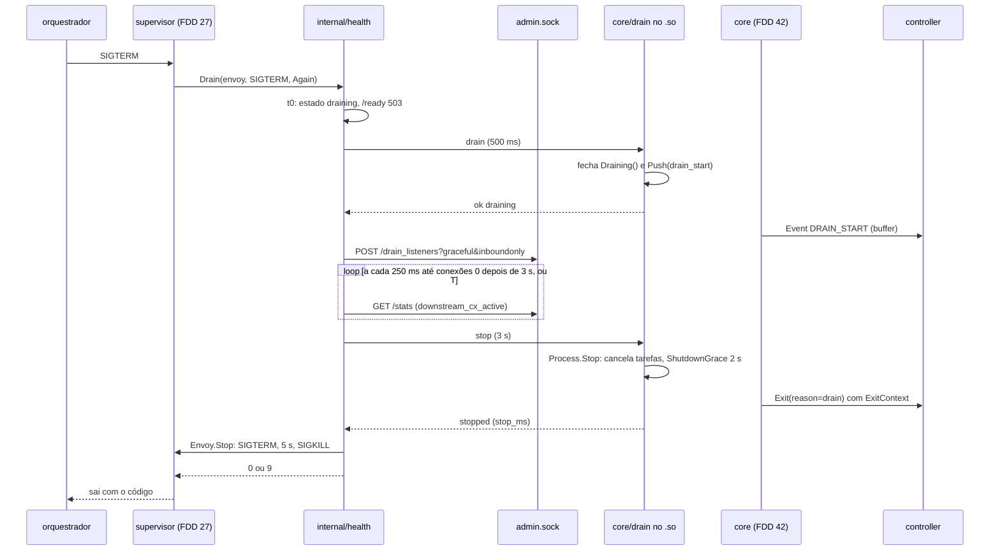
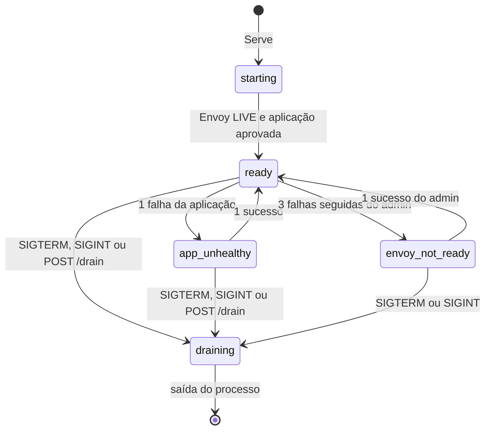
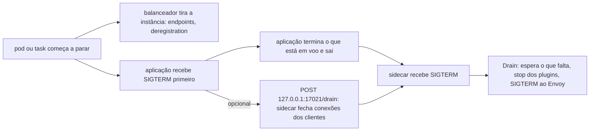

### FDD: Health `17021` e drenagem no SIGTERM (SID-09)

Versão: 1.0
Data: 2026-10-21
Responsável: Guilherme Giusti

---

### 1. Contexto e motivação técnica

**Problema técnico.** A FDD 27 sobe o Envoy, espera o primeiro `/ready` `LIVE` do admin e entrega o processo a uma porta `Lifecycle` que ainda não tem implementação: até aqui, um SIGTERM em serviço só para o Envoy (`NopLifecycle`). Ficam sem resposta verificável:

- **Quando o sidecar está pronto.** O ADR-002 do `n3x-sidecar` decidiu que o `17021` é do entrypoint e que `/ready` exige Envoy pronto, aplicação aprovada no health check e ausência de drenagem, mas não diz o que `/live` verifica, quantas falhas tiram o sidecar de pronto, como o health `grpc` fala com a aplicação sem o grpc-go (o binário `n3x` não pode depender dele, FDDs 15 e 27), nem o que o corpo responde.
- **Como drenar sem cortar requisição.** O HLD lista seis passos (503, aviso ao `.so`, `drain_listeners`, espera, SIGTERM, SIGKILL), mas não diz que stat mede "conexões ativas", com que intervalo, o que fazer com um segundo SIGTERM, como os 2 s dos plugins cabem antes de o Envoy sair, nem quando a saída é 0 ou 9.
- **Como o `.so` fica sabendo.** O plugin core precisa do sinal de drenagem para mandar `DRAIN_START` e escolher o `reason` do `Exit` (FR-016). A FDD 09 deu ao core o canal `Draining()` e a FDD 17 deixou a porta `SidecarParts.Drain`, mas o canal de controle entre os dois processos (lacuna L-18) não existe.
- **Ordem de descida.** No Kubernetes (sidecar nativo, ADR-007 do `n3x-sdk`), no ECS (`dependsOn`) e no docker compose (`network_mode: service:`), a aplicação desce **antes** do sidecar. Para um proxy de entrada, isso significa que o SIGTERM do sidecar chega quando a aplicação já saiu, e conexões persistentes de clientes ainda abertas no sidecar recebem 503 do Envoy (inconsistência I-02).
- **Health sem HTTP no orquestrador.** ECS e docker compose usam comando dentro do container, e a imagem do Envoy não tem `curl` (lacuna L-17).

**Encaixe no HLD.** Esta FDD especifica, no repositório `n3x-sidecar`, a linha "Health (`internal/health`)" de "Componentes e responsabilidades", o passo 10 da "Sequência de subida" (servidor `17021` e pronto), a seção "Drenagem no SIGTERM", as linhas "Health check da aplicação", "Drenagem" e "Encerramento dos plugins" de "Prazos obrigatórios", as interfaces "Health (`17021`)" e "Canal de controle local" e as duas primeiras "Decisões pendentes". Pacotes:

- `internal/health` (HLD): servidor `17021`, health check da aplicação, estado de pronto, sequência de drenagem e o subcomando `n3x probe`; implementa a porta `supervisor.Lifecycle` da FDD 27
- `core/control` (novo, hipótese de nome): protocolo do canal de controle e cliente usado pelo entrypoint; só biblioteca padrão, para o `cmd/n3x` continuar sem gRPC
- `core/drain` (novo, hipótese de nome): servidor do canal de controle dentro do `.so`, sinal `Draining()`, evento `drain_start` e chamada de `Process.Stop`; implementa a porta `SidecarParts.Drain` da FDD 17

Quem consome:

- FDD 27 (SID-07): chama `Prepare`, `Serve`, `EnvoyReady` e `Drain` (contrato 5 dela) e sai com o código devolvido
- FDDs 16 e 17: o adaptador inicia e fecha o servidor de `core/drain` junto com `Chain.Start` e `Process.Stop`; o executor recebe o canal de `Draining()` por `SidecarParts.Drain`
- FDD 42 (CORE-06): o agente do core usa `Draining()`, o evento `drain_start` e o `ExitContext()` da FDD 38 na janela que esta FDD garante (contrato 7)
- FDD 49 (SID-11): reaproveita `core/drain` com outra fonte de drenagem no modo Istio (`Server.Trigger`)
- FDD 47 (SDK-15): probes, health check do ECS e do compose, prazos de desligamento e o gatilho de drenagem pela aplicação (contrato 10)
- FDD 48 (SDK-16): testes de rolling update sem requisição cortada

**Atores.** Orquestrador (probes, health check do container, SIGTERM, prazo até o SIGKILL), balanceador (ALB, kube-proxy, ingress), entrypoint `n3x run` (PID 1, supervisor e health), Envoy (admin no socket Unix, listener de entrada), aplicação (alvo do health check e, opcionalmente, quem pede a drenagem), `.so` (servidor do canal de controle) e plugin core (eventos e saída).

**Limites.** Esta FDD não define a subida, o cálculo do runtime nem os sinais fora da drenagem (FDD 27), o bootstrap e o admin em socket (FDD 26; aqui só o uso), o envio do `DRAIN_START` e do `Exit` (FDD 42), a conexão com o controller e o `ExitContext` (FDD 38), o encerramento das tarefas de fundo em 2 s (FDD 18; aqui só o momento em que começa), o health e a drenagem do modo Istio (FDD 49) nem os manifestos de exemplo por orquestrador (FDD 47).

**Suposições**
- FDDs 15, 16, 17, 25, 26, 27 e 38 implementadas: `config.Config` com `File.App`, `File.Runtime.DrainTimeout` e `config.ReservedPorts`; `adapter.Process.Stop`, `adapter.ShutdownGrace` e `adapter.LogFlushGrace`; `chain.SidecarParts`; `envoycfg.AdminSocket` e `envoycfg.RuntimeDir`; `supervisor.Lifecycle`, `supervisor.Envoy`, `supervisor.DrainRequest`; `grpcconn.Provider.ExitContext`
- O admin do Envoy 1.40 aceita `POST /drain_listeners?graceful&inboundonly`, reporta `server.state` igual a 1 durante a drenagem e expõe `listener.n3x_ingress.downstream_cx_active` (spike D-01 a D-05)
- O Envoy é filho direto do entrypoint, então `getppid()` dentro do Envoy é o PID do entrypoint (FDD 27, contrato 4)
- O comando do health check do ECS e do docker compose roda como processo criado pelo runtime do container, não como filho do supervisor; o coletor `wait4(-1)` da FDD 27 não o recolhe (spike D-08)

**Restrições**
- Prazos do ADR-006 do `n3x-sidecar` (decisão já tomada): health check 1 s a cada 5 s, drenagem 20 s (`runtime.drain_timeout`), plugins 2 s, SIGKILL 5 s depois do SIGTERM ao Envoy
- `/ready` em 503 antes de qualquer outra etapa da drenagem (ADR-002 do `n3x-sidecar`)
- Drenagem pelo admin com `POST /drain_listeners?graceful`, `GOAWAY` em HTTP/2 e `Connection: close` em HTTP/1.1 (HLD)
- Nenhum `os/exec` depois do passo 9 da subida (FDD 27, contrato 7): health da aplicação só por rede
- `cmd/n3x` sem `google.golang.org/grpc`, sem o SDK Go do Envoy e sem `go-control-plane` (FDDs 15 e 27); `internal/health` e `core/control` só com a biblioteca padrão e pacotes do próprio repositório
- No modo Istio valem o health e a drenagem do Istio (ADR-002 do `n3x-sidecar`, ADR-006 do `n3x-sdk`); nada desta FDD pode impedir a FDD 49
- Documentação e mensagens em pt-BR; identificadores em inglês

**Rastreabilidade**
- PRD 1.5: FR-003 (porta de health separada, pronto com Envoy ativo e aplicação aprovada, desligamento com não pronto, drenagem pelo prazo do `n3x.yaml` com padrão de 20 s e só então encerramento do Envoy); FR-016 (evento de início da drenagem e aviso de saída em até 2 s); disponibilidade ("zero requisições cortadas em rolling update, dentro do prazo de drenagem"; "pronto em até 5 s"); critério de aceite "num rolling update com tráfego contínuo, nenhuma requisição é cortada dentro do prazo de drenagem"
- HLD do `n3x-sidecar`: "Sequência de subida" (passo 10), "Drenagem no SIGTERM", "Componentes e responsabilidades" (Health e Supervisor), "Prazos obrigatórios", "Interfaces" (Health e Canal de controle), "Ambiente de implantação" e "Decisões pendentes"
- ADRs: ADR-002 e ADR-006 do `n3x-sidecar`; ADR-006 e ADR-007 do `n3x-sdk`; ADR-007 do `n3x-plugin-core` (`DRAIN_START` e `Exit` com `reason` `drain` ou `sigterm`)
- Lacunas do README:
  - **L-17 fechada:** subcomando `n3x probe [live|ready]` contra `127.0.0.1:17021`, saída 0 com 200 e 1 nos demais casos, igual ao `n3x-controller probe` da FDD 30 (contrato 8)
  - **L-18 fechada no modo padrão:** socket Unix `/tmp/n3x/control.sock` (0600) servido pelo `.so`, com o entrypoint como cliente, autenticação por `SO_PEERCRED` e mensagens JSON de uma linha `ping`, `drain` e `stop` (contrato 6); a detecção da drenagem no modo Istio fica com a FDD 49, que usa `drain.Server.Trigger`
  - **L-01 aplicada (FDD 09):** o canal `Draining()` da visão `proxy.Sidecar` é o devolvido por `SidecarParts.Drain`, fechado no mesmo instante em que `drain_start` entra na fila (contratos 6 e 7)
- Pedidos atendidos:
  - FDD 27: `Lifecycle` implementada (`Prepare`, `Serve`, `EnvoyReady`, `Drain`); `--drain-time-s` confirmado; nenhum `os/exec` depois do passo 9; `Drain` devolve 0 ou 9 (contratos 4 e 5)
  - FDDs 15 e 25: saída 9 (`N3X-S009`) com `reason` estável (contrato 5)
  - FDD 26: admin pelo socket; canal de controle dentro de `/tmp/n3x`; saída 9 (contratos 6 e 9)
  - FDD 16: o canal de controle chama `Process.Stop` (contrato 6)
  - FDDs 09 e 17: `Draining` e `drain_start` por `SidecarParts.Drain` (contratos 6 e 7)
  - FDD 18: a porta `17021` entra em `envoycfg.ReservedLoopbackPorts` (contrato 1)
  - FDD 38: `ExitContext` sem mudança; a conexão continua viva porque o processo do Envoy está vivo durante toda a janela de saída (contrato 7)
  - FDD 06: o fim das tarefas de fundo começa no `stop` do canal de controle, antes do SIGTERM ao Envoy (contrato 4)

**Clarificações (2026-10-22)**
- Gatilho de drenagem pela aplicação (ponto P-01, hipótese H-12, inconsistência I-02): mantém ou retira o `POST /drain`? → Mantém, como mecanismo **opcional**: `POST http://127.0.0.1:17021/drain`, aceito só de loopback (contratos 1 e 10). A meta "zero requisições cortadas em rolling update" com conexões persistentes de clientes é validada com o gatilho; sem ele, a limitação (503 nas requisições que chegam entre a saída da aplicação e o SIGTERM do sidecar) fica documentada no guia (FDD 47). Usar o gatilho é opcional para a aplicação; quem não usa não precisa mudar código. O reflexo no texto do PRD (meta de disponibilidade e meta de "zero linhas de código da aplicação") foi aplicado ao PRD na validação de consistência de 2026-10-22.
- Refinos pedidos por FDDs posteriores (validação de consistência de 2026-10-22): o texto desta FDD continua valendo com os acréscimos e mudanças abaixo; em conflito, vale o contrato da FDD citada em cada item
  - SID-11 (FDD 49), contrato 8: valores novos de `drain.Source` (`istio_admin` e `istio_prestop`), `ServeWith` com `ServeOptions{Peer}` e `PeerSameExe` (par aceito pelo executável `/usr/local/bin/n3x`, para o preStop `n3x istio-drain`)
- Ordem dos 2 s dos plugins antes do SIGTERM ao Envoy (I-01), canal de controle (L-18) e subcomando `n3x probe` (L-17): aplicados ao HLD e registrados nos ADR-006 e ADR-003 na validação de consistência

---

### 2. Objetivos técnicos

- **Fora do balanceamento na hora.** Invariante: depois do SIGTERM (ou do pedido da aplicação), nenhuma resposta 200 sai de `/ready`. Medida: cliente que consulta `/ready` a cada 10 ms vê 503 em até 100 ms depois do sinal, em 100 de 100 execuções.
- **Pronto honesto.** Invariante: `/ready` responde 200 se e somente se o Envoy ficou `LIVE`, a última verificação do admin não falhou 3 vezes seguidas, o último health check da aplicação passou e não há drenagem. Medida: tabela de estados do contrato 2 coberta por teste, com aplicação e admin falsos.
- **Aplicação fora do ar detectada em um intervalo.** Medida: com os padrões (`interval` 5 s, `timeout` 1 s), aplicação derrubada leva `/ready` a 503 em até 6,1 s; aplicação de volta leva `/ready` a 200 em até 6,1 s.
- **Pronto em até 5 s.** Medida: 20 subidas na CI (amd64, 1 vCPU, 256 MiB, `.so` do core e do exemplo, aplicação já escutando): p95 do início do container até o primeiro `/ready` 200 em até 5 s (critério compartilhado com a FDD 27).
- **Zero requisições cortadas.** Medida: rolling update em kind e troca de container no docker compose com tráfego contínuo em HTTP/1.1 com keep-alive, HTTP/2 e gRPC unário: 0 requisição cortada (definição no critério de aceite) dentro do prazo de drenagem.
- **Janela de saída do core inteira.** Invariante: o `stop` do canal de controle chega ao `.so` antes do SIGTERM ao Envoy, e o SIGTERM só sai depois da resposta do `.so` ou de 3 s. Medida: com controller de teste, o `Exit` do core chega ao servidor antes de o processo do Envoy terminar em 100 de 100 drenagens.
- **Drenagem com prazo total conhecido.** Invariante: do SIGTERM à saída do entrypoint, no máximo `drain_timeout` + 3 s (stop) + 5 s (SIGTERM ao SIGKILL) + 1 s (espera depois do SIGKILL); 29 s com o padrão de 20 s.
- **Sinal de drenagem no core.** Medida: `Draining()` fecha e `drain_start` entra na fila em até 100 ms depois do pedido do entrypoint (critério da FDD 09).
- **Health barato.** Medida: entrypoint ocioso com a FDD 29 ativa: RSS até 20 MB e CPU média abaixo de 0,005 vCPU em 10 minutos (hipótese; a FDD 27 mede 15 MB sem ela).

---

### 3. Escopo e exclusões

**Incluído**
- Servidor HTTP `17021` com `GET` e `HEAD` em `/live` e `/ready`, e `POST /drain` só de loopback (contrato 1)
- Health check da aplicação `http`, `grpc` (protocolo padrão de health do gRPC escrito à mão sobre HTTP/2 sem TLS) e `tcp`, com limiares, cadência na subida e motivos de falha (contrato 2)
- Uso dos campos `app.health.*` e `runtime.drain_timeout` do `n3x.yaml` (definidos na FDD 15) (contrato 3)
- Linha do tempo da drenagem: 503, aviso ao `.so`, `drain_listeners`, espera medida pela stat de conexões ativas, `stop` dos plugins, SIGTERM e SIGKILL, com os prazos e eventos (contrato 4)
- Implementação da porta `Lifecycle` da FDD 27 e a tabela da saída 9 (`N3X-S009`) (contrato 5)
- Canal de controle entre entrypoint e `.so`: protocolo, autenticação, servidor no `.so`, `SidecarParts.Drain` e `Process.Stop` (contrato 6, L-18)
- Contrato para o agente do core (FDD 42): o que ele recebe, quando, e a janela garantida para o `Exit` (contrato 7)
- Subcomando `n3x probe` (contrato 8, L-17)
- Endpoints e stats do admin do Envoy usados (contrato 9)
- Recomendações por orquestrador, entrada para a FDD 47: probes, health check, prazos de desligamento e o gatilho pela aplicação (contrato 10)
- Decisão sobre a porta `17021` em `envoycfg.ReservedLoopbackPorts` (pedido da FDD 18)
- Logs da drenagem e do pronto (contrato 11)

**Excluído**
- Subida, runtime Go, sinais fora da drenagem, coletor de filhos e saídas 7: FDD 27 (SID-07)
- Bootstrap, listeners, admin em socket e `--mode validate`: FDD 26 (SID-06); aqui só o uso e dois pedidos (`traffic_direction` e a porta reservada)
- Envio do `DRAIN_START`, do heartbeat e do `Exit`: FDD 42 (CORE-06)
- `ExitContext`, buffer e fechamento da conexão com o controller: FDD 38 (SID-10)
- Encerramento das tarefas de fundo em 2 s: FDD 18 (SID-04); aqui só o momento em que começa
- Health e drenagem no modo Istio: FDD 49 (SID-11)
- Manifestos de exemplo por orquestrador e guias: FDD 47 (SDK-15)
- Métricas novas no entrypoint: o entrypoint não tem endpoint de métricas (ADR-002 do `n3x-sidecar`)
- Health check por comando dentro do container da aplicação (`exec`): proibido pela FDD 27 e fora do modelo de rede

---

### 4. Fluxos detalhados e diagramas

**Fluxo principal: subida até o pronto**
1. **`Prepare`** (FDD 27, depois do arquivo de fatos e antes do `exec` do Envoy): lê de `in.Config` os campos `app.address`, `app.protocol`, `app.health.*` e `runtime.drain_timeout`; monta o checador da aplicação (contrato 2); faz o `bind` de `:17021` (todas as interfaces, IPv4 e IPv6). Falha do `bind`: erro com `ExitCode() == 9` e `reason` `health_bind`; o Envoy não inicia. Nada é servido ainda.
2. **`Serve(ctx, envoy)`** (logo depois do `exec`, deve voltar em até 100 ms): inicia o servidor HTTP sobre o listener já aberto e o checador da aplicação, com uma verificação imediata e depois a cada 500 ms até o primeiro sucesso (`StartupCheckInterval`, hipótese H-05); `/live` responde 200 e `/ready` responde 503 `starting`. Loga `health_listening`.
3. **`EnvoyReady()`** (primeiro `/ready` `LIVE` do admin, na goroutine do supervisor): marca o Envoy pronto, inicia a verificação periódica do admin (`GET http://admin/ready` a cada `app.health.interval`, 500 ms por consulta) e manda um `ping` ao `.so` pelo canal de controle em segundo plano (log `control_channel_ready` ou aviso `control_channel_unavailable`, hipótese H-19).
4. Assim que o Envoy está pronto e o último health check da aplicação passou, `/ready` passa a 200 `ready` e loga `ready_changed` (`from` `starting`, `to` `ready`). Depois do primeiro sucesso, o checador da aplicação roda a cada `app.health.interval`.

**Fluxo principal: drenagem no SIGTERM** (`Drain(ctx, DrainRequest{Envoy, Signal, Again})`, chamado pela FDD 27 no primeiro SIGTERM ou SIGINT depois do pronto; `T` = `runtime.drain_timeout`; tempos contados a partir de `t0`, o instante do sinal)
1. **`t0`: não pronto.** Primeiro comando do `Drain`: o estado vira `draining` (variável atômica lida pelo handler) e `/ready` passa a 503 `draining`. As verificações da aplicação e do admin param. Loga `drain_started` com `source` (`sigterm` ou `sigint`), `drain_timeout_ms` e o número de conexões ativas, se a última leitura existir.
2. **Aviso ao `.so`.** `control.Send(op=drain, drain_timeout_ms, source)` com prazo de 500 ms (`ControlTimeout`). No `.so`, `core/drain` fecha `Draining()` e põe `drain_start` na fila do core no mesmo instante, depois responde `ok`. Falha ou prazo: aviso `control_channel_failed` (`op` `drain`) e a drenagem segue; só o evento e o `reason` `drain` do `Exit` se perdem.
3. **Drenagem dos listeners.** `POST http://admin/drain_listeners?graceful&inboundonly` com prazo de 1 s (`DrainCallTimeout`). O Envoy inicia a sequência de drenagem com a estratégia `immediate` (`--drain-strategy immediate`, pedido à FDD 27): respostas HTTP/1.1 passam a levar `Connection: close` e conexões HTTP/2 recebem `GOAWAY`; o listener `n3x_ingress` continua aceitando conexões e para de escutar ao fim de `--drain-time-s` (igual a `T` arredondado para cima, FDD 27); o listener de métricas `17090` não é parado (`inboundonly`, com `traffic_direction: INBOUND` só no `n3x_ingress`, pedido à FDD 26). Falha: `drain_call_failed`, a espera segue (as conexões não são fechadas pelo Envoy, mas o balanceador já saiu) e a saída será 9.
4. **Espera.** A cada 250 ms (`DrainPollInterval`), lê `listener.n3x_ingress.downstream_cx_active` em `GET http://admin/stats?filter=...` (contrato 9). A espera termina no primeiro destes:
   - conexões ativas em 0 **e** pelo menos `min(MinDrainWait, T)` decorridos desde `t0` (`MinDrainWait` = 3 s, hipótese H-08): `drain_wait_finished` com `reason` `connections_zero`
   - `t0 + T`: `drain_wait_finished` com `reason` `timeout` e `connections_remaining` (aviso, sem mudar a saída)
   - segundo SIGTERM ou SIGINT em `Again`: `reason` `forced` (saída 9)
   - `Envoy.Exited()` fecha: `reason` `envoy_exited` (saída 9; pula o passo 5)
   - o `ctx` do supervisor termina: segue direto para o passo 6
5. **Fim dos plugins.** `control.Send(op=stop)` com prazo de 3 s (`StopReplyTimeout`). No `.so`, `core/drain` chama `Process.Stop(ctx)` da FDD 16 com `ShutdownGrace` (2 s): `Chain.Stop`, `Containment.Stop` (cancela as tarefas de fundo, FDD 18), o `Exit` do core com o `ExitContext` (FDDs 38 e 42), `ControllerProvider.Stop` (FDD 38) e o esvaziamento dos logs (`LogFlushGrace`, 0,5 s). O `.so` responde `stopped` com `stop_ms` só depois. Sem resposta em 3 s: `stop_unconfirmed` (saída 9) e segue. Um sinal em `Again` durante este passo encurta a espera e segue (`forced`).
6. **SIGTERM ao Envoy.** `r.Envoy.Stop(ctx)` da FDD 27: SIGTERM no grupo, até 5 s, SIGKILL, até 1 s. SIGKILL necessário: `envoy_killed` (saída 9). Envoy que sai com código diferente de 0: `envoy_exit_error` (saída 9). Sinais em `Again` nesta fase só são logados.
7. **Saída.** Loga `drain_completed` com `exit_code`, `reasons`, `wait_ms`, `stop_ms`, `envoy_stop_ms` e `total_ms`, e devolve 0 ou 9. A FDD 27 loga `supervisor_exit` (`reason` `drained` para 0 e `lifecycle` para 9) e sai. O `17021` responde até o fim (é fechado quando o `ctx` do supervisor é cancelado na saída).

**Fluxos alternativos e exceções**
- **Drenagem pedida pela aplicação** (`POST /drain` vindo de loopback, contrato 1; opcional, decidido na clarificação de 2026-10-22): roda os passos 1 a 4 com `source` `app` e responde 202 na hora (sem esperar). Ao fim da espera, o entrypoint não para nada: fica em `draining` esperando o SIGTERM. Quando o SIGTERM chega, `Drain` vê a drenagem em curso, não repete os passos 1 a 3, espera o que falta até `t0 + T` (contado a partir do pedido da aplicação) com a mesma regra do passo 4 e segue para os passos 5 a 7. É o caminho para o sidecar fechar as conexões dos clientes enquanto a aplicação ainda atende, já que nos três orquestradores a aplicação desce primeiro (I-02)
- **`POST /drain` antes do pronto:** 409 `starting`; nada muda
- **`POST /drain` vindo de outro endereço:** 403 `forbidden`, log `drain_trigger_rejected` (no máximo 1 por minuto); nada muda
- **Segundo SIGTERM ou SIGINT:** cada sinal extra avança no máximo uma fase: na espera, termina a espera; no `stop`, deixa de esperar a resposta; no SIGTERM ao Envoy, só loga (`signal_received` com `action` `forward_drain` é da FDD 27). A saída fica 9 (`forced`) (hipótese H-11)
- **Envoy sai sozinho durante a drenagem** (crash, OOM): `Exited()` fecha; não há `stop` (o processo do `.so` já morreu); saída 9 com `envoy_exited` e o código ou sinal do Envoy no log
- **Canal de controle indisponível** (socket ausente, `.so` travado, par recusado): `drain` falha com aviso e a drenagem segue; `stop` falha e a saída fica 9 (`stop_unconfirmed`); o Envoy recebe SIGTERM e, se o adaptador da FDD 16 chamar `Process.Stop` pela destruição da config, os plugins ainda têm a janela pelo caminho da destruição
- **Admin do Envoy sem resposta durante a espera:** a leitura da stat conta como "desconhecida"; a espera vai até `t0 + T`; log `drain_stats_failed` uma vez
- **Requisições em voo quando o `stop` chega** (só quando a espera terminou por `timeout` ou `forced`): continuam pela cadeia; `OnComplete` roda para elas (FDD 05); as tarefas de fundo e a conexão com o controller já terminaram (FDDs 06, 18 e 38); o SIGTERM ao Envoy segue logo depois
- **Envoy morre em serviço** (fora da drenagem): a FDD 27 cancela o `ctx` do `Serve`; `/live` responde 503 `envoy_exited` até o processo sair (até 100 ms); não há drenagem
- **SIGTERM antes do pronto:** a FDD 27 trata (`startup_aborted`, saída 0); `Drain` não é chamado
- **Modo standalone** (sem bloco `controller`): igual; o `.so` fecha `Draining()` sem fila (nenhum evento) e o `stop` encerra as tarefas de fundo dos plugins
- **Aplicação mal configurada no health** (porta ou path errados): `/ready` nunca chega a 200; log `app_health_failed` com o motivo na primeira falha e `app_health_failing` a cada minuto com a contagem; a FDD 15 já avisa `health_protocol` nas combinações suspeitas
- **Modo Istio** (FDD 49): o `n3x` faz `exec` do `pilot-agent` antes do supervisor; `internal/health` não é usado, o `17021` não abre; `core/drain` continua no `.so` e a FDD 49 escolhe a fonte da drenagem por `Server.Trigger` (contrato 6)
- **Teste de carga do builder** (FDD 23) e harness de desenvolvimento: o `.so` tenta abrir o socket e, se `/tmp/n3x` não existir, loga o aviso `control_unavailable` e segue; nenhum erro

**Diagramas**

Sequência da drenagem no SIGTERM (padrões; tempos a partir do sinal):



Estados do `/ready`:



Ordem de descida nos orquestradores (motivo do gatilho pela aplicação):



---

### 5. Contratos públicos (assinaturas, endpoints, headers, exemplos)

**Contrato 1: API HTTP `17021`**
- Tipo: endpoint (HTTP/1.1 sem TLS, servido pelo entrypoint em `:17021`, IPv4 e IPv6)
- Assinatura/Rota: `GET|HEAD /live`, `GET|HEAD /ready`, `POST /drain`
- Método: GET, HEAD e POST
- Semântica de status/headers:
  - **Corpo:** uma palavra e `\n`, `Content-Type: text/plain; charset=utf-8`, `Cache-Control: no-store`, `X-Content-Type-Options: nosniff`; `HEAD` devolve o mesmo status sem corpo. Nenhum detalhe da aplicação, do Envoy ou da config no corpo
  - **`/live`** (hipótese H-04): 200 `ok` desde o `Serve` até a saída do processo, inclusive na drenagem; 503 `envoy_exited` entre a morte do Envoy em serviço e a saída do entrypoint (até 100 ms). Não consulta o admin nem a aplicação: um Envoy lento ou uma aplicação fora do ar não devem levar o orquestrador a reiniciar o sidecar
  - **`/ready`:** 200 `ready` só com as três condições do ADR-002; senão 503 com o estado (`starting`, `app_unhealthy`, `envoy_not_ready`, `draining`), com precedência `draining`, `starting`, `envoy_not_ready`, `app_unhealthy`. Responde do estado em memória, sem I/O por requisição
  - **`/drain`** (opcional para a aplicação; decidido na clarificação de 2026-10-22, antes hipótese H-12 e ponto P-01): só aceito se o par TCP for loopback (`127.0.0.0/8`, `::1` ou `::ffff:127.0.0.0/104`); 202 `draining` na primeira vez e nas seguintes (idempotente); 409 `starting` antes do pronto; 403 `forbidden` de outro endereço; corpo da requisição ignorado (até 1 KiB lido). Quem chama: a aplicação do mesmo pod ou task, no próprio tratamento de SIGTERM ou num `preStop`. Um plugin dentro do Envoy também seria par loopback, por isso a `17021` entra em `envoycfg.ReservedLoopbackPorts` (abaixo)
  - **Outros:** método errado dá 405 com `Allow: GET, HEAD` (ou `Allow: POST` em `/drain`); outra rota dá 404 `not_found`
  - **Limites do servidor** (hipótese H-17): `ReadHeaderTimeout` 2 s, `ReadTimeout` 5 s, `WriteTimeout` 5 s, `IdleTimeout` 30 s, `MaxHeaderBytes` 8 KiB, até 128 conexões simultâneas (as seguintes esperam o `accept`); só HTTP/1.1; tempo de resposta abaixo de 1 ms no p99 ocioso
  - **Porta fixa:** `17021` (ADR-006 do `n3x-sdk`, `config.ReservedPorts` da FDD 15); sem campo no `n3x.yaml`
  - **Porta reservada para plugins (pedido da FDD 18, decisão desta FDD):** `envoycfg.ReservedLoopbackPorts` passa a `{17001, 17021, 17090}` (pedido à FDD 26); a `DialDenyList` da FDD 18 recusa a `17021` sem mudança de código. Motivo: nenhum plugin tem uso legítimo para ela e o `POST /drain` confia no par loopback

**Exemplo de requisição**
```http
GET /ready HTTP/1.1
Host: 10.42.3.9:17021
User-Agent: kube-probe/1.31

POST /drain HTTP/1.1
Host: 127.0.0.1:17021
Content-Length: 0
```

**Exemplo de resposta**
```http
HTTP/1.1 503 Service Unavailable
Content-Type: text/plain; charset=utf-8
Cache-Control: no-store
X-Content-Type-Options: nosniff
Content-Length: 14

app_unhealthy

HTTP/1.1 202 Accepted
Content-Type: text/plain; charset=utf-8
Cache-Control: no-store
Content-Length: 9

draining
```

---

**Contrato 2: health check da aplicação e estado de pronto**
- Tipo: regra de comportamento (`internal/health`, checador da aplicação e do admin)
- Assinatura/Rota:
  ```go
  package health // github.com/giustech/n3x-sidecar/internal/health

  type AppCheck struct {
      Type     string         // "http", "grpc" ou "tcp" (app.health.type, padrão da FDD 15)
      Path     string         // só http (padrão /healthz)
      Address  netip.AddrPort // app.address (IP literal, FDD 15)
      Protocol string         // app.protocol: http1, http2 ou grpc
      Timeout  time.Duration  // app.health.timeout
  }

  type Result struct {
      OK       bool
      Reason   string        // vazio no sucesso; tabela abaixo
      Status   int           // status HTTP ou grpc-status, quando houver
      Duration time.Duration
  }

  type Checker interface{ Check(ctx context.Context) Result }

  func NewAppChecker(c AppCheck) Checker
  ```
- Método: rede, a partir do entrypoint, para `app.address` (normalmente loopback); nunca por comando
- Semântica de status/headers:
  - **`http`** (hipótese H-06): `GET <path>` em conexão nova (sem keep-alive), `Host` igual a `app.address`, `User-Agent: n3x-health/<versão>`, sem seguir redirecionamento; sucesso com status de 200 a 399 (mesma regra do kubelet); corpo não lido (fechado na hora). HTTP/1.1 quando `app.protocol` é `http1` ou `grpc`; HTTP/2 sem TLS com conhecimento prévio (`http.Protocols.SetUnencryptedHTTP2`, biblioteca padrão) quando é `http2`
  - **`grpc`** (hipótese H-07): `POST /grpc.health.v1.Health/Check` em HTTP/2 sem TLS, `content-type: application/grpc`, `te: trailers`, `grpc-timeout` igual ao `timeout`, corpo de 5 bytes `00 00 00 00 00` (mensagem `HealthCheckRequest` com `service` vazio, escrita à mão); sucesso com HTTP 200, `grpc-status` 0 e resposta `HealthCheckResponse` com o campo 1 igual a 1 (`SERVING`), lida até 1 KiB. Serviço sempre vazio na v1 (saúde do servidor inteiro); campo `app.health.service` fica para uma minor (ponto P-03). O binário não importa o grpc-go
  - **`tcp`:** conexão TCP aceita no prazo; fechada na hora
  - **Prazo:** `app.health.timeout` (padrão 1 s) por verificação, inteiro (conexão, envio e resposta)
  - **Cadência:** uma verificação imediata no `Serve`; a cada 500 ms até o primeiro sucesso; depois a cada `app.health.interval` (padrão 5 s), contando do fim da anterior; para na drenagem
  - **Limiares** (hipótese H-05): 1 falha leva a `app_unhealthy`; 1 sucesso volta a pronto. Motivo: o critério do PRD pede detecção dentro de um intervalo, e os orquestradores já somam o próprio limiar (`failureThreshold`) por cima do `/ready`
  - **Admin do Envoy:** depois do `EnvoyReady`, `GET http://admin/ready` a cada `app.health.interval`, 500 ms por consulta; 3 falhas seguidas (status diferente de 200 `LIVE`, conexão recusada, prazo) levam a `envoy_not_ready`; 1 sucesso volta (hipótese H-05: o admin roda na thread principal e um atraso isolado não deve tirar o sidecar do balanceamento)
  - **Motivos de falha** (campo `reason` dos logs; nunca o corpo da resposta):

| `reason` | Tipo | Quando |
| --- | --- | --- |
| `refused` | todos | conexão recusada |
| `timeout` | todos | prazo da verificação |
| `network` | todos | outro erro de rede (reset, rota) |
| `status_<código>` | http | status fora de 200 a 399 |
| `http_protocol` | http, grpc | resposta que não é HTTP válido para o protocolo usado |
| `grpc_status_<código>` | grpc | `grpc-status` diferente de 0 (12 = `UNIMPLEMENTED` indica servidor sem o serviço de health) |
| `not_serving` | grpc | `NOT_SERVING`, `UNKNOWN` ou `SERVICE_UNKNOWN` |
| `malformed` | grpc | mensagem ausente, maior que 1 KiB ou protobuf inválido |

**Exemplo de requisição**
```go
c := health.NewAppChecker(health.AppCheck{
    Type: "grpc", Address: netip.MustParseAddrPort("127.0.0.1:50051"),
    Protocol: "grpc", Timeout: time.Second,
})
fmt.Printf("%+v\n", c.Check(ctx))
```

**Exemplo de resposta**
```text
{OK:false Reason:grpc_status_12 Status:12 Duration:3.1ms}
```

---

**Contrato 3: campos do `n3x.yaml` usados (definidos na FDD 15)**
- Tipo: config (leitura; schema, padrões e validação são da FDD 15, contrato 1 dela)
- Assinatura/Rota: `app.address`, `app.protocol`, `app.health.type`, `app.health.path`, `app.health.interval`, `app.health.timeout`, `runtime.drain_timeout`
- Método: n/a
- Semântica de status/headers:

| Campo | Padrão (FDD 15) | Faixa (FDD 15) | Uso aqui |
| --- | --- | --- | --- |
| `app.health.type` | `grpc` se `app.protocol` é `grpc`; senão `http` | `http`, `grpc`, `tcp` | tipo da verificação (contrato 2) |
| `app.health.path` | `/healthz` com `type: http` | começa com `/`, até 1024 bytes | path do `GET` |
| `app.health.interval` | `5s` | 1s a 5m | cadência da aplicação e do admin depois do pronto |
| `app.health.timeout` | `1s` | 10ms a 60s, menor ou igual a `interval` | prazo de cada verificação |
| `runtime.drain_timeout` | `20s` | 1s a 15m | `T` da espera (contrato 4) e `--drain-time-s` arredondado para cima (FDD 27) |

  - Nenhum campo novo nesta FDD; o modo Istio ignora todos (FDD 15, coluna Istio; I-04)
  - **Proteção de dados:** `app.address`, `app.health.type` e `app.health.path` aparecem nos logs (não são segredo; `ENC[...]` neles já é `secret_unexpected` na FDD 15); acréscimo à lista de campos logáveis da FDD 27 (contrato 8 dela)

**Exemplo de requisição**
```yaml
app:
  address: 127.0.0.1:50051
  protocol: grpc
  health: { type: grpc, interval: 5s, timeout: 1s }
runtime:
  drain_timeout: 20s
```

**Exemplo de resposta** (log do `Serve`)
```json
{"ts":"2026-10-21T14:00:01.141Z","level":"info","component":"entrypoint","service":"pedidos","msg":"health_listening","port":17021,"app_health_type":"grpc","app_address":"127.0.0.1:50051","interval_ms":5000,"timeout_ms":1000,"drain_timeout_ms":20000}
```

---

**Contrato 4: linha do tempo da drenagem**
- Tipo: regra de comportamento (sequência de `Lifecycle.Drain`; documentada em `docs/drenagem.md` do `n3x-sidecar` e no guia da FDD 47)
- Assinatura/Rota: constantes de `internal/health` e argumentos do Envoy da FDD 27
  ```go
  const (
      MinDrainWait      = 3 * time.Second        // hipótese H-08; limitado a drain_timeout
      DrainPollInterval = 250 * time.Millisecond // hipótese
      DrainCallTimeout  = 1 * time.Second        // POST /drain_listeners
      ControlTimeout    = 500 * time.Millisecond // ping e drain no canal de controle
      StopReplyTimeout  = 3 * time.Second        // ShutdownGrace (2 s) + LogFlushGrace (0,5 s) + 0,5 s
  )
  ```
  ```text
  envoy ... --drain-time-s <ceil(drain_timeout)> --drain-strategy immediate   (FDD 27, contrato 4)
  ```
- Método: n/a
- Semântica de status/headers:

| Tempo (padrão) | Etapa | Prazo | Evento de log | Efeito |
| --- | --- | --- | --- | --- |
| 0 | SIGTERM ou SIGINT (ou `POST /drain`) | | `drain_started` | `/ready` 503 `draining` |
| 0 a 0,5 s | `drain` no canal de controle | 500 ms | `control_message` | `Draining()` fecha; `drain_start` na fila (FDD 09) |
| até 1,5 s | `POST /drain_listeners?graceful&inboundonly` | 1 s | `drain_listeners_called` | `GOAWAY` e `Connection: close`; `server.state` = 1 |
| 3 s a `T` | espera: 0 conexões depois de 3 s, ou `T` | `T` (20 s) | `drain_wait_finished` | fim da espera |
| espera + 0 a 3 s | `stop` no canal de controle | 3 s | `control_message` | tarefas canceladas; `Exit` do core; logs esvaziados (2,5 s no máximo) |
| depois do `stop` | SIGTERM ao grupo do Envoy | 5 s | `envoy_exited` (FDD 27) | Envoy sai |
| + 5 s | SIGKILL, se preciso | 1 s | `envoy_exited` com `envoy_signal` `killed` | saída 9 |
| fim | | | `drain_completed`, `supervisor_exit` | saída 0 ou 9 |

  - **Total máximo:** `T + 3 s + 5 s + 1 s` (29 s com o padrão; o aviso ao `.so` e a chamada ao admin correm dentro de `T`); típico com conexões que fecham rápido: 3 s mais o `stop` (alguns milissegundos a 2,5 s) mais a saída do Envoy (dezenas de milissegundos)
  - **Ordem dos 2 s dos plugins** (hipótese H-03, inconsistência I-01): o HLD e o ADR-006 dizem "SIGTERM ao Envoy; os plugins têm 2 s". Aqui a janela dos plugins começa no `stop`, imediatamente **antes** do SIGTERM ao Envoy, e o SIGTERM só sai quando o `.so` confirma ou em 3 s. Motivo: no SIGTERM o Envoy encerra o processo sem garantia de chamar a destruição da config do filtro e esperar 2 s por ela (spike D-04); a janela da FDD 06, o `Exit` da FDD 42 e a conexão viva da FDD 38 dependem do processo vivo. Os prazos do ADR-006 continuam os mesmos (2 s para os plugins, SIGKILL 5 s depois do SIGTERM ao Envoy); a FDD 16 já previa o `Stop` pelo canal de controle antes da destruição
  - **`--drain-time-s`** (pedido da FDD 27, confirmado): igual a `T` arredondado para cima; o Envoy para de escutar no `n3x_ingress` ao fim do mesmo prazo da espera
  - **`--drain-strategy immediate`** (hipótese H-09, pedido à FDD 27): com o sidecar já fora do balanceamento, todas as conexões recebem o pedido de fechamento logo; a estratégia padrão `gradual` espalharia os fechamentos pelos 20 s e manteria conexões persistentes até o fim
  - **`MinDrainWait`** (hipótese H-08, ponto P-02): 3 s de espera mínima mesmo com 0 conexões, para o balanceador (endpoints do Kubernetes, ingress, `kube-proxy`) parar de mandar conexões novas antes de o listener fechar; não se aplica quando `T` é menor (vale `T`)
  - **Fim por `timeout`** com conexões restantes não muda a saída (0): é um fim previsto no HLD ("ou `runtime.drain_timeout`"); o aviso traz `connections_remaining` (hipótese H-10, ponto P-07)

**Exemplo de requisição**
```text
$ kubectl delete pod pedidos-7d9f8b-xk2lp
```

**Exemplo de resposta** (stderr do sidecar; linhas encurtadas)
```json
{"ts":"2026-10-21T15:00:00.002Z","level":"info","component":"entrypoint","service":"pedidos","msg":"drain_started","source":"sigterm","drain_timeout_ms":20000,"connections":12}
{"ts":"2026-10-21T15:00:00.004Z","level":"info","component":"core","service":"pedidos","msg":"drain_signal_received","source":"sigterm","queued":true}
{"ts":"2026-10-21T15:00:00.005Z","level":"info","component":"entrypoint","service":"pedidos","msg":"control_message","op":"drain","ok":true,"duration_ms":3}
{"ts":"2026-10-21T15:00:00.009Z","level":"info","component":"entrypoint","service":"pedidos","msg":"drain_listeners_called","status":200,"duration_ms":4}
{"ts":"2026-10-21T15:00:03.010Z","level":"info","component":"entrypoint","service":"pedidos","msg":"drain_wait_finished","reason":"connections_zero","wait_ms":3008,"connections_remaining":0}
{"ts":"2026-10-21T15:00:03.071Z","level":"info","component":"entrypoint","service":"pedidos","msg":"control_message","op":"stop","ok":true,"duration_ms":61,"stop_ms":58}
{"ts":"2026-10-21T15:00:03.129Z","level":"info","component":"entrypoint","service":"pedidos","msg":"drain_completed","exit_code":0,"reasons":"","wait_ms":3008,"stop_ms":61,"envoy_stop_ms":57,"total_ms":3127}
```

---

**Contrato 5: implementação da porta `Lifecycle` e saída 9 (`N3X-S009`)**
- Tipo: sdk (API Go do pacote `github.com/giustech/n3x-sidecar/internal/health`; implementa `supervisor.Lifecycle` da FDD 27)
- Assinatura/Rota:
  ```go
  package health

  const (
      Port                 = 17021
      ExitCode             = 9
      Code                 = "N3X-S009"
      StartupCheckInterval = 500 * time.Millisecond
      EnvoyProbeTimeout    = 500 * time.Millisecond
      EnvoyFailures        = 3
      AppFailures          = 1
      AppSuccesses         = 1
      MaxConns             = 128
  )

  type State string // "starting", "ready", "app_unhealthy", "envoy_not_ready", "draining"

  type Options struct {
      Logger  *slog.Logger                                   // component=entrypoint
      Listen  func(network, address string) (net.Listener, error) // net.Listen; testes
      Control func(ctx context.Context, req control.Request, peerPID int) (control.Response, error) // control.Send; testes
      Now     func() time.Time
  }

  func NewLifecycle(opts Options) supervisor.Lifecycle

  // Erro de Prepare e Serve com o próprio código (supervisor.ExitCoder).
  type Error struct{ Reason, Detail string }
  func (e *Error) Error() string
  func (e *Error) ExitCode() int // sempre 9
  ```
- Método: n/a (chamada local pelo supervisor)
- Semântica de status/headers:
  - **Ordem e unicidade** (contrato 5 da FDD 27): `Prepare`, `Serve`, `EnvoyReady` e `Drain`, cada um no máximo uma vez; `Serve` volta em até 100 ms; `Drain` só depois do pronto; o `ctx` do `Serve` é cancelado na saída do supervisor e fecha o servidor e os checadores
  - **Concorrência:** estado numa variável atômica; handlers HTTP sem trava no caminho de `/live` e `/ready`; checadores e servidor com `recover` próprio (panic vira log `health_internal_error` e o componente segue; o servidor é reiniciado no mesmo listener)
  - **`Drain` devolve:** 0 quando nenhuma condição abaixo aconteceu; 9 quando alguma aconteceu (todas vão para `reasons`, na ordem em que ocorreram)
  - **Tabela da saída 9** (`reason` estável na major; `docs/erros.md#n3x-s009`):

| `reason` | Quando | Texto (campo `detail`) |
| --- | --- | --- |
| `health_bind` | `Prepare`: `bind` de `:17021` falhou (antes do Envoy) | `não foi possível abrir a porta 17021: address already in use; outro processo do pod ou da task usa a porta de health` |
| `drain_forced` | segundo SIGTERM ou SIGINT durante a drenagem | `drenagem encurtada por um segundo sinal (interrupt) depois de 4,2 s` |
| `drain_call_failed` | `POST /drain_listeners` falhou | `o admin do Envoy não aceitou drain_listeners (503); as conexões não foram fechadas pelo Envoy` |
| `stop_unconfirmed` | o `.so` não confirmou o `stop` em 3 s | `o .so não confirmou o fim dos plugins em 3 s (canal de controle: timeout); o Envoy foi encerrado mesmo assim` |
| `envoy_killed` | Envoy não saiu em 5 s depois do SIGTERM | `o Envoy não saiu 5 s depois do SIGTERM e recebeu SIGKILL` |
| `envoy_exited` | Envoy saiu sozinho durante a drenagem | `o Envoy saiu com o sinal 11 durante a drenagem, antes do fim dos plugins` |
| `envoy_exit_error` | Envoy saiu com código diferente de 0 depois do SIGTERM | `o Envoy saiu com 1 depois do SIGTERM` |

  - **Campos do log `drain_completed` com saída 9:** `level` `warn`, `code` (`N3X-S009`), `exit_code` (9), `reasons` (lista separada por vírgula), `detail` (do primeiro), mais os tempos. `health_bind` sai como `health_failed` (`error`) antes de o supervisor sair
  - **Como resolver** (`docs/erros.md#n3x-s009`): "para `health_bind`, libere a porta 17021 no pod ou na task; para `drain_forced`, aumente o prazo do orquestrador (`terminationGracePeriodSeconds`, `stopTimeout`, `stop_grace_period`); para `stop_unconfirmed`, `envoy_killed` e `envoy_exited`, leia as linhas `component=core` e `component=envoy` acima"
  - **Fora do 9:** a drenagem que termina por `timeout` sai com 0 e o aviso; o canal de controle que falha só no `drain` sai com 0 e o aviso

**Exemplo de requisição** (`cmd/n3x`, despacho do `run`; FDD 27)
```go
code := supervisor.Run(ctx, supervisor.Options{
    ConfigPath: configFlag,
    Logger:     log,
    Lifecycle:  health.NewLifecycle(health.Options{Logger: log}),
})
os.Exit(code)
```

**Exemplo de resposta** (drenagem forçada por um segundo `docker stop`)
```json
{"ts":"2026-10-21T15:00:04.210Z","level":"warn","component":"entrypoint","service":"pedidos","msg":"drain_wait_finished","reason":"forced","wait_ms":4208,"connections_remaining":3}
{"ts":"2026-10-21T15:00:04.300Z","level":"warn","component":"entrypoint","service":"pedidos","msg":"drain_completed","code":"N3X-S009","exit_code":9,"reasons":"drain_forced","detail":"drenagem encurtada por um segundo sinal (interrupt) depois de 4,2 s","wait_ms":4208,"stop_ms":40,"envoy_stop_ms":50,"total_ms":4298}
{"ts":"2026-10-21T15:00:04.300Z","level":"error","component":"entrypoint","service":"pedidos","msg":"supervisor_exit","exit_code":9,"reason":"lifecycle","orphans_reaped":0,"uptime_ms":3604300}
```

---

**Contrato 6: canal de controle entre o entrypoint e o `.so` (L-18)**
- Tipo: stream (socket Unix `SOCK_STREAM`, uma mensagem JSON de uma linha por conexão, nos dois sentidos)
- Assinatura/Rota: `unix:/tmp/n3x/control.sock`, modo 0600, dono 17000, dentro de `/tmp/n3x` (0700, FDD 26)
  ```go
  package control // github.com/giustech/n3x-sidecar/core/control (só biblioteca padrão)

  const (
      SocketPath     = "/tmp/n3x/control.sock"
      SocketMode     = 0o600
      Version        = 1
      MaxMessageSize = 4 << 10
  )

  type Op string

  const (
      OpPing  Op = "ping"
      OpDrain Op = "drain"
      OpStop  Op = "stop"
  )

  type Request struct {
      V              int    `json:"v"`
      Op             Op     `json:"op"`
      DrainTimeoutMS int64  `json:"drain_timeout_ms,omitempty"` // só em drain
      Source         string `json:"source,omitempty"`           // drain: "sigterm", "sigint" ou "app"
  }

  type Response struct {
      V           int    `json:"v"`
      OK          bool   `json:"ok"`
      Op          Op     `json:"op"`
      State       string `json:"state,omitempty"`        // "serving", "draining", "stopped"
      Queued      bool   `json:"queued,omitempty"`       // drain: drain_start entrou na fila
      StopMS      int64  `json:"stop_ms,omitempty"`      // stop: duração do Process.Stop
      CoreVersion string `json:"core_version,omitempty"` // ping
      Error       string `json:"error,omitempty"`        // "version", "unknown_op", "bad_request", "stopping"
  }

  // Cliente do entrypoint: conecta, confere o par (SO_PEERCRED com pid igual a peerPID),
  // escreve uma linha, lê uma linha e fecha. O prazo vem do ctx.
  func Send(ctx context.Context, path string, req Request, peerPID int) (Response, error)

  var (
      ErrUnavailable = errors.New("control: canal de controle indisponível")
      ErrPeer        = errors.New("control: processo do outro lado não é o esperado")
      ErrProtocol    = errors.New("control: resposta inválida")
  )
  ```
  ```go
  package drain // github.com/giustech/n3x-sidecar/core/drain (no .so; importa proxy/ do SDK)

  type Source string // "sigterm", "sigint", "app"; outros valores pela FDD 49

  type Options struct {
      Path    string        // control.SocketPath
      Logger  *slog.Logger  // component=core
      Getppid func() int    // os.Getppid; testes
      Now     func() time.Time
  }

  func New(opts Options) *Server // sem I/O e sem goroutine

  // Porta chain.SidecarParts.Drain (FDD 17): chamada uma vez no Build com a fila do core
  // (nil no standalone); devolve o canal que Draining() expõe.
  func (s *Server) Drain(q *proxy.EventQueue) <-chan struct{}

  // Fecha Draining() e põe drain_start na fila, uma vez; idempotente. Usada pelo
  // servidor e por outra fonte de drenagem (modo Istio, FDD 49). Devolve true na primeira.
  func (s *Server) Trigger(src Source, drainTimeout time.Duration) bool

  // Chamada pelo adaptador em ModeServe, depois do Chain.Start (pedido à FDD 16).
  // Abre o socket e atende em goroutine; stop é o Process.Stop do adaptador.
  func (s *Server) Serve(stop func(context.Context)) error

  func (s *Server) Close() // fecha o socket; chamada no fim do Process.Stop
  ```
- Método: requisição e resposta, uma por conexão; o entrypoint é sempre quem conecta (hipótese H-01)
- Semântica de status/headers:
  - **Quem é servidor** (hipótese H-01): o `.so`. Motivo: a autoridade é o entrypoint, e só o lado servidor consegue autenticar quem manda. O `.so` aceita uma conexão só se `SO_PEERCRED` der `uid` igual ao próprio e `pid` igual a `getppid()` (o entrypoint, pai do Envoy); um plugin no mesmo processo tem `pid` igual ao do próprio Envoy e é recusado, além de já ser barrado pela `DialDenyList` (FDDs 06 e 18). O entrypoint, ao conectar, confere que o `pid` do par é o do Envoy (`Envoy.PID()`), para não falar com um socket velho ou alheio
  - **Ciclo do socket:** `Serve` remove um socket velho no mesmo caminho (só se for socket), faz `listen`, ajusta o modo para 0600 e atende; falha (diretório ausente, permissão) vira aviso `control_unavailable` e o `.so` segue sem canal (drenagem sem evento). `Close` no fim do `Process.Stop`, depois da resposta do `stop`. Nunca em `ModeValidate` (o adaptador não chama `Start` nem `Serve`, FDDs 16 e 26)
  - **Mensagens:** uma linha JSON terminada em `\n`, até 4 KiB, nos dois sentidos; o servidor lê com prazo de 1 s; campo desconhecido é ignorado (evolução por adição); `v` diferente de 1 responde `error: version`; `op` desconhecido responde `error: unknown_op`; JSON inválido responde `error: bad_request`
  - **`ping`:** responde `state` (`serving`, `draining` ou `stopped`) e `core_version` (`buildinfo.Version` do `.so`); sem efeito
  - **`drain`:** chama `Trigger(source, drain_timeout)`: fecha `Draining()` e, com a fila presente, faz `Push(drain_start)` com `Detail` `drain_timeout=<duração>` (FDD 09, contrato 7), as duas coisas na mesma chamada e antes da resposta; responde `ok`, `state: draining`, `queued`. Repetido: `ok` sem novo evento. Loga `drain_signal_received`
  - **`stop`:** chama `stop(ctx)` com `ctx` de `adapter.ShutdownGrace` (2 s), que é o `Process.Stop` da FDD 16 (cadeia, contenção, conexão e esvaziamento dos logs; idempotente); responde `ok`, `state: stopped`, `stop_ms` só depois de ele voltar. Repetido ou depois da destruição da config: `ok` na hora. Loga `control_stop_requested` e `control_stop_done`
  - **Compatibilidade de versões:** o entrypoint pode ser mais novo que o `.so` (mesma major, minor maior ou igual, FDD 22); op nova só por adição, e o entrypoint trata `unknown_op` como "sem suporte" (sem falhar a drenagem)
  - **Fonte alternativa (modo Istio, FDD 49):** `Trigger` é o único jeito de fechar `Draining()`; a FDD 49 pode chamá-lo a partir de outro detector, com outra `Source`, sem o socket
  - **Composição (pedidos às FDDs 16 e 17):** `core/entry` cria `srv := drain.New(drain.Options{})`, passa `srv.Drain` em `chain.SidecarParts.Drain` e entrega `srv` ao adaptador, que chama `srv.Serve(p.Stop)` depois do `Chain.Start` e `srv.Close()` no fim do `Process.Stop`

**Exemplo de requisição** (linhas no socket)
```json
{"v":1,"op":"ping"}
{"v":1,"op":"drain","drain_timeout_ms":20000,"source":"sigterm"}
{"v":1,"op":"stop"}
{"v":2,"op":"drain"}
```

**Exemplo de resposta**
```json
{"v":1,"ok":true,"op":"ping","state":"serving","core_version":"1.0.0"}
{"v":1,"ok":true,"op":"drain","state":"draining","queued":true}
{"v":1,"ok":true,"op":"stop","state":"stopped","stop_ms":1840}
{"v":1,"ok":false,"op":"drain","error":"version"}
```

---

**Contrato 7: o que o core recebe na drenagem e na saída (contrato para a FDD 42)**
- Tipo: sdk (comportamento da visão `proxy.Sidecar` da FDD 09 no sidecar real; nenhuma API nova)
- Assinatura/Rota: `Sidecar().Draining() <-chan struct{}`, `Sidecar().NextEvent(ctx)` com `Kind` `drain_start`, `ctx` das tarefas de fundo do core, `Sidecar().ExitContext()` (FDD 38) e `proxy.ExitTimeout` (1,5 s)
- Método: n/a
- Semântica de status/headers:
  - **Início da drenagem:** `Draining()` fecha e `drain_start` (`Plugin` zero, `Instance` vazio, `Detail` `drain_timeout=20s`) entra na fila no mesmo instante, em até 100 ms depois do `drain` do entrypoint. O core converte o evento em `Event` `DRAIN_START` pelo buffer (`proxy.Buffered`, FDD 38) e **mantém o heartbeat**; não chama `Exit` aqui (FDD 09, contrato 8)
  - **Quando acontece:** no SIGTERM ou SIGINT, ou antes, no `POST /drain` da aplicação; em ambos, uma vez por processo
  - **Duração garantida da drenagem antes do fim:** entre `drain_start` e o cancelamento das tarefas passam pelo menos `min(3 s, drain_timeout)` (a espera mínima), salvo segundo sinal, falha do admin ou morte do Envoy; é a janela em que o `DRAIN_START` sai pelo buffer com a conexão normal
  - **Fim (cancelamento):** o `ctx` das tarefas do core é cancelado pelo `stop` do canal de controle (FDD 18 dentro do `Process.Stop`); o processo do Envoy está vivo e só recebe SIGTERM depois que o `Process.Stop` volta ou em 3 s. A tarefa de saída do core pega `ExitContext()` (1,5 s, marca de segundo plano, conexão aberta até ele terminar, FDD 38) e chama `Exit` direto, sem buffer, com `reason` `drain` se `Draining()` já fechou e `sigterm` se não
  - **Quando o `reason` é `sigterm`:** canal de controle sem o `drain` (aviso `control_channel_failed`), modo Istio até a FDD 49 ligar a fonte, ou `Process.Stop` vindo da destruição da config sem drenagem
  - **Standalone:** `Draining()` fecha, mas não há fila nem `NextEvent`; o core está inativo (FDD 09)
  - **Eventos não lidos no fim:** perdidos, com `core_events_lost` (FDD 17); o `DRAIN_START` normalmente já saiu, porque a espera mínima é de 3 s
  - **O que o core nunca faz:** tocar o socket do canal de controle (negado pela `DialDenyList`) ou a `17021` (porta reservada, contrato 1)

**Exemplo de requisição** (forma esperada no agente da FDD 42)
```go
func (a *Agent) drainAndExit(ctx context.Context) {
    select {
    case <-a.sc.Draining():
        // o drain_start chega por NextEvent e vira DRAIN_START no buffer; heartbeat segue
    case <-ctx.Done():
    }
    <-ctx.Done() // stop do canal de controle cancelou as tarefas
    reason := "sigterm"
    select {
    case <-a.sc.Draining():
        reason = "drain"
    default:
    }
    ectx, cancel := a.sc.ExitContext()
    defer cancel()
    _, _ = a.cli.Exit(ectx, &corev1.ExitRequest{Reason: reason})
}
```

**Exemplo de resposta** (linha do tempo em ms a partir do SIGTERM, com o padrão)
```json
{
  "0": "entrypoint: /ready 503; drain no canal de controle",
  "3": "core/drain: Draining() fechado; drain_start na fila",
  "9": "core: Event DRAIN_START enviado pelo buffer; heartbeat segue",
  "3008": "entrypoint: 0 conexões depois da espera mínima; stop no canal de controle",
  "3010": "Process.Stop: tarefas canceladas (FDD 18)",
  "3012": "core: ExitContext() com prazo em 4512; Exit(reason=drain) direto",
  "3051": "core: Exit respondido; ControllerProvider.Stop fecha a conexão (FDD 38)",
  "3069": "core/drain: stopped; entrypoint manda SIGTERM ao Envoy",
  "3127": "Envoy saiu; entrypoint sai com 0"
}
```

---

**Contrato 8: subcomando `n3x probe` (L-17)**
- Tipo: CLI (processo curto dentro do container do sidecar; despacho pela FDD 15)
- Assinatura/Rota: `n3x probe [live|ready] [--port <porta>] [--timeout <duração>]`
- Método: `GET http://127.0.0.1:<porta>/<live|ready>`
- Semântica de status/headers:
  - **Padrões** (hipótese H-14, igual ao `n3x-controller probe` da FDD 30): `ready`, porta 17021, prazo 2 s; só `127.0.0.1`; não lê o `n3x.yaml`, não abre arquivo, não loga JSON
  - **Saída:** 0 com status 200; 1 em qualquer outro caso (status diferente, conexão recusada, prazo), com uma linha em stderr (`probe: /ready respondeu 503 (app_unhealthy)`, `probe: 127.0.0.1:17021 recusou a conexão`); argumento inválido sai com 1 e `N3X-S001` (FDD 15). A saída 1 é o "não saudável" do Docker `HEALTHCHECK` e do ECS
  - **Processo:** criado pelo runtime do container (Docker `HEALTHCHECK`, ECS `healthCheck`, `docker exec`), não pelo supervisor; o coletor da FDD 27 não interfere (spike D-08); sem shell e sem `curl` na imagem
  - **Custo:** binário estático já presente (`/usr/local/bin/n3x`, FDD 28); uma conexão e uma requisição; menos de 20 ms de CPU por execução (hipótese)

**Exemplo de requisição**
```text
$ docker exec pedidos-sidecar n3x probe ready; echo $?
$ docker exec pedidos-sidecar n3x probe live --timeout 500ms; echo $?
```

**Exemplo de resposta**
```text
probe: /ready respondeu 503 (starting)
1
0
```

---

**Contrato 9: admin do Envoy usado por esta FDD**
- Tipo: endpoint (HTTP/1.1 sobre `unix:/tmp/n3x/admin.sock`, cliente `Envoy.Admin()` da FDD 27, host fixo `http://admin`)
- Assinatura/Rota:

| Uso | Requisição | Prazo | Resposta esperada |
| --- | --- | --- | --- |
| Envoy pronto em serviço | `GET /ready` | 500 ms | 200 com corpo `LIVE`; 503 `DRAINING` durante a drenagem |
| Drenagem | `POST /drain_listeners?graceful&inboundonly` | 1 s | 200 `OK` |
| Conexões ativas | `GET /stats?filter=^listener\.n3x_ingress\.downstream_cx_active$` | 500 ms | `listener.n3x_ingress.downstream_cx_active: 3` |

- Método: GET e POST
- Semântica de status/headers:
  - Só pelo socket (L-16, FDD 26); nenhuma porta TCP de admin
  - **Stat de conexões** (hipótese H-08, spike D-03): gauge `downstream_cx_active` do listener `n3x_ingress` (o `stat_prefix` do listener na FDD 26), que conta conexões do listener inteiro, HTTP/1.1 e HTTP/2; linha ausente ou formato inesperado conta como "desconhecida"
  - **`inboundonly`** exige `traffic_direction: INBOUND` no listener `n3x_ingress` e nenhum valor no `n3x_metrics` (pedido à FDD 26); sem ele o Envoy não pararia nenhum listener. Contingência: se o spike D-01 recusar, a chamada vira `?graceful` e o `17090` também para no fim do prazo
  - **`server.state`** (stat nativa, `envoy_server_state` em `/metrics`): 1 (`DRAINING`) durante a drenagem; é a métrica da drenagem (seção 7)
  - Depois do `stop`, o admin pode não responder; nenhuma chamada é feita depois dele

**Exemplo de requisição**
```text
$ curl -s --unix-socket /tmp/n3x/admin.sock -X POST 'http://admin/drain_listeners?graceful&inboundonly'
$ curl -s --unix-socket /tmp/n3x/admin.sock 'http://admin/stats?filter=^listener\.n3x_ingress\.downstream_cx_active$'
```

**Exemplo de resposta**
```text
OK
listener.n3x_ingress.downstream_cx_active: 0
```

---

**Contrato 10: recomendações por orquestrador (entrada para a FDD 47)**
- Tipo: regra de implantação (guia e exemplos de `n3x-sdk/deploy/`, FDD 47)
- Assinatura/Rota: probes do Kubernetes, `healthCheck` do ECS, `healthcheck` do docker compose, prazos de parada e o gatilho pela aplicação
- Método: n/a
- Semântica de status/headers:

| Orquestrador | Health do sidecar | Quem tira do balanceamento | Prazo de parada |
| --- | --- | --- | --- |
| Kubernetes 1.29+ (sidecar nativo) | `readinessProbe` em `/ready`; `livenessProbe` em `/live`; `startupProbe` em `/live` ou nenhum | endpoints removidos na exclusão do pod; `/ready` 503 na drenagem | `terminationGracePeriodSeconds` maior ou igual ao tempo de parada da aplicação mais `drain_timeout` mais 10 s (45 s com aplicação de 15 s e o padrão) |
| ECS | `healthCheck` `["CMD","/usr/local/bin/n3x","probe","live"]`; target group do ALB ou NLB com health check em `17021` `/ready` | o ECS tira o alvo do target group antes do SIGTERM (`deregistration_delay`) | `stopTimeout` do sidecar maior ou igual a `drain_timeout` mais 10 s (30 s com o padrão) |
| docker compose | `healthcheck` `["CMD","/usr/local/bin/n3x","probe","live"]` | não há balanceador; os clientes recebem `GOAWAY` e `Connection: close` | `stop_grace_period` maior ou igual a `drain_timeout` mais 10 s (o padrão do compose, 10 s, corta a drenagem) |

  - **Nunca `/ready` em `startupProbe`, nem no health check usado por `dependsOn` `HEALTHY` ou `depends_on: service_healthy`:** o `/ready` exige a aplicação aprovada, e a aplicação só sobe depois do sidecar; o resultado é um impasse na subida
  - **Gatilho pela aplicação** (opcional; decidido na clarificação de 2026-10-22, antes hipótese H-12 e ponto P-01): para não cortar conexões persistentes de clientes, a aplicação, ao receber SIGTERM, chama `POST http://127.0.0.1:17021/drain`, continua atendendo por `drain_timeout` ou até as requisições em voo acabarem, e só então sai. Sem isso, no Kubernetes e no ECS o sidecar só drena depois que a aplicação saiu (I-02), e requisições em conexões persistentes (gRPC sem balanceamento no cliente, HTTP/1.1 com keep-alive via `kube-proxy`) que chegarem entre a saída da aplicação e o SIGTERM do sidecar recebem 503
  - **Sinal de parada:** a imagem usa `STOPSIGNAL SIGTERM` (FDD 28); SIGINT (`docker run -it`, Ctrl+C) tem o mesmo efeito, e o segundo Ctrl+C encurta a drenagem

**Exemplo de requisição** (trecho do pod)
```yaml
spec:
  terminationGracePeriodSeconds: 45
  initContainers:
    - name: n3x
      image: ghcr.io/acme/pedidos-sidecar:1.4.0
      restartPolicy: Always
      ports: [{containerPort: 17000}, {containerPort: 17021, name: health}, {containerPort: 17090, name: metrics}]
      startupProbe: { httpGet: { path: /live, port: health }, periodSeconds: 1, failureThreshold: 30 }
      livenessProbe: { httpGet: { path: /live, port: health }, periodSeconds: 10, failureThreshold: 3 }
      readinessProbe: { httpGet: { path: /ready, port: health }, periodSeconds: 5, failureThreshold: 1 }
```

**Exemplo de resposta** (aplicação em Go, tratamento do SIGTERM com o gatilho)
```go
<-sigterm
_, _ = http.Post("http://127.0.0.1:17021/drain", "text/plain", nil) // 202 draining
ctx, cancel := context.WithTimeout(context.Background(), 20*time.Second)
defer cancel()
_ = srv.Shutdown(ctx) // termina o que está em voo enquanto o sidecar fecha as conexões dos clientes
```

---

**Contrato 11: logs do health e da drenagem**
- Tipo: log (JSON em stderr; `component=entrypoint` no entrypoint e `component=core` no `.so`; campos de base da FDD 15)
- Assinatura/Rota: eventos abaixo
- Método: n/a
- Semântica de status/headers:

| Evento | Componente | Nível | Campos |
| --- | --- | --- | --- |
| `health_listening` | entrypoint | info | `port`, `app_health_type`, `app_address`, `app_health_path` (só http), `interval_ms`, `timeout_ms`, `drain_timeout_ms` |
| `health_failed` | entrypoint | error | `code` (`N3X-S009`), `reason` (`health_bind`), `detail`, `exit_code` |
| `ready_changed` | entrypoint | info (warn ao sair de `ready`) | `from`, `to`, `reason` (da verificação que mudou), `since_ms` |
| `app_health_failed` | entrypoint | warn | `type`, `reason`, `status`, `duration_ms`, `consecutive`; só na mudança de estado |
| `app_health_failing` | entrypoint | warn | `type`, `reason`, `consecutive`, `failing_ms`; no máximo 1 por minuto |
| `envoy_check_failed` | entrypoint | warn | `status`, `body` (até 32 bytes, texto do admin), `consecutive` |
| `control_channel_ready` | entrypoint | info | `core_version`, `duration_ms` |
| `control_channel_unavailable` | entrypoint | warn | `error` (`unavailable`, `peer`, `protocol`, `timeout`) |
| `drain_started` | entrypoint | info | `source`, `drain_timeout_ms`, `connections` |
| `control_message` | entrypoint | info | `op`, `ok`, `duration_ms`, `stop_ms`, `queued` |
| `control_channel_failed` | entrypoint | warn | `op`, `error` |
| `drain_listeners_called` | entrypoint | info (warn com falha) | `status`, `duration_ms` |
| `drain_stats_failed` | entrypoint | warn | `error`; uma vez por drenagem |
| `drain_wait_finished` | entrypoint | info (warn em `timeout` com conexões e em `forced`) | `reason`, `wait_ms`, `connections_remaining` |
| `drain_trigger_rejected` | entrypoint | warn | `peer` (só o IP), `status` (403 ou 409); no máximo 1 por minuto |
| `drain_completed` | entrypoint | info (warn com saída 9) | `exit_code`, `code`, `reasons`, `detail`, `wait_ms`, `stop_ms`, `envoy_stop_ms`, `total_ms` |
| `health_internal_error` | entrypoint | error | `component` interno (`server`, `app_checker`, `envoy_checker`), tipo do panic |
| `control_listening` | core | info | `path` |
| `control_unavailable` | core | warn | `path`, `error` |
| `control_rejected` | core | warn | `peer_pid`, `peer_uid`; no máximo 1 por segundo |
| `drain_signal_received` | core | info | `source`, `queued` |
| `control_stop_requested` | core | info | |
| `control_stop_done` | core | info | `stop_ms` |

  - **Proteção de dados:** nunca o corpo da resposta da aplicação; nenhum header; o `peer` do `drain_trigger_rejected` é só o IP; nenhum segredo (canário da FDD 03); `app.address` e `app.health.*` são os únicos campos de config acrescentados à lista da FDD 27
  - **Nomes estáveis** na major; campo novo só por adição

**Exemplo de requisição**
```text
$ kubectl logs pedidos-7d9f8b-xk2lp -c n3x | jq -c 'select(.msg|test("ready_changed|app_health"))'
```

**Exemplo de resposta**
```json
{"ts":"2026-10-21T14:00:02.190Z","level":"info","component":"entrypoint","service":"pedidos","msg":"ready_changed","from":"starting","to":"ready","reason":"","since_ms":2190}
{"ts":"2026-10-21T14:31:10.004Z","level":"warn","component":"entrypoint","service":"pedidos","msg":"app_health_failed","type":"grpc","reason":"refused","status":0,"duration_ms":0,"consecutive":1}
{"ts":"2026-10-21T14:31:10.004Z","level":"warn","component":"entrypoint","service":"pedidos","msg":"ready_changed","from":"ready","to":"app_unhealthy","reason":"refused","since_ms":1868004}
```

---

### 6. Erros, exceções e fallback

**Matriz de erros previstos e tratamentos**

| Condição | Momento | Código e `reason` | Tratamento |
| --- | --- | --- | --- |
| `17021` ocupada | `Prepare` | 9 `health_bind` | Envoy não inicia; `health_failed` |
| Aplicação recusa, demora ou responde mal | em serviço | estado `app_unhealthy` | `/ready` 503; log na mudança e a cada minuto |
| Admin falha 3 vezes seguidas | em serviço | estado `envoy_not_ready` | `/ready` 503; volta no primeiro sucesso |
| Envoy morre em serviço | em serviço | código do Envoy (FDD 27) | `/live` 503 até sair; sem drenagem |
| `POST /drain` de fora do loopback | qualquer | 403 | `drain_trigger_rejected` |
| `POST /drain` antes do pronto | subida | 409 | nada muda |
| Canal de controle falha no `drain` | drenagem | aviso | segue; core sai com `reason` `sigterm` |
| `drain_listeners` falha | drenagem | 9 `drain_call_failed` | espera até `T` |
| Stat de conexões ilegível | drenagem | aviso | espera até `T` |
| Conexões restantes em `T` | drenagem | aviso, saída 0 | segue para o `stop` |
| Segundo sinal | drenagem | 9 `drain_forced` | avança uma fase |
| `.so` não confirma o `stop` em 3 s | drenagem | 9 `stop_unconfirmed` | SIGTERM ao Envoy |
| Envoy precisa de SIGKILL | drenagem | 9 `envoy_killed` | FDD 27 (`Stop`) |
| Envoy sai sozinho na drenagem | drenagem | 9 `envoy_exited` | pula o `stop` |
| Envoy sai com código diferente de 0 depois do SIGTERM | drenagem | 9 `envoy_exit_error` | log com o código |
| Par do socket não é o entrypoint | `.so` | recusa sem resposta | `control_rejected` |
| Socket não abre no `.so` | `Start` | aviso `control_unavailable` | `.so` segue sem canal |
| Panic num checador ou no servidor | qualquer | `health_internal_error` | `recover`; componente reiniciado |

**Estratégias de resiliência**
- **Timeouts:** verificação da aplicação com `app.health.timeout`; admin com 500 ms; `drain_listeners` com 1 s; canal de controle com 500 ms (`ping`, `drain`) e 3 s (`stop`); espera com `drain_timeout`; Envoy com 5 s e 1 s (FDD 27); `n3x probe` com 2 s
- **Retries:** a verificação da aplicação e a do admin se repetem pela cadência; nenhuma chamada da drenagem é repetida (cada uma tem prazo e a sequência segue)
- **Backoff:** não se aplica; a cadência é fixa
- **Circuit breaker:** não se aplica; os limiares (1 para a aplicação, 3 para o admin) fazem o papel de amortecedor, e o orquestrador soma o dele
- **Isolamento:** health e drenagem nunca bloqueiam o supervisor fora do `Drain`; o `/ready` responde da memória; o canal de controle nunca é usado no caminho da requisição

**Política de fallback**
- A drenagem nunca para por falha de um passo: cada passo tem prazo, e o próximo roda mesmo assim; a saída 9 registra o que falhou
- Sem canal de controle, o evento se perde e o `Exit` sai com `sigterm`; o tráfego não é afetado
- Sem a stat de conexões, a espera vai até o prazo inteiro
- O SIGKILL é sempre a última etapa, no prazo do ADR-006

**Invariantes**
- `/ready` responde 503 desde o primeiro comando do `Drain` (ou do `POST /drain`) até a saída, e nunca 200 antes do primeiro `LIVE` do Envoy e do primeiro sucesso da aplicação
- `/live` responde 200 durante toda a drenagem
- `Draining()` fecha no máximo uma vez, sempre junto com o `Push(drain_start)` quando há fila
- O `stop` chega ao `.so` antes do SIGTERM ao Envoy; o SIGTERM só sai depois da resposta ou de 3 s
- O tempo do sinal à saída nunca passa de `drain_timeout + 9 s`
- Nenhum processo filho é criado por `internal/health`
- O canal de controle só aceita o pai do Envoy; o entrypoint só conversa com o processo do Envoy

---

### 7. Observabilidade

**Métricas**
- O entrypoint não tem endpoint de métricas (ADR-002 do `n3x-sidecar`); estado de pronto e drenagem são log no entrypoint (resposta ao ASSUNTO; hipótese H-15)
- **Drenagem como métrica, sem série nova:** a stat nativa `server.state` do Envoy (`envoy_server_state` em `17090`, que continua no ar durante a drenagem por causa do `inboundonly`) vale 1 enquanto drena; `listener.n3x_ingress.downstream_cx_active` mostra as conexões caindo; `http.n3x_ingress.downstream_cx_drain_close` conta os fechamentos pedidos pela drenagem
- **Evento no painel:** `n3x_sidecar_events_total{kind="drain_start"}` (FDD 09) e o `DRAIN_START` enviado pelo core (FDD 42)
- Na CI do sidecar: cobertura de `internal/health`, `core/control` e `core/drain`; duração da drenagem e número de requisições cortadas no teste de rolling update (FDD 48)

**Logs**
- Catálogo, campos e níveis no contrato 11; mudanças de estado, não cada verificação
- Proteção de dados: sem corpo de resposta, sem headers, sem segredo; canário da FDD 03 com 0 ocorrência nos logs e nos corpos da `17021`

**Tracing**
- Sem tracing (ADR-009 do `n3x-sdk`); a drenagem é medida pelos campos `*_ms` de `drain_completed`

**Dashboards e alertas**
- Por consulta de log (guia da FDD 47): `drain_completed` com `exit_code` 9, agrupado por `reasons`; `drain_wait_finished` com `reason` `timeout` e `connections_remaining` maior que 0 em mais de 10% das paradas (aumentar `drain_timeout` ou usar o gatilho pela aplicação); `ready_changed` para `app_unhealthy` mais de 3 vezes em 10 minutos (aplicação instável); `health_failed` (porta ocupada)
- Prometheus: `envoy_server_state == 1` por mais de `drain_timeout` mais 60 s (sidecar preso em drenagem, por exemplo depois de um `POST /drain` sem SIGTERM)
- Painel de referência (FDD 47): instâncias em drenagem, duração das drenagens e conexões ativas no listener de entrada

---

### 8. Dependências e compatibilidade

| Componente | Versão mínima | Observações |
| --- | --- | --- |
| Go | 1.26 | `net/http` com `http.Protocols.SetUnencryptedHTTP2` (cliente h2c sem `x/net`), `syscall.GetsockoptUcred`, `net/netip`, `log/slog` |
| Envoy | 1.40.x da imagem de runtime | `/drain_listeners?graceful&inboundonly`, `--drain-time-s`, `--drain-strategy immediate`, `server.state`, `listener.<prefixo>.downstream_cx_active` (spikes D-01 a D-05) |
| FDD 27 (`internal/supervisor`) | implementada, com os pedidos desta | `Lifecycle`, `Envoy`, `DrainRequest`, `ExitCoder`; argumento `--drain-strategy immediate` |
| FDD 26 (`core/envoycfg`, bootstrap) | implementada, com os pedidos desta | `AdminSocket`, `RuntimeDir`; `ReservedLoopbackPorts` com 17021; `traffic_direction: INBOUND` no `n3x_ingress` |
| FDD 15 (`core/config`, `cmd/n3x`) | implementada, com o pedido desta | `File.App`, `Runtime.DrainTimeout`, `ReservedPorts`; despacho do `probe` |
| FDD 16 (`core/adapter`) | implementada, com o pedido desta | `Process.Stop`, `ShutdownGrace`, `LogFlushGrace`; chamada de `drain.Server.Serve` e `Close` |
| FDD 17 (`core/chain`, `core/entry`) | implementada, com o pedido desta | `SidecarParts.Drain` com `drain.Server.Drain`; composição do servidor |
| FDD 18 (`core/fault`) | implementada | `DenyList` lê `ReservedLoopbackPorts`; `Containment.Stop` dentro do `Process.Stop` |
| FDD 38 (`core/grpcconn`) | implementada | `ExitContext` e `Stop` sem mudança |
| FDD 09 (`proxy` do SDK) | a da release | `EventQueue`, `EventDrainStart`, `Draining`, `ExitTimeout` |
| Kubernetes, ECS, docker compose | Kubernetes 1.29 (sidecar nativo); ECS com `dependsOn`; Compose v2 | ordem de descida e prazos de parada (spike D-06) |

**Itens do spike da fase 0 para esta FDD** (hipótese até rodar):

| Item | O que confirmar | Onde é usado |
| --- | --- | --- |
| D-01 | `POST /drain_listeners?graceful&inboundonly` no Envoy 1.40: drena só listeners `INBOUND`, para de escutar ao fim de `--drain-time-s`, não encerra o processo; o `17090` continua servindo | contratos 4 e 9 |
| D-02 | `--drain-strategy immediate`: `GOAWAY` e `Connection: close` logo no início; conexões HTTP/1.1 ociosas com keep-alive são fechadas no início ou só ao fim do prazo | contrato 4 |
| D-03 | Nome e comportamento de `listener.n3x_ingress.downstream_cx_active` e custo de `/stats?filter=` a cada 250 ms | contratos 4 e 9 |
| D-04 | No SIGTERM, o Envoy 1.40 chama ou não a destruição da config do dynamic module e quanto tempo a thread principal pode ficar parada; confirma a ordem `stop` antes do SIGTERM | contrato 4 |
| D-05 | `server.state` igual a 1 e `/ready` 503 `DRAINING` durante a drenagem graciosa | seção 7 |
| D-06 | Ordem de descida: Kubernetes 1.29+ (sidecar nativo recebe SIGTERM depois das aplicações), ECS (`dependsOn` inverte a ordem na parada) e compose (`network_mode: service:` para a aplicação antes) | contrato 10, I-02 |
| D-07 | `SO_PEERCRED` no socket do `.so`: `pid` do cliente igual a `getppid()` do Envoy, com o Envoy em grupo de processo próprio | contrato 6 |
| D-08 | Processo do `HEALTHCHECK` do Docker e do `healthCheck` do ECS não aparece para o `wait4(-1)` do PID 1 | contrato 8 |

**Garantias de compatibilidade**
- Rotas, status e corpos da `17021` estáveis na major do `n3x-sidecar`; rota nova só por adição
- `reason` da saída 9, dos estados e das falhas de health estáveis na major; novos só por adição
- Protocolo do canal de controle com `v: 1` fixo na major; op e campo novos por adição; entrypoint mais novo que o `.so` trata `unknown_op` sem falhar
- `n3x probe` com a mesma forma e as mesmas saídas do `n3x-controller probe` (FDD 30)
- Mudança de `MinDrainWait`, `StartupCheckInterval` ou limiares só em minor, com nota de versão
- Nenhuma mudança na API do SDK; a visão `proxy.Sidecar` segue o contrato da FDD 09

---

### 9. Critérios de aceite técnicos

- **Estados do `/ready`:** com aplicação e admin falsos, todas as transições do diagrama de estados e a precedência do contrato 1 cobertas; `/ready` nunca responde 200 antes do `EnvoyReady` nem antes do primeiro sucesso da aplicação; `HEAD` com o mesmo status e sem corpo; método errado 405 com `Allow`; rota desconhecida 404
- **`/live`:** 200 do `Serve` até a saída, inclusive durante uma drenagem de 20 s; 503 `envoy_exited` depois da morte do Envoy em serviço; nenhuma chamada ao admin nem à aplicação ao responder
- **Health `http`:** aplicação falsa com 200, 302, 399, 400, 500, recusa, prazo de 2 s e resposta que não é HTTP: resultados e `reason` iguais ao contrato 2; com `app.protocol: http2`, a verificação chega em HTTP/2 sem TLS; redirecionamento não é seguido; cada verificação abre conexão nova
- **Health `grpc`:** contra o servidor de health do grpc-go (só no teste): `SERVING` aprova; `NOT_SERVING`, `UNIMPLEMENTED` (servidor sem o serviço) e resposta truncada reprovam com `not_serving`, `grpc_status_12` e `malformed`; `go list -deps ./cmd/n3x` sem `google.golang.org/grpc`
- **Health `tcp`:** porta aberta aprova; recusa e prazo reprovam
- **Detecção:** com os padrões, aplicação derrubada dá `/ready` 503 em até 6,1 s; de volta, 200 em até 6,1 s; admin parado dá `envoy_not_ready` na terceira falha (entre 10 e 15,5 s) e volta no primeiro sucesso
- **Pronto em 5 s:** 20 subidas na CI (amd64, imagem de desenvolvimento, `.so` do core e do exemplo, 1 vCPU e 256 MiB, aplicação já escutando): p95 do início do container ao primeiro `/ready` 200 em até 5 s
- **Não pronto na hora:** cliente consultando `/ready` a cada 10 ms vê 503 em até 100 ms depois do SIGTERM e depois do `POST /drain`, em 100 de 100 execuções
- **Linha do tempo:** com Envoy, admin e `.so` falsos e relógio controlado: ordem exata `draining`, `drain`, `drain_listeners`, leituras a cada 250 ms, `stop`, SIGTERM; com 0 conexões desde o início, a espera dura 3 s mais ou menos 50 ms; com conexões que caem a 0 em 7 s, termina em até 7,3 s; com conexões presas, termina em `T` mais ou menos 250 ms com `timeout` e saída 0; `drain_timeout: 1s` encurta a espera mínima para 1 s
- **Prazo total:** com conexões presas, `.so` que nunca responde ao `stop` e Envoy que ignora SIGTERM, a saída sai com 9 (`stop_unconfirmed,envoy_killed`) em até `T + 9 s + 0,3 s`
- **Segundo sinal:** na espera, termina a espera em até 100 ms e sai com 9 `drain_forced`; no `stop`, manda o SIGTERM ao Envoy em até 100 ms; um terceiro sinal só é logado
- **Envoy morre na drenagem:** `Exited()` fecha durante a espera: nenhum `stop` é enviado, saída 9 `envoy_exited` em até 100 ms
- **Canal de controle:** `drain` fecha `Draining()` e põe `drain_start` na fila com `Detail` `drain_timeout=20s` em até 100 ms; repetido não gera segundo evento; `stop` chama `Process.Stop` uma vez e só responde depois dele; conexão de uma goroutine dentro do processo do Envoy (plugin de teste com `net.Dial` direto) é recusada com `control_rejected`; o entrypoint recusa um socket cujo par não é o PID do Envoy (`ErrPeer`); `v: 2` dá `version`; `op` desconhecido dá `unknown_op`; mensagem acima de 4 KiB é recusada; nunca em `ModeValidate`
- **Sem canal:** com o socket ausente, a drenagem segue até o fim; o `stop` falha na hora (conexão recusada) e a saída é 9 `stop_unconfirmed`, em até `T` mais a saída do Envoy; o aviso `control_channel_failed` aparece para `drain` e para `stop`
- **Janela do core:** ponta a ponta com controller de teste (FDD 38) e core de teste: o `Exit` com `reason` `drain` chega ao servidor antes de o Envoy receber SIGTERM em 100 de 100 drenagens; com o canal sem `drain`, o `reason` é `sigterm`
- **Gatilho pela aplicação:** `POST /drain` de `127.0.0.1` e de `::1` dá 202 e inicia os passos 1 a 4; de um IP do pod dá 403; antes do pronto dá 409; um SIGTERM 30 s depois do pedido (com `T` de 20 s) vai direto ao `stop`
- **Porta reservada:** com a FDD 26 ajustada, `env.Dial(ctx, "tcp", "127.0.0.1:17021")` de um plugin dá `ErrDialDenied`
- **`n3x probe`:** sai 0 com 200; 1 com 503, porta fechada e prazo de 2 s (com uma linha em stderr); `probe live` não depende da aplicação; argumento inválido sai com 1 e `N3X-S001`; executado como `HEALTHCHECK` do Docker, nenhum `orphan_reaped` aparece
- **Rolling update sem corte (kind):** Deployment com 3 réplicas, `maxUnavailable: 0`, `maxSurge: 1`, `terminationGracePeriodSeconds: 45`, aplicação de teste da FDD 48 com o gatilho pela aplicação; 10 rollouts sob 200 rps contínuos em HTTP/1.1 com keep-alive, HTTP/2 e gRPC unário via Service: 0 requisição cortada e 0 erro de conexão. **Requisição cortada:** aceita pelo sidecar (conexão estabelecida e requisição enviada) que termina sem resposta completa (reset, conexão fechada sem resposta, 503 gerado pelo Envoy por aplicação ausente ou corpo truncado)
- **Medida informativa sem o gatilho** (não reprova): a mesma carga com a aplicação saindo direto no SIGTERM, para registrar o efeito da I-02 no relatório da CI
- **docker compose:** sidecar e aplicação de teste; `docker compose stop` (com `stop_grace_period: 30s`) durante 50 requisições de 2 s em voo: todas terminam com 200, `drain_completed` com `exit_code` 0, nenhuma requisição cortada
- **Marco M2:** compose com o `.so` gerado pelo `n3x-plugin build` (core e exemplo, `envoy-1.40`, amd64), `healthcheck` com `n3x probe live` e `n3x probe ready` em 0 depois da subida; requisições recebem o header do exemplo; `docker compose stop` sai com 0
- **Sem `os/exec`:** busca na CI por `os/exec` e `exec.Command` em `internal/health`, `core/control` e `core/drain` dá 0 ocorrências
- **Modo Istio não impedido:** importar `internal/health`, `core/control` e `core/drain` não registra sinal, não abre porta nem cria goroutine (contagem de goroutines antes e depois); `drain.Server.Trigger` fecha `Draining()` sem socket
- **Logs:** golden de cada evento do contrato 11; canário de segredo com 0 ocorrência nos logs e nos corpos da `17021`; `app_health_failing` no máximo 1 por minuto com a aplicação fora por 5 minutos
- **Custo ocioso:** 10 minutos depois do pronto, RSS do entrypoint até 20 MB e CPU média abaixo de 0,005 vCPU (hipótese)
- **Qualidade:** TDD; `go vet` e `go test -race` passam; cobertura de linhas de no mínimo 85% em `internal/health` e 90% em `core/control` e `core/drain` (hipótese, igual às FDDs anteriores)

---

### 10. Riscos e mitigação

### Orquestrador manda SIGKILL antes do fim da drenagem

- **Probabilidade:** média
- **Impacto:** plugins e `Exit` do core cortados; requisições em voo perdidas; saída por SIGKILL em vez de 0
- **Mitigação:**
    - Padrão de 20 s com total máximo de 29 s, abaixo dos 30 s do ECS e do Kubernetes
    - Guia com `terminationGracePeriodSeconds` (que no Kubernetes conta a parada da aplicação também), `stopTimeout` e `stop_grace_period` (o compose usa 10 s por padrão) (contrato 10)
    - Espera que termina cedo quando as conexões chegam a 0
- **Plano de contingência:** reduzir `runtime.drain_timeout` no `n3x.yaml`; a espera mínima e os prazos de `stop` e SIGKILL continuam

### A aplicação desce antes do sidecar e conexões persistentes recebem 503

- **Probabilidade:** alta (comportamento padrão dos três orquestradores, I-02)
- **Impacto:** requisições cortadas em rolling update com clientes de conexão longa (gRPC sem balanceamento no cliente, HTTP/1.1 com keep-alive via `kube-proxy`); meta do PRD não cumprida
- **Mitigação:**
    - Gatilho `POST /drain` pela aplicação, documentado com exemplo (contrato 10)
    - Espera mínima de 3 s e `--drain-strategy immediate` para os clientes reconectarem cedo
    - Teste de rolling update com e sem o gatilho (critério informativo)
- **Plano de contingência:** o gatilho foi aprovado como opcional (clarificação de 2026-10-22); para quem não o usa, a limitação fica registrada no guia. Se o gatilho se mostrar insuficiente na prática, rever o ADR-007 do `n3x-sdk` (sidecar como container comum, que recebe SIGTERM junto com a aplicação)

### Canal de controle indisponível perde o evento e corta os plugins

- **Probabilidade:** baixa
- **Impacto:** sem `DRAIN_START` no painel; `Exit` com `reason` `sigterm`; plugins sem a janela de 2 s se o Envoy não chamar a destruição da config
- **Mitigação:**
    - `ping` depois do pronto, com aviso `control_channel_unavailable` cedo
    - A drenagem segue sem o canal; saída 9 `stop_unconfirmed` mostra o problema
    - Teste ponta a ponta da janela do core em toda release
- **Plano de contingência:** o adaptador continua chamando `Process.Stop` na destruição da config (FDD 16)

### Health check da aplicação mal configurado deixa o sidecar sempre não pronto

- **Probabilidade:** média
- **Impacto:** o pod ou a task nunca entra no balanceamento
- **Mitigação:**
    - `app_health_failed` com o motivo na primeira falha e `app_health_failing` a cada minuto
    - Aviso `health_protocol` da FDD 15 nas combinações suspeitas; `grpc_status_12` aponta servidor sem o serviço de health
    - `n3x probe ready` com o estado no stderr
- **Plano de contingência:** `app.health.type: tcp` enquanto a aplicação não expõe health

### `startupProbe` ou `dependsOn` com `/ready` travam a subida

- **Probabilidade:** média
- **Impacto:** a aplicação nunca sobe porque espera o sidecar pronto, e o sidecar só fica pronto com a aplicação
- **Mitigação:**
    - Contrato 10 e exemplos da FDD 47 com `/live` e `probe live` nesses lugares
    - `/live` independente da aplicação
- **Plano de contingência:** o operador troca a probe; nenhuma mudança no sidecar

### Conexões HTTP/1.1 ociosas não fecham e toda drenagem vai até o prazo

- **Probabilidade:** média (depende do spike D-02)
- **Impacto:** paradas de 20 s em vez de 3 s; rollouts mais lentos; aviso `timeout` frequente
- **Mitigação:**
    - `--drain-strategy immediate`
    - Aviso `drain_wait_finished` com `connections_remaining` e alerta de frequência
- **Plano de contingência:** com o resultado do spike, reduzir o `idle_timeout` do listener de entrada durante a drenagem (FDD 26) ou fechar ociosas pelo admin, numa minor

### `inboundonly` não se comporta como esperado no Envoy 1.40

- **Probabilidade:** baixa
- **Impacto:** nenhum listener para, ou o `17090` para junto e o Prometheus perde os últimos segundos
- **Mitigação:**
    - Spike D-01 e teste ponta a ponta que confere o `17090` servindo durante a drenagem
- **Plano de contingência:** `?graceful` sem `inboundonly` (métricas param no fim do prazo, o resto igual)

### Plugin ou processo do pod dispara a drenagem

- **Probabilidade:** baixa
- **Impacto:** sidecar fora do balanceamento sem parada pedida
- **Mitigação:**
    - `17021` em `ReservedLoopbackPorts` (plugins recusados no `env.Dial`) e análise estática da FDD 24 contra rede crua
    - Só par loopback é aceito; a rede do pod fora do loopback recebe 403
    - Log `drain_trigger_rejected` e alerta de `envoy_server_state == 1` prolongado
- **Plano de contingência:** desligar o gatilho numa patch (rota responde 404) se aparecer abuso, mantendo o resto

### Socket velho ou alheio no caminho do canal

- **Probabilidade:** baixa
- **Impacto:** o entrypoint fala com o processo errado ou não acha o `.so`
- **Mitigação:**
    - `/tmp/n3x` criado do zero pelo entrypoint (FDD 26); o `.so` remove o socket velho antes do `listen`
    - Conferência do `pid` do par nos dois lados
- **Plano de contingência:** falha só vira aviso e saída 9 no fim; o container reinicia limpo
