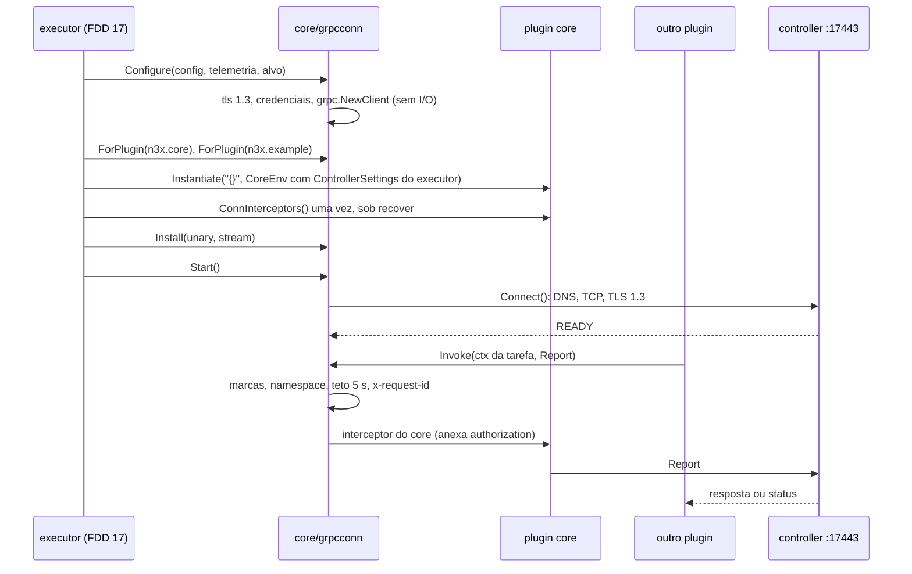
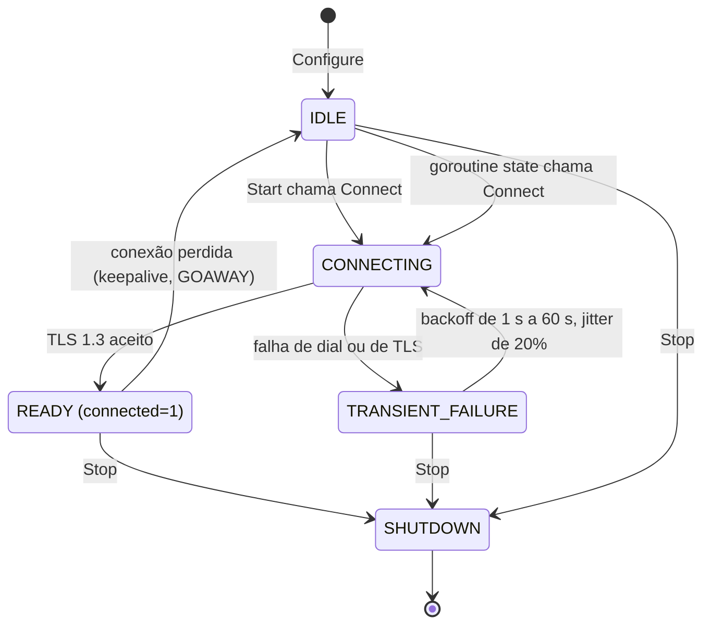
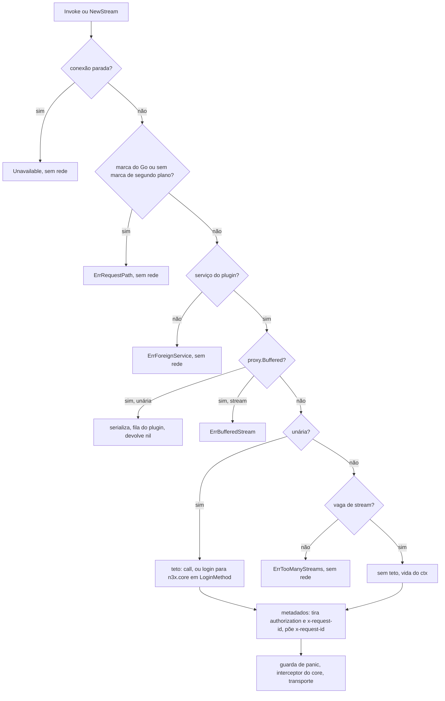

### FDD: Conexão compartilhada com o controller (SID-10)

Versão: 1.0
Data: 2026-10-20
Responsável: Guilherme Giusti

---

### 1. Contexto e motivação técnica

**Problema técnico.** O FR-002 exige que o core do `.so` abra uma única conexão gRPC com TLS 1.3 até o controller, compartilhada por todos os plugins e sempre fora do caminho da requisição. O HLD do `n3x-sidecar` deu um dono a ela (`core/grpcconn`) e fixou números (backoff de 1 s a 60 s com jitter de 20%, keepalive de 30 s com prazo de 10 s, buffer de 1.000 itens, teto de 5 s por chamada, login de 10 s), mas deixou sem comportamento verificável:

- quem impõe o teto de 5 s (o "interceptor do core" do ADR-006 do sidecar ou o interceptor do plugin core do HLD do core), como o login de 10 s escapa dele e o que vale para o stream de heartbeat, que vive enquanto o processo vive (L-08)
- o que entra no buffer de 1.000 itens, como uma chamada unária síncrona "entra" num buffer que descarta os mais antigos e como impedir que um plugin barulhento expulse os eventos do core (L-44)
- como garantir uma única conexão por processo se o Envoy criar a config do filtro mais de uma vez (L-45, parte da conexão; a parte do adaptador foi fechada na FDD 16)
- onde os interceptors do plugin core entram, o que acontece com a conexão na janela de 2 s do desligamento e como a recusa `proxy.ErrRequestPath` é implementada no sidecar

Esta entrevista achou três problemas novos:

- **Streams longos esgotam o servidor.** O host aceita 16 streams HTTP/2 por conexão (HLD do `n3x-controller`), e cada chamada unária também ocupa um stream enquanto dura. Sem limite de streams longos por plugin, 16 streams abertos por plugins travariam todas as chamadas unárias do processo, inclusive o login e os eventos do core.
- **Keepalive recusado pelo servidor.** O grpc-go no servidor, com a política padrão (tempo mínimo de 5 min), encerra com `ENHANCE_YOUR_CALM` um cliente que manda ping a cada 30 s. O keepalive do cliente só funciona se a FDD 33 ajustar a política do servidor.
- **Volta ao painel em 30 s contra backoff de 60 s.** Com o teto de 60 s e jitter de 20%, depois de uma queda longa o sidecar pode levar até 72 s para tentar de novo, além da meta de 30 s do PRD (inconsistência I-01 do checkpoint).

**Encaixe no HLD.** Esta FDD especifica o pacote `core/grpcconn` do módulo `github.com/giustech/n3x-sidecar/core` (HLD do `n3x-sidecar`: componente "Conexão compartilhada", "Fluxo de controle (sempre em segundo plano)", "Prazos obrigatórios", seção `controller` do schema do `n3x.yaml` e risco "Vazamento de goroutines ou memória na conexão compartilhada"). Ela implementa `env.Controller()` do `proxy.Env` no sidecar (D-09 do README) e as duas portas que o executor declarou para ela em `core/chain` (FDD 17, contrato 9): `ControllerProvider` (`ForPlugin`, `Install`, `Start` e `Stop`), passada em `chain.NewFactory(reg, Options{..., Controller, ...})`, e o campo `ExitContext` de `SidecarParts`, que entrega ao core o `ctx` da chamada final com a conexão viva até o fim dos 2 s da saída. Encaixa com:

- FDD 06: contrato de `env.Controller()`, `ErrStandalone`, `ErrRequestPath`, `ErrForeignService`, metadado `x-request-id` e proposta da L-08 (contrato 3 dela)
- FDD 09: `ConnInterceptors()` do core, `ControllerSettings`, `ExitContext` e `ExitTimeout` (contratos 3, 5 e 8 dela)
- FDD 15: bloco `controller` do `n3x.yaml`, faixas e `Config.ControllerSecret()`
- FDD 16: `adapter.Process` (processo único, `Build`, `Start` e `Stop` uma vez, nada em `ModeValidate`), `telemetry.Runtime`, `Platform().Controller()` e `PluginMetrics.ControllerCall`
- FDD 17: portas `chain.ControllerProvider` e `chain.SidecarParts.ExitContext`, montagem do `Env`, do `CoreEnv` e do `ControllerSettings` (feito pelo próprio executor, a partir do `config.Config`), chamada única de `ConnInterceptors()` e ordem da subida e da parada
- FDD 36: contrato de fio do core, com o serviço `n3x.plugins.n3x.core.v1.Login` (método único `Login`, L-11 fechada) e o serviço `Core` (`Register`, `Heartbeat` bidirecional, `Event` e `Exit`); dá o nome do método isento do teto e o stream de referência
- FDDs 39 e 42 (consumidoras): login, sessão, registro, heartbeat, eventos e saída usam esta conexão
- FDD 33 (servidor): política de keepalive, limites de mensagem e de streams

**Atores.** Core do `.so` (dono da conexão: executor, contenção de falhas e telemetria), plugin core (instala os interceptors, faz login, registra, mantém o heartbeat, envia eventos e a saída), demais plugins com metade de controller (chamam os próprios serviços em `env.Background()`), controller (servidor gRPC na `17443`) e operador (configura o bloco `controller`, lê métricas e logs).

**Limites.** `core/grpcconn` cria, mantém e fecha um `grpc.ClientConn`, aplica as regras da visão de cada plugin (marcas de `ctx`, namespace, teto, metadados, limite de streams), guarda e envia o buffer e publica o estado da conexão. Ele não conhece token, sessão, login nem o conteúdo das mensagens do core: isso é do plugin core (FDDs 39 e 42), que entra pela cadeia de interceptors. Ele não faz nada no caminho da requisição: nenhuma função do pacote é chamada por hook síncrono.

**Suposições**
- `Factory.Build`, `Chain.Start` e `Chain.Stop` rodam no máximo uma vez por processo e nunca em `ModeValidate` (FDD 16, contrato 1)
- As tarefas de fundo só começam no `Chain.Start`, depois de todas as instâncias criadas (FDDs 06 e 17); o `New` não tem `ctx` e não faz I/O de rede
- O controller roda com uma réplica (ADR-001 do `n3x-sdk`) e aceita no máximo 16 streams por conexão e mensagens de até 4 MiB (HLD do `n3x-controller`)
- `grpc.NewClient` não faz I/O nem resolve nome até `Connect()` ou a primeira chamada (grpc-go a partir da 1.63)
- O executor marca o `ctx` da função do `Go()` e a contenção marca o `ctx` das tarefas de fundo com as marcas privadas do contrato 9 (pedido às FDDs 17 e 18)

**Restrições**
- Nenhuma operação sem prazo (ADR-006 do `n3x-sidecar`); nada bloqueia a thread principal do Envoy: `Configure` sem rede e `Start` em até 1 ms
- Nenhum token, segredo, `authorization`, conteúdo de mensagem ou certificado em log, erro ou métrica (requisito de segurança do PRD)
- Nada por variável de ambiente (FR-001): a conexão ignora `HTTPS_PROXY`, `GRPC_*` e afins
- `core/grpcconn` importa `core/chain`, `core/config`, `core/telemetry`, o SDK (`proxy/`, `plugin/`, `telemetry/`) e grpc-go; não importa `core/adapter/envoy140` nem o SDK do Envoy (HLD do `n3x-sidecar`)
- Documentação e mensagens em pt-BR; identificadores, rótulos e nomes de evento em inglês

**Rastreabilidade**
- PRD 1.5: FR-002 (conexão única com TLS 1.3, keepalive, backoff, buffer que descarta os mais antigos, `UNAVAILABLE` ou espera enquanto o login não completa, certificado errado só loga, standalone), FR-012 (controller só em tarefa de fundo, erro na hora durante a requisição), FR-016 (registro, eventos e saída em 2 s usam esta conexão); requisitos não funcionais de disponibilidade (zero erros da aplicação causados pelo controller), segurança (TLS 1.3, nenhum segredo em log) e observabilidade (estado da conexão, tamanho e descartes do buffer); critérios de aceite "controller desligado sem erro e volta ao painel em 30 s", "TLS 1.3" e "nenhum segredo em logs"; risco "conexão gRPC dentro do Envoy vaza goroutines"
- ADRs: ADR-006 do `n3x-sidecar` (prazo obrigatório); ADR-004, ADR-009, ADR-016 e ADR-019 do `n3x-sdk`; ADR-007 e ADR-010 do `n3x-plugin-core`; ADR-004 do `n3x-controller` (rajada de logins)
- Lacunas do README fechadas aqui:
  - **L-08 fechada:** os 5 s do sidecar e os 10 s do ADR-007 do core são camadas diferentes (cliente e servidor), não conflito. O teto do cliente é imposto pela visão do `Env` em `core/grpcconn` (o "interceptor do core" do ADR-006 do sidecar é lido como o core do `.so`), antes do interceptor do plugin core, que não impõe teto. Só chamada unária tem teto: `min(prazo do ctx, controller.timeouts.call)`. O login escapa pelo método completo que a FDD 36 fixou (L-11): na visão do `n3x.core`, `/n3x.plugins.n3x.core.v1.Login/Login` usa `controller.timeouts.login` (10 s); outros plugins nem alcançam o método (`ErrForeignService`). Stream não tem teto total nem prazo por mensagem no cliente, e o caso de referência é `/n3x.plugins.n3x.core.v1.Core/Heartbeat` (FDD 36); a vida é a do `ctx` e a queda é detectada pelo keepalive e pela lógica do core. Cada tentativa do buffer usa o teto de chamada. Teto efetivo de `controller.timeouts.call` é o valor configurado (contrato 4)
  - **L-44 fechada:** só entra no buffer a chamada unária marcada pelo plugin com `proxy.Buffered()` (acréscimo pedido ao SDK); chamada síncrona nunca entra: ela segue a semântica do gRPC (espera a conexão ficar pronta dentro do teto ou recebe `Unavailable`). O buffer é dividido por plugin: os demais plugins ficam com no máximo um quarto de `max_items`, em partes iguais, e o core com o resto; cada plugin só expulsa os próprios itens mais antigos. O envio usa duas goroutines (uma só do core, outra em rodízio para os demais), então um plugin lento não atrasa os eventos do core (contrato 5)
  - **L-45 fechada (parte da conexão):** o `grpc.ClientConn` só é criado em `Configure`, chamado pelo executor dentro do `Build` em `ModeServe`, que o `adapter.Process` garante uma vez por processo. `Configure` recusa uma segunda chamada e um contador do pacote recusa uma segunda conexão viva; em `ModeValidate` nada é criado. `Install` aceita os interceptors do core uma vez; `Start` só chama `Connect()` e `Stop` fecha, uma vez cada (contrato 1)
- Lacunas aplicadas: L-13 (FDD 06): `x-request-id` em toda chamada pela conexão, com o valor do `ctx` ou um novo; `request_id` nos logs. L-12 (FDD 06): `n3x_controller_connected`, `n3x_controller_buffer_items` e `n3x_controller_buffer_dropped_total` com os nomes mantidos, alimentados por esta FDD e publicados pela FDD 16
- Pedidos de FDDs anteriores atendidos:
  - FDD 06 (P-01 e P-02 dela): L-08 fechada (contrato 4) e limite de streams por plugin (contrato 3)
  - FDD 07 (P-11 dela): harness da visão do controller para a suíte `conformance.RunEnv` (contrato 10) e regras que o controller falso do kit precisa copiar (pedido de volta à FDD 07)
  - FDD 09: interceptor do core o mais interno da cadeia (contrato 6) e conexão aberta até o fim dos 2 s da saída, garantida pelo `ExitContext` desta FDD (contrato 2 e fluxo do desligamento)
  - FDD 15 (P-11 dela): teto efetivo de `controller.timeouts.call` e faixa de `controller.buffer.max_items` (contrato 7)
  - FDD 16: conexão criada só no `Build` em `ModeServe`, ligada no `Start` e fechada no `Stop` (contrato 1)
  - FDD 36: exceção de prazo da L-08 pelo método completo `/n3x.plugins.n3x.core.v1.Login/Login` e `Core/Heartbeat` como o stream sem teto (contrato 4)
  - FDD 17 (P-04 dela): implementação das portas `ControllerProvider` (com `Install`) e `SidecarParts.ExitContext` na forma do contrato 9 dela, com um único acréscimo, `Configure`, porque o provedor nasce na carga do `.so`, antes de o `n3x.yaml` ser lido (contrato 2)

---

### 2. Objetivos técnicos

- **Controller nunca afeta o tráfego.** Medida: com o controller desligado, com certificado errado, com TLS 1.2 ou recusando a credencial, o sidecar fica pronto em até 5 s e uma carga de 200 rps por 60 s tem 0 respostas diferentes das da aplicação e p99 dentro de 10% do mesmo teste em standalone (hipótese de carga).
- **Uma conexão por processo.** Invariante: no máximo um `grpc.ClientConn` vivo por processo, nenhum no processo de validação. Medida: bootstrap de teste com duas ocorrências do filtro gera 1 log `controller_configured` e o servidor de teste aceita exatamente 1 conexão TCP; `envoy --mode validate` gera 0 conexões.
- **Nada espera sem limite.** Invariante: chamada unária termina em até `min(prazo do ctx, teto)` mais 50 ms; login em até `controller.timeouts.login` mais 50 ms; `Configure` em até 5 ms sem rede; `Start` em até 1 ms; `Stop` em até o prazo recebido mais 100 ms.
- **Recusa barata e sem rede.** Medida: `ErrRequestPath`, `ErrForeignService` e `ErrTooManyStreams` devolvidos em até 1 µs (mediana de 10.000 chamadas), com 0 bytes enviados (transporte de teste que conta chamadas). `env.Controller()` com 0 alocações.
- **Buffer limitado e justo.** Invariantes: o buffer nunca passa de `max_items` itens nem de 8 MiB (fora o caso extremo documentado no contrato 5); um plugin nunca expulsa item de outro plugin; o core tem garantida pelo menos a metade de `max_items`. Medida: um plugin que enfileira 10.000 itens não descarta nenhum item do core.
- **Volta rápida depois de uma queda curta.** Medida: numa queda do controller de até 20 s, `n3x_controller_connected` volta a 1 em até 10 s depois de o controller voltar; numa queda longa, em até 73 s (60 s com jitter de 20% mais 1 s).
- **Sem vazamento.** Medida: com o controller no ar, no máximo 20 goroutines com rótulo `component=grpcconn`, mais 1 por stream aberto; depois de 500 ciclos de queda e volta, a contagem varia no máximo 2 e o heap cresce no máximo 2 MiB; depois do `Stop`, 0 goroutines com o rótulo em até 1 s.
- **Saída dentro da janela, com a conexão viva.** Invariante: a chamada `Exit` feita com o `ctx` de `ExitContext` (porta `SidecarParts` da FDD 17) nunca perde a conexão antes de terminar e nunca passa do fim do `ShutdownGrace`. Medida: `Exit` contra servidor que demora 1 s termina com `OK` mesmo com `Stop` chamado no meio; contra servidor mudo, termina em 1,5 s mais ou menos 50 ms.
- **Token e metadados reservados invisíveis.** Invariante: nenhum código de plugin vê `authorization`; o metadado `authorization` ou `x-request-id` posto por um plugin nunca chega ao servidor como veio. Medida: teste com servidor que ecoa os metadados recebidos.
- **Mesmo comportamento no kit e no sidecar.** Medida: os casos de controller da suíte `conformance.RunEnv` (FDD 07) passam no harness do sidecar com a visão real.

---

### 3. Escopo e exclusões

**Incluído**
- Pacote `core/grpcconn`: `Provider` que implementa as portas `chain.ControllerProvider` e `chain.SidecarParts.ExitContext` da FDD 17, com o acréscimo `Configure` (contratos 1 e 2)
- Ciclo de vida do `grpc.ClientConn`: criação sem I/O no `Build` em `ModeServe`, ligação no `Start`, fechamento no `Stop` dentro da janela de 2 s; conexão única por processo (L-45, parte da conexão)
- TLS 1.3 com a CA de `controller.ca_file`, nome do servidor conferido, sem certificado de cliente; keepalive; reconexão com backoff e jitter; limites de mensagem; DNS e proxy (contrato 7)
- Visão `env.Controller()` por plugin: marcas de `ctx` (`ErrRequestPath`), namespace (`ErrForeignService`), teto, isenção do login, metadados, limite de streams, contagem por código (contratos 3 e 4)
- Fechamento da L-08 (contrato 4) e da L-44 (contrato 5)
- Buffer de envios em segundo plano: entrada por `proxy.Buffered()`, partição por plugin, despejo, envio, novas tentativas e desligamento (contrato 5)
- Cadeia de interceptors: ponto de instalação dos interceptors que o executor entrega por `Install`, contenção de panic e o que nunca é enviado (contrato 6)
- `ExitContext` da visão `Sidecar` do core: `ctx` da chamada final com a marca de segundo plano e a conexão viva até ele terminar (contrato 2)
- Acréscimos pedidos ao SDK para o buffer e o limite de streams (contrato 8) e pacote interno de marcas de `ctx` (contrato 9)
- Harness de teste da visão para a suíte de conformidade (contrato 10)
- Métricas e logs da conexão, do buffer e das chamadas (contrato 11 e seção 7)

**Excluído**
- Login, token, renovação, novo login em `UNAUTHENTICATED` e o que o interceptor do core faz sem sessão: FDD 39 (CORE-03)
- Conteúdo e momento de registro, heartbeat, eventos e saída, e a escolha de quais deles passam pelo buffer: FDD 42 (CORE-06)
- Contrato de `env.Controller()`, `env.Background()` e erros do SDK: FDD 06 (SDK-06); aqui só a implementação e os acréscimos pedidos
- Interface `ConnInterceptors()`, `CoreEnv`, `ExitContext` e exclusividade do core: FDD 09 (SDK-09)
- Limites do servidor (conexões, streams, mensagens), política de keepalive e prazos do lado do host: FDD 33 (CTL-04)
- Validação dos campos da seção `controller` do `n3x.yaml`: FDD 15 (SID-01); aqui só o uso
- Implementação de `Background`, do `Go()` e das marcas de `ctx`: FDD 18 (SID-04); aqui só a leitura das marcas
- Montagem do `Env`, do `CoreEnv` e do `ControllerSettings`, chamada de `ConnInterceptors()` e ordem da subida: FDD 17 (SID-03)
- Publicação das stats do Envoy: FDD 16 (SID-02)
- Teste de longa duração de várias horas (L-41): FDD 48 ou 50; aqui só o teste de 30 min da CI noturna
- Fora da v1, por adição em minor quando houver caso real (hipótese): campo `controller.tls_server_name`, certificado de cliente (mTLS), recarga da CA sem restart, prazo por mensagem em stream, buffer persistente em disco, cota do buffer ajustável por plugin, várias réplicas do controller

---

### 4. Fluxos detalhados e diagramas

**Fluxo de carga e subida (`ModeServe`)**
1. Carga do `.so`: o `main` gerado chama `entry.Register` (FDD 17), que cria `ctl := grpcconn.New(grpcconn.Options{})` e o entrega em `chain.Options.Controller` e, como `ctl.ExitContext`, em `chain.Options.Sidecar.ExitContext`. Nada de I/O, nada de goroutine.
2. `Build`, logo depois de `config.Load` com `SecretsOpen` e de `Telemetry().Configure` (passos 5 e 6 da FDD 17): o executor chama `ctl.Configure(chain.ControllerInput{Config, Telemetry, Target})` (acréscimo pedido à FDD 17).
   - Sem bloco `controller`: modo standalone. Loga `controller_standalone` e termina; nenhuma série de conexão é definida.
   - Com bloco `controller`: monta o `tls.Config` (TLS 1.3, CA de `cfg.ControllerCA()`, nome do servidor), as credenciais e o discador que registram o motivo das falhas, as opções de discagem (contrato 7) e chama `grpc.NewClient("dns:///" + address, ...)`, que não faz I/O. Define as séries da conexão (`Platform().Controller()`), põe `n3x_controller_connected` em 0, avisa se algum teto passa dos 10 s do servidor e loga `controller_configured`.
   - Erro (endereço que o grpc-go recusa, CA ilegível): o `Build` falha com o problema do contrato 1 e o Envoy não sobe. É erro de config do operador, que a FDD 15 já recusa antes.
3. Passo 10 da FDD 17: para cada plugin com instância, `ctl.ForPlugin(id)` cria a visão do plugin uma vez e guarda os handles de métrica dele.
4. Passo 11 da FDD 17, instância do core: o executor monta o `CoreEnv` com o `ControllerSettings` que ele mesmo tira do `config.Config` (sem porta); depois do `New`, do selo e do `CheckPrivileged` (FDD 09), com a seção `controller`, chama `ConnInterceptors()` uma vez sob `recover`, confere os dois valores não nulos e entrega o par a `ctl.Install(u, s)`, que o guarda como o mais interno da cadeia (contrato 6).
5. `Chain.Start()` (FDD 16) chama `ControllerProvider.Start()` por último (passo 14 da FDD 17): o provedor congela o conjunto de plugins, calcula a partição do buffer, inicia três goroutines com rótulos de pprof (`state`, `sender_core`, `sender_shared`) e chama `cc.Connect()` dentro de `pprof.Do`, para as goroutines internas do grpc-go herdarem o rótulo `component=grpcconn`. Volta em até 1 ms.
6. A goroutine `state` acompanha o estado do canal (`WaitForStateChange`): atualiza `n3x_controller_connected`, loga as transições e, ao ficar `IDLE` depois de perder a conexão, chama `cc.Connect()` de novo.

**Fluxo da chamada unária síncrona** (tarefa de fundo de um plugin)
1. O plugin chama o client gerado sobre a visão (`cli.Report(ctx, req)`); a visão recebe `Invoke(ctx, método, args, reply, opts...)`.
2. Conexão já parada: `Unavailable` ("controller: conexão encerrada"), sem rede.
3. `ctx` com a marca do `Go()`, ou sem a marca de segundo plano: `ErrRequestPath` na hora (FDD 06, regras 1 e 2).
4. Serviço do método fora de `id.OwnsGRPCService`: `ErrForeignService` na hora (FDD 06, regra 3).
5. Opção `proxy.Buffered()` presente: vai ao fluxo do buffer.
6. Teto: `controller.timeouts.call`; na visão do `n3x.core` e com método `LoginMethod`, `controller.timeouts.login`. O `ctx` só é encurtado se o prazo dele for maior que o teto ou se não houver prazo.
7. Metadados: cópia dos metadados de saída do plugin sem `authorization` e sem `x-request-id`, mais `x-request-id` com `telemetry.RequestIDFrom(ctx)` ou `telemetry.NewRequestID()`.
8. `cc.Invoke`: a cadeia da conexão roda a guarda de panic e o interceptor do core (anexa o token, FDD 39) e chega ao transporte.
9. Semântica de espera do gRPC: com a conexão em `TRANSIENT_FAILURE`, `Unavailable` na hora; em `CONNECTING` ou `IDLE`, espera ficar pronta dentro do teto; com `grpc.WaitForReady(true)` do plugin, espera mesmo em `TRANSIENT_FAILURE`, sempre dentro do teto.
10. O código final soma em `n3x_plugin_controller_calls_total{plugin,code}`; falha gera `controller_call_failed` amostrado. O erro volta ao plugin, que decide (FR-002).

**Fluxo do stream** (heartbeat do core ou stream de outro plugin)
- Passos 2 a 4 iguais. `proxy.Buffered()` num stream: `ErrBufferedStream`.
- Vaga de stream: no máximo `MaxStreamsPerPlugin` (2) por plugin e `MaxStreamsTotal` (8) no processo; sem vaga, `ErrTooManyStreams` na hora, sem rede.
- Sem teto: o `ctx` segue como veio (a tarefa de fundo não tem prazo). Metadados como no passo 7.
- A vaga volta quando o stream termina: `RecvMsg` devolve erro (inclusive `io.EOF`), o `ctx` do stream termina (`context.AfterFunc`) ou a abertura falha. A liberação acontece uma vez.

**Fluxo do envio pelo buffer** (L-44)
1. O plugin chama `cli.Event(ctx, req, proxy.Buffered())` numa tarefa de fundo. A visão aplica os passos 2 a 4.
2. A visão serializa `args` na hora (cópia: o plugin pode reutilizar a mensagem) e guarda `{método, bytes, x-request-id, hora}` na fila do plugin. Mensagem maior que `MaxBufferedMessage` ou que a cota de bytes do plugin: `ErrBufferTooLarge`, nada é despejado.
3. Fila do plugin cheia (itens ou bytes): sai o item mais antigo do próprio plugin, soma em `n3x_controller_buffer_dropped_total` e em `n3x_plugin_controller_buffer_total{result="dropped"}`.
4. `Invoke` devolve `nil` na hora; `reply` fica como estava. O plugin não vê o resultado do envio.
5. A goroutine `sender_core` envia só a fila do core; a `sender_shared` passa pelas filas dos demais em rodízio. Cada uma espera: fila não vazia, conexão `READY` e fila fora de espera.
6. Cada tentativa vai por `cc.Invoke` com um `ctx` próprio (marca de segundo plano, teto de chamada, `x-request-id` do item), passando pelo interceptor do core. Sucesso: tira o item e soma `result="sent"`. Código transitório (`Unavailable`, `DeadlineExceeded`, `ResourceExhausted`, `Aborted`, `Unauthenticated`): o item fica e a fila espera de 1 s a 10 s (jitter de 20%). Outro código: o item sai com `result="failed"` e log `controller_buffer_failed`.
7. A espera de todas as filas volta a zero quando a conexão volta a `READY`.

**Fluxo de reconexão**
- O grpc-go tenta de novo com backoff de 1 s a 60 s, multiplicador 1,6 e jitter de 20% (contrato 7). O discador e as credenciais registram o motivo da falha (`dial` ou `tls`), que vira `n3x_controller_connect_failures_total{reason}` e `controller_connect_failed`.
- Conexão `READY` que cai (keepalive sem resposta em 10 s, `GOAWAY`, reset): o canal vai a `IDLE` e a goroutine `state` chama `Connect()`; a primeira tentativa é imediata e as seguintes seguem o backoff.
- O grpc-go resolve o nome de novo a cada reconexão, então o IP novo do controller é achado sem restart.
- O novo login depois da volta é do core (FDD 39), com jitter próprio.

**Fluxo do desligamento** (FR-016, pedido da FDD 09)
1. Drenagem (FDD 29): a conexão segue normal; o core envia `DRAIN_START` e mantém o heartbeat (FDD 42).
2. SIGTERM ao Envoy: `Process.Stop(ctx)` com `ShutdownGrace` de 2 s (FDD 16) chama `Chain.Stop(ctx)`, que chama `Containment.Stop(ctx)` (FDD 18): o `ctx` das tarefas é cancelado; o stream de heartbeat termina e devolve a vaga; a tarefa de saída do core pega `Sidecar().ExitContext()`, que o executor liga a `ctl.ExitContext` (`SidecarParts.ExitContext`, FDD 17), e envia `Exit` direto pela visão, sem buffer.
3. `ctl.ExitContext()` devolve um `ctx` com a marca de segundo plano e prazo de `proxy.ExitTimeout` (1,5 s), derivado do `ctx` raiz do provedor, e registra esse `ctx` como "saída aberta" até ele terminar (fim do prazo ou `cancel`). É essa conta que mantém a conexão viva durante toda a chamada final.
4. Só depois de `Containment.Stop` voltar (todas as tarefas terminaram ou o prazo venceu), `Chain.Stop` chama `ControllerProvider.Stop(ctx)`, com o mesmo prazo. `Stop` recusa chamadas novas (`Unavailable`, "conexão encerrando") e espera as saídas abertas terminarem, no máximo até o prazo recebido: a conexão nunca fecha com um `Exit` em voo dentro da janela de 2 s.
5. Se a conexão está `READY` e o buffer tem itens, as duas goroutines de envio esvaziam o buffer sem espera entre tentativas até ele acabar, até a primeira falha transitória ou até o prazo menos 50 ms.
6. O que sobrou é descartado: soma em `n3x_controller_buffer_dropped_total` e um log `controller_buffer_discarded` com a quantidade.
7. Cancela o `ctx` raiz (goroutines `state` e de envio, e qualquer `ctx` de saída ainda aberto, o que garante o teto de 2 s), chama `cc.Close()`, espera as goroutines próprias por até 50 ms, põe `n3x_controller_connected` em 0 e loga `controller_closed`. Depois vem o `LogFlushGrace` da FDD 16.

**Fluxos alternativos e exceções**
- **Modo standalone:** `ForPlugin` devolve uma função que sempre dá `(nil, proxy.ErrStandalone)`, sem alocar; o executor não chama `ConnInterceptors()` nem `Install` (FDD 17); `Start` e `Stop` não fazem nada; `ExitContext` continua devolvendo um `ctx` com marca e prazo, sem uso (o core fica inativo, FDD 09); nenhuma goroutine e nenhuma série de conexão nas stats.
- **`ModeValidate`:** o executor não chama `Configure` (FDD 17); nenhuma conexão no processo de validação (FDD 16).
- **Config do filtro criada mais de uma vez:** o `adapter.Process` devolve a mesma cadeia (FDD 16); `Configure` não roda de novo. Se rodasse, devolveria `ErrConfigured`.
- **`Build` falha depois do `Configure`** (por exemplo, `New` de um plugin falha): o executor chama `ctl.Stop` com prazo curto para liberar o canal criado (pedido à FDD 17); o Envoy não sobe.
- **Controller fora do ar na subida:** `Start` volta na hora; o canal fica entre `CONNECTING` e `TRANSIENT_FAILURE`; chamadas síncronas recebem `Unavailable`; o buffer guarda; o tráfego segue.
- **Certificado inválido, CA errada, nome que não confere ou servidor só com TLS 1.2:** o handshake falha, `reason="tls"`, log `controller_connect_failed` com o motivo, nova tentativa com backoff, tráfego intacto (FR-002).
- **Credencial recusada no login:** o controller responde `UNAUTHENTICATED` ao core; a conexão continua `READY`; o core tenta de novo com backoff (FDD 39); os envios do buffer recebem `Unavailable` ou `Unauthenticated` do interceptor do core e esperam.
- **Login incompleto:** o comportamento do interceptor do core sem sessão é da FDD 39 (recomendação: esperar o login em andamento dentro do prazo da chamada e devolver `Unavailable` na hora quando não há login em andamento). Pela visão, a chamada nunca passa do teto.
- **Mensagem acima de 4 MiB:** o grpc-go recusa na hora com `ResourceExhausted`, sem enviar.
- **Panic no interceptor do core:** a guarda recupera; a chamada falha com `Internal`; soma em `n3x_plugin_panics_total{plugin="n3x.core",instance="core"}` (FDD 09). Panic dentro do transporte do grpc-go (abaixo do interceptor) soma em `n3x_sidecar_core_errors_total{event="controller_call",kind="panic"}`.
- **Panic numa goroutine do pacote:** recuperado; log `grpcconn_panic` com stack amostrado; `n3x_sidecar_core_errors_total{event="controller",kind="panic"}`; a goroutine reinicia depois de 1 s.
- **Terceiro stream de um plugin ou nono no processo:** `ErrTooManyStreams` na hora; código `TooManyStreams` em `n3x_plugin_controller_calls_total`.
- **Plugin que guarda o `ctx` de uma tarefa e usa num hook:** a marca de segundo plano passaria; é risco tratado pela análise estática (FDD 24, regra `ctx_field`).

**Diagramas**

Subida, instalação do core e chamada de um plugin:



Estados do canal, como vistos pela goroutine `state`:



Decisão da visão numa chamada:



Envio do buffer e desligamento:

```mermaid
sequenceDiagram
    participant P as plugin (tarefa)
    participant Q as filas do buffer
    participant SC as sender_core
    participant SS as sender_shared
    participant K as controller
    P->>Q: Invoke(..., proxy.Buffered()) devolve nil
    Note over Q: fila do plugin cheia: sai o mais antigo do próprio plugin
    SC->>Q: pega o mais antigo do core (conexão READY)
    SC->>K: Invoke com teto de 5 s
    K-->>SC: OK: tira o item / transitório: espera 1 s a 10 s
    SS->>Q: rodízio entre as filas dos demais
    SS->>K: Invoke com teto de 5 s
    Note over Q,K: Stop: esvazia só com READY, até o prazo menos 50 ms; o resto vira descarte
```

---

### 5. Contratos públicos (assinaturas, endpoints, headers, exemplos)

**Contrato 1: `grpcconn.Provider` (ciclo de vida e conexão única, L-45)**
- Tipo: method (API Go do módulo `github.com/giustech/n3x-sidecar/core`, usada por `core/entry` e pelo executor)
- Assinatura/Rota:
  ```go
  package grpcconn // github.com/giustech/n3x-sidecar/core/grpcconn

  // Provider implementa chain.ControllerProvider (contrato 2). Um por processo.
  type Provider struct{ /* estado, canal, visões, buffer */ }

  type Options struct {
      Transport grpc.ClientConnInterface // só testes (grpcconntest); nil em produção
      Now       func() time.Time         // nil = time.Now
      Rand      func() float64           // jitter em [0, 1); nil = math/rand/v2
  }

  func New(opts Options) *Provider // sem I/O e sem goroutine

  // chain.ControllerProvider (FDD 17, contrato 9) mais o acréscimo Configure (contrato 2)
  func (p *Provider) Configure(in chain.ControllerInput) error
  func (p *Provider) ForPlugin(id plugin.ID) func() (grpc.ClientConnInterface, error)
  func (p *Provider) Install(u grpc.UnaryClientInterceptor, s grpc.StreamClientInterceptor)
  func (p *Provider) Start()
  func (p *Provider) Stop(ctx context.Context)

  // chain.SidecarParts.ExitContext (FDD 17, contrato 9)
  func (p *Provider) ExitContext() (context.Context, context.CancelFunc)

  func (p *Provider) Stats() Stats // para testes e logs

  type Stats struct {
      Standalone  bool
      State       connectivity.State
      BufferItems int
      BufferBytes int64
      Streams     map[plugin.ID]int
      OpenExits   int // ctx de saída ainda abertos
  }

  var (
      ErrConfigure        = errors.New("grpcconn: bloco controller não pôde ser usado")
      ErrConfigured       = errors.New("grpcconn: Configure já foi chamado neste processo")
      ErrSecondConnection = errors.New("grpcconn: já existe uma conexão com o controller neste processo")
      ErrStarted          = errors.New("grpcconn: chamada depois do Start")
  )
  ```
- Método: n/a (chamada local)
- Semântica de status:
  - **Conexão única (L-45, parte da conexão):** `Configure` é o único ponto que cria um `grpc.ClientConn`. Ele roda dentro do `Build` em `ModeServe`, que roda no máximo uma vez por processo (FDD 16). Por defesa, `Configure` devolve `ErrConfigured` na segunda chamada no mesmo `Provider`, e um contador atômico do pacote devolve `ErrSecondConnection` se outro `Provider` tentar abrir enquanto uma conexão está viva. `Start` só chama `Connect()` uma vez; `Stop` é idempotente
  - **Sem I/O fora de hora:** `New` e `Configure` não abrem socket nem resolvem nome; a primeira resolução e o primeiro handshake acontecem depois do `Start`
  - **`Configure` com erro:** embrulho com `Unwrap() []error` que leva `ErrConfigure` e `plugin.FieldErrors` (padrão das FDDs 01, 02 e 15), com as regras `address_target` (em `controller.address`, endereço recusado pelo grpc-go) e `ca_format` (em `controller.ca_file`, nenhum certificado utilizável); o executor loga `config_problem` e o `Build` falha
  - **Ordem exigida:** `Configure`, depois `ForPlugin` e `Install` (em qualquer ordem entre si), depois `Start`. `ForPlugin` depois do `Start` faz panic com `ErrStarted` (erro de programação do executor)
  - **`Install`** (assinatura da FDD 17, sem retorno de erro): guarda o par de interceptors do core para a guarda do contrato 6; vale uma vez por processo. Segunda chamada, chamada no standalone ou depois do `Start` não têm efeito e geram o log `controller_core_install_ignored` (`error`, com o motivo `twice`, `standalone` ou `started`). Interceptor nulo não chega aqui: o executor já recusou a subida com `core_capability_missing` (FDD 17). Se o `Start` chegar sem o core instalado com o bloco `controller` presente, o pacote loga `controller_core_missing` (`error`) e as chamadas seguem sem token (o servidor responde `UNAUTHENTICATED`); é só defesa
  - **`ExitContext`** (implementa `SidecarParts.ExitContext`): ver contrato 2
  - **`Stats`:** cópia, segura entre goroutines

**Exemplo de requisição**
```go
// core/entry, na carga do .so (FDD 17)
ctl := grpcconn.New(grpcconn.Options{})
f := chain.NewFactory(reg, chain.Options{
    Source:      src,
    Containment: fault.New(),
    Controller:  ctl,
    Sidecar: chain.SidecarParts{
        Identity:    identityFn,      // FDD 25
        Drain:       drainFn,         // FDD 29
        ExitContext: ctl.ExitContext, // esta FDD
    },
})

// Dentro do Build, primeira criação da config do filtro
err1 := ctl.Configure(chain.ControllerInput{Config: cfg, Telemetry: h.Telemetry(), Target: h.Target()})
// Segunda criação da config do filtro: o adapter.Process devolve a mesma cadeia e não chama Build.
// Se alguém chamasse de novo:
err2 := ctl.Configure(chain.ControllerInput{Config: cfg, Telemetry: h.Telemetry(), Target: h.Target()})
```

**Exemplo de resposta**
```json
{
  "err1": null,
  "err2": "grpcconn: Configure já foi chamado neste processo",
  "conexões TCP aceitas pelo servidor de teste": 1,
  "log": "{\"ts\":\"2026-10-20T14:00:01.204Z\",\"level\":\"info\",\"component\":\"core\",\"service\":\"pedidos\",\"msg\":\"controller_configured\",\"address\":\"n3x-controller:17443\",\"server_name\":\"n3x-controller\",\"ca_file\":\"/etc/n3x/ca.pem\",\"call_timeout_ms\":5000,\"login_timeout_ms\":10000,\"buffer_max_items\":1000,\"buffer_max_bytes\":8388608,\"duration_ms\":2}"
}
```

---

**Contrato 2: portas da FDD 17 implementadas (`chain.ControllerProvider` e `chain.SidecarParts.ExitContext`)**
- Tipo: sdk (interfaces Go declaradas em `core/chain` pela FDD 17, contrato 9 dela, e implementadas por `core/grpcconn`)
- Assinatura/Rota:
  ```go
  package chain

  // Forma da FDD 17 (contrato 9), com um acréscimo desta FDD marcado abaixo.
  type ControllerProvider interface {
      // ACRÉSCIMO (pedido à FDD 17): Build em ModeServe, logo depois de config.Load
      // e de Telemetry().Configure (passos 5 e 6 dela). Sem rede.
      Configure(in ControllerInput) error

      ForPlugin(id plugin.ID) func() (grpc.ClientConnInterface, error)      // passo 10: vira Env.Controller()
      Install(u grpc.UnaryClientInterceptor, s grpc.StreamClientInterceptor) // passo 11: interceptors do core, os mais internos
      Start()                                                                // passo 14, último de Chain.Start
      Stop(ctx context.Context)                                              // depois de Containment.Stop, com o mesmo prazo
  }

  // ACRÉSCIMO (pedido à FDD 17): entrada do Configure.
  type ControllerInput struct {
      Config    *config.Config     // n3x.yaml lido com SecretsOpen (FDD 15)
      Telemetry *telemetry.Runtime // CoreLogger, Platform (FDD 16)
      Target    proxy.Target       // nome do alvo para o user agent
  }

  // Forma da FDD 17, sem mudança; ExitContext preenchido com (*grpcconn.Provider).ExitContext.
  type SidecarParts struct {
      Identity    func() proxy.SidecarIdentity              // FDD 25
      Drain       func(q *proxy.EventQueue) <-chan struct{} // FDD 29
      ExitContext func() (context.Context, context.CancelFunc) // FDDs 29 e 38: ctx da chamada final, conexão viva
  }
  ```
- Método: n/a
- Semântica:
  - **`Configure` é o único acréscimo:** o provedor nasce na carga do `.so` (`core/entry`), antes de o executor ler o `n3x.yaml`; sem um ponto de entrada no `Build`, ele não teria endereço, CA, prazos nem `max_items`. O executor chama `Configure` só em `ModeServe` e só se `Options.Controller` não for nulo; erro faz o `Build` falhar (contrato 1). A forma de `ForPlugin`, `Install`, `Start`, `Stop` e `SidecarParts` é exatamente a da FDD 17
  - **`ControllerSettings` fica com o executor** (FDD 17, tabela da visão `Sidecar`): ele tira os valores do `config.Config`; esta FDD não oferece porta para isso. Os dois leem o mesmo `config.Config`, então o teto que a visão aplica e o `CallTimeout` e o `LoginTimeout` que o core vê são sempre iguais
  - **`Install`:** o executor chama `ConnInterceptors()` uma vez, sob `recover`, confere os dois valores não nulos (`core_capability_missing`) e entrega o par; a semântica do lado daqui está no contrato 1 e a posição na cadeia, no contrato 6
  - **`ExitContext` (pedido da FDD 09, "conexão aberta até o fim dos 2 s"):** devolve um `ctx` derivado do `ctx` raiz do provedor, com a marca de segundo plano (`ctxmark.WithBackground`, contrato 9), sem `request_id`, com prazo `agora + proxy.ExitTimeout` (1,5 s) e não afetado pelo cancelamento das tarefas. Cada `ctx` devolvido conta como "saída aberta" até o fim do prazo ou o `cancel`. `Stop` espera as saídas abertas terminarem antes de esvaziar o buffer e fechar, no máximo até o prazo que recebe (o fim do `ShutdownGrace`); ao fechar, cancela o `ctx` raiz e com ele qualquer saída ainda aberta. Resultado: a chamada `Exit` nunca perde a conexão dentro da janela de 2 s, e nada passa do fim da janela
  - **Sem provedor** (`Options.Controller` nulo, testes e harness de desenvolvimento antes desta FDD): `Env.Controller()` devolve `(nil, proxy.ErrStandalone)` e o `ExitContext` é o padrão do executor (FDD 17, contrato 5)
  - **Ordem na parada:** `Chain.Stop` chama `Containment.Stop(ctx)` e só depois `ControllerProvider.Stop(ctx)` (FDD 17, contrato 5); a conta de saídas abertas cobre também uma chamada final que termine depois de `Containment.Stop` ter abandonado a tarefa

**Exemplo de requisição**
```go
// Passo 11 do Build (FDD 17), core já criado e conferido, com a seção controller
u, s, err := callConnInterceptors(coreInst) // uma vez, sob recover
if err != nil || u == nil || s == nil {
    return nil, coreCapabilityMissing(err)
}
ctl.Install(u, s)

// Na saída, dentro da tarefa exit do core (FDD 42)
ectx, cancel := sc.ExitContext() // ligado a ctl.ExitContext pelo executor
defer cancel()
_, err = corecli.Exit(ectx, &corev1.ExitRequest{Reason: corev1.ExitReason_SIGTERM})
```

**Exemplo de resposta**
```json
{
  "Install": "par guardado; log controller_core_installed",
  "segundo Install": "sem efeito; log controller_core_install_ignored com reason=twice",
  "ExitContext()": { "deadline": "agora + 1,5 s", "marca de segundo plano": true, "request_id": "ausente" },
  "Stats().OpenExits durante o Exit": 1,
  "Stop chamado com o Exit em voo": "espera o Exit terminar (ou o prazo) e só então fecha",
  "log": "{\"level\":\"info\",\"component\":\"core\",\"msg\":\"controller_closed\",\"flushed\":0,\"discarded\":0,\"waited_exits\":1,\"took_ms\":212}"
}
```

---

**Contrato 3: visão `env.Controller()` no sidecar (D-09)**
- Tipo: sdk (implementação de `grpc.ClientConnInterface` entregue por `env.Controller()`, contrato 3 da FDD 06)
- Assinatura/Rota:
  ```go
  // tipo não exportado em core/grpcconn; um valor por plugin
  //   Invoke(ctx context.Context, method string, args, reply any, opts ...grpc.CallOption) error
  //   NewStream(ctx context.Context, desc *grpc.StreamDesc, method string, opts ...grpc.CallOption) (grpc.ClientStream, error)

  const (
      MaxStreamsPerPlugin = 2 // igual a proxy.MaxControllerStreams (contrato 8) (hipótese)
      MaxStreamsTotal     = 8 // metade dos 16 streams por conexão do host (hipótese)
  )
  ```
- Método: chamadas gRPC unárias e streams dos clients gerados dos plugins
- Semântica de status e metadados:
  - **Retorno de `env.Controller()`:** a mesma visão do plugin a cada chamada, com 0 alocações, a qualquer momento depois da montagem do `Env`. Standalone: `(nil, proxy.ErrStandalone)`
  - **Regras por chamada, na ordem, antes de qualquer rede:**
    1. conexão parada (`Stop` começou): `status.Error(codes.Unavailable, "controller: conexão encerrada")`
    2. `ctx` com a marca do `Go()` (`ctxmark.IsRequest`) ou sem a marca de segundo plano (`ctxmark.IsBackground` falso): `proxy.ErrRequestPath`
    3. serviço do método fora de `id.OwnsGRPCService`, ou método mal formado: `proxy.ErrForeignService`
    4. `proxy.Buffered()` presente: unária vai ao buffer (contrato 5); stream recebe `proxy.ErrBufferedStream`
    5. unária: teto do contrato 4; stream: vaga por plugin e no processo, senão `proxy.ErrTooManyStreams`
    6. metadados: os de saída do plugin, sem `authorization` e sem `x-request-id`, mais `x-request-id` (L-13); um metadado reservado removido gera `controller_metadata_removed` (`warn`, no máximo 1 por minuto por plugin)
    7. delega a `cc.Invoke` ou `cc.NewStream` (contrato 6)
  - **Status devolvidos ao plugin:** os das sentinelas (com `GRPCStatus()`: `FailedPrecondition`, `PermissionDenied`, `ResourceExhausted`, `InvalidArgument`) e os do gRPC: `Unavailable` (conexão em falha, login incompleto, conexão encerrada), `DeadlineExceeded` (teto), `ResourceExhausted` (mensagem acima de 4 MiB, limites do servidor), `Unauthenticated` (sessão recusada) e os do serviço do plugin
  - **Espera:** a do gRPC (fail-fast em `TRANSIENT_FAILURE`, espera em `CONNECTING`); `grpc.WaitForReady(true)` aceito, sempre dentro do teto
  - **Stream:** a vaga volta uma vez, no primeiro destes: erro em `RecvMsg` (inclusive `io.EOF`), fim do `ctx` do stream ou falha na abertura. O stream devolvido é um embrulho que recupera panic nos métodos do embrulho do core e devolve `Internal`
  - **Contagem:** cada unária síncrona e cada abertura de stream somam 1 em `n3x_plugin_controller_calls_total{plugin,code}`, com `code` igual a `codes.Code.String()` ou a `RequestPath`, `ForeignService`, `TooManyStreams` e `BufferedStream`. Envios do buffer contam no contador do contrato 5
- Limites: recusas em até 1 µs; sobrecusto da visão e da cadeia (sem rede) de até 50 µs no p99 (hipótese); 2 streams por plugin e 8 no processo

**Exemplo de requisição**
```go
conn, _ := env.Controller() // plugin giustech.ratelimit
cli := ratelimitv1.NewRateLimitClient(conn)

env.Background("report", func(ctx context.Context) {
    md := metadata.Pairs("authorization", "Bearer forjado", "x-tenant", "a")
    ctx = metadata.NewOutgoingContext(ctx, md)
    _, err1 := cli.Report(ctx, &ratelimitv1.ReportReq{Limited: 3}) // controller fora do ar
    s1, _ := cli.Watch(ctx, &ratelimitv1.WatchReq{})
    s2, _ := cli.Watch(ctx, &ratelimitv1.WatchReq{})
    _, err3 := cli.Watch(ctx, &ratelimitv1.WatchReq{}) // terceiro stream do plugin
    _, _, _ = s1, s2, err3
    _ = err1
})
```

**Exemplo de resposta**
```json
{
  "err1": "rpc error: code = Unavailable (conexão em TRANSIENT_FAILURE, na hora)",
  "metadados recebidos pelo servidor (controller no ar)": { "x-tenant": "a", "x-request-id": "1d5c8e0a-3b7f-4a2e-9c41-6f0d2b8a7e13", "authorization": "anexado pelo interceptor do core" },
  "err3": "proxy: limite de streams do plugin na conexão com o controller atingido",
  "status.Code(err3)": "ResourceExhausted",
  "bytes enviados por err3": 0,
  "n3x_plugin_controller_calls_total": { "Unavailable": 1, "OK": 2, "TooManyStreams": 1 },
  "log": "{\"level\":\"warn\",\"component\":\"core\",\"msg\":\"controller_metadata_removed\",\"plugin_id\":\"giustech.ratelimit\",\"keys\":\"authorization\"}"
}
```

---

**Contrato 4: prazos e teto (L-08 fechada)**
- Tipo: sdk (regra aplicada pela visão do contrato 3)
- Assinatura/Rota:
  ```go
  package grpcconn

  const (
      LoginMethod        = "/n3x.plugins.n3x.core.v1.Login/Login" // L-11 fechada pela FDD 36: serviço próprio Login, um método unário
      ServerUnaryTimeout = 10 * time.Second                      // prazo do host (ADR-007 do core, FDD 08); só para o aviso
  )

  // deadline devolve o teto da chamada unária, ou 0 para "sem teto" (stream).
  func deadline(id plugin.ID, method string, stream bool, s proxy.ControllerSettings) time.Duration
  ```
- Método: n/a
- Semântica:

| Chamada | Teto no sidecar | Quem impõe | Origem |
| --- | --- | --- | --- |
| Unária de qualquer plugin | `min(prazo do ctx, controller.timeouts.call)`, padrão 5 s, faixa de 100 ms a 60 s | visão do `Env` em `core/grpcconn`, antes do interceptor do core | ADR-006 do `n3x-sidecar`, ADR-016 do `n3x-sdk`, HLD do `n3x-sidecar`, FDDs 06 e 15 |
| `/n3x.plugins.n3x.core.v1.Login/Login` (`LoginMethod`) chamado pelo `n3x.core` | `min(prazo do ctx, controller.timeouts.login)`, padrão 10 s, faixa de 1 s a 60 s | visão do `n3x.core` (outro plugin nem alcança o método: `ErrForeignService`) | ADR-006 do `n3x-sidecar` (login 10 s), FDDs 06 e 15; nome do método pela FDD 36 (L-11) |
| `Exit` com `ExitContext()` | `min(1,5 s, controller.timeouts.call)` = 1,5 s no padrão | visão (o prazo vem do `ctx`) | FDD 09, contrato 8 |
| Stream: `/n3x.plugins.n3x.core.v1.Core/Heartbeat` (bidirecional, FDD 36) e streams de outros plugins | sem teto total e sem prazo por mensagem; vida igual à do `ctx`; queda detectada pelo keepalive (30 s, prazo de 10 s) e pela lógica do core (FDD 42) | ninguém no cliente | HLD do `n3x-sidecar` (teto só para unária), ADR-007 do core, FDD 36 |
| Tentativa de envio do buffer | `controller.timeouts.call` por tentativa | goroutine de envio | contrato 5 |
| Handler no controller | 10 s por unária e 1 s por mensagem processada em stream | servidor (FDD 33) | ADR-007 do core, HLD do `n3x-controller` |

  - **5 s contra 10 s:** são camadas. O cliente desiste primeiro (5 s); os 10 s protegem o servidor de clientes com prazo maior e cobrem o login. Não há conflito a resolver, só documentação (reflexo no ADR-007 do core)
  - **Quem impõe:** a visão do `Env`, igual para todos os plugins, inclusive antes do login. O interceptor do plugin core não impõe teto: ele usa o prazo que recebe (pedido à FDD 39; o HLD do core dizia o contrário, I-02)
  - **Isenção do login por método completo, não por opção de chamada** (pedido da FDD 36): a FDD 36 fechou a L-11 com o serviço próprio `n3x.plugins.n3x.core.v1.Login` e o método único `Login`; os demais métodos do core (`Core/Register`, `Core/Event` e `Core/Exit`) seguem o teto de chamada e `Core/Heartbeat` é o caso de stream sem teto. Uma opção de chamada daria a qualquer plugin um jeito de escapar do teto; o método só é alcançável pelo `n3x.core` por causa do namespace. A constante `LoginMethod` é do sidecar (o `core/` não importa o plugin core) e um teste de igualdade com `corev1.Login_Login_FullMethodName` roda na CI cruzada (FDD 48)
  - **Teto efetivo de `controller.timeouts.call` (pedido da FDD 15):** é o valor configurado, sem corte, dentro da faixa de 100 ms a 60 s que a FDD 15 valida. Valor acima de `ServerUnaryTimeout` não tem efeito prático (o servidor corta antes) e gera um aviso `controller_timeout_above_server` no `Configure`; o mesmo vale para `controller.timeouts.login`
  - **Como o teto é aplicado:** `context.WithTimeout` só quando o `ctx` não tem prazo ou tem prazo maior; o `ctx` do plugin não é alterado
  - **Stream e prazo por envio:** `SendMsg` do gRPC não recebe `ctx`; um servidor vivo que para de ler pode segurar o envio pelo controle de fluxo. Por isso o core usa um `ctx` próprio por stream e o cancela quando o ack não chega (pedido à FDD 42)

**Exemplo de requisição**
```json
[
  { "plugin": "giustech.ratelimit", "method": "/n3x.plugins.giustech.ratelimit.v1.RateLimit/Report", "ctx_deadline": "30s", "servidor demora": "7s" },
  { "plugin": "n3x.core", "method": "/n3x.plugins.n3x.core.v1.Login/Login", "ctx_deadline": "nenhum", "servidor demora": "7s" },
  { "plugin": "n3x.core", "method": "/n3x.plugins.n3x.core.v1.Core/Heartbeat", "stream": true, "ctx_deadline": "nenhum", "duração": "60 min" },
  { "plugin": "n3x.core", "method": "/n3x.plugins.n3x.core.v1.Core/Exit", "ctx": "ExitContext() com 1,5 s", "servidor demora": "3s" }
]
```

**Exemplo de resposta**
```json
[
  { "resultado": "DeadlineExceeded", "depois de": "5,0 s" },
  { "resultado": "OK", "depois de": "7,0 s" },
  { "resultado": "stream aberto por 60 min, sem corte; termina 2 ms depois do cancelamento do ctx" },
  { "resultado": "DeadlineExceeded", "depois de": "1,5 s" }
]
```

---

**Contrato 5: buffer de envios em segundo plano (L-44 fechada)**
- Tipo: queue (fila em memória dentro de `core/grpcconn`, alimentada pela visão)
- Assinatura/Rota:
  ```go
  package grpcconn

  const (
      BufferMaxBytes     = 8 << 20          // teto de bytes do buffer inteiro (hipótese)
      MaxBufferedMessage = 1 << 20          // igual a proxy.MaxBufferedMessage (contrato 8)
      SharedDivisor      = 4                // os demais plugins somam até max_items/4 (hipótese)
      RetryBase          = 1 * time.Second  // espera de uma fila depois de código transitório (hipótese)
      RetryMax           = 10 * time.Second // hipótese
      RetryMultiplier    = 1.6
      RetryJitter        = 0.2
      StopMargin         = 50 * time.Millisecond
  )

  // Entrada pela visão (contrato 3): Invoke com proxy.Buffered() devolve nil ao aceitar.
  ```
- Método: `Invoke(ctx, método, args, reply, proxy.Buffered())` numa tarefa de fundo
- Semântica:
  - **O que entra:** só chamada unária marcada com `proxy.Buffered()`, de qualquer plugin, depois das regras 1 a 3 da visão. Chamada sem a marca nunca entra no buffer: ela espera a conexão pela semântica do gRPC dentro do teto ou recebe `Unavailable` (é assim que se lê o "esperam no buffer ou recebem `UNAVAILABLE`" do FR-002 e do ADR-004 do SDK, I-05)
  - **Entrada:** `args` é serializado na hora com o codec proto (cópia); o `x-request-id` do `ctx` (ou um novo) é guardado com o item; `reply` não é preenchido e `Invoke` devolve `nil` na hora, sem esperar rede. Entrega ao menos uma vez: um item pode chegar duas vezes (resposta perdida depois de o servidor processar), então o método precisa ser idempotente (o core usa o `id` do evento, ADR-007 do core)
  - **Partição (hipótese):** `C = controller.buffer.max_items` (padrão 1.000) e `n` = número de plugins, fora o core, com visão (plugins com instância). Com `n = 0`, o core fica com `C`. Com `n > 0`: cada outro plugin fica com `P = max(1, ⌊⌊C/4⌋/n⌋)` itens e o core com `max(C - n·P, ⌈C/2⌉)`. Bytes: `BufferMaxBytes` dividido na mesma proporção dos itens. No caso extremo de mais de `C/4` plugins, o total passa de `C` em até `n` itens; o core nunca fica com menos da metade
  - **Despejo:** só dentro da fila do próprio plugin, sempre o item mais antigo, até caber em itens e em bytes. Um plugin nunca expulsa item de outro. Cada despejo soma 1 em `n3x_controller_buffer_dropped_total` e em `n3x_plugin_controller_buffer_total{result="dropped"}`, e gera `controller_buffer_dropped` (`warn`, no máximo 1 a cada 10 s por plugin, com a contagem do intervalo)
  - **Item grande demais:** maior que `MaxBufferedMessage` ou que a cota de bytes do plugin: `proxy.ErrBufferTooLarge` (`ResourceExhausted`), `result="too_large"`, nada é despejado
  - **Ordem:** FIFO dentro de cada plugin; sem ordem entre plugins
  - **Envio:** `sender_core` só para a fila do core; `sender_shared` em rodízio pelas filas dos demais, na ordem de ID, pulando filas em espera. Cada goroutine tem no máximo uma chamada em voo. As duas esperam a conexão `READY`; a chamada usa um `ctx` com a marca de segundo plano, teto de `controller.timeouts.call` e o `x-request-id` do item, e passa pela cadeia do contrato 6 (o interceptor do core anexa o token)
  - **Resultado de cada tentativa:** `OK` tira o item (`result="sent"`). `Unavailable`, `DeadlineExceeded`, `ResourceExhausted`, `Aborted` e `Unauthenticated` deixam o item e põem a fila em espera de 1 s, 1,6 s, 2,6 s até 10 s, com jitter de 20%; qualquer outro código tira o item com `result="failed"` e log `controller_buffer_failed` (`warn`, com `plugin_id`, `method`, `code` e `request_id`, amostrado em 1 por segundo por plugin). A espera de todas as filas zera quando a conexão volta a `READY`
  - **Desligamento:** depois do `Stop`, nenhum item novo (`Unavailable`); com `READY`, as filas são esvaziadas sem espera até acabarem, até a primeira falha transitória ou até o prazo menos `StopMargin`; o resto sai com `result="dropped"` e um log `controller_buffer_discarded`
  - **Memória:** fora das cotas de memória dos plugins (é runtime); entra no `GOMEMLIMIT` do processo (FDD 27). Itens guardados como bytes em slices próprios, devolvidos ao coletor quando saem
- Limites: até `max_items` itens e 8 MiB (fora o caso extremo); entrada em até 10 µs no p99 para uma mensagem de 1 KiB (hipótese); com o controller no ar e latência de 1 ms, pelo menos 200 itens por segundo por goroutine de envio (hipótese)

**Exemplo de requisição**
```json
{
  "controller.buffer.max_items": 1000,
  "plugins com visão": ["n3x.core", "n3x.example"],
  "controller": "fora do ar por 2 min",
  "n3x.core enfileira": "1.200 eventos (Event, 600 bytes cada)",
  "n3x.example enfileira": "10.000 relatórios (Report, 200 bytes cada)",
  "depois": "controller volta"
}
```

**Exemplo de resposta**
```json
{
  "partição": { "n3x.core": { "itens": 750, "bytes": 6291456 }, "n3x.example": { "itens": 250, "bytes": 2097152 } },
  "durante a queda": { "n3x_controller_buffer_items": 1000, "n3x_controller_buffer_dropped_total": 10200 },
  "n3x_plugin_controller_buffer_total": {
    "n3x.core": { "accepted": 1200, "dropped": 450, "sent": 750 },
    "n3x.example": { "accepted": 10000, "dropped": 9750, "sent": 250 }
  },
  "itens do core expulsos pelo n3x.example": 0,
  "eventos do core entregues, em ordem": "os 750 mais novos, em até 6 s depois de a conexão ficar READY"
}
```

---

**Contrato 6: cadeia de interceptors e instalação do core**
- Tipo: method (opções de discagem do `grpc.ClientConn`)
- Assinatura/Rota:
  ```go
  // Ordem, de fora para dentro, em toda chamada:
  //   1. visão do plugin (contrato 3): marcas, namespace, buffer, teto, streams, metadados
  //   2. guarda de panic do pacote (grpc.WithChainUnaryInterceptor / WithChainStreamInterceptor)
  //   3. interceptor do core, lido de um atomic.Pointer preenchido por Install (FDD 17)
  //   4. transporte do grpc-go
  const MetadataAuthorization = "authorization"
  ```
- Método: interceptors de cliente gRPC
- Semântica:
  - **O interceptor do core é o mais interno** (pedido da FDD 09): roda depois de todas as regras e da guarda e logo antes do transporte. O `authorization` que ele anexa fica num `ctx` derivado que só o transporte vê; o `ctx` do plugin nunca é alterado
  - **Instalação depois da criação:** o grpc-go só aceita interceptors na criação do canal; por isso o `Configure` cria o canal com a guarda, e a guarda lê o par entregue por `Install` num ponteiro atômico (0 alocações por chamada para ler)
  - **Guarda de panic:** recupera panic do interceptor do core, devolve `status.Error(codes.Internal, "controller: falha interna no interceptor do core")` e soma em `n3x_plugin_panics_total{plugin="n3x.core",instance="core"}` (FDD 09). Uma marca no `invoker` entregue ao core distingue panic abaixo dele (transporte), que soma em `n3x_sidecar_core_errors_total{event="controller_call",kind="panic"}`
  - **O que nunca é enviado:** `authorization` posto por plugin (retirado pela visão), `x-request-id` posto por plugin (trocado pelo valor da visão), qualquer metadado com prefixo `grpc-` posto por plugin (o grpc-go recusa). O token só sai pelo interceptor do core; o login sai sem token (FDD 39)
  - **O que é enviado em toda chamada:** `x-request-id` (L-13), `user-agent` `n3x-sidecar/<versão> grpc-go/<versão>` e, depois do login, `authorization` com o token (FDD 39)
  - Nenhum interceptor do pacote loga metadados, mensagens ou o valor de `authorization`

**Exemplo de requisição**
```go
// Chamada do n3x.example com metadados próprios
ctx = metadata.AppendToOutgoingContext(ctx, "authorization", "x", "x-request-id", "meu-id", "x-cliente", "ok")
_, err := cli.Report(ctx, &examplev1.ReportReq{Denies: 1})
```

**Exemplo de resposta** (metadados recebidos por um servidor de teste que ecoa)
```json
{
  "x-cliente": ["ok"],
  "x-request-id": ["3a0d5f2e-8b1c-4e7a-a6d9-0c2f4b8e1d57"],
  "authorization": ["<token do core, 1 valor>"],
  "user-agent": ["n3x-sidecar/1.0.0 grpc-go/1.7x"],
  "metadados no ctx do plugin depois da chamada": { "authorization": ["x"], "x-request-id": ["meu-id"], "x-cliente": ["ok"] },
  "err": null
}
```

---

**Contrato 7: uso da seção `controller` do `n3x.yaml` e opções da conexão**
- Tipo: config (lida pela FDD 15; usada aqui)
- Assinatura/Rota: `/etc/n3x/n3x.yaml`, bloco `controller`, mais estas opções de discagem:
  ```go
  const (
      KeepaliveTime     = 30 * time.Second // HLD do n3x-sidecar
      KeepaliveTimeout  = 10 * time.Second // HLD do n3x-sidecar
      BackoffBase       = 1 * time.Second  // HLD do n3x-sidecar
      BackoffMax        = 60 * time.Second // HLD do n3x-sidecar
      BackoffMultiplier = 1.6              // padrão do grpc-go (hipótese)
      BackoffJitter     = 0.2              // HLD do n3x-sidecar
      MinConnectTimeout = 10 * time.Second // hipótese
      MaxMessageSize    = 4 << 20          // igual ao host (HLD do n3x-controller)
  )
  ```
- Método: n/a
- Semântica dos campos (faixas e padrões da FDD 15, contrato 1 dela):

| Campo | Padrão | Faixa | Uso aqui |
| --- | --- | --- | --- |
| `controller` | ausente = standalone | | decide standalone |
| `controller.address` | (obrigatório no bloco) | `host:porta` | alvo `dns:///<host>:<porta>`; `<host>` sem colchetes vira o nome conferido pelo TLS |
| `controller.ca_file` | (obrigatório no bloco) | arquivo PEM até 1 MiB | `RootCAs` do TLS, a partir dos bytes já lidos pela FDD 15 (`Config.ControllerCA()`, pedido) |
| `controller.secret` | (obrigatório no bloco) | `ENC[...]` | não é usado pela conexão; vai ao core por `ControllerSettings().Secret`, montado pelo executor (FDD 17) |
| `controller.timeouts.call` | `5s` | 100ms a 60s | teto efetivo das unárias e de cada tentativa do buffer (contrato 4); aviso acima de 10 s |
| `controller.timeouts.login` | `10s` | 1s a 60s | teto do `LoginMethod` na visão do core; aviso acima de 10 s |
| `controller.heartbeat_interval` | `10s` | 1s a 5m | não é usado pela conexão; vai ao core por `ControllerSettings()`, montado pelo executor (FDD 17) |
| `controller.buffer.max_items` | `1000` | 10 a 100000 | `C` da partição do buffer (contrato 5); faixa da FDD 15 confirmada |

  - **TLS:** `MinVersion` e `MaxVersion` TLS 1.3, `RootCAs` só com a CA do arquivo (sem as CAs do sistema), `ServerName` igual ao host de `controller.address` exatamente como escrito, sem certificado de cliente. Nome DNS confere com SAN DNS; IP literal confere com SAN de IP. Quando `controller.address` é um nome de serviço do orquestrador (`n3x-controller`, `n3x-controller.n3x.svc.cluster.local`, nome do Cloud Map ou do compose), o certificado do controller precisa ter esse nome exato no SAN (guia na FDD 47). Não há campo para trocar o nome conferido na v1 (hipótese)
  - **Opções do canal:** `grpc.WithTransportCredentials` (TLS acima, embrulhado para registrar a falha de handshake), `grpc.WithContextDialer` (discador TCP do pacote, que registra a falha de dial), `grpc.WithNoProxy()` (ignora `HTTPS_PROXY`, FR-001), `grpc.WithDisableServiceConfig()` (nada vem do DNS), `grpc.WithIdleTimeout(0)` (o canal não entra em modo ocioso), `grpc.WithKeepaliveParams{Time: 30s, Timeout: 10s, PermitWithoutStream: true}`, `grpc.WithConnectParams{Backoff{BaseDelay: 1s, Multiplier: 1.6, Jitter: 0.2, MaxDelay: 60s}, MinConnectTimeout: 10s}`, `grpc.WithDefaultCallOptions(MaxCallRecvMsgSize(4 MiB), MaxCallSendMsgSize(4 MiB))`, `grpc.WithUserAgent`, e os interceptors do contrato 6
  - **Keepalive e servidor:** ping a cada 30 s mesmo sem chamada em andamento; sem resposta em 10 s, a conexão cai e o canal reconecta. Exige do servidor (FDD 33) `EnforcementPolicy{MinTime <= 30s, PermitWithoutStream: true}`; sem isso, o servidor encerra a conexão com `ENHANCE_YOUR_CALM`
  - **Mensagem:** até 4 MiB nos dois sentidos, igual ao host; o `Register` de até 1 MiB cabe; mensagem maior falha no cliente, sem enviar
  - **CA lida só na subida:** trocar a CA exige restart do sidecar; trocar o certificado do controller emitido pela mesma CA não exige (risco na seção 10)

**Exemplo de requisição**
```yaml
version: 1
service: pedidos
controller:
  address: n3x-controller.n3x.svc.cluster.local:17443
  ca_file: /etc/n3x/ca.pem
  secret: ENC[v1:...]
  timeouts: { call: 15s, login: 10s }
  heartbeat_interval: 10s
  buffer: { max_items: 2000 }
keys:
  aes_file: /run/n3x/aes.key
```

**Exemplo de resposta** (efeito no `Configure`)
```json
{
  "target": "dns:///n3x-controller.n3x.svc.cluster.local:17443",
  "tls": { "min_version": "1.3", "max_version": "1.3", "server_name": "n3x-controller.n3x.svc.cluster.local", "root_cas": "1 certificado de /etc/n3x/ca.pem", "client_cert": false },
  "keepalive": { "time": "30s", "timeout": "10s", "permit_without_stream": true },
  "backoff": { "base": "1s", "multiplier": 1.6, "jitter": 0.2, "max": "60s", "min_connect_timeout": "10s" },
  "max_message_bytes": 4194304,
  "teto efetivo": { "call": "15s", "login": "10s" },
  "buffer": { "max_items": 2000, "max_bytes": 8388608 },
  "log": "{\"level\":\"warn\",\"component\":\"core\",\"msg\":\"controller_timeout_above_server\",\"path\":\"controller.timeouts.call\",\"value_ms\":15000,\"server_ms\":10000,\"detail\":\"o servidor corta as unárias em 10 s; acima disso o teto do cliente não tem efeito\"}"
}
```

---

**Contrato 8: acréscimos pedidos ao SDK (`proxy/`, FDD 06) (hipótese)**
- Tipo: sdk (API Go do pacote `proxy`, acréscimo em minor; o kit da FDD 07 aplica as mesmas regras)
- Assinatura/Rota:
  ```go
  package proxy

  // Buffered marca uma chamada unária para o buffer de envios da conexão compartilhada:
  // a chamada devolve nil assim que o pedido é aceito, sem preencher a resposta,
  // e é entregue ao menos uma vez. Só vale em tarefa de fundo.
  func Buffered() grpc.CallOption // valor que embute grpc.EmptyCallOption
  func IsBuffered(opts []grpc.CallOption) bool

  const (
      MaxControllerStreams = 2       // streams simultâneos por plugin na conexão compartilhada
      MaxBufferedMessage   = 1 << 20 // tamanho máximo serializado de uma chamada no buffer
  )

  var (
      ErrTooManyStreams error // "proxy: limite de streams do plugin na conexão com o controller atingido"; GRPCStatus ResourceExhausted
      ErrBufferedStream error // "proxy: Buffered só vale para chamada unária"; GRPCStatus InvalidArgument
      ErrBufferTooLarge error // "proxy: chamada grande demais para o buffer do controller"; GRPCStatus ResourceExhausted
  )
  ```
- Método: opção de chamada gRPC
- Semântica:
  - Adição compatível: plugins compilados sem ela continuam iguais; o runtime de qualquer versão com esta FDD aceita a opção
  - `IsBuffered` existe para o sidecar e o kit detectarem a opção do mesmo jeito
  - Até a FDD 06 acrescentar as sentinelas, a visão devolve status gRPC com os mesmos códigos e mensagens (contingência)
  - O kit (FDD 07) aceita a opção no controller falso e entrega o item ao handler depois do `Settle`, na ordem; aplica `MaxControllerStreams` e as três sentinelas (pedido à FDD 07)

**Exemplo de requisição**
```go
env.Background("events", func(ctx context.Context) {
    for {
        ev, err := sc.NextEvent(ctx)
        if err != nil {
            return
        }
        _, _ = corecli.Event(ctx, toProto(ev), proxy.Buffered()) // n3x.core
    }
})
```

**Exemplo de resposta**
```json
{
  "Event com controller no ar": "nil na hora; entregue em cerca de 2 ms",
  "Event com controller fora do ar": "nil na hora; entregue quando a conexão voltar, se não for expulso",
  "Event de 2 MiB": "proxy: chamada grande demais para o buffer do controller (ResourceExhausted)",
  "Heartbeat(ctx, proxy.Buffered())": "proxy: Buffered só vale para chamada unária (InvalidArgument)"
}
```

---

**Contrato 9: marcas de `ctx` (`core/internal/ctxmark`) (hipótese)**
- Tipo: sdk (pacote interno do módulo `core/`, usado pelas FDDs 17, 18 e 38)
- Assinatura/Rota:
  ```go
  package ctxmark // github.com/giustech/n3x-sidecar/core/internal/ctxmark

  func WithRequest(ctx context.Context) context.Context    // ctx da função do Go() (FDD 18)
  func WithBackground(ctx context.Context) context.Context // ctx das tarefas de fundo (FDD 18), ExitContext e envios do buffer (esta FDD)
  func IsRequest(ctx context.Context) bool
  func IsBackground(ctx context.Context) bool
  ```
- Método: n/a
- Semântica:
  - Chaves privadas do pacote: plugin não importa `internal` de outro módulo, então não forja a marca (FDD 06, contrato 3)
  - A marca de requisição vence: `ctx` com as duas marcas é tratado como requisição
  - `IsRequest` e `IsBackground` com 0 alocações; custo de `ctx.Value` (até 1 µs com 10 camadas de `ctx`)
  - O kit (FDD 07) tem as próprias marcas; a regra é a mesma

**Exemplo de requisição**
```go
bg := ctxmark.WithBackground(context.Background())
rq := ctxmark.WithRequest(bg)
t, cancel := context.WithTimeout(bg, time.Second)
defer cancel()
fmt.Println(ctxmark.IsBackground(t), ctxmark.IsRequest(rq), ctxmark.IsBackground(context.Background()))
```

**Exemplo de resposta**
```text
true true false
```

---

**Contrato 10: harness da visão para a conformidade (`grpcconntest`, pedido da FDD 07)**
- Tipo: sdk (API Go de teste, subpacote `core/grpcconn/grpcconntest`)
- Assinatura/Rota:
  ```go
  package grpcconntest

  // Provider devolve um provedor configurado sobre uma conexão do teste
  // (bufconn, conexão falsa do conformance.Setup ou servidor de teste com TLS).
  func Provider(conn grpc.ClientConnInterface, s proxy.ControllerSettings) *grpcconn.Provider

  // Server sobe um servidor gRPC de teste com TLS 1.3 e certificado de uma CA própria.
  func Server(t testing.TB, opts ...ServerOption) (address string, caPEM []byte)

  func TLS12Only() ServerOption                 // só TLS 1.2, para o teste de recusa
  func Delay(fullMethod string, d time.Duration) ServerOption
  func EchoMetadata() ServerOption               // devolve os metadados recebidos
  func CountConns() ServerOption                 // conta as conexões TCP aceitas
  ```
- Método: n/a
- Semântica:
  - O harness do sidecar da suíte `conformance` (FDD 17) passa `grpcconntest.Provider(setup.Controller, settings)` em `chain.Options.Controller` (e o `ExitContext` dele em `SidecarParts`), com `CallTimeout = setup.ControllerCallTimeout`; o provedor de teste já vem configurado, e o `Configure` chamado pelo executor só confere que o `n3x.yaml` do teste tem o bloco `controller`; os casos de controller do `RunEnv` (`ErrStandalone`, `ErrRequestPath` com `ctx` do `Go()` e sem marca, `ErrForeignService`, teto unário, `x-request-id`) rodam contra a visão real
  - Casos novos pedidos à FDD 07 para a suíte (mesmo comportamento no kit): isenção do login, stream sem teto, limite de streams por plugin, `Buffered` aceito e entregue, `Buffered` em stream, metadados reservados removidos
  - `Options.Transport` só é aceito por este subpacote; em produção, `core/entry` nunca o preenche (conferido em teste de `core/entry`)

**Exemplo de requisição**
```go
func TestConformidade(t *testing.T) {
    conformance.Run(t, sidecarHarness{
        adapter:    fakeEnvoy{},
        controller: func(c grpc.ClientConnInterface, d time.Duration) chain.ControllerProvider {
            return grpcconntest.Provider(c, proxy.ControllerSettings{CallTimeout: d, LoginTimeout: 10 * time.Second})
        },
    })
}
```

**Exemplo de resposta**
```text
=== RUN   TestConformidade/env/controller_request_path
=== RUN   TestConformidade/env/controller_foreign_service
=== RUN   TestConformidade/env/controller_teto_unario
    conformance.go:88: pulado com -short: caso lento no harness n3x-sidecar (5 s reais)
=== RUN   TestConformidade/env/controller_x_request_id
--- PASS: TestConformidade (4.31s)
```

---

**Contrato 11: métricas da conexão (L-12 aplicada)**
- Tipo: métrica (stats do Envoy na `17090`, publicadas pela FDD 16 a cada 1 s)
- Assinatura/Rota: `GET http://<sidecar>:17090/metrics`; handles de `core/telemetry` (FDD 16, contrato 9), com os acréscimos pedidos:
  ```go
  // existentes (FDD 16)
  func (c *ControllerMetrics) SetConnected(connected bool)
  func (c *ControllerMetrics) SetBufferItems(n int)
  func (c *ControllerMetrics) AddBufferDropped(n uint64)
  func (m *PluginMetrics) ControllerCall(code string)
  // acréscimos pedidos à FDD 16 (hipótese)
  func (c *ControllerMetrics) SetBufferBytes(n int64)
  func (c *ControllerMetrics) ConnectFailure(reason string) // "dial" ou "tls"
  func (m *PluginMetrics) ControllerBuffer(result string)  // accepted, sent, failed, dropped, too_large
  func (m *PluginMetrics) AddControllerStreams(delta int64)
  ```
- Método: GET (Prometheus)
- Semântica:

| Métrica | Tipo | Rótulos | Quando muda |
| --- | --- | --- | --- |
| `n3x_controller_connected` | gauge 0 ou 1 | (nenhum) | 1 só em `READY`; 0 nos outros estados e depois do `Stop` |
| `n3x_controller_buffer_items` | gauge | (nenhum) | itens no buffer |
| `n3x_controller_buffer_dropped_total` | counter | (nenhum) | item expulso por capacidade ou descartado no `Stop` |
| `n3x_controller_buffer_bytes` (nova) | gauge | (nenhum) | bytes no buffer |
| `n3x_controller_connect_failures_total` (nova) | counter | `reason` (`dial`, `tls`) | cada tentativa de conexão que falha |
| `n3x_plugin_controller_calls_total` | counter | `plugin`, `code` | cada unária síncrona e cada abertura de stream (contrato 3) |
| `n3x_plugin_controller_buffer_total` (nova) | counter | `plugin`, `result` | cada mudança de um item do buffer (contrato 5) |
| `n3x_plugin_controller_streams` (nova) | gauge | `plugin` | streams abertos do plugin |

  - **Standalone:** as séries de conexão e de buffer não são definidas, para o alerta `n3x_controller_connected == 0` não disparar num sidecar sem controller (pedido à FDD 16). As séries de sessão continuam como a FDD 09 definiu
  - **Cardinalidade:** constante; `plugin` limitado aos plugins do `.so`; `code` limitado aos 17 códigos gRPC mais 4 valores; nenhum rótulo com método, endereço ou valor da requisição
  - As novas ficam nas famílias de plataforma `n3x_controller_*` e `n3x_plugin_*` (FDD 06, contrato 10); `n3x_controller_*` do sidecar continua exceção da L-12 e só existe no processo do sidecar

**Exemplo de requisição**
```text
GET http://127.0.0.1:17090/metrics
```

**Exemplo de resposta**
```text
n3x_controller_connected 1
n3x_controller_buffer_items 0
n3x_controller_buffer_bytes 0
n3x_controller_buffer_dropped_total 12
n3x_controller_connect_failures_total{reason="dial"} 7
n3x_controller_connect_failures_total{reason="tls"} 0
n3x_plugin_controller_calls_total{plugin="n3x.core",code="OK"} 1240
n3x_plugin_controller_calls_total{plugin="n3x.core",code="Unavailable"} 9
n3x_plugin_controller_buffer_total{plugin="n3x.core",result="accepted"} 85
n3x_plugin_controller_buffer_total{plugin="n3x.core",result="sent"} 73
n3x_plugin_controller_buffer_total{plugin="n3x.core",result="dropped"} 12
n3x_plugin_controller_streams{plugin="n3x.core"} 1
```

---

### 6. Erros, exceções e fallback

**Matriz de erros previstos e tratamentos**

| Condição | Tratamento | Observações |
| --- | --- | --- |
| Sem bloco `controller` | Standalone: `env.Controller()` devolve `(nil, ErrStandalone)`; nenhuma conexão, goroutine ou série de conexão | O core fica inativo (FDD 09) |
| Endereço recusado pelo grpc-go ou CA sem certificado utilizável no `Configure` | `ErrConfigure` com `address_target` ou `ca_format`; o `Build` falha | Erro do operador, já recusado pela FDD 15 na maioria dos casos |
| Segundo `Configure` ou segunda conexão no processo | `ErrConfigured` ou `ErrSecondConnection`; a criação seguinte falha | Não acontece com o `adapter.Process`; defesa da L-45 |
| `Install` repetido, no standalone ou depois do `Start` | Sem efeito; log `controller_core_install_ignored` | A FDD 17 chama uma vez; defesa |
| `Exit` em voo quando o `Stop` começa | `Stop` espera a saída aberta terminar, até o prazo recebido | Pedido da FDD 09; nada passa da janela de 2 s |
| Controller fora do ar, DNS sem resposta, conexão recusada | `TRANSIENT_FAILURE`, `reason="dial"`, log amostrado, backoff de 1 s a 60 s | Tráfego intacto; buffer guarda; síncrona recebe `Unavailable` |
| Certificado inválido, CA errada, nome que não confere, servidor com TLS 1.2 | Handshake falha, `reason="tls"`, log `controller_connect_failed` com o motivo, backoff | FR-002: não conecta, loga e segue servindo |
| Conexão cai (keepalive sem resposta, `GOAWAY`, reset) | Canal vai a `IDLE`; `Connect()` na hora; depois backoff | `connected` vai a 0 e volta a 1 |
| Servidor recusa o keepalive (`ENHANCE_YOUR_CALM`) | Conexão cai e reconecta; log `controller_disconnected` com o motivo | Prevenido pela política da FDD 33 |
| Chamada no `Go()` ou com `ctx` sem marca de segundo plano | `ErrRequestPath` na hora, sem rede; `code="RequestPath"`; log `controller_call_refused` amostrado | Bug do plugin (FR-012) |
| Serviço de outro namespace | `ErrForeignService` na hora; `code="ForeignService"`; log `error` amostrado | Impede forjar `Core/Register` |
| Unária passa do teto | `DeadlineExceeded` em `controller.timeouts.call` (login: `controller.timeouts.login`) | O plugin decide |
| Terceiro stream do plugin ou nono no processo | `ErrTooManyStreams` na hora, sem rede | Protege as unárias dos 16 streams do host |
| `Buffered` num stream | `ErrBufferedStream` | Erro de programação do plugin |
| Item do buffer grande demais | `ErrBufferTooLarge`, `result="too_large"` | Nada é despejado |
| Fila do plugin cheia | Sai o item mais antigo do próprio plugin; `dropped` e log amostrado | Nunca expulsa item de outro plugin |
| Envio do buffer com código transitório | Item fica; fila espera de 1 s a 10 s | Zera quando a conexão volta a `READY` |
| Envio do buffer com outro código | Item sai, `result="failed"`, log `controller_buffer_failed` | Evita item envenenado parado na frente |
| Mensagem acima de 4 MiB | `ResourceExhausted` do grpc-go, sem enviar | Limite igual ao do host |
| Login recusado ou sessão expirada | Tratado pelo core (FDD 39); a conexão segue `READY` | Envios do buffer esperam com backoff |
| Panic no interceptor do core | `Internal`; `n3x_plugin_panics_total{plugin="n3x.core",instance="core"}` | O processo segue |
| Panic numa goroutine do pacote | Recuperado; `grpcconn_panic`; `n3x_sidecar_core_errors_total{event="controller",kind="panic"}`; reinício em 1 s | Bug do sidecar |
| Chamada depois do `Stop` | `Unavailable` ("conexão encerrada"), sem rede | Só tarefa abandonada chega aqui |
| `Stop` com buffer cheio e controller fora | Descarta na hora; `dropped`; `controller_buffer_discarded` | Não segura o desligamento esperando rede |

**Estratégias de resiliência**
- **Timeouts:** teto por unária (contrato 4); `MinConnectTimeout` de 10 s por tentativa de conexão; keepalive de 30 s com prazo de 10 s; `Configure` sem rede; `Start` em até 1 ms; `Stop` até o prazo recebido mais 100 ms
- **Retries:** a conexão tenta para sempre com backoff exponencial de 1 s a 60 s, multiplicador 1,6 e jitter de 20% (as reconexões de 500 sidecars se espalham); chamadas síncronas não são repetidas pela conexão (o plugin decide); itens do buffer repetem com espera própria de 1 s a 10 s
- **Backoff e jitter no login:** do core (FDD 39), com a rajada mitigada pelo cache de credencial do host (ADR-004 do `n3x-controller`)
- **Circuit breaker:** não há um disjuntor próprio; o estado do canal (`TRANSIENT_FAILURE` com fail-fast) já faz as síncronas falharem na hora enquanto o controller está fora, sem acumular espera
- **Limites estruturais:** uma conexão por processo, buffer limitado em itens e bytes, 2 streams por plugin e 8 no processo, uma chamada em voo por goroutine de envio

**Política de fallback**
- Sem controller (fora do ar, certificado errado, credencial recusada), o sidecar continua servindo com a config local; nada no caminho da requisição depende da conexão
- Defeito grave na conexão em produção: o operador remove o bloco `controller` e reinicia, e o sidecar roda em standalone (plano de contingência do HLD)
- Nenhum valor inválido vira padrão em silêncio: o que a FDD 15 recusa impede a subida; aqui só se avisa teto acima do servidor

**Invariantes**
- No máximo um `grpc.ClientConn` vivo por processo; nenhum em `ModeValidate`
- Nenhuma chamada com `ctx` do `Go()` ou sem marca de segundo plano chega ao transporte
- Nenhum plugin alcança método fora do próprio namespace pela conexão
- Toda unária tem prazo no transporte menor ou igual ao teto do contrato 4
- O interceptor do core é sempre o último antes do transporte; o `ctx` do plugin nunca recebe `authorization`
- O buffer nunca passa dos limites do contrato 5; um plugin nunca expulsa item de outro
- Cada vaga de stream é devolvida exatamente uma vez
- A conexão não fecha enquanto houver `ctx` de `ExitContext` aberto, salvo no fim do prazo recebido pelo `Stop`; depois do `Stop`, nenhum `ctx` de saída continua vivo
- Depois do `Stop`, nenhuma goroutine do pacote fica viva em até 1 s e `n3x_controller_connected` é 0
- Nenhum log, erro ou métrica do pacote contém token, segredo, metadado ou conteúdo de mensagem

---

### 7. Observabilidade

**Métricas**
- As do contrato 11: `n3x_controller_connected`, `n3x_controller_buffer_items`, `n3x_controller_buffer_dropped_total` (HLD do `n3x-sidecar`, exceção da L-12), `n3x_plugin_controller_calls_total{plugin,code}` (FDD 06) e as novas `n3x_controller_buffer_bytes`, `n3x_controller_connect_failures_total{reason}`, `n3x_plugin_controller_buffer_total{plugin,result}` e `n3x_plugin_controller_streams{plugin}` (hipótese de nomes)
- Alimentadas por esta FDD: `connected` pela goroutine `state`, os gauges do buffer a cada mudança (atômicos), os contadores na hora; publicação a cada 1 s pela FDD 16
- `n3x_controller_session_age_seconds` e `n3x_controller_logins_total{result}` são da FDD 39 (capacidade da FDD 09); aqui não mudam
- Panics: `n3x_plugin_panics_total{plugin="n3x.core",instance="core"}` (interceptor do core) e `n3x_sidecar_core_errors_total{event,kind}` com `event` em `controller` ou `controller_call` (FDD 16)

**Logs**
- Formato: JSON do handler do SDK (FDD 06, contrato 7), `component=core` pelo `CoreLogger()` da FDD 16, campos fixos `ts`, `level`, `component`, `service`, `msg`, `plugin_id`, `instance` e `request_id` quando houver; nome do evento em `msg`
- Eventos:

| `msg` | Nível | Campos | Quando |
| --- | --- | --- | --- |
| `controller_configured` | info | `address`, `server_name`, `ca_file`, `call_timeout_ms`, `login_timeout_ms`, `buffer_max_items`, `buffer_max_bytes`, `duration_ms` | `Configure` com bloco |
| `controller_standalone` | info | | `Configure` sem bloco |
| `controller_timeout_above_server` | warn | `path`, `value_ms`, `server_ms`, `detail` | teto acima de 10 s |
| `controller_core_installed` | info | `plugin_id`, `instance` | `Install` aceito |
| `controller_core_install_ignored` | error | `reason` (`twice`, `standalone`, `started`) | `Install` sem efeito |
| `controller_core_missing` | error | | `Start` sem o core instalado |
| `controller_state` | info | `from`, `to` | toda transição de estado do canal |
| `controller_connected` | info | `attempts`, `tls_version`, `server_name`, `down_ms` | entrada em `READY` |
| `controller_disconnected` | warn | `after_ms`, `detail` | saída de `READY` |
| `controller_connect_failed` | warn | `reason` (`dial`, `tls`), `detail` (até 256 bytes), `attempt`, `suppressed` | cada falha; depois de 3 falhas seguidas com o mesmo motivo, no máximo 1 por minuto |
| `controller_call_refused` | error | `plugin_id`, `method`, `code` (`RequestPath`, `ForeignService`, `TooManyStreams`, `BufferedStream`) | recusa da visão, amostrada em 1 por segundo por plugin e código |
| `controller_call_failed` | warn | `plugin_id`, `method`, `code`, `duration_ms`, `request_id` | unária síncrona com erro, amostrada em 1 por segundo por plugin |
| `controller_metadata_removed` | warn | `plugin_id`, `keys` | metadado reservado vindo do plugin, 1 por minuto por plugin |
| `controller_buffer_dropped` | warn | `plugin_id`, `count`, `queue_items` | despejo, no máximo 1 a cada 10 s por plugin |
| `controller_buffer_failed` | warn | `plugin_id`, `method`, `code`, `request_id` | item tirado por código não transitório, 1 por segundo por plugin |
| `controller_buffer_too_large` | warn | `plugin_id`, `method`, `bytes`, `limit` | item recusado, 1 por minuto por plugin |
| `controller_buffer_discarded` | warn | `count`, `by_plugin` | `Stop` com itens não enviados |
| `controller_closed` | info | `flushed`, `discarded`, `waited_exits`, `took_ms` | fim do `Stop` |
| `grpcconn_panic` | error | `goroutine`, `stack` (amostrado) | panic numa goroutine do pacote |

- **Proteção de dados:** nunca entram em log o valor de `authorization`, o token, `controller.secret`, metadados, mensagens, bytes do buffer ou o PEM de certificados. `detail` vem do erro do grpc-go ou do `crypto/tls` (por exemplo, "x509: certificate signed by unknown authority"), cortado em 256 bytes. `method` é o nome completo do método, que não é sensível. Conferido com o canário `n3x-canary-` como `controller.secret` e como valor de metadado (FDD 03)
- Exemplo:
  ```text
  {"ts":"2026-10-20T14:00:02.115Z","level":"warn","component":"core","service":"pedidos","msg":"controller_connect_failed","reason":"tls","detail":"tls: failed to verify certificate: x509: certificate is valid for n3x-controller.n3x.svc.cluster.local, not n3x-controller","attempt":1,"suppressed":0}
  {"ts":"2026-10-20T14:05:10.004Z","level":"info","component":"core","service":"pedidos","msg":"controller_connected","attempts":9,"tls_version":"1.3","server_name":"n3x-controller","down_ms":307889}
  ```

**Tracing**
- Sem tracing distribuído (ADR-009 do `n3x-sdk`, ADR-010 do core). A correlação é o `x-request-id` em toda chamada pela conexão (L-13), registrado como `request_id` nos logs do sidecar e do controller (FDDs 32 e 33). Itens do buffer levam o `x-request-id` do momento da entrada
- Goroutines com rótulos de pprof `component=grpcconn` e `task` (`state`, `sender_core`, `sender_shared`); as internas do grpc-go herdam `component=grpcconn` porque `Connect()` roda dentro de `pprof.Do`. É o que o teste de longa duração confere no perfil de goroutines

**Dashboards e alertas**
- Painel "Conexão com o controller" (FDD 47): `n3x_controller_connected` por instância, `rate(n3x_controller_connect_failures_total[5m])` por `reason`, `n3x_controller_buffer_items` e `_bytes`, `rate(n3x_controller_buffer_dropped_total[5m])`, `rate(n3x_plugin_controller_calls_total[5m])` por `plugin` e `code`, `n3x_plugin_controller_streams`
- Alertas (sugeridos ao guia da FDD 47):
  - `n3x_controller_connected == 0` por mais de 5 min (aviso; não dispara em standalone, que não tem a série)
  - `rate(n3x_controller_buffer_dropped_total[5m]) > 0` (aviso)
  - `increase(n3x_controller_connect_failures_total{reason="tls"}[15m]) > 0` (crítico: certificado, CA ou nome errado não se resolve sozinho)
  - `rate(n3x_plugin_controller_calls_total{code=~"RequestPath|ForeignService|TooManyStreams|BufferedStream"}[5m]) > 0` (bug de plugin)
  - `rate(n3x_plugin_panics_total{plugin="n3x.core"}[5m]) > 0` (bug no core: corta a comunicação de todos os plugins)

---

### 8. Dependências e compatibilidade

| Componente | Versão mínima | Observações |
| --- | --- | --- |
| Go | 1.26 | `context.AfterFunc` (vaga de stream), `math/rand/v2`, `runtime/pprof` (ADR-021 do `n3x-sdk`) |
| grpc-go | a do `go.mod` do SDK, no mínimo 1.66 (hipótese) | `grpc.NewClient` sem I/O, `WithIdleTimeout(0)`, `WithNoProxy`, `connectivity`, `keepalive`, `EmptyCallOption`, codec proto |
| `github.com/giustech/n3x-sdk` | minor com os acréscimos do contrato 8 (FDD 06) | `proxy.Env`, sentinelas, `ControllerSettings`, `ConnInterceptorProvider`, `telemetry.RequestIDFrom`, `NewRequestID` |
| `core/config` (FDD 15) | mesmo `core/` | bloco `controller`, `ControllerSecret()` e `ControllerCA()` (pedido) |
| `core/telemetry` e `core/adapter` (FDD 16) | mesmo `core/` | `CoreLogger`, `Platform().Controller()`, `Plugin(id)`, processo único |
| `core/chain` e `core/entry` (FDD 17) | mesmo `core/` | portas `ControllerProvider` (com o acréscimo `Configure`) e `SidecarParts.ExitContext` (contrato 2), montagem do `Env`, do `CoreEnv` e do `ControllerSettings`, chamada única de `ConnInterceptors()`, ordem do `Start` e do `Stop` |
| `core/fault` (FDD 18) | mesmo `core/` | marcas do contrato 9 no `Go()` e nas tarefas; `Containment.Stop` antes do `Stop` daqui |
| Plugin core (FDDs 36, 39 e 42) | versão fixada pela imagem | proto `n3x.plugins.n3x.core.v1` com `Login/Login` e `Core/{Register,Heartbeat,Event,Exit}` (FDD 36); interceptors, login, eventos com `proxy.Buffered()`, `Exit` direto, heartbeat com `ctx` próprio |
| Controller (FDD 33) | v1 | TLS 1.3, `EnforcementPolicy{MinTime <= 30s, PermitWithoutStream: true}`, mensagens de 4 MiB, 16 streams por conexão, `x-request-id` aceito |
| Envoy | 1.40.x (alvo `envoy-1.40`) | O pacote é neutro de alvo; vale igual no `istio-1.31` (FDD 49) |

**Garantias de compatibilidade**
- `core/grpcconn` é interno ao módulo `core/` e versiona junto com o `.so`; a porta do contrato 2 pode mudar por minor do `core/` junto com `core/chain` (H-25 da FDD 17)
- O comportamento visto pelo plugin (regras, sentinelas, teto, limite de streams, buffer) é contrato do SDK (FDD 06 mais o contrato 8) e só muda por adição em minor; o kit (FDD 07) reproduz as mesmas regras
- Campos do bloco `controller` sem mudança de nome, tipo ou faixa em relação à FDD 15
- Nomes e rótulos das métricas congelados na major; métricas novas só por adição
- O metadado `x-request-id` e a ausência de `authorization` vindo de plugin são congelados na major
- Mudar `MaxStreamsPerPlugin`, `MaxStreamsTotal`, a partição do buffer ou `BufferMaxBytes` é minor com nota de versão (hipótese, igual às FDDs 06 e 09)
- Paridade entre alvos: nada aqui depende do SDK do Envoy

---

### 9. Critérios de aceite técnicos

- **Controller desligado:** sidecar pronto em até 5 s; carga de 200 rps por 60 s com 0 respostas diferentes das da aplicação e p99 dentro de 10% do standalone; `n3x_controller_connected` em 0; o plugin de exemplo funciona (hipótese de carga)
- **Volta do controller:** numa queda de 20 s, `connected` volta a 1 em até 10 s depois de o controller voltar (relógio real, servidor de teste); numa queda de 5 min, em até 73 s; o retorno ao painel em até 30 s depois de um restart curto é conferido junto com as FDDs 39 e 42 na FDD 48
- **TLS:** servidor só com TLS 1.2, CA errada e nome que não confere: 0 conexões aceitas, `n3x_controller_connect_failures_total{reason="tls"}` sobe a cada tentativa, log `controller_connect_failed` com `reason="tls"`, tráfego intacto; servidor TLS 1.3 válido: `controller_connected` com `tls_version="1.3"`
- **Conexão única (L-45):** bootstrap de teste com duas ocorrências do filtro: 1 `controller_configured`, 1 `controller_core_installed` (`ConnInterceptors()` chamado uma vez, FDD 17) e 1 conexão TCP aceita pelo servidor (`CountConns`); `envoy --mode validate`: 0 conexões e nenhum log `controller_*`; segundo `Configure` devolve `ErrConfigured`; segundo `Install` não tem efeito; segundo `Provider` com conexão viva devolve `ErrSecondConnection`
- **Recusas da visão:** com transporte de teste que conta chamadas, `ErrRequestPath` (`ctx` do `Go()` e `ctx` sem marca), `ErrForeignService`, `ErrTooManyStreams` e `ErrBufferedStream` em até 1 µs (mediana de 10.000) e 0 chamadas ao transporte; `env.Controller()` com 0 alocações (`testing.AllocsPerRun`)
- **Teto (L-08):** servidor que demora 7 s: unária comum termina em `DeadlineExceeded` em 5 s mais ou menos 50 ms, mesmo com `ctx` de 30 s e com `WaitForReady(true)`; `/n3x.plugins.n3x.core.v1.Login/Login` pelo `n3x.core` termina com `OK` em 7 s, enquanto `/n3x.plugins.n3x.core.v1.Core/Register` com a mesma demora termina em `DeadlineExceeded` em 5 s (a isenção é só do método de login, FDD 36); `ExitContext()` termina em 1,5 s mais ou menos 50 ms; `ctx` de 1 s numa unária termina em 1 s
- **Stream sem teto:** `/n3x.plugins.n3x.core.v1.Core/Heartbeat` (FDD 36) aberto por 10 min (relógio real, CI noturna) sem corte; termina em até 100 ms depois do cancelamento do `ctx` e a vaga volta (`n3x_plugin_controller_streams` em 0); a vaga também volta com `io.EOF` do servidor
- **Limite de streams:** 2 streams por plugin aceitos, o terceiro recusado; 8 no processo aceitos (4 plugins com 2), o nono recusado; com 8 streams longos abertos, unárias de outros plugins continuam completando com o servidor configurado com 16 streams
- **Buffer, capacidade:** com o controller fora, `max_items` 1.000 e só o core: 1.200 itens dão `buffer_items` 1.000 e `dropped_total` 200; ao voltar, os 1.000 mais novos chegam em ordem, cada um uma vez, em até 10 s
- **Buffer, justiça (L-44):** core e `n3x.example`; o exemplo enfileira 10.000 itens: a fila dele fica em no máximo 250, 0 itens do core expulsos, e os eventos do core chegam primeiro mesmo com o servidor demorando 4 s em cada `Report` do exemplo (a goroutine do core não espera a do exemplo)
- **Buffer, tamanho:** item de 2 MiB recusado com `ErrBufferTooLarge`; o buffer nunca passa de 8 MiB (propriedade testada com tamanhos aleatórios)
- **Buffer, códigos:** `Unavailable` mantém o item e espera de 1 s a 10 s; `InvalidArgument` tira o item com `result="failed"`; a espera zera quando a conexão volta a `READY`
- **Metadados:** servidor que ecoa recebe `x-request-id` igual ao do `ctx` (`ContextWithRequestID`) ou um UUID v4 novo a cada chamada; `authorization` e `x-request-id` postos pelo plugin não chegam como vieram; o `ctx` do plugin não muda
- **Interceptor do core:** contagem de ordem mostra a guarda antes e o interceptor do core por último antes do transporte; panic no interceptor dá `Internal` e soma em `n3x_plugin_panics_total{plugin="n3x.core",instance="core"}`; o processo segue
- **Desligamento:** com o controller no ar, o `Exit` do core enviado com `ctl.ExitContext()` chega ao servidor antes do fechamento (servidor de teste registra a ordem); com o servidor demorando 1 s no `Exit` e `Stop` chamado 100 ms depois do início da chamada, `Stop` espera a saída aberta e o `Exit` termina com `OK`; com o servidor sem responder, o `Exit` termina em 1,5 s mais ou menos 50 ms e nada passa do prazo do `Stop`; `Stop` volta em até o prazo mais 100 ms; buffer com 500 itens e controller no ar é esvaziado; com controller fora, descartado na hora com `controller_buffer_discarded`; 0 goroutines `component=grpcconn` 1 s depois
- **Standalone:** `(nil, ErrStandalone)` em 100% das chamadas; 0 goroutines `component=grpcconn`; nenhuma série `n3x_controller_connected` em `/metrics`
- **Keepalive:** servidor que para de responder sem fechar o socket (pacotes descartados): `connected` vai a 0 em até 45 s
- **Mensagem grande:** unária de 5 MiB falha com `ResourceExhausted` sem bytes no servidor
- **Sem vazamento (30 min na CI noturna):** controller derrubado e levantado a cada 30 s, com 2 plugins usando unárias, buffer e streams: goroutines `component=grpcconn` variam no máximo 2 entre o 5º e o último ciclo; heap cresce no máximo 2 MiB; com o controller no ar, no máximo 20 goroutines mais 1 por stream
- **Segredos:** com o canário `n3x-canary-` como `controller.secret`, como token devolvido pelo servidor de teste e como valor de metadado, `secrettest.Leaks` não acha o canário em nenhum log nem erro do pacote
- **Conformidade:** os casos de controller de `conformance.RunEnv` (FDD 07) passam com o harness do contrato 10, inclusive os casos novos pedidos (sem `-short` na CI noturna)
- **Qualidade:** `go test -race ./core/grpcconn/...` passa; cobertura de linhas de `core/grpcconn` de no mínimo 85% (hipótese); `go vet` e `staticcheck` sem achados; `go list -deps ./core/grpcconn` não lista o SDK do Envoy

---

### 10. Riscos e mitigação

### Vazamento de goroutines ou memória dentro do Envoy

- **Probabilidade:** média
- **Impacto:** latência e memória crescem até o OOM do sidecar; o tráfego da aplicação cai junto
- **Mitigação:**
    - Uma conexão por processo, defendida por `ErrConfigured` e `ErrSecondConnection`
    - Buffer limitado em itens e bytes; vagas de stream liberadas por `context.AfterFunc` e pelo fim de `RecvMsg`
    - Rótulos de pprof em todas as goroutines do pacote e herdados pelas do grpc-go; teste de 30 min na CI noturna e o de várias horas da FDD 48 ou 50 (L-41)
    - `GOMEMLIMIT` calculado pelo cgroup (FDD 27)
- **Plano de contingência:** remover o bloco `controller` do serviço afetado (standalone) até a correção; o caso que reproduz vira teste de regressão

### Volta ao painel acima de 30 s depois de queda longa

- **Probabilidade:** média
- **Impacto:** com o teto de backoff de 60 s e jitter de 20%, um sidecar pode esperar até 72 s para tentar de novo depois de uma queda longa, acima da meta do PRD (I-01)
- **Mitigação:**
    - Multiplicador 1,6 (mais lento que 2): numa queda de até cerca de 40 s, a espera entre tentativas fica abaixo de 17 s
    - O critério de 30 s é medido no cenário de restart do controller (queda curta), que é o do PRD; o caso de queda longa tem meta própria (73 s)
- **Plano de contingência:** reduzir `BackoffMax` para 20 s numa minor do `core/`, depois de revisar o ADR-006 e o HLD do sidecar e medir o pico de handshakes com o simulador de 500 sidecars (FDD 51)

### Streams longos esgotam os 16 streams do servidor

- **Probabilidade:** média
- **Impacto:** com 16 streams longos, toda unária do processo espera vaga até o teto e falha, inclusive login, registro e eventos do core
- **Mitigação:**
    - 2 streams por plugin e 8 no processo, deixando metade para as unárias
    - Métrica `n3x_plugin_controller_streams` e recusa contada como `TooManyStreams`
- **Plano de contingência:** reduzir os limites numa minor ou abrir uma segunda conexão só para streams (fora da v1)

### Keepalive recusado pelo servidor

- **Probabilidade:** alta se a FDD 33 usar o padrão do grpc-go
- **Impacto:** o servidor encerra a conexão a cada poucos minutos com `ENHANCE_YOUR_CALM`; novos logins e registros em rajada
- **Mitigação:**
    - Pedido explícito à FDD 33: `MinTime` de no máximo 30 s e `PermitWithoutStream` verdadeiro
    - Teste de integração com o servidor real do controller na CI cruzada (FDD 48), com a conexão de pé por 10 min sem `GOAWAY`
- **Plano de contingência:** desligar `PermitWithoutStream` no cliente numa versão de correção

### Plugin barulhento enche o buffer

- **Probabilidade:** baixa (depois da partição)
- **Impacto:** perda dos eventos do próprio plugin; sem a partição, perda dos eventos do core
- **Mitigação:**
    - Partição por plugin com o core protegido e despejo só dentro da própria fila (L-44)
    - Goroutine de envio exclusiva do core
    - Contador `n3x_plugin_controller_buffer_total{result="dropped"}` por plugin e alerta de descarte
- **Plano de contingência:** cota do buffer ajustável por plugin em `runtime.plugin_limits` numa minor

### Troca da CA do controller exige restart dos sidecars

- **Probabilidade:** média
- **Impacto:** depois da troca da CA, os sidecars não reconectam até reiniciar; o tráfego segue, mas o painel perde os sidecars
- **Mitigação:**
    - Guia da FDD 47: CA em bundle com a antiga e a nova durante a rotação; trocar só o certificado do servidor não exige restart
    - Alerta crítico em `reason="tls"`
- **Plano de contingência:** restart em rolagem dos serviços com o bundle novo

### Bug no interceptor do core corta a comunicação de todos os plugins

- **Probabilidade:** baixa
- **Impacto:** todas as chamadas ao controller falham (`Internal` ou `Unauthenticated`); o tráfego não é afetado
- **Mitigação:**
    - Guarda de panic com métrica própria do core e alerta
    - TDD e conformidade do interceptor (FDDs 39 e 12)
- **Plano de contingência:** imagem de build com a versão anterior do core

### Entrega duplicada pelo buffer

- **Probabilidade:** média (resposta perdida depois de o servidor processar)
- **Impacto:** evento contado duas vezes no controller
- **Mitigação:**
    - Entrega "ao menos uma vez" documentada em `proxy.Buffered()`; o core usa o `id` do evento e o controller ignora repetidos (ADR-007 do core)
    - Guia do autor (FDD 47): só use `Buffered` com método idempotente
- **Plano de contingência:** deduplicação no handler do plugin pelo `x-request-id` do item

### Bloqueio na frente da fila por item envenenado

- **Probabilidade:** baixa
- **Impacto:** um item que sempre recebe código transitório segura a fila do próprio plugin
- **Mitigação:**
    - Códigos não transitórios tiram o item na hora
    - A fila parada afeta só o próprio plugin (filas e goroutines separadas para o core)
- **Plano de contingência:** limite de tentativas por item numa minor, se aparecer caso real
