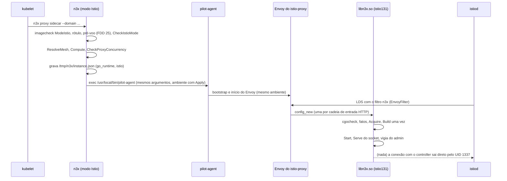
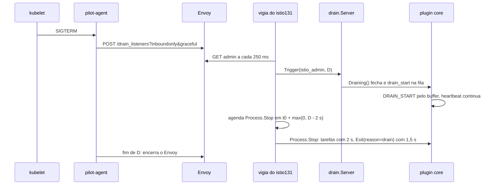
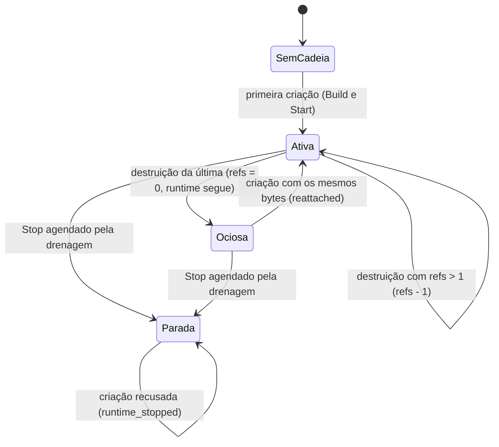

### FDD: Modo Istio e alvo `istio-1.31` (SID-11)

Versão: 1.0
Data: 2026-10-21
Responsável: Guilherme Giusti

---

### 1. Contexto e motivação técnica

**Problema técnico.** O PRD exige que a mesma imagem e o mesmo `n3x.yaml` funcionem dentro de uma malha Istio, como compatibilidade e não como dependência. No Istio, o ciclo de vida do proxy é do `pilot-agent`: ele gera o bootstrap, abre as portas (`15001`, `15006`, `15021`, `15090`), faz o health e conduz a drenagem (ADR-006 do `n3x-sdk`: "o Istio manda"). Tudo o que as FDDs 25 a 29 construíram para o modo padrão (pré-voo, bootstrap, supervisor, health `17021`, canal de controle e drenagem) supõe que o `n3x` é o pai do Envoy. No Istio ele não é. Faltava especificar, de forma verificável:

- como o binário `n3x` reconhece que foi chamado pelo injetor do Istio, valida o mesmo `n3x.yaml`, ajusta o runtime Go e entrega o processo ao `pilot-agent` sem deixar resto (L-19)
- de onde vem o `concurrency` do proxy, para cumprir a recusa do ADR-008 quando o `GOMAXPROCS` ficaria abaixo dele
- como o `.so` e o plugin core sabem que a drenagem começou, sem o supervisor e sem o canal de controle aberto pelo entrypoint (L-18, parte do Istio)
- quais capacidades opcionais o alvo `istio-1.31` oferece (L-20)
- quais proteções compensam a falta de barreira de panic e a resolução tardia de símbolos do istio-proxy 1.31
- como o filtro entra na malha (`EnvoyFilter` estático), como o `n3x.yaml` e a chave chegam ao container do proxy e como as métricas `n3x_` saem pelo merge do Istio (L-27)
- o que acontece com a config do filtro quando o Istio recria listeners (pedido da FDD 16)
- quando o alvo deve ser adiado, já que o PRD prevê essa contingência se a capacidade de uma pessoa só apertar

**Encaixe no HLD.** Esta FDD especifica a seção "Modo Istio" e o "`EnvoyFilter` estático do modo Istio" do HLD do `n3x-sidecar`, a linha `istio-1.31` de "Imagens de runtime" e o risco "Modo Istio: patch do Istio ignora as variáveis de runtime ou o `EnvoyFilter`". Peças no repositório `n3x-sidecar`:

- `internal/istiomode` (novo, hipótese de nome): o modo Istio do entrypoint (despacho, regras, leitura do `concurrency` e da duração da drenagem, fatos e `exec` do `pilot-agent`)
- `cmd/n3x`: despacho da palavra `proxy`, repasse dos subcomandos do `pilot-agent` e o subcomando novo `istio-drain`
- `core/config`: arquivo novo `istio.go` com `CheckIstioMode` e o acessor `Config.Present` (a FDD 15 deixou "as regras do modo Istio" para esta FDD)
- `core/adapter/istio131` (build tag `n3x_istio131`): o adaptador do alvo, que implementa o mesmo contrato `core/adapter` da FDD 16
- `core/adapter/internal/pathguard` (novo): conferência do path normalizado, sem o SDK do Envoy
- `core/adapter/internal/dynmod` (novo, hipótese): código comum aos dois adaptadores que não depende do ABI de um commit específico (pedido à FDD 16)
- `core/envoycfg`: arquivo novo `istio.go` com as portas e diretórios reservados do Istio
- `internal/istiofilter` (novo): gerador do `EnvoyFilter` a partir de `bootstrap.HTTPFilter` (FDD 26)
- `deploy/istio/`: `EnvoyFilter` canônico (L-42, decidida na FDD 47)
- `images/runtime/Dockerfile`: estágio final `runtime-istio` (D-10 do README; FDD 28)
- `internal/imagecheck`: semântica do `ModeIstio` (P-03 da FDD 28)

Consumidores:

- FDD 48 (SDK-16): executa os cenários Istio definidos aqui (contrato 13), em kind com Istio à noite
- FDD 47 (SDK-15): recebe a cópia do `EnvoyFilter`, o exemplo de Deployment, a config da malha e o conteúdo do `docs/operador/istio.md` (contrato 10)
- FDD 46 (BLD-07): a matriz e o fluxo por patch passam a ter o arquivo `targets/istio-1.31.yaml` (contrato 12), sem código novo
- FDD 42 (CORE-06): o `Exit` no Istio passa a sair com `reason` `drain` quando a fonte de drenagem dispara (contrato 8)
- FDD 45 (CORE-09): o painel mostra o alvo `istio-1.31` e o endereço sem porta

**Atores.** Injetor do Istio (webhook do `istiod`), `istiod` (envia o `EnvoyFilter` por xDS), `pilot-agent` (bootstrap, health, drenagem), Envoy do istio-proxy 1.31, entrypoint `n3x` no modo Istio, `.so` com o adaptador `istio131`, plugin core (registro, eventos e `Exit`), kubelet (preStop e SIGTERM), operador da malha (meshConfig e `EnvoyFilter`) e operador do serviço (anotações e `n3x.yaml`).

**Limites.**
- O N3X não abre porta própria no Istio: nem `17000`, nem `17021`, nem `17090` (ADR-006 do `n3x-sdk`). Ele é só cliente do admin do Envoy em `127.0.0.1:15000` (contrato 8) e servidor do socket Unix local `/tmp/n3x/control.sock` dentro do container do proxy (contingência do contrato 8)
- O bootstrap, o health (`15021`), as probes reescritas da aplicação e a sequência de drenagem são do Istio; esta FDD não muda nada disso
- Injeção automática, iptables e CNI continuam do Istio; gateways (`proxy router`), modo ambient e waypoint ficam fora da v1
- O comportamento da cadeia, da contenção e da conexão é o das FDDs 17, 18 e 38, sem fork; aqui só o que muda por estar no Istio

**Suposições**
- O spike `istio-1.31` da fase 0 ainda não rodou. Tudo o que depende do comportamento real do istio-proxy, do `pilot-agent` ou do `istiod` está marcado "(hipótese; IS-xx)" e listado na tabela de spike da seção 8. Os contratos públicos não mudam com o resultado do spike; muda a implementação ou a decisão de corte (contrato 14)
- O istio-proxy 1.31 traz um Envoy de um commit anterior ao `v1.40.0`, com o filtro HTTP de dynamic modules e o SDK Go no mesmo commit (PRD, "Técnica: istio-proxy 1.31 com dynamic modules"; hipótese; IS-01)
- O injetor usa a imagem da anotação `sidecar.istio.io/proxyImage` no container `istio-proxy` e também nos init containers `istio-init` ou `istio-validation`, que chamam o `pilot-agent istio-iptables` (hipótese; IS-09)
- O `pilot-agent` repassa o próprio ambiente ao Envoy (hipótese; IS-06)
- O tráfego do UID 1337 não é capturado pelo iptables do Istio, nem o de saída nem o de DNS (HLD do `n3x-sidecar`; PRD)

**Restrições**
- Só `core/adapter/*` com build tag importa o SDK Go do Envoy (ADR-001 do `n3x-sidecar`)
- O filtro recebe só `config_path` (FDD 26, que retirou o `key_path`; I-02)
- Nada em `init()` no `cmd/n3x`, em `internal/supervisor`, `internal/health`, `core/control` e `core/drain`, para o `exec` não deixar resto (FDDs 27 e 29)
- Mesmo `n3x.yaml`, mesmos plugins e mesmo `.so` por alvo; o modo Istio não tem campo próprio no `n3x.yaml` (FR-001)
- 0 alocações no caminho comum da requisição (ADR-009 do `n3x-sidecar`); a conferência de path é por varredura de bytes, sem cópia
- Documentação em pt-BR, sem travessões; identificadores em inglês

**Rastreabilidade**
- PRD 1.5: FR-001 (fluxo alternativo "Modo Istio"), FR-003 (health do Istio), FR-004 (cadeia no alvo; "recurso que existe num alvo e não no outro"), FR-006 (endereço e alvo no inventário), FR-016 (`DRAIN_START` e `Exit`); compatibilidade (istio-proxy 1.31 em amd64 e arm64); dependência "istio-proxy 1.31 com dynamic modules"; riscos "Suporte não oficial ao Istio quebra num patch do Istio" e "Capacidade de uma pessoa só" (contingência: adiar o `istio-1.31`); critérios de aceite "negação gRPC como `PERMISSION_DENIED` também em `istio-1.31`", "os mesmos plugins geram `.so` para os dois alvos e cada imagem carrega o seu", "testes de conformidade por alvo" e "Kubernetes com Istio na CI"
- HLD do `n3x-sidecar`: "Modo Istio", "`EnvoyFilter` estático do modo Istio", "Imagens de runtime", "Ambiente de implantação" (Istio), risco do patch do Istio; HLD do `n3x-builder`: "Catálogo de alvos"; HLD de plataforma: "Ambiente de implantação"
- ADRs: ADR-002 e ADR-006 do `n3x-sdk`; ADR-001, ADR-002, ADR-007 e ADR-008 do `n3x-sidecar`; ADR-004 do `n3x-builder`
- Lacunas do README fechadas aqui: **L-18** (parte do Istio: fonte da drenagem pelo admin, com contingência no preStop), **L-19** (detecção pelo primeiro argumento `proxy`, com repasse dos subcomandos do `pilot-agent`), **L-20** (parte do `istio-1.31`: `[route_change]`), **L-27** (`pathNormalization`, `proxyStatsMatcher` e `userVolumeMount`). Aplicadas: L-21 (patch do Istio registrado no catálogo pelo processo da FDD 19), L-30 (confirmada como hipótese no proxyv2), L-42 (canônico no `n3x-sidecar`, cópia no `n3x-sdk`), L-16, L-17, L-45, L-68, L-69 e L-72
- FDDs de que depende: 15, 16, 17, 18, 19, 20, 21, 22, 23, 25, 26, 27, 28, 29, 37, 42, 46 e 47

**Pedidos do registro atendidos aqui**

| Origem | Pedido | Onde |
| --- | --- | --- |
| FDDs 05 e 19 | nomes de capacidade por `proxy.ParseCapability`; capacidades do `istio-1.31` | contratos 6 e 12 |
| FDD 07 | capacidades de `sdktest.Istio131` | contrato 6 (pedido de ajuste à FDD 07) |
| FDD 09 | drenagem no Istio | contrato 8 |
| FDDs 15 e 26 | config do filtro sem `key_path` | contrato 9 |
| FDD 15 | regras do modo Istio no `n3x.yaml`; palavra `proxy` reservada | contratos 1 e 3 |
| FDD 16 | várias criações da config, buffer do Istio, nome interno no `proxyStatsMatcher`, `do_not_close`; conferir referências a zero | contratos 6, 9 e 10 |
| FDD 18 | `ListenerPort` 0 no modo Istio | contrato 6 |
| FDD 23 | confirmar a L-30 no proxyv2 | seção 8 (IS-03) |
| FDD 25 | mesmo pré-voo e fatos antes do `exec` do `pilot-agent`; versão do Envoy no alvo `istio-*` | contratos 2 e 5 |
| FDD 26 | `EnvoyFilter` a partir de `HTTPFilter` | contrato 9 |
| FDD 27 | `ReadCgroup`, `Compute`, `CheckProxyConcurrency` (saída 7), `Settings.Apply` sobre o ambiente do Istio, fatos com `go_runtime`, nada em `init()` | contratos 2 e 4 |
| FDD 28 | estágio `runtime-istio`, `USER 1337:1337`, mesmo `n3x`; `imagecheck` em `ModeIstio` (P-03 da 28) | contrato 11 |
| FDD 29 | fonte da drenagem por `drain.Server.Trigger`; a `17021` não abre; nada em `init()` | contrato 8 |
| FDD 37 | campos ignorados no Istio | contrato 3 |
| FDD 42 | `Exit` no Istio | contrato 8 |
| FDD 46 | estágio `runtime-istio` e UID 1337 no perfil `sidecar`; alvo na matriz e no `upstream` sem código novo | contratos 11 e 12 |
| FDD 47 | preencher `deploy/istio/` e o `op/istio.md`; decidir a L-27 | contrato 10 |
| FDD 48 | cenários Istio | contrato 13 |
| PRD | critério de corte e contingência do alvo | contrato 14 |

---

### 2. Objetivos técnicos

- **Mesmo comportamento da cadeia nos dois alvos.** Medida: a suíte `conformance.Cases()` da FDD 07, rodada contra o Envoy do `istio/proxyv2:1.31.x` fixado no catálogo, passa em todos os casos aplicáveis ao alvo (seguir, parar, retomar, negar e panic), em amd64 e arm64; os casos de body ficam "não aplicáveis" porque o alvo não declara `request_body` (contrato 6).
- **Negação gRPC nunca como `OK`.** Medida: em 1.000 chamadas gRPC negadas pelo `n3x.example` dentro de um pod com Istio, 1.000 chegam com `PERMISSION_DENIED` (código 7) e exatamente um `grpc-status`; 0 chegam com `OK`. Release bloqueada se falhar (PRD).
- **Nenhuma porta do N3X no pod.** Invariante: com o modo Istio ativo, nenhum socket escuta em `17000`, `17021` ou `17090` (conferido por `ss -ltn` no namespace de rede do pod).
- **Subida sem resto e sem atraso relevante.** Medida: do início do `n3x` ao `exec` do `pilot-agent`, até 300 ms no p95 e até 3,5 s no pior caso (prazos do pré-voo); depois do `exec`, nenhum processo, goroutine, sinal ou arquivo aberto do `n3x` sobrevive (o PID 1 do container passa a ser o `pilot-agent`) (hipótese de meta).
- **Recusa explícita em vez de bypass silencioso.** Invariante: imagem do alvo errado, `GOMAXPROCS` abaixo do `concurrency`, pod sem o rótulo `n3x.io/enabled`, `.so` iniciado sob o `pilot-agent` sem o entrypoint ou sem `cgocheck=0` impedem a subida com código e mensagem; nenhum desses casos deixa o tráfego passar sem os plugins.
- **Runtime Go igual ao calculado.** Medida: em 100% das subidas do cenário IST-09, o `.so` observa `GOMAXPROCS`, `GOMEMLIMIT` e `cgocheck=0` iguais ao bloco `go_runtime` do arquivo de fatos, e a stat `server.concurrency` é igual ao `concurrency` resolvido.
- **Config do filtro estável sob atualização de listeners.** Medida: 50 atualizações de listener de entrada (portas do Service, `AuthorizationPolicy`) geram 1 `Build`, 1 `Start`, 0 `runtime_stopped` e 0 recusas `runtime_stopped`.
- **Drenagem visível ao controller.** Medida: em 20 encerramentos de pod com a fonte primária, o controller recebe `DRAIN_START` em pelo menos 19 e `Exit` com `reason` `drain` em pelo menos 19, sempre antes do fim do processo (hipótese de meta; depende do IS-07).
- **Uma pessoa consegue manter.** Medida: patch novo do Istio 1.31.x entra pela automação da FDD 46 sem mudança de código; o código próprio do alvo (adaptador sem o comum, `istiomode`, gerador) fica abaixo de 2.500 linhas de Go fora de testes (hipótese de meta); critério de corte explícito (contrato 14).

---

### 3. Escopo e exclusões

**Incluído**
- Despacho do `n3x` no modo Istio: `proxy sidecar ...` entra no modo Istio; subcomandos do `pilot-agent` vindos do injetor (por exemplo `istio-iptables`) são repassados direto; `run` é recusado na imagem `istio-*` (contrato 1)
- `internal/istiomode`: verificação do ambiente (`imagecheck` em `ModeIstio`), rótulo do pod, pré-voo da FDD 25 com as regras do Istio, leitura do `concurrency` e da duração da drenagem, cálculo do runtime pela FDD 27, recusa abaixo do `concurrency`, arquivo de fatos com `go_runtime` e `istio`, ambiente e `exec` do `pilot-agent` (contratos 2, 4 e 5)
- Regras do `n3x.yaml` no modo Istio: `config.CheckIstioMode`, campos ignorados com aviso, `validate --mode istio` (contrato 3)
- Adaptador `core/adapter/istio131`: alvo, capacidades, contrato `core/adapter` da FDD 16, referências a zero sem parar o runtime, destinos reservados do Istio, conferência de path, proteções contra a falta de barreira de panic (contratos 6 e 7)
- Fonte da drenagem no Istio: vigia do admin do Envoy, contingência por preStop com `n3x istio-drain`, `stop` agendado antes do fim do processo (contrato 8)
- `EnvoyFilter` estático canônico e o gerador (contrato 9)
- Rótulos, anotações, volumes e config da malha exigidos, com o conteúdo de `n3x-sdk/deploy/istio/` e do `docs/operador/istio.md` (contrato 10; L-27)
- Estágio `runtime-istio` da imagem de runtime e o `imagecheck` em `ModeIstio` (contrato 11)
- Conteúdo de `targets/istio-1.31.yaml` (contrato 12)
- Cenários Istio que a FDD 48 executa (contrato 13)
- Portões de corte e contingência do alvo (contrato 14)
- Testes do adaptador contra o Envoy do `proxyv2` sem `pilot-agent`, na CI do `n3x-sidecar`

**Excluído**
- Spike de carga do `.so` no `istio/proxyv2:1.31.x`: fase 0 do README (os itens IS-01 a IS-15 da seção 8 ampliam o roteiro)
- Imagem de build `sidecar-builder:<v>-istio-1.31`, matriz e fluxo por patch: FDD 46 (BLD-07); aqui só o arquivo do alvo
- Verificação de símbolos e teste de carga no build: FDD 23 (BLD-05), com o mesmo bootstrap mínimo (L-30)
- Orquestração da CI cruzada, kind com Istio e relatório: FDD 48 (SDK-16); aqui só a lista de cenários
- Layout do `n3x-sdk/deploy/`, `deploytool` e guia geral: FDD 47 (SDK-15); aqui só o conteúdo do Istio
- Gateways (`proxy router`), modo ambient, waypoint, `Sidecar` CRD e injeção por template customizado: fora da v1
- Injeção automática do sidecar e iptables: do Istio (fora da v1 no N3X)
- Mudanças no comportamento da cadeia, da contenção ou da conexão com o controller: FDDs 17, 18 e 38
- Capacidade `request_body` no `istio-1.31`: fora da v1 (contrato 6)

---

### 4. Fluxos detalhados e diagramas

**Fluxo principal: subida do pod com Istio**
1. O injetor do Istio monta o pod com a imagem da anotação `sidecar.istio.io/proxyImage` (imagem do operador, feita a partir de `ghcr.io/giustech/n3x/sidecar:<v>-istio-1.31`) e os volumes das anotações `sidecar.istio.io/userVolume` e `userVolumeMount` (contrato 10).
2. **Init container** (`istio-init` ou `istio-validation`): o `ENTRYPOINT` `/usr/local/bin/n3x` recebe `istio-iptables ...`. O despacho vê a imagem `istio-*` e uma palavra que não é subcomando do `n3x`: faz `exec` direto de `/usr/local/bin/pilot-agent` com os mesmos argumentos, sem ler o `n3x.yaml` e sem conferir o UID (o init roda como root com `NET_ADMIN`) (contrato 1).
3. **Container `istio-proxy`**: o `n3x` recebe `proxy sidecar --domain ... --proxyLogLevel=... ...`. O despacho reconhece `proxy` e chama `istiomode.Run`.
4. `imagecheck.Check(Options{Mode: ModeIstio})`: UID 0 recusa com saída 8; UID diferente de 1337 só avisa (contrato 11).
5. `ParseArgs`: papel `sidecar` obrigatório (`router` sai com 1); lê `--concurrency` se presente.
6. Lê `/etc/n3x/target` (`istio-1.31`) e `/etc/istio/pod/labels` (Downward API montado pelo injetor); sem `n3x.io/enabled="true"`, recusa com `istio_label_missing` (saída 5), porque o `EnvoyFilter` não selecionaria o pod e os plugins nunca rodariam (contrato 2).
7. `preflight.Run(ctx, Options{Mode: ModeIstio, ...})` (FDD 25, com o modo novo pedido aqui): leitura da imagem, do `.so` com `WithIntegrity`, `envoy --version`, `pilot-agent version --short` e identidade em paralelo; `CheckImage`; fonte de schemas; `config.Load` com `SecretsVerify` e `config.CheckIstioMode` no lugar de `CheckDefaultMode`. Avisos `istio_field_ignored` para `listener`, `app` e `runtime.drain_timeout` presentes no arquivo (contrato 3). Versão do Istio com `major.minor` diferente do alvo: `istio_mismatch` (saída 5).
8. `ResolveMesh`: `concurrency` pela ordem argumentos, `PROXY_CONFIG`, injeção de `--concurrency`; duração da drenagem pela ordem `PROXY_CONFIG`, variáveis do `pilot-agent`, padrão de 5 s (contrato 4).
9. `goruntime.ReadCgroup`, `goruntime.Compute`, `goruntime.CheckProxyConcurrency(s, concurrency)`: abaixo dele, `below_concurrency` (saída 7). Sem limite de memória ou abaixo de 128 MiB, as recusas da FDD 27 (saída 7).
10. Prepara `/tmp/n3x` (0700, dono = UID do processo) e grava `/tmp/n3x/instance.json` com `go_runtime` e o bloco `istio` (contrato 5); falha de escrita é saída 6 `write`.
11. Monta o ambiente: `os.Environ()` com `Settings.Apply` (troca `GOMAXPROCS`, `GOMEMLIMIT` e `GODEBUG`, mantém `PROXY_CONFIG`, `ISTIO_META_*` e o resto), remove `N3X_ENVOY_VALIDATE` e garante `ENVOY_DYNAMIC_MODULES_SEARCH_PATH=/usr/lib/n3x`.
12. Loga `istio_settings`, `runtime_computed` e, por último, `istio_exec`; faz `syscall.Exec("/usr/local/bin/pilot-agent", argv, env)`. O `pilot-agent` vira o PID 1 do container. Falha do `exec` sai com 7 `istio_exec`.
13. O `pilot-agent` gera o bootstrap e inicia o Envoy com o ambiente recebido. O `istiod` envia os listeners de entrada com o filtro `n3x` inserido pelo `EnvoyFilter` (contrato 9).
14. Na primeira criação da config do filtro, o `istio131` carrega e loga `adapter_loaded` (com `target`, `capabilities`, `gomaxprocs`, `gomemlimit_bytes`, `cgocheck_off`); confere `cgocheck` (sem `cgocheck=0`, recusa) e corrige `GOMAXPROCS` e `GOMEMLIMIT` se divergirem dos fatos (contrato 7).
15. `adapter.Process.Acquire` (FDD 16) chama o `Build` do executor (FDD 17) uma vez: fonte do próprio `.so` e fatos (FDD 25; sob o `pilot-agent` sem fatos, recusa `istio_entrypoint_bypassed`), `config.Load` com `SecretsOpen`, instâncias, contenção com `ListenerPort` 0 e os destinos reservados do Istio (contrato 6).
16. As criações seguintes, uma por cadeia de entrada HTTP, somam referência e devolvem a mesma cadeia (`filter_config_reused`).
17. No fim da primeira criação em `ModeServe`: `Chain.Start`, `drain.Server.Serve` com a regra de par do Istio (contrato 8) e a vigia do admin (`istio_drain_watch_started`).
18. O plugin core conecta direto ao controller (o UID 1337 não é capturado), faz login e registra com `target: istio-1.31` e endereço sem porta (FDD 25, L-68).

**Fluxo da requisição no Istio**
1. O cliente chega ao listener de entrada do Istio (`15006` pelo iptables); os filtros do Istio rodam antes (metadata exchange, `jwt_authn`, RBAC das `AuthorizationPolicy`, stats); o `n3x` roda logo antes do `envoy.filters.http.router` (contrato 9).
2. No `request_headers`, antes do executor, o `istio131` confere o `:path` com `pathguard.Check` (contrato 7). Path fora da forma normalizada: resposta 400 `path não normalizado`, `n3x_sidecar_path_rejected_total{reason}` mais 1, log amostrado; o executor não é chamado.
3. Path normalizado: mesmo fluxo da FDD 16 (cruzamentos, `Go()`, negação ciente de gRPC, `SetRoute`).
4. Hook de body de plugin: não é chamado no `istio-1.31` (sem `request_body`); o plugin que exige a capacidade falha no `New` de forma explícita (FDD 05), e o executor avisa `hook_unsupported` para hook opcional (FDD 17).

**Fluxo da drenagem no Istio (L-18, parte do Istio)**
1. O Kubernetes apaga o pod; o kubelet roda o preStop do `istio-proxy`, se houver (contingência), e manda SIGTERM ao `pilot-agent`.
2. O `pilot-agent` chama o admin do Envoy (`POST /drain_listeners?inboundonly&graceful`) e espera a duração da drenagem `D` (`terminationDrainDuration`, ou o mínimo do modo "sair com zero conexões"); depois encerra o Envoy à força (hipótese; IS-07).
3. **Fonte primária:** a vigia do `istio131` consulta o admin em `127.0.0.1:15000` a cada 250 ms; quando o sinal de drenagem aparece (hipótese: `server.state` igual a 1, o mesmo sinal que a FDD 29 usa; IS-07), chama `drain.Server.Trigger("istio_admin", D)`.
4. **Fonte de contingência:** o preStop `n3x istio-drain` manda `drain` pelo socket `/tmp/n3x/control.sock`; o servidor chama `Trigger("istio_prestop", D)`. As duas fontes podem disparar; só a primeira tem efeito (`Trigger` é idempotente).
5. `Trigger` fecha `Draining()` e põe `drain_start` com `Detail` `drain_timeout=<D>` na fila (FDD 29, contrato 7); o core envia `DRAIN_START` pelo buffer e mantém o heartbeat (FDD 42).
6. O `istio131` agenda o `Process.Stop` para `t0 + max(0, D - 2 s)` (`StopLead`) e loga `istio_stop_scheduled`. Com o padrão do Istio (5 s), o `stop` sai 3 s depois do sinal, o que preserva a espera mínima de 3 s da FDD 29.
7. No `stop`: cadeia, contenção, tarefas de fundo com 2 s e conexão com o controller; o core chama `Exit` com `ExitContext` de 1,5 s e `reason` `drain` (FDD 42), com o Envoy ainda vivo.
8. O `pilot-agent` encerra o Envoy ao fim de `D`; não há destruição da config nem segundo `Stop`.

**Fluxos alternativos e exceções**
- **Imagem `-envoy-1.40` usada no Istio** (anotação apontando para a imagem errada): `proxy` com alvo `envoy-*` sai com 5 `istio_target_required`, com o texto "use a imagem -istio-1.31"; o pod não fica pronto.
- **`run` na imagem `-istio-1.31`** (fora do Istio, ou `docker run` sem argumentos): saída 5 `target_mode`, com o texto "esta imagem só roda injetada pelo Istio; fora da malha, use a imagem -envoy-1.40". O supervisor nunca sobe dentro de um pod injetado (risco "detecção errada").
- **Template de injeção que chama o `pilot-agent` direto** (sem passar pelo `n3x`) ou container `istio-proxy` sobrescrito com `command: [pilot-agent]`: o `.so` carrega sem arquivo de fatos e com o pai `pilot-agent`; recusa a config do filtro com `istio_entrypoint_bypassed`; o listener de entrada é recusado e o pod não fica pronto (contrato 7).
- **Pod sem o rótulo `n3x.io/enabled`**: saída 5 `istio_label_missing` antes do `exec`; o container reinicia com a mensagem.
- **Rótulo presente, mas a imagem injetada é a `proxyv2` original** (sem a anotação de imagem): o `EnvoyFilter` seleciona o pod, o Envoy não acha `libn3x.so` e recusa o listener; o pod não fica pronto. É falha visível, não bypass.
- **`EnvoyFilter` ausente ou apagado** com a imagem do N3X: o entrypoint sobe, mas o filtro nunca é criado; o tráfego passa sem plugins. Não há como o entrypoint saber (sem acesso à API do Kubernetes); o alerta IS-01 (série `n3x_build_info` ausente em pod com o rótulo) e o cenário IST-12 cobrem (risco residual, seção 10).
- **`concurrency` explícito acima do `GOMAXPROCS`**: saída 7 `below_concurrency` com os dois valores e a correção ("suba o limite de CPU do proxy, aumente `resources.cpus` ou reduza o `concurrency`").
- **`concurrency: 0` explícito** ("todos os núcleos"): vale a afinidade do processo (`runtime.NumCPU()`); normalmente acima do `GOMAXPROCS`, então recusa com 7 e a mesma mensagem.
- **`/tmp` não gravável** (anotação sem o `emptyDir`): saída 6 `write` com o texto "monte um emptyDir em /tmp no istio-proxy (sidecar.istio.io/userVolume)".
- **Chave ilegível pelo UID 1337** (sem `fsGroup: 1337` e com `0440`): saída 3 `key_read` com `EACCES` e o UID e o GID do processo (pedido da FDD 28 à FDD 15); o guia mostra `fsGroup`.
- **Atualização de listeners pelo Istio**: o Envoy cria a config nova antes de destruir a antiga; as referências sobem e descem. Se chegarem a zero (todos os listeners HTTP de entrada removidos por um tempo), o runtime não para no `MeshIstio`: a próxima criação com os mesmos bytes reata a mesma cadeia (`filter_config_reattached`); bytes diferentes continuam `filter_config_mismatch` (contrato 6).
- **Admin do Envoy inacessível** para a vigia: aviso `istio_drain_watch_failed` no máximo 1 por minuto; a vigia continua tentando; sem outra fonte, a drenagem acontece sem `DRAIN_START` e sem `Exit`, e o controller marca a instância desconectada depois de 3 intervalos de heartbeat (FDD 43).
- **`D` menor que 2 s**: o `stop` sai na hora do sinal, com o aviso `istio_drain_short`.
- **Controller dentro da malha com mTLS `STRICT`**: a conexão direta do `.so` (TLS do N3X, sem o mTLS do Istio) é recusada pelo proxy do controller; o core registra `connect_failures_total{reason}` e o guia manda deixar o controller fora da malha ou excluir a porta `17443` da captura (contrato 10).
- **Malha com `pathNormalization` mais fraca** que a exigida: requisições com `//`, `%2F`, `%5C` ou segmentos `.` e `..` recebem 400 do N3X em vez de passar com um path que os plugins compararam de outro jeito; aviso `path_normalization_weak` no máximo 1 a cada 10 min.
- **Sinal durante o pré-voo** (SIGTERM antes do `exec`): o `n3x` não instala tratador no modo Istio; o processo termina pelo sinal, sem nada a drenar.

**Diagramas**

Subida no Istio:



Drenagem no Istio:



Referências da config do filtro no `MeshIstio`:



---

### 5. Contratos públicos (assinaturas, endpoints, headers, exemplos)

**Contrato 1: despacho do `n3x` e modo Istio na linha de comando (L-19)**
- Tipo: CLI (processo, `ENTRYPOINT` da imagem)
- Assinatura/Rota:
  ```text
  n3x proxy sidecar [argumentos do injetor ...]   # modo Istio (só na imagem istio-*)
  n3x <subcomando do pilot-agent> [...]           # repasse direto (só na imagem istio-*): istio-iptables, wait, request, version...
  n3x istio-drain [--timeout <duração>]           # preStop opcional (contingência da fonte de drenagem, contrato 8)
  n3x validate --mode istio|default [...]         # regras do modo Istio (contrato 3)
  ```
- Método: processo
- Semântica de status/headers:
  - **Ordem do despacho** (hipótese): 1) subcomandos do `n3x` (`run`, `validate`, `encrypt`, `keygen`, `help`, `probe`, `istio-drain`); 2) `proxy` entra no modo Istio; 3) qualquer outra palavra, com `/etc/n3x/target` de família `istio-*`, é repassada ao `pilot-agent` com `exec` direto e o log `istio_passthrough` (só o nome do subcomando, nunca os argumentos); 4) com alvo `envoy-*` ou sem alvo, saída 1 (FDD 15)
  - **Repasse** não lê o `n3x.yaml`, não confere UID e não grava nada: o init container do Istio roda como root e precisa do `pilot-agent istio-iptables`. O repasse genérico, em vez de uma lista fixa, sobrevive a subcomandos novos do injetor num patch (hipótese; IS-09)
  - **`proxy`** exige o papel `sidecar` como segundo argumento; `router` (gateway) e papel ausente saem com 1 (`istio_role_unsupported`, `istio_args`)
  - **`run` com alvo `istio-*`**: saída 5 `target_mode` (regra do pré-voo, pedido à FDD 25). A imagem `-istio-1.31` não roda o supervisor
  - **`proxy` com alvo `envoy-*`**: saída 5 `istio_target_required`
  - **Saídas no modo Istio** (as faixas são as das FDDs 15 e 25 a 28; nenhuma faixa nova):

| Saída | Código | `reason` ou regra | Quando |
| --- | --- | --- | --- |
| 1 | `N3X-S001` | `istio_args`, `istio_role_unsupported` | papel ausente ou diferente de `sidecar`; `--concurrency` sem número inteiro |
| 2 | `N3X-S002` | regras da FDD 15 | `n3x.yaml` inválido (o mesmo arquivo do modo padrão) |
| 3 | `N3X-S003` | regras da FDD 15 | segredo que não decifra; chave ilegível |
| 4 | `N3X-S004` | `manifest_read` | `.so` ausente ou ilegível |
| 5 | `N3X-S005` | regras da FDD 25 mais `istio_target_required`, `target_mode`, `istio_mismatch`, `istio_label_missing`, `pilot_agent_missing` | imagem, `.so`, alvo, versão do Istio ou rótulo fora do contrato |
| 6 | `N3X-S006` | `write` | `/tmp/n3x` ou o arquivo de fatos não gravável |
| 7 | `N3X-S007` | `memory_unlimited`, `memory_too_low`, `below_concurrency`, `istio_exec` | runtime Go recusado (FDD 27) ou `exec` do `pilot-agent` falhou |
| 8 | `N3X-S008` | `run_as_root` | UID efetivo 0 no `proxy` (FDD 28) |

  - **`istio-drain`**: conecta em `/tmp/n3x/control.sock`, manda `{"v":1,"op":"drain","source":"istio_prestop"}` (contrato 6 da FDD 29) e sai com 0 com `ok`, 1 nos demais casos; prazo padrão de 2 s, teto de 5 s; nunca espera a drenagem terminar (o kubelet só manda o SIGTERM depois do preStop)
  - **`validate --mode`**: padrão derivado de `/etc/n3x/target` (`istio-*` vale `istio`; outro ou ausente vale `default`) (hipótese; pedido à FDD 15)
  - **Limites:** argumentos repassados sem mudança, salvo o `--concurrency` injetado (contrato 4); até 256 argumentos e 64 KiB no total (acima disso, saída 1 `istio_args`)

**Exemplo de requisição**
```text
# container istio-proxy, argumentos do template de injeção (ilustrativos)
/usr/local/bin/n3x proxy sidecar --domain loja.svc.cluster.local --proxyLogLevel=warning --proxyComponentLogLevel=misc:error --log_output_level=default:info

# init container istio-init, mesma imagem
/usr/local/bin/n3x istio-iptables -p 15001 -z 15006 -u 1337 -m REDIRECT -i '*' -x '' -b '*' -d 15090,15021,15020

# mesma imagem fora da malha
docker run --rm ghcr.io/acme/pedidos-sidecar:1.4.0-istio-1.31
```

**Exemplo de resposta**
```text
{"ts":"2026-10-21T14:00:00.004Z","level":"info","component":"entrypoint","msg":"istio_mode_started","role":"sidecar","target":"istio-1.31","image_version":"1.2.0","args":7}
...
{"ts":"2026-10-21T14:00:00.188Z","level":"info","component":"entrypoint","service":"pedidos","msg":"istio_exec","path":"/usr/local/bin/pilot-agent","argv":9,"injected":["--concurrency"],"pre_exec_ms":184}

{"ts":"2026-10-21T13:59:58.120Z","level":"info","component":"entrypoint","msg":"istio_passthrough","subcommand":"istio-iptables"}

{"ts":"2026-10-21T14:10:00.002Z","level":"error","component":"entrypoint","msg":"preflight_failed","code":"N3X-S005","rule":"target_mode","detail":"a imagem istio-1.31 só roda injetada pelo Istio (n3x proxy sidecar); fora da malha, use a imagem -envoy-1.40","exit_code":5}
```

---

**Contrato 2: API de `internal/istiomode`**
- Tipo: sdk (API Go interna do `n3x-sidecar`, chamada só pelo `cmd/n3x`)
- Assinatura/Rota:
  ```go
  package istiomode // github.com/giustech/n3x-sidecar/internal/istiomode (nome é hipótese)

  const (
      PilotAgentPath  = "/usr/local/bin/pilot-agent"
      ProxyUID        = 1337
      EnableLabel     = "n3x.io/enabled"         // valor exigido: "true"
      PodLabelsFile   = "/etc/istio/pod/labels"  // Downward API do injetor (IS-15)
      DefaultDrain    = 5 * time.Second          // padrão do terminationDrainDuration do Istio
      VersionTimeout  = 2 * time.Second          // pilot-agent version --short
      MaxArgs         = 256
      MaxArgsBytes    = 64 << 10
  )

  // IsPassthrough: true se args[0] não é subcomando do n3x nem "proxy" e o alvo é istio-*.
  func IsPassthrough(target string, args []string) bool

  type Args struct {
      Role        string   // "sidecar"
      Raw         []string // argumentos recebidos, na ordem
      Concurrency *int     // --concurrency N ou --concurrency=N, se presente
  }

  func ParseArgs(args []string) (Args, error) // args sem o "proxy"

  type Options struct {
      Args       []string                     // depois de "proxy"
      ConfigPath string                       // "" = config.DefaultPath
      Logger     *slog.Logger                 // component=entrypoint
      FS         fs.FS                        // nil = os.DirFS("/")
      Getenv     func(string) string          // nil = os.Getenv
      Environ    func() []string              // nil = os.Environ
      Exec       func(path string, argv, env []string) error // nil = syscall.Exec
      Now        func() time.Time
  }

  type Plan struct {
      Path     string               // PilotAgentPath
      Argv     []string             // argv[0] = PilotAgentPath, depois os argumentos (mais o injetado)
      Env      []string             // ambiente final
      Mesh     Mesh                 // contrato 4
      Settings goruntime.Settings   // FDD 27
      Facts    identity.Facts       // contrato 5
      Warnings []Warning
      PreExec  time.Duration
  }

  type Warning struct{ Code, Path, Detail string }

  // Prepare faz tudo menos o exec: imagecheck, rótulo, pré-voo, ResolveMesh, Compute,
  // CheckProxyConcurrency, fatos e ambiente. Sem goroutine viva no retorno.
  func Prepare(ctx context.Context, opts Options) (*Plan, error)

  // Exec chama opts.Exec; só volta com erro (ErrExec).
  func Exec(opts Options, p *Plan) error

  // Run = Prepare + logs + Exec; devolve o código de saída quando não fez o exec.
  func Run(ctx context.Context, opts Options) int

  func ExitCode(err error) int // 0 a 8, pela tabela do contrato 1

  var (
      ErrArgs         = errors.New("istiomode: argumentos do injetor inválidos")
      ErrRole         = errors.New("istiomode: só o papel sidecar é suportado")
      ErrTarget       = errors.New("istiomode: a imagem não é de um alvo istio-*")
      ErrLabel        = errors.New("istiomode: pod sem o rótulo n3x.io/enabled=\"true\"")
      ErrIstioVersion = errors.New("istiomode: versão do Istio diferente do alvo")
      ErrPilotAgent   = errors.New("istiomode: pilot-agent ausente")
      ErrExec         = errors.New("istiomode: exec do pilot-agent falhou")
  )
  ```
- Método: chamada local, uma vez por processo
- Semântica:
  - **Pré-voo** (pedido à FDD 25, modo novo `preflight.ModeIstio`): os mesmos trabalhos em paralelo do `ModeRun`, mais `pilot-agent version --short` com prazo de 2 s; `config.CheckIstioMode` no lugar de `CheckDefaultMode`; `envoy --version` sem conferência de `major.minor` (o Envoy do Istio tem numeração própria), só extraída para `envoy_version`; versão do Istio com `major.minor` diferente de `istio-M.m` vira `istio_mismatch`; saída irreconhecível vira `unknown` com o aviso `istio_version_unknown`; endereço com porta 0 (sai sem porta, FDD 25 contrato 6)
  - **Rótulo** (hipótese): `PodLabelsFile` lido com teto de 64 KiB, linhas `chave="valor"`; ausência do arquivo é `istio_label_missing` com o texto "o injetor não montou /etc/istio/pod/labels"
  - **Ordem dos problemas:** precedência da FDD 25 (`S002`, `S005`, `S004`, `S003`); os problemas do Istio entram no `S005`; recusa de runtime (`S007`) só é avaliada sem problema de pré-voo
  - **Ambiente:** `Settings.Apply(Environ())`; remove `N3X_ENVOY_VALIDATE`; acrescenta `ENVOY_DYNAMIC_MODULES_SEARCH_PATH=/usr/lib/n3x` se ausente; nenhuma outra variável muda. As três variáveis do Go valem também para o `pilot-agent`, que é um processo Go no mesmo cgroup (aceito: `GOMEMLIMIT` é limite mole e o `pilot-agent` usa bem menos que ele) (hipótese)
  - **Sem resto:** `Prepare` espera todas as goroutines do pré-voo terminarem antes de voltar; nenhum `signal.Notify`; arquivos fechados; `Exec` usa `syscall.Exec`, que substitui a imagem do processo
  - **Custo:** sem chamada de rede fora do ECS (que não se aplica) e sem `envoy --mode validate`; o tempo é o do trabalho mais lento do pré-voo

**Exemplo de requisição**
```go
plan, err := istiomode.Prepare(ctx, istiomode.Options{
    Args: []string{"sidecar", "--domain", "loja.svc.cluster.local", "--proxyLogLevel=warning"},
})
if err != nil {
    os.Exit(istiomode.ExitCode(err))
}
fmt.Println(plan.Argv, plan.Mesh.Concurrency, plan.Mesh.ConcurrencySource, plan.Settings.GOMAXPROCS)
```

**Exemplo de resposta**
```text
[/usr/local/bin/pilot-agent proxy sidecar --domain loja.svc.cluster.local --proxyLogLevel=warning --concurrency 2] 2 injected 2

(rótulo ausente)
err = istiomode: pod sem o rótulo n3x.io/enabled="true"
ExitCode(err) = 5
{"level":"error","component":"entrypoint","msg":"preflight_failed","code":"N3X-S005","rule":"istio_label_missing","detail":"o pod não tem n3x.io/enabled=\"true\": o EnvoyFilter não seleciona este pod e os plugins nunca rodariam","exit_code":5}
```

---

**Contrato 3: `n3x.yaml` no modo Istio (`config.CheckIstioMode`)**
- Tipo: regra de config e sdk (`core/config`, arquivo novo `istio.go`)
- Assinatura/Rota:
  ```go
  package config // github.com/giustech/n3x-sidecar/core/config

  // Regras do modo Istio; substitui CheckDefaultMode no istiomode e no validate --mode istio.
  func CheckIstioMode(c *Config) ([]Warning, error)

  // Present diz se o caminho estava no arquivo (não só no padrão); preenchido por Load.
  func (c *Config) Present(path string) bool // "listener", "app", "runtime.drain_timeout"
  ```
- Método: chamada local (entrypoint no modo Istio e `n3x validate --mode istio`); o `.so` não chama, para o aviso sair uma vez
- Semântica:
  - **Mesmo arquivo nos dois modos:** o schema é o da FDD 15, sem campo novo; um campo ignorado ainda precisa ser válido (tipo e faixa), para o mesmo `n3x.yaml` servir fora e dentro da malha
  - **Coluna "Istio" da FDD 15, fechada aqui:**

| Campo | Modo Istio | Motivo |
| --- | --- | --- |
| `version`, `service`, `controller.*`, `keys.*`, `resources.*`, `runtime.log_level`, `runtime.panic_breaker.*`, `runtime.request_body.max_bytes`, `runtime.plugin_limits`, `plugins` | lido, igual ao modo padrão | |
| `listener.port` | ignorado, aviso `istio_field_ignored` se presente | a entrada é do Istio; a contenção recebe `ListenerPort` 0 (FDD 18) |
| `app.address`, `app.protocol`, `app.timeouts.*` | ignorado, aviso se `app` presente; `app.address` deixa de ser obrigatório | o cluster da aplicação é o `inbound` do Istio |
| `app.health.*` | ignorado por inteiro, no mesmo aviso de `app` | health é do Istio (`15021`) e as probes da aplicação são reescritas pelo `pilot-agent` (ADR-002; I-01) |
| `runtime.drain_timeout` | ignorado, aviso se presente | a duração é a do Istio (`terminationDrainDuration`, contrato 4) |
| `runtime.request_body.max_bytes` | lido, sem efeito prático | o alvo não declara `request_body` (contrato 6) |

  - **Regras que deixam de valer:** `app.address` obrigatório (`required`), `port_conflict` e `app_not_loopback` (FDD 15, `CheckDefaultMode`). Nenhuma regra nova de erro (hipótese)
  - **Aviso:** um `config_warning` por bloco presente, código `istio_field_ignored`, `path` do bloco, texto fixo; nunca repetido pelo `.so`
  - **Config efetiva (pedido da FDD 37):** o objeto `sidecar` continua com `listener` e `app` como lidos, com os padrões; o `format` não muda e o mesmo arquivo dá o mesmo hash nos dois modos. Quem diz que os campos não valem é o `target` `istio-1.31` do `Register` (hipótese)

**Exemplo de requisição**
```yaml
# /etc/n3x/n3x.yaml, o mesmo do compose
version: 1
service: pedidos
controller:
  address: n3x-controller.n3x.svc.cluster.local:17443
  ca_file: /run/n3x/ca.pem
  secret: ENC[v1:...]
keys: { aes_file: /run/n3x/aes.key }
listener: { port: 17000 }
app:
  address: 127.0.0.1:3000
  protocol: grpc
runtime: { drain_timeout: 20s }
plugins:
  - { id: n3x.example, instance: add-header }
```

**Exemplo de resposta**
```text
{"level":"warn","component":"entrypoint","service":"pedidos","msg":"config_warning","path":"listener","code":"istio_field_ignored","detail":"ignorado no modo Istio: a entrada é do Istio"}
{"level":"warn","component":"entrypoint","service":"pedidos","msg":"config_warning","path":"app","code":"istio_field_ignored","detail":"ignorado no modo Istio: o destino e o health da aplicação são do Istio"}
{"level":"warn","component":"entrypoint","service":"pedidos","msg":"config_warning","path":"runtime.drain_timeout","code":"istio_field_ignored","detail":"ignorado no modo Istio: vale o terminationDrainDuration do proxy"}

$ n3x validate --mode istio
válido (modo istio): 1 instância, 3 avisos
```

---

**Contrato 4: leitura do `concurrency` e da duração da drenagem do Istio (`istiomode.ResolveMesh`)**
- Tipo: regra de comportamento (função pura sobre argumentos e ambiente)
- Assinatura/Rota:
  ```go
  type Mesh struct {
      IstioVersion        string        // "1.31.2"; "unknown" se não reconhecida
      Role                string        // "sidecar"
      Concurrency         int
      ConcurrencySource   string        // "args", "proxy_config", "injected"
      DrainDuration       time.Duration // D
      DrainDurationSource string        // "proxy_config", "env", "default"
      ExitOnZero          bool
  }

  func ResolveMesh(a Args, getenv func(string) string, s goruntime.Settings, affinity int) (Mesh, []Warning, error)
  ```
- Método: chamada local
- Semântica (hipótese em toda a ordem; IS-07 e IS-08):
  - **`concurrency`**, na ordem: 1) `--concurrency N` nos argumentos (`args`); 2) campo `concurrency` do JSON da variável `PROXY_CONFIG`, que o injetor preenche com o `defaultConfig` da malha e a anotação `proxy.istio.io/config` (`proxy_config`); 3) nenhum dos dois: o `istiomode` acrescenta `--concurrency <Settings.Concurrency>` aos argumentos (`injected`) e loga em `istio_exec.injected`. Valor 0 vale a afinidade. Valor negativo ou acima de 1024 é `istio_args` (saída 1)
  - **Por que injetar:** sem valor explícito, o `pilot-agent` escolhe por regra própria, que pode variar entre patches; injetar fixa o `concurrency` igual ao do modo padrão (`--concurrency = CPU` da FDD 27), e com isso `GOMAXPROCS = max(CPU, 2)` nunca fica abaixo dele. É a única mudança nos argumentos (I-04)
  - **Recusa (ADR-008):** `CheckProxyConcurrency(s, Concurrency)`; `ErrBelowConcurrency` vira saída 7 `below_concurrency`
  - **`D`**, na ordem: 1) `terminationDrainDuration` do `PROXY_CONFIG` (`proxy_config`); 2) variável `TERMINATION_DRAIN_DURATION_SECONDS` (`env`); 3) 5 s (`default`). Com `EXIT_ON_ZERO_ACTIVE_CONNECTIONS=true`, `ExitOnZero` verdadeiro e `D` passa a ser `MINIMUM_DRAIN_DURATION` (padrão 5 s), o primeiro instante em que o `pilot-agent` pode encerrar o Envoy. `D` fora de 0 a 1 h é ignorado com o aviso `istio_drain_invalid`
  - **Leitura do `PROXY_CONFIG`:** JSON até 64 KiB, campos desconhecidos ignorados, durações no formato do protobuf JSON (`"20s"`) ou do Go; JSON inválido gera o aviso `istio_proxy_config_invalid` e a ordem segue sem ele
  - **Avisos:** `istio_drain_short` com `D < 2 s`; `istio_memory_low` com o limite de memória abaixo de 512 MiB (no Istio o `pilot-agent` e o Envoy com o xDS da malha dividem o cgroup; hipótese até a FDD 50)

**Exemplo de requisição**
```json
{
  "args": ["sidecar", "--domain", "loja.svc.cluster.local"],
  "env": { "PROXY_CONFIG": "{\"terminationDrainDuration\":\"20s\",\"proxyStatsMatcher\":{\"inclusionPrefixes\":[\"n3x_\"]}}" },
  "settings": { "Concurrency": 2, "GOMAXPROCS": 2 },
  "affinity": 8
}
```

**Exemplo de resposta**
```json
{ "IstioVersion": "1.31.2", "Role": "sidecar", "Concurrency": 2, "ConcurrencySource": "injected",
  "DrainDuration": "20s", "DrainDurationSource": "proxy_config", "ExitOnZero": false, "warnings": [] }
```
```text
(com --concurrency 4 e CPU limitada a 1)
{"level":"error","component":"entrypoint","service":"pedidos","msg":"supervisor_failed","code":"N3X-S007","reason":"below_concurrency","detail":"GOMAXPROCS 2 abaixo do concurrency 4 do proxy: suba o limite de CPU do istio-proxy (sidecar.istio.io/proxyCPULimit), aumente resources.cpus ou reduza o concurrency","exit_code":7}
```

---

**Contrato 5: arquivo de fatos no modo Istio (bloco `istio`)**
- Tipo: formato de dados (acréscimo por adição ao contrato 7 da FDD 25, mesmo `format: 1`)
- Assinatura/Rota:
  ```go
  package identity

  // Acréscimo (pedido à FDD 25): o leitor é tolerante, então format continua 1.
  type IstioFacts struct {
      Format              int    `json:"format"`               // 1
      Version             string `json:"version"`              // Mesh.IstioVersion
      Role                string `json:"role"`                 // "sidecar"
      Concurrency         int    `json:"concurrency"`
      ConcurrencySource   string `json:"concurrency_source"`
      DrainDurationMS     int64  `json:"drain_duration_ms"`
      DrainDurationSource string `json:"drain_duration_source"`
      ExitOnZero          bool   `json:"exit_on_zero"`
  }
  // Facts ganha Istio *IstioFacts `json:"istio,omitempty"` (além de GoRuntime, pedido da FDD 27)
  ```
- Método: escrito pelo `istiomode` antes do `exec`; lido pelo `.so` (FDD 25) e pelo `istio131` (contrato 8)
- Semântica:
  - Mesmo caminho do modo padrão (`/tmp/n3x/instance.json`), por isso o `emptyDir` em `/tmp` é obrigatório (contrato 10)
  - `envoy_version` é a versão extraída do `envoy --version` do istio-proxy; `address` sem porta; `target` `istio-1.31`
  - O bloco `istio` presente é a prova, para o `.so`, de que o entrypoint rodou no modo Istio; `Concurrency` também vai em `go_runtime.concurrency`
  - Nunca contém segredo nem o conteúdo do `PROXY_CONFIG`

**Exemplo de requisição**
```text
istiomode.Prepare grava /tmp/n3x/instance.json (0600) antes do exec
```

**Exemplo de resposta**
```json
{"format":1,"service":"pedidos","instance":"pedidos-7d9f8b-xk2lp","source":"kubernetes","address":"10.42.3.17","address_source":"interface",
 "envoy_version":"1.39.4-dev","target":"istio-1.31","arch":"amd64","image_version":"1.2.0",
 "so":{"path":"/usr/lib/n3x/libn3x.so","integrity":"sha256:3b7f0c9e5a1d2f4b6c8e0a1b3d5f7091a2c4e6f8b0d2f4a6c8e0b2d4f6a8c0e2","core_version":"1.2.0"},
 "detected_at":"2026-10-21T14:00:00.150Z",
 "go_runtime":{"format":1,"concurrency":2,"gomaxprocs":2,"gomemlimit":241591910,"godebug":"cgocheck=0"},
 "istio":{"format":1,"version":"1.31.2","role":"sidecar","concurrency":2,"concurrency_source":"injected","drain_duration_ms":20000,"drain_duration_source":"proxy_config","exit_on_zero":false}}
```
(`envoy_version` ilustrativo; o valor real sai do spike IS-13.)

---

**Contrato 6: adaptador `istio131`, alvo, capacidades (L-20) e acréscimos ao `core/adapter`**
- Tipo: sdk (pacote Go com build tag e acréscimos por adição ao contrato neutro da FDD 16)
- Assinatura/Rota:
  ```go
  package istio131 // github.com/giustech/n3x-sidecar/core/adapter/istio131, //go:build n3x_istio131

  const TargetName = "istio-1.31"

  func Register(f adapter.Factory) // registra a fábrica no SDK Go do Envoy do commit do Istio
  func Target() proxy.Target       // proxy.NewTarget("istio-1.31", proxy.CapRouteChange)
  ```
  ```go
  package adapter // acréscimos (pedido à FDD 16), sem build tag

  type Mesh uint8

  const (
      MeshNone  Mesh = iota // envoy140: o N3X é dono do listener (bootstrap da FDD 26)
      MeshIstio             // istio131: listener, health e drenagem do Istio
  )

  // Host ganha dois métodos.
  //   Mesh() Mesh                       // envoy140: MeshNone; istio131: MeshIstio
  //   Reserved() proxy.DialDenyList     // destinos reservados do alvo; envoy140: vazio

  type ProcessOptions struct {
      KeepOnLastRelease bool // true no istio131: refs a zero não chama Stop
  }

  func NewProcessWith(target proxy.Target, tel *telemetry.Runtime, getenv func(string) string, opts ProcessOptions) *Process
  ```
  ```go
  package envoycfg // arquivo novo istio.go (dono: esta FDD)

  var IstioReservedLoopbackPorts = [...]int{15000, 15001, 15004, 15006, 15008, 15020, 15021, 15053, 15090}
  var IstioReservedUnixDirs = [...]string{"/etc/istio/proxy", "/var/run/secrets/workload-spiffe-uds", "/var/run/secrets/credential-uds"}
  ```
- Método: n/a
- Semântica:
  - **Seletor:** o arquivo `n3x_istio131 && !n3x_envoy140` de `core/adapter/active` repassa para `istio131` (FDD 16, contrato 2); o `main` gerado é o mesmo (L-03), compilado com `n3x_istio131` pela `sidecar-builder:<v>-istio-1.31`
  - **Mesmo contrato:** `Factory`, `Host`, `Chain`, `Request`, `HeaderMap`, `Verdict`, `Body` e `Token` iguais aos do `envoy140`; o código que não depende do ABI de um commit fica em `core/adapter/internal/dynmod` e é compartilhado (pedido à FDD 16, hipótese); só os arquivos com chamadas ao SDK que diferem entre commits ficam em `istio131`
  - **Capacidades (L-20 fechada para o alvo):** só `route_change`, se o spike confirmar a escrita de `:path` e `:authority` e a limpeza do cache de rota no commit do Istio (IS-04); senão, `[]`. `request_body` fica fora da v1 no `istio-1.31` (hipótese): o buffer por conexão dos listeners de entrada é do Istio e não acompanha `runtime.request_body.max_bytes` de cada serviço (o `EnvoyFilter` é igual para a malha), então o Envoy responderia 413 antes de o `.so` ver o estouro; é o caso previsto no FR-004 ("recurso que existe num alvo e não no outro")
  - **Executor no `MeshIstio`** (pedidos às FDDs 17 e 18): `ProcessSettings.ListenerPort` 0 e `ProcessSettings.TargetDeny = h.Reserved()`; `fault.DenyList` junta os dois. A lista do Istio nega a plugins o admin (`15000`), as portas de captura (`15001`, `15006`), o HBONE (`15008`), o status do `pilot-agent` (`15020`, `15021`, `15004`), o DNS proxy (`15053`), as stats (`15090`) e os sockets do xDS e do SDS (a identidade da malha); a aplicação continua alcançável pelo endereço dela
  - **Referências a zero (pedido da FDD 16):** com `KeepOnLastRelease`, a última `Release` não chama `Stop`; a cadeia fica ociosa e a próxima `Acquire` com os mesmos bytes reata a mesma cadeia, sem `Build`, `New`, `Start` ou conexão nova (log `filter_config_reattached`); bytes diferentes continuam `filter_config_mismatch`; depois de um `Stop`, a criação é `runtime_stopped`. Motivo: o Istio recria listeners a cada mudança de config da malha, e parar o runtime exigiria reiniciar o pod (hipótese; IS-02)
  - **`ModeValidate`:** nunca acontece no Istio (o `pilot-agent` não roda `--mode validate`); o marcador continua respeitado se presente
  - **Prova cruzada:** `adapter_loaded` com `target: istio-1.31` e `capabilities` iguais ao catálogo (contrato 12) e ao `sdktest.Istio131` (pedido à FDD 07)

**Exemplo de requisição**
```go
t := istio131.Target()
fmt.Println(t.Name(), t.Has(proxy.CapRequestBody), t.Has(proxy.CapRouteChange))
fmt.Println(fault.DenyList(0, h.Reserved()))
```

**Exemplo de resposta**
```json
{ "Name": "istio-1.31", "Has(request_body)": false, "Has(route_change)": true,
  "DenyList": { "LoopbackPorts": [15000, 15001, 15004, 15006, 15008, 15020, 15021, 15053, 15090, 17001, 17021, 17090],
                "UnixDirs": ["/etc/istio/proxy", "/tmp/n3x", "/var/run/secrets/credential-uds", "/var/run/secrets/workload-spiffe-uds"] } }
```
```text
{"level":"info","component":"core","msg":"adapter_loaded","target":"istio-1.31","capabilities":["route_change"],"envoy_go_sdk":"github.com/envoyproxy/envoy/source/extensions/dynamic_modules/sdk/go v0.0.0-<fase 0>","core_version":"1.2.0","go_version":"go1.26.1","gomaxprocs":2,"gomemlimit_bytes":241591910,"cgocheck_off":true}
{"level":"info","component":"core","service":"pedidos","msg":"filter_config_reattached","refs":1}
```

---

**Contrato 7: proteções do alvo sem barreira de panic e conferência de path**
- Tipo: regra de comportamento do `istio131` e sdk (`core/adapter/internal/pathguard`)
- Assinatura/Rota:
  ```go
  package pathguard // github.com/giustech/n3x-sidecar/core/adapter/internal/pathguard (sem o SDK do Envoy)

  type Reason uint8

  const (
      OK Reason = iota
      DoubleSlash  // "//"
      DotSegment   // "/./", "/../", "/." ou "/.." no fim
      EscapedSlash // "%2F", "%2f", "%5C", "%5c"
      Backslash    // "\"
      Relative     // não começa com "/" (exceto "*" no OPTIONS)
  )

  // Check olha só a parte antes de "?"; 0 alocações.
  func Check(path []byte, method []byte) Reason
  func (r Reason) String() string // "double_slash", "dot_segment", "escaped_slash", "backslash", "relative"
  ```
- Método: n/a
- Semântica:
  - **Conferência de path** (hipótese; P-01): no `request_headers`, antes do executor; `CONNECT` sem `:path` passa; `OPTIONS *` passa; resultado diferente de `OK` responde `proxy.BadRequest("path não normalizado")` pelo `Reply` do contrato 5 da FDD 16 (400 em HTTP), soma `n3x_sidecar_path_rejected_total{reason}` e loga `path_rejected` (no máximo 1 por segundo, só o `reason`, nunca o path). Motivo: os recortes `match.paths` (FDD 15) e o `deny_path` do exemplo (FDD 13) comparam o path normalizado, e a normalização no Istio depende da `meshConfig` (L-27); sem a conferência, `//admin` passaria por um plugin que nega `/admin` e chegaria à aplicação como `/admin`. Com `DECODE_AND_MERGE_SLASHES` na malha, o Envoy já entrega o path na forma certa e a conferência nunca recusa
  - **`recover` em toda entrada do ABI**, como no `envoy140`, sem depender de nenhum `recover` do SDK do Envoy do commit do Istio; teste com a tag `n3x_faultinject` injeta panic em cada entrada (criação e destruição da config, criação do filtro, headers, body, trailers, fim, destruição, agendado) e exige o Envoy vivo
  - **Goroutines do core** só pelos invólucros da contenção (FDD 18) e do adaptador; a CI recusa a instrução `go` em `core/` fora de `core/internal/safego`, `core/fault` e `core/adapter/internal/dynmod` (busca com `go/ast`; hipótese)
  - **Resolução imediata de símbolos:** o `.so` é ligado com `-Wl,-z,now` (pedido à FDD 21), então um símbolo ausente no Envoy do alvo falha no `dlopen` com erro claro, e não na primeira chamada em produção
  - **`cgocheck`:** sem `cgocheck=0` no processo (`goruntime.Observe().CgoCheckOff` falso), a criação da config é recusada com a regra `cgocheck_on`; o pod não fica pronto
  - **Runtime Go:** com fatos presentes, `GOMAXPROCS` e `GOMEMLIMIT` diferentes do `go_runtime` são corrigidos no processo (`runtime.GOMAXPROCS`, `debug.SetMemoryLimit`) no `Build`, com o aviso `go_runtime_applied`, além do `go_runtime_mismatch` da FDD 25
  - **Entrypoint ignorado:** sob o `pilot-agent` (o executável do processo pai é `/usr/local/bin/pilot-agent`) e sem arquivo de fatos com o bloco `istio`, a criação é recusada com `istio_entrypoint_bypassed`. Fora do `pilot-agent` (teste de carga da FDD 23, harness), vale o comportamento da FDD 25 (aviso `preflight_facts_missing`)
  - **`debug.SetPanicOnFault(true)`** na goroutine de cada entrada do ABI, para uma leitura de memória inválida do Envoy virar panic recuperável (hipótese; só se o spike IS-14 medir custo abaixo de 5 ns por entrada)
  - **Erro fatal do Go** (escrita concorrente em map, pilha esgotada, memória) não é recuperável em nenhum alvo; a defesa é `-race`, o teste de longa duração (FDDs 48 e 50) e o `GOMEMLIMIT`

**Exemplo de requisição**
```text
GET //admin HTTP/1.1          (malha com pathNormalization BASE)
GET /api/%2Fadmin HTTP/1.1
GET /api/./pedidos HTTP/1.1   (malha com NONE)
GET /admin HTTP/1.1
```

**Exemplo de resposta**
```text
HTTP/1.1 400 Bad Request
content-type: text/plain; charset=utf-8

path não normalizado

{"level":"warn","component":"core","service":"pedidos","msg":"path_rejected","reason":"double_slash","request_id":"7c2e..."}
(o terceiro dá dot_segment; o último segue para a cadeia e o exemplo nega com 403 "bloqueado")
```

---

**Contrato 8: fonte da drenagem no Istio (L-18, parte do Istio) e `stop` agendado**
- Tipo: regra de comportamento do `istio131`, acréscimos ao `core/drain` (pedido à FDD 29) e CLI `n3x istio-drain`
- Assinatura/Rota:
  ```go
  package istio131

  const (
      AdminAddr         = "127.0.0.1:15000"     // admin do Envoy no bootstrap do pilot-agent (IS-07)
      DrainPollInterval = 250 * time.Millisecond // igual ao DrainPollInterval da FDD 29
      AdminCallTimeout  = 500 * time.Millisecond
      StopLead          = 2 * time.Second        // = adapter.ShutdownGrace
  )
  ```
  ```go
  package drain // acréscimos por adição (FDD 29)

  const (
      SourceIstioAdmin   Source = "istio_admin"
      SourceIstioPreStop Source = "istio_prestop"
  )

  type Peer uint8

  const (
      PeerParent  Peer = iota // modo padrão: uid igual e pid == getppid() (FDD 29)
      PeerSameExe             // Istio: uid igual e /proc/<pid>/exe == /usr/local/bin/n3x
  )

  type ServeOptions struct{ Peer Peer }

  func (s *Server) ServeWith(stop func(context.Context), opts ServeOptions) error
  ```
- Método: goroutine da vigia (a partir do `Chain.Start`) e socket Unix local
- Semântica:
  - **Fonte primária (vigia do admin):** do `Start` até a primeira detecção, `GET /stats?filter=^server\.state$` em `AdminAddr` a cada 250 ms, com prazo de 500 ms e conexão HTTP/1.1 mantida; valor 1 dispara `Trigger(SourceIstioAdmin, D)`. O sinal exato é confirmado no spike (IS-07); se for outro (outra stat ou `/server_info`), muda só a implementação da vigia. A vigia é do core, não de plugin, e não conta no limite de tarefas; custo abaixo de 0,1% de uma vCPU
  - **Fonte de contingência (preStop):** o `istio131` chama `srv.ServeWith(p.Stop, ServeOptions{Peer: PeerSameExe})` depois do `Chain.Start`; o socket `/tmp/n3x/control.sock` (0600) aceita o `n3x istio-drain` do preStop, que roda no mesmo container com o mesmo UID mas não é o pai do Envoy. O `drain` vira `Trigger(SourceIstioPreStop, D)`; o `stop` pelo socket continua aceito. Um plugin no processo do Envoy tem outro executável e é recusado, além de barrado pela `DialDenyList`; a aplicação não enxerga o `/tmp` do container do proxy
  - **`D`:** lida do bloco `istio` dos fatos; sem fatos (fora do `pilot-agent`), 5 s
  - **`stop` agendado:** na primeira chamada de `Trigger`, o `istio131` agenda `Process.Stop(ctx com 2 s)` para `t0 + max(0, D - StopLead)` e loga `istio_stop_scheduled`; o `Stop` roda fora da thread principal (pedido da FDD 29 à FDD 16). Com `D` padrão de 5 s, o `stop` sai em `t0 + 3 s` (espera mínima de 3 s da FDD 29 mantida); com `D` de 20 s, em `t0 + 18 s`
  - **Core:** `Draining()` fecha e `drain_start` entra na fila com `Detail` `drain_timeout=<D>`; o `Exit` sai no cancelamento causado pelo `stop`, com `reason` `drain` (FDD 42, `exit.Reason(draining)`), com o Envoy vivo
  - **Sem fonte nenhuma** (admin sem o sinal e sem preStop): nenhuma `DRAIN_START` e nenhum `Exit`; o `pilot-agent` encerra o Envoy à força e o controller marca a instância desconectada depois de 3 intervalos (FDD 43). O caminho `reason` `sigterm` da FDD 29 não existe no Istio, porque o Envoy não recebe SIGTERM (I-08)
  - **`n3x istio-drain`:** CLI do contrato 1; sai em até `--timeout`; nunca bloqueia o encerramento do pod

**Exemplo de requisição**
```text
GET /stats?filter=%5Eserver%5C.state%24 HTTP/1.1
Host: 127.0.0.1:15000

# preStop (contingência), no container istio-proxy
/usr/local/bin/n3x istio-drain --timeout 2s
{"v":1,"op":"drain","source":"istio_prestop"}
```

**Exemplo de resposta**
```text
server.state: 1

{"v":1,"ok":true,"op":"drain","state":"draining","queued":true}

{"ts":"2026-10-21T15:00:00.260Z","level":"info","component":"core","service":"pedidos","msg":"drain_signal_received","source":"istio_admin","drain_timeout_ms":20000}
{"ts":"2026-10-21T15:00:00.260Z","level":"info","component":"core","service":"pedidos","msg":"istio_stop_scheduled","in_ms":18000,"drain_duration_ms":20000,"lead_ms":2000}
{"ts":"2026-10-21T15:00:18.262Z","level":"info","component":"core","service":"pedidos","msg":"runtime_stopping","reason":"drain_scheduled"}
{"ts":"2026-10-21T15:00:19.700Z","level":"info","component":"core","service":"pedidos","msg":"runtime_stopped","duration_ms":1438,"timed_out":false}
```

---

**Contrato 9: `EnvoyFilter` estático e o gerador**
- Tipo: CRD do Istio (`networking.istio.io/v1alpha3`, `EnvoyFilter`) e ferramenta de geração
- Assinatura/Rota: `n3x-sidecar/deploy/istio/envoyfilter.yaml` (canônico, L-42); `make envoyfilter` roda `go run ./internal/istiofilter/cmd/gen -target istio-1.31 -out deploy/istio/envoyfilter.yaml`
- Método: `kubectl apply` pelo operador da malha, uma vez por alvo
- Semântica:
  - **Fonte única do bloco:** o `value` do patch é a saída de `bootstrap.HTTPFilter(envoycfg.FilterConfig{ConfigPath: "/etc/n3x/n3x.yaml"})` (FDD 26), convertida para o YAML do `EnvoyFilter`; a CI do `n3x-sidecar` regera e falha com diferença (`envoyfilter_drift`). `filter_config` só com `config_path` (sem `key_path`, I-02); `do_not_close: true` (FDD 26; o runtime Go não pode ser descarregado)
  - **Namespace raiz (`istio-system`)**, um objeto para a malha inteira, com `workloadSelector` por `n3x.io/enabled: "true"`; por namespace não é o padrão (dá N objetos para manter) (hipótese; resposta ao ponto aberto)
  - **Nome por alvo:** `n3x-istio-1-31`, para o alvo seguinte conviver com ele durante a troca de versão do Istio
  - **Restrição de versão:** `proxyVersion: '^1\.31\..*'`; um proxy de outra minor não recebe o filtro, e a imagem do N3X daquela minor traz o próprio `EnvoyFilter`
  - **Ponto de inserção:** `HTTP_FILTER`, `SIDECAR_INBOUND`, `INSERT_BEFORE` do `envoy.filters.http.router` em todo `http_connection_manager` de entrada; os filtros do Istio (autenticação, RBAC das `AuthorizationPolicy`, stats) rodam antes. Portas TCP sem HTTP não recebem o filtro (sem cadeia N3X em TCP cru, igual ao modo padrão)
  - **Várias cadeias:** cada `http_connection_manager` de entrada cria uma config com os mesmos bytes; o `adapter.Process` soma referências (contrato 6)
  - **Validação no `istiod`:** o tipo `DynamicModuleFilter` precisa existir no registro de tipos do `istiod` 1.31 (IS-02); `istioctl analyze` sem erro sobre o arquivo

**Exemplo de requisição**
```yaml
# Code generated by internal/istiofilter. DO NOT EDIT.
# n3x-sidecar 1.2.0, alvo istio-1.31
apiVersion: networking.istio.io/v1alpha3
kind: EnvoyFilter
metadata:
  name: n3x-istio-1-31
  namespace: istio-system
  labels:
    app.kubernetes.io/name: n3x
    n3x.io/target: istio-1.31
spec:
  workloadSelector:
    labels:
      n3x.io/enabled: "true"
  configPatches:
    - applyTo: HTTP_FILTER
      match:
        context: SIDECAR_INBOUND
        proxy:
          proxyVersion: '^1\.31\..*'
        listener:
          filterChain:
            filter:
              name: envoy.filters.network.http_connection_manager
              subFilter:
                name: envoy.filters.http.router
      patch:
        operation: INSERT_BEFORE
        value:
          name: n3x
          typed_config:
            '@type': type.googleapis.com/envoy.extensions.filters.http.dynamic_modules.v3.DynamicModuleFilter
            dynamic_module_config:
              name: n3x
              do_not_close: true
            filter_name: n3x
            filter_config:
              '@type': type.googleapis.com/google.protobuf.StringValue
              value: '{"config_path":"/etc/n3x/n3x.yaml"}'
```

**Exemplo de resposta**
```text
$ kubectl apply -f deploy/istio/envoyfilter.yaml
envoyfilter.networking.istio.io/n3x-istio-1-31 created
$ istioctl analyze -n loja
✔ No validation issues found when analyzing namespace: loja.
$ make envoyfilter && git diff --exit-code deploy/istio/envoyfilter.yaml
(sem diferença)
```

---

**Contrato 10: pod, malha e arquivos de `deploy/istio/` (L-27)**
- Tipo: manifesto Kubernetes e config da malha (documentação executável; cópia no `n3x-sdk`)
- Assinatura/Rota: `n3x-sdk/deploy/istio/{envoyfilter.yaml, kustomization.yaml, pedidos-deployment.yaml, mesh-config.yaml, README.md}` e `n3x-sdk/docs/operador/istio.md` (nomes reservados pela FDD 47, contrato 9 dela)
- Método: `kubectl apply -k deploy/istio` e `istioctl install -f deploy/istio/mesh-config.yaml`
- Semântica (L-27 fechada; cada item é hipótese até o IS-10, IS-11 e IS-12):
  - **Rótulo:** `n3x.io/enabled: "true"` no template do pod (o `EnvoyFilter` seleciona por ele e o entrypoint confere)
  - **Imagem:** `sidecar.istio.io/proxyImage` com a imagem do operador por digest, feita de `ghcr.io/giustech/n3x/sidecar:<v>-istio-1.31` com o `.so` no estágio final (decisão do HLD)
  - **Volumes (`userVolume` e `userVolumeMount`, L-27):** `n3x.yaml` de um `ConfigMap` em `/etc/n3x/n3x.yaml` por `subPath` (não esconde `/etc/n3x/target`); chave AES e CA de um `Secret` em `/run/n3x` com `defaultMode: 288` (0440) e o pod com `fsGroup: 1337`; `emptyDir` com `medium: Memory` e `sizeLimit: 16Mi` em `/tmp` (o container do Istio tem a raiz só de leitura). Sem `fsGroup`, a alternativa é `defaultMode: 292` (0444), com o aviso de permissão da FDD 03 (P-08). O container `istio-proxy` declarado no pod (sobrescrita aceita pelo injetor) é a forma equivalente, usada também para o preStop da contingência
  - **Métricas (L-27):** `proxy.istio.io/config` com `proxyStatsMatcher.inclusionPrefixes: ["n3x_"]`; as séries saem em `15090/stats/prometheus` e no merge da `15020/stats/prometheus` (`enablePrometheusMerge`, padrão do Istio). Se o spike mostrar que o nome interno da stat tem prefixo de namespace (IS-11, pedido da FDD 16), a anotação passa a `inclusionRegexps` com esse prefixo, sem mudar o `.so`
  - **Drenagem:** `terminationDrainDuration: 20s` no mesmo `proxy.istio.io/config` (igual ao `drain_timeout` padrão do N3X) e `terminationGracePeriodSeconds` maior ou igual à parada da aplicação mais `D` mais 10 s (regra da FDD 29 com `D` no lugar de `T`)
  - **Recursos:** `sidecar.istio.io/proxyCPULimit` e `proxyMemoryLimit` (recomendado 512Mi no Istio, hipótese até a FDD 50); sem limite de memória, a recusa da FDD 27
  - **Malha (L-27):** `meshConfig.pathNormalization.normalization: DECODE_AND_MERGE_SLASHES` recomendado; `MERGE_SLASHES` é o mínimo aceito (o `%2F` restante recebe 400 da conferência do contrato 7); `BASE` ou `NONE` funcionam com mais recusas 400 e o alerta IS-02
  - **Aplicação:** escuta no IP do pod ou em `0.0.0.0` (o Istio entrega a entrada pelo IP do pod); a regra "só `127.0.0.1`" do modo padrão não se aplica, porque o iptables do Istio captura a entrada
  - **Controller:** fora da malha (namespace sem injeção) ou com a `17443` fora da captura (`traffic.sidecar.istio.io/excludeInboundPorts: "17443"`); com mTLS `STRICT` na porta, a conexão direta do `.so` é recusada
  - **Cópia no `n3x-sdk`:** `envoyfilter.yaml` byte a byte da tag da imagem `istio-1.31` do par, registrada em `SOURCES.json` e conferida por `src_drift` (FDD 47); os outros arquivos são do `n3x-sdk` e seguem o `deploytool check` com regras novas `istio_*` (pedido à FDD 47)

**Exemplo de requisição** (`deploy/istio/pedidos-deployment.yaml`, trecho)
```yaml
apiVersion: apps/v1
kind: Deployment
metadata: { name: pedidos, namespace: loja }
spec:
  replicas: 3
  selector: { matchLabels: { app: pedidos } }
  template:
    metadata:
      labels:
        app: pedidos
        n3x.io/enabled: "true"
      annotations:
        sidecar.istio.io/proxyImage: ghcr.io/acme/pedidos-sidecar:1.4.0-istio-1.31@sha256:<digest>
        sidecar.istio.io/proxyCPULimit: "2"
        sidecar.istio.io/proxyMemoryLimit: 512Mi
        sidecar.istio.io/userVolume: '[{"name":"n3x-config","configMap":{"name":"pedidos-n3x"}},{"name":"n3x-secrets","secret":{"secretName":"pedidos-n3x","defaultMode":288}},{"name":"n3x-tmp","emptyDir":{"medium":"Memory","sizeLimit":"16Mi"}}]'
        sidecar.istio.io/userVolumeMount: '[{"name":"n3x-config","mountPath":"/etc/n3x/n3x.yaml","subPath":"n3x.yaml","readOnly":true},{"name":"n3x-secrets","mountPath":"/run/n3x","readOnly":true},{"name":"n3x-tmp","mountPath":"/tmp"}]'
        proxy.istio.io/config: '{"terminationDrainDuration":"20s","proxyStatsMatcher":{"inclusionPrefixes":["n3x_"]}}'
    spec:
      securityContext: { fsGroup: 1337 }
      terminationGracePeriodSeconds: 45
      containers:
        - name: app
          image: ghcr.io/acme/pedidos:3.2.0@sha256:<digest>
          ports: [{ name: grpc, containerPort: 3000 }]
```
```yaml
# deploy/istio/mesh-config.yaml
apiVersion: install.istio.io/v1alpha1
kind: IstioOperator
spec:
  meshConfig:
    pathNormalization: { normalization: DECODE_AND_MERGE_SLASHES }
    enablePrometheusMerge: true
```

**Exemplo de resposta**
```text
$ kubectl -n loja get pod -l app=pedidos
NAME                    READY   STATUS    RESTARTS
pedidos-7d9f8b-xk2lp    2/2     Running   0
$ kubectl -n loja exec pedidos-7d9f8b-xk2lp -c istio-proxy -- curl -s localhost:15020/stats/prometheus | grep -c '^n3x_'
51
```

---

**Contrato 11: imagem `-istio-1.31` (estágio `runtime-istio`) e `imagecheck` em `ModeIstio` (P-03 da FDD 28)**
- Tipo: formato da imagem (estágio final do `images/runtime/Dockerfile`) e regra do `internal/imagecheck`
- Assinatura/Rota: `ghcr.io/giustech/n3x/sidecar:<buildinfo.Version>-istio-1.31`, índice OCI amd64 e arm64; `imageargs args --target istio-1.31` escolhe o estágio `runtime-istio` pelo prefixo `istio-` (deixa de sair com `target_unsupported`)
- Método: `docker buildx build` pelo processo comum da FDD 46
- Semântica:
  - **Mesmos estágios `n3x` e `files`** e o mesmo binário `n3x` do `runtime-envoy`; base `istio/proxyv2:1.31.<patch>@sha256:...` da cópia do catálogo (FDD 28)
  - **Diferenças do `runtime-envoy`:** `USER 1337:1337` (o `istio-proxy` da base e o UID que o iptables do Istio exclui); sem `EXPOSE` (o N3X não abre porta no Istio); rótulo novo `io.n3x.istio.version` por adição; `/usr/local/bin/pilot-agent` e `/usr/local/bin/envoy` da base; o resto do contrato 2 da FDD 28 igual (`/etc/n3x/target` com `istio-1.31\n`, `/usr/lib/n3x/` vazio, `/run/n3x/`, `ENV ENVOY_DYNAMIC_MODULES_SEARCH_PATH=/usr/lib/n3x`, `ENTRYPOINT ["/usr/local/bin/n3x"]`, `CMD ["run"]`, que recusa com `target_mode` fora do Istio, `STOPSIGNAL SIGTERM`)
  - **`imagecheck` em `ModeIstio`** (P-03 da FDD 28 fechado, hipótese): UID efetivo 0 recusa com 8 `run_as_root` (o `istio-proxy` roda como 1337 pelo template; o init container usa o repasse, sem `Check`); UID diferente de 1337 gera o aviso `istio_uid_unexpected` (o iptables do Istio exclui só o UID configurado, e tráfego de outro UID volta para o proxy); `rootfs_writable`, `capabilities_present` e `so_writable` iguais ao `ModeStandard`; `tmp_not_tmpfs` vale para o `/tmp` montado pela anotação
  - **Perfil `sidecar` da FDD 46 no alvo `istio-*`:** `User` `1337:1337`, `ExposedPorts` vazio, base `istio/proxyv2` com o digest do catálogo, `/usr/local/bin/pilot-agent` presente, `/etc/n3x/target` igual a `istio-1.31\n` (pedido à FDD 46)

**Exemplo de requisição**
```dockerfile
FROM ${BASE_IMAGE} AS runtime-istio
ARG VERSION REVISION TARGET_ID BASE_NAME BASE_DIGEST ENVOY_VERSION GLIBC CREATED ISTIO_VERSION
COPY --link --from=n3x --chown=0:0 --chmod=0555 /stage/usr/local/bin/n3x /usr/local/bin/n3x
COPY --link --from=files --chown=0:0 /stage/ /
ENV ENVOY_DYNAMIC_MODULES_SEARCH_PATH=/usr/lib/n3x
LABEL org.opencontainers.image.title="n3x sidecar (${TARGET_ID})" \
      io.n3x.image.kind="sidecar" io.n3x.target="${TARGET_ID}" io.n3x.istio.version="${ISTIO_VERSION}" \
      io.n3x.core.module="github.com/giustech/n3x-sidecar/core" io.n3x.core.version="${VERSION}" \
      org.opencontainers.image.base.name="${BASE_NAME}" org.opencontainers.image.base.digest="${BASE_DIGEST}"
USER 1337:1337
WORKDIR /
STOPSIGNAL SIGTERM
ENTRYPOINT ["/usr/local/bin/n3x"]
CMD ["run"]
```

**Exemplo de resposta**
```json
{ "Config": { "User": "1337:1337", "Entrypoint": ["/usr/local/bin/n3x"], "Cmd": ["run"],
  "Env": ["PATH=...", "ENVOY_DYNAMIC_MODULES_SEARCH_PATH=/usr/lib/n3x"], "ExposedPorts": null, "StopSignal": "SIGTERM",
  "Labels": { "io.n3x.target": "istio-1.31", "io.n3x.istio.version": "1.31.2" } } }
```

---

**Contrato 12: arquivo do alvo `targets/istio-1.31.yaml` (no `n3x-builder`)**
- Tipo: arquivo YAML, formato 1 da FDD 19
- Assinatura/Rota: `n3x-builder/targets/istio-1.31.yaml`, aberto por PR com `status: candidate` (FDD 19 previu que o arquivo pode nascer nesta FDD)
- Método: fluxo de preenchimento e promoção da FDD 19; matriz e `upstream` da FDD 46 sem código novo
- Semântica:
  - **Patch (L-21):** o último `1.31.x` do `istio/proxyv2` na data do spike; commit do Envoy pelo `istio.deps` daquele patch, conferido pelo `envoy --version` da imagem; glibc e `envoy_go_sdk` pelo `probe` da FDD 19 (hipótese)
  - **Capacidades:** `[route_change]` ou `[]` pelo IS-04 (contrato 6)
  - **Promoção para `supported`:** matriz nativa verde (FDD 46) e cenários IST-01 a IST-10 do contrato 13 verdes em 3 noites seguidas nas duas arquiteturas (hipótese); sem isso, o alvo fica `candidate` e só sai em pré-release `-rc` (FDD 46)

**Exemplo de requisição**
```yaml
format: 1
id: istio-1.31
status: candidate
istio:
  version: 1.31.<fase 0>
envoy:
  image: istio/proxyv2:1.31.<fase 0>@sha256:<fase 0>
  commit: <fase 0: derivado do istio.deps>
  glibc: "<fase 0>"
envoy_go_sdk: github.com/envoyproxy/envoy/source/extensions/dynamic_modules/sdk/go v0.0.0-<fase 0>
runtime_image: ghcr.io/giustech/n3x/sidecar
capabilities: [route_change]
archs: [amd64, arm64]
```

**Exemplo de resposta**
```json
{ "id": "istio-1.31", "status": "candidate", "BuildTag()": "n3x_istio131",
  "ProxyTarget().Capabilities()": ["route_change"], "matriz": "sidecar-builder:<v>-rc.1-istio-1.31 publicada só como pré-release" }
```

---

**Contrato 13: cenários Istio executados pela FDD 48**
- Tipo: catálogo de cenários de ponta a ponta (identificadores estáveis)
- Assinatura/Rota: cenários `IST-01` a `IST-14`, rodados pela CI cruzada da FDD 48 em kind (Kubernetes 1.29 ou superior) com o Istio do patch do catálogo, instalado com `deploy/istio/mesh-config.yaml`, o `EnvoyFilter` do contrato 9 e o Deployment do contrato 10, com o `n3x.example`, o plugin só de teste da FDD 48 (panic e atraso) e o controller fora da malha
- Método: `go test` do harness da FDD 48 (a forma do harness é dela)
- Semântica:

| ID | O que prova | Critério | Cadência |
| --- | --- | --- | --- |
| IST-01 | Subida | pod `2/2 Running` em até 60 s; logs `istio_mode_started`, `istio_exec`, `adapter_loaded` com `target: istio-1.31` e `capabilities` iguais ao catálogo; nenhuma porta `17000`, `17021` ou `17090` no `ss -ltn` | noite amd64 e arm64; patch do Istio |
| IST-02 | Conformidade | `conformance.Cases()` aplicáveis passam em HTTP/1.1, HTTP/2 e gRPC; casos de body marcados "não aplicável" | noite; patch |
| IST-03 | Negação gRPC | 1.000 chamadas a `pedidos.v1.Pedidos/Excluir` dão 1.000 `PERMISSION_DENIED`, um `grpc-status` cada, 0 `OK`; HTTP `/admin` dá 403 | todo PR do `n3x-sidecar` que toca `core/adapter` (amd64), noite e patch; bloqueia release |
| IST-04 | Panic contido | 100 panics injetados: 0 reinícios do Envoy; `n3x_plugin_panics_total` sobe; fail-closed dá 503 ou `UNAVAILABLE`, fail-open segue; disjuntor abre no quinto em 60 s | noite |
| IST-05 | Métricas pelo merge | todas as séries do sidecar de `deploy/observability/series.txt` presentes em `15020/stats/prometheus` e em `15090` em até 15 s do pronto; nenhuma série `envoy_n3x_` | noite |
| IST-06 | Controller | `Register` com `target: istio-1.31` e endereço sem porta; sessão e heartbeat; conexão sai direta (o controller fora da malha recebe TLS 1.3 do N3X) | noite |
| IST-07 | Drenagem | 20 encerramentos de pod com 200 rps: `DRAIN_START` e `Exit` com `reason: drain` em pelo menos 19; `stop` em `t0 + D - 2 s` com até 300 ms de erro; taxa de erro do cliente até a do mesmo cenário com a `proxyv2` original mais 0,1 ponto | noite |
| IST-08 | Path | com a malha em `BASE`, `//admin` dá 400 e conta em `n3x_sidecar_path_rejected_total{reason="double_slash"}`; com `DECODE_AND_MERGE_SLASHES`, `/api/%2Fadmin` chega normalizado e o plugin decide | noite |
| IST-09 | Runtime Go | `go_runtime_mismatch` ausente; `n3x_sidecar_go_maxprocs` igual ao calculado; `envoy_server_concurrency` igual ao `concurrency` resolvido; com `--concurrency 4` e CPU 1, o container sai com 7 `below_concurrency` | noite |
| IST-10 | Recusas | pod sem o rótulo sai com 5 `istio_label_missing`; `.so` do `envoy-1.40` na imagem Istio sai com 5 `target_mismatch`; imagem `-envoy-1.40` injetada sai com 5 `istio_target_required`; sem o `emptyDir` sai com 6 `write` | noite |
| IST-11 | Atualização de listeners | 50 mudanças de porta do Service e de `AuthorizationPolicy` com tráfego: 1 `Build`, 0 `runtime_stopped`, 0 erro atribuído ao N3X | noite |
| IST-12 | Bypass visível | rótulo com a `proxyv2` original: pod não fica pronto; `EnvoyFilter` apagado: o alerta IS-01 dispara em até 5 min no Prometheus do teste | pré-release |
| IST-13 | Contingência do preStop | com a vigia do admin desligada por opção de teste, o preStop `n3x istio-drain` gera `DRAIN_START` e `Exit` com `reason: drain` | pré-release |
| IST-14 | Teste cruzado | sidecar `istio-1.31` N-1 contra o controller N (teste da FDD 36) | pré-release |

  - **Relatório:** o da FDD 48, com `target: istio-1.31`; a linha `source: e2e` em `compat/pairs.json` da FDD 46 só com IST-01 a IST-10 verdes
  - **Alvo adiado** (contrato 14): os cenários saem como `skipped` com `reason: target_deferred`, sem falhar a CI

**Exemplo de requisição**
```text
make e2e SUITE=istio TARGET=istio-1.31 ARCH=arm64 SCENARIO=IST-03
```

**Exemplo de resposta**
```json
{ "format": 1, "suite": "istio", "target": "istio-1.31", "arch": "arm64", "istio": "1.31.2",
  "scenarios": [ { "id": "IST-03", "result": "passed", "calls": 1000, "permission_denied": 1000, "ok": 0, "duration_ms": 41210 } ] }
```

---

**Contrato 14: portões e critério de corte do alvo `istio-1.31` (contingência do PRD)**
- Tipo: processo (decisão registrada no `CHECKPOINT.md` desta FDD e no registro de decisões)
- Assinatura/Rota: portões G0 a G3; quem decide é o mantenedor, com os relatórios do spike, da FDD 46 e da FDD 48 como evidência
- Método: n/a
- Semântica:

| Portão | Quando | Corta o alvo se | Não corta, mas registra |
| --- | --- | --- | --- |
| G0 | spike da fase 0, antes da S34 | IS-01 (o `.so` não carrega no proxyv2, sem SDK Go ou sem `do_not_close`), IS-02 (o `istiod` recusa o `EnvoyFilter` ou o filtro não entra nos listeners de entrada), IS-05 (nenhum mecanismo de negação gRPC passa) ou IS-06 (o ambiente não chega ao Envoy e não há correção) falham | IS-07 sem sinal no admin (vale a contingência do preStop); IS-04 sem `route_change` (alvo com `[]`); IS-11 com nome interno (anotação com regex) |
| G1 | fim da S34 | os critérios da seção 9 marcados como portão não ficam verdes em amd64 e arm64 em até 2 sessões de implementação (a S34 e mais uma) | atraso de até 1 sessão |
| G2 | release da v1 (M5) | IST-01 a IST-10 não ficam verdes em 3 noites seguidas | IST-12 a IST-14 com falha conhecida e contornada no guia |
| G3 | manutenção depois da v1 | um patch do Istio 1.31.x fica sem `candidate` verde por mais de 14 dias duas vezes em 90 dias, ou o alvo consome mais de 1 sessão por mês | primeira ocorrência |

  - **Efeito do corte em G0 ou G1:** o `targets/istio-1.31.yaml` não é criado ou fica `candidate` (nenhuma release estável, FDD 46); o código do `istio131` e do `istiomode` não entra no `main` do `n3x-sidecar` ou fica atrás de nada que a imagem `-envoy-1.40` use; `n3x proxy` continua saindo com 1, agora com o texto "modo Istio indisponível nesta versão" (palavra reservada da FDD 15); a FDD 47 mantém o Istio como "não pronto"; os cenários IST saem `skipped` (`target_deferred`); o M5 fecha sem o Istio, com os critérios do PRD do Istio marcados como "adiados" no registro
  - **Efeito do corte em G2:** a v1 sai sem o alvo estável; o trabalho continua em pré-release `-rc` até o G2 passar numa minor seguinte
  - **Efeito em G3:** o alvo vai para `deprecated` no último patch bom (FDD 19), sem alvo `istio-1.32` até nova avaliação
  - **Contingência para o operador** (PRD): A) naquele serviço, rodar o sidecar do N3X sem Istio (`sidecar.istio.io/inject: "false"`) com a imagem `-envoy-1.40`; B) dois proxies no mesmo pod, o do Istio na frente e o N3X `-envoy-1.40` em `17000` atrás, com o `targetPort` do Service apontando para `17000` (hipótese; dobra o custo de proxy, fica fora dos critérios do PRD e só é documentada)

**Exemplo de requisição**
```text
G0, resultado do spike: IS-01 ok, IS-02 ok, IS-05 falhou (grpc-status duplicado nos três mecanismos)
```

**Exemplo de resposta**
```text
Decisão: alvo istio-1.31 adiado (G0, IS-05). targets/istio-1.31.yaml não criado; S34 liberada; M5 sem Istio;
registro: "FDD 49: alvo adiado no G0 por IS-05; contingência A documentada no docs/operador/istio.md"
```

---

### 6. Erros, exceções e fallback

**Matriz de erros previstos e tratamentos**

| Condição | Onde | Tratamento | Observação |
| --- | --- | --- | --- |
| Papel ausente ou `router` | `istiomode` | saída 1 `istio_role_unsupported` | gateways fora da v1 |
| Argumentos acima de 256 itens ou 64 KiB; `--concurrency` inválido | `istiomode` | saída 1 `istio_args` | |
| `proxy` com alvo `envoy-*` | `istiomode` | saída 5 `istio_target_required` | anotação com a imagem errada |
| `run` com alvo `istio-*` | pré-voo | saída 5 `target_mode` | evita o supervisor no pod injetado |
| Pod sem o rótulo, ou sem `/etc/istio/pod/labels` | `istiomode` | saída 5 `istio_label_missing` | o `EnvoyFilter` não selecionaria o pod |
| `pilot-agent` ausente | `istiomode` | saída 5 `pilot_agent_missing` | imagem montada errado |
| Istio de outra minor | pré-voo | saída 5 `istio_mismatch` | |
| `n3x.yaml`, segredo, `.so` | pré-voo | saídas 2, 3 e 4 da FDD 15 | mesmo arquivo dos dois modos |
| `.so` de outro alvo ou adulterado | pré-voo | saída 5 (`target_mismatch`, `integrity_mismatch`) | FDD 25 |
| UID 0 | `imagecheck` | saída 8 `run_as_root` | |
| Sem limite de memória, abaixo de 128 MiB | `goruntime` | saída 7 | FDD 27 |
| `GOMAXPROCS < concurrency` | `goruntime` | saída 7 `below_concurrency` | ADR-008 |
| `/tmp` não gravável | `istiomode` | saída 6 `write` | falta o `emptyDir` |
| `exec` falhou | `istiomode` | saída 7 `istio_exec` | |
| Sem `cgocheck=0` no Envoy | `istio131` | criação da config recusada (`cgocheck_on`); pod não fica pronto | ambiente não chegou |
| Sob o `pilot-agent` sem fatos do modo Istio | `istio131` | criação recusada (`istio_entrypoint_bypassed`) | entrypoint ignorado |
| `GOMAXPROCS` ou `GOMEMLIMIT` diferentes dos fatos | `istio131` | corrigidos no processo, aviso `go_runtime_applied` | |
| Config do filtro com bytes diferentes | `adapter.Process` | `filter_config_mismatch` (FDD 16) | só com `EnvoyFilter` antigo ou editado |
| Referências a zero | `adapter.Process` | runtime segue; reata depois | `KeepOnLastRelease` |
| Criação depois do `stop` agendado | `adapter.Process` | `runtime_stopped` | só no fim do pod |
| Path não normalizado | `istio131` | 400, métrica, log amostrado | contrato 7 |
| Hook de body | executor | não chamado; `hook_unsupported`; plugin que exige falha no `New` | sem `request_body` |
| Admin inacessível para a vigia | `istio131` | aviso 1 por minuto; segue tentando | |
| Sem fonte de drenagem | core | sem `DRAIN_START` e sem `Exit` | controller desconecta por tempo |
| Socket de controle de outro executável | `drain.Server` | conexão recusada (`control_peer_rejected`) | FDD 29 |
| `istio-drain` sem socket | CLI | saída 1 em até `--timeout` | não bloqueia o pod |
| Panic numa entrada do ABI | `istio131` | `recover`, `adapter_panic`, 500 ou `INTERNAL` se a resposta não saiu | sem barreira no istio-proxy |
| Panic de plugin | FDD 18 | contenção normal | única barreira no Istio |
| Erro fatal do Go | processo | o Envoy cai; o `pilot-agent` e o kubelet reiniciam | só prevenção |

**Estratégias de resiliência**
- **Prazos:** pré-voo com os prazos da FDD 25 (2 s para `envoy --version` e `pilot-agent version`, 3 s para a identidade); chamada ao admin com 500 ms; `istio-drain` com 2 s (teto 5 s); `Stop` com 2 s
- **Retentativas:** só a vigia do admin, a cada 250 ms, sem backoff (é local e barata); nenhuma outra
- **Disjuntor:** o da FDD 18 por instância de plugin; nada novo
- **Idempotência:** `Trigger` e `Stop` idempotentes; duas fontes de drenagem não geram dois eventos

**Política de fallback**
- Nenhum fallback silencioso que tire os plugins do caminho: falta de rótulo, de entrypoint, de `cgocheck=0`, imagem ou alvo errado recusam a subida. O único caso sem recusa possível é o `EnvoyFilter` ausente, coberto por alerta
- A fonte de drenagem cai do admin para o preStop (se configurado) e, sem os dois, para "sem evento", que é o comportamento do Istio sem o N3X
- `concurrency` sem valor explícito é fixado pela injeção, nunca adivinhado

**Invariantes**
- Nenhum socket do N3X em porta TCP no pod Istio
- O mesmo `n3x.yaml` é válido ou inválido igual nos dois modos (salvo `app.address`, que só o modo padrão exige)
- Um `Build` e um `Start` por processo do Envoy, por mais que o Istio recrie listeners
- `GOMAXPROCS >= concurrency` em todo Envoy que carrega o `.so`
- O `stop` sai antes do fim de `D` sempre que houve sinal de drenagem
- Nenhum log com argumento do injetor, `PROXY_CONFIG`, path de requisição, segredo ou conteúdo de config de plugin

---

### 7. Observabilidade

**Métricas** (família da plataforma `n3x_sidecar_`, publicadas pelo `.so` pela telemetria da FDD 16; pedido de inclusão no catálogo da FDD 16; todas hipótese de nome)
- `n3x_sidecar_istio_info{istio_version}`: gauge 1, do bloco `istio` dos fatos
- `n3x_sidecar_filter_config_refs`: gauge com as referências atuais da config do filtro (uma por cadeia de entrada HTTP)
- `n3x_sidecar_filter_config_events_total{event}`: counter, `event` em `created`, `reused`, `released`, `reattached`, `rejected`
- `n3x_sidecar_drain_signals_total{source}`: counter, `source` em `istio_admin`, `istio_prestop` (no modo padrão, os valores da FDD 29)
- `n3x_sidecar_path_rejected_total{reason}`: counter, 5 valores de `reason` do contrato 7
- Existentes que validam esta FDD: `n3x_build_info{version,target="istio-1.31",config_hash}`, `n3x_sidecar_go_maxprocs`, `n3x_sidecar_go_memory_limit_bytes` (FDD 27), `n3x_sidecar_core_errors_total{event,kind}` (FDD 16), `n3x_plugin_panics_total` (FDD 18), `n3x_sidecar_events_total{kind="drain_start"}` (FDD 09) e as nativas `envoy_server_concurrency` e `envoy_server_state` (pelo `proxyStatsMatcher` padrão do Istio, que inclui `server.`)
- Cardinalidade: 1 série de `istio_info` por pod, 5 de eventos, 2 de sinais, 5 de path; nenhum rótulo com path, header, argumento ou valor do usuário

**Logs**
- Formato: JSON de uma linha em stderr, campos fixos da FDD 06 (`ts`, `level`, `component`, `service`, `msg`, ...); `component=entrypoint` no `istiomode` e `component=core` no `.so`; os logs do `pilot-agent` e do Envoy seguem o formato do Istio
- Eventos novos:

| Evento (`msg`) | Componente | Nível | Campos | Amostragem |
| --- | --- | --- | --- | --- |
| `istio_mode_started` | entrypoint | info | `role`, `target`, `image_version`, `args` (quantidade) | 1 por processo |
| `istio_passthrough` | entrypoint | info | `subcommand` | 1 por processo |
| `istio_settings` | entrypoint | info | `istio_version`, `concurrency`, `concurrency_source`, `drain_duration_ms`, `drain_duration_source`, `exit_on_zero` | 1 por processo |
| `istio_warning` | entrypoint | warn | `code` (`istio_drain_short`, `istio_drain_invalid`, `istio_memory_low`, `istio_proxy_config_invalid`, `istio_version_unknown`, `istio_uid_unexpected`), `detail` | por aviso |
| `istio_exec` | entrypoint | info | `path`, `argv` (quantidade), `injected`, `pre_exec_ms` | último antes do `exec` |
| `istio_exec_failed` | entrypoint | error | `errno`, `exit_code` | |
| `config_warning` com `code: istio_field_ignored` | entrypoint | warn | `path` | 1 por bloco |
| `runtime_computed` (FDD 27) | entrypoint | info | mais `mode: istio`, `concurrency`, `concurrency_source` | 1 por processo |
| `go_runtime_applied` | core | warn | `field`, `expected`, `observed` | 1 por campo |
| `filter_config_released` | core | info | `refs` | por destruição |
| `filter_config_reattached` | core | info | `refs` | por reata |
| `istio_drain_watch_started` | core | info | `addr`, `interval_ms` | 1 por processo |
| `istio_drain_watch_failed` | core | warn | `detail` | 1 por minuto |
| `drain_signal_received` (FDD 29) | core | info | `source` com os valores novos, `drain_timeout_ms` | 1 por processo |
| `istio_stop_scheduled` | core | info | `in_ms`, `drain_duration_ms`, `lead_ms` | 1 por processo |
| `runtime_stopping` (FDD 16) | core | info | `reason` ganha `drain_scheduled` | 1 por processo |
| `path_rejected` | core | warn | `reason`, `request_id` | 1 por segundo no processo |
| `path_normalization_weak` | core | warn | `count` desde o último | 1 a cada 10 min |

- Proteção de dados: nunca o path recusado, os argumentos do injetor, o `PROXY_CONFIG`, o conteúdo de `/etc/istio/pod/labels` (só se o rótulo existe) nem segredo (canário da FDD 03 nos cenários)

**Tracing**
- Sem tracing distribuído na v1 (ADR-009 do `n3x-sdk`); correlação por `request_id` igual ao modo padrão. O tracing do Istio, se ligado, segue independente

**Dashboards e alertas** (pedido à FDD 47; prefixo `IS-`, hipótese)
- IS-01 `N3xIstioFilterMissing` (crítico): pod com o rótulo `n3x.io/enabled="true"` sem série `n3x_build_info` por 5 min (`kube_pod_labels` do kube-state-metrics `unless on(namespace, pod) n3x_build_info`)
- IS-02 `N3xIstioPathRejected` (aviso): `rate(n3x_sidecar_path_rejected_total[10m]) > 0` por 30 min (malha com normalização fraca ou cliente que manda path estranho)
- IS-03 `N3xIstioNoDrainSignal` (info): pods encerrados sem `n3x_sidecar_drain_signals_total` no último valor (fonte de drenagem não funcionando), medido pelo controller como `exits_total{reason="drain"}` abaixo de 90% das desconexões por `Exit` ausente
- IS-04 `N3xIstioConcurrency` (aviso): `n3x_sidecar_go_maxprocs < envoy_server_concurrency` (não deveria acontecer; prova de regressão)
- Painel: a linha "Istio" no painel de referência do sidecar da FDD 47, com `istio_info`, referências da config, recusas de path e sinais de drenagem

---

### 8. Dependências e compatibilidade

| Componente | Versão mínima | Observações |
| --- | --- | --- |
| Istio (`istiod`, `pilot-agent`, `istio/proxyv2`) | 1.31.x, patch do catálogo (L-21) | `EnvoyFilter` `networking.istio.io/v1alpha3`; anotações `proxyImage`, `userVolume`, `userVolumeMount`, `proxyCPULimit`, `proxyMemoryLimit`; `proxy.istio.io/config` |
| Envoy do istio-proxy 1.31 | commit do `istio.deps` (fase 0) | filtro de dynamic modules com `do_not_close` e o SDK Go no mesmo commit |
| SDK Go de dynamic modules | pseudo-versão do commit do Istio (`envoy_go_sdk` do catálogo) | só `core/adapter/istio131` importa; o `core/go.mod` exige a menor pseudo-versão entre os alvos (pedido às FDDs 16 e 21; I-10) |
| Kubernetes | 1.29 | Downward API em `/etc/istio/pod/labels`; sidecar nativo do Istio aceito |
| Go | 1.26 | cgo, `-buildmode=c-shared`, `-Wl,-z,now` |
| `n3x-sidecar` `core/adapter`, `core/telemetry` (FDD 16) | mesma versão do `core/` | `Mesh`, `Reserved`, `ProcessOptions` por adição |
| `core/chain` e `core/fault` (FDDs 17 e 18) | mesma versão | `ListenerPort` 0 e `TargetDeny` |
| `core/config` (FDD 15) | mesma versão | `CheckIstioMode`, `Present` |
| `internal/preflight` e `core/identity` (FDD 25) | mesma versão | `ModeIstio`, `Facts.Istio` |
| `internal/bootstrap` (FDD 26) | mesma versão | `HTTPFilter` como fonte do `EnvoyFilter` |
| `core/goruntime` (FDD 27) | mesma versão | `ReadCgroup`, `Compute`, `CheckProxyConcurrency`, `Apply`, `Observe`, `Verify` |
| `internal/imagecheck` (FDD 28) | mesma versão | `ModeIstio` |
| `core/drain` (FDD 29) | mesma versão | `Trigger`, `ServeWith`, `Source` novas |
| `n3x-builder` (FDDs 19, 21, 23, 46) | `sidecar-builder:<v>-istio-1.31` | catálogo, `-z now`, teste de carga com o bootstrap mínimo (L-30), matriz |
| `n3x-sdk` (FDDs 05, 07, 47, 48) | mesma minor | `sdktest.Istio131` com `route_change`; `deploy/istio/`; cenários IST |
| kube-state-metrics | qualquer | só para o alerta IS-01 |

**Itens a confirmar no spike `istio-1.31` da fase 0** (ampliam o roteiro do README; os marcados com G0 bloqueiam)

| # | Item | Usado em |
| --- | --- | --- |
| IS-01 (G0) | O `.so` com o plugin core e o `n3x.example` carrega no `istio/proxyv2:1.31.x` em amd64; SDK Go presente no commit; `do_not_close` aceito; glibc; `go list -m` da pseudo-versão | contratos 6 e 12 |
| IS-02 (G0) | O `istiod` 1.31 aceita o `EnvoyFilter` com `DynamicModuleFilter`; o filtro entra em todo HCM de entrada; quantas criações por pod; ordem de criação e destruição numa atualização de listener; o que acontece com as referências a zero | contratos 6 e 9 |
| IS-03 | O bootstrap mínimo da FDD 23 roda no Envoy do proxyv2 sem `pilot-agent` e sem variante (confirmação da L-30, V-09 da FDD 23) | FDD 23; testes do adaptador |
| IS-04 | Escrita de `:path` e `:authority` e limpeza do cache de rota no commit; `request_body` com o buffer de entrada do Istio (para uma minor futura) | contrato 6 |
| IS-05 (G0) | Mecanismo de negação gRPC (contrato 5 da FDD 16) que passa no commit, com um único `grpc-status` | critério de negação |
| IS-06 (G0) | O `pilot-agent` repassa o ambiente ao Envoy (`GOMAXPROCS`, `GOMEMLIMIT`, `GODEBUG`, `ENVOY_DYNAMIC_MODULES_SEARCH_PATH`); a variável do search path é lida por esse commit | contratos 2 e 7 |
| IS-07 | Sinal do admin em `127.0.0.1:15000` durante `drain_listeners?inboundonly&graceful`; como e quando o `pilot-agent` encerra o Envoy; leitura de `terminationDrainDuration`, `EXIT_ON_ZERO_ACTIVE_CONNECTIONS` e `MINIMUM_DRAIN_DURATION` | contratos 4 e 8 |
| IS-08 | `--concurrency` aceito por `pilot-agent proxy sidecar`; precedência entre o argumento e o `PROXY_CONFIG` | contrato 4 |
| IS-09 | Argumentos do template de injeção 1.31 (`proxy sidecar ...`, `istio-iptables`, `istio-validation`) e uso da imagem da anotação nos init containers | contrato 1 |
| IS-10 | `userVolume` e `userVolumeMount` com `ConfigMap` por `subPath`, `Secret` 0440 com `fsGroup: 1337` e `emptyDir` em `/tmp`, com a raiz só de leitura | contrato 10 |
| IS-11 | Nome interno das stats do módulo e efeito de `proxyStatsMatcher.inclusionPrefixes: ["n3x_"]` em `15090` e `15020` | contrato 10 |
| IS-12 | `:path` visto pelo filtro com `BASE`, `MERGE_SLASHES` e `DECODE_AND_MERGE_SLASHES` | contrato 7 |
| IS-13 | Formato de `envoy --version` e de `pilot-agent version --short` no proxyv2 | contrato 2 |
| IS-14 | Custo de `debug.SetPanicOnFault` por entrada e comportamento numa leitura inválida | contrato 7 |
| IS-15 | Formato de `/etc/istio/pod/labels` montado pelo injetor | contrato 2 |
| IS-16 | Tudo acima em arm64 nativo | matriz |

**Garantias de compatibilidade**
- O contrato `core/adapter` continua um só para `envoy140` e `istio131`; os acréscimos são por adição, com os dois adaptadores atualizados na mesma versão do `core/`
- O arquivo de fatos cresce por adição no `format: 1`; o `.so` do modo padrão ignora o bloco `istio`
- O `n3x.yaml` não ganha campo; o hash da config efetiva do mesmo arquivo é igual nos dois modos
- O `EnvoyFilter` tem nome e `proxyVersion` por alvo; um alvo novo do Istio acrescenta um arquivo sem tocar no anterior
- Subcomando novo do `pilot-agent` no injetor passa pelo repasse genérico, sem release do N3X

---

### 9. Critérios de aceite técnicos

Itens marcados [G1] compõem o portão G1 do contrato 14.

- [G1] **Despacho:** testes de tabela do `cmd/n3x` cobrem `proxy sidecar`, `proxy router`, `proxy` sem papel, `istio-iptables` com alvo `istio-*` (repasse, sem ler o `n3x.yaml`, com UID 0), palavra desconhecida com alvo `envoy-*` (saída 1), `run` com alvo `istio-*` (saída 5 `target_mode`) e `istio-drain`; cada saída do contrato 1 tem um caso que confere código e regra
- [G1] **`Prepare` sem resto:** com `Exec` falso, contagem de goroutines igual antes e depois, `signal.Ignored` e nenhum descritor aberto além de 0, 1 e 2; `Argv[0]` igual a `PilotAgentPath`; argumentos iguais aos recebidos, mais só o `--concurrency` quando `ConcurrencySource == injected`
- [G1] **Ambiente:** `Plan.Env` mantém todas as variáveis de entrada (`PROXY_CONFIG`, `ISTIO_META_*`), troca as três do Go, remove `N3X_ENVOY_VALIDATE` e tem `ENVOY_DYNAMIC_MODULES_SEARCH_PATH`; golden de entrada e saída
- [G1] **`ResolveMesh`:** tabela com as três fontes de `concurrency` e as três de `D`, `concurrency: 0`, `EXIT_ON_ZERO_ACTIVE_CONNECTIONS`, `PROXY_CONFIG` inválido e valores fora da faixa; `below_concurrency` com `--concurrency 4` e CPU 1
- [G1] **`CheckIstioMode`:** o mesmo arquivo de referência da FDD 15 passa nos dois modos; sem `app` passa só no Istio; um aviso por bloco presente; nenhum aviso para bloco ausente; `validate --mode istio` com saída 0 e o texto "modo istio"
- [G1] **Fatos:** golden do contrato 5; o `.so` do modo padrão lê o arquivo com o bloco `istio` sem erro; o `istio131` lê `D` do bloco
- [G1] **Adaptador no Envoy real do proxyv2** (sem `pilot-agent`, bootstrap da FDD 23 ou de conformidade, amd64 e arm64): `conformance.Cases()` aplicáveis passam (seguir, parar e retomar, negar com as 9 respostas prontas em HTTP e gRPC com um `grpc-status`, panic, rota, desconexão); `Has(request_body)` falso e hook de body não chamado
- [G1] **Referências:** com duas ocorrências do filtro, 1 `Build` e `refs: 2`; destruição das duas e nova criação com os mesmos bytes dá `filter_config_reattached`, 0 `Build` a mais, 0 `Stop`; bytes diferentes dão `filter_config_mismatch`
- [G1] **Proteções:** com `n3x_faultinject`, panic em cada entrada do ABI (no mínimo 9) deixa o Envoy vivo e soma `n3x_sidecar_core_errors_total{kind="panic"}`; sem `GODEBUG=cgocheck=0` a criação é recusada com `cgocheck_on`; com o pai `pilot-agent` falso e sem fatos, `istio_entrypoint_bypassed`; `GOMAXPROCS` divergente é corrigido e loga `go_runtime_applied`
- [G1] **`pathguard`:** corpus de 200 paths com o resultado esperado por `reason`; fuzzing de 5 minutos sem panic; 0 alocações; até 30 ns no p50 para um path de 64 bytes (hipótese, runner da CI)
- [G1] **Destinos reservados:** `env.Dial` de plugin para `127.0.0.1:15000`, `[::1]:15020`, `0.0.0.0:15090` e `unix` em `/etc/istio/proxy/XDS` dá `ErrDialDenied`; `127.0.0.1:17000` passa (porta livre no Istio); a aplicação em `127.0.0.1:3000` passa
- [G1] **Drenagem:** admin falso que muda `server.state` para 1 gera exatamente um `Trigger` em até 300 ms, um `drain_start` e `istio_stop_scheduled` com `in_ms = D - 2000` (com `D` de 5 s e de 20 s); `D` de 1 s dá `stop` imediato e `istio_drain_short`; preStop `n3x istio-drain` aceito com `PeerSameExe` e recusado de outro executável; as duas fontes juntas dão um evento só
- [G1] **`EnvoyFilter`:** `make envoyfilter` reproduz o arquivo do repositório byte a byte; o bloco `value` é igual ao `HTTPFilter` do golden `minimal` da FDD 26; `istioctl analyze` sem erro em kind com Istio
- [G1] **Imagem:** teste estrutural do `runtime-istio` nas duas arquiteturas (contrato 9 da FDD 28 com o golden do alvo): `User` `1337:1337`, sem `ExposedPorts`, base do catálogo, `pilot-agent` presente, até 2 camadas próprias e até 20 MiB; `imagecheck` em `ModeIstio` com UID 0 sai com 8 e com UID 1000 avisa `istio_uid_unexpected`
- [G1] **Ponta a ponta:** IST-01, IST-02, IST-03, IST-05, IST-06, IST-09 e IST-10 verdes em amd64 e arm64 (contrato 13)
- **Desempenho:** do início do `n3x` ao `exec`, até 300 ms no p95 em 50 subidas em kind (hipótese); pronto do pod com o N3X até 1 s acima do mesmo pod com a `proxyv2` original no p95; vigia do admin abaixo de 0,1% de uma vCPU
- **Drenagem real:** IST-07 com pelo menos 19 de 20 `Exit` com `reason: drain` (depende do IS-07; com a contingência, IST-13)
- **Negação gRPC:** IST-03 com 0 `OK` em 1.000 chamadas; release bloqueada se falhar (PRD)
- **Segredos:** canário `n3x-canary-` ausente de todos os logs do `n3x`, do `pilot-agent` e do Envoy nos cenários IST (`secrettest.Leaks`, FDD 03)
- **Dependências:** `go list -deps` com a tag `n3x_istio131` lista o SDK do Envoy só a partir de `core/adapter/istio131`; `internal/istiomode` e `core/adapter/internal/pathguard` não importam o SDK; `go vet` e `go test -race` passam
- **Cobertura:** no mínimo 90% em `internal/istiomode`, `core/adapter/internal/pathguard` e `core/config/istio.go`, e 80% em `core/adapter/istio131` com a ponte falsa (hipótese, igual às FDDs anteriores)
- **Manutenção:** código próprio do alvo abaixo de 2.500 linhas de Go fora de testes; um patch do Istio 1.31.x chega a `candidate` verde sem mudança de código (hipótese)

---

### 10. Riscos e mitigação

### Patch do Istio ignora as variáveis de runtime ou o `EnvoyFilter`

- **Probabilidade:** alta (PRD e HLD)
- **Impacto:** o N3X não carrega, roda sem `cgocheck=0` e com o `GOMAXPROCS` padrão, ou derruba o proxy num cluster com Istio
- **Mitigação:**
    - CI por patch do Istio com teste de carga na imagem exata (FDDs 23 e 46) e cenários IST (FDD 48)
    - `proxyVersion` restrito à minor e nome do `EnvoyFilter` por alvo
    - O `.so` confere o que recebeu: recusa sem `cgocheck=0`, corrige `GOMAXPROCS` e `GOMEMLIMIT`, loga `adapter_loaded` com os valores
- **Plano de contingência:** fixar o último patch que passou no catálogo (FDD 19); naquele serviço, rodar o N3X sem Istio (contingência A do contrato 14)

### Falta de barreira de panic derruba o proxy

- **Probabilidade:** média
- **Impacto:** um bug do core ou do adaptador fora de `recover` derruba o Envoy e a entrada da aplicação
- **Mitigação:**
    - `recover` em toda entrada do ABI, provado por injeção de falha em cada uma
    - Goroutines do core só pelos invólucros, com busca na CI
    - `-Wl,-z,now` para símbolo ausente falhar no carregamento; `SetPanicOnFault` se o spike aprovar
    - `-race` e teste de longa duração (FDDs 48 e 50)
- **Plano de contingência:** o `pilot-agent` e o kubelet reiniciam o container; se um padrão de queda aparecer num patch, o alvo volta para o último patch bom

### `EnvoyFilter` frágil entre versões do Istio

- **Probabilidade:** alta (PRD)
- **Impacto:** o filtro deixa de entrar nos listeners, entra na posição errada ou é recusado pelo `istiod`
- **Mitigação:**
    - Arquivo gerado de uma fonte só (`HTTPFilter`) e conferido na CI
    - `istioctl analyze` e IST-01 a cada patch
    - Um objeto por minor do Istio, convivendo na troca
- **Plano de contingência:** ajustar o `match` no `EnvoyFilter` do alvo numa versão patch da imagem; sem correção em 14 dias duas vezes, portão G3

### Plugins rodam desligados sem ninguém perceber (bypass silencioso)

- **Probabilidade:** média
- **Impacto:** um plugin de segurança (negação, autenticação) deixa de rodar e o tráfego chega à aplicação
- **Mitigação:**
    - Entrypoint recusa pod sem o rótulo; `.so` recusa subida sob o `pilot-agent` sem o entrypoint
    - Rótulo com a imagem original falha visível (o listener é recusado)
    - Alerta IS-01 para o `EnvoyFilter` ausente; cenário IST-12
- **Plano de contingência:** o guia manda conferir `n3x_build_info` por pod depois de cada mudança na malha; se o alerta não for viável no cluster, o roteiro manual do `docs/operador/istio.md` tem a checagem por `kubectl`

### A drenagem não é detectada

- **Probabilidade:** média (o sinal do admin depende do IS-07; I-06)
- **Impacto:** sem `DRAIN_START` e sem `Exit`; o controller só marca a instância desconectada depois de 3 intervalos; as tarefas de fundo dos plugins não ganham os 2 s
- **Mitigação:**
    - Vigia do admin com o mesmo sinal da FDD 29, confirmado no spike
    - Contingência pelo preStop `n3x istio-drain`, sem depender do admin
    - Cenários IST-07 e IST-13; alerta IS-03
- **Plano de contingência:** se nenhuma fonte funcionar num patch, documentar a limitação (sem `Exit` no Istio) e manter o alvo; não é critério de corte

### Capacidade de uma pessoa para manter o alvo

- **Probabilidade:** alta (PRD)
- **Impacto:** atraso da v1 ou alvo quebrado em produção por falta de manutenção
- **Mitigação:**
    - Código comum com o `envoy140` em `core/adapter/internal/dynmod`; só a diferença de ABI no `istio131`
    - Patch do Istio pela automação da FDD 46 (bot, `candidate`, promoção), sem código novo
    - Uma minor do Istio por vez; `EnvoyFilter` gerado
    - Portões G0 a G3 com critério objetivo (contrato 14)
- **Plano de contingência:** adiar o `istio-1.31` e entregar só o `envoy-1.40` (PRD), com as contingências A e B para o operador

### Detecção errada do modo Istio sobe o supervisor dentro do pod injetado

- **Probabilidade:** baixa
- **Impacto:** o supervisor abriria `17000` e `17021` e geraria um bootstrap próprio ao lado do `pilot-agent`
- **Mitigação:**
    - `run` recusado na imagem `istio-*`; `proxy` recusado na imagem `envoy-*`
    - Repasse genérico de subcomandos do `pilot-agent`; template que chama o `pilot-agent` direto cai na recusa do `.so`
    - IST-01 confere as portas e IST-10 as recusas
- **Plano de contingência:** se um template novo do Istio mudar a forma de chamada, patch do `n3x` com a regra nova do despacho

### Memória do container dividida entre `pilot-agent`, Envoy e Go

- **Probabilidade:** média
- **Impacto:** OOM em pods com limite baixo, porque o `GOMEMLIMIT` de 45% supõe o container só com o Envoy e o `.so`
- **Mitigação:**
    - Aviso `istio_memory_low` abaixo de 512 MiB; recomendação no guia
    - `GOMEMLIMIT` também limita o `pilot-agent` de forma mole
    - Medida opcional do Istio ocioso na FDD 50 (pedido)
- **Plano de contingência:** o operador sobe `sidecar.istio.io/proxyMemoryLimit` ou fixa `resources.memory` no `n3x.yaml`

### Controller dentro da malha recusa a conexão direta

- **Probabilidade:** média
- **Impacto:** o sidecar não registra e o painel não mostra o serviço
- **Mitigação:**
    - Guia com o controller fora da malha ou a `17443` fora da captura
    - `connect_failures_total{reason}` e logs da FDD 38
- **Plano de contingência:** `PeerAuthentication` com `PERMISSIVE` na porta `17443` do controller

### Normalização de path fraca na malha permite contornar plugins

- **Probabilidade:** média (o padrão do Istio é `BASE`)
- **Impacto:** `//admin` ou `%2F` passariam por um plugin que nega `/admin`
- **Mitigação:**
    - Conferência de path do contrato 7 com 400 fora da forma normalizada
    - `DECODE_AND_MERGE_SLASHES` no `mesh-config.yaml`; alerta IS-02
- **Plano de contingência:** se a recusa 400 quebrar uma aplicação legítima, o operador ajusta a malha para `DECODE_AND_MERGE_SLASHES`, que elimina as recusas (P-01 avalia uma opção de desligar)

### Uma única versão do SDK do Envoy no `core/go.mod`

- **Probabilidade:** média
- **Impacto:** o build do `istio-1.31` falharia com `N3X-B004` (`envoy_sdk_gomod`) se o `core/go.mod` exigisse a pseudo-versão do 1.40, mais nova que a do Istio (I-10)
- **Mitigação:**
    - `core/go.mod` exige a menor pseudo-versão entre os alvos `supported` e `candidate`; o `/n3x/build` de cada alvo sobe para a dele pelo MVS
    - CI do `n3x-sidecar` compila cada adaptador com `go build -modfile=core/go.<alvo>.mod -tags <tag>`
    - Regra nova na checagem do catálogo: `envoy_go_sdk` de todo alvo maior ou igual ao do `core/go.mod` (pedido à FDD 46)
- **Plano de contingência:** se o SDK mudar de API entre os dois commits a ponto de não compilar com a versão mínima, mover cada adaptador para um módulo Go próprio, com o `main` gerado importando o módulo do alvo (mudança nas FDDs 17 e 21)

### Atualização de listeners zera as referências

- **Probabilidade:** baixa
- **Impacto:** com a regra do modo padrão, o runtime pararia e o pod precisaria reiniciar
- **Mitigação:**
    - `KeepOnLastRelease` no `MeshIstio`; IST-11
- **Plano de contingência:** se o Envoy do Istio destruir antes de criar e algo depender do `Stop` na destruição, o reata cobre; se o spike mostrar destruição com o processo saindo, o comportamento é o mesmo do encerramento sem sinal
