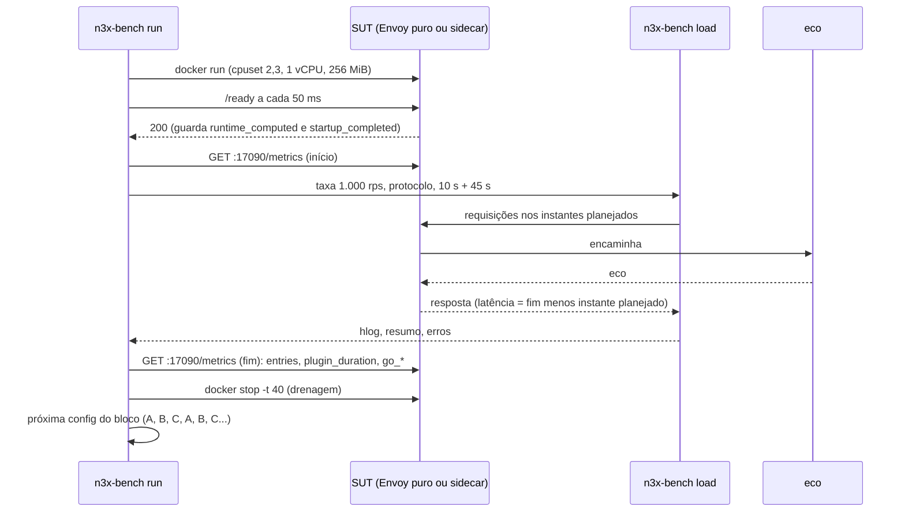
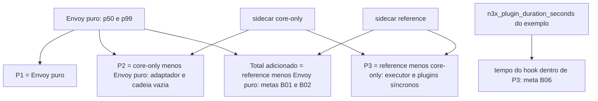

### FDD: Benchmark open-loop e orçamento do sidecar (SID-12)

Versão: 1.0
Data: 2026-10-21
Responsável: Guilherme Giusti

---

### 1. Contexto e motivação técnica

**Problema técnico.** O PRD 1.5 fixa metas de desempenho para o sidecar que hoje não têm medida: latência adicionada, com o plugin core e o plugin de exemplo ativos, de p50 até 0,5 ms e p99 até 2 ms a 1.000 rps, com carga open-loop abaixo do joelho da curva; no máximo 5 entradas do Envoy no Go por requisição, qualquer que seja o número de plugins; sidecar ocioso em até 100 MB e 0,05 vCPU; pronto em até 5 s depois que o container sobe. O ADR-009 do `n3x-sidecar` divide essas metas num orçamento por parcela (Envoy puro 0,30/1,00 ms, core do `.so` 0,15/0,50 ms, plugins síncronos 0,05/0,10 ms, folga de 0,40 ms no p99; ocioso Envoy 45 MB, runtime Go e core 35 MB, plugins 20 MB) e o ADR-008 fixa `GOMEMLIMIT` em 45% da memória; os dois ADRs dizem que os números são hipótese até o benchmark. As FDDs anteriores deixaram números pendentes desta medição: o 45%, o `UnlimitedCPUCap` de 2 e o `MinMemoryBytes` de 128 MiB, mais o custo do entrypoint (FDD 27, L-31); a duração da drenagem, o `MinDrainWait` de 3 s e o custo do health de até 20 MB (FDD 29); "adaptador mais cadeia vazia" em até 0,05/0,20 ms (FDD 16); executor e plugins síncronos em até 0,05/0,10 ms (FDD 17); hook do exemplo em até 0,05 ms no p50 (FDD 13); entradas por requisição (FDD 16); teto de conexões e parâmetros de HTTP/2 do bootstrap (FDD 26); pressão de memória com 256 MiB (FDD 26); e o dimensionamento de 1 vCPU e 256 MiB lido pelo `deploytool sizing import` (FDD 47). Medir em closed-loop esconderia a cauda da latência (omissão coordenada), por isso o PRD exige carga open-loop.

**Encaixe no HLD.** Esta FDD especifica a pasta `bench/` do `n3x-sidecar` (HLD do `n3x-sidecar`, estrutura do repositório: "benchmark open-loop e Envoy puro de referência"; "Próximos passos": "montar o benchmark open-loop contra o Envoy puro e confirmar o orçamento") e a célula "Carga open-loop (1.000 rps)" da matriz de CI do HLD de plataforma (noturno, máquina dedicada, `envoy-1.40`, amd64). Ela não muda código de produção: mede o que as FDDs 15 a 29 constroem, devolve números que confirmam ou trocam as constantes delas por regra escrita e fecha o marco M5 junto com a FDD 51. A montagem das imagens, a combinação de versões e as aplicações de teste vêm do harness da FDD 48.

```text
máquina dedicada n3x-perf (amd64, Linux, cgroup v2, SMT desligado)
┌ núcleos 5 e 6 ──────────────┐   ┌ núcleos 2 e 3, cota de 1 vCPU, 256 MiB ┐   ┌ núcleo 4 ───────────┐
│ n3x-bench load              │   │ SUT (um por vez, rede do host):         │   │ eco (FDD 48)         │
│ open-loop, HdrHistogram     ├──▶│  sidecar: n3x run, Envoy 1.40 + .so     ├──▶│ HTTP/1.1, h2c, gRPC  │
│ HTTP/1.1, HTTP/2, gRPC      │   │  ou Envoy puro: mesmo binário, mesmo    │   │ 127.0.0.1:3000       │
└─────────────────────────────┘   │  bootstrap sem o filtro n3x             │   └──────────────────────┘
┌ núcleo 7 ───────────────────┐   └────────────┬────────────────────────────┘
│ n3x-bench run (orquestrador)│◀── cgroup a cada 1 s, /proc por processo, :17090/metrics, :17021, logs
│ controller do combo (17443) │◀── conexão compartilhada do sidecar (FDD 38)
└─────────────────────────────┘
        └──▶ bench-report.json, summary.md, artefatos ──▶ portão, linha de base, issue, deploytool sizing import
```

**Atores.** Gerador de carga `n3x-bench load` (clientes HTTP/1.1, HTTP/2 e gRPC em open-loop); sistema medido (SUT): sidecar com o plugin core e o plugin de exemplo, ou Envoy puro de referência; aplicação `eco` da FDD 48; controller do mesmo `combo.json`, só para manter a conexão real do core; orquestrador `n3x-bench run` (sobe e derruba o SUT, mede, decide); mantenedor (lê o relatório e aplica os ajustes nas FDDs donas); CI noturna e de pré-release.

**Limites.** O benchmark mede um sidecar por vez, no alvo `envoy-1.40` e em amd64 (HLD de plataforma). Ele não muda constantes de outras FDDs: quando um número muda, registra o pedido para a FDD dona, aplicado num patch ou numa minor dela. Ficam fora: o controller com 500 sidecars (FDD 51), a longa duração e a injeção de panic de ponta a ponta (FDD 48, L-41), os micro-benchmarks com `-benchmem` de cada componente (FDDs 07, 13, 16, 17 e 18) e o alvo `istio-1.31` (FDD 49).

**Suposições**
- As FDDs 15 a 29, 38 e o plugin core estão implementados na versão medida; o `.so` sai do `n3x-plugin build` com o core e o `n3x.example` (FDD 48, `combo.json`)
- A meta ociosa é de 100 MiB, igual à FDD 51 (decidido na clarificação de 2026-10-22, antes ponto P-02; o PRD e o ADR-009 passaram a dizer MiB)
- Go 1.26 no `.so` aplica o `GOMAXPROCS` e o `GOMEMLIMIT` recebidos do entrypoint (FDD 27); dentro do container de 1 vCPU, o Envoy roda com `--concurrency 1` e o Go com `GOMAXPROCS` 2
- O runner auto-hospedado `n3x-perf` é o mesmo da FDD 51, sem outra carga durante a execução (hipótese de infraestrutura, ponto P-01)
- O `n3x.yaml` aceita a seção `plugins` vazia (só o core implícito), usada no cenário "sem plugins" (hipótese H-23, pedido à FDD 15)

**Restrições**
- Carga open-loop: o instante de envio de cada requisição é fixado antes, e a latência conta a partir dele (PRD; ADR-009)
- Referência na mesma máquina, com o mesmo binário do Envoy e o mesmo bootstrap menos o filtro (ADR-009)
- Nenhum segredo, token, chave ou canário entra em relatório, log ou artefato publicado (PRD, segurança; `secrettest.Leaks` da FDD 03)
- Resultado reproduzível: imagens por digest do `combo.json`, máquina descrita no relatório, mesma ordem de execução
- Documentação em pt-BR; identificadores em inglês

**Rastreabilidade**
- PRD 1.5: requisitos não funcionais de desempenho (latência adicionada a 1.000 rps em open-loop abaixo do joelho; 0 alocações e até 5 entradas do Envoy no Go por requisição; ocioso em até 100 MB e 0,05 vCPU; pronto em até 5 s); confiabilidade (`GOMEMLIMIT`, overload manager, `GOMAXPROCS` maior ou igual aos workers); FR-001 (runtime pelo cgroup), FR-003 (encaminhamento HTTP/1.1, HTTP/2 e gRPC), FR-004 (cadeia, negação); "Testes de carga e desempenho" (open-loop com HdrHistogram, à noite em máquina dedicada, antes de cada release); risco "Overhead real acima do estimado" (otimizar ou rever a meta antes de fechar a v1); critério de aceite "no benchmark open-loop a 1.000 rps, p50 até 0,5 ms e p99 até 2 ms; ocioso em até 100 MB e 0,05 vCPU; pronto em até 5 s" (CA-18 da FDD 48)
- HLD do `n3x-sidecar`: "Orçamento de desempenho do sidecar", "Meta de disponibilidade" (pronto em 5 s), "Tecnologias principais" (gerador com HdrHistogram), riscos "Overhead acima do orçamento" e "Fórmula de `GOMEMLIMIT` errada causa OOM ou GC excessivo"; HLD de plataforma: "Matriz de CI" (carga open-loop noturna, máquina dedicada)
- ADRs do `n3x-sidecar`: ADR-002 (health no entrypoint, métricas no Envoy), ADR-008 (runtime pelo cgroup, 45%, overload manager em 90% e 95%), ADR-009 (orçamento, medição open-loop contra o Envoy puro, 1 vCPU e 256 MiB); ADRs do `n3x-sdk`: ADR-009 (sem tracing, correlação por `request_id`), ADR-010 (metas do sistema divididas no HLD de cada repositório)
- Lacuna do README fechada aqui: **L-31** (a fórmula de 45% e o dimensionamento de 1 vCPU e 256 MiB deixam de ser hipótese pelas regras S1 a S4 do contrato 7; os valores finais saem da primeira `prerelease` verde). Lacunas aplicadas: L-16 (admin só no socket), L-18 (canal de controle da drenagem), L-41 (longa duração fica na FDD 48, não aqui)
- Pedidos atendidos: FDD 13 (p50 do hook até 0,05 ms), FDD 16 (entradas por requisição; adaptador mais cadeia vazia em 0,05/0,20 ms), FDD 17 (executor no Envoy real em 0,05/0,10 ms), FDD 26 (teto de conexões, parâmetros de HTTP/2, pressão de memória com 256 MiB), FDD 27 (`MemoryPercent`, `UnlimitedCPUCap` e `MinMemoryBytes`, entrypoint no orçamento ocioso, P-03), FDD 29 (duração da drenagem, `MinDrainWait`, custo ocioso com o health), FDD 47 (relatório para o `deploytool sizing import`; contingência de 384 MiB), FDD 48 (`combo.json`, `harness/` e aplicações), FDD 51 (mesmo runner e grupo, antes da 51, envelope `format: 1`, mesma política de ruído). Pedidos justificados como fora daqui (seção 3): longa duração e injeção de panic de ponta a ponta (FDDs 06 e 18, já fechados pela FDD 48), limite de body (FDD 15)
- FDDs de que depende: 27 e 48 (diretas), 13, 16, 17, 18, 26, 28, 29 e 38 (sistema medido); relacionadas: 04 e 06 (memória e tarefas de fundo do exemplo), 46 (alertas e release), 47 (dimensionamento) e 51 (mesma máquina e sessão S35)

**Clarificações (2026-10-22)**
- Unidade da meta ociosa (ponto P-02): MiB, decidido na validação de consistência e aplicado ao PRD e ao ADR-009
- Parcela do entrypoint no orçamento ocioso (I-01): incluída no ADR-009 e no HLD (até 20 MiB e 0,005 vCPU, hipótese); a meta dura continua no total do container, e as parcelas são rebalanceadas pela regra S5

---

### 2. Objetivos técnicos

- **Veredito objetivo das metas do PRD.** Medida: o portão noturno responde "passa", "falha" ou "inconclusivo" para as metas B01 a B18 do contrato 7, com valor medido, meta, tipo e fonte de cada uma no `bench-report.json`; o M5 do sidecar fecha com 3 noites verdes seguidas e uma `prerelease` verde no mesmo commit candidato (mesma regra da FDD 51).
- **Latência adicionada sem omissão coordenada.** Invariante: toda requisição tem um instante planejado `t_s = t_0 + i / taxa`; a latência gravada é `t_fim - t_s`, inclusive quando o envio atrasa por falta de conexão livre. Medida: num teste com um servidor que trava 100 ms, todas as requisições planejadas nessa janela aparecem com latência maior ou igual ao tempo que faltava para destravar.
- **Orçamento conferido parcela por parcela.** Medida: o relatório traz, por protocolo, a latência do Envoy puro, a do sidecar sem plugins e a do sidecar de referência, e as diferenças P1 a P3 (contrato 5), com o tempo do hook do exemplo lido de `n3x_plugin_duration_seconds`; e, no ocioso, memória e CPU por parcela (Envoy, runtime Go e core, plugins, entrypoint).
- **Entradas por requisição independentes do número de plugins.** Medida: `n3x_sidecar_entries_total{kind="chain"}` dividido por `n3x_sidecar_entries_total{event="filter_new"}` igual a 3 na config de referência e com 8, 32 e 64 instâncias, e nunca acima de 5.
- **Fórmula de runtime e dimensionamento decididos por regra escrita.** Medida: a seção `recommendations[]` traz o valor sugerido para `MemoryPercent`, `MinMemoryBytes` e `UnlimitedCPUCap` (FDD 27), a linha `sidecar` da tabela de dimensionamento (FDD 47), as parcelas do ADR-009, o `max_active_downstream_connections` e os parâmetros de HTTP/2 do bootstrap (FDD 26) e o `MinDrainWait` (FDD 29), cada um com a regra S1 a S7 que o produziu e a evidência.
- **Medida que não mascara o resultado.** Invariante: uma execução só vale se o gerador passou na própria saúde (B17: atraso de envio p99 até 100 µs, CPU dos núcleos dele até 70%, piso sem proxy com p99 até 0,25 ms) e se não houve pressão de CPU vinda de fora do SUT; senão o veredito é "inconclusivo", nunca "passa".
- **Ruído que não gera falso positivo.** Medida: com a mesma imagem, 10 noites seguidas sem mudança de código produzem no máximo 1 reprovação de meta dura antes da repetição e 0 depois dela (política do contrato 7).
- **Reproduzível e dentro da janela.** Medida: suíte `nightly` em até 60 min de relógio, terminando antes das 03:30 UTC (início da FDD 51); `prerelease` em até 4 h; `smoke` de PR em até 15 min num runner comum.

---

### 3. Escopo e exclusões

**Incluído**
- Módulo Go aninhado `github.com/giustech/n3x-sidecar/bench` (hipótese H-01) com o comando `n3x-bench` e os pacotes internos `load`, `sut`, `refcfg`, `probe`, `scenario`, `report` e `gate`; alvos de `make` na raiz do `n3x-sidecar` (contrato 1)
- Gerador open-loop próprio para HTTP/1.1, HTTP/2 (h2c) e gRPC, com HdrHistogram e latência a partir do instante planejado; calibração contra o Nighthawk na `prerelease` (contrato 3, hipótese H-02)
- Envoy puro de referência com o mesmo binário (mesmo digest da imagem base do runtime, FDD 28) e o bootstrap da FDD 26 sem o filtro `n3x`, gerado pelo mesmo código e versionado em `bench/configs/` com conferência de golden (contrato 4)
- Configs do sidecar medidas: `core-only` (sem plugins), `reference` (fragmento da FDD 13: `add-header` e `deny-grpc`), `plugins-8`, `plugins-32` e `plugins-64`; variantes `h1` e `h2` para `app.protocol` (contrato 4)
- Cenários (contrato 2): piso do gerador, latência por protocolo a 1.000 rps, negação, N plugins, ocioso, tempo até pronto, drenagem ociosa e sob carga, memória apertada; na `prerelease`, joelho da curva, paridade com o Nighthawk, pressão de memória e overload manager, CPU sem limite, escala de conexões, dimensionamento e diagnóstico de goroutines
- Medição (contrato 5): cgroup v2 do container, memória e CPU por processo em `/proc`, `/metrics` da `17090`, eventos de log do entrypoint e do `.so`, histogramas do cliente
- Relatório `bench-report.json` (envelope `format: 1` da FDD 51), `summary.md` e artefatos; metas, política de ruído, linha de base e regras de recomendação (contratos 6 e 7)
- Workflow `bench.yml`: `smoke` em PR, `nightly` na máquina dedicada antes da FDD 51, `prerelease` antes de cada release do sidecar e do core, `explore` manual; status `n3x-bench/release` como portão (contrato 8)
- Fechamento da L-31 e respostas ao P-03 da FDD 27 e aos pedidos listados na seção 1

**Excluído**
- Controller com 500 sidecars simulados e o orçamento do controller: FDD 51 (CTL-07)
- Teste de longa duração (vazamento de goroutines e memória) e injeção de panic de ponta a ponta: FDD 48 (SDK-16), que fechou a L-41 com `E2E-SOAK-01`, `E2E-SOAK-02` e `E2E-FLT-01` a `06`; os pedidos das FDDs 06 e 18 que citavam "48 ou 50" ficam atendidos lá
- Micro-benchmarks com `-benchmem`, `AssertZeroAllocs` e `AssertZeroAllocsFunc` de cada componente: FDDs 07 (SDK-07), 13 (SDK-13), 16 (SID-02), 17 (SID-03) e 18 (SID-04); aqui só a contagem de alocações no Envoy real, como meta de orçamento
- Limite de body (`runtime.request_body.max_bytes`, pedido da FDD 15): nenhum plugin da config de referência lê body (`proxy.CapRequestBody`), então o caminho não é exercido; fica para o primeiro plugin que pedir body
- Zero requisição cortada em rolling update com balanceador real: FDD 48 (`E2E-DRN-01` a `03`); aqui só a duração da drenagem e a janela de `MinDrainWait` sem balanceador
- Alvo `istio-1.31` e arquitetura arm64 (HLD de plataforma: só `envoy-1.40` e amd64 na carga)
- Observabilidade do tráfego da aplicação (fora da v1)
- Mudança de qualquer constante de produção: fica como pedido à FDD dona

---

### 4. Fluxos detalhados e diagramas

**Fluxo principal: suíte `nightly` na máquina dedicada**
1. O workflow `bench.yml` (contrato 8) roda às 02:15 UTC no runner `n3x-perf`, grupo de concorrência `n3x-perf` sem cancelamento (o mesmo da FDD 51, que começa às 03:30 e espera na fila se esta atrasar).
2. `n3x-bench prepare --combo head` chama `n3x-e2e plan --tier nightly --combo head` da FDD 48 e grava o `combo.json` (as cinco `main` do código-fonte); depois usa `harness/images` para montar a imagem `n3x-bench/sidecar:<sha12>` (Dockerfile do operador da FDD 47 com o core e o `n3x.example`, sem o `n3xtest.faults`), a imagem `eco` e a do controller do combo; e `harness/secrets` para gerar a chave AES, a credencial do serviço `bench`, a `hmac_key` e o `controller.yaml`, com canários no `markers.json` (contrato 8 da FDD 48). Lê do catálogo do alvo o digest do `envoy.image`, que é a base da imagem de runtime (FDD 28): o Envoy puro roda nessa mesma imagem base.
3. `n3x-bench envoy-config --check` confere que as configs versionadas em `bench/configs/` batem com o gerador da FDD 26 na versão do combo; diferença é erro de infraestrutura (saída 4), porque o Envoy puro e o sidecar deixariam de ter a mesma config.
4. Sobe o controller (núcleo 7) e a `eco` (núcleo 4, cota de 1 vCPU), uma vez para a suíte inteira.
5. `n3x-bench run --suite nightly` executa os cenários na ordem do diagrama; para cada execução:
   1. sobe um container novo do SUT com `--network host --cpus 1 --cpuset-cpus 2,3 --memory 256m --memory-swap 256m --read-only --tmpfs /tmp:size=16m --user 17000:17000` e a config do cenário
   2. espera `GET 127.0.0.1:17021/ready` 200 (sidecar) ou `GET /ready` no socket do admin (Envoy puro), a cada 50 ms, até 30 s; guarda `runtime_computed`, `adapter_loaded` e `startup_completed`
   3. liga a sonda (cgroup a cada 1 s, `/proc` por processo a cada 1 s, `/metrics` da `17090` no início e no fim de cada janela)
   4. roda a carga: aquecimento (padrão 10 s, fora da medida) e janela de medida (padrão 45 s); o gerador grava os histogramas e as contagens
   5. para o SUT com `docker stop -t 40` (SIGTERM; o sidecar drena pela FDD 29), guarda o log e confere `oom_kill` em `memory.events`
6. A latência é medida em blocos intercalados por protocolo (Envoy puro, sidecar sem plugins, sidecar de referência, e de novo), 3 vezes; cada percentil do bloco é a mediana das 3 execuções (contrato 7, hipótese H-06). Execução com coeficiente de variação do p99 acima de 15% entre as 3 ganha mais 2 execuções; continuando acima, a meta fica "inconclusiva".
7. Avalia as metas (contrato 7); meta dura que falha faz o cenário rodar de novo inteiro uma vez; falha só vale com 2 de 2.
8. Varre logs e artefatos com os canários do `markers.json` (`secrettest.Leaks`); grava `bench-report.json` e `summary.md`; compara com a linha de base das últimas 7 noites verdes; publica o artefato `sidecar-bench-<sha>`; abre ou atualiza a issue `bench-sidecar` (falha ou regressão em 3 noites) ou `perf-infra` (inconclusivo ou infraestrutura em 2 noites).

**Fluxo do gerador open-loop (cada execução de latência)**
1. Calcula a grade de instantes `t_s(i) = t_0 + i x (1 s / taxa)` (chegadas uniformes, hipótese H-03); a grade é fixa e não depende das respostas.
2. Um agendador acorda em cada `t_s(i)`, pega uma conexão livre do pool (HTTP/1.1: até 64, uma requisição por vez em cada; HTTP/2 e gRPC: 2 conexões com até 100 streams cada) e envia; sem conexão livre, abre uma nova até o teto; no teto, a requisição espera na fila do gerador, e a espera conta na latência.
3. Grava três tempos por requisição: `send_lag = t_envio - t_s` (saúde do gerador), `latency = t_fim - t_s` (a medida) e `service = t_fim - t_envio` (diagnóstico); `t_fim` é o último byte do corpo em HTTP e o status final nos trailers em gRPC.
4. Classifica o resultado pelo esperado do cenário (200 e eco com o header `x-n3x: 1`; 403 `bloqueado` na negação HTTP; `grpc-status: 7` na negação gRPC); qualquer outro resultado é erro e entra na contagem, não no histograma de sucesso.
5. No fim, escreve o HdrHistogram (1 µs a 60 s, 3 dígitos significativos) em `.hlog` por intervalo de 1 s e o resumo (p50, p90, p99, p99,9, máximo, taxa alcançada, erros, conexões abertas).

**Fluxo do ocioso**
1. Sobe o sidecar de referência conectado ao controller; espera o pronto e 60 s de assentamento (registro, primeiro heartbeat, primeiro relatório do exemplo).
2. Durante 300 s, sem tráfego da aplicação: sonda de readiness em `:17021/ready` a cada 10 s (como o Kubernetes) e scrape de `:17090/metrics` a cada 15 s (como o Prometheus); heartbeat do core a cada 10 s e relatório do exemplo a cada 10 s seguem normalmente.
3. Mede o working set do container (`memory.current - inactive_file`, a mesma conta do kubelet) a cada 1 s e a CPU por janela; mede por processo o PSS (`/proc/<pid>/smaps_rollup`) e a CPU (`/proc/<pid>/stat`) do entrypoint (PID 1 do container) e do Envoy.
4. Na `prerelease`, repete com o Envoy puro e com o sidecar sem plugins, para separar as parcelas (contrato 5).

**Fluxo do tempo até pronto e da drenagem ociosa**
1. Cria e inicia o container 10 vezes seguidas (imagem já local; a descompactação e o pull ficam fora da medida).
2. `t0` = `State.StartedAt` do `docker inspect` (ns); `t1` = primeira resposta 200 de `GET :17021/ready`, consultado a cada 50 ms; a medida é `t1 - t0`. Guarda também `startup_completed` (`preflight_ms`, `runtime_ms`, `bootstrap_ms`, `facts_ms`, `envoy_ready_ms`, `total_ms`, FDD 27).
3. Logo depois do pronto, sem conexões, envia SIGTERM e mede até o fim do container; guarda `drain_completed` (`wait_ms`, `stop_ms`, `envoy_stop_ms`, `total_ms`, `exit_code`, FDD 29).

**Fluxo da drenagem sob carga**
1. Sidecar de referência com carga de 1.000 rps em HTTP/1.1 com keep-alive (64 conexões) e gRPC (2 conexões), 20 s.
2. Variante `drain-stop`: no SIGTERM (`t0`), o gerador para de planejar requisições novas e espera as que estão em voo (simula um balanceador que tira o endpoint na hora). Mede `wait_ms` (conexões até 0), `stop_ms`, `envoy_stop_ms`, `total_ms` e as requisições cortadas pela definição da FDD 48 (contrato 9 dela).
3. Variante `drain-lb3s`: o gerador continua planejando requisições por 3 s depois do SIGTERM (simula um balanceador que leva 3 s para propagar) e depois para. Mede quantas das requisições planejadas nessa janela falharam; com `--drain-strategy immediate`, as respostas trazem `Connection: close` e `GOAWAY`, o cliente reconecta e o listener ainda aceita até `--drain-time-s` (FDD 29). É a medida que diz se `MinDrainWait` de 3 s cobre um balanceador de até 3 s.

**Fluxo da memória apertada (nightly: 128 e 256 MiB; prerelease: 128, 192 e 256 MiB)**
1. Sidecar de referência com `--memory` igual ao valor do cenário; confere no `runtime_computed` o `gomemlimit_bytes` esperado (`floor(MEM x 45 / 100)`: 60.397.977, 90.596.966 e 120.795.955 bytes).
2. Carga de 1.000 rps em HTTP/1.1 por 120 s, com uma rajada de 2.000 rps por 20 s no meio.
3. Mede `oom_kill`, pico do working set, `n3x_sidecar_go_memory_bytes` contra `n3x_sidecar_go_memory_limit_bytes`, CPU de GC (`n3x_sidecar_go_gc_cpu_seconds_total`, pedido às FDDs 16 e 27), ações do overload manager e a latência adicionada.

**Fluxos alternativos e exceções**
- **Gerador saturado ou máquina ruidosa:** atraso de envio p99 acima de 100 µs, CPU dos núcleos do gerador acima de 70%, piso acima de 0,25 ms no p99 ou pressão de CPU (`/proc/pressure/cpu`, `some avg10`) acima de 10% nos núcleos do SUT vinda de fora dele: veredito "inconclusivo", saída 3, nenhuma meta marcada como falha
- **SUT não fica pronto em 30 s, sai sozinho ou some o cgroup:** saída 4 (infraestrutura), com o código de saída do container (`N3X-S00x`) e as últimas 200 linhas do log, depois da varredura de segredos
- **OOM kill:** a meta B14 (ou B16 na `prerelease`) falha na hora; o cenário para; guarda `memory.events`, `memory.stat` e o último `/metrics`; não repete (OOM não é ruído)
- **Respostas inesperadas acima de 0,1%:** a execução vale como falha de B04 (carga válida) e a latência daquela execução não entra na mediana
- **Monitor `cgroup_memory` ausente no Envoy 1.40** (contingência da FDD 26): o `mem-pressure` sai "inconclusivo" com o motivo `overload_monitor_missing` e o relatório traz o que o bootstrap usou (`fixed_heap`)
- **Métricas de GC e alocação ainda não publicadas pelo `.so`** (pedido pendente às FDDs 16 e 27): B08 e a parte de GC de B14 saem "inconclusivas" com `metric_missing`; o resto do veredito vale
- **Configs versionadas desatualizadas:** saída 4 antes de qualquer medida, com o diff no log
- **`combo.json` com digest que não confere:** saída 4 (`digest_mismatch`, contrato 4 da FDD 48)

**Diagramas**

Ordem da suíte `nightly` (cerca de 50 min, H-19):

```mermaid
flowchart LR
    A[prepare: combo, imagens, segredos, configs] --> B[floor: gerador direto na eco]
    B --> C[latency h1: envoy, core-only, reference x3]
    C --> D[latency h2 e grpc: envoy, reference x3]
    D --> E[deny h1 e grpc; plugins-8 e plugins-32]
    E --> F[idle 300 s]
    F --> G[startup x10 com drenagem ociosa]
    G --> H[drain-stop e drain-lb3s]
    H --> I[mem-tight 128 e 256 MiB]
    I --> J[varredura, relatório, linha de base, alerta]
```



Sequência de uma execução de latência intercalada:



Cálculo das parcelas de latência por protocolo:



---

### 5. Contratos públicos (assinaturas, endpoints, headers, exemplos)

O benchmark não é publicado e não tem compromisso de compatibilidade fora do repositório. Os contratos abaixo existem para a CI, para o mantenedor e para as FDDs que leem o relatório (47 e 51); mudam em PR do próprio `n3x-sidecar`, com o `format` do relatório subindo quando um campo some ou muda de sentido.

**Contrato 1: comando `n3x-bench` e alvos de `make`**
- Tipo: CLI (`bench/cmd/n3x-bench`, executado com `go run ./cmd/n3x-bench` dentro de `bench/` ou pelos alvos de `make` da raiz)
- Assinatura/Rota:
  ```text
  n3x-bench prepare      --combo head|stable|<arquivo>  --work <dir>  [--sdk-dir <checkout do n3x-sdk>]
  n3x-bench run          --suite smoke|nightly|prerelease|<arquivo.yaml>  --work <dir>  --out <dir>
                         [--scenario <nome>[,<nome>...]] [--runs 3] [--measure 45s] [--warmup 10s]
                         [--sut-cpuset 2,3] [--sut-cpus 1] [--sut-memory 256Mi] [--app-cpuset 4]
                         [--load-cpuset 5,6] [--aux-cpuset 7] [--baseline <dir>|gh:<workflow>] [--keep]
  n3x-bench load         --target 127.0.0.1:17000 --proto http1|http2|grpc --rate 1000 --duration 45s
                         [--warmup 10s] [--conns 64] [--path /pedidos/7] [--grpc-method pedidos.v1.Pedidos/Obter]
                         [--expect forward|deny] [--arrival uniform|poisson] [--hlog <arquivo>] [--report <arquivo>]
  n3x-bench envoy-config --combo <arquivo> --out bench/configs [--check]
  n3x-bench compare      --report <arquivo> --baseline <dir>|gh:<workflow> [--nights 7] [--format text|json]
  n3x-bench gate         --commit <sha> [--tag <tag>]
  ```
  ```text
  make bench SUITE=nightly [SCENARIO=latency-h1] [OUT=bench/out]
  make bench-load PROTO=http1|http2|grpc RATE=1000 DURATION=45s TARGET=sidecar|envoy CONFIG=reference
  make bench-configs        (regera bench/configs a partir do gerador da FDD 26)
  make bench-check          (testes do módulo bench, golden das configs, schema do relatório)
  ```
- Método: processo; logs JSON em stderr; relatório e resumo em arquivo
- Semântica:
  - **`prepare`:** monta `combo.json`, imagens, segredos e configs no diretório de trabalho (modo 0700) reaproveitando o harness da FDD 48 (contrato 4 dela); nunca imprime segredo; `markers.json` e os segredos ficam no diretório de trabalho, que o `run` apaga no fim, salvo `--keep`
  - **`run`:** orquestra os cenários (contrato 2) e escreve o relatório (contrato 6); `--keep` deixa o diretório e os logs crus para depuração local
  - **`load`:** o gerador sozinho (contrato 3), contra qualquer alvo já de pé; é o que o `make bench-load` chama para exploração local
  - **`envoy-config`:** contrato 4; `--check` não escreve e sai com 4 se algum arquivo ficaria diferente
  - **`compare`:** contrato 7; `gh:<workflow>` baixa os relatórios das últimas noites verdes com `gh run download`
  - **`gate`:** lê pela API do GitHub o status `n3x-bench/release` do commit e o relatório ligado a ele; sai 0 se toda meta dura da suíte `prerelease` passou; chamado pelo release do sidecar (pedido à FDD 28)
  - **Códigos de saída (iguais aos da FDD 51):** 0 passa; 1 uso (flag, arquivo, cenário desconhecido); 2 meta dura ou de orçamento falhou; 3 inconclusivo (gerador saturado, piso alto, pressão de CPU, métrica ausente, ruído); 4 infraestrutura (docker, imagem, digest, configs desatualizadas, SUT não ficou pronto); 5 regressão (só no `compare`); com várias causas, vale a ordem 4, 3, 2
  - **Determinismo:** a grade de instantes, a ordem das execuções e os IDs de requisição (`x-request-id: bench-<cenário>-<execução>-<n>`, só nas requisições com erro guardadas no artefato) não dependem do relógio; `--arrival poisson` usa semente fixa gravada no relatório

**Exemplo de requisição**
```text
$ n3x-bench run --suite nightly --work /var/lib/n3x-perf/bench --out ./out --baseline gh:bench.yml
```

**Exemplo de resposta** (stderr, trecho, e código de saída)
```json
{"ts":"2026-10-22T02:31:12Z","level":"info","component":"benchrun","msg":"scenario_started","scenario":"latency-h1","configs":["envoy","core-only","reference"],"runs":3,"rate":1000,"measure_s":45}
{"ts":"2026-10-22T02:40:03Z","level":"info","component":"benchrun","msg":"gate_passed","gate":"B02","scenario":"latency-h1","value_ms":0.214,"limit_ms":2.0}
{"ts":"2026-10-22T03:04:47Z","level":"info","component":"benchrun","msg":"report_written","verdict":"pass","gates_failed":0,"regressions":0,"path":"out/bench-report.json"}
```
```text
exit 0
```

---

**Contrato 2: cenários e suítes (`bench/scenarios/*.yaml`)**
- Tipo: arquivo de configuração versionado (YAML lido com o `yamlconv` do SDK e decodificado de forma estrita, padrão da FDD 01)
- Assinatura/Rota: `format: 1`; um arquivo por cenário e um por suíte (`smoke.yaml`, `nightly.yaml`, `prerelease.yaml`)
- Método: lido pelo `run`
- Semântica:
  - **`sut`:** lista de configs da tabela do contrato 4 (`envoy`, `core-only`, `reference`, `plugins-8`, `plugins-32`, `plugins-64`), `variant` (`h1` ou `h2`), `memory` (padrão `256Mi`), `cpus` (padrão 1; `0` = sem cota), `cpuset`, `image` (`sidecar` ou `sidecar-faults`, este só no `diag`), `controller` (`true` padrão)
  - **`load`:** `proto`, `rate` ou `steps` (lista de taxas do joelho), `warmup`, `measure`, `conns`, `expect` (`forward` ou `deny`), `mix` (só no `sizing`), `burst` (`{rate, at, for}`), `after_sigterm` (`stop` ou a duração em que o gerador continua planejando)
  - **`runs`:** repetições intercaladas (padrão 3 no `nightly`, 5 na `prerelease`)
  - **`phases`:** para os cenários que não são de latência (`idle`, `startup`, `drain-*`, `mem-pressure`, `conn-scale`): `settle`, `measure`, `repeat`, `action` (`sigterm`, `upload_hold`, `open_idle_conns`)
  - **`gates`:** metas do contrato 7 avaliadas no cenário
  - Campo desconhecido é erro de uso (saída 1)

| Cenário | Suíte | O que faz | Duração aproximada | Metas |
| --- | --- | --- | --- | --- |
| `floor` | todas | gerador direto na `eco` (sem proxy) em HTTP/1.1, HTTP/2 e gRPC a 1.000 rps, 45 s cada | 3 min | B17 |
| `latency-h1` | nightly, prerelease | `envoy`, `core-only` e `reference` intercalados, HTTP/1.1, `GET /pedidos/7`, 1.000 rps | 9 min (nightly) | B01, B02, B04, B05, B06, B07, B08 |
| `latency-h2` | nightly, prerelease | `envoy` e `reference` (mais `core-only` na prerelease), h2c, 1.000 rps | 6 min | B01, B02, B04, B05 (prerelease), B07 |
| `latency-grpc` | nightly, prerelease | `envoy` e `reference` (mais `core-only` na prerelease), `pedidos.v1.Pedidos/Obter`, 1.000 rps | 6 min | B01, B02, B04, B05 (prerelease), B07 |
| `deny` | nightly, prerelease | `reference` com `GET /admin/x` (403) e `pedidos.v1.Pedidos/Excluir` (`PERMISSION_DENIED`), 1.000 rps, 1 execução | 2 min | informativa (latência), B07, contagem de negações igual às requisições |
| `plugins-n` | nightly (8 e 32), prerelease (8, 32 e 64) | N instâncias do `n3x.example` em ordens distintas, HTTP/1.1, 1.000 rps, 1 execução | 2 a 3 min | B07 (dura); latência e custo por instância informativos |
| `idle` | nightly (só `reference`), prerelease (`envoy`, `core-only` e `reference`) | 60 s de assentamento e 300 s ociosos com controller, sonda e scrape | 6 min (nightly), 14 min | B09, B10, B11 (parcelas só na prerelease) |
| `startup` | nightly, prerelease | 10 subidas seguidas com drenagem ociosa depois de cada uma | 2 min | B12, B13 (ociosa) |
| `drain-stop` | nightly, prerelease | 1.000 rps HTTP/1.1 e gRPC por 20 s; SIGTERM; gerador para de planejar | 1 min | B13 |
| `drain-lb3s` | nightly, prerelease | igual, com o gerador planejando por mais 3 s depois do SIGTERM | 1 min | B13 (janela de `MinDrainWait`) |
| `mem-tight` | nightly (128 e 256 MiB), prerelease (128, 192 e 256 MiB) | 1.000 rps HTTP/1.1 por 120 s com rajada de 2.000 rps por 20 s | 5 a 8 min | B14 |
| `knee` | prerelease | `envoy` e `reference`, HTTP/1.1 e gRPC, degraus 1.000, 1.500, 2.000, 3.000, 4.500, 6.000 e 8.000 rps, 20 s de aquecimento e 40 s de medida por degrau | 30 min | B03 |
| `tool-parity` | prerelease | Nighthawk e `n3x-bench load` contra o `envoy` em HTTP/1.1 e HTTP/2 a 1.000 rps | 6 min | B17 (paridade) |
| `mem-pressure` | prerelease | `reference` com 256 MiB; uploads lentos de 1 MiB até o overload manager agir; tráfego de referência ao lado | 10 min | B15 |
| `cpu-unlimited` | prerelease | sem cota de CPU e cpuset de 4 núcleos (2 a 5): `--concurrency` 2 pelo teto contra `resources.cpus: 4`; ocioso e joelho em HTTP/1.1 | 25 min | informativa: regra S3 |
| `conn-scale` | prerelease | 1.000, 5.000 e 10.000 conexões ociosas em HTTP/1.1 e HTTP/2 | 10 min | informativa: regra S6 |
| `h2-streams` | prerelease | h2c com 1 conexão e 100, 200 e 400 streams simultâneos (requisições com `atraso_ms`) | 5 min | informativa: regra S6 |
| `sizing` | prerelease | `reference` em 1 vCPU e 256 MiB, 1.000 rps somados (50% HTTP/1.1, 25% HTTP/2, 25% gRPC), 10 min | 11 min | B16 (L-31) |
| `diag` | prerelease | imagem com o `n3xtest.faults` (sem gatilho no tráfego); no fim, `dump-goroutines` | 3 min | informativa: perfil de goroutines com rótulos |
| `smoke` | smoke (PR) | `envoy` e `reference`, HTTP/1.1, 200 rps por 30 s, num runner comum | 10 min | só funcionais: B07, B18, schema do relatório, configs em dia |

**Exemplo de requisição** (`bench/scenarios/latency-h1.yaml`)
```yaml
format: 1
name: latency-h1
sut:
  configs: [envoy, core-only, reference]
  variant: h1
  memory: 256Mi
  cpus: 1
load: { proto: http1, rate: 1000, warmup: 10s, measure: 45s, conns: 64, expect: forward }
runs: 3
gates: [B01, B02, B04, B05, B06, B07, B08]
```

**Exemplo de resposta** (`n3x-bench run --scenario latency-h1` com campo errado)
```text
erro: scenarios/latency-h1.yaml: load.taxa: campo desconhecido [unknown_field]
exit 1
```

---

**Contrato 3: gerador open-loop (`n3x-bench load` e pacote `internal/load`)**
- Tipo: CLI e API Go interna do módulo de teste
- Assinatura/Rota:
  ```go
  package load // github.com/giustech/n3x-sidecar/bench/internal/load

  type Proto string // "http1", "http2", "grpc"

  type Spec struct {
      Target    string        // host:porta do SUT (ou da eco no floor)
      Proto     Proto
      Rate      float64       // requisições por segundo, constante
      Warmup    time.Duration // fora da medida
      Measure   time.Duration
      MaxConns  int           // http1: 64; http2 e grpc: 2
      Arrival   string        // "uniform" (padrão) ou "poisson"
      Seed      uint64        // só no poisson
      Request   Request       // path ou método gRPC, headers
      Expect    Expect        // forward ou deny, com o resultado esperado
      StopAfter time.Duration // drenagem: quanto tempo continuar planejando depois do sinal
  }

  type Result struct {
      Latency, Service, SendLag *hdrhistogram.Histogram // 1 µs a 60 s, 3 dígitos
      Planned, Sent, OK, Errors int64
      ErrorsByKind             map[string]int64 // status_<n>, grpc_<code>, reset, conn_refused, timeout, body_mismatch
      ConnsOpened, QueueWaits  int64
      AchievedRate             float64
      CPUPercent               float64 // dos núcleos do gerador, para a B17
  }

  func Run(ctx context.Context, s Spec) (Result, error)
  ```
- Método: chamada local ou processo
- Semântica:
  - **Por que um gerador próprio (hipótese H-02, ponto P-04):** o HLD cita wrk2, Nighthawk ou ghz. O wrk2 só fala HTTP/1.1 e não é mantido; o ghz trabalha com workers e limite de taxa, sem corrigir a omissão coordenada; o Nighthawk é open-loop e do próprio projeto Envoy, mas não fala gRPC unário com o framing do protobuf e não exporta o HdrHistogram cru. Um gerador único em Go, com o mesmo agendador para os três protocolos, dá um só formato de histograma e a mesma correção; o Nighthawk entra só como calibração (`tool-parity`)
  - **Agendamento:** um temporizador por instante planejado, com espera ativa nos últimos 50 µs para baixar o atraso; `send_lag` acima de 1 ms em mais de 0,1% das requisições invalida a execução (B17)
  - **Conexões:** HTTP/1.1 com keep-alive, pool aquecido com 8 conexões antes da medida; HTTP/2 por h2c com conhecimento prévio (`golang.org/x/net/http2`); gRPC com grpc-go sobre h2c, sem TLS, 2 conexões em rodízio; janelas e `max_concurrent_streams` padrão do cliente
  - **Requisição de referência:** HTTP `GET /pedidos/7` com 8 headers (`host`, `user-agent: n3x-bench`, `accept`, `accept-encoding`, `x-tenant`, `x-trace`, `cookie` de 64 bytes, `x-client`), sem corpo; resposta da `eco` em JSON de cerca de 500 bytes; gRPC `pedidos.v1.Pedidos/Obter{id: "7"}` com 4 metadados; negação: `GET /admin/x` e `Excluir{id: "7"}`
  - **Conferência do resultado:** o eco precisa trazer o header `x-n3x: 1` posto pelo exemplo (só nas configs com plugin); a `eco` devolve os headers recebidos (contrato 7 da FDD 48)
  - **Taxa alcançada:** requisições concluídas na janela dividida pela janela; fora de 99,5% a 100,5% da pedida, a execução falha B04
  - **Arquivos:** `.hlog` no formato do HdrHistogram (intervalos de 1 s), lido também por ferramentas externas; resumo JSON
- Limites: até 20.000 rps por processo nos núcleos 5 e 6 (o joelho mais alto previsto é 8.000); acima disso, o próprio `floor` acusa

**Exemplo de requisição**
```text
$ n3x-bench load --target 127.0.0.1:17000 --proto grpc --rate 1000 --duration 45s --warmup 10s --report grpc.json
```

**Exemplo de resposta** (`grpc.json`, valores ilustrativos)
```json
{ "proto": "grpc", "rate": 1000, "achieved_rate": 999.98, "planned": 45000, "ok": 45000, "errors": 0,
  "latency_ms": { "p50": 0.231, "p90": 0.402, "p99": 0.788, "p999": 1.412, "max": 3.06 },
  "service_ms": { "p50": 0.226, "p99": 0.771 }, "send_lag_us": { "p99": 18, "max": 240 },
  "conns_opened": 2, "queue_waits": 0, "generator_cpu_percent": 9.6 }
```

---

**Contrato 4: configs medidas, Envoy puro de referência e golden (`bench/configs/`)**
- Tipo: arquivos versionados e gerados por `n3x-bench envoy-config`
- Assinatura/Rota:
  ```text
  bench/configs/
  ├── sidecar/core-only-h1.n3x.yaml   core-only-h2.n3x.yaml
  ├── sidecar/reference-h1.n3x.yaml   reference-h2.n3x.yaml
  ├── sidecar/plugins-8.n3x.yaml      plugins-32.n3x.yaml   plugins-64.n3x.yaml
  ├── envoy/h1.bootstrap.yaml         h2.bootstrap.yaml     (Envoy puro)
  ├── envoy/h1.sidecar.bootstrap.yaml h2.sidecar.bootstrap.yaml (o que o sidecar gera, para comparar)
  └── controller.template.yaml        (sem segredo; o prepare preenche)
  ```
- Método: gerado; conferido na CI (`make bench-check` e passo 3 do fluxo principal)
- Semântica:
  - **Mesma config de listener e cluster (ADR-009):** o `envoy-config` monta o `bootstrap.Input` da FDD 26 a partir de cada `n3x.yaml` medido, chama `bootstrap.Generate` (puro e determinístico) e grava a saída como `*.sidecar.bootstrap.yaml`; o Envoy puro é a mesma árvore com uma única diferença: a entrada `n3x` de `http_filters` removida (o router fica). Listener `n3x_ingress` na `17000`, cluster `app`, admin no socket `/tmp/n3x/admin.sock`, overload manager, listener de métricas `17090`, `generate_request_id`, normalização de path, `http2_protocol_options` e prazos ficam idênticos; um teste confere que o diff entre os dois arquivos é só esse bloco
  - **Mesmo binário:** o Envoy puro roda na imagem `envoy.image` do catálogo do alvo, por digest, a mesma base da imagem de runtime da FDD 28, com `envoy -c <arquivo> --concurrency 1 --disable-hot-restart --drain-strategy immediate`; a imagem do sidecar roda `n3x run`, que calcula `--concurrency 1` pela cota (FDD 27). O relatório confere os dois digests e o `server.version` das stats
  - **Configs do sidecar:** `service: bench`, `listener.port: 17000`, `app.address: 127.0.0.1:3000`, `app.protocol` `http1` (variante `h1`) ou `http2` (variante `h2`, usada em HTTP/2 e gRPC), bloco `controller` apontando para o controller do combo, `keys.aes_file` em `/run/n3x/aes.key`, `runtime.log_level: info`; sem `resources` (vale o cgroup)
  - **Plugins por config:**

| Config | Seção `plugins` | Entradas com cadeia esperadas por requisição |
| --- | --- | --- |
| `core-only` | vazia (só o core implícito, que não tem hook) | até 3 (hipótese: a cadeia vazia ainda é chamada em `request_headers`, `response_headers` e `stream_complete`; se a FDD 16 pular a cadeia vazia, o número cai e a meta continua valendo) |
| `reference` | fragmento da FDD 13: `add-header` (`deny_path: /admin/`) e `deny-grpc` (`deny_path: /pedidos.v1.Pedidos/Excluir`), fase `transform`, ordem 50 (grupo paralelo de 2) | 3 |
| `plugins-8`, `plugins-32`, `plugins-64` | N instâncias `ex-01` a `ex-NN` do `n3x.example`, `header: x-n3x-NN`, `order` de 1 a N (grupos sequenciais, o pior caso), `deny_path` vazio | 3 |

  - **Controller:** o do combo, com a seção do `n3x.example` (FDD 13) e o serviço `bench`; com `session.hmac_key`; só existe para o core manter a conexão e o exemplo enviar o relatório, como em produção
  - **Golden:** os arquivos versionados são a saída do gerador da versão do `n3x-sidecar` no `go.mod` do módulo `bench`; mudança na FDD 26 que mexe no bootstrap exige regerar no mesmo PR (`make bench-configs`); o `smoke` reprova se o `--check` encontrar diferença

**Exemplo de requisição** (`bench/configs/sidecar/reference-h1.n3x.yaml`)
```yaml
version: 1
service: bench
listener: { port: 17000 }
app: { address: 127.0.0.1:3000, protocol: http1, health: { type: http, path: /healthz } }
controller:
  address: n3x-controller.n3x.svc.cluster.local:17443
  ca_file: /run/n3x/ca.pem
  secret: "ENC[v1:<preenchido pelo prepare>]"
keys: { aes_file: /run/n3x/aes.key }
runtime: { log_level: info }
plugins:
  - { id: n3x.example, instance: add-header, config: { header: X-N3X, deny_path: /admin/ } }
  - { id: n3x.example, instance: deny-grpc, config: { header: X-N3X, deny_path: /pedidos.v1.Pedidos/Excluir } }
```

**Exemplo de resposta** (`n3x-bench envoy-config --check` com o gerador mudado e os arquivos não)
```text
bench/configs/envoy/h1.bootstrap.yaml: diferente do gerado (static_resources.listeners[0]...http2_protocol_options.max_concurrent_streams: 100 -> 128)
rode make bench-configs no mesmo PR
exit 4
```

---

**Contrato 5: medição (`internal/probe`) e fórmulas das parcelas**
- Tipo: leitura do cgroup v2, de `/proc`, de `GET :17090/metrics`, do socket do admin e dos logs JSON
- Assinatura/Rota: `/sys/fs/cgroup/<container>/{cpu.stat,memory.current,memory.peak,memory.stat,memory.events,cpu.pressure}`; `/proc/<pid>/{smaps_rollup,stat,status}` do entrypoint e do Envoy (PIDs do host por `docker top`); `http://127.0.0.1:17090/metrics`; `GET http://admin/stats?filter=...` no socket (só leitura, como a FDD 29); eventos `runtime_computed`, `adapter_loaded`, `startup_completed`, `drain_started`, `drain_wait_finished`, `drain_completed`, `supervisor_exit`
- Método: cgroup e `/proc` a cada 1 s; `/metrics` no início e no fim de cada janela de medida (e a cada 15 s no ocioso, que é o próprio scrape simulado)
- Semântica:
  - **Latência adicionada (hipótese H-08):** para cada protocolo e percentil `q`, `added(q) = q(reference) - q(envoy)`, cada um a mediana das execuções do bloco. É diferença de percentis, não percentil das diferenças (as requisições não são pareadas). Percentis não somam: as parcelas de p99 são indicativas e a meta dura vale só para o total (I-03)
  - **Parcelas de latência:** P1 = `q(envoy)` (ADR-009: 0,30/1,00 ms); P2 = `q(core-only) - q(envoy)`, adaptador e cadeia vazia (FDD 16: 0,05/0,20 ms; parte do "core do `.so`" de 0,15/0,50 ms do ADR-009); P3 = `q(reference) - q(core-only)`, executor com hooks e plugins síncronos (FDD 17 e ADR-009: 0,05/0,10 ms); P3h = tempo do hook do exemplo por `n3x_plugin_duration_seconds{plugin="n3x.example",hook="request_headers"}` (FDD 13: p50 até 0,05 ms); sobra do executor = P3 menos P3h (informativo)
  - **Hook pelo histograma:** com os buckets da FDD 06, "p50 até 50 µs" é `bucket(le="0.00005") / count >= 0,5` e "p99 até 100 µs" é `bucket(le="0.0001") / count >= 0,99`, sobre o delta entre os dois scrapes da janela; não há interpolação
  - **Entradas por requisição (FDD 16):** `delta(n3x_sidecar_entries_total{kind="chain"}) / delta(n3x_sidecar_entries_total{event="filter_new"})` e o mesmo sem filtro de `kind` (entradas totais); deltas da janela; o relatório traz a tabela por `event`
  - **Alocações no Envoy real (pedido às FDDs 16 e 27, hipótese H-15):** `(rate(n3x_sidecar_go_alloc_objects_total) na carga - rate(...) no ocioso) / taxa`; a taxa ociosa vem do cenário `idle` da mesma noite (tarefas de fundo do core e do exemplo alocam)
  - **Memória ociosa:** working set do container = `memory.current - inactive_file` (conta do kubelet), máximo das amostras de 1 s na janela de 300 s; também média, `anon`, `file` e `memory.peak`
  - **CPU ociosa:** `delta(usage_usec)` do `cpu.stat` na janela dividido pela janela, em vCPU
  - **Parcelas ociosas (prerelease):** Envoy = PSS do processo do Envoy puro ocioso; runtime Go e core = PSS do processo Envoy do `core-only` menos o do Envoy puro; plugins = PSS do Envoy do `reference` menos o do `core-only`; entrypoint = PSS do PID 1 do sidecar (`n3x run` com o health da FDD 29). CPU por processo pela soma de `utime` e `stime`. Conferência cruzada: `n3x_sidecar_go_memory_bytes` e `n3x_plugin_memory_bytes{plugin}`
  - **Tempo até pronto:** `t1 - t0` do fluxo da seção 4; resolução de 50 ms; mais as parcelas de `startup_completed`
  - **Drenagem:** campos de `drain_completed`; tempo do SIGTERM ao fim do container; requisições cortadas pela definição da FDD 48 (contrato 9 dela); falhas na janela de `after_sigterm`
  - **GC (pedido às FDDs 16 e 27):** fração de GC = `delta(n3x_sidecar_go_gc_cpu_seconds_total) / delta(usage_usec do container)` por minuto
  - **Overload manager:** `envoy_overload_envoy_resource_monitors_cgroup_memory_pressure`, `envoy_overload_envoy_overload_actions_shrink_heap_active` e `..._stop_accepting_connections_active` (nomes finais conferidos no spike, FDD 26)
  - **Validade:** `cpu.pressure` do SUT (`some avg10`), CPU dos núcleos do gerador e do auxiliar em `/proc/stat`, `nr_throttled` e `throttled_usec` do SUT (estrangulamento acima de 5% dos períodos na carga de 1.000 rps vai para o relatório como sinal de joelho)
  - **Métricas do sidecar lidas:** `n3x_plugin_duration_seconds`, `n3x_plugin_failures_total`, `n3x_plugin_panics_total`, `n3x_plugin_denies_total`, `n3x_plugin_memory_bytes`, `n3x_sidecar_entries_total`, `n3x_sidecar_core_errors_total`, `n3x_sidecar_chain_inflight`, `n3x_sidecar_log_dropped_total`, `n3x_sidecar_go_maxprocs`, `n3x_sidecar_go_memory_limit_bytes`, `n3x_sidecar_go_memory_bytes`, `n3x_controller_connected`, `n3x_n3x_example_denies_total`, `n3x_build_info`, `envoy_server_concurrency`, `envoy_server_memory_allocated`, `envoy_server_memory_heap_size`, `envoy_listener_downstream_cx_active`, `envoy_http_downstream_rq_xx`, `envoy_http_downstream_rq_total`, as stats de overload acima

**Exemplo de requisição** (consulta das entradas no fim da janela)
```text
GET /metrics HTTP/1.1
Host: 127.0.0.1:17090
```

**Exemplo de resposta** (trecho do `bench-report.json` gerado a partir das leituras; valores ilustrativos)
```json
{
  "proto": "http1",
  "latency_ms": {
    "envoy":     { "p50": 0.182, "p99": 0.611 },
    "core_only": { "p50": 0.204, "p99": 0.702 },
    "reference": { "p50": 0.219, "p99": 0.765 }
  },
  "added_ms": { "p50": 0.037, "p99": 0.154 },
  "parcels_ms": {
    "P1_envoy":           { "p50": 0.182, "p99": 0.611, "budget": [0.30, 1.00], "status": "ok" },
    "P2_adapter_empty":   { "p50": 0.022, "p99": 0.091, "budget": [0.05, 0.20], "status": "ok" },
    "P3_executor_plugins":{ "p50": 0.015, "p99": 0.063, "budget": [0.05, 0.10], "status": "ok" }
  },
  "hook": { "plugin": "n3x.example", "le_50us": 0.97, "le_100us": 0.998, "status": "ok" },
  "entries_per_request": { "chain": 3.0, "total": 5.0 },
  "allocs_per_request": 0.004
}
```

---

**Contrato 6: relatório (`bench-report.json`, `summary.md` e artefatos)**
- Tipo: arquivo JSON versionado (`format: 1`, o mesmo envelope da FDD 51) e Markdown gerado dele
- Assinatura/Rota: `out/bench-report.json`, `out/summary.md`, `out/artifacts/<cenário>/<config>-<execução>/{latency.hlog, load.json, cgroup.csv, proc.csv, metrics-start.prom, metrics-end.prom, sut.log.gz, events.json}`, `out/combo.json`
- Método: escrito pelo `run`; publicado como artefato `sidecar-bench-<sha>` com retenção de 90 dias; o relatório da `prerelease` também é anexado à release do `n3x-sidecar` como `bench-report-<tag>.json` (histórico permanente, hipótese H-20)
- Semântica:
  - **Topo (igual à FDD 51, mais `kind` e `combo` por adição):** `format`, `kind` (`sidecar_bench`), `suite`, `verdict` (`pass`, `fail`, `inconclusive`, `infra_error`), `started_at`, `duration_s`, `seed`, `commit` (sidecar, core, SDK), `combo` (nome e digests do `combo.json`), `image` (sidecar e Envoy puro, referência e digest; `server.version`), `machine` (modelo da CPU, núcleos, SMT, governador, kernel, Docker, cgroup), `sut` (valores de `runtime_computed`: `concurrency`, `gomaxprocs`, `gomemlimit_bytes`, `memory_percent`, `memory_limit_bytes`, `cpu_limit`, origens; e `adapter_loaded`: capacidades, `cgocheck_off`)
  - **`scenarios[]`:** nome, configs, execuções (início, fim, válida ou não e por quê), `latency` (contrato 5, por config e protocolo, com as medianas e as execuções individuais), `added_ms`, `parcels_ms`, `hook`, `entries_per_request`, `allocs_per_request`, `idle` (working set máximo e médio, CPU, parcelas, PSS por processo), `startup` (10 medidas, mediana, máximo, parcelas de `startup_completed`), `drain` (campos de `drain_completed`, cortadas, falhas na janela), `memory` (pico, `gomemlimit`, fração de GC, ações do overload, OOM), `knee` (por config e protocolo: degraus, taxa alcançada, p99, estrangulamento, joelho), `load_health` (atraso de envio, CPU do gerador, piso, pressão), `gates[]` (ID, valor, meta, tipo, resultado, fonte)
  - **`recommendations[]`** (lido pelo `deploytool sizing import --bench` da FDD 47): `constant`, `owner_fdd`, `current`, `suggested`, `rule` (S1 a S7 do contrato 7), `evidence`, e por adição `sizing_row` (`sidecar`) com `cpu` e `memory` quando a regra é a S4
  - **`regressions[]`:** métrica, valor, mediana da linha de base, variação absoluta e relativa, noites seguidas
  - **Sem dado sensível:** nenhum segredo, token, canário, chave ou valor de `ENC[...]`; o log do SUT só vai compactado depois da varredura sem achado; com achado, o log não é publicado e o relatório traz só arquivo, linha e tipo da agulha
  - **Evolução:** campo novo não muda o `format`; campo que some ou muda de sentido sobe o `format`, e o `compare` não compara formatos diferentes

**Exemplo de requisição**
```text
$ jq '.recommendations[] | select(.rule=="S4")' out/bench-report.json
```

**Exemplo de resposta** (valores ilustrativos)
```json
{
  "constant": "sizing.sidecar",
  "owner_fdd": 47,
  "current": { "cpu": "1", "memory": "256Mi" },
  "suggested": { "cpu": "1", "memory": "256Mi" },
  "rule": "S4",
  "evidence": "sizing: pico 171 MiB (67%), CPU média 0,41 vCPU, joelho h1 3.000 rps e grpc 2.000 rps, B01 e B02 dentro",
  "sizing_row": { "id": "sidecar", "cpu": "1", "memory": "256Mi" }
}
```

---

**Contrato 7: metas, política de ruído, linha de base e regras de recomendação**
- Tipo: regras avaliadas pelo `run` e pelo `compare` (`internal/gate` e `internal/report`)
- Assinatura/Rota: metas B01 a B18 (dura, orçamento ou condição de validade) e regras S1 a S7
- Método: avaliação no fim de cada cenário; comparação depois da suíte
- Semântica:
  - **Meta dura:** número do PRD ou garantia de outra FDD; falha reprova a suíte e, na `prerelease`, bloqueia o release
  - **Meta de orçamento:** parcela do ADR-009 ou número de outra FDD, com tolerância de `max(10%, 20 µs)` na latência e `max(10%, 2 MiB)` na memória (hipótese H-22; 10% de 0,05 ms seria menor que o ruído); falha reprova a noite e dispara a revisão do orçamento pela regra S5, mas não bloqueia o release se as metas duras passam
  - **Condição de validade:** falha torna a meta "inconclusiva", nunca "passa"
  - **Ruído (o mesmo da FDD 51, hipótese H-07):** cada medida é a mediana de 3 execuções intercaladas (5 na `prerelease`); CV do p99 acima de 15% acrescenta 2 execuções; cenário com meta falhando roda de novo uma vez e só falha com 2 de 2; alternância por 3 noites abre a issue `flaky`; pressão de CPU de fora do SUT acima de 10% torna a noite inconclusiva

| Meta | Medida | Valor | Tipo | Cenários | Fonte |
| --- | --- | --- | --- | --- | --- |
| B01 | latência adicionada p50, por protocolo, a 1.000 rps | até 0,5 ms em HTTP/1.1, HTTP/2 e gRPC | dura | `latency-*` | PRD |
| B02 | latência adicionada p99, por protocolo, a 1.000 rps | até 2 ms em HTTP/1.1, HTTP/2 e gRPC | dura | `latency-*` | PRD |
| B03 | joelho da curva do `reference` (1 vCPU) | maior ou igual a 1.500 rps em HTTP/1.1 e gRPC (1.000 rps no máximo a 2/3 do joelho) | dura | `knee` | PRD ("abaixo do joelho"); ADR-009 (H-09) |
| B04 | carga válida | taxa alcançada entre 99,5% e 100,5%; erros até 0,1%; `queue_waits` até 0,1%; CPU média do SUT até 0,65 vCPU a 1.000 rps | condição de validade | `latency-*`, `deny`, `plugins-n` | esta FDD (H-09) |
| B05 | parcelas de latência | P1 até 0,30/1,00 ms; P2 até 0,05/0,20 ms; P3 até 0,05/0,10 ms (p50/p99) | orçamento | `latency-h1` (nightly), `latency-*` (prerelease) | ADR-009; FDDs 16 e 17 |
| B06 | hook do exemplo | `le="0.00005"` em pelo menos 50% e `le="0.0001"` em pelo menos 99% das observações | orçamento | `latency-h1` | FDD 13 |
| B07 | entradas com cadeia por requisição | exatamente 3 em `reference` e `plugins-*`; até 3 em `core-only`; nunca acima de 5 | dura | `latency-*`, `deny`, `plugins-n`, `smoke` | PRD; FDD 16 |
| B08 | alocações no Envoy real | até 0,1 alocação por requisição, descontada a taxa ociosa | orçamento | `latency-h1` | PRD (0 alocações); H-16 |
| B09 | memória ociosa do sidecar | working set máximo até 100 MiB | dura | `idle` | PRD (P-02) |
| B10 | CPU ociosa do sidecar | média até 0,05 vCPU em 300 s | dura | `idle` | PRD |
| B11 | parcelas ociosas | Envoy até 45 MiB e 0,02 vCPU; runtime Go e core até 35 MiB e 0,02 vCPU; plugins até 20 MiB e 0,01 vCPU; entrypoint com o health até 20 MiB e 0,005 vCPU | orçamento | `idle` (prerelease; o entrypoint também na nightly) | ADR-009; FDDs 27 e 29 (I-01) |
| B12 | tempo até pronto | máximo das 10 subidas até 5 s; mediana no relatório | dura | `startup` | PRD |
| B13 | drenagem | ociosa: `total_ms` até `MinDrainWait` mais 1 s e `exit_code` 0; `drain-stop`: 0 cortadas, `exit_code` 0, `total_ms` até `drain_timeout` mais 9 s; `drain-lb3s`: 0 falhas nas requisições planejadas nos 3 s depois do SIGTERM | orçamento | `startup`, `drain-*` | FDD 29 (H-13) |
| B14 | memória apertada | 0 `oom_kill` em 128, 192 e 256 MiB; em 256 MiB, 0 ações do overload manager, GC até 5% da CPU do container e latência adicionada dentro de B01 e B02; em 192 MiB, dentro de B01 e B02; em 128 MiB, GC até 15% (orçamento) | dura (exceto 128 MiB) | `mem-tight` | HLD ("sem OOM e sem GC excessivo"); ADR-008 (H-14) |
| B15 | overload manager | 0 `oom_kill`; `shrink_heap` ativa antes de `stop_accepting_connections`; `/live` 200 o tempo todo; conexões novas recusadas só com a ação ativa; as duas ações voltam a 0 em até 30 s depois de soltar os uploads | dura | `mem-pressure` | ADR-008; FDD 26 (H-17) |
| B16 | dimensionamento de 1 vCPU e 256 MiB | B01 e B02 na mistura de 1.000 rps por 10 min; pico do working set até 80% de 256 MiB (204,8 MiB); CPU média até 0,65 vCPU; 0 OOM; B03 | dura | `sizing`, `knee` | ADR-009; L-31 |
| B17 | saúde do gerador | atraso de envio p99 até 100 µs; CPU dos núcleos do gerador até 70%; piso (`floor`) p99 até 0,25 ms; na `prerelease`, p50 e p99 do Envoy puro iguais aos do Nighthawk dentro de `max(10%, 30 µs)` | condição de validade | todos; `tool-parity` | esta FDD |
| B18 | segredos | 0 achados de `secrettest.Leaks` nos logs do SUT, do controller e nos artefatos | dura | todos | PRD; FDD 03 |

| Regra | Constante (FDD dona) | Decisão |
| --- | --- | --- |
| S1 | `goruntime.MemoryPercent` (FDD 27) | Com `envoy_peak` = pico de `working set - n3x_sidecar_go_memory_bytes - PSS do entrypoint` e `go_peak` = pico de `n3x_sidecar_go_memory_bytes` no `mem-tight` de 256 MiB e no `sizing`: fica 45 se `go_peak <= 0,8 x GOMEMLIMIT`, GC até 5% e `envoy_peak + entrypoint + GOMEMLIMIT <= 0,9 x MEM` (o Go pode crescer até o limite sem acionar o `shrink_heap`); senão sugere o maior múltiplo de 5 que satisfaz a terceira condição e ainda deixa `go_peak <= 0,8 x limite`; se nenhum satisfaz, mantém 45 e dispara a S4 |
| S2 | `goruntime.MinMemoryBytes` (FDD 27) | fica 128 MiB se o `mem-tight` de 128 MiB tiver 0 OOM e latência adicionada dentro de B01 e B02; senão sugere 192 MiB (o próximo degrau medido) |
| S3 | `goruntime.UnlimitedCPUCap` (FDD 27, P-03) | fica 2 se, no `cpu-unlimited`, o ocioso com `--concurrency` 2 ficar em até 100 MiB e o de 4 workers passar de 100 MiB ou o joelho com 4 workers for menos de 1,5 vez o de 2; sugere 4 só se 4 workers ficarem em até 100 MiB ociosos e o joelho subir pelo menos 1,8 vez |
| S4 | linha `sidecar` da tabela de dimensionamento (FDD 47; L-31) | mantém 1 vCPU e 256 MiB se B16 passa; pico entre 80% e 95% ou S1 sem saída: sugere 384 MiB (contingência da FDD 47); CPU média acima de 0,65 vCPU ou B03 abaixo de 1.500 rps: sugere 2 vCPUs para 1.000 rps e publica o rps medido por vCPU |
| S5 | orçamento do ADR-009 | parcela acima do orçamento passa a valer o medido vezes 1,2, arredondado para cima em 0,01 ms ou 5 MiB; a coluna do entrypoint entra com o medido (I-01); total resultante acima da meta do PRD: o relatório marca "rever a meta ou otimizar" (plano de contingência do PRD) |
| S6 | `max_active_downstream_connections`, `max_concurrent_streams` e janelas do HTTP/2 (FDD 26) | conexões: `floor((0,9 x 256 MiB - working set do sizing) / memória por conexão ociosa)` arredondado para baixo em milhares; fica 50.000 só se o valor calculado for maior; HTTP/2: fica 100 streams e 64 KiB por stream se o `h2-streams` não mostrar reset nem fila do lado do Envoy acima de 100 streams e a memória por stream ativo couber na mesma conta |
| S7 | `MinDrainWait` e `--drain-time-s` (FDD 29) | fica 3 s se o `drain-lb3s` tiver 0 falhas e a drenagem ociosa ficar em até 4 s; com falhas no `drain-lb3s`, o relatório aponta o instante da primeira falha e a mudança depende do `E2E-DRN-02` da FDD 48 (o benchmark não tem balanceador real) |

  - **Linha de base:** mediana das últimas 7 noites verdes da `main` com o mesmo `format`, a mesma máquina e a mesma suíte; regressão quando a métrica piora mais de 15% (CPU, memória) ou mais de 25% (latências) por 3 noites seguidas, e também mais de 20 µs na latência ou 2 MiB na memória (piso absoluto, hipótese H-07); com menos de 5 noites verdes, só registra; a regressão não reprova a noite, abre a issue `bench-sidecar`
  - **Fechamento do M5 do sidecar e da L-31:** 3 noites `nightly` verdes seguidas e uma `prerelease` verde no mesmo commit candidato; as recomendações S1 a S4 dessa `prerelease` são aplicadas na FDD 27 (patch ou minor) e no `sizing.json` (FDD 47), e a L-31 deixa de ser hipótese

**Exemplo de requisição**
```text
$ n3x-bench compare --report out/bench-report.json --baseline gh:bench.yml --nights 7 --format text
```

**Exemplo de resposta**
```text
linha de base: 7 noites (2026-10-15 a 2026-10-21), máquina n3x-perf-01, format 1
latency-grpc.added_ms.p99     0,212  mediana 0,161  +31,7% (+51 µs)  (3ª noite seguida)  REGRESSÃO
latency-h1.added_ms.p50       0,037  mediana 0,035  +5,7%
idle.working_set_max_mib      71,4   mediana 70,8   +0,8%
1 regressão; issue bench-sidecar atualizada
exit 5
```

---

**Contrato 8: workflow de CI (`.github/workflows/bench.yml`), máquina e portão de release**
- Tipo: workflow do GitHub Actions no `n3x-sidecar` e status de commit
- Assinatura/Rota: jobs `smoke`, `nightly`, `prerelease` e `explore`; status `n3x-bench/nightly` e `n3x-bench/release`
- Método: gatilhos do GitHub
- Semântica:
  - **`smoke`:** em PR que muda `bench/**`, `core/adapter/**`, `core/chain/**`, `core/fault/**`, `internal/bootstrap/**`, `go.mod` ou `go.sum`; runner `ubuntu-24.04`; combo `pr` da FDD 48 (o `n3x-sidecar` do código); cenário `smoke`, `make bench-check` (testes do gerador, inclusive o de omissão coordenada, golden das configs, schema do relatório); até 15 min; sem metas de número (runner compartilhado é ruidoso), só B07, B18 e as conferências funcionais
  - **`nightly`:** `schedule` às 02:15 UTC (hipótese H-19), `runs-on: [self-hosted, n3x-perf]`, `concurrency: { group: n3x-perf, cancel-in-progress: false }`, `timeout-minutes: 75`; combo `head`; suíte `nightly`; status `n3x-bench/nightly` na `main`; alerta por issue
  - **`prerelease`:** chamado pelo `release.yml` do `n3x-sidecar` antes da tag (combo com o sidecar candidato e os outros estáveis) e por `repository_dispatch` `core-release-candidate` enviado pelo release do `n3x-plugin-core` (o mesmo evento que a FDD 51 usa, porque o core também roda dentro do `.so`); suíte `prerelease`; até 4 h; grava o status `n3x-bench/release` no commit; o release do sidecar só publica com `n3x-bench gate` verde (pedido à FDD 28)
  - **`explore`:** `workflow_dispatch` com entradas `suite`, `scenario`, `combo` e `keep`
  - **Máquina (a mesma da FDD 51, ponto P-01):** amd64, pelo menos 8 núcleos físicos, SMT desligado, governador `performance`, 16 GiB, Linux com cgroup v2 e kernel 5.19 ou mais novo, Docker 24 ou mais novo, sem swap; núcleos 0 e 1 para o sistema e o Docker, 2 e 3 para o SUT (cota de 1 vCPU), 4 para a `eco`, 5 e 6 para o gerador (`GOMAXPROCS=2`), 7 para o orquestrador, a sonda e o controller (hipótese H-05)
  - **Ordem com a FDD 51:** o benchmark começa às 02:15 e cabe em 60 min; a FDD 51 começa às 03:30 no mesmo grupo; com atraso, a 51 espera na fila (sem cancelamento) e o relatório dela registra o início real
  - **Alertas:** `n3xci alert` da FDD 46 com os rótulos `bench-sidecar` (falha 2 de 2, regressão em 3 noites; pedido à FDD 46), `perf-infra` (inconclusivo ou infraestrutura em 2 noites, compartilhado com a FDD 51) e `flaky`; fecha depois de 3 execuções verdes da mesma chave

**Exemplo de requisição** (trecho do workflow)
```yaml
on:
  schedule: [{ cron: "15 2 * * *" }]
  workflow_dispatch:
    inputs: { suite: { default: nightly }, scenario: { default: "" } }
jobs:
  nightly:
    runs-on: [self-hosted, n3x-perf]
    concurrency: { group: n3x-perf, cancel-in-progress: false }
    timeout-minutes: 75
    steps:
      - uses: actions/checkout@<sha>
      - uses: actions/checkout@<sha>
        with: { repository: giustech/n3x-sdk, path: _sdk }
      - run: cd bench && go run ./cmd/n3x-bench prepare --combo head --sdk-dir ../_sdk --work $RUNNER_TEMP/bench
      - run: cd bench && go run ./cmd/n3x-bench run --suite nightly --work $RUNNER_TEMP/bench --out out --baseline gh:bench.yml
      - if: always()
        uses: actions/upload-artifact@<sha>
        with: { name: "sidecar-bench-${{ github.sha }}", path: bench/out, retention-days: 90 }
```

**Exemplo de resposta** (`summary.md` no resumo do job, trecho)
```text
## Sidecar a 1.000 rps: PASSA (nightly, 9b2e4c1, n3x-perf-01, envoy 1.40.1)
| Meta | Medido | Meta | Resultado |
| B02 p99 adicionado (h1, h2, grpc) | 0,154 / 0,198 / 0,212 ms | até 2 ms | ok |
| B07 entradas com cadeia | 3,0 | 3 | ok |
| B09 ocioso | 71,4 MiB | até 100 MiB | ok |
| B12 pronto (máximo de 10) | 1,92 s | até 5 s | ok |
Recomendações: nenhuma mudança (S1 a S7 dentro).
```

---

### 6. Erros, exceções e fallback

**Matriz de erros previstos e tratamentos**

| Condição | Tratamento | Observações |
| --- | --- | --- |
| Flag, cenário ou arquivo inválido | saída 1 com o caminho do campo e a regra | Antes de subir qualquer container |
| `prepare`: `combo.json` sem digest conferido, build da imagem ou segredo falha | saída 4 com a etapa e o código, sem a saída do subcomando | A saída pode conter segredo |
| Configs de `bench/configs/` diferentes do gerador | saída 4 com o diff | Envoy puro e sidecar não teriam a mesma config |
| SUT não fica pronto em 30 s ou sai sozinho | saída 4; código de saída do container, `N3X-S00x` e últimas 200 linhas do log, depois da varredura | Pode ser regressão do produto; a issue `perf-infra` cita o código |
| cgroup v2 ausente ou caminho do container não achado | `inconclusive`, saída 3 | Sem medida de recurso confiável |
| Gerador saturado, piso alto ou pressão de CPU externa (B17) | `inconclusive`, saída 3; nenhuma meta marcada como falha | Issue `perf-infra` depois de 2 noites |
| CV do p99 acima de 15% depois de 5 execuções | meta do bloco `inconclusive` com `noisy` | Não fecha o M5 |
| Respostas inesperadas acima de 0,1% | B04 falha na execução; ela sai da mediana; com 2 execuções inválidas no bloco, o bloco falha | Log `load_unexpected` amostrado com o `x-request-id` |
| OOM kill do SUT | B14, B15 ou B16 falham na hora; guarda `memory.events`, `memory.stat` e o último `/metrics` | Não repete |
| Métrica pedida e ainda não publicada (`n3x_sidecar_go_gc_*`, `n3x_sidecar_go_alloc_*`) | a meta que depende dela fica `inconclusive` com `metric_missing` | Pedido pendente às FDDs 16 e 27 |
| Monitor `cgroup_memory` ausente | `mem-pressure` `inconclusive` com `overload_monitor_missing` | Contingência `fixed_heap` da FDD 26 |
| Varredura acha segredo | B18 falha; o log não é publicado; relatório traz arquivo, linha e tipo | Nunca o valor |
| Linha de base indisponível | `compare` sai 0 com aviso `baseline_unavailable` | A noite vale pelas metas |
| Erro interno do `n3x-bench` (panic) | saída 4 com a pilha só no log do job | Não publica relatório parcial como verde |

**Estratégias de resiliência**
- **Timeouts:** pronto do SUT em 30 s; `docker stop -t 40`; cada cenário com prazo no arquivo; job `nightly` com 75 min, `prerelease` com 4 h; requisições do gerador com 30 s (acima disso contam como `timeout`)
- **Retries:** uma repetição do cenário que falha meta dura (2 de 2); execuções extras por ruído (de 3 para 5); infraestrutura não repete
- **Backoff:** não há; o gerador nunca reenvia uma requisição (reenviar mascararia a cauda)
- **Circuit breaker:** um cenário com saída 4 encerra a suíte, porque os seguintes usariam a mesma infraestrutura quebrada

**Política de fallback:** nenhuma meta passa por falta de dado: medida ausente vira `inconclusive`, e a suíte com meta inconclusiva não fecha o M5. Não há recuo para closed-loop nem para outra ferramenta de carga no portão; o Nighthawk só calibra.

**Invariantes**
- O SUT é sempre um container novo por execução, com a mesma cota, o mesmo cpuset e a mesma imagem por digest
- Envoy puro e sidecar usam o mesmo binário do Envoy e configs que diferem só no filtro `n3x`
- A latência é sempre contada a partir do instante planejado; o gerador nunca espera uma resposta para planejar a próxima requisição
- O veredito `pass` exige todas as metas do cenário avaliadas e B17 válida
- Nenhum segredo, token, chave ou canário sai do processo do `n3x-bench` para relatório, log ou artefato
- O benchmark não altera o comportamento do sidecar: só configs válidas do `n3x.yaml`, sem flag ou rota de teste (o `n3xtest.faults` só entra no `diag`, numa imagem separada)

---

### 7. Observabilidade

**Métricas**
- **Do sidecar (consumidas):** a lista do contrato 5, com destaque para `n3x_plugin_duration_seconds{plugin,instance,phase,hook}` (tempo por plugin e fase durante a carga), `n3x_sidecar_entries_total{event,kind}` (entradas por requisição), `n3x_sidecar_go_memory_bytes` contra `n3x_sidecar_go_memory_limit_bytes` (uso em relação ao `GOMEMLIMIT`), `n3x_plugin_memory_bytes{plugin}` e as stats de overload do Envoy (ações do overload manager); guardadas em `metrics-start.prom` e `metrics-end.prom` por execução
- **Novas, pedidas às FDDs 16 e 27 (pendente na consolidação, hipótese H-15):** `n3x_sidecar_go_gc_cpu_seconds_total` (counter, `/cpu/classes/gc/total:cpu-seconds`), `n3x_sidecar_go_gc_cycles_total` (counter, `/gc/cycles/total:gc-cycles`), `n3x_sidecar_go_alloc_objects_total` (counter, `/gc/heap/allocs:objects`) e `n3x_sidecar_go_alloc_bytes_total` (counter, `/gc/heap/allocs:bytes`), sem rótulos, publicadas a cada 1 s como as outras `n3x_sidecar_go_*`; servem também ao alerta de GC em produção
- **Do container:** `cgroup.csv` com uma linha por segundo (`t`, `usage_usec`, `nr_throttled`, `throttled_usec`, `memory_current`, `inactive_file`, `anon`, `file`, `pressure_some_avg10`) e `proc.csv` (PSS e CPU do entrypoint e do Envoy)
- **Do gerador:** só em arquivo (`load.json`, `.hlog`); sem endpoint Prometheus no portão

**Logs**
- `n3x-bench` em JSON em stderr, campos `ts`, `level`, `component` (`benchrun`, `benchload`, `probe`), `msg`, `scenario`, `config`, `run`; eventos: `suite_started`, `scenario_started`, `run_started`, `sut_started`, `sut_ready`, `load_started`, `load_finished`, `load_unexpected` (amostrado, 1 por segundo por tipo), `run_invalid`, `noisy_block`, `sut_stopped`, `oom_detected`, `gate_passed`, `gate_failed`, `inconclusive`, `leak_found` (só arquivo, linha e tipo), `recommendation`, `regression`, `report_written`
- Valores efetivos de runtime guardados com o relatório: `runtime_computed` e `adapter_loaded` de cada execução vão inteiros para `events.json` e resumidos no topo (`sut`); `startup_completed` e `drain_completed` também
- Logs do SUT guardados compactados depois da varredura; o `x-request-id` das requisições com erro é guardado para achar a linha no log do sidecar
- Proteção: o `n3x-bench` nunca loga segredo, token, canário, chave nem corpo de resposta

**Tracing**
- Sem tracing distribuído (ADR-009 do `n3x-sdk`). Correlação por `x-request-id: bench-<cenário>-<execução>-<n>` só nas requisições guardadas por erro; no caminho medido, o header não é enviado, para não mudar o trabalho do Envoy entre o puro e o sidecar (os dois geram o `x-request-id` pelo mesmo HCM)

**Dashboards e alertas**
- `summary.md` no resumo do job, com as metas, as parcelas, as recomendações e as regressões
- Alerta noturno: issue `bench-sidecar` quando B02 (p99 adicionado) ou outra meta dura falha 2 de 2, quando uma parcela de B05 ou B11 passa do orçamento, ou quando há regressão por 3 noites; `perf-infra` para inconclusivo ou infraestrutura em 2 noites; `flaky` para alternância por 3 noites; todas fechadas depois de 3 execuções verdes da mesma chave (`n3xci alert`, FDD 46)
- Em produção, o painel de referência da FDD 47 pode usar as gauges `n3x_sidecar_go_*` e a fração de GC nova; o benchmark não define alertas de produção

---

### 8. Dependências e compatibilidade

| Componente | Versão mínima | Observações |
| --- | --- | --- |
| Go | 1.26 | Gerador e orquestrador |
| `github.com/HdrHistogram/hdrhistogram-go` | v1.1.2 (hipótese, a mesma da FDD 51) | Histogramas e `.hlog` |
| `google.golang.org/grpc` e `golang.org/x/net/http2` | as do `go.mod` do `n3x-sidecar` | Clientes gRPC e h2c |
| `github.com/prometheus/common/expfmt` | a do grafo | Leitura do `/metrics` |
| `github.com/giustech/n3x-sdk/deploy/e2e` | pseudo-versão fixada no `go.mod` do `bench` (hipótese H-24) | `harness/images`, `harness/secrets`, `harness/scrape`, `harness/measure`; `combo.json` (FDD 48) |
| `github.com/giustech/n3x-sdk` | a do `go.mod` do `n3x-sidecar` | `yamlconv`, `secret/secrettest` (`Leaks`) |
| `github.com/giustech/n3x-sidecar` | o próprio commit (`replace => ../`) | `internal/bootstrap` (FDD 26) para o Envoy puro; `core/goruntime` (FDD 27) para conferir o `gomemlimit` esperado |
| Envoy | a do alvo `envoy-1.40` no catálogo, por digest | Mesmo binário no puro e no sidecar |
| Nighthawk | imagem `envoyproxy/nighthawk-dev` por digest (hipótese) | Só no `tool-parity` |
| Aplicação `eco` | a do `combo.json` (FDD 48, contrato 7) | HTTP/1.1, h2c e `pedidos.v1.Pedidos` |
| Docker e Linux | Docker 24, kernel 5.19 com cgroup v2 | `memory.peak` e `cpu.pressure` |
| FDDs 15 a 29, 38 e o plugin core | implementadas | Sistema medido |

**Garantias de compatibilidade**
- `bench/` é módulo aninhado sem tag e sem semver; não entra no grafo do módulo `core/` nem do binário `n3x` (H-01)
- O relatório usa o mesmo envelope `format: 1` da FDD 51 e evolui por adição; o `compare` só compara relatórios do mesmo `format`, da mesma suíte e da mesma máquina; o `deploytool sizing import --bench` lê `recommendations[]` e ignora campo desconhecido
- As configs versionadas acompanham o gerador da FDD 26 pelo golden; mudança no bootstrap sem `make bench-configs` reprova o `smoke`
- As metas B01 a B18 mudam só com PR que cita a FDD dona; a mudança de uma constante de produção é patch ou minor da FDD dona (FDD 27: só em minor, com nota e `memory_percent` no log), nunca do benchmark
- Os nomes do harness da FDD 48 usados aqui (`harness/images`, `harness/scrape`, `harness/secrets`, `harness/measure`, `combo.json`, `deploy/apps/eco`) mudam só por adição (contrato 1 da FDD 48)

---

### 9. Critérios de aceite técnicos

Do benchmark (verificados no PR, sem máquina dedicada):
- Omissão coordenada: contra um servidor de teste que trava 100 ms a cada 1 s, a 1.000 rps, o p99 do `n3x-bench load` fica acima de 90 ms e a contagem de requisições com latência acima de 50 ms é pelo menos 45 por trava; um gerador closed-loop no mesmo teste (referência do próprio teste) mostra p99 abaixo de 5 ms, provando que o teste distingue os dois
- Taxa: 45.000 requisições planejadas em 45 s a 1.000 rps, com desvio de até 0,05% na contagem e atraso de envio p99 até 100 µs no runner comum com o servidor nulo
- Protocolos: o gerador fala HTTP/1.1, h2c e gRPC com a `eco` e confere o eco do header `x-n3x: 1`; a negação HTTP chega como 403 `bloqueado` e a gRPC como `grpc-status: 7` trailers-only; resposta diferente conta como erro
- Configs: `n3x-bench envoy-config --check` passa; o diff entre `h1.bootstrap.yaml` e `h1.sidecar.bootstrap.yaml` é só a entrada `n3x` de `http_filters`; mudança simulada no gerador reprova com saída 4
- Relatório: `smoke` gera `bench-report.json` válido contra o schema do `format` 1, com `kind: sidecar_bench`, e o `deploytool sizing import --bench` da FDD 47 lê a recomendação S4 de um relatório sintético
- `compare`: com 7 relatórios sintéticos, uma piora de 30% e 40 µs no p99 por 3 noites gera regressão e saída 5; por 2 noites, não; uma piora de 30% que soma só 10 µs não gera regressão
- Varredura: um log de teste com um canário plantado reprova B18 e o relatório não contém o valor
- `smoke`: B07 igual a 3 com `reference` e até 3 com `core-only`, 0 erro e relatório válido em até 15 min

Do sidecar (verificados na máquina dedicada; fecham o M5 com a FDD 51):
- B01 e B02: latência adicionada p50 até 0,5 ms e p99 até 2 ms a 1.000 rps em HTTP/1.1, HTTP/2 e gRPC, com o core e o exemplo ativos, em open-loop, por 3 noites seguidas e na `prerelease`
- B03: joelho do `reference` em 1 vCPU maior ou igual a 1.500 rps em HTTP/1.1 e gRPC (a medida de 1.000 rps fica abaixo do joelho)
- B07: exatamente 3 entradas com cadeia por requisição na referência e com 8, 32 e 64 instâncias; nunca acima de 5
- B09 e B10: sidecar ocioso com working set máximo até 100 MiB e CPU média até 0,05 vCPU, com o controller conectado
- B11: entrypoint com o health em até 20 MiB e 0,005 vCPU; parcelas do ADR-009 dentro do orçamento ou com a recomendação S5 no relatório
- B12: pronto em até 5 s no máximo de 10 subidas
- B13: drenagem ociosa em até 4 s com saída 0; `drain-stop` com 0 cortadas; `drain-lb3s` com 0 falhas na janela de 3 s
- B14 e B15: 0 OOM em 128, 192 e 256 MiB; em 256 MiB, GC até 5% e nenhuma ação do overload manager na carga de referência; sob pressão, `shrink_heap` antes de `stop_accepting_connections` e volta em até 30 s
- B16: 1 vCPU e 256 MiB sustentam 1.000 rps da mistura por 10 min com pico até 204,8 MiB e CPU média até 0,65 vCPU
- O relatório da `prerelease` traz S1 a S7 preenchidas, inclusive S1 (`MemoryPercent`), S3 (`UnlimitedCPUCap`) e S4 (dimensionamento), anexado às notas da release; a L-31 é marcada como confirmada (ou trocada) na FDD 27 e no `sizing.json`

---

### 10. Riscos e mitigação

### Overhead acima do orçamento

- **Probabilidade:** média
- **Impacto:** p99 adicionado acima de 2 ms; critério do PRD não fecha
- **Mitigação:**
    - Portão noturno com as parcelas P1 a P3 e o tempo do hook, que apontam onde está o custo (Envoy, adaptador, executor ou plugin)
    - Entradas por requisição e alocações no Envoy real conferidas toda noite
    - Linha de base de 7 noites com piso absoluto, para pegar a regressão lenta
- **Plano de contingência:** otimizar os caminhos quentes indicados pela parcela que estourou ou rever a meta com base na medição antes de fechar a v1 (PRD); a regra S5 propõe o orçamento novo do ADR-009

### Fórmula de `GOMEMLIMIT` errada causa OOM ou GC excessivo

- **Probabilidade:** média
- **Impacto:** restart por OOM ou latência alta por GC em produção
- **Mitigação:**
    - `mem-tight` em 128, 192 e 256 MiB toda noite (dois deles) e na `prerelease`, com OOM e GC como metas duras
    - `mem-pressure` exercita o overload manager de verdade com uploads lentos
    - Regra S1 decide o percentual pela folga medida do Envoy e do Go
- **Plano de contingência:** a FDD 27 muda a constante numa minor com nota; até lá, a tabela da FDD 47 sobe para 384 MiB pela regra S4

### Ruído da máquina gera falso positivo no portão

- **Probabilidade:** média
- **Impacto:** issues falsas e perda de confiança no portão
- **Mitigação:**
    - Máquina dedicada sem SMT, governador fixo, núcleos isolados por função, grupo de concorrência com a FDD 51
    - Execuções intercaladas (o desvio lento da máquina atinge o puro e o sidecar igualmente) e mediana de 3 ou 5
    - Repetição do cenário que falha (2 de 2), regressão só em 3 noites e com piso absoluto; pressão externa torna a noite inconclusiva
- **Plano de contingência:** passar o `nightly` para 5 execuções por bloco, se a alternância passar de 1 noite em 10

### Gerador próprio mede errado

- **Probabilidade:** média
- **Impacto:** latência inflada (falha falsa) ou cauda escondida (aprovação falsa)
- **Mitigação:**
    - Teste de omissão coordenada no PR e piso (`floor`) toda noite
    - Paridade com o Nighthawk na `prerelease` (B17)
    - Atraso de envio e CPU do gerador como condição de validade
- **Plano de contingência:** usar o Nighthawk como gerador do portão em HTTP/1.1 e HTTP/2 e manter o gerador próprio só no gRPC

### Envoy puro e sidecar com configs divergentes

- **Probabilidade:** baixa
- **Impacto:** a diferença medida passa a incluir outra coisa além do N3X
- **Mitigação:**
    - Configs geradas pelo mesmo código da FDD 26, golden conferido no PR e no começo de cada noite
    - Teste de que o diff é só o filtro `n3x`; mesmo digest do binário conferido no relatório
- **Plano de contingência:** saída 4 até o golden ser regerado

### A meta ociosa não fecha com o entrypoint

- **Probabilidade:** média
- **Impacto:** com os tetos do ADR-009 e os 20 MiB do entrypoint somando 120 MiB, o total pode passar de 100 MiB
- **Mitigação:**
    - Meta dura sobre o total do container (B09) e parcelas como tetos de diagnóstico (B11)
    - PSS por processo separa o entrypoint do Envoy
- **Plano de contingência:** regra S5 rebalanceia o ADR-009 com o medido; se o total não fechar, reduzir o entrypoint (sem `net/http` no health) ou rever a meta antes da v1

### Máquina dedicada indisponível

- **Probabilidade:** baixa
- **Impacto:** noites sem medida; M5 não fecha
- **Mitigação:**
    - Issue `perf-infra` depois de 2 noites; o `explore` roda em outra máquina descrita no relatório
- **Plano de contingência:** máquina bare metal de nuvem com a mesma descrição e linha de base nova, porque o `compare` não mistura máquinas

### Métricas de GC e alocação não chegam ao `.so`

- **Probabilidade:** média
- **Impacto:** "sem GC excessivo" e "0 alocações no Envoy real" sem medida; B08 e parte de B14 inconclusivas
- **Mitigação:**
    - Pedido às FDDs 16 e 27, com as quatro séries nomeadas e a fonte em `runtime/metrics`
    - O resto do veredito não depende delas
- **Plano de contingência:** ler `GODEBUG=gctrace=1` do stderr do Envoy num cenário só de diagnóstico, fora do portão

### Janela da `nightly` estoura e atrasa a FDD 51

- **Probabilidade:** baixa
- **Impacto:** a FDD 51 começa tarde e as duas disputam a madrugada
- **Mitigação:**
    - Orçamento de cerca de 50 min contra a janela de 75 min; cenários longos só na `prerelease`
    - Grupo de concorrência sem cancelamento: nunca rodam juntas
- **Plano de contingência:** mover `mem-tight` de 128 MiB e `plugins-32` para a `prerelease`, mantendo B01, B02, B07, B09, B10 e B12 toda noite
